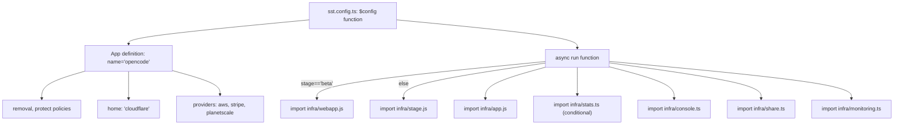
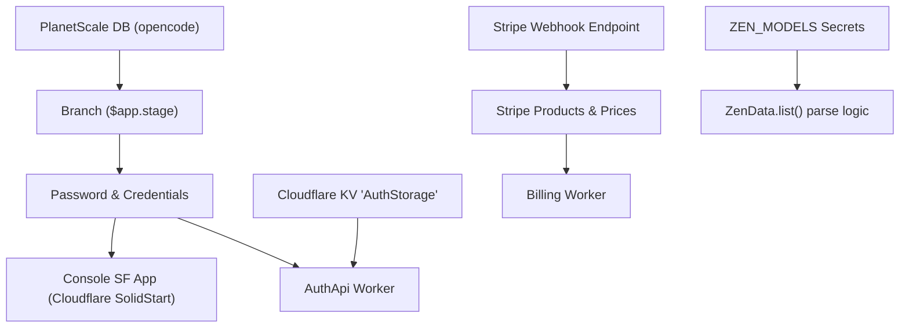
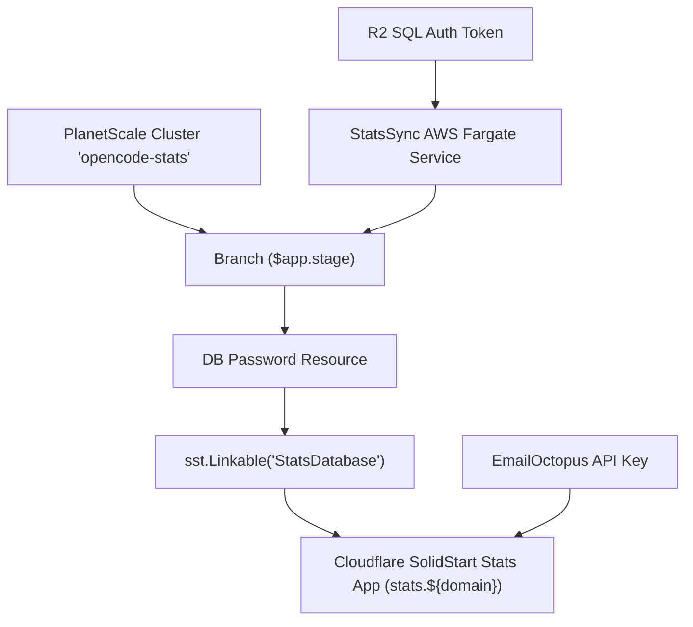
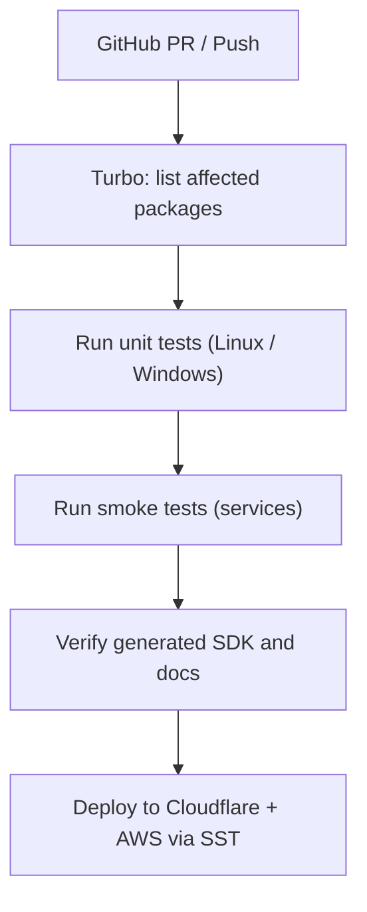
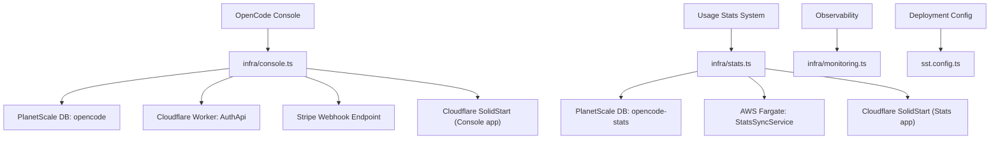
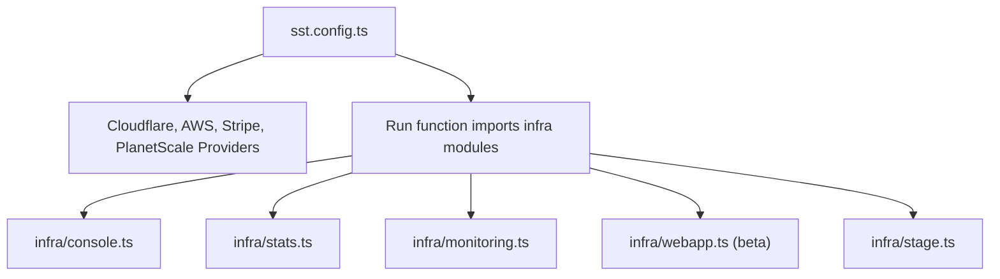

<!-- source: DeepWiki mcp.deepwiki.com · repo anomalyco/opencode · page 7.4 Infrastructure & Deployment (SST) · fetched 2026-10-27 -->

# Infrastructure & Deployment (SST)

Relevant source files

The following files were used as context for generating this wiki page:

- [.dockerignore](.dockerignore)
- [infra/console.ts](infra/console.ts)
- [infra/stage.ts](infra/stage.ts)
- [infra/stats.ts](infra/stats.ts)
- [packages/console/resource/sst-env.d.ts](packages/console/resource/sst-env.d.ts)
- [packages/function/sst-env.d.ts](packages/function/sst-env.d.ts)
- [packages/stats/core/src/database/schema.ts](packages/stats/core/src/database/schema.ts)
- [packages/stats/core/src/domain/catalog-identity.test.ts](packages/stats/core/src/domain/catalog-identity.test.ts)
- [packages/stats/core/src/domain/catalog-identity.ts](packages/stats/core/src/domain/catalog-identity.ts)
- [packages/stats/core/src/domain/geo.ts](packages/stats/core/src/domain/geo.ts)
- [packages/stats/core/src/domain/home.test.ts](packages/stats/core/src/domain/home.test.ts)
- [packages/stats/core/src/domain/home.ts](packages/stats/core/src/domain/home.ts)
- [packages/stats/core/src/domain/inference.test.ts](packages/stats/core/src/domain/inference.test.ts)
- [packages/stats/core/src/domain/inference.ts](packages/stats/core/src/domain/inference.ts)
- [packages/stats/core/src/domain/model-normalization.ts](packages/stats/core/src/domain/model-normalization.ts)
- [packages/stats/core/src/domain/model.ts](packages/stats/core/src/domain/model.ts)
- [packages/stats/core/src/domain/provider.ts](packages/stats/core/src/domain/provider.ts)
- [packages/stats/core/src/domain/stat.ts](packages/stats/core/src/domain/stat.ts)
- [packages/stats/core/src/honeycomb-backfill.ts](packages/stats/core/src/honeycomb-backfill.ts)
- [packages/stats/core/src/resource.d.ts](packages/stats/core/src/resource.d.ts)
- [packages/stats/core/src/stat-sync.ts](packages/stats/core/src/stat-sync.ts)
- [packages/stats/server/src/stat-sync.ts](packages/stats/server/src/stat-sync.ts)
- [sst-env.d.ts](sst-env.d.ts)
- [sst.config.ts](sst.config.ts)

This page documents the Serverless Stack (SST) infrastructure definitions, core configuration (`sst.config.ts`), Cloudflare Workers and services provisioning, as well as deployment workflows for OpenCode SaaS components: the Console, Stats system, WebApp, and stage environments.

## Overview & Scope

OpenCode's infrastructure is managed using SST with Cloudflare Workers as the home platform and AWS supporting backend services. Key responsibilities covered here include:

- SST application configuration and provider setup in `sst.config.ts`
- Core service deployments including:
  - Console web app and supporting API parts
  - Usage statistics database and sync services
  - Monitoring and observability pipelines
  - Production-like deployment stage configurations
- Cloudflare Workers configuration and linking secrets/storage resources
- Service implementations for code update, file management, and changelog syncing
- Deployment workflows ensuring build integrity and runtime health checks

This page explains the implementation details, data flows, and key classes/function roles involved in the infrastructure provisioning and deployment pipelines.

---

## Global SST Configuration (`sst.config.ts`)

The root SST configuration file `sst.config.ts` sets global application parameters, environment-specific settings, and cloud provider configurations.

### Implementation Details

- Defines the SST app named `"opencode"` with removal and protection policies dependent on the deployment stage:
  - `"retain"` resources on production stages
  - `"remove"` on other environments such as dev or beta
- Specifies `cloudflare` as the home provider for edge workers and frontend hosting
- Configures providers for AWS (with dynamic profile selection based on GitHub Actions environment and stage), Stripe for payments, and PlanetScale as the MySQL serverless database
- The `run` function dynamically imports infrastructure modules based on stage:
  - Beta stage triggers web app creation and returns URL
  - Other stages import `infra/stage.js`, `infra/app.js`, stats, console, share, and monitoring modules conditionally
- Returns deploy output properties such as deployed URLs and AWS stage names

Sources:  
[[sst.config.ts:1-48]]()

---

## Console Infrastructure (`infra/console.ts`)

This module provisions the core OpenCode Console SaaS infrastructure, including the frontend app, auth storage, API endpoints, and Stripe billing integrations.

### Key Component Breakdown

- **Domain and URLs**: Uses environment stage to set the domain for console and inference services, handling staging and production domains [[infra/console.ts:1-12]]().
  
- **Data Buckets**: Sets up Cloudflare R2 Buckets (`ZenData`, `ZenDataNew`) to archive Zen inference dumps (legacy data retention) [[infra/console.ts:18-21]]().

- **Secrets**: Declares AWS SES email keys, Salesforce CRM credentials, and a linkable URL resource for internal account API [[infra/console.ts:22-32]]().

- **Console frontend**:
  - Uses `sst.cloudflare.x.SolidStart` to deploy the Console frontend app hosted at `${domain}` [[infra/console.ts:34-73]]().
  - Binds all necessary secrets for SES, Salesforce, EmailOctopus, and internal URLs.
  - Configures server placement in AWS US-East-2 region with worker compatibility flags to enable strict global fetch [[infra/console.ts:54-72]]().
  
- **Internal Cloudflare Worker Services**:
  - Various workers handle authentication flows, OAuth, API endpoints, and Stripe webhooks. These are connected with the appropriate secrets and environment variables (defined but not expanded here).

- **Stripe Billing & Product Catalog**:
  - Defines Stripe webhook endpoints for event listening.
  - Registers products (`ZenLite`, `ZenBlack`) and their pricing plans.
  - Configures promotion coupons and discount codes
  - Integrates cost and rate-limit model secrets for Zen usage billing [[infra/console.ts:140-210]]() and model parsing in companion code [[packages/console/core/src/model.ts:86-116]]().

### Data Flow (Console Layer)

1. User accesses Console frontend hosted on Cloudflare via domain.
2. Authenticated user calls Backend Cloudflare Workers out to:
   - OAuth authentication using GitHub/Google secrets.
   - Billing and subscription management via Stripe webhook endpoints.
   - Internal API calls to Salesforce and Email services.
3. Backend persists metadata to PlanetScale database branch aligned with the deployment stage.
4. Data is archived to Cloudflare R2 storage buckets as applicable.
5. Console UI uses linked secrets and API URLs for configuration and data fetching.

Sources:  
[[infra/console.ts:1-211]](), [[packages/console/core/src/model.ts:86-116]]()

---

## Stats Infrastructure (`infra/stats.ts`)

The Stats infrastructure provisions a PlanetScale database cluster and branch, Cloudflare SolidStart app deployment, backend sync services, and secrets for R2 SQL data access.

### Key Components and Implementation

- **PlanetScale Setup**:
  - Defines a PlanetScale database cluster `opencode-stats` under `anomalyco` [[infra/stats.ts:13-51]]().
  - Branching depends on stage: production uses readonly `production`, others create a branch named for the stage.
  - A password resource is created for DB authentication.
  - A `sst.Linkable("StatsDatabase")` exposes connection details including a connection URL.
  
- **Stats Web App Deployment**:
  - Deploys a Cloudflare SolidStart app on a subdomain prefixed with `stats.` (e.g. `stats.opencode.ai`) [[infra/stats.ts:70-78]]().
  - Environmental variable `PUBLIC_URL` for data references is set using configured domains.
  - Links Secrets for EmailOctopus API keys.

- **Stats Sync Service**:
  - An AWS Fargate Service named `StatsSyncService` runs the sync worker that pulls data from R2 SQL.
  - Runs with arm64 architecture, minimal CPU and memory configured with burst capacity to avoid crashes.
  - Docker image specified with build context and command to execute the sync (`bun src/stat-sync.ts`).
  - Links Secrets and config including database, R2 SQL access, hidden models, dataset, and authentication token [[infra/stats.ts:95-126]]().

### Data Flow (Stats Layer)

1. The sync service queries Cloudflare R2 SQL dataset progress and downloads data.
2. Processed and normalized stats data is upserted to the PlanetScale `opencode-stats` database.
3. The SolidStart frontend queries this database to display usage and inference statistics.
4. Secret keys for EmailOctopus and R2 SQL enable API communication and data ingestion automation.

Sources:  
[[infra/stats.ts:1-127]]()

---

## Cloudflare Workers Functions & Services

OpenCode uses Cloudflare Workers to implement API functions and short-lived service endpoints.

### Summary of Services

- **Console Workers**:  
  Implemented under `infra/console.ts` deployment, manage auth flows, billing webhook endpoints, and model metadata APIs.

- **Update Service** (`services/update`):  
  A backend service that handles dynamic code or configuration updates across deployed services.

- **Files Service** (`services/files`):  
  Manages file storage, synchronization, and artifact delivery — using Cloudflare storage bindings for durable persistence.

- **Changelog Service** (`services/changelog`):  
  Generates and delivers changelog listings for release notes, accessible via the Console or website frontend.

These service implementations register Workers, bind secrets, leverage environment variables and may use R2 storage and API Routes as defined in SST infrastructure.

Sources: Referred generally as prevalent service concepts in the infra, no detailed file content shown.

---

## Deployment Workflow

### GitHub Actions Integration

- Runs on all pull requests and pushes.
- Uses Turborepo to detect affected packages (`bun x turbo ls --affected`) to optimize test scope [[.github/workflows/test.yml:41-53]]().
- Executes unit and integration tests across OS matrices including Linux and Windows.
- Builds and runs smoke tests for service packages to verify deployment readiness.
- Validates generated clients and documentation artifacts.

### Deployment Flow Diagram

Sources:  
[[.github/workflows/test.yml:1-172]]()

---

## Infrastructure Mapping: Natural Language to Code Entities

The following diagrams bridge user-facing service names and system components to code entities and file references for ease of developer discovery.

### OpenCode SaaS Services to SST Resource Code Entities

### SST Configuration and Deployment Flow

---

# Summary

This SST-based infrastructure creates a cohesive cloud-native stack deploying OpenCode's core SaaS components:

- Cloudflare Workers provide low-latency, globally distributed API and frontend hosting.
- PlanetScale serverless MySQL instances serve production-grade, scalable data storage across multiple services.
- AWS Fargate backs long-running sync tasks required for stats and billing pipelines.
- Comprehensive secret and configuration management integrates billing, auth, and marketing services.
- Deployments are coordinated via SST `sst.config.ts` and automated via CI workflows providing testing and smoke checks.

This architecture ensures OpenCode scales infrastructure and deployment seamlessly across environments from dev to production.

---

# References

- [sst.config.ts:1-48]()
- [infra/console.ts:1-73]()
- [infra/stats.ts:1-126]()
- [.github/workflows/test.yml:1-172]()
- [packages/console/core/src/model.ts:86-116]()

---

