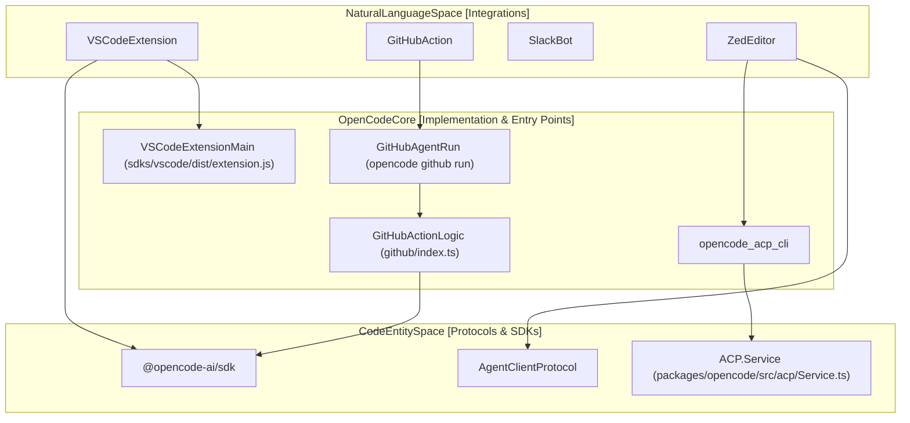
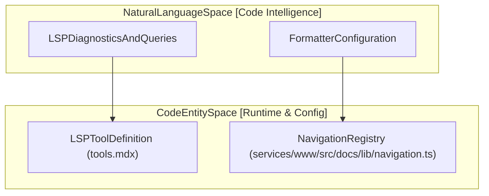

<!-- source: DeepWiki mcp.deepwiki.com · repo anomalyco/opencode · page 8 Documentation Sites & Integrations · fetched 2026-10-27 -->

# Documentation Sites & Integrations

Relevant source files

The following files were used as context for generating this wiki page:

- [github/README.md](github/README.md)
- [github/action.yml](github/action.yml)
- [github/index.ts](github/index.ts)
- [packages/console/app/.opencode/agent/css.md](packages/console/app/.opencode/agent/css.md)
- [packages/core/src/v1/config/permission.ts](packages/core/src/v1/config/permission.ts)
- [packages/web/src/content/docs/agents.mdx](packages/web/src/content/docs/agents.mdx)
- [packages/web/src/content/docs/cli.mdx](packages/web/src/content/docs/cli.mdx)
- [packages/web/src/content/docs/commands.mdx](packages/web/src/content/docs/commands.mdx)
- [packages/web/src/content/docs/config.mdx](packages/web/src/content/docs/config.mdx)
- [packages/web/src/content/docs/custom-tools.mdx](packages/web/src/content/docs/custom-tools.mdx)
- [packages/web/src/content/docs/github.mdx](packages/web/src/content/docs/github.mdx)
- [packages/web/src/content/docs/gitlab.mdx](packages/web/src/content/docs/gitlab.mdx)
- [packages/web/src/content/docs/keybinds.mdx](packages/web/src/content/docs/keybinds.mdx)
- [packages/web/src/content/docs/mcp-servers.mdx](packages/web/src/content/docs/mcp-servers.mdx)
- [packages/web/src/content/docs/permissions.mdx](packages/web/src/content/docs/permissions.mdx)
- [packages/web/src/content/docs/plugins.mdx](packages/web/src/content/docs/plugins.mdx)
- [packages/web/src/content/docs/rules.mdx](packages/web/src/content/docs/rules.mdx)
- [packages/web/src/content/docs/sdk.mdx](packages/web/src/content/docs/sdk.mdx)
- [packages/web/src/content/docs/server.mdx](packages/web/src/content/docs/server.mdx)
- [packages/web/src/content/docs/tools.mdx](packages/web/src/content/docs/tools.mdx)
- [packages/web/src/content/docs/tui.mdx](packages/web/src/content/docs/tui.mdx)

This page provides a high-level overview of OpenCode's documentation properties, publishing infrastructure, external editor and platform integrations, and language server protocol (LSP) / formatter configurations. These components extend OpenCode's reach into developer workflows, editorial documentation, and IDE ecosystems.

For detailed technical specifications, see the child pages:
- [Docs Content & Sites](#8.1)
- [Editor & Platform Integrations](#8.2)
- [LSP & Formatters](#8.3)

---

## 1. Documentation Content & Publishing Sites

OpenCode maintains comprehensive documentation and marketing properties across two main codebase components:

- **`packages/web`**: An Astro-based Starlight documentation and marketing site. It hosts the official docs, CLI, config, agents, guides, and blog posts. Content is organized with structured layouts and navigation trees.

- **`services/www`**: The next-generation documentation platform backed by a SolidJS/Go-powered system. It manages doc navigation, localized docs support, posts site, and serves the console frontend code.

Navigation trees are explicitly defined to group related docs sections such as Introduction, Configuration, CLI, Agents, Plugins, Tools, Permissions, and API references [services/www/src/docs/lib/navigation.ts:1-179]().

This dual approach segregates marketing-focused docs from dynamic platform-driven docs, enabling a flexible content delivery strategy.

For details, see [Docs Content & Sites](#8.1).

Sources: [services/www/src/docs/lib/navigation.ts:1-179]()

---

## 2. Editor & Platform Integrations

OpenCode integrates external editors, collaboration platforms, and automation pipelines with its core via the `@opencode-ai/sdk` JavaScript/TypeScript client and standardized protocols like the Agent Client Protocol (ACP).

Key supported integrations include:

- **Visual Studio Code Extension**: Implements VS Code APIs to connect with local or remote OpenCode servers enabling inline editing, completions, and session control [sdks/vscode/package.json:2-108]().
- **Zed Editor via ACP**: Uses the ACP JSON-RPC agent server to integrate tightly with Zed workflows, leveraging `packages/cli/src/acp/Service.ts` for session mapping and message translation [packages/opencode/src/acp/Service.ts:1-50]().
- **GitHub Actions Automation**: Provides a GitHub Action (`github/action.yml`) that runs OpenCode commands triggered by GitHub events like issue comments or PR reviews [github/action.yml:1-79]().
- **Slack and GitLab Bots**: Integrate chat platforms for conversational commands and notifications.
- **Enterprise Samples**: Includes Salesforce force-app SC setups and ecosystem listings.

### Integration Protocol Mapping

This mapping shows how user-facing editors and automation platforms are connected through SDKs and protocols into the core OpenCode runtime and services, demonstrating the layered architecture of integrations.

For details, see [Editor & Platform Integrations](#8.2).

Sources: [sdks/vscode/package.json:2-108](), [packages/opencode/src/acp/Service.ts:1-50](), [github/action.yml:1-79]()

---

## 3. LSP & Formatters

OpenCode supports integration with Language Server Protocol (LSP) servers to provide code intelligence directly in its editing tools and AI workflows. This enables features like go-to-definition, find references, hover tooltips, document symbols, and call hierarchies, powered by the experimental LSP tool available in configuration [packages/web/src/content/docs/tools.mdx:154-174](). 

Formatting configurations ensure that code generated or modified by AI models is consistent with project-specific style rules and formatting preferences.

### LSP and Formatter Architecture

This diagram illustrates how LSP queries and formatter settings in natural language workflows correspond to runtime LSP tool implementations and configuration management within the docs site navigation structure.

For details, see [LSP & Formatters](#8.3).

Sources: [packages/web/src/content/docs/tools.mdx:154-174](), [services/www/src/docs/lib/navigation.ts:46]()

---

This concludes the high-level overview of OpenCode’s documentation sites and integrations. For implementation details and configuration guidance, please refer to the child pages as indicated.

---

