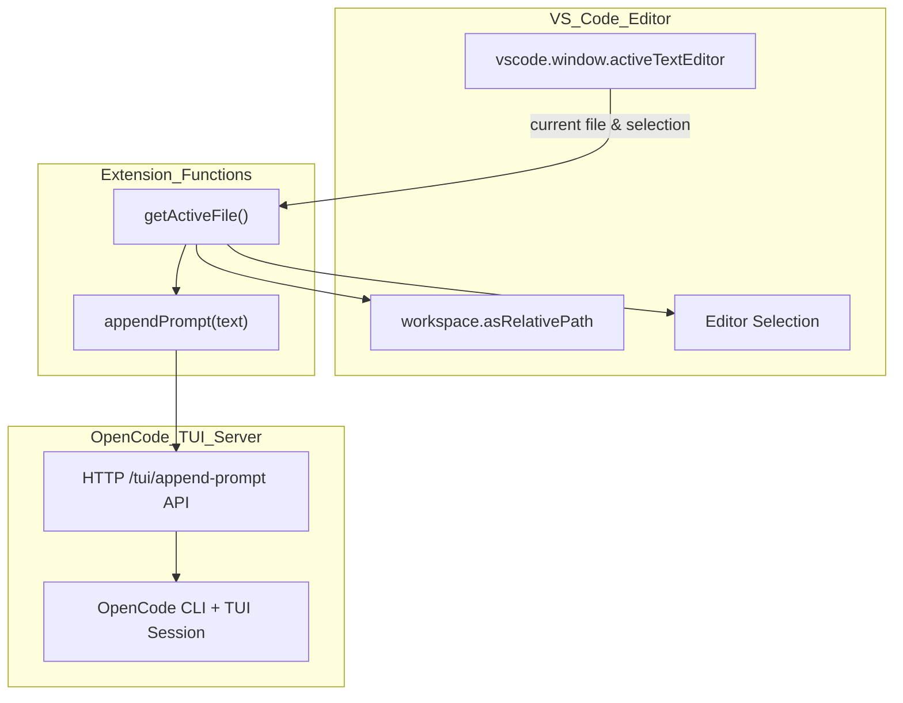
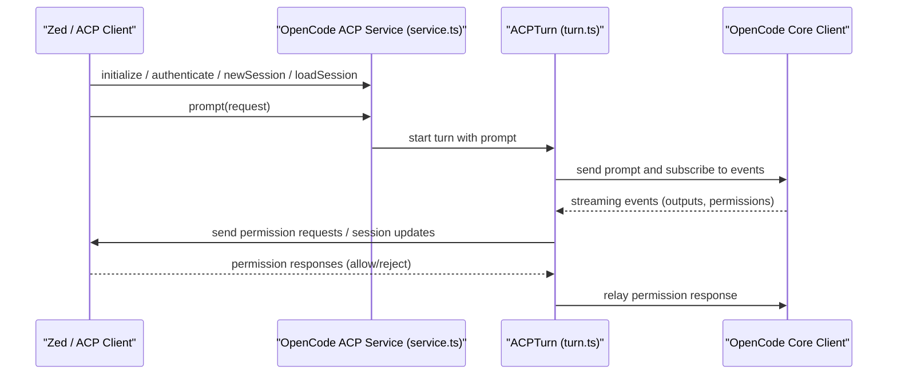
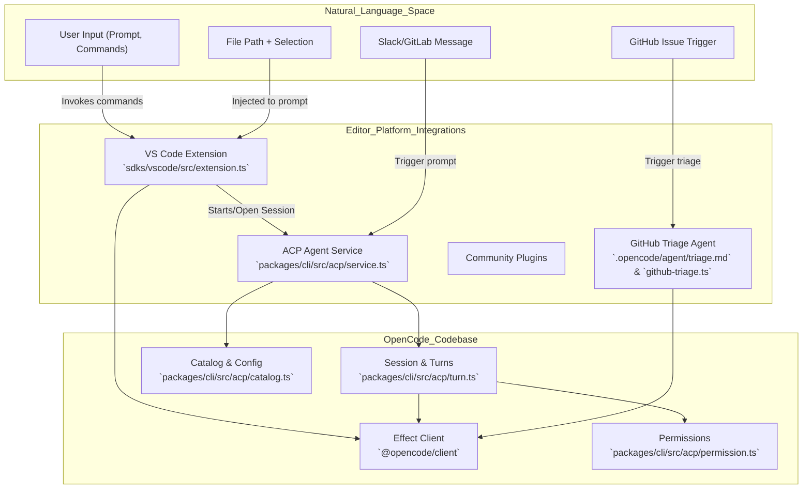

<!-- source: DeepWiki mcp.deepwiki.com · repo anomalyco/opencode · page 8.2 Editor & Platform Integrations · fetched 2026-10-27 -->

# Editor & Platform Integrations

Relevant source files

The following files were used as context for generating this wiki page:

- [bun.lock](bun.lock)
- [package.json](package.json)
- [packages/app/package.json](packages/app/package.json)
- [packages/cli/src/acp/agent.ts](packages/cli/src/acp/agent.ts)
- [packages/cli/src/acp/catalog.ts](packages/cli/src/acp/catalog.ts)
- [packages/cli/src/acp/config-option.ts](packages/cli/src/acp/config-option.ts)
- [packages/cli/src/acp/connection.ts](packages/cli/src/acp/connection.ts)
- [packages/cli/src/acp/content.ts](packages/cli/src/acp/content.ts)
- [packages/cli/src/acp/elicitation.ts](packages/cli/src/acp/elicitation.ts)
- [packages/cli/src/acp/error.ts](packages/cli/src/acp/error.ts)
- [packages/cli/src/acp/permission.ts](packages/cli/src/acp/permission.ts)
- [packages/cli/src/acp/replay.ts](packages/cli/src/acp/replay.ts)
- [packages/cli/src/acp/service.ts](packages/cli/src/acp/service.ts)
- [packages/cli/src/acp/sessions.ts](packages/cli/src/acp/sessions.ts)
- [packages/cli/src/acp/tool.ts](packages/cli/src/acp/tool.ts)
- [packages/cli/src/acp/translate.ts](packages/cli/src/acp/translate.ts)
- [packages/cli/src/acp/turn.ts](packages/cli/src/acp/turn.ts)
- [packages/cli/test/acp/additional-directories.test.ts](packages/cli/test/acp/additional-directories.test.ts)
- [packages/cli/test/acp/catalog.test.ts](packages/cli/test/acp/catalog.test.ts)
- [packages/cli/test/acp/compaction.test.ts](packages/cli/test/acp/compaction.test.ts)
- [packages/cli/test/acp/elicitation.test.ts](packages/cli/test/acp/elicitation.test.ts)
- [packages/cli/test/acp/error.test.ts](packages/cli/test/acp/error.test.ts)
- [packages/cli/test/acp/permission.test.ts](packages/cli/test/acp/permission.test.ts)
- [packages/cli/test/acp/prompt-content.subprocess.test.ts](packages/cli/test/acp/prompt-content.subprocess.test.ts)
- [packages/cli/test/acp/prompt.test.ts](packages/cli/test/acp/prompt.test.ts)
- [packages/cli/test/acp/replay.test.ts](packages/cli/test/acp/replay.test.ts)
- [packages/cli/test/acp/session.test.ts](packages/cli/test/acp/session.test.ts)
- [packages/cli/test/acp/subprocess.ts](packages/cli/test/acp/subprocess.ts)
- [packages/cli/test/acp/translate.test.ts](packages/cli/test/acp/translate.test.ts)
- [packages/cli/test/acp/turn.test.ts](packages/cli/test/acp/turn.test.ts)
- [packages/cli/test/acp/wire-fixture.ts](packages/cli/test/acp/wire-fixture.ts)
- [packages/console/app/package.json](packages/console/app/package.json)
- [packages/desktop/package.json](packages/desktop/package.json)
- [packages/function/package.json](packages/function/package.json)
- [packages/plugin/package.json](packages/plugin/package.json)
- [packages/ui/package.json](packages/ui/package.json)
- [packages/web/package.json](packages/web/package.json)
- [packages/web/src/content/docs/ecosystem.mdx](packages/web/src/content/docs/ecosystem.mdx)
- [sdks/vscode/package.json](sdks/vscode/package.json)

This page documents OpenCode's external editor extensions, including the VS Code extension, the Agent Client Protocol (ACP) integration leveraged by editors like Zed, plus platform automation such as GitHub Actions, Slack/GitLab integrations, a Salesforce sample app, and the broader OpenCode ecosystem projects.

---

## 1. VS Code Extension (`sdks/vscode`)

The VS Code Extension integrates OpenCode's AI coding agent into the Visual Studio Code environment, enabling users to interact with OpenCode through commands, keybindings, and menus. It primarily manages terminal sessions running the OpenCode CLI and communicates with the OpenCode TUI server to control/apply prompts and session context.

### Architecture and Implementation

- **Command Registration & Activation**: The extension entrypoint `activate` registers commands such as `openTerminal`, `openNewTerminal`, and `addFilepathToTerminal` for UI and keybinding triggers [sdks/vscode/src/extension.ts:8-43]().

- **Terminal Management**: The `openTerminal` command creates or focuses an integrated terminal running the OpenCode CLI, spawning it with environment variables configured to communicate with a randomized HTTP server port [sdks/vscode/src/extension.ts:45-91]().

- **Prompt Injection**: The function `appendPrompt` injects text into the running OpenCode TUI prompt input via an authenticated POST request to the `/tui/append-prompt` endpoint on the TUI's HTTP server [sdks/vscode/src/extension.ts:93-98]().

- **Active File Context Extraction**: Utility `getActiveFile` extracts the current editor's active file path relative to the workspace root, including selection ranges resolved to line numbers. This contextual info can then be injected into prompts [sdks/vscode/src/extension.ts:98]().

### Key Commands & Keybindings

The extension declares commands in `package.json`:

| Command                  | Description                                | Default Keybinding             |
|--------------------------|--------------------------------------------|-------------------------------|
| `opencode.openTerminal`  | Opens or focuses an existing OpenCode terminal | `Cmd+Escape` (macOS), `Ctrl+Escape` (Win/Linux) |
| `opencode.openNewTerminal` | Opens a new OpenCode terminal session         | `Cmd+Shift+Escape` (macOS), `Ctrl+Shift+Escape` (Win/Linux) |
| `opencode.addFilepathToTerminal` | Appends active file path and selection as prompt input | `Cmd+Alt+K` (macOS), `Ctrl+Alt+K` (Win/Linux) |

### Data Flow: VS Code Editor to OpenCode TUI Prompt Injection

*Diagram: How VS Code editor context is extracted and injected into OpenCode TUI*

Sources: [sdks/vscode/src/extension.ts:8-43](), [sdks/vscode/src/extension.ts:45-98](), [sdks/vscode/src/extension.ts:98](), [sdks/vscode/package.json:26-81]()

---

## 2. Zed & ACP (Agent Client Protocol) Integration (`packages/cli/src/acp`)

OpenCode implements the **Agent Client Protocol (ACP)**, a JSON-RPC-based agent server protocol. This enables editors like Zed to communicate seamlessly with OpenCode to create, load, and interact with AI coding sessions following the ACP specification.

### ACP Service Core Components

- **ACP Service Interface**: Defined in `service.ts`, this exposes ACP JSON-RPC methods such as `initialize`, `authenticate`, `newSession`, `loadSession`, `listSessions`, `deleteSession`, `resumeSession`, `closeSession`, `forkSession`, and `prompt`. Each method responds with either success data or typed `ACPError` failures [packages/cli/src/acp/service.ts:50-66]().

- **Session Management**: Sessions are securely created, loaded, and managed through connections that track working directories and additional session directories. The service validates session directory consistency and loads the OpenCode catalog for context [packages/cli/src/acp/service.ts:68-149]().

- **Turn Handling**: The `turn.ts` module manages the lifecycle of "turns" — discrete units of interaction such as prompts and responses. It subscribes to OpenCode client streams and relays session events, including permission requests and tool outputs, back to the ACP client. It also manages interruptions and cancellation signals [packages/cli/src/acp/turn.ts:32-37]().

- **Permission Workflow**: `permission.ts` intercepts tool execution attempts that require user authorization (e.g., file write access). Permission requests are sent to the ACP client, which can approve or reject them through structured JSON-RPC calls, and then the permission response is relayed back to the core OpenCode runtime [packages/cli/src/acp/permission.ts:47-74]().

- **Catalog & Configuration**: The ACP service queries and reloads project-specific configuration options, allowing dynamic session parameter adjustments on the fly [packages/cli/src/acp/catalog.ts](), [packages/cli/src/acp/service.ts:76-100]().

### ACP Communication Flow

*Diagram: ACP prompt lifecycle and permission request flow*

Sources: [packages/cli/src/acp/service.ts:50-149](), [packages/cli/src/acp/turn.ts:32-37](), [packages/cli/src/acp/permission.ts:47-74](), [packages/cli/src/acp/agent.ts:26-130]()

---

## 3. GitHub Action & Repository Automation

OpenCode provides GitHub automation tools implementing agent-driven triage, workflows, and repository management helpers. This platform automation is defined primarily under `.opencode/` and in script packages.

### Triage Agent and GitHub Triage Tool

- **Triage Agent**: A hidden agent defined in `.opencode/agent/triage.md` uses OpenCode GPT mini model to triage new GitHub issues by assigning them to teams: `tui`, `desktop_web`, `core`, `inference`, and `windows`. It does not modify labels during triage [/.opencode/agent/triage.md:1-43]().

- **Custom Tool (`github-triage.ts`)**: Custom Bun script that picks random assignees from team rosters defined in `.github/TEAM_MEMBERS`. It queries GitHub API to assign issues and posts comments on assignment events [/.opencode/tool/github-triage.ts:1-60]().

- **Team Roster**: The `.github/TEAM_MEMBERS` file enumerates contributors by team, facilitating random assignee selection during triage [/.github/TEAM_MEMBERS:1-22]().

- **Release & Automation Scripts**: The `packages/script` contains reusable Bun-based helper scripts managing release publishing, version validation, and semantic flags [packages/script/src/index.ts:1-90]().

Sources: [.opencode/agent/triage.md:1-43](), [.opencode/tool/github-triage.ts:1-60](), [.github/TEAM_MEMBERS:1-22](), [packages/script/src/index.ts:1-90]()

---

## 4. Slack and GitLab Integrations

While explicit detailed code files for Slack and GitLab integrations are not shown in this snapshot, OpenCode leverages its plugin system and external webhook routing to integrate with common collaboration platforms like Slack and GitLab. These allow triggering sessions based on chat commands, issuing automated code reviews and triages, and receiving notifications from CI/CD pipelines.

---

## 5. Salesforce Force-App Sample

OpenCode provides a sample Salesforce `force-app` in the `salesforce/` directory (not detailed here) designed to demonstrate integration with the Salesforce development ecosystem. The sample includes AI-empowered automation and CLI interoperability, enabling users to embed AI assistant workflows into Salesforce development pipelines for enhanced productivity.

---

## 6. Ecosystem Listing (`packages/web/src/content/docs/ecosystem.mdx`)

OpenCode curates and showcases a broad ecosystem of community-driven plugins, agents, and integrations to extend OpenCode capabilities:

| Plugin Name                         | Description                                                                                         |
|-----------------------------------|-------------------------------------------------------------------------------------------------|
| opencode-daytona                  | Runs OpenCode in isolated Daytona sandboxes with live previews and git sync                        |
| opencode-helicone-session        | Automatically injects Helicone session headers for grouping LLM requests                           |
| opencode-type-inject             | Injects TypeScript/Svelte types into file read operations                                         |
| opencode-openai-codex-auth       | Uses ChatGPT Plus/Pro subscription in place of API credits                                        |
| opencode-pty                     | Allows AI agents to run interactive background processes and PTYs                                 |
| opencode-wakatime                | Tracks OpenCode usage statistics with Wakatime                                                    |
| opencode-notificator             | Desktop notifications and sound alerts for events                                                |
| opencode-skillful                | Enables lazy prompt loading with skill discovery                                                 |
| @plannotator/opencode            | Interactive plan review with visual annotations                                                   |
| opencode-scheduler                | Schedules recurring jobs with systemd/launchd cron syntax                                       |
| ...                             | ...                                                                                             |

Additional projects are continuously added via community contributions. See `packages/web/src/content/docs/ecosystem.mdx` for the full, up-to-date list.

Sources: [packages/web/src/content/docs/ecosystem.mdx:1-47]()

---

# Mermaid Diagram Mapping Natural Language to Code Entity Space

This diagram bridges the editor/platform ecosystem with the corresponding OpenCode code entities involved in integrating natural language inputs (prompts, commands) into structured AI agent session interactions.

*Diagram: Overview linking user natural language interactions through editor/platform integrations into OpenCode internal code entities*

---

# Summary

OpenCode supports tight integration with popular editors such as VS Code via a native extension, and standardizes interactions with editors like Zed though the Agent Client Protocol (ACP). Automation scripts and triage workflows empower GitHub repository management. The ecosystem includes Slack/GitLab integrations and Salesforce sample projects to extend OpenCode assistance broadly across developer workflows.

This integration layer is a critical component connecting the natural-language AI sessions driven by users into concrete code actions inside sessions, enriching the developer experience with structured AI-assisted workflows.

---

# Sources

- [sdks/vscode/src/extension.ts:8-98]()
- [sdks/vscode/package.json:26-81]()
- [packages/cli/src/acp/service.ts:50-149]()
- [packages/cli/src/acp/turn.ts:32-37]()
- [packages/cli/src/acp/permission.ts:47-74]()
- [packages/cli/src/acp/agent.ts:26-130]()
- [.opencode/agent/triage.md:1-43]()
- [.opencode/tool/github-triage.ts:1-60]()
- [.github/TEAM_MEMBERS:1-22]()
- [packages/script/src/index.ts:1-90]()
- [packages/web/src/content/docs/ecosystem.mdx:1-47]()

---

