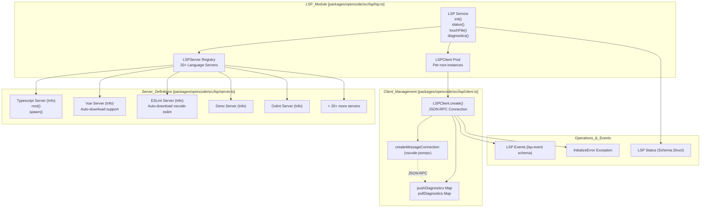
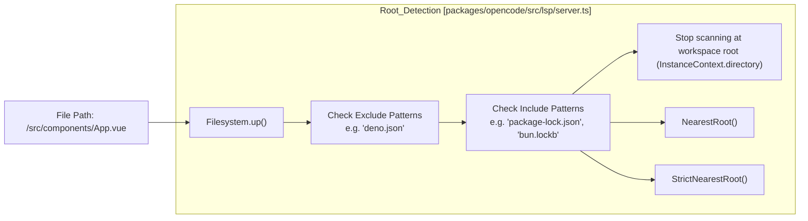
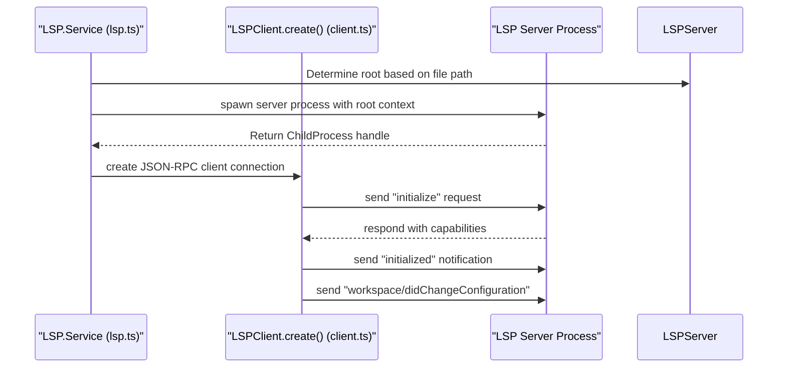
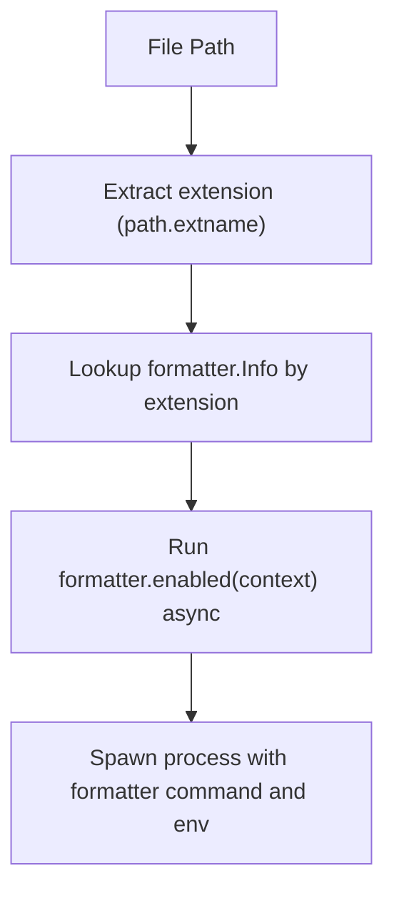
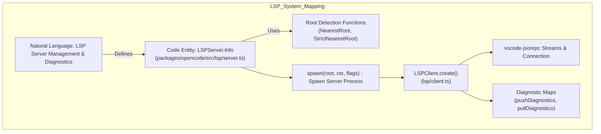
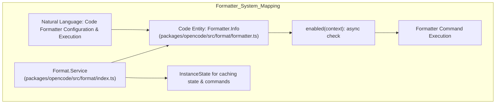

<!-- source: DeepWiki mcp.deepwiki.com · repo anomalyco/opencode · page 8.3 LSP & Formatters · fetched 2026-10-27 -->

# LSP & Formatters

<details>
<summary>Relevant source files</summary>

The following files were used as context for generating this wiki page:

- [packages/web/src/content/docs/ar/lsp.mdx](packages/web/src/content/docs/ar/lsp.mdx)
- [packages/web/src/content/docs/bs/lsp.mdx](packages/web/src/content/docs/bs/lsp.mdx)
- [packages/web/src/content/docs/da/lsp.mdx](packages/web/src/content/docs/da/lsp.mdx)
- [packages/web/src/content/docs/de/lsp.mdx](packages/web/src/content/docs/de/lsp.mdx)
- [packages/web/src/content/docs/es/lsp.mdx](packages/web/src/content/docs/es/lsp.mdx)
- [packages/web/src/content/docs/formatters.mdx](packages/web/src/content/docs/formatters.mdx)
- [packages/web/src/content/docs/fr/lsp.mdx](packages/web/src/content/docs/fr/lsp.mdx)
- [packages/web/src/content/docs/it/lsp.mdx](packages/web/src/content/docs/it/lsp.mdx)
- [packages/web/src/content/docs/ja/lsp.mdx](packages/web/src/content/docs/ja/lsp.mdx)
- [packages/web/src/content/docs/ko/lsp.mdx](packages/web/src/content/docs/ko/lsp.mdx)
- [packages/web/src/content/docs/lsp.mdx](packages/web/src/content/docs/lsp.mdx)
- [packages/web/src/content/docs/nb/lsp.mdx](packages/web/src/content/docs/nb/lsp.mdx)
- [packages/web/src/content/docs/pl/lsp.mdx](packages/web/src/content/docs/pl/lsp.mdx)
- [packages/web/src/content/docs/ru/lsp.mdx](packages/web/src/content/docs/ru/lsp.mdx)

</details>


This page covers OpenCode's Language Server Protocol (LSP) integration and automatic code formatting system. LSP provides code intelligence features such as diagnostics, hover information, and go-to-definition, serving as critical feedback to the AI agent. The formatter system automatically applies language-specific formatting to files after edits, ensuring consistency with project style conventions.

---

## LSP Architecture

OpenCode manages multiple LSP servers per project, automatically spawning and configuring them based on file extensions and project detection logic. The system architecture includes the server definitions, client handling, and communication protocols.



**Description:**

- **LSP Service (`packages/opencode/src/lsp/lsp.ts`)**: Core service managing LSP servers and active client connections per workspace root.
- **Server Definitions (`packages/opencode/src/lsp/server.ts`)**: Declarative info for supported language servers, including file extensions, root detection logic, and spawn process.
- **Client Management (`packages/opencode/src/lsp/client.ts`)**: Manages the JSON-RPC connection with LSP servers using `vscode-jsonrpc`, handling requests, notifications, and diagnostics caching.
- **Operations & Events**: Defines LSP events and status updates, and handles initialization errors.

Sources: [packages/opencode/src/lsp/lsp.ts:138-206](), [packages/opencode/src/lsp/server.ts:80-86](), [packages/opencode/src/lsp/client.ts:29-32](), [packages/opencode/src/lsp/lsp.ts:119-134]()

---

## LSP Server Definitions

LSP servers are defined by an `Info` interface which includes:

- `id`: unique server ID
- `extensions`: file extensions the server handles
- `root(file, ctx)`: function detecting the project root directory given a filepath and context
- `spawn(root, ctx, flags)`: function to launch the language server process with appropriate args

### Root Detection

Root detection establishes the workspace root directory for the LSP server by walking the directory tree upwards looking for marker files. The system uses two key root-detection helpers:

- **NearestRoot**: Returns the nearest directory upward that contains marker files such as `package-lock.json`, `bun.lockb`, etc., ignoring excluded directories or files.
- **StrictNearestRoot**: Similar but returns `undefined` if no marker file found.

They rely on `Filesystem.up()` which is a generator that traverses upward from the current directory, emitting matches until the workspace root boundary (`InstanceContext.directory`).



Examples:

- Typescript LSP root detects standard package manager lock files excluding Deno config.
- Vue LSP root looks for `package-lock.json`, `yarn.lock`, or `pnpm-lock.yaml`.
- Deno LSP root searches for `deno.json` or `deno.jsonc`.

Sources: [packages/opencode/src/lsp/server.ts:32-54]()

### Auto-Download and Installation Logic

Several LSP servers support automatic downloading and installation when the user does not have them locally:

- **ESLint LSP**: Checks if ESLint is listed in project dependencies and the official VSCode ESLint server is missing. If so, downloads the server archive from GitHub, extracts, runs `npm install` and compiles the server before spawning the Node process.
- **Vue LSP**: Checks for globally installed `vue-language-server`. If absent and downloads are enabled, resolves and downloads the `@vue/language-server` package via NPM, and spawns it.

All downloads respect the `disableLspDownload` feature flag which can be set via environment variable `OPENCODE_DISABLE_LSP_DOWNLOAD`.

Sources: [packages/opencode/src/lsp/server.ts:149-170](), [packages/opencode/src/lsp/server.ts:173-207]()

---

## LSP Client Communication

The client manages a JSON-RPC connection with the spawned LSP process to interact with it according to the Language Server Protocol.

### Client Initialization Lifecycle



- Clients are instantiated per workspace root.
- Initialization includes capability exchange and configuration synchronization.

Sources: [packages/opencode/src/lsp/client.ts:123-207](), [packages/opencode/src/lsp/lsp.ts:208-240](), [packages/opencode/src/lsp/server.ts:25-28]()

### Diagnostics Handling

Diagnostics are key feedback items for the AI agent. LSP servers send diagnostics via:

- `textDocument/publishDiagnostics` notifications (pushed diagnostics)
- On-demand `textDocument/diagnostic` requests (pulled diagnostics)

OpenCode maintains two diagnostic maps:

- `pushDiagnostics`: diagnostics sent proactively by the server
- `pullDiagnostics`: diagnostics obtained by explicit query requests

Before diagnostics are emitted to listeners, diagnostics are merged and deduplicated based on code, severity, message, source, and range.

Listeners (subscribers) such as the session or agent receive diagnostics to inform error detection and correction workflows.

Sources: [packages/opencode/src/lsp/client.ts:160-172](), [packages/opencode/src/lsp/client.ts:147-150](), [packages/opencode/src/lsp/client.ts:91-105]()

---

## Code Formatting System

OpenCode supports automatic code formatting by invoking language-specific formatters on files after writes or edits.

### Formatter Registry

Formatters implement the `Formatter.Info` interface with:

- `name`: unique formatter name, e.g., `"prettier"`.
- `environment?`: optional environment variables for execution.
- `extensions`: handled file extensions.
- `enabled(context): Promise<string[] | false>`: async predicate returning the command to invoke the formatter or `false` to disable.

The `Context` includes the current working directory, worktree root, and feature flags.

Sources: [packages/opencode/src/format/formatter.ts:1-108]()

### Commonly Built-in Formatters

| Formatter    | Extensions (examples)                                                         | Requirements / Activation                                                        | Invocation Example                         |
|--------------|-------------------------------------------------------------------------------|---------------------------------------------------------------------------------|--------------------------------------------|
| prettier     | `.js, .jsx, .ts, .tsx, .html, .css, .json, .yaml, .md, .graphql`             | Projects with `prettier` package.json dependency                                | `prettier --write $FILE`                    |
| biome        | `.js, .jsx, .ts, .tsx, .html, .css, .json, .md, .yaml`                       | Presence of `biome.json` or `biome.jsonc` config                                | `biome format --write $FILE`                |
| ruff         | `.py, .pyi`                                                                   | `ruff` binary found, recognized config files                                   | `ruff format $FILE`                         |
| gofmt        | `.go`                                                                         | `gofmt` binary available                                                       | `gofmt -w $FILE`                           |
| zig          | `.zig, .zon`                                                                  | `zig` binary found                                                             | `zig fmt $FILE`                            |
| uv (uvformat)| `.py, .pyi`                                                                   | `uv` binary found and `ruff` disabled                                         | `uv format -- $FILE`                        |
| mix          | `.ex, .exs, .heex`                                                            | `mix` binary found                                                             | `mix format $FILE`                          |
| clang-format | `.c, .cpp, .h, .hpp, .ino`                                                    | Presence of `.clang-format` config                                             | `clang-format -i $FILE`                     |
| ktlint       | `.kt, .kts`                                                                   | `ktlint` binary found                                                          | `ktlint -F $FILE`                           |
| air (rlang)  | `.R`                                                                          | `air` binary found and help output verified                                   | `air format $FILE`                          |

The `enabled` method dynamically checks environment or project settings to determine formatter availability at runtime.

Sources: [packages/opencode/src/format/formatter.ts:18-247]()

### Formatter Execution Flow

When a file is written or edited, OpenCode runs this process:

1. Extract the file's extension.
2. Match formatters that support this extension and are enabled.
3. Run the formatters asynchronously using the configured command, passing the file path.



The invocation is non-blocking and occurs in the background, keeping the user experience responsive. The formatter registry and execution pipeline are implemented primarily in `packages/opencode/src/format/index.ts`.

Sources: [packages/opencode/src/format/index.ts:57-116]()

---

## Configuration

Both LSP servers and formatters are configurable in the main `opencode.json` configuration file.

### LSP Configuration

- Set `"lsp": true` to enable all built-in LSP servers.
- Use the `lsp` object to configure individual servers with properties:
  - `disabled`: disable a server
  - `command`: override launch command
  - `extensions`: override handled extensions
  - `env`: specify environment variables
  - `initialization`: send LSP initialize options

Example disabling ESLint and customizing Rust:

```json
{
  "lsp": {
    "rust": {
      "command": ["rust-analyzer"],
      "env": { "RUST_LOG": "debug" }
    },
    "eslint": { "disabled": true }
  }
}
```

Sources: [packages/web/src/content/docs/lsp.mdx:78-96](), [packages/opencode/src/lsp/lsp.ts:161-182]()

### Formatter Configuration

Formatters can be enabled or disabled and customized per formatter:

```json
{
  "formatter": {
    "prettier": {
      "command": ["prettier", "--write", "--config", ".prettierrc.json", "$FILE"]
    },
    "gofmt": {
      "disabled": true
    }
  }
}
```

Sources: [packages/web/src/content/docs/formatters.mdx:60-70](), [packages/opencode/src/format/index.ts:134-158]()

### Feature Flags

- `disableLspDownload`: disables automatic LSP server downloads (environment variable: `OPENCODE_DISABLE_LSP_DOWNLOAD`)
- `experimentalOxfmt`: enables experimental `oxfmt` formatter for JavaScript/TypeScript
- `experimentalLspTy`: switches Python LSP from `pyright` to experimental `ty` server

Sources: [packages/opencode/src/format/formatter.ts:93-94](), [packages/opencode/src/lsp/server.ts:152](), [packages/opencode/src/lsp/lsp.ts:98-108]()

---

## Performance & Stability Considerations

- **Diagnostics Debounce:** Diagnostic updates are debounced (approx. 150ms) to reduce UI flicker and avoid excessive updates.
- **Initialization Timeout:** LSP clients time out the `initialize` request after 45s to avoid hanging on unresponsive servers.
- **Diagnostic Request Timeouts:** Document and workspace diagnostic request timeouts are 5s and 10s, respectively, balancing responsiveness and completeness.

Sources: [packages/opencode/src/lsp/client.ts:13-18]()

---

## Architecture & Code Entity Mapping

### LSP System Mapping



Sources: [packages/opencode/src/lsp/lsp.ts:138-206](), [packages/opencode/src/lsp/server.ts:80-86](), [packages/opencode/src/lsp/client.ts:29-32]()

### Formatter System Mapping



Sources: [packages/opencode/src/format/formatter.ts:1-108](), [packages/opencode/src/format/index.ts:30-130]()

---

This completes the LSP and Formatter technical documentation. For detailed usage, configuration examples, and troubleshooting, see the relevant docs pages on the OpenCode docs site.

---

