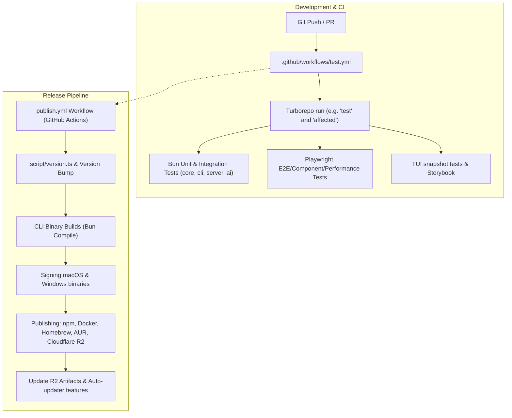
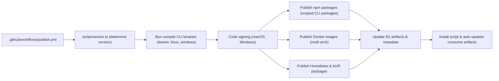

<!-- source: DeepWiki mcp.deepwiki.com · repo anomalyco/opencode · page 9 Build, Release & Quality · fetched 2026-10-27 -->

# Build, Release & Quality

Relevant source files

The following files were used as context for generating this wiki page:

- [.github/actions/setup-bun/action.yml](.github/actions/setup-bun/action.yml)
- [.github/workflows/publish.yml](.github/workflows/publish.yml)
- [.gitignore](.gitignore)
- [.opencode/command/changelog.md](.opencode/command/changelog.md)
- [CHANGELOG.md](CHANGELOG.md)
- [install](install)
- [packages/cli/Dockerfile](packages/cli/Dockerfile)
- [packages/cli/bin/opencode2.cjs](packages/cli/bin/opencode2.cjs)
- [packages/cli/script/postinstall.mjs](packages/cli/script/postinstall.mjs)
- [packages/cli/script/publish-aur.ts](packages/cli/script/publish-aur.ts)
- [packages/cli/script/publish.ts](packages/cli/script/publish.ts)
- [packages/cli/src/heap.ts](packages/cli/src/heap.ts)
- [packages/plugin/script/publish.ts](packages/plugin/script/publish.ts)
- [script/changelog.ts](script/changelog.ts)
- [script/profile-typecheck-packages.ts](script/profile-typecheck-packages.ts)
- [script/profile-typecheck.ts](script/profile-typecheck.ts)
- [script/publish.ts](script/publish.ts)
- [script/raw-changelog.ts](script/raw-changelog.ts)
- [script/update-artifact.ts](script/update-artifact.ts)
- [script/version.ts](script/version.ts)

This page provides a high-level overview of OpenCode's build tooling, release pipeline, and testing infrastructure. OpenCode features a robust multi-platform build system, CI/CD pipelines orchestrated via GitHub Actions and Turborepo, and a multi-channel distribution strategy that publishes standalone binaries, desktop apps, and packages across 8+ distribution vectors.

For deep technical details, see the child pages:
- [Release Pipeline & Distribution](#9.1) — publish.yml workflow, version/changelog scripts, multi-platform binary builds and signing, update artifacts on R2, npm/Docker/Homebrew/AUR publishing, install script, auto-updater.
- [Nix Builds](#9.2) — flake.nix outputs, node_modules fixed-output derivation and nix/hashes.json, opencode/desktop/electron derivations, nix-eval and nix-hashes workflows.
- [Testing & QA Infrastructure](#9.3) — Turbo pipelines and test.yml, bun test suites in core/cli/server/ai, http-recorder cassettes and recorded tests, Playwright e2e/component/performance suites, TUI snapshot tests, Storybook, mock server, packages/simulation harness.

---

## Overview of Build and Quality Infrastructure

The OpenCode monorepo relies on **Bun workspaces** combined with **Turborepo** to orchestrate builds, tests, and caching for its large set of interdependent packages [[turbo.json:1-94]](). This setup allows incremental builds and parallelism to optimize CI runs.

Continuous Integration (CI) is implemented with GitHub Actions workflows that validate every pull request and push event with a comprehensive suite of automated tests. These include:
- Unit and integration tests implemented with `bun test` across packages such as `core`, `cli`, `server`, and `ai`.
- End-to-end browser tests using Playwright to verify the UI and performance characteristics.
- Snapshot testing for TUI components and Storybook stories.
- HTTP recorder cassettes enabling deterministic integration test playback.

The CI workflow for tests is defined in `.github/workflows/test.yml` orchestrating execution and caching [[.github/workflows/test.yml:1-192]]().

---

## Release Pipeline and Distribution

OpenCode's release process is governed by the `.github/workflows/publish.yml` GitHub Actions workflow. It is triggered by push events to key branches (`ci`, `dev`, `beta`) or manually through workflow dispatch with version bump inputs [[.github/workflows/publish.yml:1-195]]().

Key stages of this pipeline include:
- **Version bump determination and tagging** via `script/version.ts`, which outputs the new semantic version and Git tags [[script/version.ts:1-17]]().
- **Multi-platform CLI binary building** using Bun's compile features, producing binaries for macOS, Linux, and Windows [[.github/workflows/publish.yml:70-135]]().
- **Code signing** particularly for macOS binaries via secure code-sign certificates in GitHub secrets [[.github/workflows/publish.yml:138-190]]().
- **Publishing to various package managers and artifact stores**, including:
  - npm packages distributed via scoped packages with postinstall scripts for binary resolution and installation [[packages/cli/script/publish.ts:1-174]]().
  - Docker multi-architecture images pushed to GitHub Container Registry [[packages/cli/script/publish.ts:146-148]]().
  - Homebrew taps and Arch User Repository (AUR) packages prepared and published with scripts [[packages/cli/script/publish.ts:149-156]](), [[packages/cli/script/publish-aur.ts:1-100]]().
  - Cloudflare R2 (via `UpdateArtifact` APIs) stores release binaries and update metadata for the auto-updater [[packages/cli/script/publish.ts:91-123]]().

The OpenCode **install script** complements this by providing users with a simple shell script that detects the platform/architecture, resolves the correct release version, downloads the appropriate binary, and installs it into the user's home directory. It handles intricate platform details like Rosetta detection on macOS, musl libc on Linux, and AVX2 CPU instructions, falling back to baseline binaries as needed [[install:1-208]]().

---

## Testing and Quality Assurance Infrastructure

The testing infrastructure leverages Turborepo pipelines for efficient test running, caching, and affected package detection. The `.github/workflows/test.yml` workflow coordinates running:
- `bun test` suites for unit and integration tests, covering core libraries (`core`), command line interface (`cli`), server APIs (`server`), and AI modules (`ai`).
- HTTP recorder cassettes and recorded tests providing realistic network response playback to simulate external API calls reliably.
- Playwright test suites for browser-based end-to-end, component, and performance testing.
- Terminal UI (TUI) snapshot tests and Storybook-driven component rendering verification.
- Simulation harnesses helping with package integration and scenario testing.

This layered testing approach ensures all facets of the software from low-level core runtime to user interactive clients and external integrations remain stable and reliable [[.github/workflows/test.yml:1-192]](), [[turbo.json:1-94]](), [[packages/app/playwright.config.ts:1-70]]().

---

## Bridging Natural Language to Code Entities

To orient readers, here is a diagram connecting natural language concepts in the build, release and QA domains to key code entities and scripts in the repo:

```mermaid
graph TD
    NL_Build["Build System Concepts"] --> BunWorkspaces["Bun Workspaces (package.json)"]
    NL_Build --> Turborepo["turbo.json vs task orchestration"]

    NL_Release["Release Pipeline"] --> PublishYml[".github/workflows/publish.yml"]
    NL_Release --> VersionTs["script/version.ts"]
    NL_Release --> PublishTs["script/publish.ts"]
    NL_Release --> PublishCliTs["packages/cli/script/publish.ts"]
    NL_Release --> PublishAurTs["packages/cli/script/publish-aur.ts"]

    NL_Signing["Code Signing (macOS/Windows)"] --> PublishYml
    NL_Signing --> CertSecrets["GitHub Secrets for Certificates"]

    NL_Distribution["Distribution Channels"] --> NpmPackages["@opencode/cli-* packages"]
    NL_Distribution --> DockerImages["Docker multi-arch builds"]
    NL_Distribution --> HomebrewAUR["Homebrew & AUR scripts"]
    NL_Distribution --> UpdateArtifacts["script/update-artifact.ts & R2 backend"]

    NL_Install["User Install Script"] --> InstallSh["install"]
    NL_Install --> OptionalDeps["npm optional dependencies for binaries"]

    NL_Testing["Test Infrastructure"] --> TestYml[".github/workflows/test.yml"]
    NL_Testing --> BunTests["bun test suites (core, cli, server, ai)"]
    NL_Testing --> PlaywrightTests["Playwright (e2e/component/performance)"]
    NL_Testing --> SnapshotTests["TUI snapshot and Storybook"]

    subgraph "Code Entities"
        PublishYml
        VersionTs
        PublishTs
        PublishCliTs
        PublishAurTs
        InstallSh["install (shell script)"]
        TestYml
    end

    subgraph "Natural Language Concepts"
        NL_Build
        NL_Release
        NL_Signing
        NL_Distribution
        NL_Install
        NL_Testing
    end
```

---

## Summary

OpenCode's build, release, and quality infrastructure is designed for reliability, multi-platform support, and developer productivity:
- **Build tooling**: Bun + Turborepo for efficient steps orchestration, caching, and package management.
- **Release pipeline**: Structured semantic versioning, multi-platform binary builds, secure code signing, and wide distribution coverage (npm, Docker, Homebrew, AUR, Cloudflare).
- **Testing**: Comprehensive test coverage using diverse suites and tools, automated in CI with caching for speed.

This enables OpenCode to rapidly iterate while delivering stable, high-quality releases to users via a robust multi-channel distribution ecosystem.

For further technical deep-dives, see the related child pages listed above.

---

Sources:  
[.github/workflows/publish.yml:1-195](), [script/publish.ts:1-133](), [script/version.ts:1-16](),  
[packages/cli/script/publish.ts:1-173](), [packages/cli/script/publish-aur.ts:1-99](), [install:1-208](),  
[.github/workflows/test.yml:1-192](), [turbo.json:1-57](), [packages/app/playwright.config.ts:1-70](),  
[.github/actions/setup-bun/action.yml:1-75](), [script/changelog.ts:1-76]()

---

