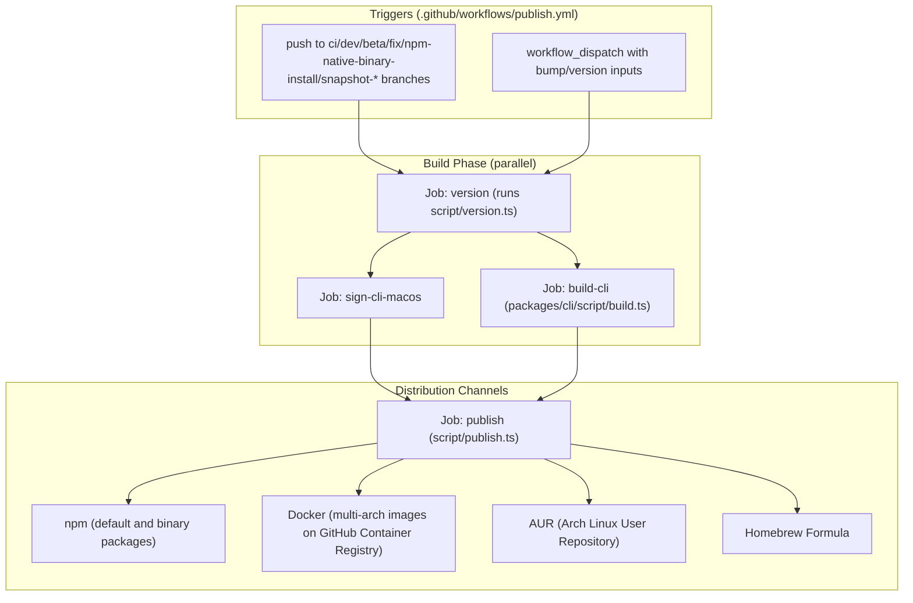
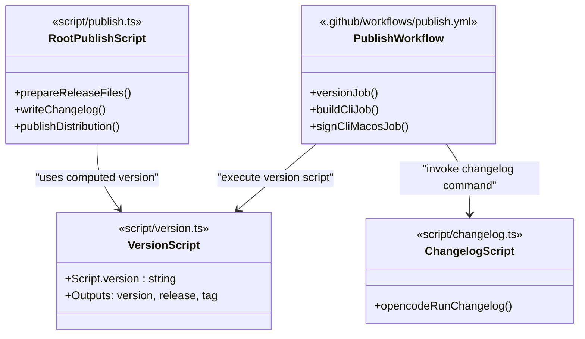
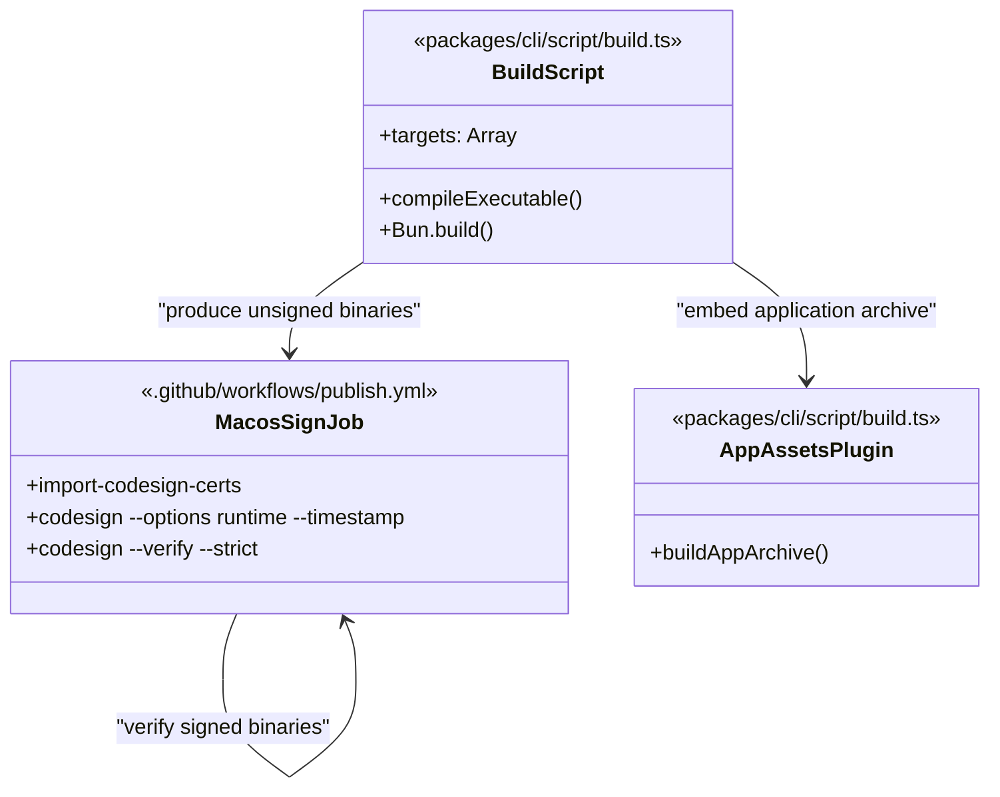
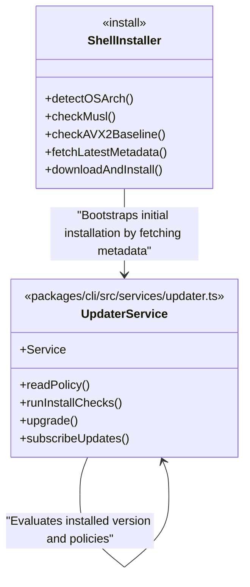

<!-- source: DeepWiki mcp.deepwiki.com · repo anomalyco/opencode · page 9.1 Release Pipeline & Distribution · fetched 2026-10-27 -->

# Release Pipeline & Distribution

Relevant source files

The following files were used as context for generating this wiki page:

- [.github/actions/setup-bun/action.yml](.github/actions/setup-bun/action.yml)
- [.github/workflows/publish.yml](.github/workflows/publish.yml)
- [.gitignore](.gitignore)
- [.opencode/command/changelog.md](.opencode/command/changelog.md)
- [CHANGELOG.md](CHANGELOG.md)
- [install](install)
- [packages/cli/Dockerfile](packages/cli/Dockerfile)
- [packages/cli/bin/opencode2.cjs](packages/cli/bin/opencode2.cjs)
- [packages/cli/script/postinstall.mjs](packages/cli/script/postinstall.mjs)
- [packages/cli/script/publish-aur.ts](packages/cli/script/publish-aur.ts)
- [packages/cli/script/publish-homebrew.ts](packages/cli/script/publish-homebrew.ts)
- [packages/cli/script/publish.ts](packages/cli/script/publish.ts)
- [packages/cli/src/commands/handlers/default.ts](packages/cli/src/commands/handlers/default.ts)
- [packages/cli/src/commands/handlers/serve.ts](packages/cli/src/commands/handlers/serve.ts)
- [packages/cli/src/commands/handlers/upgrade.ts](packages/cli/src/commands/handlers/upgrade.ts)
- [packages/cli/src/env.ts](packages/cli/src/env.ts)
- [packages/cli/src/heap.ts](packages/cli/src/heap.ts)
- [packages/cli/src/node/index.ts](packages/cli/src/node/index.ts)
- [packages/cli/src/services/retained-image.ts](packages/cli/src/services/retained-image.ts)
- [packages/cli/src/services/standalone.ts](packages/cli/src/services/standalone.ts)
- [packages/cli/src/services/updater-action.ts](packages/cli/src/services/updater-action.ts)
- [packages/cli/src/services/updater.test.ts](packages/cli/src/services/updater.test.ts)
- [packages/cli/src/services/updater.ts](packages/cli/src/services/updater.ts)
- [packages/cli/test/env.test.ts](packages/cli/test/env.test.ts)
- [packages/cli/test/fixture/upgrade.ts](packages/cli/test/fixture/upgrade.ts)
- [packages/cli/test/retained-image.test.ts](packages/cli/test/retained-image.test.ts)
- [packages/cli/test/updater-install.test.ts](packages/cli/test/updater-install.test.ts)
- [packages/cli/test/upgrade.test.ts](packages/cli/test/upgrade.test.ts)
- [packages/plugin/script/publish.ts](packages/plugin/script/publish.ts)
- [script/changelog.ts](script/changelog.ts)
- [script/profile-typecheck-packages.ts](script/profile-typecheck-packages.ts)
- [script/profile-typecheck.ts](script/profile-typecheck.ts)
- [script/publish-winget.ts](script/publish-winget.ts)
- [script/publish.ts](script/publish.ts)
- [script/raw-changelog.ts](script/raw-changelog.ts)
- [script/update-artifact.ts](script/update-artifact.ts)
- [script/version.ts](script/version.ts)

The release pipeline and distribution system of OpenCode is a comprehensive CI/CD workflow implemented with GitHub Actions, complemented by Bun-based TypeScript scripts. It automates semantic versioning, changelog generation, multi-platform native binary builds, cryptographic signing, artifact uploads to Cloudflare R2, and multi-channel publishing including npm, Docker, Homebrew, AUR, shell installer script, and an internal auto-updater service embedded in the CLI.

Sources:  
[.github/workflows/publish.yml:1-195](), [script/publish.ts:1-133](), [script/version.ts:1-16](), [script/changelog.ts:1-76](), [packages/cli/script/publish.ts:1-173](), [install:1-209](), [packages/cli/src/services/updater.ts:1-160]()

---

## 1. Workflow Architecture & Triggers

The central release automation is declared in the GitHub Actions workflow `.github/workflows/publish.yml`. It triggers on pushes to specified branches (`ci`, `dev`, `beta`, and some others including snapshot branches) and on manual workflow dispatch events supporting semantic version bump inputs and explicit version overrides.

The workflow manages concurrency scoped by workflow and ref names, avoiding race conditions during simultaneous triggered workflows especially on development or release branches.

### Job sequence overview:

- **`version` job**: Determines the exact version for the release and sets outputs for subsequent jobs [`.github/workflows/publish.yml:42-75`](), [`script/version.ts:1-17`]().
- **`build-cli` job**: Compiles multi-platform CLI binaries with Bun native compilation [`.github/workflows/publish.yml:76-136`]().
- **`sign-cli-macos` job**: Runs code signing on macOS executables using imported Apple certificates [`.github/workflows/publish.yml:139-193`]().
- **`publish` job**: Orchestrates publishing binaries and packages to registries and artifact storage [`.github/workflows/publish.yml`] and [`script/publish.ts:1-134`]().

Sources:  
[.github/workflows/publish.yml:1-41,42-75,76-136,139-193](), [script/version.ts:1-16](), [script/publish.ts:1-133]()

---

## 2. Versioning & Changelog Automation

Semantic versioning is centralized in `script/version.ts` which derives the new version string and outputs relevant release indicators to GitHub Actions environment variables for use in downstream jobs.

The root release script (`script/publish.ts`) also handles:

- Synchronization of version strings across all `package.json` files in the monorepo, ensuring uniform versioning [script/publish.ts:26-56]().

- Optional updating of `CHANGELOG.md` during releases by appending new sections with release notes passed as inputs [script/publish.ts:37-49]().

- Invocation of the internal changelog generation command via `opencode run --command changelog` wrapped inside `script/changelog.ts` [script/changelog.ts:50-71]().

- A final clean-up routine commits version bumps and tags to the Git repository when publishing a release [script/publish.ts:100-120]().

### Data Flow Diagram – Version and Changelog

Sources:  
[script/version.ts:1-16](), [script/changelog.ts:1-76](), [script/publish.ts:20-56,37-49,100-120](), [.github/workflows/publish.yml:63-75]()

---

## 3. Multi-Platform Binary Builds & Signing

The main binary build is performed by `packages/cli/script/build.ts`. It compiles the CLI application as platform-specific native executables for the following 12 platforms derived from OS, CPU architecture, and ABI variants:

| OS      | Arch   | ABI / Variant                | Notes                |
|---------|--------|-----------------------------|----------------------|
| Linux   | arm64  | glibc, musl, baseline (no AVX2) | Baseline disables AVX2 instructions          |
| Linux   | x64    | glibc, musl, baseline       | |
| Darwin  | arm64  | native                      | Apple Silicon native |
| Darwin  | x64    | native, baseline            | Intel with runtime options |
| Windows | arm64  | native                      | Windows ARM64 native |
| Windows | x64    | native, baseline            | Windows x64 with and without AVX2 baseline |

### Compilation highlights:

- Uses Bun's native compilation API (`Bun.build`) to embed the app archive binary `.cache/bun-app-archive.bin` via a virtual plugin module `virtual:opencode-app-assets` [packages/cli/script/build.ts:30-85]().

- Integrates OS-specific packages and features like the bundled terminal PTY library (`@opencode-ai/pty`) to provide a consistent CLI experience [packages/cli/script/build.ts:112-128]().

- Detects compatible or fallback filesystem watchers (e.g., `@parcel/watcher` on macOS/Linux) for live file operations [packages/cli/script/build.ts:139-148]().

### Code Signing

- **macOS Signing** is performed in the GitHub Actions job `sign-cli-macos`. It imports the Apple Developer ID certificate into a temporary keychain, signs the compiled binaries with `codesign` enabling hardened runtime and timestamping, and verifies signatures and requirements post-signing [`.github/workflows/publish.yml:139-193`](). 

- **Windows** binaries undergo signing preparations during packaging but signing details are handled through the Windows packaging workflow (not shown in detail here).

Sources:  
[.github/workflows/publish.yml:139-193](), [packages/cli/script/build.ts:30-85,112-128,139-148]()  

---

## 4. Artifact Distribution & R2 Uploads

Distribution artifacts consist of platform-specific binaries packed into deterministic archives (`tar.gz` on Linux/macOS, `zip` on Windows) ensuring reproducibility by zeroing timestamps and ownership metadata.

These archives, alongside npm tarballs, are uploaded to Cloudflare R2 artifact storage and version metadata is published to OpenCode update registries.

The script responsible for this is `packages/cli/script/publish.ts`. Its key responsibilities include:

- Collecting versioned package names and versions from the mono-repository binary packages using glob scans [packages/cli/script/publish.ts:38-46]().

- Validating consistent versions across binary sub-packages and the root CLI distribution [packages/cli/script/publish.ts:45-49]().

- Preparing the folder structure with required files and a postinstall script that checks for successful installation [packages/cli/script/publish.ts:51-83]().

- Packing binaries via `tar` or `zip` commands for each platform with fixed timestamps and permissions to ensure artifact integrity and reproducibility [packages/cli/script/publish.ts:158-173]().

- Uploading archives to R2 via `UpdateArtifact.upload` and publishing version metadata for consumers and the updater [packages/cli/script/publish.ts:91-123]().

Sources:  
[packages/cli/script/publish.ts:38-49,51-83,91-124](), [script/update-artifact.ts:1-88]()  

---

## 5. Registry Publishing: npm, Docker, Homebrew & AUR

The publish pipeline automates multi-channel registry deployment:

- **npm**: Packages all CLI binary wrappers as optional dependency packages scoped under `@opencode/cli-*`, shipping platform-specific binaries. These packages include a guarding postinstall script that errors with instructions if install scripts are disabled in the user's environment [packages/cli/script/publish.ts:20-90]().

- **Docker**: For stable releases on the `latest` channel, the publish script builds a multi-architecture image supporting `linux/amd64` and `linux/arm64` which it publishes to `ghcr.io/anomalyco/opencode` using `docker buildx` [packages/cli/script/publish.ts:146-148]().

- **AUR & Homebrew**: On beta and latest channels, additional scripts `publish-aur.ts` and `publish-homebrew.ts` are run to synchronize packaging formulas and definitions for Arch Linux and macOS Homebrew users [packages/cli/script/publish.ts:150-156]().

This multilayered publishing allows users to install OpenCode conveniently on their preferred platform with package manager integrations for native experiences.

Sources:  
[packages/cli/script/publish.ts:20-90,146-156]()  

---

## 6. Installer & Auto-Updater Runtime

### Shell Installer `install`

OpenCode provides a portable, standalone bash shell installer script named `install`. This script performs:

- OS and CPU architecture detection supporting Darwin, Linux, and Windows, as well as sub-arch detection including ARM64 and x64 variants [install:70-111]().

- CPU feature detection (AVX2 support) and determination of libc variant on Linux (musl vs glibc) to select appropriate binaries from the release artifacts [install:121-170]().

- Fetching version metadata and binary package names from the OpenCode update API, with fallbacks for version override or local binary installation [install:178-204]().

- Downloading, extracting, and installing binaries into `$HOME/.opencode/bin` with optional environment PATH updates unless disabled by `--no-modify-path` flag [install:69-208]().

- Compatible with multiple shell environments and includes error handling for unsupported OS/Arch combinations.

### Auto-Updater Service (`Updater.Service`)

Within the CLI, the `Updater` service (`packages/cli/src/services/updater.ts`) provides:

- Robust cross-platform update checks for the CLI with support for multiple installation methods: curl (shell), npm, pnpm, bun, yarn, Homebrew, and WinGet.

- Logic to parse user update preferences from local configuration files, supporting policies `disable`, `notify`, and `auto` update modes [packages/cli/src/services/updater.ts:122-137]().

- The updater manages concurrency to serialize update attempts and notifies about installation progress and latest available versions [packages/cli/src/services/updater.ts:139-161]().

- Detects installed package manifests to determine current version and installation method, allowing tailored upgrade commands per platform and installation approach [packages/cli/src/services/updater.ts:139-161]().

- Provides structured reporting and error wrapping via a custom `UpgradeError` class.

Sources:  
[install:1-209](), [packages/cli/src/services/updater.ts:1-161]()  

---

# Summary

OpenCode's release pipeline is a tightly integrated system utilizing GitHub Actions for CI orchestration and Bun-powered Node scripts for building, versioning, publishing, and signing. Native multi-target CLI binaries are built and cryptographically signed, distributed across npm, Docker, Homebrew, and AUR with release metadata stored in Cloudflare R2. Users install via a robust shell installer or from package managers, supported by an intelligent client-side auto-updater that respects user policies and environment detection. This modular architecture ensures reliable and transparent delivery of OpenCode releases.

---

# References

- [GitHub Workflow `.github/workflows/publish.yml`](.github/workflows/publish.yml)  
- [Release Publish Script `script/publish.ts`](script/publish.ts)  
- [Version Script `script/version.ts`](script/version.ts)  
- [Changelog Script `script/changelog.ts`](script/changelog.ts)  
- [CLI Publish `packages/cli/script/publish.ts`](packages/cli/script/publish.ts)  
- [Shell Installer `install`](install)  
- [Updater Service `packages/cli/src/services/updater.ts`](packages/cli/src/services/updater.ts)

---

