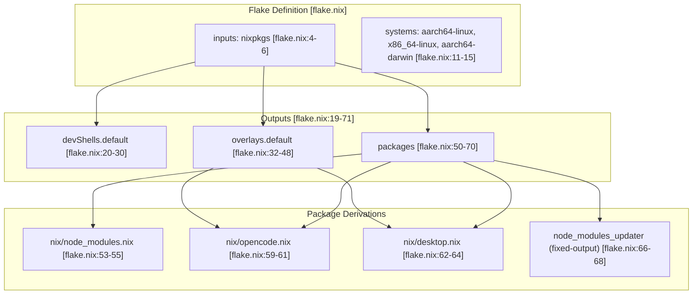
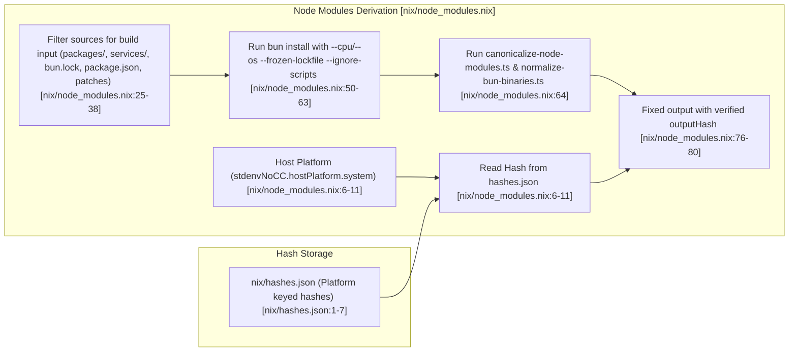
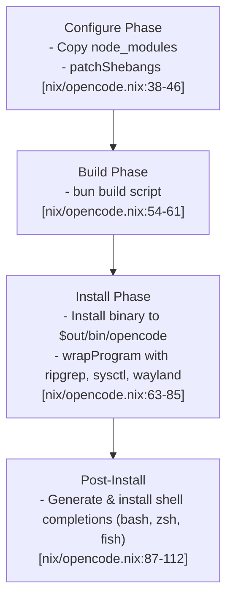
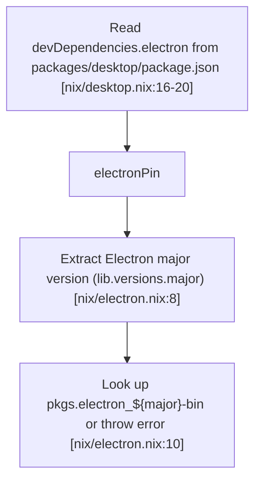
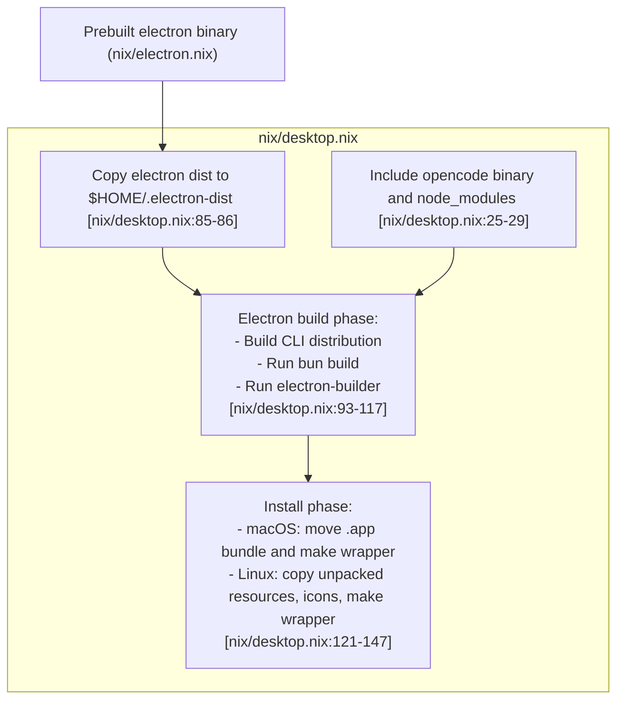
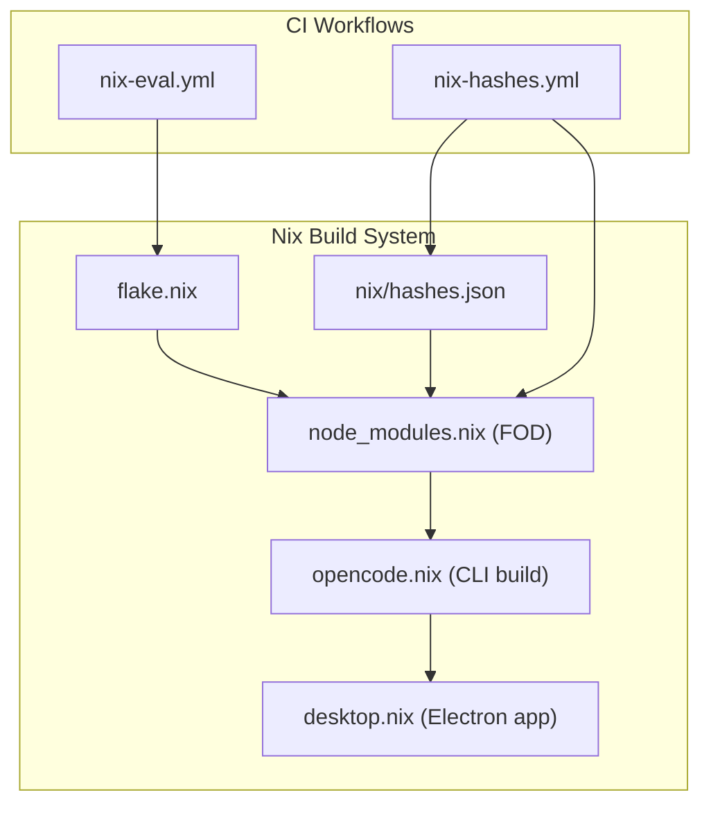

<!-- source: DeepWiki mcp.deepwiki.com · repo anomalyco/opencode · page 9.2 Nix Builds · fetched 2026-10-27 -->

# Nix Builds

<details>
<summary>Relevant source files</summary>

The following files were used as context for generating this wiki page:

- [.github/workflows/nix-eval.yml](.github/workflows/nix-eval.yml)
- [.github/workflows/nix-hashes.yml](.github/workflows/nix-hashes.yml)
- [flake.lock](flake.lock)
- [flake.nix](flake.nix)
- [nix/desktop.nix](nix/desktop.nix)
- [nix/electron.nix](nix/electron.nix)
- [nix/hashes.json](nix/hashes.json)
- [nix/node_modules.nix](nix/node_modules.nix)
- [nix/opencode.nix](nix/opencode.nix)
- [packages/app/README.md](packages/app/README.md)
- [packages/desktop/README.md](packages/desktop/README.md)
- [packages/gui-extensions/src/updater/main.ts](packages/gui-extensions/src/updater/main.ts)
- [packages/gui-extensions/src/updater/platform.ts](packages/gui-extensions/src/updater/platform.ts)

</details>


This document details the Nix-based build infrastructure for OpenCode, providing fully reproducible builds, deterministic development shells, multi-architecture packaging for the CLI (`opencode`), and the desktop application (`opencode-desktop`). It covers the flake outputs, fixed-output derivations for `node_modules`, electron derivations, and the related CI workflows.

---

## 1. Flake Architecture & Outputs (`flake.nix`)

The entry point for the Nix build system is `flake.nix`. It defines the input dependencies, supported systems matrix, overlays, development shells, and packages using Nx's structured output attributes [flake.nix:1-72]().

### Flake Outputs and Code Entities



- **Supported Systems**: The flake targets three primary platforms: `aarch64-linux`, `x86_64-linux`, and `aarch64-darwin` [flake.nix:11-15]().
- **Development Shells**: Provide consistent environments with essentials like `bun`, `nodejs`, `pkg-config`, `openssl`, and `git` [flake.nix:20-29]().
- **Overlays**: Allow injecting custom package definitions (`opencode`, `opencode-desktop`) that leverage the node_modules derivation [flake.nix:32-48]().
- **Packages**: Expose multiple derivations per system, notably `opencode`, `opencode-desktop`, `default` (alias to `opencode`), and a fixed-output derivation `node_modules_updater` to compute hashes [flake.nix:50-70]().

Sources:
[flake.nix:1-72]()

---

## 2. Node Modules Fixed-Output Derivation and Hashing

OpenCode manages Node.js dependencies via Bun within a fixed-output derivation (FOD), ensuring deterministic builds despite Bun's native installs being non-byte-identical across platforms [nix/node_modules.nix:21-87](). This mechanism relies on a SHA-256 hash store `nix/hashes.json` to fix output verification.

### Data Flow: Node Modules Fixed-Output Derivation



- **Platform-Specific Hash Lookup**: Uses the current system platform to read the stored SHA-256 hash from `nix/hashes.json` for the fixed-output derivation [nix/node_modules.nix:6-11]().
- **Source Fileset**: Restricts the derivation's inputs to necessary project directories (`packages`, `services`), lockfiles, patches, and base manifests to ensure reproducibility [nix/node_modules.nix:25-38]().
- **Bun Installation**: Invokes `bun install` with explicit CPU and OS parameters matching the platform, disabling script execution and progress output for deterministic output [nix/node_modules.nix:50-63]().
- **Output Normalization**: Runs custom scripts to canonicalize the `node_modules` tree and normalize Bun binary hashes, enforcing byte-identical outputs across machines and builds [nix/node_modules.nix:64-66]().
- **Fixed Output Hashing**: The derivation verifies the output against the stored hash, ensuring immutability and enforcing rebuilds when hashes change [nix/node_modules.nix:76-80]().

Sources:
[nix/hashes.json:1-7]()
[nix/node_modules.nix:1-87]()

---

## 3. CLI Derivation: `opencode` Package Build (`nix/opencode.nix`)

The CLI is built by `nix/opencode.nix`, which depends on the pinned `node_modules` derivation. The build compiles the main binary, patches shebangs, manages environment variables, and installs shell completions [nix/opencode.nix:17-133]().

### Build Pipeline



- **Copy & Patch**: Node modules from the fixed-output derivation are copied into the build context. The shebangs of Node.js binaries are patched for nix compatibility [nix/opencode.nix:41-44]().
- **Bun Build**: Executes the build script `./script/build.ts` which bundles the CLI into a single executable JavaScript file [nix/opencode.nix:58]().
- **Wrapping**: The resulting binary is wrapped with required dependencies including `ripgrep` and platform-specific tools (`sysctl` on Darwin, Wayland on Linux) by modifying the runtime environment variables [nix/opencode.nix:69-80]().
- **Shell Completion**: The binary is invoked with `--completions` flags to generate shell completions for bash, zsh, and fish. Additionally, a secondary binary alias `opencode2` is installed with related completions [nix/opencode.nix:87-112]().

### Environment Configuration

- Sets `OPENCODE_DISABLE_MODELS_FETCH=true` to disable model fetching during build.
- Embeds the `MODELS_DEV_API_JSON` path from the `models-dev` package.
- Limits Node.js old space size to 4GB via `NODE_OPTIONS`.

Sources:
[nix/opencode.nix:1-133]()

---

## 4. Desktop & Electron Derivations (`nix/desktop.nix` and `nix/electron.nix`)

The desktop application (`opencode-desktop`) is built on top of Electron, integrating the CLI binary and packaging it for target platforms via Electron Builder [nix/desktop.nix:1-168](), [nix/electron.nix:1-10]().

### Electron Version Resolution & Prebuilt Binary



- Reads the Electron version pin from `packages/desktop/package.json`.
- Uses the Electron major version to select the matching prebuilt binary from nixpkgs.
- Throws an error if no build of that Electron major version exists in nixpkgs.

### Desktop Derivation Architecture



- **Inputs**: Passes in the `opencode` CLI binary, the normalized `node_modules`, and patches [nix/desktop.nix:25-29]().
- **Electron Distribution**: Copies the prebuilt Electron runtime to `$HOME/.electron-dist` for packaging [nix/desktop.nix:85-86]().
- **Build Phase**:
  - Copies the CLI distribution to a temporary directory with expected layout, including version embedding.
  - Runs the desktop `bun run build` to compile renderer/main JavaScript bundles.
  - Invokes `electron-builder` with custom config, disabling automatic macOS signing (`--config.mac.identity=null`) [nix/desktop.nix:93-117]().
- **Install Phase**:
  - macOS builds move the `.app` bundle to install path and wrap the executable [nix/desktop.nix:121-126]().
  - Linux builds copy resources and icons to standard XDG locations and wrap the `electron` binary with environment variables for Wayland support [nix/desktop.nix:127-146]().

### Environment & Wrapping Details

- Sets `ELECTRON_SKIP_BINARY_DOWNLOAD = 1` to prevent electron-builder from downloading Electron itself.
- Wraps the `opencode-desktop` executable with an environment variable `ELECTRON_FORCE_IS_PACKAGED=1`.
- For Linux, enables Wayland support flags conditionally:

  ```bash
  --add-flags "'${NIXOS_OZONE_WL:+${WAYLAND_DISPLAY:+--ozone-platform-hint=auto --enable-features=WaylandWindowDecorations --enable-wayland-ime=true}}"
  ```

### Desktop Metadata

- Installs desktop entry files (`ai.opencode.desktop`) with icons at various resolutions and metadata for Linux desktop integration [nix/desktop.nix:53-61, 130-141]().

Sources:
[nix/desktop.nix:1-168]()
[nix/electron.nix:1-10]()

---

## 5. GitHub Actions Workflows: `nix-eval.yml` and `nix-hashes.yml`

To maintain and verify the Nix builds, two key workflows operate in the CI environment.

### a) `nix-eval.yml`: Flake Evaluation

This workflow runs on pushes and pull requests to `dev`. It checks:

- Flake metadata.
- Flake structure and all system outputs.
- Evaluation of packages and optional packages for supported systems.
- Evaluation of the development shells.

Failure to eval any derivation or devShell is treated as a failed CI check [`.github/workflows/nix-eval.yml`:1-95]().

### b) `nix-hashes.yml`: Node Modules Hash Computation & Update

This workflow handles maintenance of the `node_modules` fixed-output derivation hashes.

- Defined via matrix strategy across platforms (`x86_64-linux`, `aarch64-linux`, `aarch64-darwin`) [`.github/workflows/nix-hashes.yml`:28-38]()].
- For each platform, runs the `node_modules_updater` derivation with a `fakeHash` to force a build failure that outputs the correct hash in the logs.
- Extracts the resulting hash reliably from build logs using GNU grep regex [`.github/workflows/nix-hashes.yml`:60-64]()].
- Retries the hash computation up to 3 times upon empty output.
- Uploads the hash as an artifact, then later a subsequent job downloads all computed hashes and updates `nix/hashes.json` accordingly.
- Commits and pushes the updated `nix/hashes.json` to the repository if changes are detected [`.github/workflows/nix-hashes.yml`:90-160]()].

### Workflow Job Overview Table

| Workflow File             | Key Job Name     | Description                             |
|---------------------------|------------------|---------------------------------------|
| `.github/workflows/nix-eval.yml`    | `nix-eval`       | Validates flake outputs, packages, and devShells for all platforms on push and PR. |
| `.github/workflows/nix-hashes.yml`  | `compute-hash`   | Computes node_modules fixed-output derivation hashes on each platform. |
|                           | `update-hashes`  | Updates and commits `nix/hashes.json` with newly computed hashes.    |

Sources:
[.github/workflows/nix-eval.yml:1-95]()
[.github/workflows/nix-hashes.yml:1-161]()

---

# Summary Diagram Bridging Natural Language to Code Entity Space



This diagram highlights the flow of inputs, outputs, and interactions among core Nix build components and CI automation.

Sources:
[flake.nix:1-72]()
[nix/node_modules.nix:1-87]()
[nix/hashes.json:1-7]()
[nix/opencode.nix:1-133]()
[nix/desktop.nix:1-168]()
[.github/workflows/nix-eval.yml:1-95]()
[.github/workflows/nix-hashes.yml:1-161]()

---

# Additional Notes

- The fixed-output derivation strategy for `node_modules` is critical due to Bun's platform-specific installation behavior and nondeterministic file structures.
- The Electron derivation adopts a strategy of shipping the prebuilt Electron runtime from nixpkgs, avoiding direct downloads during the build.
- The desktop packaging step ensures consistent integration with platform-specific desktop environments (e.g., `.app` bundles on macOS, desktop entries on Linux).
- The workflows ensure continuous verification of the flake structure and automatic update of package dependency hashes, minimizing manual intervention.

This page is a LEAF page and does not have child pages.

---

