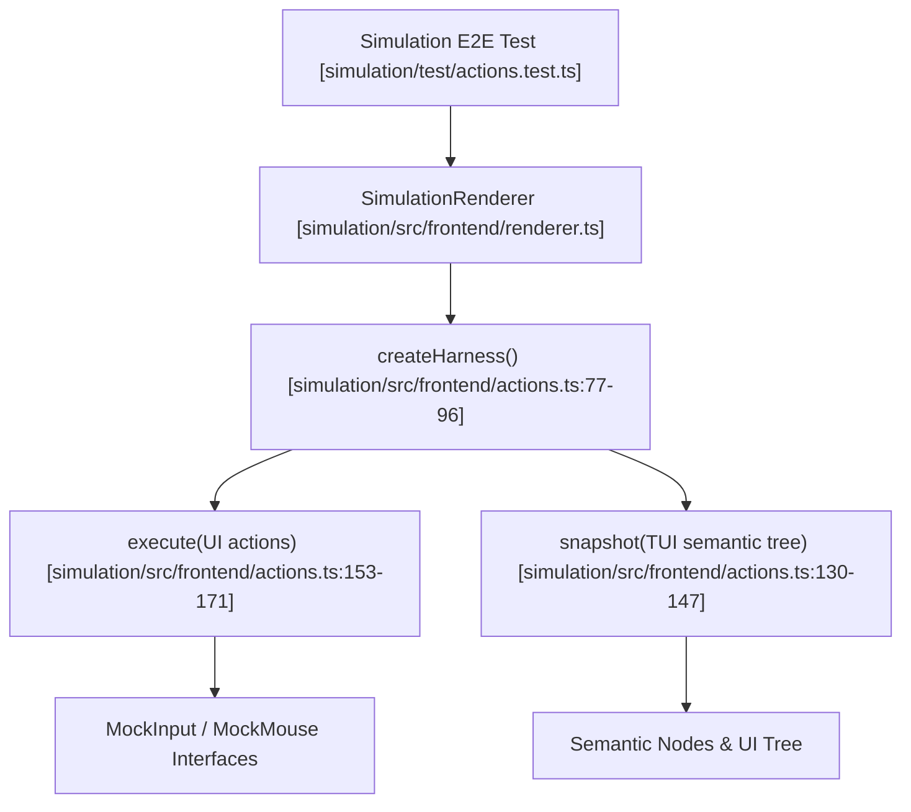
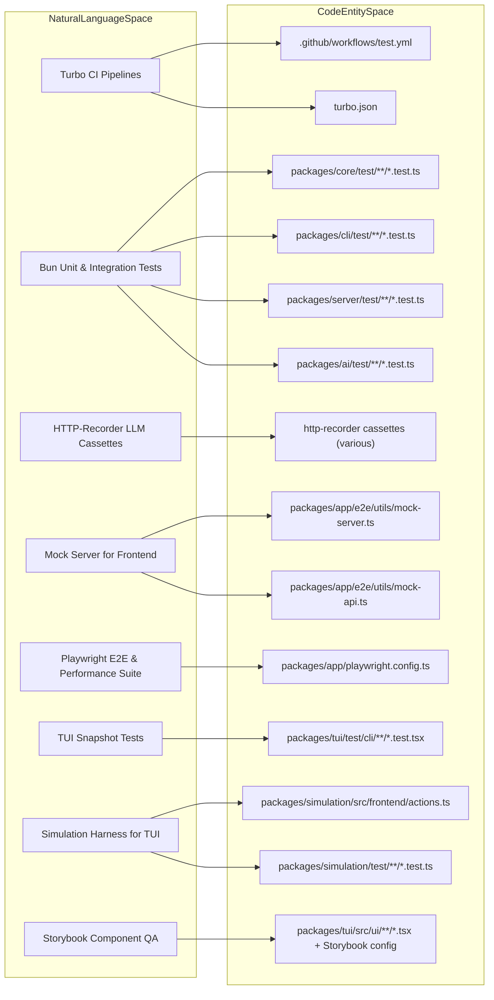

<!-- source: DeepWiki mcp.deepwiki.com · repo anomalyco/opencode · page 9.3 Testing & QA Infrastructure · fetched 2026-10-27 -->

# Testing & QA Infrastructure

<details>
<summary>Relevant source files</summary>

The following files were used as context for generating this wiki page:

- [.github/workflows/test.yml](.github/workflows/test.yml)
- [.opencode/skills/unit-tests/SKILL.md](.opencode/skills/unit-tests/SKILL.md)
- [packages/app/e2e/performance/playwright.config.ts](packages/app/e2e/performance/playwright.config.ts)
- [packages/app/e2e/performance/unit/mock-server.test.ts](packages/app/e2e/performance/unit/mock-server.test.ts)
- [packages/app/e2e/regression/composer.spec.ts](packages/app/e2e/regression/composer.spec.ts)
- [packages/app/e2e/regression/terminal-input.spec.ts](packages/app/e2e/regression/terminal-input.spec.ts)
- [packages/app/e2e/utils/mock-api.ts](packages/app/e2e/utils/mock-api.ts)
- [packages/app/e2e/utils/mock-server.ts](packages/app/e2e/utils/mock-server.ts)
- [packages/app/playwright.config.ts](packages/app/playwright.config.ts)
- [packages/app/src/composer/commands.tsx](packages/app/src/composer/commands.tsx)
- [packages/app/src/composer/editor/interaction.test.ts](packages/app/src/composer/editor/interaction.test.ts)
- [packages/app/src/composer/editor/interaction.ts](packages/app/src/composer/editor/interaction.ts)
- [packages/app/src/providers/connect/controller.ts](packages/app/src/providers/connect/controller.ts)
- [packages/app/src/providers/connect/dialog.tsx](packages/app/src/providers/connect/dialog.tsx)
- [packages/app/src/providers/connect/models.css](packages/app/src/providers/connect/models.css)
- [packages/app/src/providers/models/select-dialog.stories.tsx](packages/app/src/providers/models/select-dialog.stories.tsx)
- [packages/app/src/providers/models/selection.tsx](packages/app/src/providers/models/selection.tsx)
- [packages/app/src/runtime/persistence/schema.test.ts](packages/app/src/runtime/persistence/schema.test.ts)
- [packages/app/src/runtime/persistence/schema.ts](packages/app/src/runtime/persistence/schema.ts)
- [packages/app/src/runtime/server/persistence.ts](packages/app/src/runtime/server/persistence.ts)
- [packages/app/src/settings/about/about.tsx](packages/app/src/settings/about/about.tsx)
- [packages/app/src/settings/about/notices/dialog.tsx](packages/app/src/settings/about/notices/dialog.tsx)
- [packages/app/src/settings/providers/account-actions.ts](packages/app/src/settings/providers/account-actions.ts)
- [packages/app/src/settings/providers/providers.tsx](packages/app/src/settings/providers/providers.tsx)
- [packages/app/test-browser/fixtures/model-selection.ts](packages/app/test-browser/fixtures/model-selection.ts)
- [packages/app/test-browser/playwright-config.test.ts](packages/app/test-browser/playwright-config.test.ts)
- [packages/cli/test/fixture/standalone-owner.ts](packages/cli/test/fixture/standalone-owner.ts)
- [packages/cli/test/standalone.test.ts](packages/cli/test/standalone.test.ts)
- [packages/client/test/solid-pending-status.test.ts](packages/client/test/solid-pending-status.test.ts)
- [packages/console/app/test/consoleMarketing.test.ts](packages/console/app/test/consoleMarketing.test.ts)
- [packages/core/src/git.ts](packages/core/src/git.ts)
- [packages/core/src/snapshot.ts](packages/core/src/snapshot.ts)
- [packages/core/test/git.test.ts](packages/core/test/git.test.ts)
- [packages/core/test/lib/clock.ts](packages/core/test/lib/clock.ts)
- [packages/core/test/snapshot.test.ts](packages/core/test/snapshot.test.ts)
- [packages/gui-extensions/src/terminal/terminal.tsx](packages/gui-extensions/src/terminal/terminal.tsx)
- [packages/protocol/src/simulation.ts](packages/protocol/src/simulation.ts)
- [packages/schema/test/v1-isolation.test.ts](packages/schema/test/v1-isolation.test.ts)
- [packages/session-ui/component-tests/session-message-projection.spec.ts](packages/session-ui/component-tests/session-message-projection.spec.ts)
- [packages/session-ui/src/components/message-file.test.ts](packages/session-ui/src/components/message-file.test.ts)
- [packages/session-ui/src/components/message-file.ts](packages/session-ui/src/components/message-file.ts)
- [packages/simulation/src/backend/index.ts](packages/simulation/src/backend/index.ts)
- [packages/simulation/src/backend/openai.ts](packages/simulation/src/backend/openai.ts)
- [packages/simulation/src/backend/simulated-provider.ts](packages/simulation/src/backend/simulated-provider.ts)
- [packages/simulation/src/frontend/actions.ts](packages/simulation/src/frontend/actions.ts)
- [packages/simulation/src/frontend/renderer.ts](packages/simulation/src/frontend/renderer.ts)
- [packages/simulation/src/frontend/semantics.ts](packages/simulation/src/frontend/semantics.ts)
- [packages/simulation/src/frontend/server.ts](packages/simulation/src/frontend/server.ts)
- [packages/simulation/src/frontend/simulation.ts](packages/simulation/src/frontend/simulation.ts)
- [packages/simulation/src/manifest.ts](packages/simulation/src/manifest.ts)
- [packages/simulation/src/protocol/index.ts](packages/simulation/src/protocol/index.ts)
- [packages/simulation/src/recording.ts](packages/simulation/src/recording.ts)
- [packages/simulation/test/actions.test.ts](packages/simulation/test/actions.test.ts)
- [packages/simulation/test/frontend-server.test.ts](packages/simulation/test/frontend-server.test.ts)
- [packages/simulation/test/openai.test.ts](packages/simulation/test/openai.test.ts)
- [packages/simulation/test/protocol.test.ts](packages/simulation/test/protocol.test.ts)
- [packages/simulation/test/recording.test.ts](packages/simulation/test/recording.test.ts)
- [packages/simulation/test/simulated-provider.test.ts](packages/simulation/test/simulated-provider.test.ts)
- [packages/storybook/.storybook/main.ts](packages/storybook/.storybook/main.ts)
- [packages/storybook/.storybook/preview.tsx](packages/storybook/.storybook/preview.tsx)
- [packages/storybook/playwright/README.md](packages/storybook/playwright/README.md)
- [packages/storybook/playwright/config.ts](packages/storybook/playwright/config.ts)
- [packages/tui/src/simulation/semantics.ts](packages/tui/src/simulation/semantics.ts)
- [packages/ui/src/context/dialog.tsx](packages/ui/src/context/dialog.tsx)
- [packages/ui/src/overlays/dialog/dialog.tsx](packages/ui/src/overlays/dialog/dialog.tsx)
- [turbo.json](turbo.json)

</details>


This page details the comprehensive testing and Quality Assurance (QA) strategy employed across the OpenCode monorepo. The strategy encompasses various testing methodologies to ensure code reliability and stability, including Turbo pipelines, Bun test suites in core modules, recorded HTTP cassettes for LLM tests, Playwright end-to-end and performance test suites, snapshot tests for the Terminal UI (TUI), Storybook component testing, a mock server for frontend API simulations, and the packages/simulation headless control harness for UI automation.

---

## 1. CI Workflows & Turbo Pipelines (`test.yml` & `turbo.json`)

Continuous Integration (CI) uses GitHub Actions configured in `.github/workflows/test.yml` coordinated with the Turborepo task graph in `turbo.json` to optimize test execution.

### Pipeline Structure

- **Affected Packages Detection (`affected` job):** Using the `bun x turbo ls --affected` command, the workflow determines which packages have code changes related to the current branch or PR, limiting test execution scope to only changed packages. Special handling ensures always testing the `app` and `storybook` packages when necessary [.github/workflows/test.yml:24-55]().

- **Unit Testing (`unit` job):** Runs on Linux and Windows runners, executes Bun test suites concurrently via `bun turbo test --affected`, and runs targeted test scripts like service lifecycle smoke tests. The job includes steps to verify package publishing and documentation integrity [.github/workflows/test.yml:56-140]().

- **Build Job (`build` job):** Validates TypeScript builds and compiles critical packages before publishing [.github/workflows/test.yml:141-181]().

- **E2E and UI Tests:** Conditioned on affected package detection results and typically run separately in workflows triggered by the `affected` job output.

### Turbo Tasks & Dependencies

`turbo.json` defines task dependencies so that the CLI, SDK, server, core, and other packages typecheck and test in the correct order. The `test` task depends on `transit`, a no-op transit step that folds dependencies for caching purposes. Some tasks like component tests and desktop tests run with cache disabled to ensure fresh validation [turbo.json:1-57]().

```mermaid
graph TD
    A["GitHub Action Trigger (push/pr)"] --> B["affected job"]
    B -->|"Affected @opencode/app or Storybook changed"| D["Trigger E2E job"]
    B -->|"Detected affected packages"| C["unit job (Linux/Windows runners)"]
    C -->|"run bun turbo test --affected"| E[ "Run Bun Test Suites"]
    C -->|"run service smoke and package verify scripts"| F["Build & Publish Verifications"]
    D -->|"Playwright test suites"| G["Playwright E2E & Performance"]
    E -.-> H["packages/core#test"]
    E -.-> I["packages/server#test"]
    E -.-> J["packages/cli#test"]
    E -.-> K["packages/ai#test"]
```

Sources:  
* [.github/workflows/test.yml:1-181]()  
* [turbo.json:1-57]()

---

## 2. Unit & Integration Testing with Bun (`core`, `cli`, `server`, `ai`)

Each workspace package contains Bun test suites that focus on unit and integration testing. Tests leverage effect-based layers to isolate service dependencies, enabling precise control and mocking.

### Effect-Based Testing

In `core`, tests such as those for Git repository handling (`core/test/git.test.ts`) use the Effect runtime to execute side-effectful operations in a composable manner. Effect’s layering system provides dependency injection, allowing tests to provide mock layers or test-specific configurations.

This pattern ensures test repeatability without side effects leaking across runs and supports complex asynchronous behavior like LLM prompts, session event sourcing, or file watching.

Sources:  
* [core/test/git.test.ts:1-77]()  
* [turbo.json:1-57]()

---

## 3. Recorded LLM Cassettes (`http-recorder`)

To achieve deterministic and free testing of interactions with LLM providers, OpenCode uses the `http-recorder` package to record HTTP request-response pairs ("cassettes"). These are replayed during tests to emulate API calls without external dependency.

This strategy is critical for multi-turn conversations and complex tool-call chains to keep tests fast, stable, and below API usage quotas.

The recorder hooks into HTTP providers like OpenAI, Anthropic, Gemini, and the Zen gateway, intercepting upstream calls and caching results.

Sources:  
* [.github/workflows/test.yml:1-181]()

---

## 4. Mock Server & API Fixtures (`packages/app/e2e/utils/mock-server.ts`)

Frontend end-to-end and integration tests launch an Effect-based mock HTTP server defined primarily in `packages/app/e2e/utils/mock-server.ts` with helper routes and error conditions from `mock-api.ts`.

### MockServerConfig and Behavior

`MockServerConfig` specifies fixtures for sessions, projects, permissions, and providers. It offers hooks for simulating mutations like session creation, MCP actions, OAuth flows, and shell outputs. This declarative mock server mirrors server API structures, enabling fast, reliable frontend testing without backend dependencies.

```typescript
interface MockServerConfig {
  server?: string;
  provider: Resolvable<MockProviderCatalog>;
  sessions: MockSession[];
  directory: string;
  project: unknown;
  projects?: Resolvable<unknown[]>;
  // Callbacks and mocks for file writes, permissions, MCP, etc.
  onCredentialActivate?: (credentialID: string) => void;
  onMessages?: (input: { sessionID: string; before?: string; phase: "start" | "end" }) => void;
  // ...
}
```

```mermaid
graph TD
  PT["Playwright Test Harness"] --> MS[ "MockServerConfig [mock-server.ts]" ]
  MS --> MA[ "MockApi HttpApi Group [mock-api.ts]" ]
  MA -->|GET /api/session| SE["Mock Sessions Fixture"]
  MA -->|POST /api/session/:id/prompt| LL["Mock LLM Response Generator"]
  MA -->|GET /api/event| SSE["SSE Transport (Server-Sent Events)"]
  SSE --> U["SolidJS Frontend Application"]
```

Sources:  
* [packages/app/e2e/utils/mock-server.ts:1-130]()  
* [packages/app/e2e/utils/mock-api.ts:1-178]()

---

## 5. Playwright E2E & Performance Suites (`packages/app/playwright.config.ts`)

End-to-end (E2E) browser tests use Playwright to automate the SolidJS frontend, covering user flows, regressions, and performance scenarios.

### Playwright Configuration

- The Playwright config file sets the test directory, timeout limits, and retry policies.  
- It configures a web server to either reuse an existing deployment or run a local development/build server.  
- Environment variables inject test fixture flags and server addresses to control behavior.  
- Supports Chromium projects including touch-scroll specialized test runs.  
- Integrates with CI to collect video recordings on retry failures and HTML reports [packages/app/playwright.config.ts:1-87]().

```typescript
export default defineConfig({
  testDir: "./e2e",
  timeout: 60000,
  retries: process.env.CI ? 2 : 0,
  workers: ...,
  webServer: {
    command,
    url: baseURL,
    reuseExistingServer: !built,
    timeout: 120000,
  },
  use: {
    baseURL,
    trace: "on-first-retry",
    screenshot: "only-on-failure",
  },
  projects: [
    { name: "chromium", ... },
    { name: "chromium-touch-scroll", ... },
  ],
})
```

Sources:  
* [packages/app/playwright.config.ts:1-87]()

---

## 6. TUI Snapshot Tests (`packages/tui`)

Terminal UI components are validated through snapshot tests rendering SolidJS components into virtual terminal buffers (ANSI output). These tests ensure UI consistency for inline tools, dialogs, and status badges.

One key test suite (`inline-tool-wrap-snapshot.test.tsx`) asserts correct terminal rendering for wrapping, partial failures, reminder alignments, and status indicators [packages/tui/test/cli/tui/inline-tool-wrap-snapshot.test.tsx:1-209]().

Sample test snippet:

```typescript
describe("TUI inline tool wrapping", () => {
  test("replaces pending copy when a tool fails before completion", async () => {
    const frame = await renderFrame(() => <FailedPendingToolFixture />, { width: 72, height: 3 });
    expect(frame).toContain("Patch failed");
    expect(frame).not.toContain("Preparing patch");
  });
});
```

Sources:  
* [packages/tui/test/cli/tui/inline-tool-wrap-snapshot.test.tsx:1-209]()

---

## 7. Simulation Harness (`packages/simulation`)

The `packages/simulation` package provides a headless control harness and websocket server that can drive UI rendering and input simulation for TUI applications. This enables programmatic testing and snapshotting of terminal UI states.

### Harness API and Workflow

- The `createHarness` API wraps a `CliRenderer` instance, exposing mock keyboard/mouse inputs, resize utilities, and rendering methods [packages/simulation/src/frontend/actions.ts:77-96]().

- The harness provides access to snapshot semantic nodes of UI elements for deep comparison [packages/simulation/src/frontend/actions.ts:130-147]().

- UI events like typing, clicking, focus, and arrow keys can be synthesized [packages/simulation/src/frontend/actions.ts:153-171]().

```typescript
export interface Harness {
  readonly renderer: CliRenderer;
  readonly mockInput: MockInput;
  readonly mockMouse: MockMouse;
  readonly resize: (cols: number, rows: number) => void;
  readonly renderOnce: () => Promise<void>;
  readonly screen: () => string;
}

export function createHarness(renderer: CliRenderer): Harness {
  const setup = SimulationRenderer.setupFor(renderer);
  return {
    renderer,
    mockInput: setup?.mockInput ?? createMockKeys(renderer),
    mockMouse: setup?.mockMouse ?? createMockMouse(renderer),
    resize: setup?.resize ?? ((cols, rows) => renderer.resize(cols, rows)),
    renderOnce: setup?.renderOnce ?? (async () => {
      renderer.requestRender();
      await renderer.idle();
    }),
    screen: () => decoder.decode((Reflect.get(renderer, "currentRenderBuffer") as RenderBuffer).getRealCharBytes()),
  };
}
```



Sources:  
* [packages/simulation/src/frontend/actions.ts:1-177]()  
* [packages/simulation/test/actions.test.ts:1-175]()

---

## 8. Storybook & Component QA

UI components and dialogs across `packages/ui` and `packages/session-ui` are developed with Storybook, enabling isolated visual validation and interaction testing.

For example, the TUI dialog prompt and toast components have dedicated Storybook stories and unit tests that assert keyboard interaction, state transitions, accessibility through ARIA annotations, styling across themes, and responsiveness [packages/tui/src/ui/dialog-prompt.tsx:1-145](), [packages/tui/src/ui/toast.tsx:1-214]().

These component tests provide feedback during development, preventing regressions and improving test coverage beyond integration tests.

Sources:  
* [packages/tui/src/ui/dialog-prompt.tsx:1-145]()  
* [packages/tui/src/ui/toast.tsx:1-214]()

---

# Summary Diagram: OpenCode Testing & QA Infrastructure - Natural Language to Code Entities



---

This infrastructure delivers robust coverage from low-level unit tests to full system integration and browser-based UI validation, leveraging modern tools and OpenCode’s effect-driven architecture for isolated, reproducible, and performant test runs.

Sources:  
* `.github/workflows/test.yml`  
* `turbo.json`  
* `packages/core/test/git.test.ts`  
* `packages/app/e2e/utils/mock-server.ts`  
* `packages/app/e2e/utils/mock-api.ts`  
* `packages/app/playwright.config.ts`  
* `packages/tui/test/cli/tui/inline-tool-wrap-snapshot.test.tsx`  
* `packages/simulation/src/frontend/actions.ts`  
* `packages/simulation/test/actions.test.ts`  
* `packages/tui/src/ui/dialog-prompt.tsx`  
* `packages/tui/src/ui/toast.tsx`

---

