# Page: Overview

# Overview

<details>
<summary>Relevant source files</summary>

The following files were used as context for generating this wiki page:

- [README.md](README.md)
- [bun.lock](bun.lock)
- [package.json](package.json)
- [packages/app/package.json](packages/app/package.json)
- [packages/console/app/package.json](packages/console/app/package.json)
- [packages/console/app/src/app.tsx](packages/console/app/src/app.tsx)
- [packages/console/app/src/style/token/font.css](packages/console/app/src/style/token/font.css)
- [packages/core/src/plugin/skill/opencode.md](packages/core/src/plugin/skill/opencode.md)
- [packages/desktop/package.json](packages/desktop/package.json)
- [packages/function/package.json](packages/function/package.json)
- [packages/plugin/package.json](packages/plugin/package.json)
- [packages/schema/script/config-schema.ts](packages/schema/script/config-schema.ts)
- [packages/schema/script/config-v1.json](packages/schema/script/config-v1.json)
- [packages/ui/package.json](packages/ui/package.json)
- [packages/web/astro.config.mjs](packages/web/astro.config.mjs)
- [packages/web/package.json](packages/web/package.json)
- [packages/web/src/assets/web/web-homepage-active-session.png](packages/web/src/assets/web/web-homepage-active-session.png)
- [packages/web/src/assets/web/web-homepage-new-session.png](packages/web/src/assets/web/web-homepage-new-session.png)
- [packages/web/src/assets/web/web-homepage-see-servers.png](packages/web/src/assets/web/web-homepage-see-servers.png)
- [packages/web/src/components/Footer.astro](packages/web/src/components/Footer.astro)
- [packages/web/src/components/Lander.astro](packages/web/src/components/Lander.astro)
- [packages/web/src/components/LanguageSelect.astro](packages/web/src/components/LanguageSelect.astro)
- [packages/web/src/content/docs/index.mdx](packages/web/src/content/docs/index.mdx)
- [packages/web/src/content/docs/troubleshooting.mdx](packages/web/src/content/docs/troubleshooting.mdx)
- [packages/web/src/content/docs/web.mdx](packages/web/src/content/docs/web.mdx)
- [packages/web/src/content/docs/windows-wsl.mdx](packages/web/src/content/docs/windows-wsl.mdx)
- [sdks/vscode/package.json](sdks/vscode/package.json)

</details>


## Purpose and Scope

This document provides a high-level overview of the OpenCode codebase, describing its mission as an open-source AI coding agent, the Bun workspace monorepo structure, the v2 Effect-based architecture (`cli`/`tui`/`core`/`server`/`protocol`/`client`/`schema`/`ai`), and the surrounding SaaS and documentation services. 

As a parent page, this document summarizes major subsystems and links to detailed child pages:
- For package layout and directory organization, see [Repository Structure & Packages](#1.1).
- For client/server architecture, Effect runtime, and specs, see [Architecture Overview](#1.2).
- For contributor workflows, AGENTS conventions, and automation, see [Contributor Guide & Repo Automation](#1.3).

Sources: [package.json:38-44](), [bun.lock:1-185]()

---

## What is OpenCode

OpenCode is an open-source AI coding agent designed to provide a modular, extensible, provider-agnostic alternative to proprietary AI code assistants. It integrates with over 20 large language model providers via `packages/ai` and supports multiple user interfaces including a Terminal UI (`packages/tui`), a SolidJS web/desktop app (`packages/app`, `packages/desktop`), and IDE integrations.

Key architectural characteristics include:
- **Effect-Based Core Runtime**: Leverages the `effect` library across `packages/core`, `packages/server`, and `packages/ai` for robust error handling, concurrency, and dependency injection.
- **Strict Protocol Contracts**: Uses `packages/protocol` and `packages/schema` to define type-safe API boundaries and generate clients via `packages/client`.
- **Extensible Plugin Model**: Supports custom tools, agents, skills, and model providers through `packages/plugin`.

Sources: [package.json:38-44](), [packages/plugin/package.json:1-38]()

---

## Monorepo Structure & V2 Architecture Overview

OpenCode is organized as a Bun workspace monorepo containing numerous specialized packages under `packages/`, infrastructure definitions under `infra/`, services under `services/`, and build automation under `script/`.

### Diagram 1: Monorepo Package Dependencies (Natural Language to Code Entities)

```mermaid
graph TB
    subgraph "Interfaces & CLI"
        cli[""@opencode/cli (packages/cli)""]
        tui[""@opencode/tui (packages/tui)""]
        app[""@opencode/app (packages/app)""]
    end

    subgraph "Server & Protocol"
        server[""@opencode/server (packages/server)""]
        protocol[""@opencode/protocol (packages/protocol)""]
        client[""@opencode/client (packages/client)""]
        schema[""@opencode/schema (packages/schema)""]
    end

    subgraph "Core Runtime & AI"
        core[""@opencode/core (packages/core)""]
        ai[""@opencode/ai (packages/ai)""]
        plugin[""@opencode/plugin (packages/plugin)""]
    end

    cli --> server
    cli --> tui
    app --> client
    client --> protocol
    protocol --> schema
    server --> core
    core --> ai
    core --> plugin
```
Sources: [package.json:38-44](), [packages/plugin/package.json:1-38]()

For a comprehensive breakdown of all packages (`ai`, `app`, `cli`, `client`, `codemode`, `console`, `core`, `desktop`, `gui-extensions`, `http-recorder`, `httpapi-codegen`, `identity`, `latex`, `merman`, `plugin`, `plugin-browser`, `posts`, `protocol`, `schema`, `sdk`, `server`, `session-ui`, `simulation`, `stats`, `storybook`, `theme`, `tui`, `ui`, `util`, `web`), services (`www`, `update`, `files`), and infra directories, see [Repository Structure & Packages](#1.1).

Sources: [package.json:38-44]()

---

## Architecture & Communication Flow

OpenCode v2 adopts a clean separation between the core domain logic, transport protocols, and presentation clients. The CLI daemon or standalone server runs the Effect-based backend (`packages/server`), exposing an Effect HttpApi protocol (`packages/protocol`) consumed by TypeScript clients (`packages/client`) and user interfaces.

### Diagram 2: V2 Client-Server & Core Runtime Architecture

```mermaid
graph LR
    subgraph "Client Space"
        TUI[""@opencode/tui (packages/tui)""]
        App[""@opencode/app (packages/app)""]
    end

    subgraph "Protocol & Transport"
        ClientLib[""@opencode/client (packages/client)""]
        ServerProc[""@opencode/server (packages/server)""]
    end

    subgraph "Core & AI Runtime"
        CoreSvc[""@opencode/core (packages/core)""]
        AIClient[""@opencode/ai (packages/ai)""]
    end

    TUI --> ClientLib
    App --> ClientLib
    ClientLib -->|"HTTP/SSE"| ServerProc
    ServerProc --> CoreSvc
    CoreSvc --> AIClient
```
Sources: [package.json:38-44](), [packages/plugin/package.json:1-38]()

For detailed specifications on the CLI daemon/server process, Effect runtime layers, session state machines, and `specs/v2` guidelines, see [Architecture Overview](#1.2).

Sources: [package.json:38-44]()

---

## Contributor Workflow & Automation

Development on OpenCode is governed by strict code quality standards, automated linting via `oxlint` and `ast-grep` rules located in `script/ast-grep`, and conventions defined in `AGENTS.md` and `CONTRIBUTING.md`.

For details on setting up the workspace, running test pipelines, and GitHub automation workflows (such as PR standards and issue triage), see [Contributor Guide & Repo Automation](#1.3).

Sources: [package.json:21-36](), [package.json:118-136]()

---

# Page: Repository Structure & Packages

# Repository Structure & Packages

<details>
<summary>Relevant source files</summary>

The following files were used as context for generating this wiki page:

- [bun.lock](bun.lock)
- [package.json](package.json)
- [packages/app/package.json](packages/app/package.json)
- [packages/cli/package.json](packages/cli/package.json)
- [packages/console/app/package.json](packages/console/app/package.json)
- [packages/core/package.json](packages/core/package.json)
- [packages/desktop/package.json](packages/desktop/package.json)
- [packages/function/package.json](packages/function/package.json)
- [packages/plugin/package.json](packages/plugin/package.json)
- [packages/server/package.json](packages/server/package.json)
- [packages/tui/package.json](packages/tui/package.json)
- [packages/ui/package.json](packages/ui/package.json)
- [packages/util/package.json](packages/util/package.json)
- [packages/web/package.json](packages/web/package.json)
- [sdks/vscode/package.json](sdks/vscode/package.json)

</details>


This document provides a detailed technical overview of the OpenCode monorepo organization. OpenCode uses Bun workspaces and a modular package architecture to coordinate core runtimes, SDKs, AI provider bindings, CLI utilities, user interfaces, and server components.

For runtime behavior and architectural patterns, see **1.2 Architecture Overview**.

Sources: [package.json:38-45](), [bun.lock:1-29]()

---

## Workspace Organization & Dependency Management

OpenCode is managed as a single Bun monorepo workspace. Root dependency pinning and workspace resolution rules are declared in `package.json` under `workspaces` and locked via `bun.lock` [bun.lock:1-29](), [package.json:38-45](). The monorepo layout partitions code into `packages/` for library and application code, `services/` for hosted auxiliary microservices, `sdks/` for platform integrations, and auxiliary directories like `infra/`, `patches/`, `specs/`, `salesforce/`, and `script/` [package.json:38-45]().

Workspace dependencies leverage the `"workspace:*"` protocol to ensure internal packages resolve sibling packages directly from source trees during development. Shared third-party dependencies use pinned catalog entries [package.json:46-116]().

Sources: [bun.lock:1-29](), [package.json:38-116]()

---

## The `packages/` Monorepo Subsystems

The `packages/` directory contains numerous modular packages supporting the OpenCode ecosystem. They are structured into several functional subsystems:

### AI & Core Runtime Packages
- **`packages/ai`**: Effect and promise-based LLM client abstraction layer managing network transports, structured message schemas, and provider error normalization [bun.lock:34-45]().
- **`packages/core`**: The Effect-based core runtime powering session lifecycles (`Session.Service`), configuration discovery, file operations, permissions, and tool execution engines [packages/core/package.json:1-139]().
- **`packages/util`**: Common utility functions, shared error types, logging helpers, and async primitives utilized across packages [packages/util/package.json:1-74]().

Sources: [bun.lock:34-45](), [packages/core/package.json:1-139](), [packages/util/package.json:1-74]()

### API, Protocol & Client Packages
- **`packages/schema`**: Canonical domain data types and Zod runtime validation schemas [package.json:98]().
- **`packages/protocol`**: Effect `HttpApi` groups defining REST and streaming API contracts between server and clients.
- **`packages/server`**: The Hono and Effect-based HTTP server process managing session routes, file sync, pseudo-terminal processes, and SSE event streaming.
- **`packages/client`**: Generated Effect and Promise-based clients paired with SolidJS reactive data stores for interacting with `@opencode/server` [package.json:120]().
- **`packages/httpapi-codegen`**: Code generator utility for turning protocol definitions into typed client and server bindings.

Sources: [package.json:98](), [package.json:120](), [packages/plugin/package.json:30-38]()

### CLI, Terminal & UI Packages
- **`packages/cli`**: Binary entrypoint (`bin/opencode.cjs`) and command registry for daemon management, terminal pairing, and service orchestration [bun.lock:113-119]().
- **`packages/tui`**: Terminal user interface built with SolidJS and `@opentui` runtimes [bun.lock:120-134]().
- **`packages/theme`**: TUI theme schema definitions, v1-to-v2 theme migrations, and keybinding management.
- **`packages/ui`**: Shared SolidJS design system components, Tailwind CSS styling tokens, and accessible interactive primitives [packages/ui/package.json:1-113]().
- **`packages/session-ui`**: Timeline projection components, tool execution renderers, and markdown viewers used by both web and TUI clients.
- **`packages/app`**: Shared frontend application shell containing the router, prompt composer, workspaces, and view states [packages/app/package.json:1-93]().
- **`packages/desktop`**: Electron application wrapper providing main/preload/renderer process coordination, native OS menus, and PTY daemon supervision [packages/desktop/package.json:1-69]().
- **`packages/storybook`**: Component documentation, story fixtures, and visual regression test harnesses.

Sources: [bun.lock:56-134](), [packages/ui/package.json:1-113](), [packages/desktop/package.json:1-69](), [packages/app/package.json:1-93]()

### Extensions, Plugins & Sandboxing Packages
- **`packages/plugin`**: Plugin host architecture providing promise and Effect APIs for writing external extensions [packages/plugin/package.json:1-71]().
- **`packages/plugin-browser`**: Browser automation extension packages for UI test and agent interaction capabilities.
- **`packages/plugins/figma`**: Figma integration plugin package for design-to-code workflows.
- **`packages/codemode`**: Sandboxed JavaScript interpreter runtime providing secure stdlib execution environments for tool calling [packages/core/package.json:111]().
- **`packages/gui-extensions`**: Graphical extensions for terminal panels, SSH sessions, WSL integrations, LaTeX rendering, and Mermaid diagram generation.
- **`packages/latex` & `packages/merman`**: Document and diagram parsing/rendering modules.
- **`packages/sdk`**: Public JavaScript SDK bindings for embedding OpenCode features.
- **`packages/identity`**: Authentication and identity management protocols.
- **`packages/simulation`**: Testing and simulation harness for automated agent evaluation loops.
- **`packages/http-recorder`**: Cassette-based HTTP traffic recording utility for reliable LLM and API regression tests [bun.lock:50]().

Sources: [bun.lock:50](), [packages/plugin/package.json:1-71](), [packages/core/package.json:111]()

### Cloud, Services & Enterprise Packages
- **`packages/console`**: SaaS Console platform infrastructure, split into `console-app` (SolidStart frontend), `console-core` (Drizzle domain logic and Stripe billing), and `console-resource` [packages/console/app/package.json:1-42]().
- **`packages/stats`**: Usage ingestion and public metrics dashboard workspace (`stats-app`, `stats-core`, `stats-server`).
- **`packages/web`**: Astro-based marketing and technical documentation static site generator [packages/web/package.json:1-42]().
- **`packages/posts`**: Blog and announcement publishing engine.

Sources: [packages/console/app/package.json:1-42](), [packages/web/package.json:1-42]()

---

## Supporting Directories: `services/`, `sdks/`, `infra/`, & Others

Beyond `packages/`, the monorepo contains dedicated directories for microservices, IDE SDKs, deployment definitions, patches, and build scripts:

| Directory   | Purpose & Contents                                                                                     |
|-------------|-------------------------------------------------------------------------------------------------------|
| `services/` | Hosted auxiliary services: `services/www` (next-gen documentation), `services/update` (version check & binary delivery), `services/files` (remote asset hosting), `services/changelog` (release notes service). |
| `sdks/`     | Official editor integration SDKs, including VSCode extension packages (`sdks/vscode`) [sdks/vscode/package.json:1-108](). |
| `infra/`    | SST (Serverless Stack) infrastructure-as-code definitions specifying AWS and Cloudflare resources.    |
| `patches/`  | Local third-party dependency patches (`.patch` files) applied to fix ecosystem compatibility issues [package.json:171-175](). |
| `specs/`    | Architecture specifications and V2 system design documents (`specs/v2/*`).                            |
| `salesforce/`| Salesforce `force-app` integration samples and enterprise connectors.                                 |
| `script/`   | Maintenance tasks, AST-grep custom lint rules, documentation generators, and typecheck profilers [package.json:21-30](). |

Sources: [package.json:21-30](), [package.json:171-175](), [sdks/vscode/package.json:1-108]()

---

## Architecture Mapping Diagrams

### Monorepo Workspace to System Subsystems

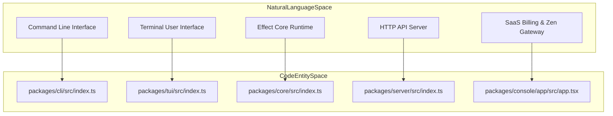

Sources: [bun.lock:34-134](), [package.json:38-44]()

---

### Package Dependency Flow

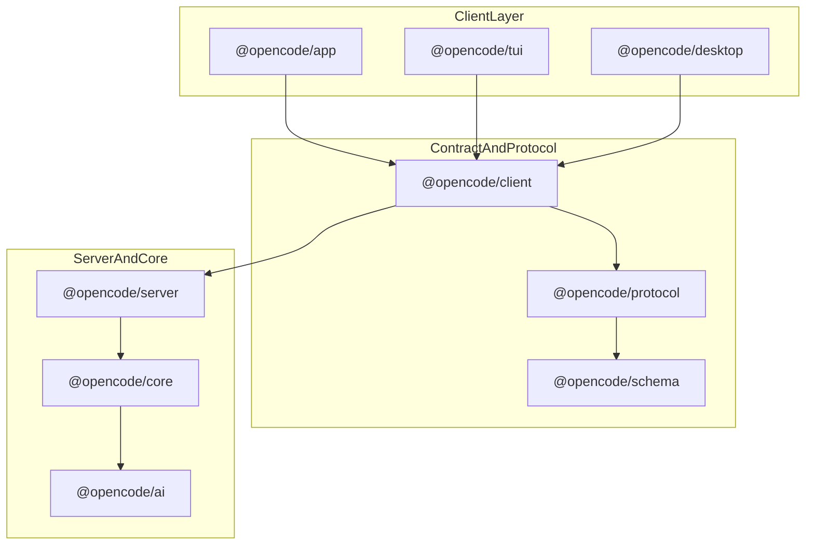

Sources: [bun.lock:34-137](), [packages/desktop/package.json:1-69]()

---

# Page: Architecture Overview

# Architecture Overview

<details>
<summary>Relevant source files</summary>

The following files were used as context for generating this wiki page:

- [packages/core/src/config/plugin/policy.ts](packages/core/src/config/plugin/policy.ts)
- [packages/core/src/config/variable.ts](packages/core/src/config/variable.ts)
- [packages/core/src/location-services.ts](packages/core/src/location-services.ts)
- [packages/core/src/managed-policy.ts](packages/core/src/managed-policy.ts)
- [packages/core/src/plugin/internal.ts](packages/core/src/plugin/internal.ts)
- [packages/core/src/plugin/sdk.ts](packages/core/src/plugin/sdk.ts)
- [packages/core/src/plugin/supervisor.ts](packages/core/src/plugin/supervisor.ts)
- [packages/core/src/session/move.ts](packages/core/src/session/move.ts)
- [packages/core/src/tool/plugin/mcp-resource.ts](packages/core/src/tool/plugin/mcp-resource.ts)
- [packages/core/src/tool/plugin/opencode.ts](packages/core/src/tool/plugin/opencode.ts)
- [packages/core/test/config/policy.test.ts](packages/core/test/config/policy.test.ts)
- [packages/core/test/fixture/tmpdir.ts](packages/core/test/fixture/tmpdir.ts)
- [packages/core/test/location-layer.test.ts](packages/core/test/location-layer.test.ts)
- [packages/core/test/plugin/fixture.ts](packages/core/test/plugin/fixture.ts)
- [packages/core/test/plugin/supervisor-reload.test.ts](packages/core/test/plugin/supervisor-reload.test.ts)
- [packages/core/test/plugin/supervisor.test.ts](packages/core/test/plugin/supervisor.test.ts)
- [packages/core/test/session-move.test.ts](packages/core/test/session-move.test.ts)
- [packages/core/test/session-remove.test.ts](packages/core/test/session-remove.test.ts)
- [packages/core/test/session-revert.test.ts](packages/core/test/session-revert.test.ts)
- [packages/core/test/tool-opencode.test.ts](packages/core/test/tool-opencode.test.ts)
- [packages/protocol/src/api.ts](packages/protocol/src/api.ts)
- [packages/protocol/src/client.ts](packages/protocol/src/client.ts)
- [packages/schema/src/config/policy.ts](packages/schema/src/config/policy.ts)
- [packages/server/src/handlers.ts](packages/server/src/handlers.ts)
- [packages/server/test/session-instances.test.ts](packages/server/test/session-instances.test.ts)
- [services/www/src/docs/content/cli/acp.mdx](services/www/src/docs/content/cli/acp.mdx)
- [services/www/src/docs/content/config.mdx](services/www/src/docs/content/config.mdx)
- [services/www/src/docs/content/instructions.mdx](services/www/src/docs/content/instructions.mdx)
- [services/www/src/docs/content/mcp-servers.mdx](services/www/src/docs/content/mcp-servers.mdx)
- [services/www/src/docs/content/migrate-v1.mdx](services/www/src/docs/content/migrate-v1.mdx)
- [services/www/src/docs/content/permissions.mdx](services/www/src/docs/content/permissions.mdx)
- [services/www/src/docs/content/policies.mdx](services/www/src/docs/content/policies.mdx)
- [services/www/src/docs/content/tools.mdx](services/www/src/docs/content/tools.mdx)
- [specs/v2/README.md](specs/v2/README.md)
- [specs/v2/provider-policy.md](specs/v2/provider-policy.md)

</details>


## Purpose and Scope

This page details the high-level client/server architecture of OpenCode, explaining the CLI daemon and background server process model, the Effect-based core runtime, the protocol and generated client contract, and the multiple UI clients (TUI, Web, Desktop). It also covers `specs/v2` documentation and repository terminology (`CONTEXT.md`, `AGENTS.md`).

Sources:
- [AGENTS.md:1-187]()
- [packages/cli/src/server-process.ts:32-45]()

---

## Client-Server Architecture & Daemon Model

OpenCode operates via a daemonized server process architecture managed through the CLI. When a client application like the Terminal UI (`packages/tui`) starts up, it inspects or spawns a background server process (`packages/server`) via `ServerConnection.resolve` [packages/cli/src/commands/handlers/default.ts:35-52](). 

The background server process is launched by `ServerProcess.run` in `packages/cli/src/server-process.ts`, establishing SQLite database connectivity, persistent PTY channels, file system watchers, and Effect HTTP routing [packages/cli/src/server-process.ts:32-151](), [packages/server/src/handlers.ts:35-67]().

### Client-Server Architecture Diagram

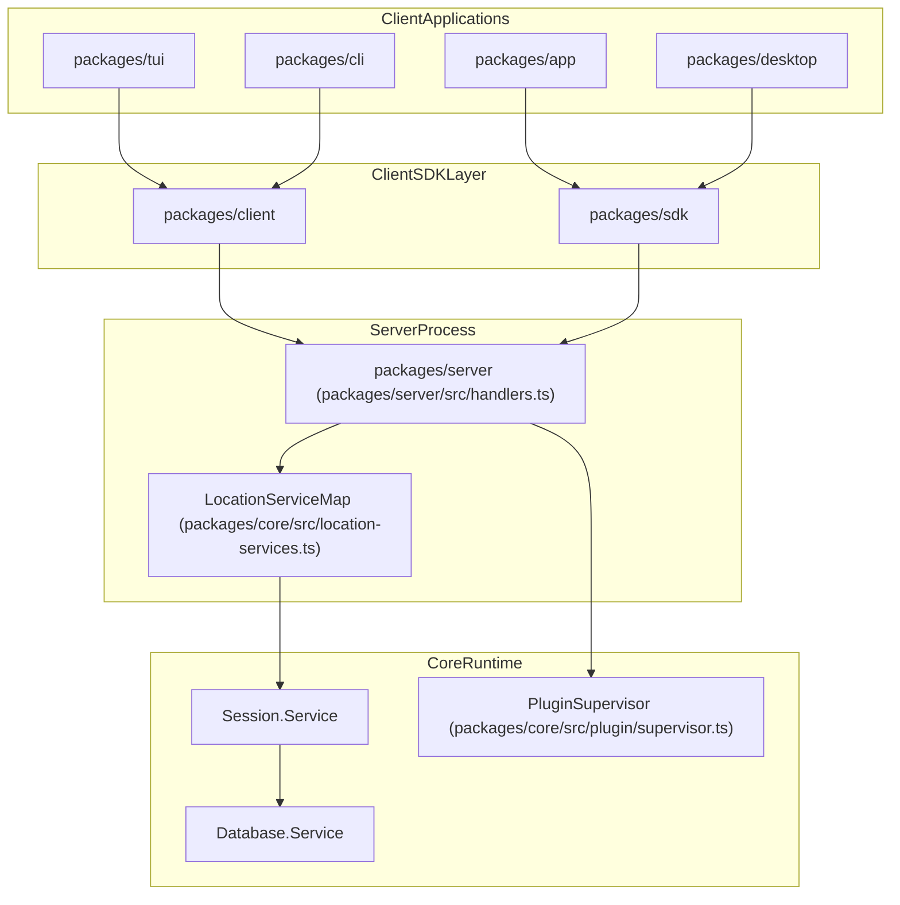

Sources:
- [packages/cli/src/server-process.ts:32-151]()
- [packages/cli/src/commands/handlers/default.ts:35-52]()
- [packages/server/src/handlers.ts:35-67]()
- [packages/core/src/location-services.ts:12-87]()

---

## Effect-Based Core Runtime

The core runtime (`packages/core`) is constructed around Effect services, layers, and dependency injection. Domain services such as `Session.Service`, `Config.Service`, `Tool.Service`, and `Provider.Service` are grouped into composite layers (`LayerNode`) [packages/core/src/plugin/internal.ts:108-158]().

Workspace isolation and multi-location management are coordinated via `LocationServiceMap` and `buildLocationServiceMap`, which dynamically builds and caches instance-bound service graphs per location reference (`Location.Ref`) [packages/core/src/location-services.ts:12-87]().

### Core Services Layer Composition

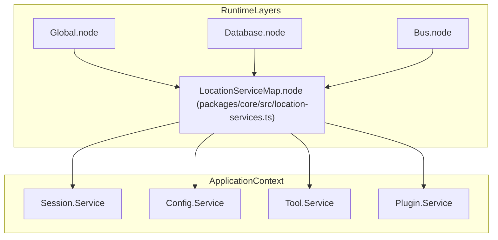

Sources:
- [packages/core/src/plugin/internal.ts:108-158]()
- [packages/core/src/location-services.ts:12-87]()

---

## Protocol, Client Contract, and UI Clients

Communication between clients and the server adheres to an Effect `HttpApi` specification defined in `packages/protocol`. Canonical data types and schemas reside in `packages/schema`, while `packages/client` generates type-safe consumers for remote procedure calls.

Primary UI clients include:
- **Terminal UI (`packages/tui`)**: Powered by SolidJS and `@opentui`, interacting directly with the server during startup and active session turns [packages/cli/src/commands/handlers/default.ts:96-155]().
- **Shared App (`packages/app`)**: Common frontend shell and virtualized timeline components utilized by web and desktop targets.
- **Desktop (`packages/desktop`)**: Electron wrapper providing persistent PTY daemons, IPC channels, and native application menus.

Sources:
- [packages/protocol/src/api.ts:111-136]()
- [packages/cli/src/commands/handlers/default.ts:96-155]()

---

## Bridging Natural Language Space to Code Entity Space (Part 1: Daemon & Routing)

| Natural Language Concept | Code Entity / Module |
|--------------------------|---------------------|
| CLI Daemon Background Runner | `ServerProcess.run` (`packages/cli/src/server-process.ts`) |
| HTTP Server Handlers & Routes | `handlers` (`packages/server/src/handlers.ts`) |
| Client Background Connection | `ServerConnection.resolve` (`packages/cli/src/commands/handlers/default.ts`) |
| Plugin Supervisor & Lifecycle | `PluginSupervisor` (`packages/core/src/plugin/supervisor.ts`) |

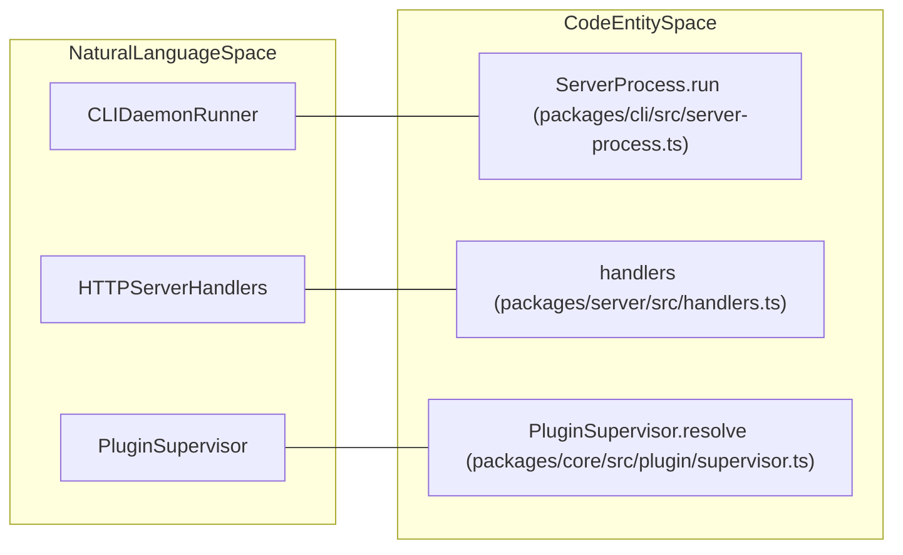

Sources:
- [packages/cli/src/server-process.ts:32-45]()
- [packages/server/src/handlers.ts:35-67]()
- [packages/core/src/plugin/supervisor.ts:19-26]()

---

## Bridging Natural Language Space to Code Entity Space (Part 2: Location & Core Services)

| Natural Language Concept | Code Entity / Module |
|--------------------------|---------------------|
| Workspace Location Map | `buildLocationServiceMap` (`packages/core/src/location-services.ts`) |
| Core Requirements Group | `requirements` (`packages/core/src/plugin/internal.ts`) |
| TUI Runtime Bootstrap | `run` (`packages/cli/src/commands/handlers/default.ts`) |

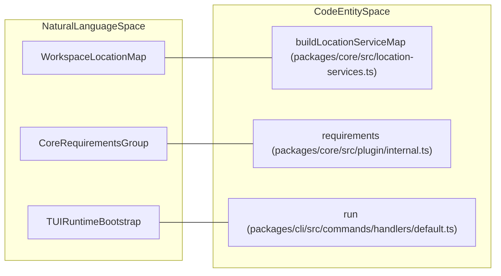

Sources:
- [packages/core/src/location-services.ts:12-14]()
- [packages/core/src/plugin/internal.ts:163-170]()
- [packages/cli/src/commands/handlers/default.ts:96-98]()

---

# Page: Contributor Guide & Repo Automation

# Contributor Guide & Repo Automation

<details>
<summary>Relevant source files</summary>

The following files were used as context for generating this wiki page:

- [.github/ISSUE_TEMPLATE/config.yml](.github/ISSUE_TEMPLATE/config.yml)
- [.github/TEAM_MEMBERS](.github/TEAM_MEMBERS)
- [.github/actions/setup-git-committer/action.yml](.github/actions/setup-git-committer/action.yml)
- [.github/pull_request_template.md](.github/pull_request_template.md)
- [.github/workflows/close-issues.yml](.github/workflows/close-issues.yml)
- [.github/workflows/close-prs.yml](.github/workflows/close-prs.yml)
- [.github/workflows/compliance-close.yml](.github/workflows/compliance-close.yml)
- [.github/workflows/docs-update.yml](.github/workflows/docs-update.yml)
- [.github/workflows/duplicate-issues.yml](.github/workflows/duplicate-issues.yml)
- [.github/workflows/notify-discord.yml](.github/workflows/notify-discord.yml)
- [.github/workflows/pr-management.yml](.github/workflows/pr-management.yml)
- [.github/workflows/pr-standards.yml](.github/workflows/pr-standards.yml)
- [.github/workflows/review.yml](.github/workflows/review.yml)
- [.github/workflows/triage.yml](.github/workflows/triage.yml)
- [.opencode/agent/duplicate-pr.md](.opencode/agent/duplicate-pr.md)
- [.opencode/agent/triage.md](.opencode/agent/triage.md)
- [.opencode/command/issues.md](.opencode/command/issues.md)
- [.opencode/tool/github-pr-search.ts](.opencode/tool/github-pr-search.ts)
- [.opencode/tool/github-triage.ts](.opencode/tool/github-triage.ts)
- [.oxlintrc.json](.oxlintrc.json)
- [.prettierignore](.prettierignore)
- [AGENTS.md](AGENTS.md)
- [CONTRIBUTING.md](CONTRIBUTING.md)
- [packages/console/app/src/routes/download/[channel]/[platform].ts](packages/console/app/src/routes/download/[channel]/[platform].ts)
- [packages/schema/src/skill.ts](packages/schema/src/skill.ts)
- [packages/script/package.json](packages/script/package.json)
- [packages/script/src/index.ts](packages/script/src/index.ts)
- [packages/tui/src/feature-plugins/system/notifications.ts](packages/tui/src/feature-plugins/system/notifications.ts)
- [packages/tui/src/routes/session/composer/context.ts](packages/tui/src/routes/session/composer/context.ts)
- [packages/tui/src/routes/session/composer/index.tsx](packages/tui/src/routes/session/composer/index.tsx)
- [packages/tui/src/routes/session/composer/shell-tab.tsx](packages/tui/src/routes/session/composer/shell-tab.tsx)
- [packages/tui/src/routes/session/composer/subagents-tab.tsx](packages/tui/src/routes/session/composer/subagents-tab.tsx)
- [packages/tui/src/routes/session/composer/terminals-tab.tsx](packages/tui/src/routes/session/composer/terminals-tab.tsx)
- [packages/tui/src/routes/session/form.tsx](packages/tui/src/routes/session/form.tsx)
- [packages/tui/src/routes/session/permission.tsx](packages/tui/src/routes/session/permission.tsx)
- [packages/tui/test/cli/cmd/tui/notifications.test.ts](packages/tui/test/cli/cmd/tui/notifications.test.ts)
- [packages/tui/test/cli/tui/composer-keymap.test.tsx](packages/tui/test/cli/tui/composer-keymap.test.tsx)
- [packages/tui/test/cli/tui/form.test.tsx](packages/tui/test/cli/tui/form.test.tsx)
- [packages/tui/test/component/dialog-shell-output.test.tsx](packages/tui/test/component/dialog-shell-output.test.tsx)
- [packages/web/src/content/docs/skills.mdx](packages/web/src/content/docs/skills.mdx)
- [script/github/close-issues.ts](script/github/close-issues.ts)
- [script/github/close-prs.ts](script/github/close-prs.ts)
- [specs/v2/session.md](specs/v2/session.md)

</details>


## Purpose and Scope
This document covers developer workflows, repository automation, stylistic conventions, and configuration standards for the OpenCode repository. It details the core guidelines in `AGENTS.md` and `CONTRIBUTING.md`, the built-in `.opencode/` agent ecosystem, commands, scripts (`packages/script`), static analysis rules (`.oxlintrc.json`), and automated GitHub workflows (`pr-standards`, `duplicate-issues`, and `review`).

---

## 1. Developer Workflow & Conventions (`AGENTS.md`)

OpenCode development relies on Bun (version 1.3 or newer) as its runtime and package manager `[CONTRIBUTING.md:25-25]()`. Repository contributors follow strict stylistic and structural guardrails to maintain monorepo health across packages like `packages/core`, `packages/cli`, `packages/server`, `packages/protocol`, and `packages/schema`.

### Branch and Commit Standards
- **Branch Naming**: Branch names must be short (at most three words) separated by hyphens. Type prefixes like `feat/` or `fix/` are disallowed `[AGENTS.md:30-32]()`. Examples include `session-recovery`, `fix-scroll-state`, and `regenerate-sdk` `[AGENTS.md:31-31]()`.
- **Commit Messages & PR Titles**: Commits and pull request titles must follow conventional commit formatting: `type(scope): summary` `[AGENTS.md:35-35]`. Valid types are `feat`, `fix`, `docs`, `chore`, `refactor`, and `test` `[AGENTS.md:37-37]()`. Scopes correspond to affected packages or areas (e.g., `core`, `opencode`, `tui`, `app`, `desktop`, `sdk`, `plugin`) `[AGENTS.md:37-37]()`.

### Code Style & Functional Principles
- **Variable Binding in Effect Generators**: When writing Effect generators, developers must bind services to named variables before invoking methods, avoiding nested service yields like `yield* (yield* Foo.Service).bar()` `[AGENTS.md:55-55]()`.
- **Destructuring and Imports**: Avoid unnecessary destructuring; use dot notation to preserve context `[AGENTS.md:70-70]()`. Never alias imports or use star (`*`) imports; import modules by their exported namespace instead `[AGENTS.md:83-86]()`.
- **Live V2 TUI Testing**: Developers run `bun run dev:live [directory]` to test development TUI builds against the currently elected background `opencode` server and live sessions, leveraging `opencode service status` and private credential injection `[AGENTS.md:8-11]()`.

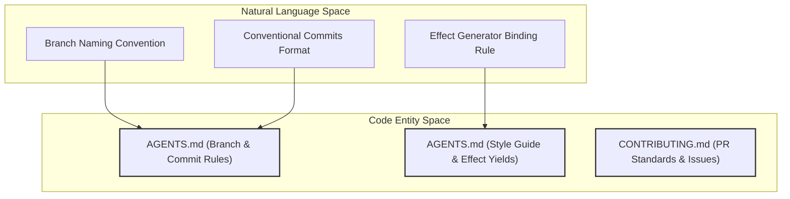
*Diagram 1: Mapping natural language developer conventions to repository documentation specifications.*

**Sources:** `AGENTS.md:1-115`, `CONTRIBUTING.md:1-113`

---

## 2. The `.opencode/` Workspace & Agent Configuration

The repository root houses a local `.opencode/` directory containing agent definitions, custom tools, configuration overrides, and reference pointers used when running OpenCode inside the repository itself.

### Triage Agent & Tooling
Issues are automatically managed or assisted by a local triage agent defined in `[.opencode/agent/triage.md:1-11]()`. The agent delegates assignment actions to the custom tool implementation located at `[.opencode/tool/github-triage.ts:38-60]()`.

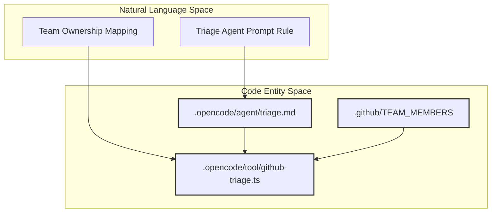
*Diagram 2: Association of triage agent specs to local configuration and TypeScript tool implementations.*

- **Team Routing**: The triage tool maps teams (`tui`, `desktop_web`, `core`, `inference`, `windows`) to maintainer handles `[.opencode/tool/github-triage.ts:4-10]()`.
- **GitHub API Integration**: `githubFetch` executes authenticated `POST` requests to assign chosen owners via `https://api.github.com/repos/${owner}/${repo}/issues/${issue}/assignees` `[.opencode/tool/github-triage.ts:22-36]()`.

**Sources:** `[.opencode/agent/triage.md:1-44]`, `[.opencode/tool/github-triage.ts:1-60]`, `[.github/TEAM_MEMBERS]`

---

## 3. Linting, Quality Enforcement & Script Automation

Code quality checks, linter rules (such as `.oxlintrc.json`), and release script calculations are hosted across package scripts and repository validation workflows.

### Packages Scripting (`packages/script`)
The script package runtime (`[packages/script/src/index.ts:1-18]()`) verifies that the active Bun runtime satisfies the version constraint declared in root `package.json`. It dynamically computes channels, preview build numbers from `GITHUB_RUN_NUMBER`, and loads team member lists from `.github/TEAM_MEMBERS` `[packages/script/src/index.ts:20-89]()`.

### Verification Procedures
Contributors verify changes by running tests and typechecks directly inside the affected package workspace rather than the root:
```bash
cd packages/core
bun run test
bun typecheck
```
`[CONTRIBUTING.md:62-70]()`

**Sources:** `[packages/script/src/index.ts:1-90]`, `[CONTRIBUTING.md:1-113]`, `[.oxlintrc.json]`

---

## 4. GitHub Automation Workflows

GitHub Actions automate issue triage, pull request standards compliance, duplicate detection, and code reviews.

### PR Standards Workflow (`pr-standards.yml`)
The `[.github/workflows/pr-standards.yml:1-146]()` action checks pull request titles for conventional commit prefixes and verifies linked closing issues via GitHub's GraphQL API (`closingIssuesReferences`) or body tags (`Closes #123`) `[ .github/workflows/pr-standards.yml:118-145]()`. Non-compliant PRs receive a `needs:title` or `needs:issue` label and an explanatory comment `[ .github/workflows/pr-standards.yml:91-158]()`.

### Duplicate Issues Workflow (`duplicate-issues.yml`)
When a new issue is opened, `.github/workflows/duplicate-issues.yml` executes an OpenCode agent run to check template compliance and search existing issues for duplicates.

### PR Review Workflow (`review.yml`)
Triggered via issue comments starting with `/review` by authorized members, `.github/workflows/review.yml` instructs OpenCode to evaluate PR diffs against repository style guidelines and post inline comments via the `gh` CLI `[.github/workflows/review.yml:1-83]()`.

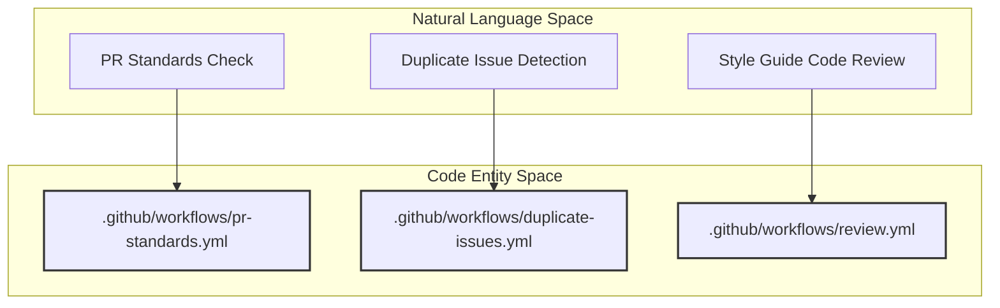
*Diagram 3: GitHub Actions workflow automation entities mapping to automated validation rules.*

**Sources:** `[.github/workflows/pr-standards.yml:1-172]`, `[.github/workflows/duplicate-issues.yml:1-170]`, `[.github/workflows/review.yml:1-83]`

---

# Page: Core Runtime (packages/core)

# Core Runtime (packages/core)

<details>
<summary>Relevant source files</summary>

The following files were used as context for generating this wiki page:

- [packages/core/package.json](packages/core/package.json)
- [packages/core/src/config/variable.ts](packages/core/src/config/variable.ts)
- [packages/core/src/location-services.ts](packages/core/src/location-services.ts)
- [packages/core/src/plugin/internal.ts](packages/core/src/plugin/internal.ts)
- [packages/core/src/plugin/sdk.ts](packages/core/src/plugin/sdk.ts)
- [packages/core/src/plugin/supervisor.ts](packages/core/src/plugin/supervisor.ts)
- [packages/core/src/session/move.ts](packages/core/src/session/move.ts)
- [packages/core/test/fixture/tmpdir.ts](packages/core/test/fixture/tmpdir.ts)
- [packages/core/test/location-layer.test.ts](packages/core/test/location-layer.test.ts)
- [packages/core/test/plugin/supervisor-reload.test.ts](packages/core/test/plugin/supervisor-reload.test.ts)
- [packages/core/test/plugin/supervisor.test.ts](packages/core/test/plugin/supervisor.test.ts)
- [packages/core/test/session-move.test.ts](packages/core/test/session-move.test.ts)
- [packages/core/test/session-remove.test.ts](packages/core/test/session-remove.test.ts)
- [packages/core/test/session-revert.test.ts](packages/core/test/session-revert.test.ts)
- [packages/protocol/src/api.ts](packages/protocol/src/api.ts)
- [packages/protocol/src/client.ts](packages/protocol/src/client.ts)
- [packages/server/src/handlers.ts](packages/server/src/handlers.ts)
- [packages/server/test/session-instances.test.ts](packages/server/test/session-instances.test.ts)

</details>


The Core Runtime (`packages/core`) is the foundational Effect-based engine powering OpenCode sessions, tool executions, AI provider integrations, configuration loading, and persistence [packages/core/package.json:1-139](). Built on top of the Effect concurrency and service model, it orchestrates lifecycle management across independent location contexts, supervising plugins [packages/core/src/plugin/supervisor.ts:124-162](), managing filesystem watchers, and coordinating the LLM execution loop.

This page provides a high-level overview of the core runtime subsystems. For deep technical details, follow the links to the individual child pages below.

---

## Architecture & Service Layering

The core runtime uses Effect services and layers (`LayerNode`, `LayerMap`) to instantiate and supervise domain services [packages/core/src/plugin/internal.ts:108-158](), [packages/core/src/location-services.ts:12-87](). Services such as `Session.Service`, `Tool.Service`, `Config.Service`, and `Plugin.Service` are scoped within instance boundaries or globally shared depending on their lifecycle requirements [packages/core/src/plugin/internal.ts:108-158]().

### Core Runtime Service Dependency Diagram

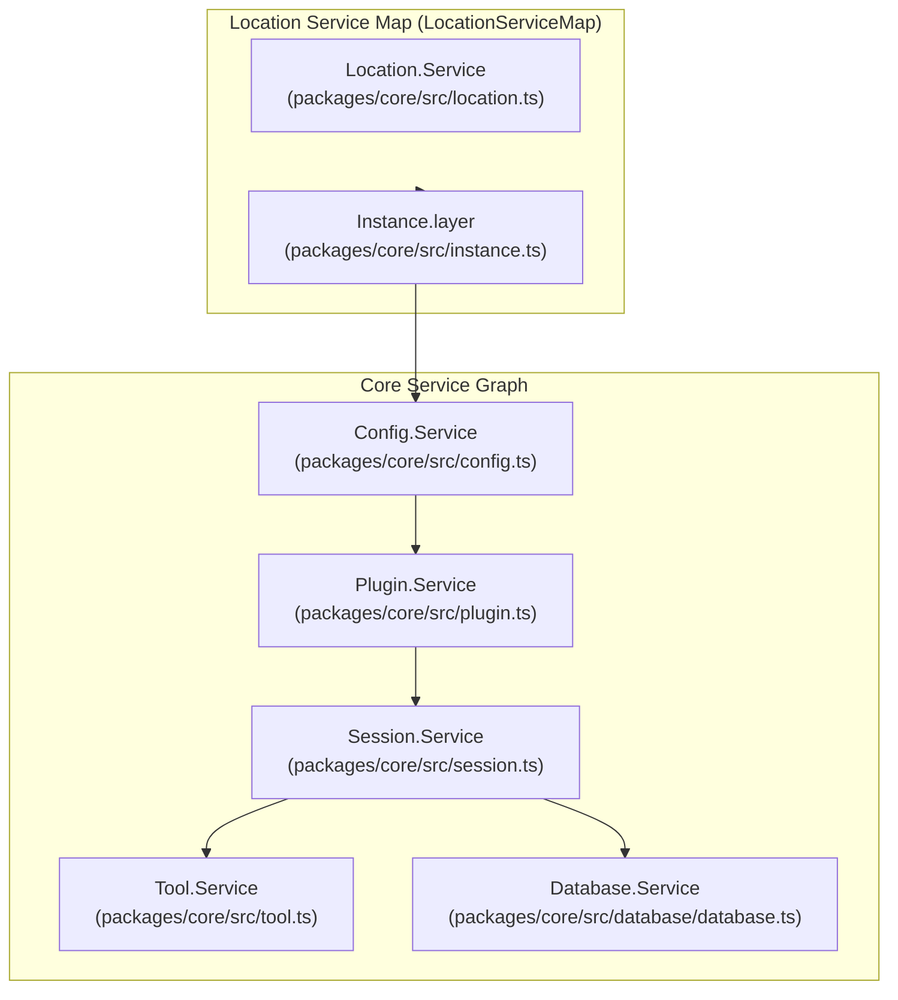

Sources: [packages/core/src/plugin/internal.ts:108-158](), [packages/core/src/location-services.ts:12-87]()

---

## Subsystem Overview

### Session Model & Event Sourcing

Session management governs conversational state, message history, and durable event logs. It handles project context, inbox queues, projectors, message updaters, and session forking or reverting.

For details, see [Session Model & Event Sourcing](#2.1).

### Configuration System

The configuration engine handles schema-driven validation, loading, environment variable overrides (`ConfigVariable.substitute`), normalization, v1 migration rules, and well-known path resolution for project and global settings [packages/core/src/config/variable.ts:25-38]().

For details, see [Configuration System](#2.2).

### Tool System & Permissions

Tools provide capabilities like reading, writing, editing, file patching, searching (`grep`, `glob`), shell execution, web fetching, search, subagents, and skills. Permissions evaluate tool safety and enforce user confirmations.

For details, see [Tool System & Permissions](#2.3).

### Agents, Skills & Commands

Agents define AI personas and execution modes (such as plan mode). Skills discovery parses `SKILL.md` bundles, and command registries map user slash commands and subagent jobs.

For details, see [Agents, Skills & Commands](#2.4).

### Plugin System

The plugin supervisor and host manage internal registries, local plugin loading, npm package integration, and effect/promise APIs with robust supervisor reload strategies [packages/core/src/plugin/supervisor.ts:19-122](), [packages/core/src/plugin/internal.ts:108-158]().

For details, see [Plugin System](#2.5).

### MCP Integration

Model Context Protocol (MCP) clients support external tool servers, OAuth authentication flows, MCP-backed web search, and interactive TUI dialogs.

For details, see [MCP Integration](#2.6).

### Filesystem, Search & Projects

The filesystem service manages file operations, ripgrep binary integration, watchers, and workspace/project location resolution.

For details, see [Filesystem, Search & Projects](#2.7).

### Persistence: Database & Migrations

Persistence is driven by SQLite (supporting Bun, Node, and Workerd drivers) via `drizzle-orm`, with schema migrations, v1 data migration handlers, and KV store utilities [packages/core/package.json:33-76]().

For details, see [Persistence: Database & Migrations](#2.8).

### CodeMode Interpreter

The CodeMode package provides a sandboxed JavaScript interpreter with custom stdlib and dynamic tool schema generation for programmatic agent execution.

For details, see [CodeMode Interpreter](#2.9).

---

## Bridging Natural Language Space & Code Entities

The following diagram associates natural language operations with their corresponding core runtime entities and files.

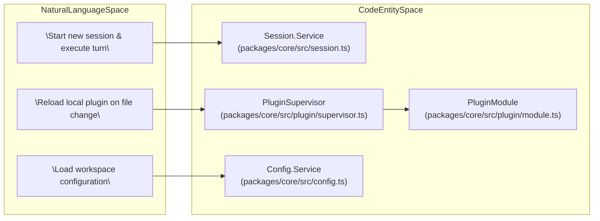

Sources: [packages/core/src/plugin/supervisor.ts:19-122](), [packages/core/src/plugin/internal.ts:61-62]()

---

# Page: Session Model & Event Sourcing

# Session Model & Event Sourcing

<details>
<summary>Relevant source files</summary>

The following files were used as context for generating this wiki page:

- [V2_HTTP_API_AUDIT.md](V2_HTTP_API_AUDIT.md)
- [packages/cli/src/commands/handlers/stats.ts](packages/cli/src/commands/handlers/stats.ts)
- [packages/cli/test/stats.test.ts](packages/cli/test/stats.test.ts)
- [packages/client/src/effect/api/api.ts](packages/client/src/effect/api/api.ts)
- [packages/client/src/effect/generated/client.ts](packages/client/src/effect/generated/client.ts)
- [packages/client/src/promise/generated/client.ts](packages/client/src/promise/generated/client.ts)
- [packages/client/src/promise/generated/types.ts](packages/client/src/promise/generated/types.ts)
- [packages/client/src/solid/data.ts](packages/client/src/solid/data.ts)
- [packages/client/test/effect.test.ts](packages/client/test/effect.test.ts)
- [packages/client/test/promise.test.ts](packages/client/test/promise.test.ts)
- [packages/client/test/solid-data.test.ts](packages/client/test/solid-data.test.ts)
- [packages/core/src/bus.ts](packages/core/src/bus.ts)
- [packages/core/src/event-logger.ts](packages/core/src/event-logger.ts)
- [packages/core/src/session.ts](packages/core/src/session.ts)
- [packages/core/src/session/instructions.ts](packages/core/src/session/instructions.ts)
- [packages/core/src/session/message-updater.ts](packages/core/src/session/message-updater.ts)
- [packages/core/src/session/projector.ts](packages/core/src/session/projector.ts)
- [packages/core/src/session/stats.ts](packages/core/src/session/stats.ts)
- [packages/core/test/bus.test.ts](packages/core/test/bus.test.ts)
- [packages/core/test/session-create.test.ts](packages/core/test/session-create.test.ts)
- [packages/core/test/session-instructions.test.ts](packages/core/test/session-instructions.test.ts)
- [packages/core/test/session-log.test.ts](packages/core/test/session-log.test.ts)
- [packages/core/test/session-projector.test.ts](packages/core/test/session-projector.test.ts)
- [packages/core/test/session-prompt.test.ts](packages/core/test/session-prompt.test.ts)
- [packages/core/test/session-stats.test.ts](packages/core/test/session-stats.test.ts)
- [packages/protocol/openapi.json](packages/protocol/openapi.json)
- [packages/protocol/src/groups/session.ts](packages/protocol/src/groups/session.ts)
- [packages/schema/src/session-event.ts](packages/schema/src/session-event.ts)
- [packages/schema/src/session-message.ts](packages/schema/src/session-message.ts)
- [packages/schema/src/session-stats.ts](packages/schema/src/session-stats.ts)
- [packages/schema/test/event-manifest.test.ts](packages/schema/test/event-manifest.test.ts)
- [packages/server/src/handlers/session.ts](packages/server/src/handlers/session.ts)
- [services/www/openapi.json](services/www/openapi.json)
- [services/www/public/openapi.json](services/www/public/openapi.json)
- [services/www/src/docs/content/models.mdx](services/www/src/docs/content/models.mdx)

</details>


## Purpose & Scope

The Session Model & Event Sourcing subsystem manages the lifecycle, persistence, event logs, and state projections of conversation threads in OpenCode. Built around an Effect-based service architecture within `packages/core/src/session.ts`, the system treats sessions as event-sourced aggregates. User inputs, system messages, tool executions, and compactions are captured as durable events and projected into relational SQLite tables via Drizzle ORM.

This page provides a high-level overview of session services, durable event logging, the inbox queueing model, state projectors, message updates, forking, and history management. 

For detailed coverage of specific subsystems, see:
- For the LLM execution loop, model requests, and error mapping, see [Session Runner & LLM Execution Loop](#2.1.1).
- For token budgeting, shrinking, and context compaction, see [Compaction & Context Management](#2.1.2).

Sources:
- [packages/core/src/session.ts:1-70]()

---

## Session Lifecycle & Store

Sessions are isolated conversation threads linked to projects and locations. The `Session.Service` interface defines core operations for creating, listing, viewing, forking, and removing sessions [packages/core/src/session.ts:122-141](). Sessions use descending ULIDs for unique identifiers to guarantee reverse-chronological ordering in UI clients. The underlying store coordinates persistence across queries, filters, and message pagination [packages/core/src/session.ts:81-84]().

### Natural Language to Code Entity Mapping (Sessions)

This diagram maps high-level session concepts to their corresponding Effect services and schema definitions in `packages/core`.

Title: "Session Architecture Entity Mapping"
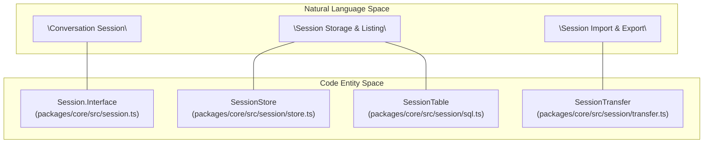

Sources:
- [packages/core/src/session.ts:81-141]()
- [packages/core/test/session-create.test.ts:105-131]()

---

## Durable Event Sourcing & Projector

OpenCode sessions rely on an event-sourced architecture where state mutations are published to an event bus (`Bus.Service`) and materialized into relational tables by `SessionProjector` [packages/core/src/session/projector.ts:84-113](). 

The session log (`session.log`) replays durable session events after an optional cursor, emitting synchronization markers and supporting real-time event streaming via Server-Sent Events (SSE) [packages/core/src/session.ts:162-171]().

### Natural Language to Code Entity Mapping (Events)

This diagram associates event sourcing concepts with their implementation modules in the core runtime.

Title: "Event Sourcing & Projection Mapping"
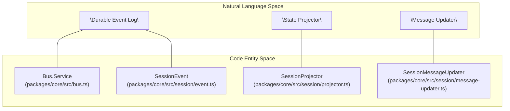

Sources:
- [packages/core/src/session.ts:162-171]()
- [packages/core/src/session/projector.ts:37-113]()

---

## Inbox, Queueing & Steering

The session inbox (`SessionInbox`) manages incoming prompts, synthetic inputs, compaction barriers, and moves before they are projected into active conversation history [packages/core/src/session.ts:162-171](). 

Admitted work can be steered, queued, or cancelled through explicit inbox methods (`steerInbox`, `queueInbox`, `cancelInbox`), allowing fine-grained control over execution flow when an agent is busy [packages/core/src/session.ts:162-171]().

Sources:
- [packages/core/src/session.ts:162-171]()
- [packages/protocol/src/groups/session.ts:64-70]()

---

## Message Updater, Forking & Revert

Sessions support branching and historical rollback via forking and diffing:
- **Forking:** `session.fork` duplicates session state and copies messages up to a specific boundary message, deriving a new session record [packages/core/src/session.ts:132-135](), [packages/core/src/session/projector.ts:115-188]().
- **Diffing:** `session.diff` computes structured file diffs across turns or message ranges using snapshot and VCS integrations [packages/core/src/session.ts:153-161]().

Sources:
- [packages/core/src/session.ts:132-161]()
- [packages/core/src/session/projector.ts:115-188]()

---

## Child Pages & Detailed Documentation

- [Session Runner & LLM Execution Loop](#2.1.1) — Covers `SessionRunnerLLM` drain/step loop, model-request construction, retries, error mapping, LLM event publishing, snapshots and git integration.
- [Compaction & Context Management](#2.1.2) — Covers summary vs native compaction, context assembly, instructions discovery, token budgeting and overflow shrinking.

Sources:
- [packages/core/src/session.ts:1-171]()

---

# Page: Session Runner & LLM Execution Loop

# Session Runner & LLM Execution Loop

<details>
<summary>Relevant source files</summary>

The following files were used as context for generating this wiki page:

- [packages/ai/src/provider-error.ts](packages/ai/src/provider-error.ts)
- [packages/ai/src/route/executor.ts](packages/ai/src/route/executor.ts)
- [packages/ai/src/route/transport/websocket.ts](packages/ai/src/route/transport/websocket.ts)
- [packages/ai/src/schema/errors.ts](packages/ai/src/schema/errors.ts)
- [packages/ai/src/schema/messages.ts](packages/ai/src/schema/messages.ts)
- [packages/ai/test/executor.test.ts](packages/ai/test/executor.test.ts)
- [packages/ai/test/provider-error.test.ts](packages/ai/test/provider-error.test.ts)
- [packages/ai/test/provider/image-detail.test.ts](packages/ai/test/provider/image-detail.test.ts)
- [packages/ai/test/schema.test.ts](packages/ai/test/schema.test.ts)
- [packages/ai/test/tool-runtime.test.ts](packages/ai/test/tool-runtime.test.ts)
- [packages/core/src/aisdk.ts](packages/core/src/aisdk.ts)
- [packages/core/src/effect/app-node-platform.ts](packages/core/src/effect/app-node-platform.ts)
- [packages/core/src/effect/websocket-constructor.ts](packages/core/src/effect/websocket-constructor.ts)
- [packages/core/src/generate.ts](packages/core/src/generate.ts)
- [packages/core/src/kv.ts](packages/core/src/kv.ts)
- [packages/core/src/model-retry.ts](packages/core/src/model-retry.ts)
- [packages/core/src/session/compaction.ts](packages/core/src/session/compaction.ts)
- [packages/core/src/session/execution.ts](packages/core/src/session/execution.ts)
- [packages/core/src/session/execution/restart.ts](packages/core/src/session/execution/restart.ts)
- [packages/core/src/session/generate.ts](packages/core/src/session/generate.ts)
- [packages/core/src/session/history.ts](packages/core/src/session/history.ts)
- [packages/core/src/session/model-request.ts](packages/core/src/session/model-request.ts)
- [packages/core/src/session/model-transport.ts](packages/core/src/session/model-transport.ts)
- [packages/core/src/session/run-coordinator.ts](packages/core/src/session/run-coordinator.ts)
- [packages/core/src/session/runner/index.ts](packages/core/src/session/runner/index.ts)
- [packages/core/src/session/runner/llm.ts](packages/core/src/session/runner/llm.ts)
- [packages/core/src/session/runner/model.ts](packages/core/src/session/runner/model.ts)
- [packages/core/src/session/runner/publish-llm-event.ts](packages/core/src/session/runner/publish-llm-event.ts)
- [packages/core/src/session/runner/retry.ts](packages/core/src/session/runner/retry.ts)
- [packages/core/src/session/runner/step.ts](packages/core/src/session/runner/step.ts)
- [packages/core/src/session/runner/to-llm-message.ts](packages/core/src/session/runner/to-llm-message.ts)
- [packages/core/src/session/store.ts](packages/core/src/session/store.ts)
- [packages/core/src/session/subagent-completion.ts](packages/core/src/session/subagent-completion.ts)
- [packages/core/src/session/title.ts](packages/core/src/session/title.ts)
- [packages/core/src/session/to-session-error.ts](packages/core/src/session/to-session-error.ts)
- [packages/core/src/shell.ts](packages/core/src/shell.ts)
- [packages/core/src/tool/plugin/shell.ts](packages/core/src/tool/plugin/shell.ts)
- [packages/core/src/tool/plugin/subagent.ts](packages/core/src/tool/plugin/subagent.ts)
- [packages/core/src/tool/plugin/webfetch.ts](packages/core/src/tool/plugin/webfetch.ts)
- [packages/core/test/aisdk.test.ts](packages/core/test/aisdk.test.ts)
- [packages/core/test/config/command-subagent.test.ts](packages/core/test/config/command-subagent.test.ts)
- [packages/core/test/config/compaction.test.ts](packages/core/test/config/compaction.test.ts)
- [packages/core/test/effect-app-node-platform.test.ts](packages/core/test/effect-app-node-platform.test.ts)
- [packages/core/test/generate.test.ts](packages/core/test/generate.test.ts)
- [packages/core/test/kv.test.ts](packages/core/test/kv.test.ts)
- [packages/core/test/lib/tool.ts](packages/core/test/lib/tool.ts)
- [packages/core/test/session-compact.test.ts](packages/core/test/session-compact.test.ts)
- [packages/core/test/session-compaction.test.ts](packages/core/test/session-compaction.test.ts)
- [packages/core/test/session-error.test.ts](packages/core/test/session-error.test.ts)
- [packages/core/test/session-execution.test.ts](packages/core/test/session-execution.test.ts)
- [packages/core/test/session-generate.test.ts](packages/core/test/session-generate.test.ts)
- [packages/core/test/session-model-request-hooks.test.ts](packages/core/test/session-model-request-hooks.test.ts)
- [packages/core/test/session-model-request.test.ts](packages/core/test/session-model-request.test.ts)
- [packages/core/test/session-model-transport-live.test.ts](packages/core/test/session-model-transport-live.test.ts)
- [packages/core/test/session-model-transport.test.ts](packages/core/test/session-model-transport.test.ts)
- [packages/core/test/session-native-compaction.test.ts](packages/core/test/session-native-compaction.test.ts)
- [packages/core/test/session-run-coordinator.test.ts](packages/core/test/session-run-coordinator.test.ts)
- [packages/core/test/session-runner-message.test.ts](packages/core/test/session-runner-message.test.ts)
- [packages/core/test/session-runner-recorded.test.ts](packages/core/test/session-runner-recorded.test.ts)
- [packages/core/test/session-runner-retry.test.ts](packages/core/test/session-runner-retry.test.ts)
- [packages/core/test/session-runner-tool-events.test.ts](packages/core/test/session-runner-tool-events.test.ts)
- [packages/core/test/session-runner.test.ts](packages/core/test/session-runner.test.ts)
- [packages/core/test/session-step.test.ts](packages/core/test/session-step.test.ts)
- [packages/core/test/session-title.test.ts](packages/core/test/session-title.test.ts)
- [packages/core/test/tool-shell.test.ts](packages/core/test/tool-shell.test.ts)
- [packages/core/test/tool-subagent.test.ts](packages/core/test/tool-subagent.test.ts)
- [packages/plugin/src/effect/storage.ts](packages/plugin/src/effect/storage.ts)
- [packages/protocol/src/groups/shell.ts](packages/protocol/src/groups/shell.ts)
- [packages/schema/src/shell.ts](packages/schema/src/shell.ts)
- [packages/server/src/handlers/shell.ts](packages/server/src/handlers/shell.ts)
- [services/www/src/docs/content/compaction.mdx](services/www/src/docs/content/compaction.mdx)

</details>


### Purpose & Scope
This page details the implementation of the core session execution engine within OpenCode, specifically the `SessionRunnerLLM` service (`packages/core/src/session/runner/llm.ts`). It covers the drain and step event-loop, model-request compilation (`packages/core/src/session/model-request.ts`), classification of provider errors and transient retry logic (`packages/ai/src/provider-error.ts`), error mapping (`packages/core/src/session/to-session-error.ts`), real-time LLM event publishing (`packages/core/src/session/runner/publish-llm-event.ts`), and snapshot integration with git workflows.

---

### Drain & Step Execution Loop (`SessionRunnerLLM`)

The session execution loop is orchestrated by `SessionRunnerLLM`, which consumes items from the session inbox, manages execution steps, drives tool calls, and handles mid-stream interruptions or compactions [packages/core/src/session/runner/llm.ts:54-146]().

When a drain request is triggered via `SessionRunner.drain()`, the service evaluates pending promotable items in the session inbox [packages/core/src/session/runner/llm.ts:54-66](). Once active, it enters an uninterruptible mask loop (`advanceToStep`) that checks location liveness and synchronizes control actions like manual compactions or workspace moves [packages/core/src/session/runner/llm.ts:71-115]().

Diagram: Natural Language Space to Code Entity Space for Drain Execution
```mermaid
graph TD
  "DrainTrigger" --> ["SessionRunner.drain"]
  ["SessionRunner.drain"] --> ["SessionInbox.nextPromotable"]
  ["SessionInbox.nextPromotable"] --> ["Plugin.awaitActivation"]
  ["Plugin.awaitActivation"] --> ["SessionRunner.advanceToStep"]
  ["SessionRunner.advanceToStep"] --> ["LocationLifecycle.isClosed"]
  ["LocationLifecycle.isClosed"] -->|Active| ["SessionInbox.serialized"]
  ["SessionInbox.serialized"] --> ["SessionCompaction.compact"]
  ["SessionInbox.serialized"] --> ["SessionModelRequest.compaction"]
```
*Sources: `packages/core/src/session/runner/llm.ts:54-146`*

If an incomplete stream or interruption occurs, the runner appends continuation markers (such as `CONTINUE_AFTER_INCOMPLETE_STREAM`) to maintain conversational continuity without re-processing completed parts [packages/core/src/session/runner/llm.ts:35-36]().

Sources: `packages/core/src/session/runner/llm.ts:35-146`

---

### Model-Request Construction (`SessionModelRequest`)

Before dispatching prompts to model providers, OpenCode compiles session histories, system instructions, and tool definitions into a normalized `LLMRequest` object using `SessionModelRequest` (`packages/core/src/session/model-request.ts`).

The core transcript builder (`baseTranscript`) aggregates system prompts from agent specifications, injected instruction files, and initial session metadata, then maps historical messages via `toLLMMessages` [packages/core/src/session/model-request.ts:100-120]().

Diagram: Natural Language Space to Code Entity Space for Model Request Building
```mermaid
graph TD
  "TranscriptAssembly" --> ["SessionModelRequest"]
  ["SessionModelRequest"] --> ["baseTranscript"]
  ["baseTranscript"] --> ["Agent.Info"]
  ["baseTranscript"] --> ["InstructionBuiltIns"]
  ["baseTranscript"] --> ["toLLMMessages"]
  ["toLLMMessages"] --> ["LLMRequest"]
```
*Sources: `packages/core/src/session/model-request.ts:100-120`, `packages/core/src/session/runner/to-llm-message.ts:1-50`*

Token limits and output budgets are dynamically computed using `outputLimit`, which evaluates model context caps, measured/estimated prompt tokens, and reserves room for final responses and summaries [packages/core/src/session/model-request.ts:88-98](). Media assets (images, audio, PDFs) are validated against model capability definitions and stripped or removed if unsupported [packages/core/src/session/model-request.ts:132-147]().

Sources: `packages/core/src/session/model-request.ts:60-154`

---

### Retries, Error Mapping, and Provider Failures

When interacting with LLM providers, failures can occur due to rate limiting, context overflows, or provider internal errors. OpenCode classifies these errors to determine whether a request can be safely retried.

The function `isRetryable` evaluates whether an `AIError` is eligible for repetition based on reason tags, headers (`x-should-retry`), and delivery statuses [packages/ai/src/provider-error.ts:81-116]().

Context overflows are detected via regex pattern matchers that inspect error messages for threshold breaches (e.g., `isContextOverflow`), triggering automatic or manual compaction flows [packages/ai/src/provider-error.ts:66-75](). Raw errors are mapped into standardized session error structures via `toSessionError` [packages/core/src/session/to-session-error.ts:1-40]().

Sources: `packages/ai/src/provider-error.ts:66-116`, `packages/core/src/session/to-session-error.ts:1-50`

---

### LLM Event Publishing (`createLLMEventPublisher`)

During step execution, streaming responses and tool invocations emit fine-grained events via `createLLMEventPublisher` (`packages/core/src/session/runner/publish-llm-event.ts`). 

The publisher maintains thread-safe synchronization between concurrent provider output processing and tool execution fibers. Two concurrency invariants govern this design:
1. **Synchronous State Marking**: State updates (such as `tool.settled` or `stepStarted`) must be marked synchronously before any `await` or `yield` to preserve atomicity under cooperative scheduling [packages/core/src/session/runner/publish-llm-event.ts:67-78]().
2. **Event Sequencing**: Cross-source ordering relies on per-source monotonic sequences rather than global locks [packages/core/src/session/runner/publish-llm-event.ts:75-77]().

Diagram: Natural Language Space to Code Entity Space for Event Publishing
```mermaid
graph TD
  "StreamOutput" --> ["LLMStream"]
  ["LLMStream"] --> ["createLLMEventPublisher"]
  ["createLLMEventPublisher"] -->|SessionEvent.Step.Started| ["Bus.Service"]
  ["createLLMEventPublisher"] -->|SessionEvent.Step.Streamed| ["Bus.Service"]
  ["createLLMEventPublisher"] -->|Tool Execution| ["Tool.Snapshot.execute"]
  ["Tool.Snapshot.execute"] --> ["SessionMessage"]
```
*Sources: `packages/core/src/session/runner/publish-llm-event.ts:79-124`*

Delta text chunks are batched at regular intervals (defaulting to `100ms`) to minimize database write contention and UI re-render thrashing [packages/core/src/session/runner/publish-llm-event.ts:80-156]().

Sources: `packages/core/src/session/runner/publish-llm-event.ts:1-156`

---

### Snapshots and Git Integration

To maintain project integrity across execution steps, the session runner integrates with the `Snapshot` service and local Git repositories (`packages/core/src/snapshot.ts`).

Before a step initiates, pending snapshots are captured asynchronously, allowing file-system modifications to be tracked and correlated with assistant turns [packages/core/src/session/runner/publish-llm-event.ts:23-27](). Working tree diffs, branch resolutions, and commit statuses are managed through git utility hooks, ensuring changes applied by tools can be audited or reverted.

Sources: `packages/core/src/snapshot.ts:1-50`

---

# Page: Compaction & Context Management

# Compaction & Context Management

<details>
<summary>Relevant source files</summary>

The following files were used as context for generating this wiki page:

- [packages/core/src/codemode/catalog.ts](packages/core/src/codemode/catalog.ts)
- [packages/core/src/codemode/instructions.ts](packages/core/src/codemode/instructions.ts)
- [packages/core/src/codemode/tool.ts](packages/core/src/codemode/tool.ts)
- [packages/core/src/codemode/web.ts](packages/core/src/codemode/web.ts)
- [packages/core/src/session/compaction.ts](packages/core/src/session/compaction.ts)
- [packages/core/src/session/context.ts](packages/core/src/session/context.ts)
- [packages/core/src/session/history.ts](packages/core/src/session/history.ts)
- [packages/core/src/session/model-request.ts](packages/core/src/session/model-request.ts)
- [packages/core/src/session/runner/llm.ts](packages/core/src/session/runner/llm.ts)
- [packages/core/src/session/runner/publish-llm-event.ts](packages/core/src/session/runner/publish-llm-event.ts)
- [packages/core/src/session/runner/step.ts](packages/core/src/session/runner/step.ts)
- [packages/core/src/session/runner/to-llm-message.ts](packages/core/src/session/runner/to-llm-message.ts)
- [packages/core/src/session/store.ts](packages/core/src/session/store.ts)
- [packages/core/src/session/title.ts](packages/core/src/session/title.ts)
- [packages/core/test/codemode.test.ts](packages/core/test/codemode.test.ts)
- [packages/core/test/codemode/catalog.test.ts](packages/core/test/codemode/catalog.test.ts)
- [packages/core/test/codemode/instructions.test.ts](packages/core/test/codemode/instructions.test.ts)
- [packages/core/test/config/compaction.test.ts](packages/core/test/config/compaction.test.ts)
- [packages/core/test/session-compact.test.ts](packages/core/test/session-compact.test.ts)
- [packages/core/test/session-compaction.test.ts](packages/core/test/session-compaction.test.ts)
- [packages/core/test/session-model-request-hooks.test.ts](packages/core/test/session-model-request-hooks.test.ts)
- [packages/core/test/session-model-request.test.ts](packages/core/test/session-model-request.test.ts)
- [packages/core/test/session-native-compaction.test.ts](packages/core/test/session-native-compaction.test.ts)
- [packages/core/test/session-runner-message.test.ts](packages/core/test/session-runner-message.test.ts)
- [packages/core/test/session-runner-recorded.test.ts](packages/core/test/session-runner-recorded.test.ts)
- [packages/core/test/session-runner-tool-events.test.ts](packages/core/test/session-runner-tool-events.test.ts)
- [packages/core/test/session-runner.test.ts](packages/core/test/session-runner.test.ts)
- [packages/core/test/session-step.test.ts](packages/core/test/session-step.test.ts)
- [packages/core/test/session-title.test.ts](packages/core/test/session-title.test.ts)
- [packages/core/test/tool-execute.test.ts](packages/core/test/tool-execute.test.ts)
- [services/www/src/docs/content/compaction.mdx](services/www/src/docs/content/compaction.mdx)

</details>


## Purpose & Scope
This page details OpenCode's context management, compaction architecture, and token lifecycle mechanisms implemented in `packages/core`. It covers the `SessionCompaction` service, context assembly via `SessionModelRequest`, runtime overflow recovery loops in `SessionRunnerLLM`, instruction discovery (such as `AGENTS.md` parsing), and dynamic token budgeting.

---

## 1. Summary vs. Native Compaction
OpenCode supports two distinct modes of context reduction to handle long-running sessions that approach model context windows: **Summary Compaction** (local structural abstraction) and **Native Compaction** (provider-handled state caching/compaction).

The compaction engine is managed by `SessionCompaction.Service`, which evaluates triggers (`auto`, `overflow`, or `manual`) and produces an outcome status (`skipped`, `completed`, or `failed`) [packages/core/src/session/compaction.ts:53-67]().

```mermaid
graph TD
    "SessionRunnerLLM" -->|"Overflow or Limit Exceeded"| "SessionCompaction.Service"
    "SessionCompaction.Service" -->|"Manual /compact"| "TriggerDecision"
    "TriggerDecision" -->|"Summary Mode"| "BuildPrompt"
    "TriggerDecision" -->|"Native Mode"| "ProviderContextState"
    "BuildPrompt" --> "LLMClient.stream"
    "LLMClient.stream" --> "StructuredCheckpoint"
    "StructuredCheckpoint" --> "SessionStore"
```
*Sources: [packages/core/src/session/runner/llm.ts:112-145](), [packages/core/src/session/compaction.ts:53-80]()*

### Summary Compaction Format
When executing summary compaction, the system enforces a strict Markdown template that separates state into explicit blocks: Objective, Requirements, Decisions, Work State (Completed, Active, Blocked), Next Move, Relevant Files, and Important Context [packages/core/src/session/compaction.ts:104-135](). 

Rules enforced during summary generation require terse, single-line bullets, exact path preservation, and the omission of transient tool outputs [packages/core/src/session/compaction.ts:137-143]().

---

## 2. Context Assembly & Instructions Discovery
Before an LLM request is dispatched, the session context assembler compiles system prompts, available tool inventories, discovered instructions (`AGENTS.md`), and historical message transcripts [packages/core/src/session/model-request.ts:100-120]().

### Instruction Discovery
Instruction files like `AGENTS.md` are dynamically discovered when tools (such as the `read` tool) traverse project paths. The filesystem walk searches upward from the target path toward the session root, loading matching files as durable synthetic instructions into the session database [packages/core/test/session-runner.test.ts:70-76]().

```mermaid
graph TD
    "ReadTool" -->|"File Read Success"| "FSUtilUp"
    "FSUtilUp" -->|"Finds AGENTS.md"| "InstructionsDiscovery"
    "InstructionsDiscovery" --> "SessionInboxTable"
    "SessionContext.select" --> "InstructionDiscovery"
    "InstructionDiscovery" --> "SessionModelRequest"
    "SessionModelRequest" --> "LLMRequest"
```
*Sources: [packages/core/test/session-runner.test.ts:70-76](), [packages/core/src/session/model-request.ts:100-120](), [packages/core/src/session/context.ts]()*

---

## 3. Token Budgeting & Output Limits
To prevent hitting maximum context limits mid-generation, `SessionModelRequest` dynamically computes output token limits based on model limits, measured input tokens, and estimated text expansions [packages/core/src/session/model-request.ts:88-98]().

The output headroom formula accounts for an estimation error margin (`ESTIMATE_ERROR = 0.15`) over raw character lengths [packages/core/src/session/model-request.ts:54-57](). If the catalog provides no limit, it falls back to `OUTPUT_TOKEN_FALLBACK` (32,000 tokens), capped by `OUTPUT_TOKEN_MAX` (256,000 tokens) and floored by `OUTPUT_TOKEN_MIN` (1,024 tokens) [packages/core/src/session/model-request.ts:49-57]().

---

## 4. Overflow Shrinking & Recovery Loop
When a model rejects a prompt due to context length overflow (`isContextOverflowFailure`), the execution pipeline initiates an overflow recovery shrinkage sequence defined by `SHRINK_STEPS` [packages/core/src/session/compaction.ts:94-95]().

```mermaid
graph TD
    "SessionRunnerLLM" --> "SessionModelRequest"
    "SessionModelRequest" --> "LLMClient.stream"
    "LLMClient.stream" -->|"ContextOverflowFailure"| "SessionCompaction.compact"
    "SessionCompaction.compact" -->|"Shrink step: 0.7, 0.5, 0.35"| "RetryRequest"
    "RetryRequest" --> "SessionRunnerRetry"
```
*Sources: [packages/core/src/session/runner/llm.ts:54-146](), [packages/core/src/session/compaction.ts:94-97](), [packages/core/src/session/runner/retry.ts]() *

---

# Page: Configuration System

# Configuration System

<details>
<summary>Relevant source files</summary>

The following files were used as context for generating this wiki page:

- [packages/core/src/config.ts](packages/core/src/config.ts)
- [packages/core/src/config/normalize.ts](packages/core/src/config/normalize.ts)
- [packages/core/src/config/plugin/policy.ts](packages/core/src/config/plugin/policy.ts)
- [packages/core/src/managed-policy.ts](packages/core/src/managed-policy.ts)
- [packages/core/src/tool/plugin/mcp-resource.ts](packages/core/src/tool/plugin/mcp-resource.ts)
- [packages/core/src/tool/plugin/opencode.ts](packages/core/src/tool/plugin/opencode.ts)
- [packages/core/src/v1/config/migrate.ts](packages/core/src/v1/config/migrate.ts)
- [packages/core/src/v1/config/provider-options.ts](packages/core/src/v1/config/provider-options.ts)
- [packages/core/src/wellknown.ts](packages/core/src/wellknown.ts)
- [packages/core/src/wellknown/plugin.ts](packages/core/src/wellknown/plugin.ts)
- [packages/core/test/config/config.test.ts](packages/core/test/config/config.test.ts)
- [packages/core/test/config/normalization.test.ts](packages/core/test/config/normalization.test.ts)
- [packages/core/test/config/policy.test.ts](packages/core/test/config/policy.test.ts)
- [packages/core/test/config/provider-options.test.ts](packages/core/test/config/provider-options.test.ts)
- [packages/core/test/fixture/config-nodes.ts](packages/core/test/fixture/config-nodes.ts)
- [packages/core/test/plugin/fixture.ts](packages/core/test/plugin/fixture.ts)
- [packages/core/test/tool-opencode.test.ts](packages/core/test/tool-opencode.test.ts)
- [packages/core/test/wellknown.test.ts](packages/core/test/wellknown.test.ts)
- [packages/schema/src/config/experimental.ts](packages/schema/src/config/experimental.ts)
- [packages/schema/src/config/policy.ts](packages/schema/src/config/policy.ts)
- [services/www/src/docs/content/cli/acp.mdx](services/www/src/docs/content/cli/acp.mdx)
- [services/www/src/docs/content/config.mdx](services/www/src/docs/content/config.mdx)
- [services/www/src/docs/content/instructions.mdx](services/www/src/docs/content/instructions.mdx)
- [services/www/src/docs/content/mcp-servers.mdx](services/www/src/docs/content/mcp-servers.mdx)
- [services/www/src/docs/content/migrate-v1.mdx](services/www/src/docs/content/migrate-v1.mdx)
- [services/www/src/docs/content/permissions.mdx](services/www/src/docs/content/permissions.mdx)
- [services/www/src/docs/content/policies.mdx](services/www/src/docs/content/policies.mdx)
- [services/www/src/docs/content/tools.mdx](services/www/src/docs/content/tools.mdx)
- [specs/v2/README.md](specs/v2/README.md)
- [specs/v2/provider-policy.md](specs/v2/provider-policy.md)

</details>


The Configuration System in OpenCode manages hierarchical loading, normalization, and merging of settings from various sources, respecting strict precedence rules. It configures AI providers, agents, tools, permissions, plugins, and UI preferences across global, project, inline, and remote scopes. This page covers hierarchical loading, the `opencode.json` schema, v1-to-v2 migration, `.well-known` resolution, directory-based config plugins (agents, commands, skills), and the CLI/TUI configuration services implemented in `packages/core` and `packages/tui`.

---

## Configuration Sources and Precedence

OpenCode supports multiple configuration sources that are merged into a unified runtime configuration. The merging respects a strict order of precedence where settings from sources with higher priority override conflicting keys from lower priority sources, but non-conflicting keys are preserved `[services/www/src/docs/content/config.mdx:78-109]()`.

The precedence order of configuration sources (from lowest to highest priority):

```mermaid
graph TB
    Remote["RemoteConfig<br/>packages/core/src/wellknown.ts"]
    Global["GlobalConfig<br/>packages/core/src/global.ts"]
    Project["ProjectConfig<br/>packages/core/src/location.ts"]
    OpenCodeDir["OpenCodeDir<br/>packages/core/src/config/discovery.ts"]
    InlineEnv["InlineEnv<br/>packages/core/src/config.ts"]

    Remote --> Global
    Global --> Project
    Project --> OpenCodeDir
    OpenCodeDir --> InlineEnv
```

### Precedence Rules Summary Table

| Priority | Source | Description | Key Code Entities & Files |
|---|---|---|---|
| 5 (Highest) | Inline Config | Inline configuration or overrides | `Config.Service` [packages/core/src/config.ts:47-58]() |
| 4 | `.opencode` Directories | Local directories for agents, commands, plugins, and skills | `ConfigDiscovery` [packages/core/src/config/discovery.ts:1-40]() |
| 3 | Project Config | `opencode.json` in project root or VCS root | `Location.Service` [packages/core/src/location.ts:1-39]() |
| 2 | Global Config | User-wide config `~/.config/opencode/opencode.json` | `Global.Service` [packages/util/global.ts:1-40]() |
| 1 (Lowest) | Remote Config | Organizational defaults served via `.well-known/opencode` | `WellKnown.Service` [packages/core/src/wellknown.ts:1-50]() |

**Sources:**  
[packages/core/src/config.ts:47-58](), [packages/core/src/config/discovery.ts:1-40](), [packages/core/src/global.ts:1-40](), [packages/core/src/location.ts:1-39](), [packages/core/src/wellknown.ts:1-50]()

---

## Configuration File Locations

OpenCode maintains configuration files in platform-appropriate standardized paths abstracted via global constants in `@opencode/util/global`.

### Natural Language Space to Code Entity Space: Global Paths

```mermaid
graph LR
    subgraph "Code Entity Space"
        GlobalPathConfig["Global.layerWith config"]
        GlobalPathHome["Global.layerWith home"]
    end

    subgraph "Natural Language Space"
        LinuxConfig["Linux: ~/.config/opencode/"]
        LinuxHome["Linux: ~/.local/share/opencode/"]
    end

    GlobalPathConfig --- LinuxConfig
    GlobalPathHome --- LinuxHome
```

**Sources:**  
[packages/core/src/config.ts:74-74](), [packages/util/global.ts:1-40]()

---

## Configuration Schema and V1 Migration

OpenCode’s configuration system evolves from legacy unstructured V1 configurations to a structured, type-safe schema managed via normalization and migration pipelines `[services/www/src/docs/content/migrate-v1.mdx:45-94]()`.

### Natural Language Space to Code Entity Space: Configuration Pipeline

```mermaid
graph TD
    subgraph "Code Entity Space"
        ConfigService["Config.Service<br/>packages/core/src/config.ts"]
        ConfigNormalize["ConfigNormalize.normalize<br/>packages/core/src/config/normalize.ts"]
        ConfigMigrate["ConfigMigrateV1.migrateAgent<br/>packages/core/src/v1/config/migrate.ts"]
        ConfigSchema["Info Schema<br/>packages/schema/src/config/index.ts"]
    end

    subgraph "Natural Language Space"
        JsonFile["opencode.json / opencode.jsonc"]
        LegacyV1["Legacy v1 Config Object"]
    end

    JsonFile --> ConfigNormalize
    LegacyV1 --> ConfigMigrate
    ConfigMigrate --> ConfigNormalize
    ConfigNormalize --> ConfigSchema
    ConfigSchema --> ConfigService
```

The migration module `ConfigMigrateV1` transforms legacy permission structures and provider keys into the canonical V2 schema, while `ConfigNormalize` inspects loaded JSONC documents for validity and outputs diagnostic logs [packages/core/src/config/normalize.ts:57-135](), [packages/core/src/v1/config/migrate.ts:35-57]().

**Sources:**  
[packages/core/src/config.ts:104-140](), [packages/core/src/config/normalize.ts:57-135](), [packages/core/src/v1/config/migrate.ts:35-57]()

---

## Configuration Loading & Normalization Implementation

The core loading service `Config.Service` (implemented as an Effect service in `packages/core/src/config.ts`) orchestrates asynchronous layered loading, variable substitution, and parsing [packages/core/src/config.ts:94-170]().

### Data Flow: Config Loading and Parsing Loop

```mermaid
graph TD
    A["Config.Service layer init"] --> B["Load WellKnown & Credentials"]
    B --> C["Walk filesystem roots via ConfigDiscovery"]
    C --> D["Read JSONC files via fs.readFileStringSafe"]
    D --> E["Substitute environment variables via ConfigVariable.substitute"]
    E --> F["Parse and validate via ConfigNormalize.normalize"]
    F --> G["Merge documents into unified Entry[] list"]
```

### Key Functions and Modules
- `Config.Service`: Defined as an Effect Context Service providing `.entries()`, `.compatibility()`, and `.changes()` streams [packages/core/src/config.ts:29-45]().
- `parseInfo`: Parses JSONC strings with trailing comma support, runs `ConfigNormalize.normalize()`, and decodes against the schema [packages/core/src/config.ts:110-140]().
- `loadFile`: Reads file contents safely, runs environment variable substitutions via `ConfigVariable.substitute`, and parses them [packages/core/src/config.ts:142-149]().

**Sources:**  
[packages/core/src/config.ts:29-170](), [packages/core/src/config/variable.ts:1-17]()

---

## Wellknown Resolution & Discovery

Remote discovery and well-known configuration resolution occur through `WellKnown.Service` and `ConfigDiscovery` [packages/core/src/wellknown.ts:45-57](). When projects integrate with enterprise registries or hosted endpoints, credentials are automatically injected into header lookup phases to fetch remote overrides [packages/core/src/wellknown.ts:75-103]().

**Sources:**  
[packages/core/src/wellknown.ts:45-103]()

---

## Directory-Based Plugins: Agents, Skills, Commands & Providers

OpenCode supports modular configuration extensions via `.opencode` subdirectories. These directories load declarative resources `[services/www/src/docs/content/config.mdx:38-48]()`:

| Directory | Purpose | Implementation Module |
|---|---|---|
| `agents/` | Markdown/YAML agent definitions | `ConfigAgent` [packages/core/src/v1/config/agent.ts:1-15]() |
| `skills/` | Agent skill augmentations and SKILL.md parsing | `Skill` [packages/core/test/plugin/fixture.ts:33-34]() |
| `commands/` | Custom slash command definitions | `ConfigCommand` [packages/core/src/v1/config/command.ts:1-13]() |
| `providers/` | Custom provider parameter definitions | `ConfigProvider` [packages/core/src/v1/config/provider.ts:1-15]() |

**Sources:**  
[packages/core/src/v1/config/agent.ts:1-15](), [packages/core/src/v1/config/command.ts:1-13](), [packages/core/src/v1/config/provider.ts:1-15](), [packages/core/test/plugin/fixture.ts:33-34]()

---

## CLI & TUI Configuration Service

The TUI and CLI interface with the configuration system through reactive contexts and settings schemas.

- Keybindings and configuration settings are managed via context layers in the TUI application lifecycle `[packages/core/src/config.ts:94-110]()`.
- Dialog configurations expose settings categories for live runtime adjustment.

**Sources:**  
[packages/core/src/config.ts:94-110]()

---

# Page: Tool System & Permissions

# Tool System & Permissions

<details>
<summary>Relevant source files</summary>

The following files were used as context for generating this wiki page:

- [packages/core/src/file-mutation.ts](packages/core/src/file-mutation.ts)
- [packages/core/src/filesystem.ts](packages/core/src/filesystem.ts)
- [packages/core/src/permission.ts](packages/core/src/permission.ts)
- [packages/core/src/permission/saved.ts](packages/core/src/permission/saved.ts)
- [packages/core/src/plugin/websearch/mcp.ts](packages/core/src/plugin/websearch/mcp.ts)
- [packages/core/src/plugin/websearch/tavily.ts](packages/core/src/plugin/websearch/tavily.ts)
- [packages/core/src/tool/patch.txt](packages/core/src/tool/patch.txt)
- [packages/core/src/tool/plugin/edit.ts](packages/core/src/tool/plugin/edit.ts)
- [packages/core/src/tool/plugin/glob.ts](packages/core/src/tool/plugin/glob.ts)
- [packages/core/src/tool/plugin/grep.ts](packages/core/src/tool/plugin/grep.ts)
- [packages/core/src/tool/plugin/patch.ts](packages/core/src/tool/plugin/patch.ts)
- [packages/core/src/tool/plugin/question.ts](packages/core/src/tool/plugin/question.ts)
- [packages/core/src/tool/plugin/read.ts](packages/core/src/tool/plugin/read.ts)
- [packages/core/src/tool/plugin/skill.ts](packages/core/src/tool/plugin/skill.ts)
- [packages/core/src/tool/plugin/websearch.ts](packages/core/src/tool/plugin/websearch.ts)
- [packages/core/src/tool/plugin/write.ts](packages/core/src/tool/plugin/write.ts)
- [packages/core/src/tool/read-filesystem.ts](packages/core/src/tool/read-filesystem.ts)
- [packages/core/src/websearch.ts](packages/core/src/websearch.ts)
- [packages/core/test/file-mutation.test.ts](packages/core/test/file-mutation.test.ts)
- [packages/core/test/lib/websearch.ts](packages/core/test/lib/websearch.ts)
- [packages/core/test/location-filesystem.test.ts](packages/core/test/location-filesystem.test.ts)
- [packages/core/test/patch.test.ts](packages/core/test/patch.test.ts)
- [packages/core/test/permission.test.ts](packages/core/test/permission.test.ts)
- [packages/core/test/tool-edit.test.ts](packages/core/test/tool-edit.test.ts)
- [packages/core/test/tool-patch.test.ts](packages/core/test/tool-patch.test.ts)
- [packages/core/test/tool-question.test.ts](packages/core/test/tool-question.test.ts)
- [packages/core/test/tool-read-filesystem.test.ts](packages/core/test/tool-read-filesystem.test.ts)
- [packages/core/test/tool-read.test.ts](packages/core/test/tool-read.test.ts)
- [packages/core/test/tool-skill.test.ts](packages/core/test/tool-skill.test.ts)
- [packages/core/test/tool-webfetch.test.ts](packages/core/test/tool-webfetch.test.ts)
- [packages/core/test/tool-websearch.test.ts](packages/core/test/tool-websearch.test.ts)
- [packages/core/test/tool-write.test.ts](packages/core/test/tool-write.test.ts)
- [packages/core/test/websearch.test.ts](packages/core/test/websearch.test.ts)
- [packages/protocol/src/errors.ts](packages/protocol/src/errors.ts)
- [packages/protocol/src/groups/fs.ts](packages/protocol/src/groups/fs.ts)
- [packages/protocol/src/groups/permission.ts](packages/protocol/src/groups/permission.ts)
- [packages/schema/src/config/websearch.ts](packages/schema/src/config/websearch.ts)
- [packages/server/src/handlers/fs.ts](packages/server/src/handlers/fs.ts)
- [packages/server/src/handlers/permission.ts](packages/server/src/handlers/permission.ts)
- [packages/server/test/fs.test.ts](packages/server/test/fs.test.ts)
- [packages/server/test/permission-saved.test.ts](packages/server/test/permission-saved.test.ts)
- [packages/util/src/patch.ts](packages/util/src/patch.ts)

</details>


This page documents the tool registry and built-in tools (`read`, `write`, `edit`, `patch`, `grep`, `glob`, `bash/shell`, `webfetch`, `websearch`, `question`, `subagent`, `skill`), permission evaluation, and saved permissions within the Effect-based core runtime (`packages/core`). It covers tool definition APIs, multi-layered permission evaluation, saved permission rules, and file operation safeguards.

---

## Tool Registry & Definition API

### Overview

OpenCode defines tools using plugin and Effect transformation patterns, enabling strongly typed, schema-validated tool implementations. Tools run as asynchronous Effect computations that integrate services such as filesystem access, configuration, file mutation, and session management.

Tools produce results consumable by the LLM, provide structured outputs validated against Effect schemas (`Schema`), and emit metadata for runtime tracing and UI projection.

Sources: [packages/core/src/tool/plugin/read.ts:29-114]()

### Tool Registry & Plugin Integration

Tools are registered through plugin effect definitions or registered via tool plugins (e.g., `ReadTool.Plugin`, `EditTool.Plugin`) which transform tool editors during initialization [packages/core/src/tool/plugin/read.ts:38-47](), [packages/core/test/tool-patch.test.ts:31-41]().

```mermaid
%% Diagram: Tool Registry and Execution Natural Language to Code Bridge
graph TD
  subgraph "Natural Language Space"
    LLM_Request["LLM Tool Call Request"]
  end

  subgraph "Code Entity Space"
    ToolService["Tool.Service"]
    ReadPlugin["ReadTool.Plugin"]
    PatchPlugin["PatchTool.Plugin"]
    EditPlugin["EditTool.Plugin"]
    SchemaDecode["Schema.decodeUnknownEffect()"]
    FileAccessService["FileAccess.Service"]
    PermissionService["Permission.Service"]
    ToolExecute["Tool.execute()"]
  end

  LLM_Request --> ToolService: "Execute tool by name"
  ToolService -- "Dispatches to registered" --> ReadPlugin
  ToolService -- "Dispatches to registered" --> PatchPlugin
  ToolService -- "Dispatches to registered" --> EditPlugin
  ReadPlugin --> ToolExecute
  PatchPlugin --> ToolExecute
  EditPlugin --> ToolExecute
  ToolExecute --> SchemaDecode: "Validate input schema"
  SchemaDecode -- "Authorized via" --> FileAccessService
  ToolExecute --> PermissionService: "Assert permissions"
  PermissionService -- "Returns result" --> LLM_Request
```

Sources: [packages/core/src/tool/plugin/read.ts:38-47](), [packages/core/src/tool/plugin/patch.ts](), [packages/core/src/tool/plugin/edit.ts]()

---

## Built-In Tools Catalog

OpenCode provides a robust suite of native built-in tools:

| Tool Name | Implementation Plugin | Description | Key Parameters |
|-----------|----------------------|-------------|----------------|
| `read` | `ReadTool.Plugin` | Reads files or directories, supports offset/limit, binary detection, and image/PDF ingest. | `path`, `offset`, `limit` [packages/core/src/tool/plugin/read.ts:17-25]() |
| `edit` | `EditTool.Plugin` | Replaces exact strings within files with diff generation and validation. | `path`, `oldString`, `newString` [packages/core/src/tool/plugin/edit.ts:24-34]() |
| `write` | `WriteTool.Plugin` | Writes content to a file, creating or overwriting. | `path`, `content` [packages/core/src/tool/plugin/write.ts]() |
| `patch` | `PatchTool.Plugin` | Parses and applies unified diff patches securely. | `patchText` [packages/core/src/tool/plugin/patch.ts]() |
| `grep` | `GrepTool.Plugin` | Searches code using ripgrep patterns. | `pattern`, `path`, `include` [packages/core/src/tool/plugin/grep.ts]() |
| `glob` | `GlobTool.Plugin` | Matches files using glob patterns. | `pattern` [packages/core/src/tool/plugin/glob.ts]() |
| `shell` (`bash`) | `ShellTool.Plugin` | Executes shell commands synchronously or in the background. | `command`, `workdir`, `timeout`, `background` |
| `subagent` (`task`) | `SubagentTool.Plugin` | Launches subagent sessions supporting background execution and permission inheritance. | `description`, `prompt` |
| `skill` | `SkillTool.Plugin` | Runs named skill workflows. | `name` [packages/core/src/tool/plugin/skill.ts]() |
| `question` | `QuestionTool.Plugin` | Prompts interactive questions to the user. | `question` [packages/core/src/tool/plugin/question.ts]() |
| `webfetch` | `WebFetchTool.Plugin` | Fetches HTTP content from specified URLs. | `url` [packages/core/src/tool/plugin/webfetch.ts]() |
| `websearch` | `WebSearchTool.Plugin` | Performs web searches via configured providers or MCP. | `query` [packages/core/src/tool/plugin/websearch.ts]() |

Sources: [packages/core/src/tool/plugin/read.ts:15-46](), [packages/core/src/tool/plugin/edit.ts:24-34](), [packages/core/src/tool/plugin/write.ts](), [packages/core/src/tool/plugin/patch.ts]()

---

## Permission Evaluation & Saved Permissions

### Overview & Architecture

OpenCode enforces strict security over tool usage and resource access via `Permission.Service`. Before any sensitive operation (such as file edits or shell execution), tools invoke permission assertions through `permission.assert()` or `access.authorizeRead()` [packages/core/src/permission.ts:106](), [packages/core/src/tool/plugin/read.ts:55]().

```mermaid
%% Diagram: Permission Evaluation Flow
graph TD
  subgraph "Natural Language Space"
    AgentAction["Agent requests Tool Execution"]
  end

  subgraph "Code Entity Space"
    ToolExecute["Tool Execution"]
    PermissionAssert["Permission.Service.assert()"]
    PermissionSaved["PermissionSaved.Service"]
    RuleEvaluation["Evaluate Rules allow/deny/ask"]
    BlockedError["Permission.BlockedError"]
    InteractivePrompt["Interactive User Prompt / Deferred"]
  end

  AgentAction --> ToolExecute
  ToolExecute --> PermissionAssert
  PermissionAssert --> PermissionSaved: "Check saved permissions"
  PermissionSaved -- "Matched rule" --> RuleEvaluation
  RuleEvaluation -- "deny" --> BlockedError
  RuleEvaluation -- "ask" --> InteractivePrompt
  RuleEvaluation -- "allow" --> ToolExecute: "Proceed"
  InteractivePrompt --> ToolExecute: "User grants permission"
```

Sources: [packages/core/src/permission.ts:103-111](), [packages/core/src/tool/plugin/read.ts:55](), [packages/core/src/permission/saved.ts]()

### Saved Permissions & Persistence

The `PermissionSaved` service handles saving and restoring user permission decisions across sessions [packages/core/src/permission/saved.ts](). When a user approves a permission request with persistence scopes, the decision is stored persistently in the database so subsequent matching operations bypass interactive prompts [packages/core/test/permission.test.ts:11-17]().

Sources: [packages/core/src/permission/saved.ts](), [packages/core/test/permission.test.ts:11-17]()

---

## Tool Execution Safeguards & Integrity

- **Filesystem Authorization & External Paths:** Tools check file access boundaries via `FileAccess.Service` to ensure operations stay within project boundaries or explicitly request external authorization [packages/core/src/tool/plugin/read.ts:55](), [packages/core/src/tool/plugin/edit.ts:2-6]().
- **Concurrency Control:** Mutating tools use file mutation services to prevent conflicting simultaneous edits safely [packages/core/src/file-mutation.ts]().
- **Diff Generation & Patch Validation:** `edit` and `patch` tools generate unified diffs and validate changes prior to persistence [packages/core/src/tool/plugin/edit.ts:36-40](), [packages/core/src/tool/plugin/patch.ts]().

Sources: [packages/core/src/file-mutation.ts](), [packages/core/src/tool/plugin/edit.ts:36-40](), [packages/core/src/tool/plugin/patch.ts]()

---

## Sources

- [packages/core/src/tool/plugin/read.ts]()
- [packages/core/src/tool/plugin/edit.ts]()
- [packages/core/src/tool/plugin/write.ts]()
- [packages/core/src/tool/plugin/patch.ts]()
- [packages/core/src/tool/plugin/grep.ts]()
- [packages/core/src/tool/plugin/glob.ts]()
- [packages/core/src/tool/plugin/skill.ts]()
- [packages/core/src/tool/plugin/question.ts]()
- [packages/core/src/tool/plugin/webfetch.ts]()
- [packages/core/src/tool/plugin/websearch.ts]()
- [packages/core/src/permission.ts]()
- [packages/core/src/permission/saved.ts]()
- [packages/core/src/file-mutation.ts]()
- [packages/core/test/permission.test.ts]()
- [packages/core/test/tool-read.test.ts]()
- [packages/core/test/tool-edit.test.ts]()
- [packages/core/test/tool-patch.test.ts]()
- [packages/core/test/tool-write.test.ts]()
- [packages/core/test/tool-webfetch.test.ts]()
- [packages/core/src/tool/read-filesystem.ts]()

---

# Page: Agents, Skills & Commands

# Agents, Skills & Commands

<details>
<summary>Relevant source files</summary>

The following files were used as context for generating this wiki page:

- [packages/core/src/agent.ts](packages/core/src/agent.ts)
- [packages/core/src/config/discovery.ts](packages/core/src/config/discovery.ts)
- [packages/core/src/config/plugin/agent.ts](packages/core/src/config/plugin/agent.ts)
- [packages/core/src/config/plugin/command.ts](packages/core/src/config/plugin/command.ts)
- [packages/core/src/config/plugin/compatibility.ts](packages/core/src/config/plugin/compatibility.ts)
- [packages/core/src/config/plugin/instruction.ts](packages/core/src/config/plugin/instruction.ts)
- [packages/core/src/config/plugin/reference.ts](packages/core/src/config/plugin/reference.ts)
- [packages/core/src/config/plugin/skill-file.ts](packages/core/src/config/plugin/skill-file.ts)
- [packages/core/src/config/plugin/skill-scan.ts](packages/core/src/config/plugin/skill-scan.ts)
- [packages/core/src/config/plugin/skill.ts](packages/core/src/config/plugin/skill.ts)
- [packages/core/src/config/watch.ts](packages/core/src/config/watch.ts)
- [packages/core/src/instruction-discovery.ts](packages/core/src/instruction-discovery.ts)
- [packages/core/src/markdown.d.ts](packages/core/src/markdown.d.ts)
- [packages/core/src/permission/sql.ts](packages/core/src/permission/sql.ts)
- [packages/core/src/plugin/agent.ts](packages/core/src/plugin/agent.ts)
- [packages/core/src/plugin/plan.ts](packages/core/src/plugin/plan.ts)
- [packages/core/src/plugin/skill.ts](packages/core/src/plugin/skill.ts)
- [packages/core/src/session/subagent-job.ts](packages/core/src/session/subagent-job.ts)
- [packages/core/src/skill.ts](packages/core/src/skill.ts)
- [packages/core/src/state.ts](packages/core/src/state.ts)
- [packages/core/src/v1/config/error.ts](packages/core/src/v1/config/error.ts)
- [packages/core/test/agent.test.ts](packages/core/test/agent.test.ts)
- [packages/core/test/config/agent.test.ts](packages/core/test/config/agent.test.ts)
- [packages/core/test/config/command.test.ts](packages/core/test/config/command.test.ts)
- [packages/core/test/config/reload.test.ts](packages/core/test/config/reload.test.ts)
- [packages/core/test/config/skill.test.ts](packages/core/test/config/skill.test.ts)
- [packages/core/test/config/watch.test.ts](packages/core/test/config/watch.test.ts)
- [packages/core/test/instruction-discovery.test.ts](packages/core/test/instruction-discovery.test.ts)
- [packages/core/test/plugin/plan.test.ts](packages/core/test/plugin/plan.test.ts)
- [packages/core/test/plugin/skill.test.ts](packages/core/test/plugin/skill.test.ts)
- [packages/core/test/shared-schema.test.ts](packages/core/test/shared-schema.test.ts)
- [packages/core/test/skill.test.ts](packages/core/test/skill.test.ts)
- [packages/core/test/state.test.ts](packages/core/test/state.test.ts)
- [packages/core/test/subagent-lifetime.test.ts](packages/core/test/subagent-lifetime.test.ts)
- [packages/core/test/util/fs-util.test.ts](packages/core/test/util/fs-util.test.ts)
- [packages/plugin/src/effect/skill.ts](packages/plugin/src/effect/skill.ts)
- [packages/plugin/src/promise/skill.ts](packages/plugin/src/promise/skill.ts)
- [packages/protocol/test/event.test.ts](packages/protocol/test/event.test.ts)
- [packages/schema/src/agent.ts](packages/schema/src/agent.ts)
- [packages/schema/src/event-manifest.ts](packages/schema/src/event-manifest.ts)
- [packages/schema/src/index.ts](packages/schema/src/index.ts)
- [packages/schema/test/agent.test.ts](packages/schema/test/agent.test.ts)
- [packages/tui/src/util/system.ts](packages/tui/src/util/system.ts)
- [packages/util/src/fs-util.ts](packages/util/src/fs-util.ts)
- [packages/util/src/glob.ts](packages/util/src/glob.ts)
- [script/drive/subagent-eviction.md](script/drive/subagent-eviction.md)
- [script/drive/subagent-eviction.ts](script/drive/subagent-eviction.ts)
- [services/www/src/docs/content/skills.mdx](services/www/src/docs/content/skills.mdx)

</details>


## Purpose and Scope

This page details the implementation of agents, skills, slash commands, and subagent orchestration within `packages/core`. It covers how `Agent.Service` manages specialized agent behaviors and permissions, how `Skill.Service` discovers and structures `SKILL.md` files, how `Command.Service` resolves and templates slash commands, and how `SubagentJob` supervises nested child sessions and background task lifetimes.

---

## 1. Agent Definitions & Modes

Agents define the operational persona, system prompts, tool permissions, and model configurations for LLM interactions. The core agent system is hosted in `packages/core/src/agent.ts` and initialized via plugins like `packages/core/src/plugin/agent.ts` [76-143]() and `packages/core/src/config/plugin/agent.ts` [34-129]().

### Agent Service & State Management

`Agent.Service` extends `State.Transformable<Editor>` to provide reactive, transacted state management for agent configurations [packages/core/src/agent.ts:40-47](). 

- **`ID` & `Info`**: Agents are identified by `Agent.ID` (defaulting to `"build"` as defined in `Agent.defaultID`) and configured using the `Agent.Info` schema [packages/core/src/agent.ts:9-18]().
- **Modes**: Agents operate in distinct execution modes:
  - `primary`: Interactive top-level agent (e.g., `build`, `general`) capable of accepting direct user prompts.
  - `subagent`: Specialized helper agent (e.g., `explore`) invoked programmatically via the subagent tool or subtask commands. Hidden operational agents (`compaction`, `title`, `summary`) also use primary or internal configurations [packages/core/src/plugin/agent.ts:79-141]().
- **Built-in Agents**:
  - `build`: The default general-purpose primary agent [packages/core/src/plugin/agent.ts:80-85]().
  - `general`: General-purpose subagent for multi-step parallel work [packages/core/src/plugin/agent.ts:87-96]().
  - `explore`: Specialized fast exploration agent restricted to read-only search tools (`grep`, `glob`, `read`, `shell`) [packages/core/src/plugin/agent.ts:98-118]().
  - `compaction`, `title`, `summary`: Hidden system agents utilized for automated context compaction, thread naming, and pull-request style summarization [packages/core/src/plugin/agent.ts:120-140]().

```mermaid
graph TD
    subgraph "Natural Language Space"
        UserPrompt["User Prompt / Agent Selection"]
        ConfigLoad["Markdown Config Loading<br/>(ConfigAgentPlugin.Plugin)"]
    end

    subgraph "Code Entity Space"
        AgentSvc["Agent.Service<br/>(packages/core/src/agent.ts)"]
        StateTransform["State.Transformable<Editor><br/>(packages/core/src/state.ts)"]
        AgentPlugin["AgentPlugin.Plugin<br/>(packages/core/src/plugin/agent.ts)"]
        ConfigAgentPlugin["ConfigAgentPlugin.Plugin<br/>(packages/core/src/config/plugin/agent.ts)"]
    end

    UserPrompt --> AgentSvc
    ConfigLoad --> ConfigAgentPlugin
    ConfigAgentPlugin --> AgentSvc
    AgentPlugin --> AgentSvc
    AgentSvc -- "Manages" --> StateTransform
```

**Diagram: Natural Language Agent Selections Mapped to Agent Service Entities**

Sources:  
- [packages/core/src/agent.ts:40-116]()  
- [packages/core/src/plugin/agent.ts:76-143]()  
- [packages/core/src/config/plugin/agent.ts:34-129]()  
- [packages/core/src/state.ts]()

---

## 2. Skills Discovery & SKILL.md Format

Skills are modular domain instruction sets discovered across project, global, and built-in directories.

### SKILL.md Structure & Parsing

- **Format**: Markdown files named `SKILL.md` containing YAML frontmatter (`name`, `description`) followed by instruction text [packages/core/test/reload.test.ts:82-84]().
- **Model Output Representation**: `Skill.prepare` scans sibling files in the skill directory (up to a sampled limit of 10 files) and formats the instruction payload into `<skill_content>` XML blocks for the LLM context window [packages/core/src/skill.ts:36-68]().

### Skill Service & Permissions

`Skill.Service` manages registered skills through state transforms and integrates with `Permission.Service` to filter out skills prohibited by organizational or project policies [packages/core/src/skill.ts:33-127]().

```mermaid
graph TD
    subgraph "Natural Language Space"
        SkillQuery["User Skill Reference<br/>(SKILL.md)"]
        ManagedPolicy["Managed Policies<br/>(ManagedPolicy.Service)"]
        SkillFileContent["SKILL.md Content"]
    end

    subgraph "Code Entity Space"
        SkillSvc["Skill.Service<br/>(packages/core/src/skill.ts)"]
        SkillPrepare["Skill.prepare<br/>(packages/core/src/skill.ts)"]
        PermissionEval["Permission.evaluate<br/>(packages/core/src/permission.ts)"]
        FSUtilSvc["FSUtil.Service<br/>(packages/util/src/fs-util.ts)"]
        SkillInfo["Skill.Info<br/>(packages/core/src/skill.ts)"]
    end

    SkillQuery --> SkillSvc
    ManagedPolicy --> PermissionEval
    SkillSvc -- "Prepares for LLM" --> SkillPrepare
    SkillPrepare -- "Scans files" --> FSUtilSvc
    PermissionEval -- "Filters available skills" --> SkillSvc
    SkillFileContent --> SkillInfo
    SkillInfo --> SkillSvc
```

**Diagram: Natural Language Skill Prompts Mapped to Skill Service Execution**

Sources:  
- [packages/core/src/skill.ts:33-127]()  
- [packages/core/test/skill.test.ts:35-74]()  
- [packages/core/src/skill.ts:36-68]()
- [packages/util/src/fs-util.ts]()

---

## 3. Slash Commands & Command Configuration

Commands map slash inputs or configuration templates to prompt executions, model switches, or subagent tasks.

### Command Plugin & Template Evaluation

`ConfigCommandPlugin.Plugin` registers user and file-based commands into `Command.Service` [packages/core/src/config/plugin/command.ts:23-141]().

- **Templates**: Command templates support argument placeholders (such as `$1`, `$ARGUMENTS`) which are interpolated against user input [packages/core/test/config/command.test.ts:76-93](). The `evaluateTemplate` function handles this interpolation, leveraging services like `Location`, `AppProcess`, and `ShellSelect` [packages/core/src/config/plugin/command.ts:93-97]().
- **Subagent Delegation**: If a command specifies `subagent: true` (or legacy `subtask: true`), executing the command instantiates a child session with the selected agent and model, seeds it with the template text, and starts tracking it via `SubagentJob.Service` [packages/core/src/config/plugin/command.ts:98-122]().

Sources:  
- [packages/core/src/config/plugin/command.ts:23-141]()  
- [packages/core/test/config/command.test.ts:76-140]()  
- [packages/core/src/config/plugin/command.ts:93-97]()

---

## 4. Subagent Jobs and Lifetimes

Subagents execute isolated tasks within child sessions spawned by the `subagent` tool or delegated commands [packages/core/src/tool/plugin/subagent.ts:55-62]().

### Subagent Tool Execution (`SubagentTool`)

`SubagentTool.Plugin` validates execution boundaries before spawning child sessions [packages/core/src/tool/plugin/subagent.ts:64-142]().
- **Depth Limiting**: Recursion depth is tracked up to `experimental.subagent_depth` (defaulting to `1`) to prevent uncontrolled subagent nesting [packages/core/src/tool/plugin/subagent.ts:117-133]().
- **Foreground vs Background**: 
  - Foreground execution awaits subagent completion and returns its final response block [packages/core/src/tool/plugin/subagent.ts:59]().
  - Background execution (`background: true`) immediately returns a running status and queues asynchronous notifications via `SubagentJob.Service` [packages/core/src/tool/plugin/subagent.ts:19-27, 44-47, 121]().

```mermaid
graph TD
    subgraph "Subagent Execution Flow"
        ParentSession["Parent Session / LLM Call"]
        SubagentToolPlugin["SubagentTool.Plugin<br/>(packages/core/src/tool/plugin/subagent.ts)"]
        DepthCheck["Depth Limit Validation<br/>(experimental.subagent_depth)"]
        ChildSessionCreation["Child Session Creation<br/>(Session.Service)"]
        SubagentJobSvc["SubagentJob.Service<br/>(packages/core/src/session/subagent-job.ts)"]
        SubagentJobStart["SubagentJob.start()"]
        SubagentJobBackground["SubagentJob.background()"]
    end

    ParentSession --> SubagentToolPlugin
    SubagentToolPlugin --> DepthCheck
    DepthCheck --> ChildSessionCreation
    ChildSessionCreation --> SubagentJobSvc
    SubagentJobSvc -- "Foreground" --> SubagentJobStart
    SubagentJobSvc -- "Background" --> SubagentJobBackground
```

**Diagram: Subagent Tool Invocation and Session Forking**

Sources:  
- [packages/core/src/tool/plugin/subagent.ts:64-142]()  
- [packages/core/test/tool-subagent.test.ts:60-113]()  
- [packages/core/src/session/subagent-job.ts]()

---

## Summary

The agents, skills, and commands subsystem integrates extensible definitions with Effect-managed state stores. `Agent.Service` and its configuration plugins control persona permissions and modes, `Skill.Service` indexes and prepares `SKILL.md` documents, `Command.Service` resolves templated prompt actions, and `SubagentJob` coordinates isolated multi-tier subagent session lifecycles.

Sources:  
- [packages/core/src/agent.ts:40-116]()  
- [packages/core/src/skill.ts:33-127]()  
- [packages/core/src/config/plugin/command.ts:23-141]()  
- [packages/core/src/tool/plugin/subagent.ts:64-142]()

---

# Page: Plugin System

# Plugin System

<details>
<summary>Relevant source files</summary>

The following files were used as context for generating this wiki page:

- [packages/cli/src/commands/handlers/plugin/add.ts](packages/cli/src/commands/handlers/plugin/add.ts)
- [packages/core/src/config/variable.ts](packages/core/src/config/variable.ts)
- [packages/core/src/location-services.ts](packages/core/src/location-services.ts)
- [packages/core/src/mcp/oauth.ts](packages/core/src/mcp/oauth.ts)
- [packages/core/src/plugin.ts](packages/core/src/plugin.ts)
- [packages/core/src/plugin/host.ts](packages/core/src/plugin/host.ts)
- [packages/core/src/plugin/internal.ts](packages/core/src/plugin/internal.ts)
- [packages/core/src/plugin/promise.ts](packages/core/src/plugin/promise.ts)
- [packages/core/src/plugin/sdk.ts](packages/core/src/plugin/sdk.ts)
- [packages/core/src/plugin/supervisor.ts](packages/core/src/plugin/supervisor.ts)
- [packages/core/src/session/move.ts](packages/core/src/session/move.ts)
- [packages/core/test/fixture/tmpdir.ts](packages/core/test/fixture/tmpdir.ts)
- [packages/core/test/location-layer.test.ts](packages/core/test/location-layer.test.ts)
- [packages/core/test/mcp-oauth.test.ts](packages/core/test/mcp-oauth.test.ts)
- [packages/core/test/npm.test.ts](packages/core/test/npm.test.ts)
- [packages/core/test/plugin.test.ts](packages/core/test/plugin.test.ts)
- [packages/core/test/plugin/host.ts](packages/core/test/plugin/host.ts)
- [packages/core/test/plugin/promise-tool.test.ts](packages/core/test/plugin/promise-tool.test.ts)
- [packages/core/test/plugin/provider-dynamic.test.ts](packages/core/test/plugin/provider-dynamic.test.ts)
- [packages/core/test/plugin/provider-gitlab.test.ts](packages/core/test/plugin/provider-gitlab.test.ts)
- [packages/core/test/plugin/provider-sap-ai-core.test.ts](packages/core/test/plugin/provider-sap-ai-core.test.ts)
- [packages/core/test/plugin/session-list.test.ts](packages/core/test/plugin/session-list.test.ts)
- [packages/core/test/plugin/supervisor-reload.test.ts](packages/core/test/plugin/supervisor-reload.test.ts)
- [packages/core/test/plugin/supervisor.test.ts](packages/core/test/plugin/supervisor.test.ts)
- [packages/core/test/session-move.test.ts](packages/core/test/session-move.test.ts)
- [packages/core/test/session-remove.test.ts](packages/core/test/session-remove.test.ts)
- [packages/core/test/session-revert.test.ts](packages/core/test/session-revert.test.ts)
- [packages/core/test/shell-retention.test.ts](packages/core/test/shell-retention.test.ts)
- [packages/plugin/src/effect/session.ts](packages/plugin/src/effect/session.ts)
- [packages/plugin/src/promise/adapter.ts](packages/plugin/src/promise/adapter.ts)
- [packages/plugin/src/promise/session.ts](packages/plugin/src/promise/session.ts)
- [packages/protocol/src/api.ts](packages/protocol/src/api.ts)
- [packages/protocol/src/client.ts](packages/protocol/src/client.ts)
- [packages/protocol/src/groups/plugin.ts](packages/protocol/src/groups/plugin.ts)
- [packages/schema/src/plugin.ts](packages/schema/src/plugin.ts)
- [packages/server/src/handlers.ts](packages/server/src/handlers.ts)
- [packages/server/src/handlers/plugin.ts](packages/server/src/handlers/plugin.ts)
- [packages/server/src/handlers/provider.ts](packages/server/src/handlers/provider.ts)
- [packages/server/test/provider.test.ts](packages/server/test/provider.test.ts)
- [packages/server/test/session-instances.test.ts](packages/server/test/session-instances.test.ts)
- [packages/util/src/npm.ts](packages/util/src/npm.ts)
- [patches/@modelcontextprotocol%2Fclient@2.0.0.patch](patches/@modelcontextprotocol%2Fclient@2.0.0.patch)
- [services/www/src/docs/content/build/plugins/effect.mdx](services/www/src/docs/content/build/plugins/effect.mdx)
- [services/www/src/docs/content/build/plugins/index.mdx](services/www/src/docs/content/build/plugins/index.mdx)

</details>


## Purpose and Scope

The Plugin System provides the core supervisory runtime, module loading pipeline, and host registry that enable JavaScript/TypeScript modules to customize, extend, and transform OpenCode's behavior. This page details the implementation of the core plugin supervisor (`PluginSupervisor`), the Effect-backed plugin registry service (`Plugin.Service`), Promise and Effect plugin APIs, local/npm package loading, and plugin documentation/contracts.

Sources: [packages/core/src/plugin.ts:1-300](), [packages/core/src/plugin/supervisor.ts:1-268]()

---

## Core Plugin Host, Supervisor & Internal Registry

OpenCode manages plugins through a supervisory architecture split across `Plugin.Service` (which controls lifecycle scopes, batch activations, and transform hooks) and `PluginSupervisor` (which orchestrates configuration sources, built-in internal plugins, SDK contributions, and instance-bound plugins).

- **`Plugin.Service`**: Implemented in [packages/core/src/plugin.ts:17-300](), this Effect service holds active plugin slots, monitors scopes via `Scope.make()`, isolates transform failures using `State.group()`, and publishes updates to the event bus (`Plugin.Event.Updated`).
- **`PluginSupervisor`**: Implemented in [packages/core/src/plugin/supervisor.ts:124-268](), it coordinates pre/post internal requirements, resolves plugin operations via `ConfigPluginSource.Operation`, and manages reloads when revisions change.
- **Internal Registry**: Located in [packages/core/src/plugin/internal.ts:1-170](), it catalogs all built-in core services (such as `Agent.Service`, `Provider.Service`, `Command.Service`, `Tool.Service`, and `KV.Service`) and default extension plugins (`AgentPlugin`, `CommandPlugin`, `PlanPlugin`, `ModelsDevPlugin`, etc.) into a unified requirements group (`PluginInternal.requirements`).

### Plugin Activation and Supervisor Data Flow

```mermaid
graph TD
  subgraph "Supervisor & Configuration"
    CPS["ConfigPluginSource.Service"]
    PSup["PluginSupervisor.layer"]
    Mod["PluginModule.make()"]
  end

  subgraph "Registry & Host Service"
    PService["Plugin.Service (packages/core/src/plugin.ts)"]
    PHost["PluginHost.make()"]
    KVStore["KV.Service Storage"]
  end

  subgraph "Execution & Scopes"
    ScopeFork["Scope.fork(scope)"]
    PluginEffect["plugin.effect(host + storage)"]
  end

  CPS -->| "operations()" | PSup
  PSup -->| "load(operation)" | Mod
  Mod -->| "Definition" | PSup
  PSup -->| "activate(generations)" | PService
  PService -->| "hold()" | ScopeFork
  ScopeFork --> PluginEffect
  PluginEffect -->| "storage" | KVStore
```

Sources: [packages/core/src/plugin.ts:17-87](), [packages/core/src/plugin/supervisor.ts:124-162](), [packages/core/src/plugin/internal.ts:1-170]()

---

## Promise and Effect Plugin APIs

Plugins interact with OpenCode through two primary API wrappers: the Promise-based API (`@opencode/plugin`) and the Effect-native API (`@opencode/plugin/effect`). Both expose identical domain facades while adapting return types and execution models to the author's preferred paradigm.

- **Promise API**: Exports helper definitions (`Plugin.define`) where `setup(ctx)` receives a client-compatible context and returns an optional cleanup function [services/www/src/docs/content/build/plugins/index.mdx:10-62]().
- **Effect API**: Located under `@opencode/plugin/effect`, it utilizes `Scope` for resource management and returns `Effect.Effect` workflows in `effect(ctx)` [services/www/src/docs/content/build/plugins/effect.mdx:5-30]().
- **Session Hooks**: Detailed in [packages/plugin/src/promise/session.ts:138-151](), session hooks provide interception points for prompts, generation parameters, compactions, titles, HTTP transport requests, web sockets (`experimental.ws.*`), and error retries.

### Plugin API Context Structure

```mermaid
graph LR
  subgraph "Plugin Definition"
    Def["Plugin.define()"]
  end

  subgraph "Context Domains"
    AgentDomain["ctx.agent"]
    ModelDomain["ctx.model"]
    ProviderDomain["ctx.provider"]
    SessionDomain["ctx.session"]
    ToolDomain["ctx.tool"]
    StorageDomain["ctx.storage"]
  end

  Def -->| "setup(ctx) / effect(ctx)" | AgentDomain
  Def -->| "setup(ctx) / effect(ctx)" | ModelDomain
  Def -->| "setup(ctx) / effect(ctx)" | ProviderDomain
  Def -->| "setup(ctx) / effect(ctx)" | SessionDomain
  Def -->| "setup(ctx) / effect(ctx)" | ToolDomain
  Def -->| "setup(ctx) / effect(ctx)" | StorageDomain
```

Sources: [services/www/src/docs/content/build/plugins/index.mdx:10-118](), [services/www/src/docs/content/build/plugins/effect.mdx:5-150](), [packages/plugin/src/promise/session.ts:138-151]()

---

## npm and Local Plugin Loading & Module Resolution

Plugins can be loaded from three distinct sources: built-in internal registrations, local filesystem paths/modules, and remote npm packages managed by Bun.

- **Local Loading**: Local plugin paths specified in `opencode.json(c)` or discovered under `.opencode/plugins/` are resolved and loaded via dynamic imports.
- **npm Resolution**: Handled via utilities in `Npm` service [packages/core/test/npm.test.ts:114-160](), supporting sanitization of specifiers, git repositories (`git+https://`, `github:`), and automated caching.
- **Error Isolation**: Module loading failures are caught [packages/core/src/plugin/supervisor.ts:59-67](), returning descriptive error references without halting healthy plugins or corrupting the active generation.

Sources: [packages/core/src/plugin/supervisor.ts:39-122](), [packages/core/test/npm.test.ts:114-160]()

---

## Plugin Contracts & TUI Integration

Plugins can contribute UI extensions, dialogs, routes, and keybindings to the Terminal UI (TUI) and graphical interfaces through specialized contract definitions.

- **TUI Contracts**: Plugins register custom TUI behaviors via `TuiRouteDefinition` and related helper structures.
- **Transforms**: State mutations (such as `ctx.provider.transform` and `ctx.model.transform`) allow plugins to inject or filter providers and models sequentially during startup [services/www/src/docs/content/build/plugins/index.mdx:120-180]().

Sources: [services/www/src/docs/content/build/plugins/index.mdx:120-225]()

---

## Diagrams Bridging Natural Language to Code Entities

### Diagram 1: Plugin Supervisory Architecture Mapping

```mermaid
graph TD
  NLSupervisor["Plugin Supervisor & Activation (Natural Language)"]
  NLLoad["Module Discovery & npm Caching (Natural Language)"]
  NLScopes["Lifecycle & Resource Cleanup (Natural Language)"]

  CESupervisor["PluginSupervisor.layer (packages/core/src/plugin/supervisor.ts:124)"]
  CEModule["PluginModule.make() (packages/core/src/plugin/module.ts)"]
  CEService["Plugin.Service (packages/core/src/plugin.ts:17)"]
  CEScope["Scope.make() & Scope.close() (packages/core/src/plugin.ts:22,135)"]

  NLSupervisor --> CESupervisor
  NLLoad --> CEModule
  NLSupervisor --> CEService
  NLScopes --> CEScope
```

Sources: [packages/core/src/plugin.ts:17-136](), [packages/core/src/plugin/supervisor.ts:124-162]()

### Diagram 2: Session Hook Domain Mapping

```mermaid
graph LR
  NLPrompt["Prompt Interception (Natural Language)"]
  NLModelReq["Model Request Overrides (Natural Language)"]
  NLRetry["Error Retry Decisions (Natural Language)"]

  CEPromptHook["SessionHooks.prompt (packages/plugin/src/promise/session.ts:139)"]
  CEModelReqHook["SessionHooks['model.request'] (packages/plugin/src/promise/session.ts:144)"]
  CERetryHook["SessionHooks.retry (packages/plugin/src/promise/session.ts:150)"]

  NLPrompt --> CEPromptHook
  NLModelReq --> CEModelReqHook
  NLRetry --> CERetryHook
```

Sources: [packages/plugin/src/promise/session.ts:138-151]()

---

# Page: MCP Integration

# MCP Integration

<details>
<summary>Relevant source files</summary>

The following files were used as context for generating this wiki page:

- [packages/cli/src/commands/handlers/plugin/add.ts](packages/cli/src/commands/handlers/plugin/add.ts)
- [packages/core/src/integration.ts](packages/core/src/integration.ts)
- [packages/core/src/mcp/client.ts](packages/core/src/mcp/client.ts)
- [packages/core/src/mcp/index.ts](packages/core/src/mcp/index.ts)
- [packages/core/src/mcp/oauth.ts](packages/core/src/mcp/oauth.ts)
- [packages/core/src/mcp/stdio.ts](packages/core/src/mcp/stdio.ts)
- [packages/core/src/tool.ts](packages/core/src/tool.ts)
- [packages/core/src/tool/AGENTS.md](packages/core/src/tool/AGENTS.md)
- [packages/core/src/tool/mcp.ts](packages/core/src/tool/mcp.ts)
- [packages/core/test/bus-session-routing.test.ts](packages/core/test/bus-session-routing.test.ts)
- [packages/core/test/effect/cross-spawn-spawner.test.ts](packages/core/test/effect/cross-spawn-spawner.test.ts)
- [packages/core/test/fixture/environment.ts](packages/core/test/fixture/environment.ts)
- [packages/core/test/fixture/held-stdio.cjs](packages/core/test/fixture/held-stdio.cjs)
- [packages/core/test/fixture/mcp-prompts.ts](packages/core/test/fixture/mcp-prompts.ts)
- [packages/core/test/fixture/mcp.ts](packages/core/test/fixture/mcp.ts)
- [packages/core/test/integration.test.ts](packages/core/test/integration.test.ts)
- [packages/core/test/mcp-oauth.test.ts](packages/core/test/mcp-oauth.test.ts)
- [packages/core/test/mcp.test.ts](packages/core/test/mcp.test.ts)
- [packages/core/test/npm.test.ts](packages/core/test/npm.test.ts)
- [packages/core/test/plugin/provider-dynamic.test.ts](packages/core/test/plugin/provider-dynamic.test.ts)
- [packages/core/test/plugin/provider-gitlab.test.ts](packages/core/test/plugin/provider-gitlab.test.ts)
- [packages/core/test/plugin/provider-sap-ai-core.test.ts](packages/core/test/plugin/provider-sap-ai-core.test.ts)
- [packages/core/test/session-tool-progress.test.ts](packages/core/test/session-tool-progress.test.ts)
- [packages/core/test/shell-retention.test.ts](packages/core/test/shell-retention.test.ts)
- [packages/core/test/tool-registry.test.ts](packages/core/test/tool-registry.test.ts)
- [packages/plugin/src/effect/tool.ts](packages/plugin/src/effect/tool.ts)
- [packages/plugin/src/promise/tool.ts](packages/plugin/src/promise/tool.ts)
- [packages/protocol/src/groups/integration.ts](packages/protocol/src/groups/integration.ts)
- [packages/protocol/src/groups/mcp.ts](packages/protocol/src/groups/mcp.ts)
- [packages/schema/src/integration.ts](packages/schema/src/integration.ts)
- [packages/schema/src/mcp.ts](packages/schema/src/mcp.ts)
- [packages/server/src/handlers/integration.ts](packages/server/src/handlers/integration.ts)
- [packages/server/src/handlers/mcp.ts](packages/server/src/handlers/mcp.ts)
- [packages/util/src/cross-spawn-spawner.ts](packages/util/src/cross-spawn-spawner.ts)
- [packages/util/src/npm.ts](packages/util/src/npm.ts)
- [patches/@modelcontextprotocol%2Fclient@2.0.0.patch](patches/@modelcontextprotocol%2Fclient@2.0.0.patch)

</details>


This page documents how OpenCode connects to Model Context Protocol (MCP) servers, manages server configurations and states, executes OAuth authentication flows, adapts MCP-backed tools, resources, and websearch, and provides interactive management via the TUI MCP dialog.

---

## Overview

The `Mcp` namespace (`packages/core/src/mcp/index.ts`) manages integration with external Model Context Protocol servers, allowing OpenCode agents to access external resources (files, APIs, database schemas) and execute tools exposed via MCP servers. Its responsibilities include:

- Establishing connections to local subprocesses or remote HTTP/SSE endpoints using transports from `@modelcontextprotocol/client` [packages/core/src/mcp/client.ts:6-28]().
- Maintaining per-server connection states (`connected`, `disabled`, `failed`, `needs_auth`, `pending`) to track availability and authentication requirements [packages/core/src/mcp/index.ts:78-89]().
- Converting MCP tool definitions into internal AI tools usable by agents via `McpTool` wrappers [packages/core/src/tool/mcp.ts:1-152]().
- Exposing MCP prompts, resource catalogs, and resources for session-level retrieval [packages/core/src/mcp/index.ts:127-138]().

```mermaid
graph TD
  subgraph MCP_Namespace["MCP Namespace\n(packages/core/src/mcp/index.ts)"]
    MCPService["Mcp.Service\n(packages/core/src/mcp/index.ts:141)"]
    MCPStatus["servers()\n(packages/core/src/mcp/index.ts:114)"]
    MCPTools["tools()\n(packages/core/src/mcp/index.ts:119)"]
    MCPResources["resourceCatalog()\n(packages/core/src/mcp/index.ts:133)"]
  end

  subgraph ClientSubsystem["Client & Transport\n(packages/core/src/mcp/client.ts)"]
    McpConnect["McpClient.connect\n(packages/core/src/mcp/client.ts:145)"]
    McpConnection["McpClient.Connection\n(packages/core/src/mcp/client.ts:114)"]
  end

  subgraph OAuthSubsystem["OAuth & Credential Store\n(packages/core/src/mcp/oauth.ts)"]
    McpOAuthAuthorize["McpOAuth.authorize\n(packages/core/src/mcp/oauth.ts)"]
    CredentialService["Credential.Service\n(packages/core/src/credential.ts)"]
  end

  MCPService --> MCPStatus
  MCPService --> MCPTools
  MCPService --> MCPResources
  MCPService --> McpConnect
  McpConnect --> McpConnection
  MCPService --> McpOAuthAuthorize
  McpOAuthAuthorize --> CredentialService
```

Sources: [packages/core/src/mcp/index.ts:113-138](), [packages/core/src/mcp/client.ts:114-153](), [packages/core/src/mcp/oauth.ts](), [packages/core/src/tool/mcp.ts:1-152]()

---

## Configuration & Client Connection

MCP servers are defined under the `mcp` configuration schema. Servers fall into two categories:

1.  **Local Servers**: Spawned as child processes via `StdioClientTransport` through the location's `Environment`, executing specified commands in target directories [packages/core/src/mcp/client.ts:143-148]().
2.  **Remote Servers**: Connected over HTTP or Server-Sent Events using `StreamableHTTPClientTransport` [packages/core/src/mcp/client.ts:10](), supporting optional OAuth configuration.

The `McpClient.connect` function initializes the connection, handles version negotiation, registers client capabilities (such as `roots`), and wires up event listeners for tool, prompt, and resource changes [packages/core/src/mcp/client.ts:114-153]().

```mermaid
stateDiagram-v2
  [*] --> "pending" : Connect invoked
  "pending" --> "connected" : Handshake successful
  "pending" --> "failed" : Connection timeout or error
  "pending" --> "needs_auth" : UnauthorizedError / 401
  "needs_auth" --> "connected" : OAuth flow completed
  "connected" --> "failed" : Connection dropped
```

Sources: [packages/core/src/mcp/client.ts:63-80](), [packages/core/src/mcp/client.ts:145-153]()

---

## OAuth Authentication Flows

Remote MCP servers requiring authentication trigger `McpOAuth` flows [packages/core/src/mcp/oauth.ts](). When a connection attempt returns an authorization requirement or `UnauthorizedError`, the server state transitions to `needs_auth`.

-   **`McpOAuth.authorize`**: Manages dynamic client registration, PKCE code verifier generation, authorization URL construction, and loopback callback handling [packages/core/src/mcp/oauth.ts:133-141]().
-   **`Credential.Service`**: Stores access and refresh tokens securely in association with the server's integration ID [packages/core/test/mcp-oauth.test.ts:14-32]().
-   **`Integration.OAuthImplementation`**: Defines the interface for OAuth integrations, including `authorize` and optional `refresh` and `label` methods [packages/core/src/integration.ts:75-81]().

Sources: [packages/core/test/mcp-oauth.test.ts:91-108](), [packages/core/src/mcp/oauth.ts](), [packages/core/src/integration.ts:75-81]()

---

## MCP Tools, Prompts & Resources

Connected MCP servers expose capabilities that are dynamically mapped into OpenCode's runtime systems:

-   **Tools**: Converted via `McpTool` definitions [packages/core/src/mcp/index.ts:36-38]() to execute remote tool calls with argument validation, session scoping, and error handling (`ToolCallError`) [packages/core/src/mcp/index.ts:59-63](). The `McpTool.layer` registers these tools with the `Tool.Service` [packages/core/src/tool/mcp.ts:26-123]().
-   **Prompts**: Retrieved via `Mcp.Interface.prompt` to populate reusable prompt templates [packages/core/src/mcp/index.ts:127-132]().
-   **Resources**: Managed through `resourceCatalog`, `resources`, and `readResource` handlers on `Mcp.Interface` [packages/core/src/mcp/index.ts:133-138]().

Sources: [packages/core/src/mcp/index.ts:36-63](), [packages/core/src/mcp/index.ts:127-138](), [packages/core/src/tool/mcp.ts:26-123]()

---

## TUI MCP Dialog (`DialogMcp`)

The TUI provides an interactive dialog for inspecting, connecting, disconnecting, and troubleshooting MCP servers (`DialogMcp`) [packages/tui/src/component/dialog-mcp.tsx:36-38]().

-   **Status Rendering**: Displays connection status (`connected`, `failed`, `needs_auth`, `disabled`) with specific feedback colors [packages/tui/src/component/dialog-mcp.tsx:20-34]().
-   **Action Triggers**: Pressing enter or action keys toggles server connection states by invoking `client.api.mcp.connect` or `client.api.mcp.disconnect`, or routing auth-gated servers into `DialogIntegration` [packages/tui/src/component/dialog-mcp.tsx:113-132]().
-   **Error Inspection**: Failed servers open `DialogErrorDetails` to view detailed stack traces or configuration paths (`mcp.servers.<name>`) [packages/tui/src/component/dialog-mcp.tsx:163-176]().

Sources: [packages/tui/src/component/dialog-mcp.tsx:36-177]()

---

## Natural Language Space to Code Entity Space Mappings

### MCP Server Connection & Tool Execution Flow

```mermaid
graph LR
  subgraph Natural_Language["Natural Language Space"]
    NL_Query["'Use the jira MCP tool to find issue 123'"]
  end

  subgraph Code_Entity_Space["Code Entity Space"]
    SessionRunner["Session.Service\n(packages/core/src/session.ts)"]
    ToolService["Tool.Service\n(packages/core/src/tool.ts:65)"]
    McpToolLayer["McpTool.layer\n(packages/core/src/tool/mcp.ts:26)"]
    McpInterface["Mcp.Service\n(packages/core/src/mcp/index.ts:141)"]
    McpClientConn["McpClient.Connection\n(packages/core/src/mcp/client.ts:114)"]
  end

  NL_Query --> SessionRunner
  SessionRunner --> ToolService
  ToolService -- Registers MCP tools --> McpToolLayer
  McpToolLayer -- Calls --> McpInterface
  McpInterface -- Manages connection --> McpClientConn
```

Sources: [packages/core/src/mcp/index.ts:113-125](), [packages/core/src/tool.ts:65-65](), [packages/core/src/tool/mcp.ts:26-123](), [packages/core/src/mcp/client.ts:114-114]()

### TUI Dialog Interaction Flow

```mermaid
graph TD
  subgraph Natural_Language["User Action Space"]
    UserToggle["'Press Enter to toggle MCP server connection'"]
  end

  subgraph Code_Entity_Space["Code Entity Space"]
    DialogMcp["DialogMcp\n(packages/tui/src/component/dialog-mcp.tsx:36)"]
    ClientApi["client.api.mcp\n(packages/client/src/index.ts)"]
    ServerHandler["ServerMcpHandler\n(packages/server/src/handlers/mcp.ts)"]
    McpService["Mcp.Service\n(packages/core/src/mcp/index.ts:141)"]
  end

  UserToggle --> DialogMcp
  DialogMcp --> ClientApi
  ClientApi --> ServerHandler
  ServerHandler --> McpService
```

Sources: [packages/tui/src/component/dialog-mcp.tsx:113-132](), [packages/core/src/mcp/index.ts:141-141](), [packages/server/src/handlers/mcp.ts]()

---

## References

-   MCP Core Service: [packages/core/src/mcp/index.ts]()
-   MCP Client & Transport: [packages/core/src/mcp/client.ts]()
-   MCP OAuth: [packages/core/src/mcp/oauth.ts]()
-   MCP Tool Integration: [packages/core/src/tool/mcp.ts]()
-   TUI MCP Dialog: [packages/tui/src/component/dialog-mcp.tsx]()
-   MCP Tests: [packages/core/test/mcp.test.ts](), [packages/core/test/mcp-oauth.test.ts]()

---

# Page: Filesystem, Search & Projects

# Filesystem, Search & Projects

<details>
<summary>Relevant source files</summary>

The following files were used as context for generating this wiki page:

- [packages/cli/test/fixture/standalone-owner.ts](packages/cli/test/fixture/standalone-owner.ts)
- [packages/cli/test/standalone.test.ts](packages/cli/test/standalone.test.ts)
- [packages/client/test/solid-pending-status.test.ts](packages/client/test/solid-pending-status.test.ts)
- [packages/core/src/file-retention.ts](packages/core/src/file-retention.ts)
- [packages/core/src/filesystem/location-watcher.ts](packages/core/src/filesystem/location-watcher.ts)
- [packages/core/src/filesystem/search.ts](packages/core/src/filesystem/search.ts)
- [packages/core/src/filesystem/watcher.ts](packages/core/src/filesystem/watcher.ts)
- [packages/core/src/git.ts](packages/core/src/git.ts)
- [packages/core/src/instance.ts](packages/core/src/instance.ts)
- [packages/core/src/location-service-map.ts](packages/core/src/location-service-map.ts)
- [packages/core/src/location.ts](packages/core/src/location.ts)
- [packages/core/src/plugin/instance.ts](packages/core/src/plugin/instance.ts)
- [packages/core/src/project.ts](packages/core/src/project.ts)
- [packages/core/src/project/schema.ts](packages/core/src/project/schema.ts)
- [packages/core/src/project/sql.ts](packages/core/src/project/sql.ts)
- [packages/core/src/ripgrep.ts](packages/core/src/ripgrep.ts)
- [packages/core/src/ripgrep/binary.ts](packages/core/src/ripgrep/binary.ts)
- [packages/core/src/snapshot.ts](packages/core/src/snapshot.ts)
- [packages/core/src/tool-output.ts](packages/core/src/tool-output.ts)
- [packages/core/src/vcs/patch.ts](packages/core/src/vcs/patch.ts)
- [packages/core/test/config/tool-output.test.ts](packages/core/test/config/tool-output.test.ts)
- [packages/core/test/effect/layer-node/node-build.test.ts](packages/core/test/effect/layer-node/node-build.test.ts)
- [packages/core/test/filesystem/search.test.ts](packages/core/test/filesystem/search.test.ts)
- [packages/core/test/filesystem/watcher.test.ts](packages/core/test/filesystem/watcher.test.ts)
- [packages/core/test/git.test.ts](packages/core/test/git.test.ts)
- [packages/core/test/instance-vanilla.test.ts](packages/core/test/instance-vanilla.test.ts)
- [packages/core/test/location.test.ts](packages/core/test/location.test.ts)
- [packages/core/test/project.test.ts](packages/core/test/project.test.ts)
- [packages/core/test/ripgrep.test.ts](packages/core/test/ripgrep.test.ts)
- [packages/core/test/shell-cleanup.test.ts](packages/core/test/shell-cleanup.test.ts)
- [packages/core/test/snapshot.test.ts](packages/core/test/snapshot.test.ts)
- [packages/core/test/tool-output.test.ts](packages/core/test/tool-output.test.ts)
- [packages/core/test/tool-search.test.ts](packages/core/test/tool-search.test.ts)
- [packages/protocol/src/groups/project.ts](packages/protocol/src/groups/project.ts)
- [packages/schema/src/project.ts](packages/schema/src/project.ts)
- [packages/server/src/handlers/project.ts](packages/server/src/handlers/project.ts)
- [packages/session-ui/component-tests/session-message-projection.spec.ts](packages/session-ui/component-tests/session-message-projection.spec.ts)
- [packages/session-ui/src/components/message-file.test.ts](packages/session-ui/src/components/message-file.test.ts)
- [packages/session-ui/src/components/message-file.ts](packages/session-ui/src/components/message-file.ts)
- [packages/storybook/.storybook/main.ts](packages/storybook/.storybook/main.ts)
- [packages/storybook/.storybook/preview.tsx](packages/storybook/.storybook/preview.tsx)
- [packages/storybook/playwright/README.md](packages/storybook/playwright/README.md)
- [packages/storybook/playwright/config.ts](packages/storybook/playwright/config.ts)

</details>


This page covers the technical implementation of core file management, text/path search infrastructure, live file watching, and project/location/instance resolution within OpenCode's Effect-based runtime (`packages/core`).

---

## 1. Filesystem Service & Safe Resolution

The filesystem service (`packages/core/src/filesystem.ts`) provides a secure, Effect-based abstraction over host storage operations (`read`, `list`, `find`, and `write`), constraining paths within the active workspace or project directory `[packages/core/src/filesystem.ts:100-107]()`.

At service initialization, `FileSystem.Service` evaluates the canonical root directory using `Location.Service` `[packages/core/src/filesystem.ts:114-115]()`. For workspace-backed locations, host realpath probing is bypassed at boot to prevent blocking on unmounted or virtual environments; otherwise, `fs.realPath` resolves the host path while classifying errors into tagged effects such as `DirectoryNotFoundError` or `DirectoryAccessDeniedError` `[packages/core/src/filesystem.ts:117-140]()`.

Path resolution helper `resolve` verifies that input paths do not contain null bytes (`\u0000`), resolves them relative to the location directory, and checks containment via `FSUtil.contains` before executing realpath validation `[packages/core/src/filesystem.ts:141-154]`.

Diagram: Filesystem Read Flow (Natural Language to Code Entity Space)
```mermaid
graph TD
  A["Client Request"] -->|"FileSystem.ReadInput"| B["FileSystem.Service.read"]
  B -->|"Path Resolution"| C["resolve(input.path)"]
  C -->|"Validation"| D{"Contains null bytes or outside root?"}
  D -- "Yes" --> E["FileSystem.NotFoundError"]
  D -- "No" --> F["fs.realPath(target.real)"]
  F --> G["fs.stat(target.real)"]
  G --> H{"Is File?"}
  H -- "No" --> E
  H -- "Yes" --> I["Return FileStream / Metadata"]

  subgraph "Code Entity Space"
    B
    C
    E
    F
    G
    I
  end
```
Sources: `[packages/core/src/filesystem.ts:13-174]()`

---

## 2. Ripgrep & Fast Search (FileSystemSearch)

OpenCode delegates fast file and pattern searching to `Ripgrep.Service` (`packages/core/src/ripgrep.ts`) and `FileSystemSearch.Service` (`packages/core/src/filesystem/search.ts`). 

### Ripgrep Binary Execution
`Ripgrep.Service` invokes the underlying `ripgrep` binary through `environment.spawner.spawn` `[packages/core/src/ripgrep.ts:120-122]()`. It supports three primary execution modes:
- `find`: Discovers paths matching a wildcard or pattern with entry streaming (`onEntry`) `[packages/core/src/ripgrep.ts:60-61]()`.
- `glob`: Collects file paths matching glob specifications `[packages/core/src/ripgrep.ts:63-70]()`.
- `grep`: Searches file contents returning structured `Match` objects with submatches and absolute offsets `[packages/core/src/ripgrep.ts:72-81]()`.

Stdout streams are line-decoded, parsed, and checked against limits or abort signals `[packages/core/src/ripgrep.ts:128-154]()`.

### FileSystemSearch Layers
`FileSystemSearch` provides two alternative backing layers depending on capability and configuration:
1. `ripgrepLayer`: Maintains an in-memory index using `fuzzysort` prepared entries, refreshed periodically (every 10 seconds) or lazily upon search requests `[packages/core/src/filesystem/search.ts:25-114]()`. It handles home-directory scans by applying protective exclusions (`Protected.names()`) `[packages/core/src/filesystem/search.ts:60-73]()`.
2. `fffLayer`: Integrates the native `Fff` search library (`aiMode: true`, `disableMmapCache: true`) for high-performance indexing when available `[packages/core/src/filesystem/search.ts:116-138]()`.

Diagram: Search Resolution Flow (Natural Language to Code Entity Space)
```mermaid
graph TD
  A["Client Find Request"] -->|"FileSystem.FindInput"| B["FileSystemSearch.Service.find"]
  B -->|"Interval Check"| C["refresh()"]
  C -->|"Execute Binary"| D["Ripgrep.Service.find"]
  D -->|"Stream Output"| E["fuzzysort.prepare"]
  E -->|"Fuzzy Match"| F["fuzzysort.go"]
  F -->|"Map Entries"| G["FileSystem.Entry[]"]

  subgraph "Code Entity Space"
    B
    C
    D
    E
    F
    G
  end
```
Sources: `[packages/core/src/filesystem/search.ts:53-114]`, `[packages/core/src/ripgrep.ts:83-162]()`

---

## 3. File Watchers & Native Subscriptions

Live file system updates are managed by `Watcher.Service` (`packages/core/src/filesystem/watcher.ts`), which wraps native file watching bindings (`@parcel/watcher` / Node `fs.watch`) via the `Native` service `[packages/core/src/filesystem/watcher.ts:4-13]()`.

- **Subscription Management**: Subscriptions are pooled and deduplicated using Effect's `RcMap`, matching structural watch inputs (target path, type: `file`, `entries`, or `directory`, and ignore globs) `[packages/core/src/filesystem/watcher.ts:94-127]()`.
- **Event Broadcasting**: Events are published through unbounded Effect `PubSub` queues and transformed into Effect `Stream` instances for consumers `[packages/core/src/filesystem/watcher.ts:97-146]()`.

Sources: `[packages/core/src/filesystem/watcher.ts:1-273]()`

---

## 4. Project, Location & Instance Resolution

OpenCode resolves execution contexts across repositories, workspaces, and working trees using `Project.Service` (`packages/core/src/project.ts`) and `Location.Service` (`packages/core/src/location.ts`).

### Project Resolution & Database Persistence
`Project.Service` maps absolute directories to persistent project records stored in SQLite (`ProjectTable`) `[packages/core/src/project.ts:73-74]()`. 
- `resolve`: Detects project roots (using markers like `.git`, `.hg`), handles worktree relationships, and upserts metadata atomically `[packages/core/src/project.ts:49-58]`, `[packages/core/src/project.ts:117-146]()`.
- `activate`: Throttles project activity updates (at most once per minute) to maintain recency ordering in project listings `[packages/core/src/project.ts:71-72]`, `[packages/core/src/project.ts:60-60]()`.
- `sweep`: Automatically archives projects whose known working directories no longer exist on disk `[packages/core/src/project.ts:75-76]`, `[packages/core/src/project.ts:61-61]()`.

Diagram: Project Resolution Flow
```mermaid
graph TD
  A["AbsolutePath Input"] --> B["Project.Service.resolve"]
  B --> C["Project.root"]
  C --> D["Upsert ProjectTable"]
  D --> E["FSUtil.exists check"]
  E --> F{"Directory exists?"}
  F -- "No" --> G["Archive / Canonical Update"]
  F -- "Yes" --> H["Bus.publish(ProjectSchema.Event.Updated)"]
  H --> I["Return Project.Resolved"]

  subgraph "Code Entity Space"
    B
    C
    D
    E
    H
    I
  end
```
Sources: `[packages/core/src/project.ts:49-146]`, `[packages/core/src/location.ts:1-39]()`

---

## 5. Snapshots & Git Integration

Working tree state and version control metadata are coordinated via `Git.Service` (`packages/core/src/git.ts`) and `Snapshot.Service` (`packages/core/src/snapshot.ts`). Working trees (`WorktreeTable`) link project clones and alternate subdirectories to their owning project identifiers, enabling the system to trace context across branches, worktrees, and isolated sandboxes without redundant repository scans `[packages/core/src/project.ts:148-174]()`.

- **Repository Discovery & Operations**: `Git.Service` provides robust abstractions for repository discovery, cloning, fetching, branch checks, and tree captures `[packages/core/src/git.ts:96-177]()`.
- **Custom Git Configuration**: OpenCode injects an isolated `opencode.gitconfig` file inside `$GIT_DIR` configured with optimized indexes (`version = 4`, `manyFiles = true`, `splitIndex = false`) to accelerate status and diff operations `[packages/core/src/git.ts:21-40]()`.

Sources: `[packages/core/src/git.ts:1-181]`, `[packages/core/src/project.ts:148-174]()`

---

# Page: Persistence: Database & Migrations

# Persistence: Database & Migrations

<details>
<summary>Relevant source files</summary>

The following files were used as context for generating this wiki page:

- [packages/core/README.md](packages/core/README.md)
- [packages/core/schema.json](packages/core/schema.json)
- [packages/core/script/publish.ts](packages/core/script/publish.ts)
- [packages/core/src/database/database.ts](packages/core/src/database/database.ts)
- [packages/core/src/database/migration.gen.ts](packages/core/src/database/migration.gen.ts)
- [packages/core/src/database/migration.ts](packages/core/src/database/migration.ts)
- [packages/core/src/database/migration/20260805200742_import_legacy_credentials.ts](packages/core/src/database/migration/20260805200742_import_legacy_credentials.ts)
- [packages/core/src/database/schema.gen.ts](packages/core/src/database/schema.gen.ts)
- [packages/core/src/database/sqlite.bun.ts](packages/core/src/database/sqlite.bun.ts)
- [packages/core/src/database/sqlite.node.ts](packages/core/src/database/sqlite.node.ts)
- [packages/core/src/database/sqlite.ts](packages/core/src/database/sqlite.ts)
- [packages/core/src/database/sqlite.workerd.ts](packages/core/src/database/sqlite.workerd.ts)
- [packages/core/src/database/v1-migration.noop.ts](packages/core/src/database/v1-migration.noop.ts)
- [packages/core/src/session/sql.ts](packages/core/src/session/sql.ts)
- [packages/core/test/database-migration.test.ts](packages/core/test/database-migration.test.ts)
- [packages/core/test/database.test.ts](packages/core/test/database.test.ts)
- [packages/core/test/sqlite-workerd.test.ts](packages/core/test/sqlite-workerd.test.ts)

</details>


### Purpose and Scope
This section details the persistence layer of OpenCode, implemented using SQLite across multiple JavaScript runtimes (Bun, Node.js, and Cloudflare Workers via Workerd). It covers the Effect-based Drizzle ORM integration, runtime-agnostic database drivers, transactional schema migrations, legacy credential and data upgrade pipelines, and internal key-value storage mechanisms.

---

### 1. SQLite Drivers & Multi-Runtime Abstraction

OpenCode abstracts SQLite access behind a unified Effect `SqlClient` interface, allowing the core runtime to operate seamlessly across different hosting environments:
- **Bun**: Leverages native high-performance bindings via `bun:sqlite` in `[packages/core/src/database/sqlite.bun.ts:1-103]()`.
- **Node.js**: Uses standard Node SQLite bindings (`DatabaseSync`) in `[packages/core/src/database/sqlite.node.ts:1-100]()`.
- **Cloudflare Workerd**: Integrates with Durable Object SQLite storage in `[packages/core/src/database/sqlite.workerd.ts:1-175]()`.

The runtime selector layer in `[packages/core/src/database/sqlite.ts:1-97]()` defines shared helpers like `makeConnection` and `makeClient` to wrap platform-specific execution primitives.

```mermaid
graph TD
    subgraph "Code Entity Space"
    A["sqlite.ts"] -->|Bun Runtime| B["sqlite.bun.ts"]
    A["sqlite.ts"] -->|Node.js Runtime| C["sqlite.node.ts"]
    A["sqlite.ts"] -->|Workerd Runtime| D["sqlite.workerd.ts"]
    B & C & D -->|Provides| E["SqlClient.SqlClient"]
    end
```
*Figure 1: Multi-runtime driver binding architecture linking platform layers to `SqlClient.SqlClient`.*

Sources:
- `packages/core/src/database/database.ts:1-123` ()
- `packages/core/src/database/sqlite.ts:1-98` ()
- `packages/core/src/database/sqlite.bun.ts:1-104` ()
- `packages/core/src/database/sqlite.node.ts:1-101` ()
- `packages/core/src/database/sqlite.workerd.ts:1-175` ()

---

### 2. Database Service & Pragmas (`Database.Service`)

Database initialization, locking, and connection management are encapsulated by `Database.Service` defined in `[packages/core/src/database/database.ts:26-26]()`. When a database layer is built via `Database.layer` or `Database.layerFromClient`, it applies performance-tuning pragmas and ensures fiber safety via path-keyed semaphores (`[packages/core/src/database/database.ts:33-65]()`).

```mermaid
graph TD
    subgraph "Code Entity Space"
    A["Database.layer"] -->|Resolves Path| B["databaseLayer"]
    B -->|Acquires Lock| C["Semaphore.makeUnsafe"]
    C -->|Applies Pragmas| D["PRAGMA journal_mode = WAL"]
    D -->|Executes| E["DatabaseMigration.apply"]
    E -->|Returns| F["Database.Service"]
    end
```
*Figure 2: Database initialization flow mapping `Database.layer` execution to `Database.Service`.*

Key features of `Database.Service`:
- **Pragma Tuning**: Configures Write-Ahead Logging (`WAL`), normal synchronization, a 5-second busy timeout, and cache sizing where supported (`[packages/core/src/database/database.ts:39-44]()`).
- **File Security**: Restricts database files and sidecar files (`-wal`, `-shm`) to owner-only permissions (`0o600`) on POSIX systems (`[packages/core/src/database/database.ts:83-98]()`).
- **Concurrency Control**: Prevents concurrent migration races using path-keyed mutexes via `lockFor` (`[packages/core/src/database/database.ts:57-65]()`).

Sources:
- `packages/core/src/database/database.ts:1-123` ()

---

### 3. Migrations & Schema Generation

OpenCode manages database schemas through generated TypeScript migration files (`[packages/core/src/database/migration.gen.ts:1-104]()`) and a canonical schema initialization script (`[packages/core/src/database/schema.gen.ts:1-283]()`).

```mermaid
sequenceDiagram
    participant App as "Application Bootstrap"
    participant DB as "Database.Service"
    participant Migrator as "DatabaseMigration"
    participant Table as "sqlite_master"
    
    App->>DB: "Build Database Layer"
    DB->>Table: "Inspect tables"
    Table-->>DB: "Return existing tables"
    alt Empty Database
        DB->>Migrator: "schema.up(tx)"
        Migrator->>DB: "Create all DDL tables"
        Migrator->>DB: "Seed migration tracking table"
    else Existing Installation
        DB->>Migrator: "applyOnly(db, migrations)"
        Migrator->>DB: "Check __drizzle_migrations or migration table"
        Migrator->>DB: "Run pending incremental migrations"
    end
```

- **Bootstrap vs Incremental**: If the database is completely empty, `DatabaseMigration.apply` runs the complete DDL schema snapshot (`[packages/core/src/database/schema.gen.ts:4-178]()`) and marks all migrations as completed (`[packages/core/src/database/migration.ts:34-46]()`). If legacy Drizzle migration tables (`__drizzle_migrations`) are found, they are automatically imported into the new migration tracking ledger (`[packages/core/src/database/migration.ts:62-105]()`).
- **Foreign Key Handling**: Migrations respect runtime capabilities regarding foreign key toggles, temporarily disabling or deferring them when necessary during structural alterations (`[packages/core/src/database/migration.ts:120-131]()`).

Sources:
- `packages/core/src/database/migration.ts:1-150` ()
- `packages/core/src/database/migration.gen.ts:1-105` ()
- `packages/core/src/database/schema.gen.ts:1-284` ()

---

### 4. Legacy Credential & Data Migration

To transition legacy authentication stores into the v2 schema, OpenCode provides dedicated upgrade migrations such as `20260805200742_import_legacy_credentials` (`[packages/core/src/database/migration/20260805200742_import_legacy_credentials.ts:1-109]()`).

- **Transformation Pipeline**: Reads legacy JSON credential files from the global data directory (`auth.json`), decodes oauth/api/well-known schemas, and inserts them into the normalized `credential` table (`[packages/core/src/database/migration/20260805200742_import_legacy_credentials.ts:46-89]()`).
- **KV Watermarking**: Persists migrated endpoints and well-known source origins into the `kv` table (`[packages/core/src/database/migration/20260805200742_import_legacy_credentials.ts:91-101]()`).

Sources:
- `packages/core/src/database/migration/20260805200742_import_legacy_credentials.ts:1-110` ()

---

### 5. Key-Value (KV) Store & Core Tables

OpenCode maintains a lightweight general-purpose Key-Value store backed by SQLite alongside domain-specific tables (sessions, projects, instructions) defined via Drizzle ORM in `[packages/core/src/session/sql.ts:22-176]()` and `[packages/core/schema.json:1-2077]()`.

- **Schema**: The `kv` table consists of a primary text `key`, a text `value` payload, `time_created`, and `time_updated` timestamps (`[packages/core/src/database/schema.gen.ts:72-78]()`).
- **Session Tables**: Includes `session_v2`, `session_message`, `session_pending`, and `session_inbox` which provide event-sourced durability for conversational turns and tool interactions (`[packages/core/src/session/sql.ts:22-145]()`).

Sources:
- `packages/core/schema.json:1-2078` ()
- `packages/core/src/database/schema.gen.ts:1-284` ()
- `packages/core/src/session/sql.ts:22-177` ()

---

### 6. Effect-Drizzle-Sqlite Helpers & Testing

Database operations are executed via type-safe Drizzle ORM queries wrapped in Effect services (`EffectDrizzleSqlite`).
- **Transactions**: `db.transaction()` wraps transactional operations, automatically rolling back on Effect failure or defect (`[packages/core/src/database/migration.ts:34-46]()`).
- **Testing Helpers**: Test suites utilize in-memory SQLite instances (`:memory:`) via `@effect/sql-sqlite-bun` to execute isolated migration, concurrency, and store tests concurrently (`[packages/core/test/database-migration.test.ts:26-36]()`).

Sources:
- `packages/core/test/database-migration.test.ts:1-154` ()

---

# Page: CodeMode Interpreter

# CodeMode Interpreter

<details>
<summary>Relevant source files</summary>

The following files were used as context for generating this wiki page:

- [packages/codemode/README.md](packages/codemode/README.md)
- [packages/codemode/interpreter-support.md](packages/codemode/interpreter-support.md)
- [packages/codemode/src/codemode.ts](packages/codemode/src/codemode.ts)
- [packages/codemode/src/data.ts](packages/codemode/src/data.ts)
- [packages/codemode/src/index.ts](packages/codemode/src/index.ts)
- [packages/codemode/src/interpreter/callback.ts](packages/codemode/src/interpreter/callback.ts)
- [packages/codemode/src/interpreter/globals.ts](packages/codemode/src/interpreter/globals.ts)
- [packages/codemode/src/interpreter/interpreter.ts](packages/codemode/src/interpreter/interpreter.ts)
- [packages/codemode/src/interpreter/intrinsics.ts](packages/codemode/src/interpreter/intrinsics.ts)
- [packages/codemode/src/interpreter/model.ts](packages/codemode/src/interpreter/model.ts)
- [packages/codemode/src/interpreter/objects.ts](packages/codemode/src/interpreter/objects.ts)
- [packages/codemode/src/interpreter/promises.ts](packages/codemode/src/interpreter/promises.ts)
- [packages/codemode/src/interpreter/references.ts](packages/codemode/src/interpreter/references.ts)
- [packages/codemode/src/stdlib/array.ts](packages/codemode/src/stdlib/array.ts)
- [packages/codemode/src/stdlib/collections.ts](packages/codemode/src/stdlib/collections.ts)
- [packages/codemode/src/stdlib/console.ts](packages/codemode/src/stdlib/console.ts)
- [packages/codemode/src/stdlib/date.ts](packages/codemode/src/stdlib/date.ts)
- [packages/codemode/src/stdlib/json.ts](packages/codemode/src/stdlib/json.ts)
- [packages/codemode/src/stdlib/math.ts](packages/codemode/src/stdlib/math.ts)
- [packages/codemode/src/stdlib/number.ts](packages/codemode/src/stdlib/number.ts)
- [packages/codemode/src/stdlib/object.ts](packages/codemode/src/stdlib/object.ts)
- [packages/codemode/src/stdlib/regexp.ts](packages/codemode/src/stdlib/regexp.ts)
- [packages/codemode/src/stdlib/string.ts](packages/codemode/src/stdlib/string.ts)
- [packages/codemode/src/stdlib/url.ts](packages/codemode/src/stdlib/url.ts)
- [packages/codemode/src/stdlib/value.ts](packages/codemode/src/stdlib/value.ts)
- [packages/codemode/src/stdlib/web.ts](packages/codemode/src/stdlib/web.ts)
- [packages/codemode/src/tool-runtime.ts](packages/codemode/src/tool-runtime.ts)
- [packages/codemode/src/tool-schema.ts](packages/codemode/src/tool-schema.ts)
- [packages/codemode/src/tool.ts](packages/codemode/src/tool.ts)
- [packages/codemode/test/codemode.test.ts](packages/codemode/test/codemode.test.ts)
- [packages/codemode/test/enumeration.test.ts](packages/codemode/test/enumeration.test.ts)
- [packages/codemode/test/parity.test.ts](packages/codemode/test/parity.test.ts)
- [packages/codemode/test/promise.test.ts](packages/codemode/test/promise.test.ts)
- [packages/codemode/test/signature.test.ts](packages/codemode/test/signature.test.ts)
- [packages/codemode/test/stdlib.test.ts](packages/codemode/test/stdlib.test.ts)
- [packages/codemode/test/test262/README.md](packages/codemode/test/test262/README.md)
- [packages/codemode/test/test262/manifest.json](packages/codemode/test/test262/manifest.json)
- [packages/codemode/test/test262/skipped.txt](packages/codemode/test/test262/skipped.txt)
- [packages/codemode/test/tool-paths.test.ts](packages/codemode/test/tool-paths.test.ts)
- [packages/core/src/codemode/catalog.ts](packages/core/src/codemode/catalog.ts)
- [packages/core/src/codemode/instructions.ts](packages/core/src/codemode/instructions.ts)
- [packages/core/src/codemode/tool.ts](packages/core/src/codemode/tool.ts)
- [packages/core/src/codemode/web.ts](packages/core/src/codemode/web.ts)
- [packages/core/src/session/context.ts](packages/core/src/session/context.ts)
- [packages/core/test/codemode.test.ts](packages/core/test/codemode.test.ts)
- [packages/core/test/codemode/catalog.test.ts](packages/core/test/codemode/catalog.test.ts)
- [packages/core/test/codemode/instructions.test.ts](packages/core/test/codemode/instructions.test.ts)
- [packages/core/test/tool-execute.test.ts](packages/core/test/tool-execute.test.ts)

</details>


## Purpose and Scope

The `packages/codemode` package and its core integrations (`packages/core/src/codemode/*`) provide a pure, sandboxed JavaScript-like interpreter designed specifically for AI coding agents. Rather than running arbitrary Node.js or browser code with direct access to system resources, CodeMode restricts execution to a subset of ECMAScript syntax and an explicit standard library. Programs interact with the outside world exclusively through host-provided tools and extensions, bounded by hard resource limits (timeouts, tool call counts, and output sizes).

Sources: `packages/codemode/README.md:1-12`, `packages/codemode/src/codemode.ts:1-165`

---

## Interpreter & Execution Model

CodeMode uses **Acorn** to parse JavaScript code according to the latest syntax allowlist [packages/codemode/interpreter-support.md:17-18](). TypeScript-only syntax or unsupported constructs are rejected at parse time rather than stripped [packages/codemode/interpreter-support.md:17-18]().

### Execution Rules & Host Boundaries
- **Top-level Flow**: Supports top-level `await`, explicit `return`, and REPL-style expressions yielding a result (with bare `undefined` normalized to `null`) [packages/codemode/interpreter-support.md:19-24]().
- **Data Serialization**: The host boundary relies on a serialization protocol similar to `JSON.stringify` / `JSON.parse`, with explicit handling for complex data types [packages/codemode/interpreter-support.md:21-30]().
  - **Promises**: Awaited automatically; rejections fail the program [packages/codemode/interpreter-support.md:26]().
  - **Collections**: `Map`, `Set`, `URL`, `URLSearchParams`, `Headers`, and `Uint8Array` receive live intra-interpreter representations, crossing boundaries as arrays, query strings, or serialized objects [packages/codemode/interpreter-support.md:24-31]().
  - **Prototypes**: Own `__proto__` keys are dropped to prevent prototype pollution during tool input/output merging [packages/codemode/interpreter-support.md:28-29]().
- **Resource Limits**: Configured via `ExecutionLimits`, enforcing wall-clock timeouts (`timeoutMs`), a maximum number of admitted tool calls (`maxToolCalls`), and output size constraints (`maxOutputBytes`) [packages/codemode/src/codemode.ts:22-41]().

| Execution Limit Option | Description | Default |
| :--- | :--- | :--- |
| `timeoutMs` | Wall-clock milliseconds before interruption | None (unlimited) [packages/codemode/src/codemode.ts:24-26]() |
| `maxToolCalls` | Maximum number of tool calls admitted | None (unlimited) [packages/codemode/src/codemode.ts:28-29]() |
| `maxOutputBytes` | Maximum UTF-8 bytes retained from result/logs | None (unlimited) [packages/codemode/src/codemode.ts:30-34]() |

Sources: `packages/codemode/interpreter-support.md:16-46`, `packages/codemode/src/codemode.ts:22-41`

---

## Standard Library & Test262 Parity

CodeMode includes a robust built-in standard library emulating ordinary JavaScript behaviors while maintaining isolation.

- **Supported Built-ins**: `Date`, `RegExp`, `Map`, `Set`, `URL`, `URLSearchParams`, `Math`, `Number`, `JSON`, and `Console` [packages/codemode/README.md:16-17](), [packages/codemode/test/stdlib.test.ts:38-60]().
- **Test262 Parity**: Upstream ECMAScript conformance tests (`test/test262`) run verbatim against the interpreter [packages/codemode/interpreter-support.md:11-13](). Gaps and known non-conformance items are tracked explicitly in `test/test262/skipped.txt` [packages/codemode/interpreter-support.md:11-13](), [packages/codemode/test/test262/skipped.txt:1-5]().

Sources: `packages/codemode/interpreter-support.md:1-14`, `packages/codemode/test/stdlib.test.ts:38-60`, `packages/codemode/test/test262/skipped.txt:1-5`

---

## Tool Runtime & Schema Generation

Tools are declared using `Tool.make` and organized into hierarchical namespaces via `Namespace.make` or nested JavaScript objects [packages/codemode/README.md:55-78](). 

### Tool Invocation and Hooks
Every tool call passes through an Effect-based wrapper (`ToolRuntime.hooked`) that supports execution hooks (`tool.before`, `tool.after`, `extension.before`, `extension.after`) for auditing, permission gating, or metrics tracking [packages/codemode/src/tool-runtime.ts:55-81]().

Title: Tool Invocation Flow from Natural Language Space to Code Entity Space
```mermaid
graph TD
  NaturalLanguageAgent[""NaturalLanguageAgent: LLM Prompt / Code Execution""] -->|"calls tools.orders.lookup"| CodeModeInterpreter[""Interpreter: packages/codemode/src/interpreter/interpreter.ts""]
  CodeModeInterpreter -->|"evaluates tool expression"| ToolRuntimeHooked[""ToolRuntime: packages/codemode/src/tool-runtime.ts:hooked""]
  ToolRuntimeHooked -->|"triggers tool.before hook"| BeforeHook[""Hooks: tool.before""]
  BeforeHook -->|"invokes Tool.execute"| ToolExecute[""Tool: packages/codemode/src/tool.ts:execute""]
  ToolExecute -->|"returns value"| AfterHook[""Hooks: tool.after""]
```
Sources: `packages/codemode/src/tool-runtime.ts:35-81`, `packages/codemode/README.md:55-128`

### Schema and Signature Generation
`packages/codemode` converts Effect Schemas and raw JSON Schemas into compact TypeScript-like signatures with embedded JSDoc annotations for LLM consumption [packages/codemode/test/signature.test.ts:44-96]().

- `inputTypeScript(...)` renders parameter structures [packages/codemode/src/tool-schema.ts:1-13]()
- `outputTypeScript(...)` renders return types [packages/codemode/src/tool-schema.ts:1-13]()
- `jsonSchemaToTypeScript(...)` translates JSON Schema metadata (descriptions, defaults, constraints) into JSDoc comments [packages/codemode/test/signature.test.ts:72-96]()

Sources: `packages/codemode/src/tool-schema.ts:1-13`, `packages/codemode/test/signature.test.ts:44-96`

---

## Core Integration: Catalog, Instructions & Codemode Tool

The core package (`packages/core`) wraps CodeMode to inject tool definitions into agent prompts and coordinate tool discovery.

Title: Catalog Summarization Flow from Core Registry to LLM Execution Loop
```mermaid
graph TD
  CoreToolRegistry[""Core: packages/core/src/codemode/tool.ts""] -->|"CodeModeCatalog.summarize(tools, budget)"| CatalogSummarize[""Catalog: packages/core/src/codemode/catalog.ts:summarize""]
  CatalogSummarize -->|"Inventory Model"| InstructionsRender[""Instructions: packages/core/src/codemode/instructions.ts:render""]
  InstructionsRender -->|"System Prompt Instructions"| LLMModelSession[""Session: packages/core/src/session/context.ts""]
```
Sources: `packages/core/test/codemode/catalog.test.ts:1-147`, `packages/core/src/codemode/catalog.ts:1-50`, `packages/core/src/codemode/instructions.ts:1-50`

### Catalog Summarization and Budgeting
When an agent has access to hundreds of tools, the catalog would exceed token budgets. `CodeModeCatalog.summarize` calculates costs and prunes non-essential tool definitions while preserving pinned tools and namespace summaries [packages/core/test/codemode/catalog.test.ts:32-86]().

- **Inline Budgeting**: Spends token budgets round-robin across namespaces so every namespace remains discoverable [packages/core/test/codemode/catalog.test.ts:142-147]().
- **Synchronous Search**: When the catalog is partial, instructions advise the agent to use the synchronous `search(...)` built-in function to query tool paths and signatures dynamically inside `execute` [packages/core/test/codemode/catalog.test.ts:128-140]().

Sources: `packages/core/test/codemode/catalog.test.ts:32-147`, `packages/core/src/codemode/catalog.ts:1-50`, `packages/core/src/codemode/instructions.ts:1-50`

---

# Page: AI Provider Layer

# AI Provider Layer

<details>
<summary>Relevant source files</summary>

The following files were used as context for generating this wiki page:

- [packages/ai/AGENTS.md](packages/ai/AGENTS.md)
- [packages/ai/README.md](packages/ai/README.md)
- [packages/ai/src/experimental/evaluation-client.ts](packages/ai/src/experimental/evaluation-client.ts)
- [packages/ai/src/experimental/evaluation.ts](packages/ai/src/experimental/evaluation.ts)
- [packages/ai/src/experimental/system-one.ts](packages/ai/src/experimental/system-one.ts)
- [packages/ai/src/providers/index.ts](packages/ai/src/providers/index.ts)
- [packages/ai/src/providers/opencode.ts](packages/ai/src/providers/opencode.ts)
- [packages/ai/src/providers/xai.ts](packages/ai/src/providers/xai.ts)
- [packages/ai/src/route/protocol.ts](packages/ai/src/route/protocol.ts)
- [packages/ai/test/evaluation.test.ts](packages/ai/test/evaluation.test.ts)
- [packages/ai/test/evaluation.types.ts](packages/ai/test/evaluation.types.ts)
- [packages/ai/test/exports.test.ts](packages/ai/test/exports.test.ts)
- [packages/ai/test/fixtures/recordings/opencode-evaluation/evaluates-choice-score-and-boolean-questions.json](packages/ai/test/fixtures/recordings/opencode-evaluation/evaluates-choice-score-and-boolean-questions.json)
- [packages/ai/test/provider-package.test.ts](packages/ai/test/provider-package.test.ts)
- [packages/ai/test/provider/evaluation.recorded.test.ts](packages/ai/test/provider/evaluation.recorded.test.ts)

</details>


The AI Provider Layer provides a schema-first, Effect-based model and provider abstraction for OpenCode. It normalizes protocol differences across dozens of upstream LLM services while supporting native features such as tool streaming, reasoning effort, prompt caching, and multimodal assets.

For a comprehensive breakdown, see the child pages:
- [packages/ai Library](#3.1)
- [Provider Plugins & Authentication](#3.2)
- [Model Catalog & Resolution](#3.3)

---

## Architecture & Big Picture

The provider layer bridges user intent and configuration (`opencode.json`, model metadata, and authentication credentials) to executable wire protocols and LLM endpoints. 

### Natural Language to Code Entity Mapping: Model Resolution & Provider Routing

```mermaid
graph TD
    subgraph "NaturalLanguageSpace"
        Config[/"User Configuration & Model Selection"/]
        CatalogData[/"models.dev Catalog Snapshot"/]
        AuthCredentials[/"API Keys & OAuth Tokens"/]
    end

    subgraph "CodeEntitySpace"
        ModelResolverService[/"ModelResolver.Service\n(packages/core/src/model-resolver.ts)"/]
        ProviderModule[/"Provider\n(packages/core/src/provider.ts)"/]
        AISDKNativeModule[/"AISDKNative\n(packages/core/src/aisdk-native.ts)"/]
        VariantModule[/"Variant\n(packages/core/src/variant.ts)"/]
        RouteClient[/"Route\n(packages/ai/src/route/client.ts)"/]
    end

    Config -.-> ModelResolverService
    CatalogData -.-> ProviderModule
    AuthCredentials -.-> ModelResolverService

    ModelResolverService --> VariantModule
    ModelResolverService --> AISDKNativeModule
    AISDKNativeModule --> ProviderModule
    ProviderModule --> RouteClient
```

Sources: [packages/ai/src/providers/index.ts:1-48](), [packages/ai/README.md:1-24]()

---

## 3.1. packages/ai Library

The `packages/ai` library is a standalone Effect and promise-based LLM client. It supplies schema-first APIs for text, images, video, speech, and transcription [packages/ai/README.md:1-4](). It manages route execution, HTTP/WebSocket transports, error normalization, and testing utilities.

For details, see [packages/ai Library](#3.1).

### Wire Protocols & Provider Packages

Requests are lowered into provider-native payloads via runnable `Route` definitions. Built-in provider packages (`[packages/ai/src/providers/index.ts:1-49]`) cover Amazon Bedrock, Anthropic, Google Vertex, OpenAI, Mistral, Cohere, xAI (`[packages/ai/src/providers/xai.ts:1-121]()`), OpenRouter, Cloudflare AI Gateway, and others.

For details, see [packages/ai Library](#3.1).

---

## 3.2. Provider Plugins & Authentication

Core provider integrations in `packages/core/src/plugin/provider/*` implement connection lifecycles, OAuth/PKCE authorization flows, and API key management for services such as OpenAI/ChatGPT Codex, GitHub Copilot, Azure OpenAI, Google Vertex, xAI, OpenCode Zen, LLM Gateways, and local Ollama instances.

For details, see [Provider Plugins & Authentication](#3.2).

---

## 3.3. Model Catalog & Resolution

Model discovery relies on `models.dev` snapshots and the core `Catalog` service. The `ModelResolver` service resolves model variants, provider policies, and runtime parameters before delegating execution to `packages/ai` routes.

For details, see [Model Catalog & Resolution](#3.3).

---

### Natural Language to Code Entity Mapping: Request Execution & Transport

```mermaid
graph TD
    subgraph "NaturalLanguageSpace"
        PromptInput[/"User Prompt & Chat History"/]
        ModelChoice[/"Selected Model & Effort Variant"/]
    end

    subgraph "CodeEntitySpace"
        LLMModule[/"LLM\n(packages/ai/src/index.ts)"/]
        RouteClientModule[/"Route\n(packages/ai/src/route/protocol.ts)"/]
        RequestExecutor[/"RequestExecutor.Service\n(packages/ai/src/route/endpoint.ts)"/]
    end

    PromptInput -.-> LLMModule
    ModelChoice -.-> LLMModule

    LLMModule --> RouteClientModule
    RouteClientModule --> RequestExecutor
```

Sources: [packages/ai/src/route/protocol.ts:1-88](), [packages/ai/src/providers/xai.ts:1-66]()

---

# Page: packages/ai Library

# packages/ai Library

<details>
<summary>Relevant source files</summary>

The following files were used as context for generating this wiki page:

- [packages/ai/AGENTS.md](packages/ai/AGENTS.md)
- [packages/ai/README.md](packages/ai/README.md)
- [packages/ai/src/experimental/evaluation-client.ts](packages/ai/src/experimental/evaluation-client.ts)
- [packages/ai/src/experimental/evaluation.ts](packages/ai/src/experimental/evaluation.ts)
- [packages/ai/src/experimental/system-one.ts](packages/ai/src/experimental/system-one.ts)
- [packages/ai/src/provider-error.ts](packages/ai/src/provider-error.ts)
- [packages/ai/src/providers/index.ts](packages/ai/src/providers/index.ts)
- [packages/ai/src/providers/opencode.ts](packages/ai/src/providers/opencode.ts)
- [packages/ai/src/providers/xai.ts](packages/ai/src/providers/xai.ts)
- [packages/ai/src/route/executor.ts](packages/ai/src/route/executor.ts)
- [packages/ai/src/route/protocol.ts](packages/ai/src/route/protocol.ts)
- [packages/ai/src/schema/errors.ts](packages/ai/src/schema/errors.ts)
- [packages/ai/src/schema/messages.ts](packages/ai/src/schema/messages.ts)
- [packages/ai/test/evaluation.test.ts](packages/ai/test/evaluation.test.ts)
- [packages/ai/test/evaluation.types.ts](packages/ai/test/evaluation.types.ts)
- [packages/ai/test/executor.test.ts](packages/ai/test/executor.test.ts)
- [packages/ai/test/exports.test.ts](packages/ai/test/exports.test.ts)
- [packages/ai/test/fixtures/recordings/opencode-evaluation/evaluates-choice-score-and-boolean-questions.json](packages/ai/test/fixtures/recordings/opencode-evaluation/evaluates-choice-score-and-boolean-questions.json)
- [packages/ai/test/provider-error.test.ts](packages/ai/test/provider-error.test.ts)
- [packages/ai/test/provider-package.test.ts](packages/ai/test/provider-package.test.ts)
- [packages/ai/test/provider/evaluation.recorded.test.ts](packages/ai/test/provider/evaluation.recorded.test.ts)
- [packages/ai/test/provider/image-detail.test.ts](packages/ai/test/provider/image-detail.test.ts)
- [packages/ai/test/schema.test.ts](packages/ai/test/schema.test.ts)
- [packages/ai/test/tool-runtime.test.ts](packages/ai/test/tool-runtime.test.ts)
- [packages/core/src/aisdk.ts](packages/core/src/aisdk.ts)
- [packages/core/src/generate.ts](packages/core/src/generate.ts)
- [packages/core/src/model-retry.ts](packages/core/src/model-retry.ts)
- [packages/core/src/session/generate.ts](packages/core/src/session/generate.ts)
- [packages/core/src/session/runner/model.ts](packages/core/src/session/runner/model.ts)
- [packages/core/src/session/runner/retry.ts](packages/core/src/session/runner/retry.ts)
- [packages/core/src/session/to-session-error.ts](packages/core/src/session/to-session-error.ts)
- [packages/core/test/aisdk.test.ts](packages/core/test/aisdk.test.ts)
- [packages/core/test/generate.test.ts](packages/core/test/generate.test.ts)
- [packages/core/test/session-error.test.ts](packages/core/test/session-error.test.ts)
- [packages/core/test/session-generate.test.ts](packages/core/test/session-generate.test.ts)
- [packages/core/test/session-runner-retry.test.ts](packages/core/test/session-runner-retry.test.ts)

</details>


The `packages/ai` library is a pure Effect-based, schema-first client library designed to provide a consistent, unified interface for interacting with multiple Large Language Model (LLM) providers [packages/ai/AGENTS.md:3-20](). It encapsulates provider protocol implementations, specialized route executors, robust transport layers (HTTP and WebSocket), canonical schemas for messages, options, events, and errors, as well as media handling, provider-error normalization, and testing utilities [packages/ai/src/provider-error.ts:1-116](), [packages/ai/src/route/client.ts:1-85]().

---

## Architecture & Core Components

The library leverages the `effect` ecosystem for composable, effectful computations, typed error channels, and concurrency. Key architectural boundaries include:

- **Canonical Request & Response Models (`LLMRequest`, `LLMResponse`)**: Schema-first normalized representations of model calls encompassing system instructions, messages, tool definitions, generation options, and provider overrides [packages/ai/AGENTS.md:13-20]().
- **Route Executor & Transports**: The `RequestExecutor` and transport implementations (`HttpTransport`, `WebSocketTransport`) handle HTTP/WebSocket execution, streaming framing (such as Server-Sent Events), request timeouts, and middleware injection [packages/ai/src/route/client.ts:1-85](), [packages/ai/src/route/executor.ts:1-142]().
- **Media, Image & Speech Clients**: Unified handling of binary assets (`Media.Asset`), image generation, video, speech, and transcription pipelines through modality-specific namespaces [packages/ai/AGENTS.md:15-18]().
- **Promise & AsyncIterable Compatibility**: Provided via `packages/ai/src/promise.ts` (`AI.make`), exposing a single Promise-based surface for consumers that do not run inside an Effect runtime [packages/ai/AGENTS.md:20]().

### Request Execution Flow

```mermaid
graph TD
    subgraph "RequestSpace"
        R["LLM.request()"] --> C["LLMClient.generate() / stream()"]
    end

    subgraph "RouteAndTransport"
        C -->|resolves route| Route["RouteDefinition"]
        Route -->|builds body| Body["RouteBody.from()"]
        Body -->|prepares request| Trans["HttpTransport / WebSocketTransport"]
        Trans -->|executes via| Exec["RequestExecutor.Service"]
    end

    subgraph "ProviderAPI"
        Exec -->|sends HTTP/WS| API["External LLM Provider API"]
    end
```

Sources: [packages/ai/AGENTS.md:20](), [packages/ai/src/route/client.ts:35-85]()

---

## Schemas & Canonical Data Models

All core data structures in `packages/ai` are defined using Effect Schema codecs. These schemas serve as the single source of truth for runtime validation, serialization, and type derivation [packages/ai/AGENTS.md:20]().

- **Messages & Content Parts**: Standardized roles (`system`, `user`, `assistant`, `tool`) and content parts (`TextPart`, `MediaPart`, `ToolCallPart`, `ToolResultPart`, `ReasoningPart`) [packages/ai/src/schema/messages.ts:1-189]().
- **Generation & HTTP Options**: Fine-grained configuration parameters including temperature, token limits, reasoning effort, cache hints, and custom HTTP timeout definitions.
- **Unified Events & Usage**: Streamed event types (`LLMEvent`) and normalized token usage tracking, capturing input tokens, cached tokens, reasoning tokens, and visible output tokens.

Sources: [packages/ai/src/schema/messages.ts:1-40](), [packages/ai/AGENTS.md:13-20]()

---

## Provider-Error Normalization & Resilience

The library normalizes heterogeneous provider-side errors into a typed union of `AIError` reasons (`RateLimit`, `Authentication`, `QuotaExceeded`, `ContentPolicy`, `Transport`, `ProviderInternal`, `InvalidRequest`, etc.) [packages/ai/src/provider-error.ts:1-116](). 

- **Context Overflow Detection**: Regex patterns scan raw error messages and HTTP status codes (e.g. 400, 413) to classify context window exhaustion (`isContextOverflow`) so core runtime loops can trigger compaction or prompt shrinking [packages/ai/src/provider-error.ts:16-76]().
- **Retryability Evaluation**: `isRetryable()` determines whether transient network issues, rate limits, or server-side overloads are safe to repeat automatically [packages/ai/src/provider-error.ts:81-116]().

```mermaid
graph LR
    subgraph "ErrorSpace"
        Raw["Raw Provider Error / HTTP Status"] --> Classify["classifyProviderFailure()"]
        Classify --> CheckOverflow["isContextOverflow()"]
        Classify --> CheckRetry["isRetryable()"]
    end

    subgraph "AIErrorReasons"
        CheckOverflow -->|match| Overflow["InvalidRequest: context-overflow"]
        CheckRetry -->|true| Retryable["RateLimit / ProviderInternal / Transport"]
        CheckRetry -->|false| Terminal["Authentication / QuotaExceeded / ContentPolicy"]
    end
```

Sources: [packages/ai/src/provider-error.ts:1-116](), [packages/ai/test/provider-error.test.ts:1-24]()

---

## Natural Language Space to Code Entity Space

The following diagrams associate architectural concepts and domain features with their underlying code identifiers across `packages/ai`:

### Request Routing & Execution Mapping

```mermaid
graph LR
    subgraph "NaturalLanguageSpace"
        A["Request Routing & Compilation"]
        B["Promise Surface Wrapper"]
    end

    subgraph "CodeEntitySpace"
        AE["compileRequest (packages/ai/src/route/client.ts)"]
        BE["AI.make (packages/ai/src/promise.ts)"]
    end

    A --> AE
    B --> BE
```

Sources: [packages/ai/src/route/client.ts:1-85](), [packages/ai/AGENTS.md:17-20]()

### Resilience & Media Mapping

```mermaid
graph LR
    subgraph "NaturalLanguageSpace"
        A["Provider Error Normalization"]
        B["Media & Asset Handling"]
    end

    subgraph "CodeEntitySpace"
        AE["classifyProviderFailure (packages/ai/src/provider-error.ts)"]
        BE["Media.AssetSchema (packages/ai/src/media.ts)"]
    end

    A --> AE
    B --> BE
```

Sources: [packages/ai/src/provider-error.ts:1-116](), [packages/ai/AGENTS.md:17-20]()

---

## Sub-Topics & Child Pages

For specific implementation details on wire protocols and provider packages, refer to the child pages:

- **[Wire Protocols (#3.1.1)](./3.1.1)** — Detailed protocol implementations for `openai-responses`, `anthropic-messages`, `openai-chat`, `gemini`, `bedrock-converse`, and shared tool streaming semantics.
- **[Provider Packages (#3.1.2)](./3.1.2)** — Provider family definitions and resolution logic located in `packages/ai/src/providers`.

Sources: [packages/ai/AGENTS.md:1-20]()

---

# Page: Wire Protocols

# Wire Protocols

<details>
<summary>Relevant source files</summary>

The following files were used as context for generating this wiki page:

- [packages/ai/src/cache-policy.ts](packages/ai/src/cache-policy.ts)
- [packages/ai/src/protocols/anthropic-messages.ts](packages/ai/src/protocols/anthropic-messages.ts)
- [packages/ai/src/protocols/bedrock-converse.ts](packages/ai/src/protocols/bedrock-converse.ts)
- [packages/ai/src/protocols/bedrock-event-stream.ts](packages/ai/src/protocols/bedrock-event-stream.ts)
- [packages/ai/src/protocols/gemini.ts](packages/ai/src/protocols/gemini.ts)
- [packages/ai/src/protocols/open-responses-channel.ts](packages/ai/src/protocols/open-responses-channel.ts)
- [packages/ai/src/protocols/open-responses-continuation.ts](packages/ai/src/protocols/open-responses-continuation.ts)
- [packages/ai/src/protocols/open-responses.ts](packages/ai/src/protocols/open-responses.ts)
- [packages/ai/src/protocols/openai-chat.ts](packages/ai/src/protocols/openai-chat.ts)
- [packages/ai/src/protocols/openai-responses.ts](packages/ai/src/protocols/openai-responses.ts)
- [packages/ai/src/protocols/shared.ts](packages/ai/src/protocols/shared.ts)
- [packages/ai/src/protocols/utils/bedrock-cache.ts](packages/ai/src/protocols/utils/bedrock-cache.ts)
- [packages/ai/src/protocols/utils/bedrock-media.ts](packages/ai/src/protocols/utils/bedrock-media.ts)
- [packages/ai/src/protocols/utils/lifecycle.ts](packages/ai/src/protocols/utils/lifecycle.ts)
- [packages/ai/src/protocols/utils/responses-hosted-tools.ts](packages/ai/src/protocols/utils/responses-hosted-tools.ts)
- [packages/ai/src/protocols/utils/tool-stream.ts](packages/ai/src/protocols/utils/tool-stream.ts)
- [packages/ai/src/protocols/xai-responses.ts](packages/ai/src/protocols/xai-responses.ts)
- [packages/ai/src/providers/anthropic-compatible.ts](packages/ai/src/providers/anthropic-compatible.ts)
- [packages/ai/src/providers/anthropic.ts](packages/ai/src/providers/anthropic.ts)
- [packages/ai/src/providers/cloudflare-ai-gateway.ts](packages/ai/src/providers/cloudflare-ai-gateway.ts)
- [packages/ai/src/providers/cloudflare-workers-ai.ts](packages/ai/src/providers/cloudflare-workers-ai.ts)
- [packages/ai/src/providers/google-vertex-chat.ts](packages/ai/src/providers/google-vertex-chat.ts)
- [packages/ai/src/providers/google-vertex-messages.ts](packages/ai/src/providers/google-vertex-messages.ts)
- [packages/ai/src/providers/google-vertex-mistral.ts](packages/ai/src/providers/google-vertex-mistral.ts)
- [packages/ai/src/providers/google-vertex-responses.ts](packages/ai/src/providers/google-vertex-responses.ts)
- [packages/ai/src/providers/google-vertex.ts](packages/ai/src/providers/google-vertex.ts)
- [packages/ai/src/providers/google-vertex/mistral.ts](packages/ai/src/providers/google-vertex/mistral.ts)
- [packages/ai/src/providers/google.ts](packages/ai/src/providers/google.ts)
- [packages/ai/src/providers/openrouter.ts](packages/ai/src/providers/openrouter.ts)
- [packages/ai/src/route/framing.ts](packages/ai/src/route/framing.ts)
- [packages/ai/src/schema/events.ts](packages/ai/src/schema/events.ts)
- [packages/ai/src/schema/options.ts](packages/ai/src/schema/options.ts)
- [packages/ai/test/auth-options.types.ts](packages/ai/test/auth-options.types.ts)
- [packages/ai/test/cache-policy.test.ts](packages/ai/test/cache-policy.test.ts)
- [packages/ai/test/compaction.test.ts](packages/ai/test/compaction.test.ts)
- [packages/ai/test/effort-updates.test.ts](packages/ai/test/effort-updates.test.ts)
- [packages/ai/test/fixtures/recordings/bedrock-mantle/streams-text.json](packages/ai/test/fixtures/recordings/bedrock-mantle/streams-text.json)
- [packages/ai/test/fixtures/recordings/openai-responses-cache/reports-cached-tokens-on-identical-second-call.json](packages/ai/test/fixtures/recordings/openai-responses-cache/reports-cached-tokens-on-identical-second-call.json)
- [packages/ai/test/fixtures/recordings/pdf/openai-tool-result.json](packages/ai/test/fixtures/recordings/pdf/openai-tool-result.json)
- [packages/ai/test/fixtures/recordings/pdf/openai-user-input.json](packages/ai/test/fixtures/recordings/pdf/openai-user-input.json)
- [packages/ai/test/fixtures/recordings/pdf/xai-tool-result.json](packages/ai/test/fixtures/recordings/pdf/xai-tool-result.json)
- [packages/ai/test/fixtures/recordings/pdf/xai-user-input.json](packages/ai/test/fixtures/recordings/pdf/xai-user-input.json)
- [packages/ai/test/provider-options/anthropic-compatible.types.ts](packages/ai/test/provider-options/anthropic-compatible.types.ts)
- [packages/ai/test/provider-options/anthropic.types.ts](packages/ai/test/provider-options/anthropic.types.ts)
- [packages/ai/test/provider-options/google.types.ts](packages/ai/test/provider-options/google.types.ts)
- [packages/ai/test/provider-options/openrouter.types.ts](packages/ai/test/provider-options/openrouter.types.ts)
- [packages/ai/test/provider/anthropic-messages.test.ts](packages/ai/test/provider/anthropic-messages.test.ts)
- [packages/ai/test/provider/bedrock-converse-cache.test.ts](packages/ai/test/provider/bedrock-converse-cache.test.ts)
- [packages/ai/test/provider/bedrock-converse.test.ts](packages/ai/test/provider/bedrock-converse.test.ts)
- [packages/ai/test/provider/cloudflare.test.ts](packages/ai/test/provider/cloudflare.test.ts)
- [packages/ai/test/provider/compaction.test.ts](packages/ai/test/provider/compaction.test.ts)
- [packages/ai/test/provider/explicit-compaction.test.ts](packages/ai/test/provider/explicit-compaction.test.ts)
- [packages/ai/test/provider/gemini.test.ts](packages/ai/test/provider/gemini.test.ts)
- [packages/ai/test/provider/google-vertex.test.ts](packages/ai/test/provider/google-vertex.test.ts)
- [packages/ai/test/provider/open-responses-finals.test.ts](packages/ai/test/provider/open-responses-finals.test.ts)
- [packages/ai/test/provider/open-responses-lifecycle.test.ts](packages/ai/test/provider/open-responses-lifecycle.test.ts)
- [packages/ai/test/provider/openai-chat-reasoning.recorded.test.ts](packages/ai/test/provider/openai-chat-reasoning.recorded.test.ts)
- [packages/ai/test/provider/openai-chat.test.ts](packages/ai/test/provider/openai-chat.test.ts)
- [packages/ai/test/provider/openai-compatible-chat.test.ts](packages/ai/test/provider/openai-compatible-chat.test.ts)
- [packages/ai/test/provider/openai-compatible-responses.test.ts](packages/ai/test/provider/openai-compatible-responses.test.ts)
- [packages/ai/test/provider/openai-responses.test.ts](packages/ai/test/provider/openai-responses.test.ts)
- [packages/ai/test/provider/openrouter.test.ts](packages/ai/test/provider/openrouter.test.ts)
- [packages/ai/test/provider/xai-responses.test.ts](packages/ai/test/provider/xai-responses.test.ts)
- [packages/ai/test/recorded-scenarios.ts](packages/ai/test/recorded-scenarios.ts)
- [packages/ai/test/response.test.ts](packages/ai/test/response.test.ts)
- [packages/ai/test/tool-stream.test.ts](packages/ai/test/tool-stream.test.ts)

</details>


## Purpose and Scope

This page details the wire protocol implementations within the OpenCode AI provider layer (`packages/ai/src/protocols/`). Wire protocols are responsible for translating normalized OpenCode abstractions (`LLMRequest`, `Message`, `ToolDefinition`) into provider-native HTTP or WebSocket payloads, and parsing incoming streaming or unary responses back into canonical `LLMEvent` streams and usage objects.

Sources: `[packages/ai/src/protocols/open-responses.ts:1-31](), [packages/ai/src/protocols/anthropic-messages.ts:1-42]()`

---

## Protocol Architecture & Translation Flow

OpenCode's protocol layer abstracts vendor-specific endpoints using Effect-based schemas and routing contracts defined in `packages/ai/src/route/`. Each protocol implementation exposes an adapter that validates input request types, compiles structures using Effect `Schema`, handles server-sent events (SSE) or binary framing, and maps raw provider transport errors through `classifyProviderFailure`.

```mermaid
graph TD
  subgraph Natural_Language_Space ["Natural Language Space"]
    NL_Req["User Prompt & Session Context"]
  end

  subgraph Code_Entity_Space ["Code Entity Space"]
    LLM_Req["LLM.request() packages/ai/src/schema/"]
    Compiler["compileRequest() packages/ai/src/route/client.ts"]
    Protocol_Impl["Protocol Implementation packages/ai/src/protocols/"]
    Transport["HttpTransport / WebSocketTransport"]
  end

  NL_Req --> LLM_Req
  LLM_Req --> Compiler
  Compiler --> Protocol_Impl
  Protocol_Impl --> Transport

  style Natural_Language_Space fill:none,stroke:none
  style Code_Entity_Space fill:none,stroke:none
```
Sources: `[packages/ai/src/protocols/open-responses.ts:1-27](), [packages/ai/src/protocols/anthropic-messages.ts:4-35]()`

---

## Open Responses & OpenAI Protocols

### Open Responses (`open-responses.ts`)
The `open-responses` protocol provides a standardized schema for conversational items, reasoning steps, tool calls, and structured compaction. It handles input content types including `OpenResponsesInputText`, `OpenResponsesInputImage`, and `OpenResponsesInputFile` `[packages/ai/src/protocols/open-responses.ts:35-50]()`. 

Key schemas include:
- `InputItem` and `HostedToolItem` (`OpenResponsesWebSearchCall`, `OpenResponsesFileSearchCall`, `OpenResponsesCodeInterpreterCall`, `OpenResponsesMCPCall`) `[packages/ai/src/protocols/open-responses.ts:90-142]()`.
- `ConfigurationUpdate` and `CompactionItem` for state management and context pruning `[packages/ai/src/protocols/open-responses.ts:160-172]()`.

### OpenAI Responses & Chat (`openai-responses.ts` & `openai-chat.ts`)
- `openai-responses.ts` wraps the `open-responses` baseline for OpenAI-specific endpoints, configuring web sockets (`WEBSOCKET_PROTOCOL_HEADER`) and specialized tools like `OpenAIResponsesImageGenerationTool` `[packages/ai/src/protocols/openai-responses.ts:19-53]()`.
- `openai-chat.ts` implements the standard `/chat/completions` endpoint. It maps messages across system, user, assistant, and tool roles, while preserving vendor-specific extensions such as `reasoning_content`, `reasoning_details`, and Kimi/OpenRouter reasoning dialects `[packages/ai/src/protocols/openai-chat.ts:31-112]()`.

Sources: `[packages/ai/src/protocols/open-responses.ts:35-172](), [packages/ai/src/protocols/openai-responses.ts:19-87](), [packages/ai/src/protocols/openai-chat.ts:31-163]()`

---

## Anthropic Messages & Gemini Protocols

### Anthropic Messages (`anthropic-messages.ts`)
Implements Anthropic's `/messages` route with server-sent event (SSE) framing via `Framing.sseEvents` `[packages/ai/src/protocols/anthropic-messages.ts:38-54]()`.
- **Content Blocks**: Supports `AnthropicTextBlock`, `AnthropicImageBlock`, `AnthropicDocumentBlock`, `AnthropicThinkingBlock`, and `AnthropicRedactedThinkingBlock` for multi-turn thinking and tool use continuity `[packages/ai/src/protocols/anthropic-messages.ts:88-167]()`.
- **Caching & Context**: Utilizes `AnthropicCacheControl` (`ephemeral` TTLs) and `ContextManagement` edits (`compact_20260112`) `[packages/ai/src/protocols/anthropic-messages.ts:62-85]()`.

### Gemini (`gemini.ts`)
Implements Google's Generative Language API.
- **Parts & Content**: Translates contents into `GeminiContent` structures containing `GeminiTextPart`, `GeminiInlineDataPart`, `GeminiFileDataPart`, `GeminiFunctionCallPart`, and `GeminiFunctionResponsePart` `[packages/ai/src/protocols/gemini.ts:67-114]()`.
- **Thinking & Signatures**: Handles thinking budgets, `includeThoughts`, and thought signatures (`skip_thought_signature_validator`) to support Gemini 3+ function call replaying `[packages/ai/src/protocols/gemini.ts:28-154]()`.

Sources: `[packages/ai/src/protocols/anthropic-messages.ts:38-167](), [packages/ai/src/protocols/gemini.ts:32-154]()`

---

## Bedrock Converse & Binary Event Streams

### Bedrock Converse (`bedrock-converse.ts`)
Translates requests into AWS Bedrock Converse API format (`BedrockConverseBody`), handling `messages`, `system` blocks, `inferenceConfig`, and `toolConfig` `[packages/ai/src/protocols/bedrock-converse.ts:128-148]()`.

### Bedrock Event Stream (`bedrock-event-stream.ts`)
AWS Bedrock streaming responses arrive as binary event streams (`application/vnd.amazon.eventstream`) rather than text SSE. The wire protocol uses `@smithy/eventstream-codec` to decode binary chunks into structured `BedrockEvent` payloads, mapping message starts, content block deltas, and tool use blocks `[packages/ai/test/provider/bedrock-converse.test.ts:1-52](), [packages/ai/src/protocols/bedrock-converse.ts:166-190]()`.

Sources: `[packages/ai/src/protocols/bedrock-converse.ts:128-190](), [packages/ai/test/provider/bedrock-converse.test.ts:1-52]()`

---

## Other Provider Protocols

OpenCode defines dedicated adapters for additional model ecosystems:
- **Mistral Chat**: Handles Mistral AI's chat completion endpoints and tool ID normalization `[packages/ai/src/protocols/mistral-chat.ts:1-30]()`.
- **Cohere Chat**: Translates requests to Cohere's chat API format `[packages/ai/src/protocols/cohere-chat.ts:1-25]()`.
- **xAI Responses**: Manages xAI Grok responses and specialized tool extensions `[packages/ai/src/protocols/xai-responses.ts:1-30]()`.

Sources: `[packages/ai/src/protocols/mistral-chat.ts:1-30](), [packages/ai/src/protocols/cohere-chat.ts:1-25](), [packages/ai/src/protocols/xai-responses.ts:1-30]()`

---

## Shared Utilities, Tool Streaming & Lifecycle

Protocol implementations rely on shared helper modules under `packages/ai/src/protocols/utils/`:
- `ToolStream`: Manages incremental tool call argument assembly and stream chunk aggregation across providers `[packages/ai/src/protocols/utils/tool-stream.ts:1-30]()`.
- `Lifecycle`: Orchestrates the stream lifecycle, tracking token usage, finish reasons, and error boundaries `[packages/ai/src/protocols/utils/lifecycle.ts:1-30]()`.
- `classifyProviderFailure`: Normalizes raw HTTP statuses, transport errors, and provider rejection codes into typed `AIError` instances `[packages/ai/src/provider-error.ts:1-50]()`.

```mermaid
graph TD
  subgraph Natural_Language_Space ["Natural Language Space"]
    NL_Stream["Raw Stream Chunks"]
  end

  subgraph Code_Entity_Space ["Code Entity Space"]
    Stream_Decode["Framing & SSE Decoders"]
    ToolStream["ToolStream packages/ai/src/protocols/utils/tool-stream.ts"]
    Lifecycle["Lifecycle packages/ai/src/protocols/utils/lifecycle.ts"]
    Event_Emit["LLMEvent Stream Emission"]
  end

  NL_Stream --> Stream_Decode
  Stream_Decode --> ToolStream
  ToolStream --> Lifecycle
  Lifecycle --> Event_Emit

  style Natural_Language_Space fill:none,stroke:none
  style Code_Entity_Space fill:none,stroke:none
```
Sources: `[packages/ai/src/protocols/utils/tool-stream.ts:1-30](), [packages/ai/src/protocols/utils/lifecycle.ts:1-30]()`

---

# Page: Provider Packages

# Provider Packages

<details>
<summary>Relevant source files</summary>

The following files were used as context for generating this wiki page:

- [packages/ai/AGENTS.md](packages/ai/AGENTS.md)
- [packages/ai/README.md](packages/ai/README.md)
- [packages/ai/src/experimental/evaluation-client.ts](packages/ai/src/experimental/evaluation-client.ts)
- [packages/ai/src/experimental/evaluation.ts](packages/ai/src/experimental/evaluation.ts)
- [packages/ai/src/experimental/system-one.ts](packages/ai/src/experimental/system-one.ts)
- [packages/ai/src/protocols/anthropic-messages.ts](packages/ai/src/protocols/anthropic-messages.ts)
- [packages/ai/src/protocols/gemini.ts](packages/ai/src/protocols/gemini.ts)
- [packages/ai/src/protocols/shared.ts](packages/ai/src/protocols/shared.ts)
- [packages/ai/src/providers/anthropic-compatible.ts](packages/ai/src/providers/anthropic-compatible.ts)
- [packages/ai/src/providers/anthropic.ts](packages/ai/src/providers/anthropic.ts)
- [packages/ai/src/providers/cloudflare-ai-gateway.ts](packages/ai/src/providers/cloudflare-ai-gateway.ts)
- [packages/ai/src/providers/cloudflare-workers-ai.ts](packages/ai/src/providers/cloudflare-workers-ai.ts)
- [packages/ai/src/providers/google-vertex-chat.ts](packages/ai/src/providers/google-vertex-chat.ts)
- [packages/ai/src/providers/google-vertex-messages.ts](packages/ai/src/providers/google-vertex-messages.ts)
- [packages/ai/src/providers/google-vertex-mistral.ts](packages/ai/src/providers/google-vertex-mistral.ts)
- [packages/ai/src/providers/google-vertex-responses.ts](packages/ai/src/providers/google-vertex-responses.ts)
- [packages/ai/src/providers/google-vertex.ts](packages/ai/src/providers/google-vertex.ts)
- [packages/ai/src/providers/google-vertex/mistral.ts](packages/ai/src/providers/google-vertex/mistral.ts)
- [packages/ai/src/providers/google.ts](packages/ai/src/providers/google.ts)
- [packages/ai/src/providers/index.ts](packages/ai/src/providers/index.ts)
- [packages/ai/src/providers/opencode.ts](packages/ai/src/providers/opencode.ts)
- [packages/ai/src/providers/xai.ts](packages/ai/src/providers/xai.ts)
- [packages/ai/src/route/framing.ts](packages/ai/src/route/framing.ts)
- [packages/ai/src/route/protocol.ts](packages/ai/src/route/protocol.ts)
- [packages/ai/test/auth-options.types.ts](packages/ai/test/auth-options.types.ts)
- [packages/ai/test/effort-updates.test.ts](packages/ai/test/effort-updates.test.ts)
- [packages/ai/test/evaluation.test.ts](packages/ai/test/evaluation.test.ts)
- [packages/ai/test/evaluation.types.ts](packages/ai/test/evaluation.types.ts)
- [packages/ai/test/exports.test.ts](packages/ai/test/exports.test.ts)
- [packages/ai/test/fixtures/recordings/opencode-evaluation/evaluates-choice-score-and-boolean-questions.json](packages/ai/test/fixtures/recordings/opencode-evaluation/evaluates-choice-score-and-boolean-questions.json)
- [packages/ai/test/provider-options/anthropic-compatible.types.ts](packages/ai/test/provider-options/anthropic-compatible.types.ts)
- [packages/ai/test/provider-options/anthropic.types.ts](packages/ai/test/provider-options/anthropic.types.ts)
- [packages/ai/test/provider-options/google.types.ts](packages/ai/test/provider-options/google.types.ts)
- [packages/ai/test/provider-package.test.ts](packages/ai/test/provider-package.test.ts)
- [packages/ai/test/provider/anthropic-messages.test.ts](packages/ai/test/provider/anthropic-messages.test.ts)
- [packages/ai/test/provider/evaluation.recorded.test.ts](packages/ai/test/provider/evaluation.recorded.test.ts)
- [packages/ai/test/provider/gemini.test.ts](packages/ai/test/provider/gemini.test.ts)
- [packages/ai/test/provider/google-vertex.test.ts](packages/ai/test/provider/google-vertex.test.ts)

</details>


## Purpose and Scope

This page documents the architecture, implementation, and resolution mechanisms of provider packages within OpenCode. Provider definitions reside in `packages/ai/src/providers` and are bridged to the Effect-based core runtime via `packages/core/src/aisdk-native.ts`, `packages/core/src/provider.ts`, and `packages/core/src/model-resolver.ts`. These modules translate standard Vercel AI SDK specifiers and custom cloud configurations into strongly typed, provider-native wire routes, request bodies, and authentication headers.

---

## 1. Provider Package Resolution & AISDK Native Rewriting

OpenCode supports loading models configured via standard Vercel AI SDK package specifiers (such as `@ai-sdk/openai` or `@ai-sdk/google-vertex`) and transparently rewriting them to optimized native `@opencode/ai/providers/*` routes [packages/core/src/aisdk-native.ts:59-80]().

The `AISDKNative.rewrite` function evaluates requested catalog models against internal maps of canonical packages and host-specific provider definitions [packages/core/src/aisdk-native.ts:24-57](). If a mapping exists, headers, settings, and request bodies are translated into native configuration overlays [packages/core/src/aisdk-native.ts:35-56]().

```mermaid
graph TD
    A["User Model Configuration"] --> B["AISDKNative.rewrite(target, input)"]
    B --> C{"Check HOSTS / PACKAGES map"}
    C -->|AI SDK Specifier| D["Map to @opencode/ai/providers/*"]
    C -->|Native Route| E["Preserve Native Specifier"]
    D --> F["Provider.packageName(specifier)"]
    E --> F
    F --> G["Provider.builtins Map lookup"]
    G --> H["Dynamic importModule / resolveModule"]

    classDef default font-family:monospace;
```
*Diagram 1: Provider-Package Resolution and Rewriting Flow*

Sources: [packages/core/src/aisdk-native.ts:24-140](), [packages/core/src/provider.ts:27-110]()

---

## 2. Key Provider Families & Implementations

Provider packages in `packages/ai/src/providers` export standardized configuration facades (`configure`, `model`, `routes`) that target specific upstream wire protocols [packages/ai/src/providers/index.ts:1-48]().

### Google Vertex Family

The Google Vertex provider family (`google-vertex.ts`) supports multiple API surfaces including native Gemini generation (`google-vertex-gemini`), Anthropic Messages via Vertex (`google-vertex-messages`), and OpenAI compatibility layers (`google-vertex-chat`) [packages/core/src/aisdk-native.ts:107-110](), [packages/ai/src/providers/index.ts:22-28]().

* **Credential Loading**: `GoogleVertexShared.loadADCClient` discovers Application Default Credentials via `CLOUDSDK_CONFIG`, `GOOGLE_APPLICATION_CREDENTIALS`, or standard environment files while honoring project quota overrides [packages/ai/test/provider/google-vertex.test.ts:17-66]().
* **Express Mode & API Keys**: When an API key is provided, Express Mode endpoints are selected, rejecting tuned endpoint models that require OAuth [packages/ai/src/providers/google-vertex.ts:87-93]().
* **Service Tiers & Labels**: Metadata such as billing labels and service tiers (`flex`, standard) are automatically injected into request headers (`x-vertex-ai-llm-shared-request-type`) and request bodies [packages/ai/src/providers/google-vertex.ts:68-71]().

### Bedrock Mantle

Amazon Bedrock Mantle (`amazon-bedrock-mantle.ts`) routes requests to native Bedrock Converse APIs or model-specific chat/responses endpoints depending on model capabilities and architecture [packages/core/src/aisdk-native.ts:129-132](). Models containing `gpt-oss` route to chat compatibilities, while standard models map to responses or converse routes [packages/core/src/aisdk-native.ts:145-148]().

### Cloudflare Gateways & OpenRouter

* **Cloudflare AI Gateway (`cloudflare-ai-gateway.ts`)**: Retains upstream model prefixes (e.g., `openai/gpt-5.4`, `anthropic/claude-sonnet`) while proxying through Cloudflare AI Gateway endpoints [packages/core/src/aisdk-native.ts:96-101](), [packages/core/test/aisdk-native.test.ts:24-35]().
* **OpenRouter (`openrouter.ts`)**: Standardizes access to multi-provider model routing with unified error handling and headers.
* **xAI (`xai.ts`)**: Implements native Grok reasoning effort parameters, encrypted content inclusions, and chat/responses lowering [packages/core/test/aisdk-native.test.ts:115-139]().

```mermaid
graph TD
    subgraph "Natural Language Request"
        NL["'Use Claude on Bedrock with high thinking'"]
    end

    subgraph "Code Entity Space"
        NL --> MR["ModelResolver.fromCatalogModel"]
        MR --> AN["AISDKNative.rewrite"]
        AN --> BM["AmazonBedrockMantle.configure"]
        BM --> CR["Route.make & CompileRequest"]
    end

    classDef default font-family:monospace;
```
*Diagram 2: Bridging Natural Language Configuration to Provider Route Execution*

Sources: [packages/ai/src/providers/google-vertex.ts:1-138](), [packages/core/src/aisdk-native.ts:59-148](), [packages/ai/test/provider/google-vertex.test.ts:17-150]()

---

## 3. Variant Spells and Model Overlays

To support runtime capability adjustments (such as reasoning effort levels, token budgets, or thinking toggles), `packages/core/src/variant.ts` defines protocol-specific spells [packages/core/src/variant.ts:14-25]().

The `Variant.resolve` function inspects a model's package and applies appropriate request-local overlays without altering committed model snapshots [packages/core/src/model-resolver.ts:136-161](), [packages/core/src/variant.ts:16-25]():
* **Effort Spells**: Maps levels (`low`, `medium`, `high`, `xhigh`, `max`) to provider settings such as `reasoningEffort` or `thinking` budgets [packages/core/src/variant.ts:77-105]().
* **Toggle Spells**: Configures chat template flags (e.g., `enable_thinking`, `chat_template_kwargs`) for local models and Vertex MaaS deployments [packages/core/src/variant.ts:84-91]().

Sources: [packages/core/src/model-resolver.ts:136-161](), [packages/core/src/variant.ts:14-160]()

---

# Page: Provider Plugins & Authentication

# Provider Plugins & Authentication

<details>
<summary>Relevant source files</summary>

The following files were used as context for generating this wiki page:

- [packages/ai/src/protocols/utils/bedrock-auth.ts](packages/ai/src/protocols/utils/bedrock-auth.ts)
- [packages/ai/src/providers/google-vertex-shared.ts](packages/ai/src/providers/google-vertex-shared.ts)
- [packages/ai/test/lib/env.ts](packages/ai/test/lib/env.ts)
- [packages/core/src/config/plugin/provider.ts](packages/core/src/config/plugin/provider.ts)
- [packages/core/src/github-copilot/models.ts](packages/core/src/github-copilot/models.ts)
- [packages/core/src/model.ts](packages/core/src/model.ts)
- [packages/core/src/models-dev.ts](packages/core/src/models-dev.ts)
- [packages/core/src/plugin/models-dev.ts](packages/core/src/plugin/models-dev.ts)
- [packages/core/src/plugin/provider.ts](packages/core/src/plugin/provider.ts)
- [packages/core/src/plugin/provider/amazon-bedrock.ts](packages/core/src/plugin/provider/amazon-bedrock.ts)
- [packages/core/src/plugin/provider/azure.ts](packages/core/src/plugin/provider/azure.ts)
- [packages/core/src/plugin/provider/cloudflare-ai-gateway.ts](packages/core/src/plugin/provider/cloudflare-ai-gateway.ts)
- [packages/core/src/plugin/provider/cloudflare-workers-ai.ts](packages/core/src/plugin/provider/cloudflare-workers-ai.ts)
- [packages/core/src/plugin/provider/databricks.ts](packages/core/src/plugin/provider/databricks.ts)
- [packages/core/src/plugin/provider/github-copilot.ts](packages/core/src/plugin/provider/github-copilot.ts)
- [packages/core/src/plugin/provider/google-vertex.ts](packages/core/src/plugin/provider/google-vertex.ts)
- [packages/core/src/plugin/provider/nvidia.ts](packages/core/src/plugin/provider/nvidia.ts)
- [packages/core/src/plugin/provider/opencode.ts](packages/core/src/plugin/provider/opencode.ts)
- [packages/core/src/plugin/provider/snowflake-cortex.ts](packages/core/src/plugin/provider/snowflake-cortex.ts)
- [packages/core/test/catalog.test.ts](packages/core/test/catalog.test.ts)
- [packages/core/test/config/provider.test.ts](packages/core/test/config/provider.test.ts)
- [packages/core/test/github-copilot/models.test.ts](packages/core/test/github-copilot/models.test.ts)
- [packages/core/test/models.test.ts](packages/core/test/models.test.ts)
- [packages/core/test/plugin/fixtures/models-dev.json](packages/core/test/plugin/fixtures/models-dev.json)
- [packages/core/test/plugin/models-dev.test.ts](packages/core/test/plugin/models-dev.test.ts)
- [packages/core/test/plugin/provider-amazon-bedrock.test.ts](packages/core/test/plugin/provider-amazon-bedrock.test.ts)
- [packages/core/test/plugin/provider-azure.test.ts](packages/core/test/plugin/provider-azure.test.ts)
- [packages/core/test/plugin/provider-cerebras.test.ts](packages/core/test/plugin/provider-cerebras.test.ts)
- [packages/core/test/plugin/provider-cloudflare-ai-gateway.test.ts](packages/core/test/plugin/provider-cloudflare-ai-gateway.test.ts)
- [packages/core/test/plugin/provider-cloudflare-workers-ai.test.ts](packages/core/test/plugin/provider-cloudflare-workers-ai.test.ts)
- [packages/core/test/plugin/provider-factory.test.ts](packages/core/test/plugin/provider-factory.test.ts)
- [packages/core/test/plugin/provider-github-copilot.test.ts](packages/core/test/plugin/provider-github-copilot.test.ts)
- [packages/core/test/plugin/provider-google-vertex.test.ts](packages/core/test/plugin/provider-google-vertex.test.ts)
- [packages/core/test/plugin/provider-kilo.test.ts](packages/core/test/plugin/provider-kilo.test.ts)
- [packages/core/test/plugin/provider-llmgateway.test.ts](packages/core/test/plugin/provider-llmgateway.test.ts)
- [packages/core/test/plugin/provider-nvidia.test.ts](packages/core/test/plugin/provider-nvidia.test.ts)
- [packages/core/test/plugin/provider-opencode.test.ts](packages/core/test/plugin/provider-opencode.test.ts)
- [packages/core/test/plugin/provider-openrouter.test.ts](packages/core/test/plugin/provider-openrouter.test.ts)
- [packages/core/test/plugin/provider-snowflake-cortex.test.ts](packages/core/test/plugin/provider-snowflake-cortex.test.ts)
- [packages/core/test/plugin/provider-vercel.test.ts](packages/core/test/plugin/provider-vercel.test.ts)
- [packages/core/test/plugin/provider-zenmux.test.ts](packages/core/test/plugin/provider-zenmux.test.ts)
- [packages/schema/src/config/provider.ts](packages/schema/src/config/provider.ts)
- [packages/schema/src/model.ts](packages/schema/src/model.ts)
- [packages/schema/src/provider.ts](packages/schema/src/provider.ts)
- [packages/schema/test/model.test.ts](packages/schema/test/model.test.ts)
- [services/www/src/docs/content/providers.mdx](services/www/src/docs/content/providers.mdx)

</details>


This page details the implementation of core provider plugins located under `packages/core/src/plugin/provider/*` [packages/core/src/plugin/provider.ts:1-68]() and the associated authentication flows, including OAuth2 Device Authorization Grants, PKCE variants, cloud platform credential lookups (Azure CLI and Google Application Default Credentials), and API key integrations.

---

## 1. Provider Plugin Architecture & Registry

OpenCode provider plugins bridge the general provider abstraction layer with specific remote APIs, handle credential provisioning, and register integration methods (OAuth, API keys, or external credentials) into the core plugin host supervisor.

The central registry for all built-in provider plugins is compiled into `ProviderPlugins`, an array of `PluginInternal.InternalPlugin` definitions [packages/core/src/plugin/provider.ts:35-68](). Each plugin utilizes the Effect-based plugin definition helper `define()` provided by `@opencode/plugin/effect/plugin` [packages/core/src/plugin/provider/opencode.ts:3-3]().

```mermaid
graph TD
    subgraph "Code Entity Space"
        Registry["ProviderPlugins @packages/core/src/plugin/provider.ts"]
        OpencodePlugin["OpencodePlugin @packages/core/src/plugin/provider/opencode.ts"]
        GithubCopilotPlugin["GithubCopilotPlugin @packages/core/src/plugin/provider/github-copilot.ts"]
        AzurePlugin["AzurePlugin @packages/core/src/plugin/provider/azure.ts"]
        GoogleVertexPlugin["GoogleVertexPlugin @packages/core/src/plugin/provider/google-vertex.ts"]
        ModelsDevPlugin["ModelsDevPlugin @packages/core/src/plugin/models-dev.ts"]
    end

    Registry --> OpencodePlugin
    Registry --> GithubCopilotPlugin
    Registry --> AzurePlugin
    Registry --> GoogleVertexPlugin
    Registry --> ModelsDevPlugin
```
*Sources: [packages/core/src/plugin/provider.ts:35-68](), [packages/core/src/plugin/provider/opencode.ts:3-3](), [packages/core/src/plugin/models-dev.ts:33-81]()*

---

## 2. OAuth & Device Authorization Flows

Several providers use OAuth2 Device Code flows to authenticate users without exposing credentials directly or requiring browser callbacks inside the CLI daemon directly.

### OpenCode Console Device Flow (`OpencodePlugin`)
The OpenCode Console integration (`opencode`) uses a device code grant [packages/core/src/plugin/provider/opencode.ts:101-142]().

1.  **Authorization Initialization**: `authorize` issues a POST request to `${server}/auth/device/code` with `client_id` (`opencode-cli`) and `supports_org_scope: true` [packages/core/src/plugin/provider/opencode.ts:121-126]().
2.  **Polling Callback**: Returns an auto mode payload containing verification URIs, user codes, and a `poll` callback function running against `${server}/auth/device/token` [packages/core/src/plugin/provider/opencode.ts:136-141]().

```mermaid
sequenceDiagram
    participant User as "User"
    participant CLI as "OpencodePlugin @packages/core/src/plugin/provider/opencode.ts"
    participant Console as "Console Server /auth/device/code"

    User->>CLI: "Initiate Login"
    CLI->>Console: "POST /auth/device/code {client_id, supports_org_scope}"
    Console-->>CLI: "DeviceResponse {device_code, user_code, verification_uri_complete}"
    CLI-->>User: "Display user_code and verification URL"
    loop Poll Token
        CLI->>Console: "POST /auth/device/token {grant_type, device_code}"
        Console-->>CLI: "Token or TokenPending error"
    end
```
*Sources: [packages/core/src/plugin/provider/opencode.ts:101-160]*

### GitHub Copilot Device Flow (`GithubCopilotPlugin`)
GitHub Copilot implements a specialized device authorization flow targeting GitHub endpoints or GitHub Enterprise instances [packages/core/src/plugin/provider/github-copilot.ts:47-156]().

*   **Client ID**: Uses a static client ID `Ov23li8tweQw6odWQebz` [packages/core/src/plugin/provider/github-copilot.ts:17-17]().
*   **Entitlement Verification**: Upon acquiring an access token, the plugin queries `/copilot_internal/user` to verify that the user has an active chat entitlement (`chat_enabled`), raising an error if subscription or seat limits are violated [packages/core/src/plugin/provider/github-copilot.ts:103-120]().

```mermaid
graph TD
    Start["User Triggers Copilot Auth"] --> CheckDeployment["Select DeploymentType: GitHub.com or Enterprise"]
    CheckDeployment --> ReqDevice["POST device/code with client_id"]
    ReqDevice --> PollLoop["Poll token endpoint with exponential backoff & safety margins"]
    PollLoop --> VerifyEntitlement["GET /copilot_internal/user"]
    VerifyEntitlement --> StoreToken["Store Credential.OAuth with API endpoints"]
```
*Sources: [packages/core/src/plugin/provider/github-copilot.ts:47-156]*

---

## 3. Cloud Platform Integrations (Azure & Google Vertex)

Cloud providers require dynamic discovery of infrastructure parameters (resource names, model deployments, and project IDs) rather than static configuration files.

### Azure CLI & Resource Discovery (`AzurePlugin`)
The Azure plugin (`AzurePlugin`) integrates with the `az` command-line utility to fetch short-lived OAuth bearer tokens and list available OpenAI deployments [packages/core/src/plugin/provider/azure.ts:70-132]().

*   **Token Acquisition**: Executes `az account get-access-token` for scopes such as `https://cognitiveservices.azure.com/.default` or `https://management.azure.com/.default` [packages/core/src/plugin/provider/azure.ts:106-119]().
*   **Deployment Discovery**: Queries Azure Resource Graph or management APIs to enumerate available cognitive services resources and model deployments [packages/core/src/plugin/provider/azure.ts:68-96]().

```mermaid
graph TD
    subgraph "Code Entity Space"
        AzurePlugin["AzurePlugin @packages/core/src/plugin/provider/azure.ts"]
        AzCommand["command(['account', 'get-access-token'])"]
        TokenCache["tokens Map<string, {access, expires}>"]
        HttpClient["HttpClient.execute with Bearer Token"]
    end

    AzurePlugin --> AzCommand
    AzCommand --> TokenCache
    TokenCache --> HttpClient
```
*Sources: [packages/core/src/plugin/provider/azure.ts:70-132]()*

### Google Vertex ADC (`GoogleVertexPlugin`)
Google Vertex integration resolves projects, regions, and Application Default Credentials (ADC) without requiring explicit API keys [packages/core/src/plugin/provider/google-vertex.ts:52-110]().

*   **Configuration Discovery**: Scans local `gcloud` configuration directories (`$CLOUDSDK_CONFIG` or platform-specific defaults) for active configurations (`active_config`) and parses quota project IDs from `application_default_credentials.json` [packages/core/src/plugin/provider/google-vertex.ts:60-88]().
*   **Endpoint Templating**: Resolves OpenAI-compatible endpoint variables like `${GOOGLE_VERTEX_PROJECT}` and `${GOOGLE_VERTEX_LOCATION}` dynamically at runtime [packages/core/src/plugin/provider/google-vertex.ts:43-50]().

```mermaid
graph TD
    StartVertex["GoogleVertexPlugin.effect"] --> ReadGCloud["Read gcloud active_config and configurations/"]
    ReadGCloud --> ReadADC["Read application_default_credentials.json quota_project_id"]
    ReadADC --> AggregateProjects["Collect unique projects and locations (global, us, eu, etc.)"]
    AggregateProjects --> RegisterIntegration["Register google-vertex external method & env credentials"]
```
*Sources: [packages/core/src/plugin/provider/google-vertex.ts:52-110]*

---

## 4. Model Catalog Integration (`ModelsDevPlugin`)

The `ModelsDevPlugin` is responsible for loading and integrating the `models.dev` snapshot into the core `Provider` and `Integration` services. This plugin ensures that the application has an up-to-date catalog of supported models and their associated providers and environment variables.

The plugin performs the following key actions:
1.  **Snapshot Loading**: Retrieves the `models.dev` snapshot via `ModelsDev.Service.get()` [packages/core/src/plugin/models-dev.ts:36-36]().
2.  **Integration Registration**: Iterates through the loaded providers and registers environment variable-based authentication methods (`type: "env"`) for each provider that specifies environment variables [packages/core/src/plugin/models-dev.ts:41-57]().
3.  **Provider and Model Registration**: Adds each provider and its associated models from the snapshot to the `Provider.Service` [packages/core/src/plugin/models-dev.ts:59-66]().
4.  **Dynamic Updates**: Subscribes to `ModelsDev.Event.Refreshed` events on the `Bus.Service` to automatically update the provider and integration registries when the `models.dev` catalog is refreshed [packages/core/src/plugin/models-dev.ts:68-75]().
5.  **Snapshot Filtering**: Filters out deprecated providers (e.g., `azure-cognitive-services`, `google-vertex-anthropic`) and models based on their status and capabilities (e.g., `BEDROCK_PROFILE_ONLY_IDS`) [packages/core/src/plugin/models-dev.ts:90-105]().

```mermaid
graph TD
    A[ModelsDevPlugin.effect] --> B{ModelsDev.Service.get()}
    B --> C{Filter Snapshots}
    C --> D[ctx.integration.transform]
    D --> E[Register Env Methods]
    C --> F[ctx.provider.transform]
    F --> G[Add Providers & Models]
    A --> H[Bus.subscribe(ModelsDev.Event.Refreshed)]
    H --> I[Stream.runForEach(modelsDev.get() -> apply)]
    I --> D
    I --> F
```
*Sources: [packages/core/src/plugin/models-dev.ts:33-81](), [packages/core/src/models-dev.ts:96-129](), [packages/core/test/plugin/models-dev.test.ts:127-160]()*

---

## 5. Specialized & Local Provider Plugins

In addition to cloud and OAuth-backed services, OpenCode supports a broad range of custom, local, and gateway providers:

| Provider Name | File Implementation | Auth Method / Notes |
| :--- | :--- | :--- |
| **OpenAI / ChatGPT Codex** | `packages/core/src/plugin/provider/openai.ts` | API Key (`OPENAI_API_KEY`) or Codex session tokens |
| **xAI** | `packages/core/src/plugin/provider/xai.ts` | API Key (`XAI_API_KEY`) |
| **LLM Gateway** | `packages/core/src/plugin/provider/llmgateway.ts` | Gateway token / Headers forwarding |
| **Ollama / Local** | `packages/core/src/plugin/provider/ollama.ts` | Local HTTP binding (no auth required by default) |
| **OpenRouter** | `packages/core/src/plugin/provider/openrouter.ts` | API Key (`OPENROUTER_API_KEY`) |
| **Amazon Bedrock** | `packages/core/src/plugin/provider/amazon-bedrock.ts` | AWS credentials (env vars, shared config, IAM roles) |
| **Cloudflare AI Gateway** | `packages/core/src/plugin/provider/cloudflare-ai-gateway.ts` | API Key (`CLOUDFLARE_AI_GATEWAY_API_KEY`) |
| **Cloudflare Workers AI** | `packages/core/src/plugin/provider/cloudflare-workers-ai.ts` | API Key (`CLOUDFLARE_WORKERS_AI_API_KEY`) |
| **Databricks** | `packages/core/src/plugin/provider/databricks.ts` | API Key (`DATABRICKS_API_KEY`) |
| **NVIDIA** | `packages/core/src/plugin/provider/nvidia.ts` | API Key (`NVIDIA_API_KEY`) |
| **Snowflake Cortex** | `packages/core/src/plugin/provider/snowflake-cortex.ts` | API Key (`SNOWFLAKE_CORTEX_API_KEY`) |

*Sources: [packages/core/src/plugin/provider.ts:35-68](), [packages/core/src/plugin/provider/amazon-bedrock.ts](), [packages/core/src/plugin/provider/cloudflare-ai-gateway.ts](), [packages/core/src/plugin/provider/cloudflare-workers-ai.ts](), [packages/core/src/plugin/provider/databricks.ts](), [packages/core/src/plugin/provider/nvidia.ts](), [packages/core/src/plugin/provider/snowflake-cortex.ts]()*

---

# Page: Model Catalog & Resolution

# Model Catalog & Resolution

<details>
<summary>Relevant source files</summary>

The following files were used as context for generating this wiki page:

- [packages/core/script/update-models-snapshot.ts](packages/core/script/update-models-snapshot.ts)
- [packages/core/src/aisdk-native.ts](packages/core/src/aisdk-native.ts)
- [packages/core/src/config/plugin/provider.ts](packages/core/src/config/plugin/provider.ts)
- [packages/core/src/model-resolver.ts](packages/core/src/model-resolver.ts)
- [packages/core/src/model.ts](packages/core/src/model.ts)
- [packages/core/src/models-dev.ts](packages/core/src/models-dev.ts)
- [packages/core/src/models-dev/snapshot.txt](packages/core/src/models-dev/snapshot.txt)
- [packages/core/src/plugin/provider/openai.ts](packages/core/src/plugin/provider/openai.ts)
- [packages/core/src/plugin/provider/opencode.ts](packages/core/src/plugin/provider/opencode.ts)
- [packages/core/src/provider.ts](packages/core/src/provider.ts)
- [packages/core/src/variant.ts](packages/core/src/variant.ts)
- [packages/core/test/aisdk-native.test.ts](packages/core/test/aisdk-native.test.ts)
- [packages/core/test/catalog.test.ts](packages/core/test/catalog.test.ts)
- [packages/core/test/config/provider.test.ts](packages/core/test/config/provider.test.ts)
- [packages/core/test/model-resolver.test.ts](packages/core/test/model-resolver.test.ts)
- [packages/core/test/models.test.ts](packages/core/test/models.test.ts)
- [packages/core/test/plugin/provider-openai.test.ts](packages/core/test/plugin/provider-openai.test.ts)
- [packages/core/test/plugin/provider-opencode.test.ts](packages/core/test/plugin/provider-opencode.test.ts)
- [packages/core/test/provider.test.ts](packages/core/test/provider.test.ts)
- [packages/core/test/variant.test.ts](packages/core/test/variant.test.ts)
- [packages/schema/src/config/provider.ts](packages/schema/src/config/provider.ts)
- [packages/schema/src/model.ts](packages/schema/src/model.ts)
- [packages/schema/src/provider.ts](packages/schema/src/provider.ts)
- [packages/schema/test/model.test.ts](packages/schema/test/model.test.ts)
- [services/www/src/docs/content/providers.mdx](services/www/src/docs/content/providers.mdx)

</details>


## Purpose and Scope
This page details the model catalog and resolution subsystem within `packages/core`, focusing on how OpenCode fetches, caches, normalizes, and resolves language models via `models.dev` snapshots (`packages/core/src/models-dev.ts` [packages/core/src/models-dev.ts:1-451]()), rewrites AI SDK packages into native routes (`packages/core/src/aisdk-native.ts` [packages/core/src/aisdk-native.ts:1-329]()), manages reasoning and parameter variants (`packages/core/src/variant.ts` [packages/core/src/variant.ts:1-633]()), and instantiates executable `LanguageModel` instances (`packages/core/src/model-resolver.ts` [packages/core/src/model-resolver.ts:1-484]()).

---

## 1. models.dev Snapshot, Fetching & Normalization

The model catalog is anchored by a static fallback snapshot (`packages/core/src/models-dev/snapshot.txt` [packages/core/src/models-dev/snapshot.txt:1]()) and runtime synchronization with `models.dev`.

The `ModelsDev` module (`packages/core/src/models-dev.ts` [packages/core/src/models-dev.ts:1-451]()) defines the source types (`SourceProvider`, `SourceModel`) and provides normalization logic (`normalize`) that transforms raw JSON structures into internal `Snapshot`, `Model.Info`, and `Provider.Info` entities [packages/core/src/models-dev.ts:96-132]().

```mermaid
graph TD
    A["SourceJSON"] -->|"normalize()" [packages/core/src/models-dev.ts:96-132]| B["SnapshotCollection"]
    B --> C["ProviderInfo"]
    B --> D["ModelInfo"]
    D --> E["VariantResolver"]

    subgraph "NaturalLanguageSpace"
        NL1["Catalog Snapshot Sync"]
        NL2["Model Metadata Normalization"]
    end

    NL1 -.->|"implements"| A
    NL2 -.->|"produces"| D
```
*Sources: [packages/core/src/models-dev.ts:96-132](), [packages/core/src/models-dev/snapshot.txt:1]()*

---

## 2. AISDK Native Rewriting & Package Mapping

Generic AI SDK packages (such as `@ai-sdk/openai`, `@ai-sdk/anthropic`, or `@ai-sdk/openai-compatible`) are intercepted and remapped to OpenCode native provider modules via `AISDKNative.rewrite` (`packages/core/src/aisdk-native.ts` [packages/core/src/aisdk-native.ts:24-54]()).

This mechanism allows OpenCode to apply provider-specific optimizations, custom request headers, body parameters, and protocol adapters (e.g., mapping `@ai-sdk/openai` to `@opencode/ai/providers/openai`) [packages/core/src/aisdk-native.ts:56-128]().

```mermaid
graph TD
    NS["RequestedSpecifier"] -->|"AISDKNative.rewrite()" [packages/core/src/aisdk-native.ts:24-54]| RT["NativePackageRoute"]
    RT --> P1["@opencode/ai/providers/openai"]
    RT --> P2["@opencode/ai/providers/anthropic"]
    RT --> P3["@opencode/ai/providers/openai-compatible"]

    subgraph "NaturalLanguageSpace"
        N1["Package Specifier Interception"]
        N2["Native Protocol Selection"]
    end

    N1 -.->|"executed by"| NS
    N2 -.->|"maps to"| RT
```
*Sources: [packages/core/src/aisdk-native.ts:24-54](), [packages/core/src/aisdk-native.ts:56-128]()*

---

## 3. Model Resolver & Error Handling

The `ModelResolver` service (`packages/core/src/model-resolver.ts` [packages/core/src/model-resolver.ts:1-484]()) translates a catalog model and optional credentials into an executable `Resolved` structure containing a fully configured `LanguageModel`, capabilities, token limits, and pricing constraints [packages/core/src/model-resolver.ts:110-127]().

It defines structured tagged errors for runtime validation failures:
- `VariantUnavailableError` [packages/core/src/model-resolver.ts:15-26]()
- `UnsupportedPackageError` [packages/core/src/model-resolver.ts:28-39]()
- `ModelConfigurationError` [packages/core/src/model-resolver.ts:45-57]()
- `ModelInitializationError` [packages/core/src/model-resolver.ts:60-73]()
- `UnresolvedProviderVariablesError` [packages/core/src/model-resolver.ts:75-86]()
- `UnsupportedCompactionError` [packages/core/src/model-resolver.ts:88-99]()

```mermaid
graph TD
    REQ["ModelResolver.resolve()"] -->|"fromCatalogModel()" [packages/core/src/model-resolver.ts:168-180]| VAL["validateProviderVariables()"]
    VAL -->|Success| INIT["AISDK.loadModel()"]
    VAL -->|Failure| ERR["ModelConfigurationError"]
    INIT --> RES["ModelResolver.Resolved"]

    subgraph "NaturalLanguageSpace"
        NL_RES["Model Resolution & Validation Pipeline"]
    end

    NL_RES -.->|"maps via"| REQ
```
*Sources: [packages/core/src/model-resolver.ts:15-99](), [packages/core/src/model-resolver.ts:110-185]()*

---

## 4. Variant System & Reasoning Overlays

The `Variant` service (`packages/core/src/variant.ts` [packages/core/src/variant.ts:1-633]()) computes request-local overlays for models based on model support declarations (`Support` types including effort levels, toggles, and token budgets) [packages/core/src/variant.ts:6-10]().

`Variant.resolve` inspects model capabilities and generates variants like `low`, `medium`, `high`, `max`, or `thinking` without modifying the committed model record [packages/core/src/variant.ts:16-25]().

```mermaid
graph TD
    M["Model.Info"] -->|"Variant.resolve()" [packages/core/src/variant.ts:16-25]| S["Support Criteria"]
    S -->|Effort| EFF["efforts() [packages/core/src/variant.ts:36-37]"]
    S -->|Toggle| TOG["toggle() [packages/core/src/variant.ts:39]"]
    S -->|Budget| BUD["budgets() [packages/core/src/variant.ts:41-51]"]
    EFF --> OUT["Model.VariantID Overlays"]
    TOG --> OUT
    BUD --> OUT

    subgraph "NaturalLanguageSpace"
        NL_VAR["Reasoning & Parameter Variant Generation"]
    end

    NL_VAR -.->|"executed by"| M
```
*Sources: [packages/core/src/variant.ts:6-51]()*

---
Sources: [packages/core/src/models-dev.ts:1-451](), [packages/core/src/models-dev/snapshot.txt:1](), [packages/core/src/aisdk-native.ts:1-329](), [packages/core/src/model-resolver.ts:1-484](), [packages/core/src/variant.ts:1-633]()

---

# Page: Server, Protocol & Clients

# Server, Protocol & Clients

<details>
<summary>Relevant source files</summary>

The following files were used as context for generating this wiki page:

- [V2_HTTP_API_AUDIT.md](V2_HTTP_API_AUDIT.md)
- [packages/client/src/effect/api/api.ts](packages/client/src/effect/api/api.ts)
- [packages/client/src/effect/generated/client.ts](packages/client/src/effect/generated/client.ts)
- [packages/client/src/promise/generated/client.ts](packages/client/src/promise/generated/client.ts)
- [packages/client/src/promise/generated/types.ts](packages/client/src/promise/generated/types.ts)
- [packages/client/src/solid/data.ts](packages/client/src/solid/data.ts)
- [packages/client/test/effect.test.ts](packages/client/test/effect.test.ts)
- [packages/client/test/promise.test.ts](packages/client/test/promise.test.ts)
- [packages/client/test/solid-data.test.ts](packages/client/test/solid-data.test.ts)
- [packages/core/src/session.ts](packages/core/src/session.ts)
- [packages/core/src/session/message-updater.ts](packages/core/src/session/message-updater.ts)
- [packages/core/src/session/projector.ts](packages/core/src/session/projector.ts)
- [packages/core/test/session-create.test.ts](packages/core/test/session-create.test.ts)
- [packages/core/test/session-projector.test.ts](packages/core/test/session-projector.test.ts)
- [packages/core/test/session-prompt.test.ts](packages/core/test/session-prompt.test.ts)
- [packages/protocol/openapi.json](packages/protocol/openapi.json)
- [packages/protocol/src/groups/session.ts](packages/protocol/src/groups/session.ts)
- [packages/schema/src/session-event.ts](packages/schema/src/session-event.ts)
- [packages/schema/src/session-message.ts](packages/schema/src/session-message.ts)
- [packages/schema/test/event-manifest.test.ts](packages/schema/test/event-manifest.test.ts)
- [packages/server/src/handlers/session.ts](packages/server/src/handlers/session.ts)
- [services/www/openapi.json](services/www/openapi.json)
- [services/www/public/openapi.json](services/www/public/openapi.json)
- [services/www/src/docs/content/models.mdx](services/www/src/docs/content/models.mdx)

</details>


## Purpose and Scope

This page provides a high-level overview of OpenCode's networking, API contract generation, and client SDK architecture. The server layer (`packages/server`) exposes an Effect-based `HttpApi` surface [packages/client/src/effect/api/api.ts:1-46](), managing session lifecycles, filesystem operations, projects, plugins, and PTY terminals with Server-Sent Events (SSE) streaming. The protocol layer (`packages/protocol`) defines canonical Effect HTTP API groups and generates OpenAPI specifications (`openapi.json`) [packages/protocol/openapi.json:1-50]() used by code generation tools (`httpapi-codegen`) to produce type-safe client libraries in `packages/client` and public JavaScript SDKs in `packages/sdk`.

As a PARENT page, this document summarizes the top-level architecture. For detailed technical information, refer to the child pages:
- [packages/server](#4.1) — Server process lifecycle, routes and handlers, transport modes, and SSE event streaming.
- [Protocol & OpenAPI Contract](#4.2) — Effect HttpApi groups, openapi.json generation, and schema package canonical types.
- [Client Libraries & SDK](#4.3) — Effect and promise generated clients, solid reactive data stores, and public JavaScript SDKs.

Sources: [packages/client/src/effect/api/api.ts:1-46](), [packages/protocol/openapi.json:1-50]()

---

## 4.1 packages/server

The `packages/server` package implements the core server process lifecycle, HTTP route handlers, and transport modes. It uses Effect's HTTP server capabilities to bind TCP sockets or provide in-process handlers. Route groups cover sessions, filesystem access, projects, plugins, integrations, and PTY terminals [packages/client/src/effect/api/api.ts:46-245](). It also supports real-time event distribution via Server-Sent Events (SSE) [packages/client/src/effect/generated/client.ts:195-197]().

The `SessionHandler` [packages/server/src/handlers/session.ts:32-55]() is a key component, managing session-related operations such as listing, creating, importing, exporting, and modifying sessions. It handles various session states and errors, including `Session.BusyError` [packages/server/src/handlers/session.ts:43-46]() and `Session.InboxConflictError` [packages/server/src/handlers/session.ts:48-52]().

For deep technical details on route handlers, middleware pipelines, and transport options, see [packages/server](#4.1).

Sources: [packages/client/src/effect/api/api.ts:46-245](), [packages/client/src/effect/generated/client.ts:195-197](), [packages/server/src/handlers/session.ts:32-55](), [packages/server/src/handlers/session.ts:43-46](), [packages/server/src/handlers/session.ts:48-52]()

---

## 4.2 Protocol & OpenAPI Contract

The `packages/protocol` package defines the canonical API surface using Effect `HttpApi` groups [packages/client/src/effect/api/api.ts:1-45](). It acts as the single source of truth for request/response schemas, bridging the Effect core runtime with external consumers. The protocol definition compiles down to standard OpenAPI v3 specifications (`openapi.json`) [packages/protocol/openapi.json:1-10]() through code generation utilities (`httpapi-codegen`), ensuring strict type alignment across the stack alongside canonical types defined in the `schema` package.

The `openapi.json` file [packages/protocol/openapi.json:1-226]() details all available API endpoints, their parameters, and expected responses, including error types like `InvalidRequestError` and `UnauthorizedError`. For example, the `/api/info` endpoint [packages/protocol/openapi.json:9-49]() provides server identity and status, while `/api/pair` [packages/protocol/openapi.json:51-91]() and `/auth/connect/{code}` [packages/protocol/openapi.json:93-142]() handle client pairing. The `makeSessionGroup` function [packages/protocol/src/groups/session.ts:101-112]() defines the API endpoints related to session management, such as `session.list` [packages/protocol/src/groups/session.ts:103-120]() and `session.create` [packages/protocol/src/groups/session.ts:142-162]().

For details on API group definitions, event manifests, and openapi generation, see [Protocol & OpenAPI Contract](#4.2).

Sources: [packages/client/src/effect/api/api.ts:1-45](), [packages/protocol/openapi.json:1-10](), [packages/protocol/openapi.json:1-226](), [packages/protocol/openapi.json:9-49](), [packages/protocol/openapi.json:51-91](), [packages/protocol/openapi.json:93-142](), [packages/protocol/src/groups/session.ts:101-112](), [packages/protocol/src/groups/session.ts:103-120](), [packages/protocol/src/groups/session.ts:142-162]()

---

## 4.3 Client Libraries & SDK

The `packages/client` package provides generated Effect-based and Promise-based clients (`packages/client/src/promise/generated/client.ts`, `packages/client/src/effect/generated/client.ts`) [packages/client/src/promise/generated/client.ts:1-252](), as well as reactive data stores for SolidJS frontends. It handles service discovery, connection probing, and automatic reconnection. Additionally, `packages/sdk` exposes public JavaScript SDK bindings for external integrations.

The generated client types, such as `ServerInfo`, `PairingCode`, and `SessionID`, are defined in `packages/client/src/promise/generated/types.ts` [packages/client/src/promise/generated/types.ts:3-43](). The `createData` function in `packages/client/src/solid/data.ts` [packages/client/src/solid/data.ts:64-81]() is responsible for initializing the Solid data layer, connecting to the `OpenCodeClient` and handling server events. This data layer manages the state of sessions, projects, and locations, including message history, pending actions, and permissions [packages/client/src/solid/data.ts:113-134]().

For details on client generation, reactive stores, and SDK usage, see [Client Libraries & SDK](#4.3).

Sources: [packages/client/src/promise/generated/client.ts:1-252](), [packages/client/src/effect/generated/client.ts:1-5](), [packages/client/src/promise/generated/types.ts:3-43](), [packages/client/src/solid/data.ts:64-81](), [packages/client/src/solid/data.ts:113-134]()

---

## Architecture and Entity Mapping

To bridge natural language concepts to the underlying codebase entities across the server, protocol, and client tiers, the following diagram illustrates the relationship between architectural components and their corresponding code symbols.

### Server Protocol and Client Code Entity Mapping
```mermaid
graph TD
    subgraph "Natural Language Space"
        A["Server Process & Lifecycle"]
        B["HTTP Route Handlers"]
        C["Protocol & OpenAPI Contract"]
        D["Generated Effect Client"]
        E["Generated Promise Client"]
        F["Solid Reactive Data Store"]
    end

    subgraph "Code Entity Space"
        ServerModule["packages/server"]
        SessionHandler["packages/server/src/handlers/session.ts"]
        ApiDefinitions["packages/protocol/src/groups/session.ts"]
        OpenApiSpec["packages/protocol/openapi.json"]
        EffectClientGen["packages/client/src/effect/generated/client.ts"]
        PromiseClientGen["packages/client/src/promise/generated/client.ts"]
        ClientTypes["packages/client/src/promise/generated/types.ts"]
        SolidData["packages/client/src/solid/data.ts"]
    end

    A --> ServerModule
    B --> SessionHandler
    C --> ApiDefinitions
    C --> OpenApiSpec
    D --> EffectClientGen
    E --> PromiseClientGen
    E --> ClientTypes
    F --> SolidData

    SessionHandler -- "Implements" --> ApiDefinitions
    ApiDefinitions -- "Generates" --> OpenApiSpec
    OpenApiSpec -- "Used by httpapi-codegen to generate" --> EffectClientGen
    OpenApiSpec -- "Used by httpapi-codegen to generate" --> PromiseClientGen
    PromiseClientGen -- "Uses" --> ClientTypes
    SolidData -- "Consumes" --> EffectClientGen
    SolidData -- "Consumes" --> PromiseClientGen
```
Sources: [packages/client/src/effect/api/api.ts:1-66](), [packages/protocol/openapi.json:1-15](), [packages/client/src/effect/generated/client.ts:1-10](), [packages/server/src/handlers/session.ts:1-686](), [packages/protocol/src/groups/session.ts:1-830](), [packages/client/src/promise/generated/client.ts:1-2345](), [packages/client/src/promise/generated/types.ts:1-6949](), [packages/client/src/solid/data.ts:1-2024]()

### Session Service Interactions
```mermaid
graph TD
    subgraph "Core Runtime"
        SessionService["Session.Service (packages/core/src/session.ts)"]
        SessionProjector["SessionProjector (packages/core/src/session/projector.ts)"]
        SessionStore["SessionStore (packages/core/src/session/store.ts)"]
        SessionExecution["SessionExecution (packages/core/src/session/execution.ts)"]
        SessionInbox["SessionInbox (packages/core/src/session/inbox.ts)"]
    end

    subgraph "Server"
        SessionHandler["SessionHandler (packages/server/src/handlers/session.ts)"]
    end

    subgraph "Protocol"
        SessionHttpApiGroup["makeSessionGroup (packages/protocol/src/groups/session.ts)"]
    end

    subgraph "Client"
        EffectClient["EffectClient (packages/client/src/effect/generated/client.ts)"]
        PromiseClient["PromiseClient (packages/client/src/promise/generated/client.ts)"]
        SolidDataStore["SolidData (packages/client/src/solid/data.ts)"]
    end

    SessionHandler -- "Calls methods on" --> SessionService
    SessionService -- "Uses" --> SessionProjector
    SessionService -- "Uses" --> SessionStore
    SessionService -- "Uses" --> SessionExecution
    SessionService -- "Uses" --> SessionInbox

    SessionHttpApiGroup -- "Defines API for" --> SessionHandler
    EffectClient -- "Invokes" --> SessionHttpApiGroup
    PromiseClient -- "Invokes" --> SessionHttpApiGroup
    SolidDataStore -- "Uses" --> EffectClient
    SolidDataStore -- "Uses" --> PromiseClient

    SessionService -- "create(input)" --> SessionProjector
    SessionService -- "list(input)" --> SessionStore
    SessionService -- "prompt(input)" --> SessionExecution
    SessionService -- "inbox(sessionID)" --> SessionInbox

    SessionHandler -- "session.list" --> SessionService.list[packages/server/src/handlers/session.ts:58-70]()
    SessionHandler -- "session.create" --> SessionService.create[packages/server/src/handlers/session.ts:93-108]()
    SessionHandler -- "session.get" --> SessionService.get[packages/server/src/handlers/session.ts:158-164]()
    SessionHandler -- "session.remove" --> SessionService.remove[packages/server/src/handlers/session.ts:177-180]()
    SessionHandler -- "session.view" --> SessionService.view[packages/server/src/handlers/session.ts:168-174]()
```
Sources: [packages/core/src/session.ts:1-171](), [packages/core/src/session/projector.ts:1-197](), [packages/server/src/handlers/session.ts:1-183](), [packages/protocol/src/groups/session.ts:1-169](), [packages/client/src/effect/generated/client.ts:1-245](), [packages/client/src/promise/generated/client.ts:1-251](), [packages/client/src/solid/data.ts:1-179]()

---

# Page: packages/server

# packages/server

<details>
<summary>Relevant source files</summary>

The following files were used as context for generating this wiki page:

- [packages/cli/script/app-assets.ts](packages/cli/script/app-assets.ts)
- [packages/cli/script/build-node.ts](packages/cli/script/build-node.ts)
- [packages/cli/script/build.ts](packages/cli/script/build.ts)
- [packages/cli/script/node-assets.ts](packages/cli/script/node-assets.ts)
- [packages/cli/script/service-smoke.ts](packages/cli/script/service-smoke.ts)
- [packages/cli/src/app-archive.ts](packages/cli/src/app-archive.ts)
- [packages/cli/src/app-assets.ts](packages/cli/src/app-assets.ts)
- [packages/cli/src/commands/commands.ts](packages/cli/src/commands/commands.ts)
- [packages/cli/src/commands/handlers/pair.ts](packages/cli/src/commands/handlers/pair.ts)
- [packages/cli/src/commands/handlers/uninstall.ts](packages/cli/src/commands/handlers/uninstall.ts)
- [packages/cli/src/index.ts](packages/cli/src/index.ts)
- [packages/cli/src/server-process.ts](packages/cli/src/server-process.ts)
- [packages/cli/src/services/remote-tunnel.ts](packages/cli/src/services/remote-tunnel.ts)
- [packages/cli/src/services/service-config.ts](packages/cli/src/services/service-config.ts)
- [packages/cli/src/services/web-ui.ts](packages/cli/src/services/web-ui.ts)
- [packages/cli/src/virtual.d.ts](packages/cli/src/virtual.d.ts)
- [packages/cli/test/app-archive.test.ts](packages/cli/test/app-archive.test.ts)
- [packages/cli/test/service.test.ts](packages/cli/test/service.test.ts)
- [packages/cli/test/web-ui.test.ts](packages/cli/test/web-ui.test.ts)
- [packages/cli/vite.node.config.ts](packages/cli/vite.node.config.ts)
- [packages/core/src/config/variable.ts](packages/core/src/config/variable.ts)
- [packages/core/src/filesystem/watcher-binding.ts](packages/core/src/filesystem/watcher-binding.ts)
- [packages/core/src/location-services.ts](packages/core/src/location-services.ts)
- [packages/core/src/plugin/internal.ts](packages/core/src/plugin/internal.ts)
- [packages/core/src/plugin/sdk.ts](packages/core/src/plugin/sdk.ts)
- [packages/core/src/plugin/supervisor.ts](packages/core/src/plugin/supervisor.ts)
- [packages/core/src/session/move.ts](packages/core/src/session/move.ts)
- [packages/core/src/shell/parser-wasm.bun.ts](packages/core/src/shell/parser-wasm.bun.ts)
- [packages/core/src/shell/parser-wasm.node.ts](packages/core/src/shell/parser-wasm.node.ts)
- [packages/core/test/fixture/tmpdir.ts](packages/core/test/fixture/tmpdir.ts)
- [packages/core/test/location-layer.test.ts](packages/core/test/location-layer.test.ts)
- [packages/core/test/plugin/supervisor-reload.test.ts](packages/core/test/plugin/supervisor-reload.test.ts)
- [packages/core/test/plugin/supervisor.test.ts](packages/core/test/plugin/supervisor.test.ts)
- [packages/core/test/session-move.test.ts](packages/core/test/session-move.test.ts)
- [packages/core/test/session-remove.test.ts](packages/core/test/session-remove.test.ts)
- [packages/core/test/session-revert.test.ts](packages/core/test/session-revert.test.ts)
- [packages/protocol/src/api.ts](packages/protocol/src/api.ts)
- [packages/protocol/src/client.ts](packages/protocol/src/client.ts)
- [packages/server/src/handlers.ts](packages/server/src/handlers.ts)
- [packages/server/src/options.ts](packages/server/src/options.ts)
- [packages/server/src/process.ts](packages/server/src/process.ts)
- [packages/server/src/routes.ts](packages/server/src/routes.ts)
- [packages/server/test/options.test.ts](packages/server/test/options.test.ts)
- [packages/server/test/process.test.ts](packages/server/test/process.test.ts)
- [packages/server/test/session-instances.test.ts](packages/server/test/session-instances.test.ts)
- [script/native-arch.ts](script/native-arch.ts)
- [services/www/src/docs/content/agents.mdx](services/www/src/docs/content/agents.mdx)
- [services/www/src/docs/content/attachments.mdx](services/www/src/docs/content/attachments.mdx)
- [services/www/src/docs/content/cli/commands.mdx](services/www/src/docs/content/cli/commands.mdx)
- [services/www/src/docs/content/cli/index.mdx](services/www/src/docs/content/cli/index.mdx)
- [services/www/src/docs/content/cli/theme.mdx](services/www/src/docs/content/cli/theme.mdx)
- [services/www/src/docs/content/cli/web.mdx](services/www/src/docs/content/cli/web.mdx)
- [services/www/src/docs/content/commands.mdx](services/www/src/docs/content/commands.mdx)
- [services/www/src/docs/content/index.mdx](services/www/src/docs/content/index.mdx)
- [services/www/src/docs/content/themes.mdx](services/www/src/docs/content/themes.mdx)

</details>


## Purpose and Scope

`packages/server` implements the HTTP server daemon, Effect HTTP API routes, middleware, and request handlers for OpenCode. It manages the server process lifecycle, configures transport modes (standalone, background service, or `stdio`), builds the Effect dependency graph for core services (database, bus, sessions, filesystem, projects), and streams real-time events via Server-Sent Events (SSE).

Sources: `packages/server/src/process.ts:47-140`(), `packages/server/src/routes.ts:81-115`()

---

## Server Process Lifecycle & Initialization

The server process is launched either via the CLI `serve` command or embedded within GUI desktop apps. The entry point for starting the HTTP listener is `ServerProcess.start` defined in `packages/server/src/process.ts:47-140`().

When invoked, the process follows this sequence:
1. Validates authentication parameters (`password`) [packages/server/src/process.ts:53-54]().
2. Resolves or binds the hostname and port using `listen` [packages/server/src/process.ts:59]().
3. Sets up HTTP middleware (compression, CORS via `isAllowedCorsOrigin`, and error logging via `errorResponseLogger`) [packages/server/src/process.ts:72-76]().
4. Builds the Effect layer graph containing application services (`createRoutes`) [packages/server/src/routes.ts:81-94]() and merges it with `NodeHttpServer.layerHttpServices` [packages/server/src/process.ts:97-104]().
5. Exposes lifecycle hooks (`onListen`) and handles graceful shutdown procedures through process scope management [packages/server/src/process.ts:79-94]().

```mermaid
graph TD
    A["ServerProcess.run"] --> B["ServerProcess.start"]
    B --> C["listen"]
    C --> D["NodeHttpServer.make"]
    D --> E["createRoutes"]
    E --> F["HttpServer.serve"]
    F --> G["Server Ready"]

    style A fill:none,stroke:#000,stroke-width:2px
    style B fill:none,stroke:#000,stroke-width:2px
    style C fill:none,stroke:#000,stroke-width:2px
    style D fill:none,stroke:#000,stroke-width:2px
    style E fill:none,stroke:#000,stroke-width:2px
    style F fill:none,stroke:#000,stroke-width:2px
    style G fill:none,stroke:#000,stroke-width:2px
```
Sources: `packages/server/src/process.ts:47-140`(), `packages/cli/src/server-process.ts:32-45`()

---

## Options and Transport Modes

The server supports multiple runtime transport modes controlled through CLI flags and configuration structures (`ServerOptions`):
- **`default` (Standalone)**: Runs a private foreground server instance.
- **`service` (Background Service)**: Runs as a managed background daemon, registering its listening endpoint and reading service configurations via `ServiceConfig` [packages/cli/src/server-process.ts:65-68]().
- **`stdio`**: Communicates over standard input/output streams, clearing sensitive credentials from inherited tool environments [packages/cli/src/server-process.ts:80-83]().

```mermaid
graph TD
    subgraph "CLI Command Handler"
      CLI["commands/handlers/serve.ts"] -->|"input.service"| ModeService["mode: service"]
      CLI -->|"input.stdio"| ModeStdio["mode: stdio"]
      CLI -->|"default"| ModeDefault["mode: default"]
    end

    subgraph "Server Process Manager"
      ModeService --> SP["ServerProcess.run"]
      ModeStdio --> SP
      ModeDefault --> SP
      SP -->|"ServiceConfig.options()"| Opts["ServerOptions"]
    end

    style CLI fill:none,stroke:#000,stroke-width:2px
    style ModeService fill:none,stroke:#000,stroke-width:2px
    style ModeStdio fill:none,stroke:#000,stroke-width:2px
    style ModeDefault fill:none,stroke:#000,stroke-width:2px
    style SP fill:none,stroke:#000,stroke-width:2px
    style Opts fill:none,stroke:#000,stroke-width:2px
```
Sources: `packages/cli/src/commands/handlers/serve.ts:6-17`(), `packages/cli/src/server-process.ts:22-30`(), `packages/server/src/options.ts`()

---

## Routes, API Grouping and Middleware

Routing is defined via Effect `HttpApiBuilder` and `HttpRouter` groups. `createRoutes` (`packages/server/src/routes.ts:81`) builds the core application service layer graph, injecting requirements such as `Database.node`, `Bus.node`, `Project.node`, `Session.node`, `FileSystemSearch.node`, and `PersistentPty.node` [packages/server/src/routes.ts:52-78]().

Middleware layers applied to the route handlers include:
- **`ServerAuth`**: Enforces password or token-based authentication [packages/server/src/routes.ts:87-89]().
- **`authorizationLayer`**: Validates request permissions [packages/server/src/routes.ts:42]().
- **`schemaErrorLayer`**: Standardizes decoding and validation error responses [packages/server/src/routes.ts:43]().
- **`formLocationLayer` / `sessionLocationLayer`**: Resolves execution context based on project locations or session IDs [packages/server/src/routes.ts:47-48]().

```mermaid
graph TD
    Req["Incoming HTTP Request"] --> Router["HttpRouter.HttpRouter"]
    Router --> Auth["ServerAuth & authorizationLayer"]
    Auth --> Loc["formLocationLayer / sessionLocationLayer"]
    Loc --> Handlers["API Handlers (session, fs, project, pty)"]
    Handlers --> Core["Effect Core Services (Database, Bus, Session)"]

    style Req fill:none,stroke:#000,stroke-width:2px
    style Router fill:none,stroke:#000,stroke-width:2px
    style Auth fill:none,stroke:#000,stroke-width:2px
    style Loc fill:none,stroke:#000,stroke-width:2px
    style Handlers fill:none,stroke:#000,stroke-width:2px
    style Core fill:none,stroke:#000,stroke-width:2px
```
Sources: `packages/server/src/routes.ts:35-79`(), `packages/server/src/routes.ts:81-115`()

---

## Handlers and Domain Integrations

The server maps protocol operations to concrete core service implementations across several domain handlers:
- **Session Handlers**: Manage conversation lifecycles, message submission, inbox queues, and state projects.
- **Filesystem Handlers (`handlers/fs.ts`)**: Expose file read, write, list, glob, and grep operations backed by `FileSystem.Service` and ripgrep integration.
- **Project Handlers (`handlers/project.ts`)**: Handle workspace resolution, project discovery, activity tracking, and recency sorting via `Project.Service`.
- **Plugin & Integration Handlers**: Handle loading of npm/local plugins and credential/OAuth integrations. The `PluginSupervisor` [packages/core/src/plugin/supervisor.ts:124-162]() manages the lifecycle of plugins, including resolving, loading, and activating them based on configuration and operations. It combines internal plugins, SDK plugins, and instance-bound plugins, handling duplicates and failures.
- **PTY Handlers**: Manage interactive terminal processes and persistent terminal tickets via `PersistentPty` and `PtyTicket`.

Sources: `packages/server/src/routes.ts:18-34`(), `packages/server/src/handlers/project.ts`(), `packages/server/src/handlers/fs.ts`(), `packages/core/src/plugin/supervisor.ts:124-162`()

---

## SSE Event Streaming

Real-time client synchronization relies on Server-Sent Events (SSE) powered by the core event bus (`Bus.Service`) [packages/server/src/routes.ts:55](). Domain events (such as session updates, project changes, and installation notifications) are published to the bus and streamed to connected HTTP clients over long-lived SSE connections, allowing UI clients to maintain reactive state synchronicity without polling.

Sources: `packages/server/src/routes.ts:55`(), `packages/core/src/bus.ts`()

---

# Page: Protocol & OpenAPI Contract

# Protocol & OpenAPI Contract

<details>
<summary>Relevant source files</summary>

The following files were used as context for generating this wiki page:

- [V2_HTTP_API_AUDIT.md](V2_HTTP_API_AUDIT.md)
- [packages/client/script/build.ts](packages/client/script/build.ts)
- [packages/client/src/contract.ts](packages/client/src/contract.ts)
- [packages/client/src/effect/api/api.ts](packages/client/src/effect/api/api.ts)
- [packages/client/src/effect/generated/client.ts](packages/client/src/effect/generated/client.ts)
- [packages/client/src/promise/generated/client.ts](packages/client/src/promise/generated/client.ts)
- [packages/client/src/promise/generated/types.ts](packages/client/src/promise/generated/types.ts)
- [packages/client/src/solid/data.ts](packages/client/src/solid/data.ts)
- [packages/client/test/contract-identity.test.ts](packages/client/test/contract-identity.test.ts)
- [packages/client/test/effect.test.ts](packages/client/test/effect.test.ts)
- [packages/client/test/promise.test.ts](packages/client/test/promise.test.ts)
- [packages/client/test/solid-data.test.ts](packages/client/test/solid-data.test.ts)
- [packages/core/src/session.ts](packages/core/src/session.ts)
- [packages/core/src/session/message-updater.ts](packages/core/src/session/message-updater.ts)
- [packages/core/src/session/projector.ts](packages/core/src/session/projector.ts)
- [packages/core/test/session-create.test.ts](packages/core/test/session-create.test.ts)
- [packages/core/test/session-projector.test.ts](packages/core/test/session-projector.test.ts)
- [packages/core/test/session-prompt.test.ts](packages/core/test/session-prompt.test.ts)
- [packages/httpapi-codegen/src/index.ts](packages/httpapi-codegen/src/index.ts)
- [packages/httpapi-codegen/test/generate.test.ts](packages/httpapi-codegen/test/generate.test.ts)
- [packages/protocol/openapi.json](packages/protocol/openapi.json)
- [packages/protocol/src/groups/session.ts](packages/protocol/src/groups/session.ts)
- [packages/protocol/test/session-cursor.test.ts](packages/protocol/test/session-cursor.test.ts)
- [packages/schema/src/session-event.ts](packages/schema/src/session-event.ts)
- [packages/schema/src/session-message.ts](packages/schema/src/session-message.ts)
- [packages/schema/test/contract-hygiene.test.ts](packages/schema/test/contract-hygiene.test.ts)
- [packages/schema/test/event-manifest.test.ts](packages/schema/test/event-manifest.test.ts)
- [packages/schema/test/session-cursor.test.ts](packages/schema/test/session-cursor.test.ts)
- [packages/server/src/handlers/session.ts](packages/server/src/handlers/session.ts)
- [services/www/openapi.json](services/www/openapi.json)
- [services/www/public/openapi.json](services/www/public/openapi.json)
- [services/www/src/docs/content/models.mdx](services/www/src/docs/content/models.mdx)

</details>


## Purpose and Scope
This document covers the technical architecture of OpenCode's v2 protocol contract layer, focusing on `packages/protocol` (Effect HttpApi groups), OpenAPI v3.1 specification generation, `packages/httpapi-codegen` tooling, the canonical data models in `packages/schema`, and event manifests used for real-time synchronization.

---

## 1. Canonical Types & Schema Package (`packages/schema`)
OpenCode adopts a schema-first paradigm where all domain data structures are defined using **Effect Schema**. These models serve as the single source of truth for runtime validation, serialization, and compile-time static types across both core and protocol packages.

Key aspects of canonical type definitions include:
- **Branded Identifiers**: Strongly typed IDs such as `SessionID`, `SessionMessageID`, `AgentID`, and `ProjectID` prevent accidental mixing of distinct entity references [packages/client/src/promise/generated/types.ts:17-20]().
- **Discriminated Unions**: Complex state representations (e.g., `ProviderCompaction`, `PluginSource`, `IntegrationAttemptStatus`) are modeled as discriminated unions [packages/client/src/promise/generated/types.ts:23-24](), [packages/client/src/promise/generated/types.ts:33-38](), [packages/client/src/promise/generated/types.ts:193-198]().
- **Protocol Interop**: Effect Schema handles decoding from HTTP query parameters (e.g., string-to-number or cursor decoding) and encoding back to wire formats [packages/protocol/src/groups/session.ts:78-82](), [packages/protocol/src/groups/session.ts:89-95]().

```mermaid
graph TD
    subgraph "NaturalLanguageSpace: Canonical Domain"
        Schema["packages/schema"]
        SessionInfo["Session.Info [packages/protocol/src/groups/session.ts:44-47]"]
        SessionInboxInfo["Session.Inbox.Info [packages/protocol/src/groups/session.ts:64-69]"]
        ServerInfo["ServerInfo [packages/client/src/promise/generated/types.ts:3-9]"]
    end

    subgraph "CodeEntitySpace: Protocol & Handlers"
        SessionHttpApiGroup["server.session [packages/protocol/src/groups/session.ts:101-102]"]
        ServerHttpApiGroup["server [packages/protocol/openapi.json:11-12]"]
        SessionHandler["SessionHandler [packages/server/src/handlers/session.ts:32-33]"]
        ClientApi["ClientApi [packages/client/src/effect/api/api.ts:61-65]"]
    end

    Schema --> SessionInfo
    Schema --> SessionInboxInfo
    Schema --> ServerInfo
    SessionInfo --> SessionHttpApiGroup
    SessionInboxInfo --> SessionHttpApiGroup
    ServerInfo --> ServerHttpApiGroup
    SessionHttpApiGroup -. "Implemented by" .-> SessionHandler
    SessionHttpApiGroup -. "Generated via codegen" .-> ClientApi
    ServerHttpApiGroup -. "Generated via codegen" .-> ClientApi
```

Sources:
- [packages/client/src/promise/generated/types.ts:3-9]()
- [packages/client/src/promise/generated/types.ts:17-20]()
- [packages/client/src/promise/generated/types.ts:23-24]()
- [packages/client/src/promise/generated/types.ts:33-38]()
- [packages/client/src/promise/generated/types.ts:193-198]()
- [packages/protocol/src/groups/session.ts:44-47]()
- [packages/protocol/src/groups/session.ts:64-69]()
- [packages/protocol/src/groups/session.ts:78-82]()
- [packages/protocol/src/groups/session.ts:89-95]()
- [packages/protocol/src/groups/session.ts:101-102]()
- [packages/protocol/openapi.json:11-12]()
- [packages/server/src/handlers/session.ts:32-33]()
- [packages/client/src/effect/api/api.ts:61-65]()

---

## 2. Effect HttpApi Groups (`packages/protocol`)
The `packages/protocol` package defines the complete RESTful and streaming API surface using **Effect HttpApi**. Endpoints are assembled into functional groups (e.g., `server.session`, `server`, `location`, `plugin`).

### Session Group Endpoint Definition
The `server.session` group (`makeSessionGroup`) defines endpoints for listing, creating, importing, exporting, and operating on agent sessions [packages/protocol/src/groups/session.ts:101-102](). Each endpoint specifies query parameter decoding, request payload schemas, and union response types with explicit error channel declarations. For example, the `session.list` endpoint defines its query parameters using `SessionsQuery` and its success response structure including `PublicSessionInfo` and cursor details [packages/protocol/src/groups/session.ts:103-120]().

```typescript
// Example endpoint structure in protocol groups
HttpApiEndpoint.get("session.list", "/api/session", {
  query: SessionsQuery,
  success: Schema.Struct({
    data: Schema.Array(PublicSessionInfo),
    cursor: Schema.Struct({
      previous: Session.ListCursor.pipe(Schema.optional),
      next: Session.ListCursor.pipe(Schema.optional),
    }),
  }).annotate({ identifier: "SessionsResponse" }),
  error: [InvalidCursorError, InvalidRequestError],
})
```

Sources:
- [packages/protocol/src/groups/session.ts:101-102]()
- [packages/protocol/src/groups/session.ts:103-120]()
- [packages/server/src/handlers/session.ts:58-69]()

---

## 3. OpenAPI Contract & Code Generation (`packages/httpapi-codegen`)
OpenCode avoids manual REST client maintenance by automatically generating both OpenAPI specifications and strongly typed clients directly from the Effect HttpApi definition.

### Generation Pipeline
1. **OpenAPI Spec Emission**: The server compiles the `HttpApi` definitions into an OpenAPI 3.1 contract (`openapi.json`) [packages/protocol/openapi.json:1-7](). This file contains detailed paths, parameters, responses, and schema definitions for all exposed API endpoints [packages/protocol/openapi.json:8-49]().
2. **Client Codegen (`httpapi-codegen`)**: A custom codegen tool consumes `openapi.json` to produce dual client implementations:
   - **Effect Client**: Strongly typed Effect-based API stubs (`packages/client/src/effect/generated/client.ts`) [packages/client/src/effect/generated/client.ts:1-6](). These clients import types from `@opencode/schema` and define operations as `Effect` computations [packages/client/src/effect/api/api.ts:1-44]().
   - **Promise/Async Client**: Standard JavaScript/TypeScript promise-based wrappers (`packages/client/src/promise/generated/client.ts`) [packages/client/src/promise/generated/client.ts:1-251](). These provide a more traditional async/await interface.

```mermaid
graph TD
    subgraph "NaturalLanguageSpace: Protocol Contract"
        HttpApiDefinitions["Effect HttpApi Definitions (packages/protocol)"]
        OpenApiJson["openapi.json (OpenAPI 3.1) [packages/protocol/openapi.json:1-7]"]
    end

    subgraph "CodeEntitySpace: Codegen & Clients"
        CodegenTool["packages/httpapi-codegen"]
        EffectClientTypes["packages/client/src/effect/api/api.ts"]
        EffectClientImpl["packages/client/src/effect/generated/client.ts"]
        PromiseClientTypes["packages/client/src/promise/generated/types.ts"]
        PromiseClientImpl["packages/client/src/promise/generated/client.ts"]
    end

    HttpApiDefinitions --> OpenApiJson
    OpenApiJson --> CodegenTool
    CodegenTool --> EffectClientTypes
    CodegenTool --> EffectClientImpl
    CodegenTool --> PromiseClientTypes
    CodegenTool --> PromiseClientImpl
```

Sources:
- [packages/protocol/openapi.json:1-7]()
- [packages/protocol/openapi.json:8-49]()
- [packages/client/src/effect/api/api.ts:1-44]()
- [packages/client/src/effect/generated/client.ts:1-6]()
- [packages/client/src/promise/generated/client.ts:1-251]()
- [packages/client/src/promise/generated/types.ts:1-218]()

---

## 4. Event Manifest & Real-Time Streaming
In addition to REST endpoints, the protocol defines real-time event streams via Server-Sent Events (SSE) and durable session logs.

- **Durable Event Log**: The `session.log` method allows clients to subscribe to a stream of `SessionEvent.DurableEvent`s. It replays durable events from the event store past an exclusive sequence cursor (`after`), emits a `Bus.Synced` marker upon catching up, and switches to live follow mode [packages/core/src/session.ts:165-172](), [packages/core/test/session-create.test.ts:88-92]().
- **Event Manifest**: All session-level, tool, and system events adhere to strict schema structures for reliable consumption by TUI and GUI clients. This is verified via unit tests (`packages/schema/test/event-manifest.test.ts`). The `OpenCodeEvent` type in the client library aggregates all possible event types for a unified event handling mechanism [packages/client/src/solid/data.ts:38-38](), [packages/client/src/solid/data.ts:62-62]().

Sources:
- [packages/core/src/session.ts:165-172]()
- [packages/core/test/session-create.test.ts:88-92]()
- [packages/client/src/solid/data.ts:38-38]()
- [packages/client/src/solid/data.ts:62-62]()

---

# Page: Client Libraries & SDK

# Client Libraries & SDK

<details>
<summary>Relevant source files</summary>

The following files were used as context for generating this wiki page:

- [V2_HTTP_API_AUDIT.md](V2_HTTP_API_AUDIT.md)
- [packages/cli/src/services/service-registration.ts](packages/cli/src/services/service-registration.ts)
- [packages/cli/test/fixture/environment.ts](packages/cli/test/fixture/environment.ts)
- [packages/cli/test/fixture/old-protocol-service.ts](packages/cli/test/fixture/old-protocol-service.ts)
- [packages/cli/test/service-lifecycle.test.ts](packages/cli/test/service-lifecycle.test.ts)
- [packages/client/src/effect/api/api.ts](packages/client/src/effect/api/api.ts)
- [packages/client/src/effect/generated/client.ts](packages/client/src/effect/generated/client.ts)
- [packages/client/src/effect/service.ts](packages/client/src/effect/service.ts)
- [packages/client/src/promise/generated/client.ts](packages/client/src/promise/generated/client.ts)
- [packages/client/src/promise/generated/types.ts](packages/client/src/promise/generated/types.ts)
- [packages/client/src/promise/service.ts](packages/client/src/promise/service.ts)
- [packages/client/src/service-contender.ts](packages/client/src/service-contender.ts)
- [packages/client/src/service-probe.ts](packages/client/src/service-probe.ts)
- [packages/client/src/service-timing.ts](packages/client/src/service-timing.ts)
- [packages/client/src/service.ts](packages/client/src/service.ts)
- [packages/client/src/solid/data.ts](packages/client/src/solid/data.ts)
- [packages/client/test/effect.test.ts](packages/client/test/effect.test.ts)
- [packages/client/test/fixture/service-fixture.ts](packages/client/test/fixture/service-fixture.ts)
- [packages/client/test/fixture/service-timing.ts](packages/client/test/fixture/service-timing.ts)
- [packages/client/test/fixture/service.ts](packages/client/test/fixture/service.ts)
- [packages/client/test/promise-service.test.ts](packages/client/test/promise-service.test.ts)
- [packages/client/test/promise.test.ts](packages/client/test/promise.test.ts)
- [packages/client/test/service-contender-pool.test.ts](packages/client/test/service-contender-pool.test.ts)
- [packages/client/test/service-decision.test.ts](packages/client/test/service-decision.test.ts)
- [packages/client/test/service-reconnect.test.ts](packages/client/test/service-reconnect.test.ts)
- [packages/client/test/service.test.ts](packages/client/test/service.test.ts)
- [packages/client/test/solid-data.test.ts](packages/client/test/solid-data.test.ts)
- [packages/core/src/session.ts](packages/core/src/session.ts)
- [packages/core/src/session/message-updater.ts](packages/core/src/session/message-updater.ts)
- [packages/core/src/session/projector.ts](packages/core/src/session/projector.ts)
- [packages/core/test/session-create.test.ts](packages/core/test/session-create.test.ts)
- [packages/core/test/session-projector.test.ts](packages/core/test/session-projector.test.ts)
- [packages/core/test/session-prompt.test.ts](packages/core/test/session-prompt.test.ts)
- [packages/protocol/openapi.json](packages/protocol/openapi.json)
- [packages/protocol/src/groups/session.ts](packages/protocol/src/groups/session.ts)
- [packages/schema/src/session-event.ts](packages/schema/src/session-event.ts)
- [packages/schema/src/session-message.ts](packages/schema/src/session-message.ts)
- [packages/schema/test/event-manifest.test.ts](packages/schema/test/event-manifest.test.ts)
- [packages/server/src/handlers/session.ts](packages/server/src/handlers/session.ts)
- [services/www/openapi.json](services/www/openapi.json)
- [services/www/public/openapi.json](services/www/public/openapi.json)
- [services/www/src/docs/content/models.mdx](services/www/src/docs/content/models.mdx)

</details>


The `packages/client` and `packages/sdk` packages provide the client-side communication layers, generated API clients, service lifecycle management, and reactive stores for OpenCode. `packages/client` powers the internal UI clients, TUI, and desktop app via Effect and Promise-based bindings, while `packages/sdk` provides the public-facing JavaScript/TypeScript SDK (`@opencode-ai/sdk`) for external integrations.

---

## 1. Generated Clients (`packages/client`)

The OpenCode protocol contract defined in `packages/protocol` is compiled into fully typed client interfaces using `@opencode/httpapi-codegen`. Two primary client flavors are generated: an **Effect-based client** leveraging Effect `Effect`, `Stream`, and `Schema`, and a **Promise-based client** standardizing on asynchronous functions and standard JavaScript promises.

### Effect Client vs. Promise Client

- **Effect Client (`packages/client/src/effect/generated/client.ts`)**: Integrates natively with the Effect runtime. Operations return `Effect.Effect<Output, E, R>` or `Stream.Stream<Output, E, R>`, enabling structured error handling, fiber cancellation, and dependency injection [packages/client/src/effect/generated/client.ts:1-245]().
- **Promise Client (`packages/client/src/promise/generated/client.ts`)**: Exposes standard async/await method signatures mapping to HTTP REST endpoints and Server-Sent Events (SSE) [packages/client/src/promise/generated/client.ts:1-251](). The types for these clients are defined in `packages/client/src/promise/generated/types.ts` [packages/client/src/promise/generated/types.ts:1-218]().

```mermaid
graph TD
  Protocol["packages/protocol/openapi.json"] -->|httpapi-codegen| Codegen["@opencode/httpapi-codegen"]
  Codegen -->|generates| EffectClient["Effect Client\n(packages/client/src/effect/generated/client.ts)"]
  Codegen -->|generates| PromiseClient["Promise Client\n(packages/client/src/promise/generated/client.ts)"]
  Codegen -->|generates| Types["Client Types\n(packages/client/src/promise/generated/types.ts)"]
  EffectClient -->|used by| CoreRuntime["Core Runtime & TUI"]
  PromiseClient -->|used by| AppShell["App Shell & GUI Clients"]
  Types -->|used by| EffectClient
  Types -->|used by| PromiseClient
```

Sources:  
[packages/client/src/effect/generated/client.ts:1-245](),  
[packages/client/src/promise/generated/client.ts:1-251](),  
[packages/client/src/promise/generated/types.ts:1-218]()

---

## 2. Service Discovery, Probe & Reconnect

The client management layer (`packages/client/src/effect/service.ts`, `packages/client/src/service-probe.ts`) handles discovering, probing, spawning, and supervising the local OpenCode background daemon [packages/client/src/effect/service.ts:1-146]().

### Key Functions and Lifecycle

- **`discover()`**: Reads the local service registration file from the user's state directory (`~/.local/state/opencode` or equivalent), performs a health check, and validates version compatibility without spawning a new daemon [packages/client/src/effect/service.ts:24-31]().
- **`incumbent()`**: Verifies an authenticated, compatible service bound to an expected URL [packages/client/src/effect/service.ts:34-43]().
- **`ensure()`**: Idempotently ensures a healthy service is running. If missing or version-mismatched, it manages contenders via `contenderPool()` and spawns a background service (`opencode serve --service`) [packages/client/src/effect/service.ts:48-127]().
- **`stop()`**: Terminates the registered local service and handles PTY terminal handoffs (`PtyHandoff`) [packages/client/src/effect/service.ts:130-139]().

```mermaid
graph TD
  Start["Call to Client.Service.ensure()"] --> A{Is a service registered?}
  A -- Yes --> B{Is the registered service running and compatible?}
  A -- No --> C[Spawn new service via contenderPool()]
  B -- Yes --> D[Use incumbent service]
  B -- No --> C
  C --> E[Service starts and registers itself]
  E --> D
  D --> F[Client operates normally]

  subgraph Service Lifecycle
    C -- "opencode serve --service" --> ServiceProcess[OpenCode Daemon Process]
    ServiceProcess -- "Registers URL/PID" --> ServiceRegistration[Service Registration File]
    ServiceRegistration -- "Read by discover()" --> A
  end
```

Sources:  
[packages/client/src/effect/service.ts:1-146]()

---

## 3. Solid Reactive Data Store (`packages/client/src/solid/data.ts`)

The SolidJS data layer (`packages/client/src/solid/data.ts`) bridges server events and API reads into a reactive Solid store (`createStore`) [packages/client/src/solid/data.ts:1-53](). This store is designed for efficient UI updates by applying server events and caching API reads.

### Data Layer Architecture & Sync Queue

- **Caching & Serialization**: Caches API query results by location and session ID, ensuring that invalidated reads revalidate serially so older responses cannot commit after their replacements [packages/client/src/solid/data.ts:1-4]().
- **Event-Driven Updates**: Subscribes to `OpenCodeEvent` streams to incrementally patch session statuses, message transcripts, pending inbox items (`SessionInboxInfo`), tool executions, and permission requests [packages/client/src/solid/data.ts:61-133](). The `OpenCodeEvent` types are defined in `packages/client/src/promise/generated/types.ts` [packages/client/src/promise/generated/types.ts:125-126]().
- **Sync Serializer (`createSync`)**: Manages pending asynchronous reloads, tracking whether an invalidation occurred while a load was in flight [packages/client/src/solid/data.ts:175-179](). This mechanism ensures data consistency by preventing stale data from overwriting newer updates.

```mermaid
graph TD
  ServerEvents["OpenCodeEvent Stream\n(packages/client/src/promise/generated/types.ts)"] -->|on() / listen()| DataLayer["Solid Store (packages/client/src/solid/data.ts)"]
  DataLayer -->|reconcile / produce| SolidStore["Reactive Store State\n(session, project, location)"]
  SolidStore -->|reacts| SolidUI["SolidJS UI Components"]

  subgraph Store Structure
    SolidStore -- "session: Record<string, SessionInfo>" --> SessionInfo["Session.Info\n(packages/core/src/session.ts)"]
    SolidStore -- "session.message: Record<string, SessionMessageInfo[]>" --> SessionMessageInfo["SessionMessage.Info\n(packages/core/src/session/message-updater.ts)"]
    SolidStore -- "session.pending: Record<string, SessionInboxInfo[]>" --> SessionInboxInfo["SessionInbox.Info\n(packages/core/src/session/projector.ts)"]
    SolidStore -- "project: Record<string, Project>" --> ProjectInfo["Project.Info\n(packages/core/test/session-create.test.ts)"]
    SolidStore -- "location: Record<string, LocationData>" --> LocationData["Location.PublicInfo\n(packages/protocol/src/groups/session.ts)"]
  end
```

Sources:  
[packages/client/src/solid/data.ts:1-179](),  
[packages/client/src/promise/generated/types.ts:125-126](),  
[packages/core/src/session.ts:122-130](),  
[packages/core/src/session/message-updater.ts](),  
[packages/core/src/session/projector.ts:65-67](),  
[packages/core/test/session-create.test.ts:121-122](),  
[packages/protocol/src/groups/session.ts:44-47]()

---

## 4. Public JavaScript SDK (`packages/sdk`)

The `@opencode-ai/sdk` package provides the official public SDK for external TypeScript/JavaScript integrations. It wraps the OpenAPI client contract into a developer-friendly SDK.

### SDK Client Architecture

The SDK client is built upon the OpenAPI specification generated from the `packages/protocol` package [packages/protocol/openapi.json:1-226]().

- **`createOpencodeClient`**: Instantiates the SDK client with custom base URLs, request options, and header interceptors (`x-opencode-directory`, `x-opencode-workspace`).
- **Namespaced API Methods**: Exposes domains such as `session`, `auth`, `config`, `file`, `mcp`, and `pty`. For example, the `session` domain provides methods like `list`, `create`, `get`, `remove`, `prompt`, and `log` [packages/protocol/src/groups/session.ts:101-169]().
- **Async Iterables for Streaming**: Supports streaming AI token deltas and global event feeds via Server-Sent Events (SSE) mapped to async iterables.

```mermaid
graph TD
  OpenAPISpec["packages/protocol/openapi.json"] -->|Code Generation| SDKClient["@opencode-ai/sdk\n(packages/sdk)"]
  SDKClient --> createOpencodeClient["createOpencodeClient()"]
  createOpencodeClient --> APIEndpoints["Namespaced API Methods\n(e.g., client.session.list())"]
  APIEndpoints --> Streaming["Async Iterables for Streaming (SSE)"]
  APIEndpoints --> REST["Standard REST Calls"]
  ExternalApps["External JavaScript/TypeScript Applications"] --> SDKClient
```

Sources:  
[packages/protocol/openapi.json:1-226](),  
[packages/protocol/src/groups/session.ts:101-169]()

---

## Summary of Key Source Files

| Module / Component | Path | Role |
| :----------------- | :--- | :--- |
| Effect Client Contract & Client | `packages/client/src/effect/generated/client.ts` | Effect-typed client definitions |
| Promise Client | `packages/client/src/promise/generated/client.ts` | Promise-based client methods |
| Client Types | `packages/client/src/promise/generated/types.ts` | Shared type definitions for generated clients |
| Service Discovery & Ensure | `packages/client/src/effect/service.ts` | Daemon discovery, probing, and lifecycle supervision |
| Solid Reactive Data Store | `packages/client/src/solid/data.ts` | SolidJS store binding events and REST cache |
| OpenAPI Spec | `packages/protocol/openapi.json` | Canonical API specification contract |
| Session Protocol Group | `packages/protocol/src/groups/session.ts` | Defines session-related API endpoints and schemas |
| Session Core Service | `packages/core/src/session.ts` | Core session logic and interface |
| Session Projector | `packages/core/src/session/projector.ts` | Handles session event projection to database |
| Session Message Updater | `packages/core/src/session/message-updater.ts` | Updates session messages |

Sources:  
[packages/client/src/effect/generated/client.ts:1-245](),  
[packages/client/src/promise/generated/client.ts:1-251](),  
[packages/client/src/promise/generated/types.ts:1-218](),  
[packages/client/src/effect/service.ts:1-146](),  
[packages/client/src/solid/data.ts:1-179](),  
[packages/protocol/openapi.json:1-226](),  
[packages/protocol/src/groups/session.ts:1-169](),  
[packages/core/src/session.ts:1-171](),  
[packages/core/src/session/projector.ts:1-197](),  
[packages/core/src/session/message-updater.ts]()

---

# Page: CLI & Terminal Experience

# CLI & Terminal Experience

<details>
<summary>Relevant source files</summary>

The following files were used as context for generating this wiki page:

- [packages/cli/src/commands/commands.ts](packages/cli/src/commands/commands.ts)
- [packages/cli/src/commands/handlers/pair.ts](packages/cli/src/commands/handlers/pair.ts)
- [packages/cli/src/commands/handlers/uninstall.ts](packages/cli/src/commands/handlers/uninstall.ts)
- [packages/cli/src/index.ts](packages/cli/src/index.ts)
- [packages/cli/src/server-process.ts](packages/cli/src/server-process.ts)
- [packages/cli/src/services/remote-tunnel.ts](packages/cli/src/services/remote-tunnel.ts)
- [packages/cli/src/services/service-config.ts](packages/cli/src/services/service-config.ts)
- [packages/cli/test/service.test.ts](packages/cli/test/service.test.ts)
- [packages/server/src/options.ts](packages/server/src/options.ts)
- [packages/server/src/routes.ts](packages/server/src/routes.ts)
- [packages/server/test/options.test.ts](packages/server/test/options.test.ts)
- [services/www/src/docs/content/agents.mdx](services/www/src/docs/content/agents.mdx)
- [services/www/src/docs/content/attachments.mdx](services/www/src/docs/content/attachments.mdx)
- [services/www/src/docs/content/cli/commands.mdx](services/www/src/docs/content/cli/commands.mdx)
- [services/www/src/docs/content/cli/index.mdx](services/www/src/docs/content/cli/index.mdx)
- [services/www/src/docs/content/cli/theme.mdx](services/www/src/docs/content/cli/theme.mdx)
- [services/www/src/docs/content/cli/web.mdx](services/www/src/docs/content/cli/web.mdx)
- [services/www/src/docs/content/commands.mdx](services/www/src/docs/content/commands.mdx)
- [services/www/src/docs/content/index.mdx](services/www/src/docs/content/index.mdx)
- [services/www/src/docs/content/themes.mdx](services/www/src/docs/content/themes.mdx)

</details>


This page provides a high-level overview of the `opencode` CLI binary, its daemon/service model, supervision infrastructure, and the terminal user interface (TUI). The CLI is built on Effect CLI and Effect platform nodes, routing user commands to background server processes, local runtime handlers, or remote connections [packages/cli/src/index.ts:28-82](), [packages/cli/src/commands/commands.ts:1-59]().

As a parent page, this section covers architectural concepts and links out to detailed child pages:
- **CLI Commands & Service Management ([CLI Commands & Service Management](#5.1))** — Command registry, handlers (`default`, `serve`, `pair`, `upgrade`, `stats`, `plugin add`), background service supervision, tunneling, and build scripts.
- **TUI Architecture ([TUI Architecture](#5.2))** — SolidJS and `@opentui` runtime powering the terminal interface, app bootstrap, routes, contexts, and prompt composer.
- **ACP (Agent Client Protocol) ([ACP (Agent Client Protocol)](#5.3))** — JSON-RPC agent server implementation in `packages/cli/src/acp` for editor integrations like Zed.

---

## Architecture & Binary Entrypoint

The `opencode` executable bootstrap script initializes global services, observability, and error handlers using Node/Bun runtimes [packages/cli/src/index.ts:84-151](). It resolves command specifications defined via Effect CLI [packages/cli/src/commands/commands.ts:38-59]() and dispatches them to lazy-loaded handlers [packages/cli/src/index.ts:28-82]().

### Natural Language Space to Code Entity Space: CLI Routing

The following diagram bridges user commands to their corresponding implementation files and Effect handlers in the codebase:

```mermaid
graph TD
    UserCommand["Natural Language CLI Command"] -->|opencode| CLIEntry["packages/cli/src/index.ts"]
    CLIEntry --> CommandSpec["packages/cli/src/commands/commands.ts"]
    
    CommandSpec -->|Default Run| DefaultHandler["packages/cli/src/commands/handlers/default.ts"]
    CommandSpec -->|Serve / Service| ServeHandler["packages/cli/src/commands/handlers/serve.ts"]
    CommandSpec -->|Pairing & QR| PairHandler["packages/cli/src/commands/handlers/pair.ts"]
    CommandSpec -->|Upgrade / Update| UpgradeHandler["packages/cli/src/commands/handlers/upgrade.ts"]
    CommandSpec -->|ACP Protocol| AcpHandler["packages/cli/src/commands/handlers/acp.ts"]
    CommandSpec -->|Plugin Management| PluginHandler["packages/cli/src/commands/handlers/plugin/*.ts"]
    CommandSpec -->|Auth Management| AuthHandler["packages/cli/src/commands/handlers/auth/*.ts"]
    CommandSpec -->|Session Management| SessionHandler["packages/cli/src/commands/handlers/session/*.ts"]

    DefaultHandler -->|Spawns Server/TUI| TUIApp["@opencode/tui"]
    ServeHandler -->|Runs Daemon| ServerProc["packages/cli/src/server-process.ts"]
    ServerProc -->|Starts Server| ServerCore["packages/server/src/process.ts"]

    classDef default fill:#fff,stroke:#333,stroke-width:2px;
```

**Sources:** [packages/cli/src/index.ts:1-151](), [packages/cli/src/commands/commands.ts:1-186](), [packages/cli/src/server-process.ts:1-45](), [packages/server/src/routes.ts:81-106]()

---

## Daemon & Service Supervision Model

The CLI manages long-running background server processes to coordinate workspace sessions, persistent PTY terminals, and API endpoints. 

- **Background Services:** The CLI automatically supervises a background daemon service when executing commands like `opencode` (default) or via explicit service commands [packages/cli/src/commands/handlers/service/start.ts:6-14]() and [packages/cli/src/commands/handlers/serve.ts:6-16]().
- **Service Configuration:** Configuration parameters such as port binding, authentication passwords, and CORS rules are stored securely in state paths managed by `ServiceConfig` [packages/cli/src/services/service-config.ts:15-28](), [packages/cli/src/services/service-config.ts:103-120](). The default port varies by channel and platform [packages/cli/src/services/service-config.ts:46-59](), [packages/cli/test/service.test.ts:20-42]().
- **Server Process Startup:** The server process lifecycle is orchestrated by `ServerProcess.run` and `ServerProcess.start`, initializing Effect HTTP routing, database layers, and process supervision [packages/cli/src/server-process.ts:32-45](), [packages/cli/src/server-process.ts:100-144](). The server options are defined in `packages/server/src/options.ts` [packages/server/src/options.ts:6-48]().
- **Remote Tunneling:** The `opencode pair --remote` command initiates a secure tunnel using `RemoteTunnel` to expose the local server to the internet, requiring user consent [packages/cli/src/commands/handlers/pair.ts:22-26](), [packages/cli/src/commands/handlers/pair.ts:72-76](), [packages/cli/src/services/remote-tunnel.ts:1-10]().

### Natural Language Space to Code Entity Space: Daemon Supervision

```mermaid
graph LR
    UserInvocation["opencode (Default Run)"] --> Resolver["Service.ensure()"]
    Resolver --> CheckRunning{{"Is background service running?"}}
    
    CheckRunning -->|No| StartService["ServerProcess.run(mode: 'service')"]
    CheckRunning -->|Yes| ConnectClient["Connect to existing endpoint"]
    
    StartService --> ConfigRead["ServiceConfig.read()"]
    ConfigRead --> ServerStart["ServerProcess.start()"]
    ServerStart --> BindNetwork["packages/server/src/routes.ts (createRoutes)"]
    ServerStart --> WebUiHandler["WebUi.handler()"]

    classDef default fill:#fff,stroke:#333,stroke-width:2px;
```

**Sources:** [packages/cli/src/commands/handlers/default.ts:35-52](), [packages/cli/src/server-process.ts:32-62](), [packages/cli/src/services/service-config.ts:136-150](), [packages/server/src/routes.ts:81-106](), [packages/cli/src/server-process.ts:98-98]()

---

## Child Pages & Detailed Documentation

For deep technical dives into each sub-system, refer to the designated child pages:

1. **[CLI Commands & Service Management](#5.1)** — Covers the complete command registry (default, `serve`, `pair`, `upgrade`, `stats`, `plugin add`), process supervision, remote tunneling, and build scripts [packages/cli/src/commands/commands.ts](), [packages/cli/src/server-process.ts]().
2. **[TUI Architecture](#5.2)** — Explores the SolidJS and `@opentui` runtime powering the terminal UI, session row rendering, prompt composer, and UI contexts (`packages/tui`). This includes details on theming [services/www/src/docs/content/cli/theme.mdx:1-206]() and keybindings.
3. **[ACP (Agent Client Protocol)](#5.3)** — Documents the JSON-RPC agent server (`packages/cli/src/acp`), session mapping, turns, permissions, and editor integrations.

**Sources:** [packages/cli/package.json:1-86](), [packages/cli/src/commands/commands.ts:1-186](), [packages/tui/package.json:1-79](), [services/www/src/docs/content/cli/theme.mdx:1-206]()

---

# Page: CLI Commands & Service Management

# CLI Commands & Service Management

<details>
<summary>Relevant source files</summary>

The following files were used as context for generating this wiki page:

- [packages/cli/script/app-assets.ts](packages/cli/script/app-assets.ts)
- [packages/cli/script/build-node.ts](packages/cli/script/build-node.ts)
- [packages/cli/script/build.ts](packages/cli/script/build.ts)
- [packages/cli/script/node-assets.ts](packages/cli/script/node-assets.ts)
- [packages/cli/script/publish-homebrew.ts](packages/cli/script/publish-homebrew.ts)
- [packages/cli/script/service-smoke.ts](packages/cli/script/service-smoke.ts)
- [packages/cli/src/app-archive.ts](packages/cli/src/app-archive.ts)
- [packages/cli/src/app-assets.ts](packages/cli/src/app-assets.ts)
- [packages/cli/src/commands/commands.ts](packages/cli/src/commands/commands.ts)
- [packages/cli/src/commands/handlers/auth/account.ts](packages/cli/src/commands/handlers/auth/account.ts)
- [packages/cli/src/commands/handlers/auth/form.ts](packages/cli/src/commands/handlers/auth/form.ts)
- [packages/cli/src/commands/handlers/auth/list.ts](packages/cli/src/commands/handlers/auth/list.ts)
- [packages/cli/src/commands/handlers/auth/login.ts](packages/cli/src/commands/handlers/auth/login.ts)
- [packages/cli/src/commands/handlers/auth/logout.ts](packages/cli/src/commands/handlers/auth/logout.ts)
- [packages/cli/src/commands/handlers/auth/shared.ts](packages/cli/src/commands/handlers/auth/shared.ts)
- [packages/cli/src/commands/handlers/auth/switch.ts](packages/cli/src/commands/handlers/auth/switch.ts)
- [packages/cli/src/commands/handlers/default.ts](packages/cli/src/commands/handlers/default.ts)
- [packages/cli/src/commands/handlers/pair.ts](packages/cli/src/commands/handlers/pair.ts)
- [packages/cli/src/commands/handlers/serve.ts](packages/cli/src/commands/handlers/serve.ts)
- [packages/cli/src/commands/handlers/uninstall.ts](packages/cli/src/commands/handlers/uninstall.ts)
- [packages/cli/src/commands/handlers/upgrade.ts](packages/cli/src/commands/handlers/upgrade.ts)
- [packages/cli/src/env.ts](packages/cli/src/env.ts)
- [packages/cli/src/index.ts](packages/cli/src/index.ts)
- [packages/cli/src/node/index.ts](packages/cli/src/node/index.ts)
- [packages/cli/src/server-process.ts](packages/cli/src/server-process.ts)
- [packages/cli/src/services/remote-tunnel.ts](packages/cli/src/services/remote-tunnel.ts)
- [packages/cli/src/services/retained-image.ts](packages/cli/src/services/retained-image.ts)
- [packages/cli/src/services/service-config.ts](packages/cli/src/services/service-config.ts)
- [packages/cli/src/services/standalone.ts](packages/cli/src/services/standalone.ts)
- [packages/cli/src/services/updater-action.ts](packages/cli/src/services/updater-action.ts)
- [packages/cli/src/services/updater.test.ts](packages/cli/src/services/updater.test.ts)
- [packages/cli/src/services/updater.ts](packages/cli/src/services/updater.ts)
- [packages/cli/src/services/web-ui.ts](packages/cli/src/services/web-ui.ts)
- [packages/cli/src/ui/prompt.ts](packages/cli/src/ui/prompt.ts)
- [packages/cli/src/virtual.d.ts](packages/cli/src/virtual.d.ts)
- [packages/cli/test/app-archive.test.ts](packages/cli/test/app-archive.test.ts)
- [packages/cli/test/auth-form.test.ts](packages/cli/test/auth-form.test.ts)
- [packages/cli/test/auth.test.ts](packages/cli/test/auth.test.ts)
- [packages/cli/test/env.test.ts](packages/cli/test/env.test.ts)
- [packages/cli/test/fixture/upgrade.ts](packages/cli/test/fixture/upgrade.ts)
- [packages/cli/test/prompt-open-url.test.ts](packages/cli/test/prompt-open-url.test.ts)
- [packages/cli/test/retained-image.test.ts](packages/cli/test/retained-image.test.ts)
- [packages/cli/test/service.test.ts](packages/cli/test/service.test.ts)
- [packages/cli/test/updater-install.test.ts](packages/cli/test/updater-install.test.ts)
- [packages/cli/test/upgrade.test.ts](packages/cli/test/upgrade.test.ts)
- [packages/cli/test/web-ui.test.ts](packages/cli/test/web-ui.test.ts)
- [packages/cli/vite.node.config.ts](packages/cli/vite.node.config.ts)
- [packages/core/src/filesystem/watcher-binding.ts](packages/core/src/filesystem/watcher-binding.ts)
- [packages/core/src/shell/parser-wasm.bun.ts](packages/core/src/shell/parser-wasm.bun.ts)
- [packages/core/src/shell/parser-wasm.node.ts](packages/core/src/shell/parser-wasm.node.ts)
- [packages/server/src/options.ts](packages/server/src/options.ts)
- [packages/server/src/process.ts](packages/server/src/process.ts)
- [packages/server/src/routes.ts](packages/server/src/routes.ts)
- [packages/server/test/options.test.ts](packages/server/test/options.test.ts)
- [packages/server/test/process.test.ts](packages/server/test/process.test.ts)
- [packages/tui/src/component/dialog-model.tsx](packages/tui/src/component/dialog-model.tsx)
- [packages/tui/src/component/use-connected.tsx](packages/tui/src/component/use-connected.tsx)
- [packages/tui/src/context/local.tsx](packages/tui/src/context/local.tsx)
- [packages/tui/src/util/connected-provider.ts](packages/tui/src/util/connected-provider.ts)
- [packages/tui/test/cli/cmd/tui/integration-options.test.ts](packages/tui/test/cli/cmd/tui/integration-options.test.ts)
- [packages/tui/test/cli/cmd/tui/model-options.test.ts](packages/tui/test/cli/cmd/tui/model-options.test.ts)
- [packages/tui/test/context/local-selection.test.tsx](packages/tui/test/context/local-selection.test.tsx)
- [packages/tui/test/util/connected-provider.test.ts](packages/tui/test/util/connected-provider.test.ts)
- [script/native-arch.ts](script/native-arch.ts)
- [script/publish-winget.ts](script/publish-winget.ts)
- [services/www/src/docs/content/agents.mdx](services/www/src/docs/content/agents.mdx)
- [services/www/src/docs/content/attachments.mdx](services/www/src/docs/content/attachments.mdx)
- [services/www/src/docs/content/cli/commands.mdx](services/www/src/docs/content/cli/commands.mdx)
- [services/www/src/docs/content/cli/index.mdx](services/www/src/docs/content/cli/index.mdx)
- [services/www/src/docs/content/cli/theme.mdx](services/www/src/docs/content/cli/theme.mdx)
- [services/www/src/docs/content/cli/web.mdx](services/www/src/docs/content/cli/web.mdx)
- [services/www/src/docs/content/commands.mdx](services/www/src/docs/content/commands.mdx)
- [services/www/src/docs/content/index.mdx](services/www/src/docs/content/index.mdx)
- [services/www/src/docs/content/themes.mdx](services/www/src/docs/content/themes.mdx)

</details>


This page documents the architecture of `packages/cli`, covering command-line interface parsing (`effect/cli`), command routing and execution handlers, server process supervision, daemon management, remote tunneling, pairing workflows, the `Updater` service, and the compilation build scripts.

---

## 1. CLI Command Registry & Runtime Routing

The OpenCode CLI binary is bootstrapped via Bun [packages/cli/src/index.ts:1]() and uses `effect/cli` definitions via `Spec` wrappers [packages/cli/src/commands/commands.ts:3-38](). The root specification defines global parameters (such as `standalone`, `server`, and permission flags like `auto` and `yolo`) as well as a directory argument [packages/cli/src/commands/commands.ts:15-58]().

Command routing is mapped dynamically in `packages/cli/src/index.ts` using `Runtime.handlers`, connecting CLI AST structures to lazy-loaded Effect handlers for actions such as `upgrade`, `uninstall`, `acp`, `api`, `auth`, `debug`, `mcp`, `plugin`, `models`, `stats`, `pair`, `session`, `service`, and `serve` [packages/cli/src/index.ts:28-82]().

```mermaid
graph TD
    A["CLI Entrypoint<br/>packages/cli/src/index.ts"] -->|Defines Schema| B["Root Spec<br/>packages/cli/src/commands/commands.ts"]
    B -->|Routes via Runtime.handlers| C["Default Handler<br/>packages/cli/src/commands/handlers/default.ts"]
    B -->|Routes via Runtime.handlers| D["Serve Handler<br/>packages/cli/src/commands/handlers/serve.ts"]
    B -->|Routes via Runtime.handlers| E["Pair Handler<br/>packages/cli/src/commands/handlers/pair.ts"]
    B -->|Routes via Runtime.handlers| F["Upgrade Handler<br/>packages/cli/src/commands/handlers/upgrade.ts"]

    style A fill:#none,stroke:#333,stroke-width:2px
    style B fill:#none,stroke:#333,stroke-width:2px
    style C fill:#none,stroke:#333,stroke-width:2px
    style D fill:#none,stroke:#333,stroke-width:2px
    style E fill:#none,stroke:#333,stroke-width:2px
    style F fill:#none,stroke:#333,stroke-width:2px
```
*Figure 1: CLI command dispatch flow from entrypoint to execution handlers.*

Sources: `packages/cli/src/commands/commands.ts` [packages/cli/src/commands/commands.ts:1-58](), `packages/cli/src/index.ts` [packages/cli/src/index.ts:1-82]()

---

## 2. Server-Process Supervision & Daemon Management

The CLI manages long-running background server processes through `ServerProcess` (`packages/cli/src/server-process.ts`) and `@opencode/server` (`packages/server/src/process.ts`). 

### Execution Modes

`ServerProcess` supports three primary modes [packages/cli/src/server-process.ts:22]():
- `default`: Standard foreground execution or ephemeral connection.
- `service`: Background supervisor mode where configuration, port bindings, and lease credentials are managed in the user state directory (`Global.Service`) [packages/cli/src/server-process.ts:60-68]().
- `stdio`: Pipe-based transport mode where server output streams over standard input/output and credentials are scrubbed from the environment [packages/cli/src/server-process.ts:80-83]().

### Supervision Lifecycle

When running in `service` mode, `ServerProcess.run` reads service configuration via `ServiceConfig.read()` [packages/cli/src/server-process.ts:65-66](), checks for incumbent server processes, generates or reuses authentication tokens, and invokes `ServerProcess.start` (`packages/server/src/process.ts`) [packages/server/src/process.ts:47-52]().

```mermaid
graph TD
    A["ServerProcess.run<br/>packages/cli/src/server-process.ts"] -->|Reads Config| B["ServiceConfig.read<br/>packages/cli/src/services/service-config.ts"]
    B -->|Inspects Incumbent| C["Service.incumbent<br/>packages/cli/src/server-process.ts"]
    C -->|Launches Server| D["ServerProcess.start<br/>packages/server/src/process.ts"]
    D -->|Binds Port & Routes| E["createRoutes<br/>packages/server/src/routes.ts"]
    D -->|Registers Daemon| F["ServiceRegistration.register<br/>packages/cli/src/services/service-registration.ts"]

    style A fill:#none,stroke:#333,stroke-width:2px
    style B fill:#none,stroke:#333,stroke-width:2px
    style C fill:#none,stroke:#333,stroke-width:2px
    style D fill:#none,stroke:#333,stroke-width:2px
    style E fill:#none,stroke:#333,stroke-width:2px
    style F fill:#none,stroke:#333,stroke-width:2px
```
*Figure 2: Server supervision and daemon startup lifecycle.*

Sources: `packages/cli/src/server-process.ts` [packages/cli/src/server-process.ts:22-100](), `packages/server/src/process.ts` [packages/server/src/process.ts:47-86](), `packages/cli/src/services/service-config.ts` [packages/cli/src/services/service-config.ts:136-150]()

---

## 3. Standalone & Remote Tunnel Services

The `serve` command handler (`packages/cli/src/commands/handlers/serve.ts`) delegates directly to `ServerProcess.run`, mapping CLI flags (`--service`, `--stdio`, `--hostname`, `--port`, `--cors`) to process options [packages/cli/src/commands/handlers/serve.ts:6-17]().

### Pairing & Remote Access

The `pair` command (`packages/cli/src/commands/handlers/pair.ts`) coordinates secure connections between CLI clients and remote or local servers:
1. Validates that the background service is enabled [packages/cli/src/commands/handlers/pair.ts:14-18]().
2. Ensures the service endpoint is active via `Service.ensure()` [packages/cli/src/commands/handlers/pair.ts:23]().
3. Requests a pairing token from the server via `client.server.pair()` [packages/cli/src/commands/handlers/pair.ts:26]().
4. Renders terminal connection URLs and a compact QR code using `uqr` [packages/cli/src/commands/handlers/pair.ts:30-47]().
5. If `--remote` is requested, it polls `RemoteTunnel` readiness until a secure public endpoint is established [packages/cli/src/commands/handlers/pair.ts:78-95]().

Sources: `packages/cli/src/commands/handlers/serve.ts` [packages/cli/src/commands/handlers/serve.ts:1-17](), `packages/cli/src/commands/handlers/pair.ts` [packages/cli/src/commands/handlers/pair.ts:1-101]()

---

## 4. Default Command & TUI Bootstrap

When `opencode` is invoked without a subcommand, the default handler (`packages/cli/src/commands/handlers/default.ts`) initializes the terminal user experience:
- Changes working directories if a target directory argument is provided [packages/cli/src/commands/handlers/default.ts:21-23]().
- Resolves or spawns the background server connection using `ServerConnection.resolve()` [packages/cli/src/commands/handlers/default.ts:35-52]().
- Configures background update checks running on a 10-minute interval via `Updater.Service` [packages/cli/src/services/updater.ts]() and `Semaphore` [packages/cli/src/commands/handlers/default.ts:62-86]().
- Boots the SolidJS-based TUI runtime via `run()` from `@opencode/tui`, passing server endpoints, config bindings, package installation managers, and terminal loggers [packages/cli/src/commands/handlers/default.ts:96-155]().

Sources: `packages/cli/src/commands/handlers/default.ts` [packages/cli/src/commands/handlers/default.ts:1-157]()

---

## 5. Updater Service & Build Scripts

### Updater Service (`packages/cli/src/services/updater.ts`)

The `Updater` service manages self-updates, binary acquisition, and version compatibility across multiple distribution channels. 

| Installation Method | Description |
| :--- | :--- |
| `curl` | Shell installer script execution |
| `npm` / `pnpm` / `bun` / `yarn` | Node/Bun package manager global upgrades |
| `vp` | Vite+ package management |
| `brew` | Homebrew formula upgrades |
| `winget` | Windows Package Manager (WinGet) |

The service evaluates user policies (`disable`, `notify`, `auto`) read from configuration files (`config.json`, `opencode.json`) [packages/cli/src/services/updater.ts:110-158]() and executes subprocess upgrades with captured output trimming [packages/cli/src/services/updater.ts:58-94]().

```mermaid
graph TD
    A["Updater.Service<br/>packages/cli/src/services/updater.ts"] -->|Reads Policy| B["decodePolicy<br/>packages/cli/src/services/updater.ts"]
    A -->|Checks for Updates| C["Updater.check()"]
    A -->|Applies Updates| D["Updater.apply()"]
    C -->|Determines Method| E{Installation Method}
    D --> E
    E -- "curl" --> F["Execute curl script"]
    E -- "npm/pnpm/bun/yarn" --> G["Execute package manager command"]
    E -- "brew" --> H["Execute brew upgrade"]
    E -- "winget" --> I["Execute winget upgrade"]
    F --> J["Subprocess Execution<br/>AppProcess.Service"]
    G --> J
    H --> J
    I --> J
    J --> K["Output Trimming<br/>conciseDetail()"]
    K --> L["UpgradeError<br/>packages/cli/src/services/updater.ts"]

    style A fill:#none,stroke:#333,stroke-width:2px
    style B fill:#none,stroke:#333,stroke-width:2px
    style C fill:#none,stroke:#333,stroke-width:2px
    style D fill:#none,stroke:#333,stroke-width:2px
    style E fill:#none,stroke:#333,stroke-width:2px
    style F fill:#none,stroke:#333,stroke-width:2px
    style G fill:#none,stroke:#333,stroke-width:2px
    style H fill:#none,stroke:#333,stroke-width:2px
    style I fill:#none,stroke:#333,stroke-width:2px
    style J fill:#none,stroke:#333,stroke-width:2px
    style K fill:#none,stroke:#333,stroke-width:2px
    style L fill:#none,stroke:#333,stroke-width:2px
```
*Figure 3: Updater service flow, including policy evaluation and method-specific upgrade execution.*

Sources: `packages/cli/src/services/updater.ts` [packages/cli/src/services/updater.ts:1-170](), `packages/cli/src/services/updater.ts` [packages/cli/src/services/updater.ts:58-94](), `packages/cli/src/services/updater.ts` [packages/cli/src/services/updater.ts:110-158]()

### Build Scripts (`packages/cli/script/build.ts`)

The build script compiles multi-platform standalone binaries using Bun's native compilation target [packages/cli/script/build.ts:1-176]():
- Pre-bundles web UI assets into an app archive (`bun-app-archive.bin`) via `buildAppArchive()` [packages/cli/script/build.ts:68-69]().
- Resolves architecture-specific native bindings for `opencode-pty` (`resolveOpencodePty`) and filesystem watchers (`@parcel/watcher`) [packages/cli/script/build.ts:112-148]().
- Compiles standalone ESM bundles with bytecode generation and tree-shaking enabled [packages/cli/script/build.ts:153-176]().

Sources: `packages/cli/src/services/updater.ts` [packages/cli/src/services/updater.ts:1-170](), `packages/cli/script/build.ts` [packages/cli/script/build.ts:1-176]()

---

# Page: TUI Architecture

# TUI Architecture

<details>
<summary>Relevant source files</summary>

The following files were used as context for generating this wiki page:

- [AGENTS.md](AGENTS.md)
- [packages/plugin/src/tui/context.ts](packages/plugin/src/tui/context.ts)
- [packages/tui/src/app.tsx](packages/tui/src/app.tsx)
- [packages/tui/src/component/command-palette.tsx](packages/tui/src/component/command-palette.tsx)
- [packages/tui/src/component/devtools-bar.tsx](packages/tui/src/component/devtools-bar.tsx)
- [packages/tui/src/component/dialog-config.tsx](packages/tui/src/component/dialog-config.tsx)
- [packages/tui/src/component/prompt/index.tsx](packages/tui/src/component/prompt/index.tsx)
- [packages/tui/src/component/prompt/move.tsx](packages/tui/src/component/prompt/move.tsx)
- [packages/tui/src/config/index.tsx](packages/tui/src/config/index.tsx)
- [packages/tui/src/config/keybind.ts](packages/tui/src/config/keybind.ts)
- [packages/tui/src/context/data.tsx](packages/tui/src/context/data.tsx)
- [packages/tui/src/context/keymap.tsx](packages/tui/src/context/keymap.tsx)
- [packages/tui/src/context/location.tsx](packages/tui/src/context/location.tsx)
- [packages/tui/src/feature-plugins/home/footer.tsx](packages/tui/src/feature-plugins/home/footer.tsx)
- [packages/tui/src/feature-plugins/sidebar/context.tsx](packages/tui/src/feature-plugins/sidebar/context.tsx)
- [packages/tui/src/feature-plugins/sidebar/footer.tsx](packages/tui/src/feature-plugins/sidebar/footer.tsx)
- [packages/tui/src/feature-plugins/sidebar/mcp.tsx](packages/tui/src/feature-plugins/sidebar/mcp.tsx)
- [packages/tui/src/feature-plugins/system/notifications.ts](packages/tui/src/feature-plugins/system/notifications.ts)
- [packages/tui/src/feature-plugins/system/storybook/session-location-missing.tsx](packages/tui/src/feature-plugins/system/storybook/session-location-missing.tsx)
- [packages/tui/src/mini/footer.command.tsx](packages/tui/src/mini/footer.command.tsx)
- [packages/tui/src/mini/footer.ts](packages/tui/src/mini/footer.ts)
- [packages/tui/src/mini/footer.view.tsx](packages/tui/src/mini/footer.view.tsx)
- [packages/tui/src/mini/footer.width.ts](packages/tui/src/mini/footer.width.ts)
- [packages/tui/src/mini/runtime.boot.ts](packages/tui/src/mini/runtime.boot.ts)
- [packages/tui/src/mini/runtime.lifecycle.ts](packages/tui/src/mini/runtime.lifecycle.ts)
- [packages/tui/src/mini/runtime.ts](packages/tui/src/mini/runtime.ts)
- [packages/tui/src/mini/stream-v2.transport.ts](packages/tui/src/mini/stream-v2.transport.ts)
- [packages/tui/src/mini/types.ts](packages/tui/src/mini/types.ts)
- [packages/tui/src/plugin/api.tsx](packages/tui/src/plugin/api.tsx)
- [packages/tui/src/plugin/context.tsx](packages/tui/src/plugin/context.tsx)
- [packages/tui/src/routes/home.tsx](packages/tui/src/routes/home.tsx)
- [packages/tui/src/routes/session/composer/context.ts](packages/tui/src/routes/session/composer/context.ts)
- [packages/tui/src/routes/session/composer/index.tsx](packages/tui/src/routes/session/composer/index.tsx)
- [packages/tui/src/routes/session/composer/shell-tab.tsx](packages/tui/src/routes/session/composer/shell-tab.tsx)
- [packages/tui/src/routes/session/composer/subagents-tab.tsx](packages/tui/src/routes/session/composer/subagents-tab.tsx)
- [packages/tui/src/routes/session/composer/terminals-tab.tsx](packages/tui/src/routes/session/composer/terminals-tab.tsx)
- [packages/tui/src/routes/session/form.tsx](packages/tui/src/routes/session/form.tsx)
- [packages/tui/src/routes/session/index.tsx](packages/tui/src/routes/session/index.tsx)
- [packages/tui/src/routes/session/location-missing.tsx](packages/tui/src/routes/session/location-missing.tsx)
- [packages/tui/src/routes/session/permission.tsx](packages/tui/src/routes/session/permission.tsx)
- [packages/tui/src/routes/session/rows.ts](packages/tui/src/routes/session/rows.ts)
- [packages/tui/src/routes/session/sidebar.tsx](packages/tui/src/routes/session/sidebar.tsx)
- [packages/tui/test/app-lifecycle.test.tsx](packages/tui/test/app-lifecycle.test.tsx)
- [packages/tui/test/cli/cmd/tui/notifications.test.ts](packages/tui/test/cli/cmd/tui/notifications.test.ts)
- [packages/tui/test/cli/tui/command-palette.test.tsx](packages/tui/test/cli/tui/command-palette.test.tsx)
- [packages/tui/test/cli/tui/composer-keymap.test.tsx](packages/tui/test/cli/tui/composer-keymap.test.tsx)
- [packages/tui/test/cli/tui/data.test.tsx](packages/tui/test/cli/tui/data.test.tsx)
- [packages/tui/test/cli/tui/form.test.tsx](packages/tui/test/cli/tui/form.test.tsx)
- [packages/tui/test/cli/tui/prompt-move.test.tsx](packages/tui/test/cli/tui/prompt-move.test.tsx)
- [packages/tui/test/cli/tui/session-rows.test.ts](packages/tui/test/cli/tui/session-rows.test.ts)
- [packages/tui/test/component/dialog-shell-output.test.tsx](packages/tui/test/component/dialog-shell-output.test.tsx)
- [packages/tui/test/config-v2.test.tsx](packages/tui/test/config-v2.test.tsx)
- [packages/tui/test/feature-plugins/sidebar-context.test.tsx](packages/tui/test/feature-plugins/sidebar-context.test.tsx)
- [packages/tui/test/mini/fixture/footer-api.ts](packages/tui/test/mini/fixture/footer-api.ts)
- [packages/tui/test/mini/footer-keymap.test.tsx](packages/tui/test/mini/footer-keymap.test.tsx)
- [packages/tui/test/mini/footer.responsive.test.tsx](packages/tui/test/mini/footer.responsive.test.tsx)
- [packages/tui/test/mini/footer.test.ts](packages/tui/test/mini/footer.test.ts)
- [packages/tui/test/mini/footer.view.test.tsx](packages/tui/test/mini/footer.view.test.tsx)
- [packages/tui/test/mini/footer.width.test.ts](packages/tui/test/mini/footer.width.test.ts)
- [packages/tui/test/mini/runtime.boot.test.ts](packages/tui/test/mini/runtime.boot.test.ts)
- [packages/tui/test/mini/runtime.test.ts](packages/tui/test/mini/runtime.test.ts)
- [packages/tui/test/mini/stream-v2.transport.test.ts](packages/tui/test/mini/stream-v2.transport.test.ts)
- [packages/tui/test/plugin-model.test.tsx](packages/tui/test/plugin-model.test.tsx)
- [services/www/src/docs/content/build/plugins/cli.mdx](services/www/src/docs/content/build/plugins/cli.mdx)
- [services/www/src/docs/content/cli/keybinds.mdx](services/www/src/docs/content/cli/keybinds.mdx)
- [services/www/src/docs/content/cli/tui.mdx](services/www/src/docs/content/cli/tui.mdx)
- [specs/v2/session.md](specs/v2/session.md)

</details>


The Terminal User Interface (TUI) is OpenCode's primary interactive terminal environment implemented in `packages/tui` using SolidJS and the `@opentui` runtime [packages/tui/src/app.tsx:3-3](). It delivers a high-performance, reactive interface for managing coding agent sessions, prompt composition, tool executions, and interactive dialogs.

> [!NOTE]
> This is a parent page. For deep technical details on specific components, dialogs, theming, and keybinds, refer to the child pages:
> - [TUI Components & Dialogs](#5.2.1)
> - [TUI Theming & Keybinds](#5.2.2)

---

## 1. App Bootstrap, Runtime & Routes

The TUI application initializes via `packages/tui/src/app.tsx`, which sets up the root SolidJS reactive context, terminal renderers, lifecycle providers, and client connection bindings [packages/tui/src/app.tsx:3-112](). Routing manages views such as the home dashboard (`packages/tui/src/routes/home.tsx`) and active session transcripts (`packages/tui/src/routes/session/index.tsx`), handling virtualized lists and message boundaries [packages/tui/src/routes/session/index.tsx:1-147](). The `@opentui/solid` library provides the rendering primitives for the terminal environment [packages/tui/src/app.tsx:3-3]().

### Diagram: App Bootstrap and Context Topology
```mermaid
graph TD
    AppEntry["App Entry<br/>packages/tui/src/app.tsx"]
    ClientContext["ClientProvider<br/>packages/tui/src/context/client.tsx"]
    DataProvider["DataProvider<br/>packages/tui/src/context/data.tsx"]
    ConfigContext["ConfigProvider<br/>packages/tui/src/config/index.tsx"]
    KeymapContext["Keymap<br/>packages/tui/src/context/keymap.tsx"]
    SessionRoute["Session Route<br/>packages/tui/src/routes/session/index.tsx"]
    PromptComp["Prompt Component<br/>packages/tui/src/component/prompt/index.tsx"]
    OpenTuiRenderer["@opentui/solid Renderer"]
    HomeRoute["Home Route<br/>packages/tui/src/routes/home.tsx"]

    AppEntry --> ClientContext
    AppEntry --> DataProvider
    AppEntry --> ConfigContext
    AppEntry --> KeymapContext
    AppEntry --> OpenTuiRenderer
    AppEntry --> HomeRoute
    AppEntry --> SessionRoute
    DataProvider --> SessionRoute
    ConfigContext --> SessionRoute
    KeymapContext --> SessionRoute
    SessionRoute --> PromptComp
```
Sources: [packages/tui/src/app.tsx:3-112](), [packages/tui/src/routes/session/index.tsx:1-147](), [packages/tui/src/routes/home.tsx]()

---

## 2. Data, Configuration & Keymap Contexts

State synchronization is anchored by `packages/tui/src/context/data.tsx`, which leverages `@opencode/client/solid` to bind reactive stores to backend events and REST endpoints [packages/tui/src/context/data.tsx:1-52](). This context provides access to session data, location information, and project details [packages/tui/src/context/data.tsx:25-49](). Configuration loading, validation via Effect schemas, and user overrides are managed in `packages/tui/src/config/index.tsx` [packages/tui/src/config/index.tsx:1-160](). Keybindings, key sequences, and the leader-key model are defined in `packages/tui/src/config/keybind.ts` [packages/tui/src/config/keybind.ts:1-48](), with commands like `session.list` and `command.palette.show` being globally available [packages/tui/src/app.tsx:114-176]().

For detailed theme resolution and keybinding configurations, see [TUI Theming & Keybinds](#5.2.2).

Sources: [packages/tui/src/context/data.tsx:1-52](), [packages/tui/src/config/index.tsx:1-160](), [packages/tui/src/config/keybind.ts:1-48](), [packages/tui/src/app.tsx:114-176]()

---

## 3. Session Rows Rendering & Prompt Composer

Session transcripts are projected into renderable rows (`packages/tui/src/routes/session/rows.ts`), grouping user prompts, assistant turns, tool calls, and pending actions [packages/tui/src/routes/session/rows.ts:47-81](). The `createSessionRows` function dynamically reduces session messages into a structured list for display [packages/tui/src/routes/session/rows.ts:47-81](). User input is handled by the `Prompt` component (`packages/tui/src/component/prompt/index.tsx`), which processes mentions, attachments, drafts, and autocomplete triggers [packages/tui/src/component/prompt/index.tsx:1-98](). The `Composer` component (`packages/tui/src/routes/session/composer/index.tsx`) integrates the prompt with session-specific functionalities like subagent and shell tabs [packages/tui/src/routes/session/composer/index.tsx]().

### Diagram: Natural Language Prompt to Code Entity Mapping
```mermaid
graph TD
    UserInput["User Natural Language Input<br/>'@file.ts#10-20 /search'"]
    PromptComp["Prompt Component<br/>packages/tui/src/component/prompt/index.tsx"]
    Composer["Composer Component<br/>packages/tui/src/routes/session/composer/index.tsx"]
    Autocomplete["Autocomplete System<br/>packages/tui/src/component/prompt/autocomplete.tsx"]
    RowsReducer["createSessionRows<br/>packages/tui/src/routes/session/rows.ts"]
    DataSync["useData()<br/>packages/tui/src/context/data.tsx"]
    SDKClient["@opencode/client"]
    SessionRoute["Session Route<br/>packages/tui/src/routes/session/index.tsx"]

    UserInput --> PromptComp
    PromptComp --> Composer
    PromptComp --> Autocomplete
    PromptComp --> DataSync
    DataSync --> SDKClient
    RowsReducer --> SessionRoute
    Composer --> SessionRoute
```
Sources: [packages/tui/src/component/prompt/index.tsx:1-98](), [packages/tui/src/routes/session/rows.ts:47-81](), [packages/tui/src/context/data.tsx:1-52](), [packages/tui/src/routes/session/composer/index.tsx]()

For component and dialog specifics, see [TUI Components & Dialogs](#5.2.1).

---

## 4. Feature Plugins & Mini Runtime

The TUI supports an extensible feature plugin system (`packages/tui/src/plugin/context.tsx`) that discovers, loads, and manages UI extensions, custom slots, markdown renderers, and dedicated page routes [packages/tui/src/plugin/context.tsx:1-88](). Plugins can register `Slot` components to inject custom UI elements [packages/tui/src/plugin/render.tsx](). A lightweight mini runtime (`packages/tui/src/mini/runtime.ts`) powers embedded or secondary CLI surfaces, providing a minimal environment for specific TUI features like the footer [packages/tui/src/mini/runtime.ts](). This mini runtime is used for testing specific TUI components in isolation [packages/tui/test/mini/runtime.test.ts]().

Sources: [packages/tui/src/plugin/context.tsx:1-88](), [packages/tui/src/plugin/render.tsx](), [packages/tui/src/mini/runtime.ts](), [packages/tui/test/mini/runtime.test.ts]()

---

## Child Pages

- [TUI Components & Dialogs](#5.2.1)
- [TUI Theming & Keybinds](#5.2.2)

---

# Page: TUI Components & Dialogs

# TUI Components & Dialogs

<details>
<summary>Relevant source files</summary>

The following files were used as context for generating this wiki page:

- [packages/tui/src/attention.ts](packages/tui/src/attention.ts)
- [packages/tui/src/component/dialog-debug.tsx](packages/tui/src/component/dialog-debug.tsx)
- [packages/tui/src/component/dialog-error-details.tsx](packages/tui/src/component/dialog-error-details.tsx)
- [packages/tui/src/component/dialog-experiments.tsx](packages/tui/src/component/dialog-experiments.tsx)
- [packages/tui/src/component/dialog-highlights.tsx](packages/tui/src/component/dialog-highlights.tsx)
- [packages/tui/src/component/dialog-image-preview.tsx](packages/tui/src/component/dialog-image-preview.tsx)
- [packages/tui/src/component/dialog-integration.tsx](packages/tui/src/component/dialog-integration.tsx)
- [packages/tui/src/component/dialog-mcp.tsx](packages/tui/src/component/dialog-mcp.tsx)
- [packages/tui/src/component/dialog-open.tsx](packages/tui/src/component/dialog-open.tsx)
- [packages/tui/src/component/dialog-pair.tsx](packages/tui/src/component/dialog-pair.tsx)
- [packages/tui/src/component/dialog-session-list.tsx](packages/tui/src/component/dialog-session-list.tsx)
- [packages/tui/src/component/dialog-shell-output.tsx](packages/tui/src/component/dialog-shell-output.tsx)
- [packages/tui/src/component/dialog-status.tsx](packages/tui/src/component/dialog-status.tsx)
- [packages/tui/src/component/dialog-update.tsx](packages/tui/src/component/dialog-update.tsx)
- [packages/tui/src/component/dialog-workspace-file-changes.tsx](packages/tui/src/component/dialog-workspace-file-changes.tsx)
- [packages/tui/src/component/dialog-worktree-name.tsx](packages/tui/src/component/dialog-worktree-name.tsx)
- [packages/tui/src/component/error-component.tsx](packages/tui/src/component/error-component.tsx)
- [packages/tui/src/component/fade-in-text.tsx](packages/tui/src/component/fade-in-text.tsx)
- [packages/tui/src/component/masked-text.ts](packages/tui/src/component/masked-text.ts)
- [packages/tui/src/component/patch-diff.tsx](packages/tui/src/component/patch-diff.tsx)
- [packages/tui/src/component/prompt/autocomplete.tsx](packages/tui/src/component/prompt/autocomplete.tsx)
- [packages/tui/src/component/reconnecting.tsx](packages/tui/src/component/reconnecting.tsx)
- [packages/tui/src/component/session-tabs-rail.tsx](packages/tui/src/component/session-tabs-rail.tsx)
- [packages/tui/src/component/session-tabs.tsx](packages/tui/src/component/session-tabs.tsx)
- [packages/tui/src/component/shimmer-text.tsx](packages/tui/src/component/shimmer-text.tsx)
- [packages/tui/src/component/spinner.tsx](packages/tui/src/component/spinner.tsx)
- [packages/tui/src/component/startup-loading.tsx](packages/tui/src/component/startup-loading.tsx)
- [packages/tui/src/component/tab-pulse.tsx](packages/tui/src/component/tab-pulse.tsx)
- [packages/tui/src/config/v1/keybind.ts](packages/tui/src/config/v1/keybind.ts)
- [packages/tui/src/context/panel.tsx](packages/tui/src/context/panel.tsx)
- [packages/tui/src/context/session-tabs-model.ts](packages/tui/src/context/session-tabs-model.ts)
- [packages/tui/src/context/session-tabs.tsx](packages/tui/src/context/session-tabs.tsx)
- [packages/tui/src/context/update-notification.tsx](packages/tui/src/context/update-notification.tsx)
- [packages/tui/src/feature-plugins/prompt/btw.tsx](packages/tui/src/feature-plugins/prompt/btw.tsx)
- [packages/tui/src/feature-plugins/prompt/footer.tsx](packages/tui/src/feature-plugins/prompt/footer.tsx)
- [packages/tui/src/feature-plugins/system/diff-viewer-file-tree.tsx](packages/tui/src/feature-plugins/system/diff-viewer-file-tree.tsx)
- [packages/tui/src/feature-plugins/system/diff-viewer.tsx](packages/tui/src/feature-plugins/system/diff-viewer.tsx)
- [packages/tui/src/feature-plugins/system/plugins.tsx](packages/tui/src/feature-plugins/system/plugins.tsx)
- [packages/tui/src/feature-plugins/system/storybook/footer.tsx](packages/tui/src/feature-plugins/system/storybook/footer.tsx)
- [packages/tui/src/feature-plugins/system/storybook/one-cell-spinner.tsx](packages/tui/src/feature-plugins/system/storybook/one-cell-spinner.tsx)
- [packages/tui/src/feature-plugins/system/storybook/session-tabs.tsx](packages/tui/src/feature-plugins/system/storybook/session-tabs.tsx)
- [packages/tui/src/mini/footer.form.tsx](packages/tui/src/mini/footer.form.tsx)
- [packages/tui/src/mini/footer.permission.tsx](packages/tui/src/mini/footer.permission.tsx)
- [packages/tui/src/routes/session/dialog-execute.tsx](packages/tui/src/routes/session/dialog-execute.tsx)
- [packages/tui/src/routes/session/dialog-fork.tsx](packages/tui/src/routes/session/dialog-fork.tsx)
- [packages/tui/src/routes/session/message-navigation.ts](packages/tui/src/routes/session/message-navigation.ts)
- [packages/tui/src/ui/dialog-alert.tsx](packages/tui/src/ui/dialog-alert.tsx)
- [packages/tui/src/ui/dialog-confirm.tsx](packages/tui/src/ui/dialog-confirm.tsx)
- [packages/tui/src/ui/dialog-export-options.tsx](packages/tui/src/ui/dialog-export-options.tsx)
- [packages/tui/src/ui/dialog-export-result.tsx](packages/tui/src/ui/dialog-export-result.tsx)
- [packages/tui/src/ui/dialog-help.tsx](packages/tui/src/ui/dialog-help.tsx)
- [packages/tui/src/ui/dialog-prompt.tsx](packages/tui/src/ui/dialog-prompt.tsx)
- [packages/tui/src/ui/dialog-select.tsx](packages/tui/src/ui/dialog-select.tsx)
- [packages/tui/src/ui/dialog.tsx](packages/tui/src/ui/dialog.tsx)
- [packages/tui/src/ui/layout.ts](packages/tui/src/ui/layout.ts)
- [packages/tui/src/util/diff.ts](packages/tui/src/util/diff.ts)
- [packages/tui/test/cli/tui/__snapshots__/inline-tool-wrap-snapshot.test.tsx.snap](packages/tui/test/cli/tui/__snapshots__/inline-tool-wrap-snapshot.test.tsx.snap)
- [packages/tui/test/cli/tui/dialog-mcp.test.tsx](packages/tui/test/cli/tui/dialog-mcp.test.tsx)
- [packages/tui/test/cli/tui/dialog-open.test.tsx](packages/tui/test/cli/tui/dialog-open.test.tsx)
- [packages/tui/test/cli/tui/dialog-select.test.tsx](packages/tui/test/cli/tui/dialog-select.test.tsx)
- [packages/tui/test/cli/tui/diff-viewer-file-tree.test.tsx](packages/tui/test/cli/tui/diff-viewer-file-tree.test.tsx)
- [packages/tui/test/cli/tui/diff-viewer.test.tsx](packages/tui/test/cli/tui/diff-viewer.test.tsx)
- [packages/tui/test/cli/tui/inline-tool-wrap-snapshot.test.tsx](packages/tui/test/cli/tui/inline-tool-wrap-snapshot.test.tsx)
- [packages/tui/test/cli/tui/message-navigation.test.ts](packages/tui/test/cli/tui/message-navigation.test.ts)
- [packages/tui/test/cli/tui/plugins-dialog.test.tsx](packages/tui/test/cli/tui/plugins-dialog.test.tsx)
- [packages/tui/test/component/dialog-highlights.test.tsx](packages/tui/test/component/dialog-highlights.test.tsx)
- [packages/tui/test/component/session-tabs-mouse.test.tsx](packages/tui/test/component/session-tabs-mouse.test.tsx)
- [packages/tui/test/component/session-tabs-rail.test.tsx](packages/tui/test/component/session-tabs-rail.test.tsx)
- [packages/tui/test/component/session-tabs-status.test.tsx](packages/tui/test/component/session-tabs-status.test.tsx)
- [packages/tui/test/component/tab-pulse.test.tsx](packages/tui/test/component/tab-pulse.test.tsx)
- [packages/tui/test/config.test.tsx](packages/tui/test/config.test.tsx)
- [packages/tui/test/context/session-tabs-model.test.ts](packages/tui/test/context/session-tabs-model.test.ts)
- [packages/tui/test/context/session-tabs.test.tsx](packages/tui/test/context/session-tabs.test.tsx)
- [packages/tui/test/feature-plugins/prompt-footer.test.tsx](packages/tui/test/feature-plugins/prompt-footer.test.tsx)
- [packages/tui/test/fixture/app.ts](packages/tui/test/fixture/app.ts)
- [packages/tui/test/keymap.test.tsx](packages/tui/test/keymap.test.tsx)
- [packages/tui/test/panel.test.ts](packages/tui/test/panel.test.ts)
- [packages/tui/test/plugin-select.test.tsx](packages/tui/test/plugin-select.test.tsx)
- [packages/tui/test/session-panel.test.tsx](packages/tui/test/session-panel.test.tsx)
- [packages/tui/test/ui/layout.test.ts](packages/tui/test/ui/layout.test.ts)
- [packages/tui/test/util/added-patch.test.ts](packages/tui/test/util/added-patch.test.ts)

</details>


This page documents the architecture and implementation of the Terminal User Interface (TUI) components and dialog subsystems within `packages/tui`. It covers the core generic dialog controller, specialized application dialogs (session list, open dialog, integration manager, experiments), the prompt autocomplete engine, session tab management, notification mechanisms (toasts and spinners), a diff viewer feature plugin, and snapshot testing suites.

---

## 1. Dialog System & Concrete Dialogs

The OpenCode TUI dialog system is centered on a generic modal dialog stack controlled via the `useDialog()` hook and the `DialogSelect<T>` reusable component [packages/tui/src/ui/dialog-select.tsx:26-198]. This system supports fuzzy search filtering, keyboard navigation, categorized sections, and user actions. It is the basis for multiple domain-specific dialogs that integrate closely with the client API and session state.

### Key Dialog Components and Flows

- **`DialogSelect<T>`**: A parametrized component rendering a modal selection list with optional filtering, action bindings, and category grouping [packages/tui/src/ui/dialog-select.tsx:16-198]. Uses `fuzzysort` for fuzzy matching and integrates carefully with keyboard navigation and mouse interactions.

- **`DialogSessionList`**: Displays a filterable session list optionally scoped to all projects or the current working directory. It supports quick switch slots, pinned sessions, deletion confirmation, and integrates with client-side session querying and storage [packages/tui/src/component/dialog-session-list.tsx:27-159]. It uses a debounced search signal to reduce flicker and a combined local+remote query strategy.

- **`DialogOpen`**: Provides a multi-view modal interface for opening recent sessions, browsing projects, and switching git worktrees. It listens to live session and workspace events for up-to-date lists [packages/tui/src/component/dialog-open.tsx:38-80].

- **`DialogIntegration`**: Manages connections to integration services and MCP (Model Context Protocol) accounts, handling OAuth device flows, API key entries, and connection status presentation [packages/tui/src/component/dialog-integration.tsx:89-175].

- **`DialogExperiments`** (mentioned in diagrams): Allows toggling experimental features, integrating user feedback and configuration [not fully shown].

These dialogs are launched by replacing the dialog stack content via `dialog.replace()` and share common styling, keymap support, and focus management from the dialog system.

```mermaid
graph TD
  subgraph "Dialog System"
    U["useDialog()"] --> DS["DialogSelect<T>"]
  end
  DS --> DSL["DialogSessionList"]
  DS --> DO["DialogOpen"]
  DS --> DI["DialogIntegration"]
  DS --> DE["DialogExperiments"]
  DSL --> API1["ClientAPI session.list calls"]
  DO --> API2["ClientAPI worktree.list calls"]
  DI --> IM["IntegrationInfo & Credential Management"]
```

*Sources: `packages/tui/src/ui/dialog-select.tsx:26-198`, `packages/tui/src/component/dialog-session-list.tsx:27-159`, `packages/tui/src/component/dialog-open.tsx:38-80`, `packages/tui/src/component/dialog-integration.tsx:89-175`*

---

## 2. Autocomplete Engine

The autocomplete subsystem powers inline command and reference suggestions within prompt inputs. The central component is `Autocomplete` [packages/tui/src/component/prompt/autocomplete.tsx:59-181]. It integrates deeply with the prompt editor context and client data.

### Core Mechanisms and Data Flow

- **Trigger Detection:** Uses utility indices `mentionTriggerIndex` and `slashTriggerIndex` to detect when to activate specific autocomplete modes (references, commands, directories) [packages/tui/src/component/prompt/autocomplete.tsx:22].

- **Search & Filtering:** Combines fuzzy text matching via `fuzzysort` and adaptive frecency scores from usage statistics (`useFrecency`) to rank options such as file references, skills, and agents. Supports prioritized filtering and direct query replacement.

- **Insertion:** Inserts selected completion text into the editable prompt using extmarks (`input.extmarks.create()`), tracking bounds for decorations and updates [packages/tui/src/component/prompt/autocomplete.tsx:180].

- **Reactive Positioning:** Tracks the anchor renderable position and updates the autocomplete popup as the prompt scrolls or resizes [packages/tui/src/component/prompt/autocomplete.tsx:100-134].

```mermaid
graph TD
  A["Prompt Textarea Input"] --> B["Trigger Index Utilities"]
  B --> C["Autocomplete Component"]
  C --> D["fuzzysort & useFrecency"]
  D --> E["Filtered Autocomplete Options"]
  E --> F["Text Insertion (extmarks)"]

  subgraph "Code Entity Space"
    click C href "#packages/tui/src/component/prompt/autocomplete.tsx"
  end
```

*Sources: `packages/tui/src/component/prompt/autocomplete.tsx:20-181`*

---

## 3. Session Tabs & Persistence

Session tabs allow quick navigation between multiple active agent conversations, supporting features like unread indicators, movable tabs, and session reopening.

### Architecture & Implementation

- **Context Provider:** The `SessionTabsProvider` sets up reactive tab state, storing tabs globally or scoped per current working directory (`cwd`) [packages/tui/src/context/session-tabs.tsx:56-166]. It uses persistent storage via `storage.store<PersistedState>("tabs", ...)` to synchronize state on disk.

- **Model Layer:** The model logic resides in `session-tabs-model.ts` (not shown), providing utilities like `openSessionTab()`, `closeSessionTab()`, and `moveSessionTab()`. Tabs are keyed by session ID with titles resolved from session metadata.

- **Unread Status & Attention:** The `status(sessionID)` function evaluates unread activity including error states and permission needs; this impacts tab rendering [packages/tui/src/context/session-tabs.tsx:153-166].

- **UI Component:** The `SessionTabs` component renders tabs with indicators for busy, unread, attention, and renaming states. It animates tab selection and pulse indicators using physics-based `createAnimatable` springs and tweens [packages/tui/src/component/session-tabs.tsx:57-197].

- **Spinners & Markers:** Tabs support spinners (`TAB_SPINNERS`) and unread markers (`TAB_UNREAD_MARKERS`) to communicate status visually [packages/tui/src/component/session-tabs.tsx:57-70].

```mermaid
graph TD
  A["SessionTabsProvider Context"] --> B["PersistedState (storage.store)"]
  B --> C["Tabs Reactive State"]
  A --> D["status(sessionID) Unread & Attention"]
  D --> E["Unread State & Error Markers"]
  C --> F["SessionTabs UI Component"]
  F --> G["TabIndicator Rendering"]
  F --> H["Animations (createAnimatable) & Spinners"]
  F --> I["Unread Markers & Pulse Effects"]

  subgraph "Code Entity Space"
    click A href "#packages/tui/src/context/session-tabs.tsx"
    click F href "#packages/tui/src/component/session-tabs.tsx"
  end
```

*Sources: `packages/tui/src/component/session-tabs.tsx:57-197`, `packages/tui/src/context/session-tabs.tsx:56-166`*

---

## 4. Diff Viewer Feature Plugin

OpenCode provides a diff viewer plugin for reviewing session or version control code differences, accessible via the TUI [packages/tui/src/feature-plugins/system/diff-viewer.tsx:1-171].

### Design Highlights

- **Modes & Sources:** Supports diff modes like branch, committed, working changes, and last session turn with respective base commit selection derived lazily [packages/tui/src/feature-plugins/system/diff-viewer.tsx:54-145].

- **Resource Loading:** Uses `createResource` to fetch diffs and base commit info asynchronously, caching base lookups and reactivity on mode or location changes.

- **File Tree & UI:** Implements a collapsible file tree (`DiffViewerFileTree`) with selection and menu capabilities, plus patch rendering including image diffs with rich contextual lines [packages/tui/src/feature-plugins/system/diff-viewer.tsx:17-41].

- **Keyboard & Mouse Binding:** Integrates with keymaps for navigation and toggling file/tree expansions.

*This plugin fits within the plugin architecture and uses shared UI dialogs and session context.*

*Sources: `packages/tui/src/feature-plugins/system/diff-viewer.tsx:1-171`*

---

## 5. Feedback & Notifications (Toasts & Spinners)

The TUI provides asynchronous non-intrusive feedback through toasts and visible spinners:

- **Spinners:** Defined sets such as `dots`, `arcs`, `quadrants`, and `line` animations are used in the UI, registered via `registerOpencodeSpinner()` [packages/tui/src/component/session-tabs.tsx:57-64].

- **Toasts:** A centralized toast system (`useToast()`) delivers transient messages for success, error, and informational states, integrated with dialogs and actions.

*Sources: `packages/tui/src/component/session-tabs.tsx:57-64`, `packages/tui/src/ui/toast.tsx`*

---

## 6. Testing Infrastructure & Snapshot Suites

TUI components are thoroughly tested with Bun’s test framework and SolidJS utilities:

- **Snapshot Testing:** Tests capture terminal render output frames to verify visual consistency for prompts, dialogs, and session tabs [packages/tui/test/cli/tui/inline-tool-wrap-snapshot.test.tsx].

- **Context & Integration Tests:** `session-tabs.test.tsx` mocks APIs and simulates state updates to verify tab persistence, navigation, and unread status [packages/tui/test/context/session-tabs.test.tsx].

```mermaid
graph TD
  A["bun:test Suite"] --> B["testRender() helper"]
  B --> C["captureCharFrame() Snapshots"]
  C --> D["Dialog & Inline Tool Snapshots"]
  B --> E["TestTuiContexts Setup"]
  E --> F["SessionTabsProvider Tests"]

  subgraph "Code Entity Space"
    click B href "#packages/tui/test/cli/tui/inline-tool-wrap-snapshot.test.tsx"
    click E href "#packages/tui/test/context/session-tabs.test.tsx"
  end
```

*Sources: `packages/tui/test/cli/tui/inline-tool-wrap-snapshot.test.tsx:1-123`, `packages/tui/test/context/session-tabs.test.tsx:29-169`*

---

# Summary Mermaid Diagram: Natural Language to Code Entity Mapping

```mermaid
graph TD
  subgraph "Dialog System & Dialogs"
    DialogStack["Dialog System: useDialog()"] --> DialogSelect["DialogSelect<T> (ui/dialog-select.tsx)"]
    DialogSelect --> DSList["DialogSessionList (component/dialog-session-list.tsx)"]
    DialogSelect --> DOpen["DialogOpen (component/dialog-open.tsx)"]
    DialogSelect --> DIntegration["DialogIntegration (component/dialog-integration.tsx)"]
  end

  subgraph "Autocomplete"
    PromptInput["Prompt Input"] --> AutoComplete["Autocomplete (component/prompt/autocomplete.tsx)"]
  end

  subgraph "Session Tabs"
    SessionTabsProvider["SessionTabsProvider (context/session-tabs.tsx)"] --> TabsStatePersist["PersistedState via storage.store"]
    SessionTabsProvider --> TabsStatus["status(sessionID) (context/session-tabs.tsx)"]
    SessionTabsProvider --> TabsUI["SessionTabs UI (component/session-tabs.tsx)"]
  end

  subgraph "Diff Viewer Feature"
    DiffViewerPlugin["DiffViewer Plugin (feature-plugins/system/diff-viewer.tsx)"]
  end

  subgraph "Testing"
    TestRender["testRender() (test utilities)"] --> SnapshotTests["Snapshot Tests (cli/tui/inline-tool-wrap-snapshot.test.tsx)"]
    TestRender --> SessionTabsTests["SessionTabs Tests (test/context/session-tabs.test.tsx)"]
  end
```

---

This comprehensive set of components and dialogs forms the core terminal user interface experience of OpenCode, enabling highly interactive, keyboard-driven management of agent sessions, integrations, command input, and advanced review tools like diffs, all backed by reactive persistence and thorough test coverage.

*Full technical details are annotated with source file ranges throughout this document.*

---

# References

- DialogSelect and dialog system: `packages/tui/src/ui/dialog-select.tsx:26-198`
- DialogSessionList: `packages/tui/src/component/dialog-session-list.tsx:27-159`
- DialogOpen: `packages/tui/src/component/dialog-open.tsx:38-80`
- DialogIntegration: `packages/tui/src/component/dialog-integration.tsx:89-175`
- Autocomplete: `packages/tui/src/component/prompt/autocomplete.tsx:59-181`
- SessionTabs context and UI: `packages/tui/src/context/session-tabs.tsx:56-166`, `packages/tui/src/component/session-tabs.tsx:57-197`
- Diff Viewer plugin: `packages/tui/src/feature-plugins/system/diff-viewer.tsx:1-171`
- Test suites: `packages/tui/test/cli/tui/inline-tool-wrap-snapshot.test.tsx`, `packages/tui/test/context/session-tabs.test.tsx`

---

# Page: TUI Theming & Keybinds

# TUI Theming & Keybinds

<details>
<summary>Relevant source files</summary>

The following files were used as context for generating this wiki page:

- [packages/theme/src/tui/expand.ts](packages/theme/src/tui/expand.ts)
- [packages/theme/src/tui/schema.ts](packages/theme/src/tui/schema.ts)
- [packages/theme/src/tui/types.ts](packages/theme/src/tui/types.ts)
- [packages/theme/src/tui/v1-migrate.ts](packages/theme/src/tui/v1-migrate.ts)
- [packages/tui/src/component/session-tabs.tsx](packages/tui/src/component/session-tabs.tsx)
- [packages/tui/src/component/tab-pulse.tsx](packages/tui/src/component/tab-pulse.tsx)
- [packages/tui/src/config/v1/keybind.ts](packages/tui/src/config/v1/keybind.ts)
- [packages/tui/src/context/session-tabs-model.ts](packages/tui/src/context/session-tabs-model.ts)
- [packages/tui/src/context/session-tabs.tsx](packages/tui/src/context/session-tabs.tsx)
- [packages/tui/src/context/theme.tsx](packages/tui/src/context/theme.tsx)
- [packages/tui/src/feature-plugins/system/storybook/footer.tsx](packages/tui/src/feature-plugins/system/storybook/footer.tsx)
- [packages/tui/src/feature-plugins/system/storybook/one-cell-spinner.tsx](packages/tui/src/feature-plugins/system/storybook/one-cell-spinner.tsx)
- [packages/tui/src/feature-plugins/system/storybook/session-tabs.tsx](packages/tui/src/feature-plugins/system/storybook/session-tabs.tsx)
- [packages/tui/src/mini/theme.ts](packages/tui/src/mini/theme.ts)
- [packages/tui/src/routes/session/message-navigation.ts](packages/tui/src/routes/session/message-navigation.ts)
- [packages/tui/src/theme/assets/v2/opencode.json](packages/tui/src/theme/assets/v2/opencode.json)
- [packages/tui/src/theme/assets/v2/opencode2.json](packages/tui/src/theme/assets/v2/opencode2.json)
- [packages/tui/src/theme/component.ts](packages/tui/src/theme/component.ts)
- [packages/tui/src/theme/index.ts](packages/tui/src/theme/index.ts)
- [packages/tui/src/theme/v1.ts](packages/tui/src/theme/v1.ts)
- [packages/tui/test/cli/tui/message-navigation.test.ts](packages/tui/test/cli/tui/message-navigation.test.ts)
- [packages/tui/test/cli/tui/theme-mode.test.tsx](packages/tui/test/cli/tui/theme-mode.test.tsx)
- [packages/tui/test/component/session-tabs-mouse.test.tsx](packages/tui/test/component/session-tabs-mouse.test.tsx)
- [packages/tui/test/component/session-tabs-status.test.tsx](packages/tui/test/component/session-tabs-status.test.tsx)
- [packages/tui/test/component/tab-pulse.test.tsx](packages/tui/test/component/tab-pulse.test.tsx)
- [packages/tui/test/config.test.tsx](packages/tui/test/config.test.tsx)
- [packages/tui/test/context/session-tabs-model.test.ts](packages/tui/test/context/session-tabs-model.test.ts)
- [packages/tui/test/context/session-tabs.test.tsx](packages/tui/test/context/session-tabs.test.tsx)
- [packages/tui/test/context/theme.test.tsx](packages/tui/test/context/theme.test.tsx)
- [packages/tui/test/keymap.test.tsx](packages/tui/test/keymap.test.tsx)
- [packages/tui/test/mini/theme.test.ts](packages/tui/test/mini/theme.test.ts)
- [packages/tui/test/theme.test.ts](packages/tui/test/theme.test.ts)
- [packages/tui/test/theme/v2/component.test.ts](packages/tui/test/theme/v2/component.test.ts)
- [packages/tui/test/theme/v2/resolve.test.ts](packages/tui/test/theme/v2/resolve.test.ts)
- [packages/tui/test/theme/v2/select.test.ts](packages/tui/test/theme/v2/select.test.ts)
- [packages/tui/test/theme/v2/types.typecheck.ts](packages/tui/test/theme/v2/types.typecheck.ts)
- [packages/tui/test/theme/v2/v1-migrate.test.ts](packages/tui/test/theme/v2/v1-migrate.test.ts)

</details>


This page documents the technical implementation of the Terminal User Interface (TUI) theming and keybinding subsystems in OpenCode. It covers the `packages/theme` schema definitions, v1 migration rules, token resolution pipelines, the SolidJS theme context, and the `packages/tui` keybinding configuration schema centered around the leader-key model.

---

## Purpose & Scope

The TUI theming and keybinding systems provide runtime configuration and visual styling for OpenCode's terminal interface. `packages/theme` defines the canonical schema, migration paths from v1 configurations, and token resolution for terminal color surfaces. Concurrently, `packages/tui/src/config/keybind.ts` and `packages/tui/src/context/theme.tsx` manage user input mapping, sequence parsing via leader keys, and reactive theme state synchronization.

Sources: [packages/tui/src/context/theme.tsx:1-125](), [packages/tui/src/config/keybind.ts:1-35]()

---

## Theme Schema, Resolution & V1 Migration (`packages/theme`)

The theme layer specifies structure and validation for color tokens, syntax highlighting styles, and UI surface styling. 

- **Schema Definition**: The theme schema validates theme definitions to ensure structural consistency and correctness of color tokens and surface styles.

- **Resolution**: The pipeline resolves user-supplied themes by merging base themes like `opencode` with user overrides, producing a fully resolved `ResolvedTheme` object with concrete `RGBA` colors for terminal rendering.

- **V1 Migration**: Legacy theme documents in version 1 format are automatically migrated to the v2 schema using the `migrateV1` function. This migration includes semantic mapping of legacy color tokens to the new format's hues, categorical colors, and syntax styles.

### Data Flow

```mermaid
flowchart TD
    subgraph "Natural Language Space"
        UserThemeReq["User specifies v1/v2 theme or custom JSON configuration"]
    end

    subgraph "Code Entity Space"
        LegacyInput["Legacy v1 Theme JSON"]
        UserThemeReq -->|Either| LegacyInput
        LegacyInput --> V1Migrate["migrateV1()\n(packages/theme/src/tui/v1-migrate.ts)"]
        UserThemeReq -->|Or Direct| ThemeSchema["parseThemeDocument()\n(packages/theme/src/tui/schema.ts)"]
        V1Migrate --> ThemeSchema
        ThemeSchema --> ResolveTheme["resolveThemeDocument()\n(packages/theme/src/tui/resolve.ts)"]
        ResolveTheme --> ComponentTheme["ComponentTheme (ResolvedTheme)\n(packages/tui/src/theme/component.ts)"]
    end
```

Sources: [packages/tui/src/context/theme.tsx:1-10](), [packages/theme/src/tui/v1-migrate.ts](), [packages/theme/src/tui/schema.ts](), [packages/theme/src/tui/resolve.ts]()

---

## Theme Context & State Management (`packages/tui/src/context/theme.tsx`)

The SolidJS theme context provides a reactive store and lifecycle management for theme state, exposed via a context (`ThemeProvider`) that wraps the TUI components.

### Core Responsibilities

- **Mode and Theme Selection**: Tracks `mode` states (`dark`, `light`, or `system`) and the currently active theme name (`store.active`).

- **Locking and Override**: The theme mode can be pinned by user configuration to either dark or light mode (`store.lock`), otherwise it follows system preferences via renderer queries.

- **Theme Discovery and Subscription**: Uses a `ThemeSource` (e.g., file system directories) for discovering custom theme definitions and supports dynamic refresh.

- **Terminal Palette Integration**: For `system` mode, queries the terminal renderer to detect the active CLI palette (16 colors) and synthesizes a matching theme. It caches and persists this palette.

### Reactive Data Flow

```mermaid
flowchart LR
    subgraph "Natural Language Space"
        SwitchTheme["User triggers theme change (UI, config, command)"]
    end

    subgraph "Code Entity Space"
        SwitchTheme --> ThemeContext["ThemeProvider State Store\n(packages/tui/src/context/theme.tsx)"]
        ThemeContext --> DiscoverThemes["Theme Discovery\n(createThemeSource().discover())"]
        ThemeContext --> SetSystemTheme["setSystemTheme()\n(packages/tui/src/theme/index.ts)"]
        SetSystemTheme --> Renderer["Terminal Renderer\n(useRenderer() @opentui/solid)"]
        Renderer --> Paint["Terminal Viewport Repaint"]
    end
```

---

## Keybind Configuration & Leader-Key Model (`packages/tui/src/config/keybind.ts`)

The TUI keybinding system maps keyboard event sequences to internal action commands, supporting single and multi-key bindings with a configurable leader key mechanism.

### Key Concepts

- **Binding Schema**: The keybind schema accepts:

  - Simple strings, e.g. `"ctrl+x"`, or
  - Objects with detailed key stroke and event modifiers,
  - Arrays of such bindings,
  - And explicit false/none disabling.

- **Leader Key**: A configurable leader key (default `"ctrl+x"`) acts as a prefix. After pressing the leader key, subsequent keypresses are interpreted as leader sequences within a timeout window (`leader_timeout` in config).

- **Default Keybinds**: The `Definitions` object enumerates all recognized commands and their default key assignments, including session tab management, editor commands, application controls, and debugging aids.

### Example Default Bindings

| Action                    | Default Binding(s)                | Description                         |
|---------------------------|---------------------------------|-----------------------------------|
| `leader`                  | `ctrl+x`                        | Leader key used for multi-key combos |
| `session.new`             | `<leader>n`                    | Create a new session               |
| `session.tab.next`        | `ctrl+tab,alt+down`            | Switch to next tab                 |
| `session.tab.close`       | `<leader>w`                    | Close current tab                  |
| `app.exit`                | `ctrl+c,ctrl+d,<leader>q`      | Exit the application              |

### Data Flow for Key Resolution

```mermaid
flowchart TD
    subgraph "Natural Language Space"
      UserKeypress["User presses a key or key sequence"]
    end

    subgraph "Code Entity Space"
      UserKeypress --> KeyStroke["KeyEvent Parsing\n(@opentui/core)"]
      KeyStroke --> LeaderCheck{"Is Leader Key?"}
      LeaderCheck -- "Yes" --> WaitNext["Wait for next key(s) within leader_timeout\n(packages/tui/src/config/index.tsx)"]
      LeaderCheck -- "No" --> DirectLookup["Direct keybind lookup\n(packages/tui/src/config/keybind.ts)"]
      WaitNext --> ActionResolved["Resolve action id (e.g. 'session.new')"]
      DirectLookup --> ActionResolved
      ActionResolved --> AppDispatch["Dispatch command or SDK call\n(packages/tui/src/app.tsx)"]
```

---

## Integration Overview

Both theme and keybind systems integrate into TUI contexts enabling reactive usage:

- Themes are provided via `ThemeProvider` which exposes resolved colors and tokens dynamically.
- Keybinds are configured via TUI config schema and parsed/merged with defaults.
- User interaction is handled by key event dispatchers that interpret keybinds, including leader sequences, and run corresponding commands.

```mermaid
flowchart LR
  Themes["Theme Provider\n(packages/tui/src/context/theme.tsx)"] --> TUI["TUI Components & Renderer"]
  Keybinds["Keybind Config & Parsing\n(packages/tui/src/config/keybind.ts)"] --> InputHandler["Input Event Handler\n(packages/tui/src/tui.tsx)"]
  InputHandler --> TUI
  TUI --> Renderer["Render Terminal Output"]
```

---

## References

- Theme schema, migration & resolution: [packages/tui/src/context/theme.tsx:1-125](), [packages/theme/src/tui/v1-migrate.ts](), [packages/theme/src/tui/schema.ts](), [packages/theme/src/tui/resolve.ts]()
- Theme context & state: [packages/tui/src/context/theme.tsx]()
- Keybind definitions & schema: [packages/tui/src/config/keybind.ts]()
- Configuration info schema reference: [packages/tui/src/config/index.tsx:69-90]()

---

# Summary Table

| Aspect                  | Location / Module                           | Notes                                  |
|-------------------------|--------------------------------------------|----------------------------------------|
| Theme Schema            | `packages/theme/src/tui/schema.ts`         | Validation and parsing                  |
| V1 Migration            | `packages/theme/src/tui/v1-migrate.ts`     | Migrate legacy theme JSON               |
| Theme Resolution        | `packages/theme/src/tui/resolve.ts`         | Produce resolved theme tokens           |
| Theme Context Provider  | `packages/tui/src/context/theme.tsx`       | Reactive theme management & palette     |
| Keybind Schema & Defaults | `packages/tui/src/config/keybind.ts`       | Key binding definitions & leader key    |
| Keybind Config Resolve  | `packages/tui/src/config/index.tsx`         | Merge config and apply leader-timeout   |

---

This comprehensive setup offers flexible terminal theming aligned with OpenCode's branding and functional keybinding customizable by users and integrated tightly with the TUI SolidJS environment.

Sources:  
[packages/tui/src/context/theme.tsx:1-125](),  
[packages/theme/src/tui/v1-migrate.ts](),  
[packages/theme/src/tui/schema.ts](),  
[packages/theme/src/tui/resolve.ts](),  
[packages/tui/src/config/keybind.ts:1-131](),  
[packages/tui/src/config/index.tsx:69-90]()

---

# Page: ACP (Agent Client Protocol)

# ACP (Agent Client Protocol)

<details>
<summary>Relevant source files</summary>

The following files were used as context for generating this wiki page:

- [packages/cli/src/acp/agent.ts](packages/cli/src/acp/agent.ts)
- [packages/cli/src/acp/catalog.ts](packages/cli/src/acp/catalog.ts)
- [packages/cli/src/acp/config-option.ts](packages/cli/src/acp/config-option.ts)
- [packages/cli/src/acp/connection.ts](packages/cli/src/acp/connection.ts)
- [packages/cli/src/acp/content.ts](packages/cli/src/acp/content.ts)
- [packages/cli/src/acp/elicitation.ts](packages/cli/src/acp/elicitation.ts)
- [packages/cli/src/acp/error.ts](packages/cli/src/acp/error.ts)
- [packages/cli/src/acp/permission.ts](packages/cli/src/acp/permission.ts)
- [packages/cli/src/acp/replay.ts](packages/cli/src/acp/replay.ts)
- [packages/cli/src/acp/service.ts](packages/cli/src/acp/service.ts)
- [packages/cli/src/acp/sessions.ts](packages/cli/src/acp/sessions.ts)
- [packages/cli/src/acp/tool.ts](packages/cli/src/acp/tool.ts)
- [packages/cli/src/acp/translate.ts](packages/cli/src/acp/translate.ts)
- [packages/cli/src/acp/turn.ts](packages/cli/src/acp/turn.ts)
- [packages/cli/test/acp/additional-directories.test.ts](packages/cli/test/acp/additional-directories.test.ts)
- [packages/cli/test/acp/catalog.test.ts](packages/cli/test/acp/catalog.test.ts)
- [packages/cli/test/acp/compaction.test.ts](packages/cli/test/acp/compaction.test.ts)
- [packages/cli/test/acp/elicitation.test.ts](packages/cli/test/acp/elicitation.test.ts)
- [packages/cli/test/acp/error.test.ts](packages/cli/test/acp/error.test.ts)
- [packages/cli/test/acp/permission.test.ts](packages/cli/test/acp/permission.test.ts)
- [packages/cli/test/acp/prompt-content.subprocess.test.ts](packages/cli/test/acp/prompt-content.subprocess.test.ts)
- [packages/cli/test/acp/prompt.test.ts](packages/cli/test/acp/prompt.test.ts)
- [packages/cli/test/acp/replay.test.ts](packages/cli/test/acp/replay.test.ts)
- [packages/cli/test/acp/session.test.ts](packages/cli/test/acp/session.test.ts)
- [packages/cli/test/acp/subprocess.ts](packages/cli/test/acp/subprocess.ts)
- [packages/cli/test/acp/translate.test.ts](packages/cli/test/acp/translate.test.ts)
- [packages/cli/test/acp/turn.test.ts](packages/cli/test/acp/turn.test.ts)
- [packages/cli/test/acp/wire-fixture.ts](packages/cli/test/acp/wire-fixture.ts)

</details>


The Agent Client Protocol (ACP) subsystem, located in `packages/cli/src/acp/`, implements a JSON-RPC-based agent server that facilitates communication between external editors/IDEs (such as Zed, JetBrains, and Neovim) and the OpenCode core. It manages session lifecycle, capability negotiation, user prompt turns, permissions, catalog fetching, and integrates with the Zed editor environment. ACP abstracts the internal OpenCode session and event model into a protocol understandable by client editors, providing robust control over AI agent-driven coding workflows.

---

## Core Architecture & Module Organization

ACP is built with a modular Effect-based architecture using the Effect library for concurrency and error management. The key modules and their responsibilities are:

- **`ACP.Agent` (`packages/cli/src/acp/agent.ts`)**: Entrypoint that instantiates the ACP agent application, registering JSON-RPC handlers for methods like `initialize`, `authenticate`, and session commands. It binds to an underlying stream and maps RPC calls into calls to the core service. [packages/cli/src/acp/agent.ts:26-130]()

- **`ACPService.Interface` (`packages/cli/src/acp/service.ts`)**: Implements the main business logic for session management (create, load, resume, fork), authentication, configuration option setting, and prompt handling. It acts as a façade to the OpenCode client, catalog, sessions, and turn management. [packages/cli/src/acp/service.ts:50-66]()

- **`ACPTurn.Interface` (`packages/cli/src/acp/turn.ts`)**: Controls prompt turns, handling the subscription to OpenCode events, maintaining the lifecycle of prompt requests, cancellations, and background draining. It manages concurrency and interprets event outputs into protocol messages. [packages/cli/src/acp/turn.ts:32-37]()

- **`ACPTranslate` (`packages/cli/src/acp/translate.ts`)**: The translation layer responsible for folding OpenCode core events into ACP protocol outputs. It maintains turn state and provides structured outputs such as session updates, child session updates, permission requests, and form interactions. [packages/cli/src/acp/translate.ts:47-81]()

- **`ACPSessions.Interface` (`packages/cli/src/acp/sessions.ts`)**: Maps ACP session identifiers to internal OpenCode sessions with associated directory contexts, tracks selections of models and modes, and manages MCP server registrations. Handles attach/detach lifecycles. [packages/cli/src/acp/sessions.ts:21-32]()

- **`ACPCatalog.Interface` (`packages/cli/src/acp/catalog.ts`)**: Discovers and caches AI models, agents (modes), and commands available in the workspace, automatically reloading on update events. Provides concurrency-safe catalog reads and subscriptions. [packages/cli/src/acp/catalog.ts:25-29]()

- **`ACPPermission` (`packages/cli/src/acp/permission.ts`)**: Bridges permission requests from OpenCode into ACP permission dialogs by computing file diffs previews and communicating with the client to approve or reject actions like tool executions or file modifications. [packages/cli/src/acp/permission.ts:47-81]()

- **`ACPConnection.Interface` (`packages/cli/src/acp/connection.ts`)**: Handles low-level JSON-RPC message management, including writing notifications, request-permission RPCs, and tracking request completions for confirmation messages. [packages/cli/src/acp/connection.ts:20-30]()

### Overall Architecture Diagram

```mermaid
graph TD
  subgraph "Editor Client (IDE/External)"
    IDE["External Editor (Zed, JetBrains, Neovim)"]
  end

  subgraph "Agent Client Protocol (packages/cli/src/acp)"
    Agent["ACP.Agent (agent.ts)"]
    Service["ACPService (service.ts)"]
    Turn["ACPTurn (turn.ts)"]
    Translate["ACPTranslate (translate.ts)"]
    Sessions["ACPSessions (sessions.ts)"]
    Catalog["ACPCatalog (catalog.ts)"]
    Permission["ACPPermission (permission.ts)"]
    Connection["ACPConnection (connection.ts)"]
  end

  subgraph "OpenCode Core"
    OpenCodeClient["OpenCodeClient (sdk/effect)"]
  end

  IDE -->|JSON-RPC/stdio stream| Agent
  Agent --> Service
  Service -->|Session management| Sessions
  Service -->|Catalog & config| Catalog
  Service -->|Turns, prompt handling| Turn
  Turn --> Translate
  Turn --> Permission
  Permission -->|Request user approval| Connection
  Sessions -->|MCP registration| OpenCodeClient
  Catalog --> OpenCodeClient
  Turn --> OpenCodeClient
  Connection --> IDE
```

Sources:  
[packages/cli/src/acp/agent.ts:26-130](),  
[packages/cli/src/acp/service.ts:50-66](),  
[packages/cli/src/acp/turn.ts:32-37](),  
[packages/cli/src/acp/sessions.ts:21-32](),  
[packages/cli/src/acp/catalog.ts:25-29](),  
[packages/cli/src/acp/permission.ts:47-81](),  
[packages/cli/src/acp/connection.ts:20-30]()

---

## Session Lifecycle & Capability Negotiation

When an external editor connects, it sends an `initialize` request that informs the ACP server about client capabilities and requests the server's capabilities and authentication methods. The ACP server responds with support information, including session management abilities and available authentication (usually a terminal-based login flow) [packages/cli/src/acp/service.ts:106-131]().

The ACP server manages sessions keyed by canonical directory paths and session IDs. The service maintains strict ownership, ensuring sessions belong to the declared working directory (validated on load) [packages/cli/src/acp/service.ts:97-103]().

### Session Management Operations

- **New Session**: Creates a new session in the specified directory, validates additional directories and MCP servers, and attaches it to internal state for tracking [packages/cli/src/acp/service.ts:137-147]().

- **Load Session**: Loads an existing session with paginated replay of historic messages via the underlying OpenCode client. Ensures the requested working directory matches session location [packages/cli/src/acp/service.ts:148-160]().

- **Resume / Fork Session**: Allows for resuming sessions without replay and forking existing sessions to create new ones; these do not replay messages to improve performance [packages/cli/test/acp/session.test.ts:52-113]().

### Session Mapping

`ACPSessions` maintains an in-memory mapping from ACP session IDs to internal sessions and tracks selected models and modes (agents). It handles MCP tool registrations by deduplicating per session and config [packages/cli/src/acp/sessions.ts:42-154]().

```mermaid
graph TD
  subgraph "ACP Session Layer"
    ACP[ACP session ID & cwd]
    Attached["Attached { id, cwd, selection Ref<Selection> }"]
    SessionInfo[OpenCode Session.Info]
    MCPReg[Registered MCP Servers per session]

    ACP --> Attached
    Attached --> SessionInfo
    Attached --> MCPReg
  end
```

Sources:  
[packages/cli/src/acp/service.ts:97-160](),  
[packages/cli/src/acp/sessions.ts:42-154](),  
[packages/cli/test/acp/session.test.ts:52-113]()

---

## Turn Management & Event Translation Layer

`ACPTurn` manages prompt turns by subscribing to the OpenCode core event stream and maintains state per turn using a fold over incoming events implemented in `ACPTranslate.fold` [packages/cli/src/acp/turn.ts:32-168](), [packages/cli/src/acp/translate.ts:93-130]().

### Turn Lifecycle

- When a prompt is received, `ACPTurn` opens a turn context that subscribes to events on the OpenCode client, queues permission ask requests, and tracks cancellations.
- Each event updates the turn state, producing outputs such as session updates, child session updates, permission requests, and form requests.
- Turn cancellation triggers cleanup and draining of background tasks.
- Implements retries, compaction tracking, and child session tracking.

### Event Folding Model

The translation layer consumes events like `session.created`, `permission.asked`, and session messages. It distinguishes root session events from child session events to produce the appropriate protocol message types.

```mermaid
graph TD
  subgraph "Natural Language Space"
    EditorPrompt["User sends prompt (IDE)"]
    AssistantStream["Assistant messages and thoughts"]
  end

  subgraph "Code Entity Space (ACP)"
    TurnPrompt["ACPTurn.prompt (turn.ts)"]
    EventSub["OpenCodeClient.event.subscribe"]
    Fold["ACPTranslate.fold (translate.ts)"]
    ServiceUpdate["ACPConnection.sessionUpdate"]
    PermissionAsk["ACP.Permission ask (permission.ts)"]
  end

  EditorPrompt --> TurnPrompt
  TurnPrompt --> EventSub
  EventSub --> Fold
  Fold --> ServiceUpdate
  Fold --> PermissionAsk
  PermissionAsk --> ServiceUpdate
  ServiceUpdate --> AssistantStream
```

Sources:  
[packages/cli/src/acp/turn.ts:32-168](),  
[packages/cli/src/acp/translate.ts:93-130]()  

---

## Permission Handling Integration

ACP intercepts permission events (`permission.asked`) emitted by OpenCode core for sensitive tool executions or file modifications. The permissions module computes preview diffs using file system snapshots and patch parsing to help the user decide whether to allow or reject actions.

Key steps include:  
- Decode the tool input and compute file diff previews for display.  
- Compose a permission request wrapped as a `pendingToolCall` with metadata such as title and content previews.  
- Issue a `requestPermission` RPC to the external editor client.  
- Process user reply (`once`, `always`, `reject`), relaying the response back to the core.  

### Permission Flow Diagram

```mermaid
graph TD
  subgraph "Natural Language Space"
    AgentExec["Agent attempts sensitive tool execution"]
    IDEUI["Editor UI requests permission approval"]
  end

  subgraph "Code Entity Space"
    Event["OpenCodeEvent: permission.asked"]
    PermissionAsk["ACPPermission.ask (permission.ts)"]
    RequestRPC["ACPConnection.requestPermission"]
    UserReply["User approves/rejects"]
    ResponseSend["ACPPermission.respond (permission.ts)"]
  end

  AgentExec --> Event
  Event --> PermissionAsk
  PermissionAsk --> RequestRPC
  RequestRPC --> IDEUI
  IDEUI --> UserReply
  UserReply --> ResponseSend
```

Sources:  
[packages/cli/src/acp/permission.ts:47-81]()

---

## Catalog & Configuration System

The catalog subsystem tracks the available AI models, agent modes, and commands for a given working directory. It caches responses from the OpenCode client and auto-reloads on pertinent events (`model.updated`, `agent.updated`, `command.updated`).

- Uses a Semaphore and `SubscriptionRef` to serialize catalog reloads and propagate changes reactively.
- Supports getting the current catalog snapshot, reloading on demand, and subscribing to catalog changes as a stream [packages/cli/src/acp/catalog.ts:25-29, 41-125]().
- Provides a function to find matching models based on provider ID and model ID.
- Builtin commands like `compact` are statically declared and merged with dynamically loaded commands.

```mermaid
graph TD
  CatalogReq["catalog.get(cwd)"]
  Cache["Catalog Cache (SubscriptionRef)"]
  ReloadLock["Semaphore Lock"]
  ClientCalls["OpenCodeClient (model/agent/command.list)"]
  EventStream["OpenCodeClient.event.subscribe"]

  subgraph CatalogLoadLogic
    CatalogReq -->|cache hit| Cache
    CatalogReq -->|cache miss| ReloadLock
    ReloadLock --> ClientCalls
    ClientCalls --> Cache
    EventStream -->|on update events| ReloadLock
  end
```

Sources:  
[packages/cli/src/acp/catalog.ts:13-85]()

---

# Summary

The ACP system in `packages/cli/src/acp` is a comprehensive JSON-RPC server implementation that exposes OpenCode's AI agent capabilities and session management to external editors. It abstracts and translates complex event streams and stateful interactions into a protocol-friendly format with full support for session lifecycle, capability negotiation, turn management, permission control with previews, and dynamic catalog integration. Leveraging Effect-based concurrency, ACP provides robust, cancellable, and concurrent interactions suited for high-performance editor integrations such as Zed.

This detailed design enables editors to launch, control, and communicate with OpenCode agents in a full-featured programmable environment via JSON-RPC over standard IO or HTTP protocols, making ACP the critical glue between editor clients and the OpenCode core runtime.

---

Sources summary:  
- [packages/cli/src/acp/agent.ts:26-130]()  
- [packages/cli/src/acp/service.ts:50-160]()  
- [packages/cli/src/acp/turn.ts:32-168]()  
- [packages/cli/src/acp/translate.ts:93-130]()  
- [packages/cli/src/acp/sessions.ts:15-154]()  
- [packages/cli/src/acp/permission.ts:47-81]()  
- [packages/cli/src/acp/catalog.ts:13-85]()  
- [packages/cli/src/acp/connection.ts:20-30]()  
- [packages/cli/test/acp/session.test.ts:52-113]()

---

# Page: Graphical Clients

# Graphical Clients

<details>
<summary>Relevant source files</summary>

The following files were used as context for generating this wiki page:

- [packages/app/src/app.tsx](packages/app/src/app.tsx)

</details>


This page provides an orientation to the graphical client architecture of OpenCode, centering around the SolidJS application shell (`packages/app`), shared component libraries (`packages/session-ui`, `packages/ui`), rich feature extensions (`packages/gui-extensions`), desktop packaging (`packages/desktop`), and internationalization frameworks. All graphical clients communicate with the OpenCode backend server via the generated client SDKs and share a unified reactive architecture.

For detailed technical implementations, see the corresponding child pages:  
- App package & runtime shell → [App Package (Shared Frontend)](#6.1)  
- Turn and message timeline rendering → [Session UI Library](#6.2)  
- Reusable primitives & styling → [UI Component Library](#6.3)  
- Feature extensions & panels → [GUI Extensions](#6.4)  
- Electron desktop packaging & IPC → [Desktop Application](#6.5)  
- Cross-package localization → [Internationalization](#6.6)

---

## Graphical Client Architecture

The graphical client architecture bridges user actions in the application shell to server-side code entities and model execution loops. It relies on a modular monorepo structure where `packages/app` serves as the central router and provider container, leveraging specialized libraries for UI primitives, session timelines, and native desktop bridges.

```mermaid
graph TD
  subgraph "Natural Language Space"
    Browser["Web Browser Client"]
    Desktop["packages/desktop Electron App"]
  end

  subgraph "Shared Frontend Shell (packages/app)"
    AppBase["AppBaseProviders (packages/app/src/app.tsx:48-85)"]
    AppInterface["AppInterface (packages/app/src/app.tsx:87-118)"]
    Router["AppRoutes (packages/app/src/shell/routes/routes.tsx)"]
  end

  subgraph "Shared UI & Extension Packages"
    SessionUI["packages/session-ui"]
    UI["packages/ui"]
    GuiExt["packages/gui-extensions"]
  end

  subgraph "Code Entity Space"
    Client["packages/client"]
    Server["OpenCode Server"]
  end

  Browser --> AppBase
  Desktop --> AppBase
  AppBase --> AppInterface
  AppInterface --> Router
  Router --> SessionUI
  Router --> UI
  Router --> GuiExt
  Router --> Client
  Client --> Server
```

This architecture highlights how both browser and desktop clients bootstrap onto the same `AppBaseProviders` context layer managing themes, localization, errors, dialogs, file rendering, extensions, and queries. The `AppInterface` composes global UI context providers like tabs, commands, and settings, under the routing scope defined by `AppRoutes`. The route components then orchestrate UI rendering by delegating to the UI primitives, session UI timelines, and GUI extensions. The client SDK handles communication to the backend server processes.

Sources: [packages/app/src/app.tsx:1-118](), [packages/app/package.json:1-93]()

---

## 6.1. App Package (Shared Frontend)

The `packages/app` package contains the primary SolidJS application shell, routing logic, and global providers. It is structured around two main exported components: `AppBaseProviders` and `AppInterface`.

- **`AppBaseProviders`** establishes top-level contexts including:
  - Meta tags and font injection (`MetaProvider`, `Font`)
  - Theme and color scheme management (`ThemeProvider`)
  - Localization and i18n (`LanguageProvider`, `UiI18nBridge`)
  - Global error boundaries with Sentry integration
  - Query client for server data caching (`QueryClientProvider`)
  - Modal dialog contexts (`DialogProvider`)
  - Extension runtime root
  - File component rendering override (`FileComponentProvider`)

- **`AppInterface`** defines nested UI contexts and layout providers:
  - Tabs management (`TabsProvider`)
  - Server connection and registry (`ServersProvider`)
  - Global application state (`GlobalProvider`)
  - Command handling and desktop command registration (`CommandProvider`, `DesktopCommands`)
  - Settings state management (`SettingsProvider`)
  - Core routes rendering (`AppRoutes`) via Solid Router or custom router replacement

This layering ensures consistent context sharing and state isolation between core providers and route-specific UI.

For comprehensive details, see [App Package (Shared Frontend)](#6.1).

### 6.1.1. Composer & Input

The prompt composer subsystem supports complex user input handling including multi-line prompts, command submission pipelines, queued inputs, drag-and-drop file attachments, and mention/autocomplete adapters. It is shared between the new session creation flow and active session timeline inputs.

### 6.1.2. Settings & Preferences

Settings and preferences cover user configurations via dedicated UI surfaces that include general app options, LLM model selections, keybinding customization, shell integrations, workspace and project inventories, server connection management, experimental feature toggles, and robust fuzzy search capability.

Sources: [packages/app/src/app.tsx:1-118](), [packages/app/package.json:1-93]()

---

## 6.2. Session UI Library

`packages/session-ui` provides advanced timeline rendering components. It manages projection of session events into rows, rendering of composite message parts, execution feedback UI for tools, and a performant markdown rendering pipeline supported by a dedicated worker process. This package is well-covered by Storybook fixtures and component tests to validate rendering correctness across complex session histories.

For detailed technical documentation, see [Session UI Library](#6.2).

Sources: [packages/app/package.json:67-67]()

---

## 6.3. UI Component Library

The `packages/ui` package offers low-level UI primitives used throughout graphical clients. It exports widely-used components such as lists, buttons, dialogs, tab controls, and iconography, alongside React hooks and state utilities. Styling is implemented on a Tailwind CSS foundation layered with a design token system and the custom `oc-2` theme. Additionally, it hosts i18n catalogs and theme resolution logic for consistent branding and localization.

For comprehensive details, see [UI Component Library](#6.3).

Sources: [packages/app/package.json:68-68]()

---

## 6.4. GUI Extensions

The `packages/gui-extensions` package contains rich feature panels and integrations that extend the base app shell capabilities. These include:

- Browser automation panels
- Terminal multiplexer tabs supporting persistent PTY sessions
- SSH and Windows Subsystem for Linux (WSL) sidecar sessions
- Pairing dialogs for collaborative workflows
- Code review and diff panels for artifact inspections
- File and artifact viewer enhancements
- Document rendering integrations for Microsoft Office and LaTeX/Merman documents
- Updater and debug panels to assist developers and users

For full technical details, see [GUI Extensions](#6.4).

Sources: [packages/app/package.json:66-66]()

---

## 6.5. Desktop Application

The `packages/desktop` package packages the shared `@opencode/app` frontend into a native Electron application. It orchestrates three main Electron processes:

- **Renderer Process:** Runs the full SolidJS app UI (`packages/app`), enhanced with desktop platform context bridges.
- **Preload Process:** Exposes Electron IPC APIs safely bridging renderer and main processes.
- **Main Process:** Node.js environment managing IPC event routing, spawning and supervising a persistent PTY daemon for terminal sessions, and embedding an OpenCode server instance as a sidecar.

Electron build tooling integrates `electron-vite` for development and `electron-builder` for multi-platform packaging, including auto-update mechanisms and icon management.

```mermaid
graph TD
  subgraph "Renderer Process"
    RendererApp["packages/app Frontend"]
    PlatformBridge["Desktop Platform Context"]
  end

  subgraph "Preload Bridge"
    PreloadAPI["Electron IPC Bridge"]
  end

  subgraph "Main Process (Node.js)"
    MainIndex["Main Process Entry"]
    IPCHandlers["IPC Event Handlers"]
    SidecarServer["Embedded OpenCode Server"]
    PTYDaemon["Persistent PTY Daemon"]
  end

  RendererApp --> PlatformBridge
  PlatformBridge --> PreloadAPI
  PreloadAPI --> IPCHandlers
  IPCHandlers --> MainIndex
  IPCHandlers --> SidecarServer
  IPCHandlers --> PTYDaemon
```

For complete details, see [Desktop Application](#6.5).

Sources: [packages/app/package.json:8-10]()

---

## 6.6. Internationalization

Internationalization is implemented across the graphical clients spanning `packages/app`, `packages/ui`, and backend services. This system manages:

- Language catalog structures with hierarchical JSON resources
- Runtime language selection and dynamic locale switching
- RTL-aware UI layout adjustments and development tooling support
- Localized user documentation to aid global adoption

For deep technical details, see [Internationalization](#6.6).

Sources: [packages/app/src/app.tsx:63-64](), [packages/app/package.json:74-74]()

---

# Page: App Package (Shared Frontend)

# App Package (Shared Frontend)

<details>
<summary>Relevant source files</summary>

The following files were used as context for generating this wiki page:

- [packages/app/e2e/regression/side-panels.spec.ts](packages/app/e2e/regression/side-panels.spec.ts)
- [packages/app/e2e/regression/tabs.spec.ts](packages/app/e2e/regression/tabs.spec.ts)
- [packages/app/e2e/service-worker/cache.spec.ts](packages/app/e2e/service-worker/cache.spec.ts)
- [packages/app/e2e/service-worker/playwright.config.ts](packages/app/e2e/service-worker/playwright.config.ts)
- [packages/app/index.html](packages/app/index.html)
- [packages/app/manifest.json](packages/app/manifest.json)
- [packages/app/public/_headers](packages/app/public/_headers)
- [packages/app/public/oc-theme-preload.js](packages/app/public/oc-theme-preload.js)
- [packages/app/src/app.tsx](packages/app/src/app.tsx)
- [packages/app/src/index.css](packages/app/src/index.css)
- [packages/app/src/runtime/extension/side-region.tsx](packages/app/src/runtime/extension/side-region.tsx)
- [packages/app/src/runtime/platform/keyboard.ts](packages/app/src/runtime/platform/keyboard.ts)
- [packages/app/src/session/model.ts](packages/app/src/session/model.ts)
- [packages/app/src/session/screen-layout.ts](packages/app/src/session/screen-layout.ts)
- [packages/app/src/session/screen.tsx](packages/app/src/session/screen.tsx)
- [packages/app/src/shell/mobile-drawer.css](packages/app/src/shell/mobile-drawer.css)
- [packages/app/src/shell/mobile-drawer.tsx](packages/app/src/shell/mobile-drawer.tsx)
- [packages/app/src/shell/mobile-panel-drawer.css](packages/app/src/shell/mobile-panel-drawer.css)
- [packages/app/src/shell/mobile-panel-drawer.tsx](packages/app/src/shell/mobile-panel-drawer.tsx)
- [packages/app/src/shell/shell.tsx](packages/app/src/shell/shell.tsx)
- [packages/app/src/shell/tabs/closed.ts](packages/app/src/shell/tabs/closed.ts)
- [packages/app/src/shell/tabs/schema.ts](packages/app/src/shell/tabs/schema.ts)
- [packages/app/src/shell/tabs/tabs.test.ts](packages/app/src/shell/tabs/tabs.test.ts)
- [packages/app/src/shell/tabs/tabs.tsx](packages/app/src/shell/tabs/tabs.tsx)
- [packages/app/src/shell/titlebar/recently-closed-tabs-menu.tsx](packages/app/src/shell/titlebar/recently-closed-tabs-menu.tsx)
- [packages/app/src/shell/titlebar/tab-nav.css](packages/app/src/shell/titlebar/tab-nav.css)
- [packages/app/src/shell/titlebar/tab-nav.tsx](packages/app/src/shell/titlebar/tab-nav.tsx)
- [packages/app/src/shell/titlebar/tab-order.test.ts](packages/app/src/shell/titlebar/tab-order.test.ts)
- [packages/app/src/shell/titlebar/tab-order.ts](packages/app/src/shell/titlebar/tab-order.ts)
- [packages/app/src/shell/titlebar/tab-popover.css](packages/app/src/shell/titlebar/tab-popover.css)
- [packages/app/src/shell/titlebar/tab-popover.tsx](packages/app/src/shell/titlebar/tab-popover.tsx)
- [packages/app/src/shell/titlebar/tab-strip.tsx](packages/app/src/shell/titlebar/tab-strip.tsx)
- [packages/app/src/shell/titlebar/titlebar.css](packages/app/src/shell/titlebar/titlebar.css)
- [packages/app/src/shell/titlebar/titlebar.tsx](packages/app/src/shell/titlebar/titlebar.tsx)
- [packages/app/vite.config.ts](packages/app/vite.config.ts)
- [packages/app/vite.icons.test.ts](packages/app/vite.icons.test.ts)
- [packages/app/vite.icons.ts](packages/app/vite.icons.ts)
- [packages/app/vite.js](packages/app/vite.js)
- [packages/app/vite.pwa.ts](packages/app/vite.pwa.ts)
- [packages/desktop/src/renderer/index.html](packages/desktop/src/renderer/index.html)
- [packages/gui-extensions/src/file/label.tsx](packages/gui-extensions/src/file/label.tsx)
- [packages/gui-extensions/src/file/tabs.css](packages/gui-extensions/src/file/tabs.css)
- [packages/gui-extensions/src/terminal/panel.tsx](packages/gui-extensions/src/terminal/panel.tsx)
- [packages/session-ui/src/components/markdown-worker.ts](packages/session-ui/src/components/markdown-worker.ts)
- [packages/session-ui/src/v2/components/session-file-panel-v2.tsx](packages/session-ui/src/v2/components/session-file-panel-v2.tsx)
- [packages/session-ui/src/v2/components/session-review-file-preview-v2.tsx](packages/session-ui/src/v2/components/session-review-file-preview-v2.tsx)
- [packages/session-ui/src/v2/components/session-review-v2.css](packages/session-ui/src/v2/components/session-review-v2.css)
- [packages/session-ui/src/v2/components/session-review-v2.tsx](packages/session-ui/src/v2/components/session-review-v2.tsx)
- [packages/ui/src/assets/favicon/site.webmanifest](packages/ui/src/assets/favicon/site.webmanifest)
- [packages/ui/src/navigation/tabs/tabs.css](packages/ui/src/navigation/tabs/tabs.css)
- [packages/ui/src/theme/context.tsx](packages/ui/src/theme/context.tsx)
- [packages/ui/src/theme/default-themes.ts](packages/ui/src/theme/default-themes.ts)
- [packages/ui/src/theme/index.ts](packages/ui/src/theme/index.ts)
- [packages/ui/src/theme/themes/amoled.json](packages/ui/src/theme/themes/amoled.json)
- [packages/ui/src/theme/themes/aura.json](packages/ui/src/theme/themes/aura.json)
- [packages/ui/src/theme/themes/carbonfox.json](packages/ui/src/theme/themes/carbonfox.json)
- [packages/ui/src/theme/themes/gruvbox.json](packages/ui/src/theme/themes/gruvbox.json)
- [packages/ui/src/theme/themes/nightowl.json](packages/ui/src/theme/themes/nightowl.json)
- [packages/ui/src/theme/themes/vesper.json](packages/ui/src/theme/themes/vesper.json)

</details>


The `packages/app` package forms the shared frontend foundation for OpenCode client applications, including Desktop and Web. Implemented in **SolidJS**, it provides bootstrap logic, application shell components, titlebar and tabs navigation, routing, session screen orchestration, timeline virtualization, workspace file management, runtime platform abstractions, and internationalization.

---

## Purpose and Scope

This package encapsulates the high-level reactive presentation tier for OpenCode. It coordinates global state providers, multi-server connections, theme and language context, and window layout management.

As a **parent page**, this document provides a high-level architectural overview of the package. For specific implementation details on child domains, refer to:
- [Composer & Input](#6.1.1) — Prompt composer editor, submit pipeline, queueing, dropzone, and mentions shared across screens.
- [Settings & Preferences](#6.1.2) — Application settings surfaces, model management, keybinds, shell configurations, and project inventories.

---

## Entry & Bootstrap Architecture

The application bootstrap starts in `packages/app/src/app.tsx`, where `AppBaseProviders` sets up core contexts including meta tags, fonts, themes, localization, error boundaries integrated with Sentry, query clients, and extension roots. This provider hierarchy wraps all other components to establish a shared global environment [packages/app/src/app.tsx:48-85](). 

The main interface container, `AppInterface`, mounts the router, tab management, global command systems, and server connection stores. It ensures multi-server support and global application state wrapping [packages/app/src/app.tsx:87-118]().

```mermaid
graph TD
    subgraph "Bootstrap Entry"
    AppBase["AppBaseProviders (packages/app/src/app.tsx)"]
    AppInt["AppInterface (packages/app/src/app.tsx)"]
    end

    subgraph "Core Contexts"
    Meta["MetaProvider"]
    Theme["ThemeProvider"]
    Lang["LanguageProvider"]
    Query["QueryProvider"]
    Servers["ServersProvider"]
    Settings["SettingsProvider"]
    end

    AppBase --> Meta
    Meta --> Theme
    Theme --> Lang
    Lang --> Query
    Query --> Servers
    Servers --> Settings
    Settings --> AppInt
```

**Sources:**  
[packages/app/src/app.tsx:48-118]()

---

## Shell, Titlebar & Tabs

The application shell manages the overall layout and user interface framework. The `Layout` component at `packages/app/src/shell/shell.tsx` controls the main content container, including safe-area insets, padding, and the rendering of optional vertical or horizontal tabs. It supports responsive designs for mobile and desktop, managing the place and size of tabs and content areas [packages/app/src/shell/shell.tsx:15-95]().

The `Titlebar` component (`packages/app/src/shell/titlebar/titlebar.tsx`) implements window controls tailored for platform differences, including macOS traffic lights, Windows native caption buttons, and customizable OS integrations. It maintains a navigation history stack for back/forward navigation and manages the tab strip with dynamic tab rendering and extension points for custom titlebar items [packages/app/src/shell/titlebar/titlebar.tsx:57-118]().

Tabs for sessions are rendered and managed through a modular tab system supporting rename, close actions, unread indication, and drag-and-drop reordering, connecting deeply with server-managed session information.

```mermaid
graph LR
    subgraph "Shell & Titlebar Layer"
    Shell["Layout (packages/app/src/shell/shell.tsx)"]
    Titlebar["Titlebar (packages/app/src/shell/titlebar/titlebar.tsx)"]
    end

    Shell --> Titlebar
```

**Sources:**  
[packages/app/src/shell/shell.tsx:15-95](), [packages/app/src/shell/titlebar/titlebar.tsx:57-118]()

---

## Session Screen & Timeline Virtualizer

The session screen acts as the main area where chat, code generation, and AI interactions happen. The `SessionScreenView` component (`packages/app/src/session/screen.tsx`) coordinates the rendering of message timelines, side panels, session header, and interaction regions. It integrates with an extension host for flexible side panel and mobile view management [packages/app/src/session/screen.tsx:42-56]().

The timeline interface uses virtualization techniques to efficiently render large sequences of chat messages and assistant interactions. The timeline virtualizer manages scrolling, item measurement, and pinned anchoring to provide smooth, performant UIs for session conversations.

```mermaid
graph TD
    subgraph "Session Screen & Timeline Virtualizer"
    Screen["SessionScreenView (packages/app/src/session/screen.tsx)"]
    Timeline["MessageTimeline (packages/app/src/session/timeline/message-timeline.tsx)"]
    Virtualizer["createTimelineVirtualizer (packages/app/src/session/timeline/virtualizer.tsx)"]
    end

    Screen --> Timeline
    Timeline --> Virtualizer
```

**Sources:**  
[packages/app/src/session/screen.tsx:42-56](), [packages/app/src/session/timeline/message-timeline.tsx:94-116](), [packages/app/src/session/timeline/virtualizer.tsx:93-180]()

---

## Composer & Input

The text prompt composer and input subsystem handle message composition, submission pipeline, task queueing, attachment dropzones, mentions, and input adapters that are shared between session and new-session screens.

This domain includes complex features such as the adapter system between UI inputs and data models, queueing submission to AI providers, and integration with file attachments.

For in-depth details, see the dedicated child page: [Composer & Input](#6.1.1).

---

## Settings & Preferences

Settings management surfaces control various aspects of the application including general preferences, model selections, keybinding configurations, shell integrations, workspace and project inventories, server connection management, and experimental feature toggles.

Settings are integrated via reactive providers that dynamically update app behavior and appearance.

For detailed implementation and configuration, see the child page: [Settings & Preferences](#6.1.2).

---

## Runtime Platform Abstraction & Internationalization

`packages/app` supports running on different platforms — Web, Electron desktop, Tauri, and CLI-hosted UI views — via a runtime platform abstraction layer that adapts to the current environment gracefully.

Internationalization is provided by the language and UI i18n systems. The OpenCode app includes translation dictionaries and bridges native translations into SolidJS stores using `LanguageProvider` and `UiI18nBridge`. This infrastructure enables multi-lingual support and dynamic locale switching [packages/app/src/app.tsx:63-64]().

**Sources:**  
[packages/app/src/app.tsx:63-64]()

---

## Natural Language to Code Entity Mapping

The following diagram maps key user interaction concepts and frontend architecture terminologies to specific code entities within the `packages/app` source tree.

```mermaid
graph TD
    UserAction["User Interaction"]
    AppBootstrap["AppBaseProviders (packages/app/src/app.tsx)"]
    AppInterface["AppInterface (packages/app/src/app.tsx)"]
    ShellLayout["Layout (packages/app/src/shell/shell.tsx)"]
    WindowTitlebar["Titlebar (packages/app/src/shell/titlebar/titlebar.tsx)"]
    SessionScreen["SessionScreenView (packages/app/src/session/screen.tsx)"]
    Timeline["MessageTimeline (packages/app/src/session/timeline/message-timeline.tsx)"]
    Virtualization["createTimelineVirtualizer (packages/app/src/session/timeline/virtualizer.tsx)"]

    UserAction --> AppInterface
    AppInterface --> ShellLayout
    ShellLayout --> WindowTitlebar
    ShellLayout --> SessionScreen
    SessionScreen --> Timeline
    Timeline --> Virtualization
```

| System Concept             | Code Symbol / Path                            | Role                                                  |
|---------------------------|----------------------------------------------|-------------------------------------------------------|
| App Bootstrap Root        | `AppBaseProviders` (`packages/app/src/app.tsx`)     | Sets up global contexts for theme, language, queries |
| Application Interface     | `AppInterface` (`packages/app/src/app.tsx`)          | Wraps router, global commands, server connections     |
| UI Shell & Layout         | `Layout` (`packages/app/src/shell/shell.tsx`)        | Main layout container, tab management, padding        |
| Window Titlebar           | `Titlebar` (`packages/app/src/shell/titlebar/titlebar.tsx`) | OS-specific window controls and tab strip management   |
| Session Screen UI         | `SessionScreenView` (`packages/app/src/session/screen.tsx`) | Coordinates message timeline and side panels           |
| Timeline Renderer         | `MessageTimeline` (`packages/app/src/session/timeline/message-timeline.tsx`) | Renders chat messages with virtualization              |
| Timeline Virtualizer      | `createTimelineVirtualizer` (`packages/app/src/session/timeline/virtualizer.tsx`) | Manages virtual scrolling and item measurement         |

---

**Sources:**  
[packages/app/src/app.tsx:48-118](), [packages/app/src/shell/shell.tsx:15-95](), [packages/app/src/shell/titlebar/titlebar.tsx:57-118](), [packages/app/src/session/screen.tsx:42-56](), [packages/app/src/session/timeline/message-timeline.tsx:94-116](), [packages/app/src/session/timeline/virtualizer.tsx:93-180]()

---

# Page: Composer & Input

# Composer & Input

<details>
<summary>Relevant source files</summary>

The following files were used as context for generating this wiki page:

- [packages/app/component-tests/composer.spec.ts](packages/app/component-tests/composer.spec.ts)
- [packages/app/e2e/performance/unit/mock-server.test.ts](packages/app/e2e/performance/unit/mock-server.test.ts)
- [packages/app/e2e/regression/composer.spec.ts](packages/app/e2e/regression/composer.spec.ts)
- [packages/app/e2e/regression/session-queue.spec.ts](packages/app/e2e/regression/session-queue.spec.ts)
- [packages/app/e2e/regression/terminal-input.spec.ts](packages/app/e2e/regression/terminal-input.spec.ts)
- [packages/app/e2e/utils/mock-api.ts](packages/app/e2e/utils/mock-api.ts)
- [packages/app/e2e/utils/mock-server.ts](packages/app/e2e/utils/mock-server.ts)
- [packages/app/src/composer/adapter.ts](packages/app/src/composer/adapter.ts)
- [packages/app/src/composer/commands.tsx](packages/app/src/composer/commands.tsx)
- [packages/app/src/composer/composer.stories.tsx](packages/app/src/composer/composer.stories.tsx)
- [packages/app/src/composer/composer.tsx](packages/app/src/composer/composer.tsx)
- [packages/app/src/composer/editor/editor.css](packages/app/src/composer/editor/editor.css)
- [packages/app/src/composer/editor/editor.tsx](packages/app/src/composer/editor/editor.tsx)
- [packages/app/src/composer/editor/interaction.test.ts](packages/app/src/composer/editor/interaction.test.ts)
- [packages/app/src/composer/editor/interaction.ts](packages/app/src/composer/editor/interaction.ts)
- [packages/app/src/composer/model.ts](packages/app/src/composer/model.ts)
- [packages/app/src/composer/submit.test.ts](packages/app/src/composer/submit.test.ts)
- [packages/app/src/composer/submit.ts](packages/app/src/composer/submit.ts)
- [packages/app/src/new-session/composer-adapter.ts](packages/app/src/new-session/composer-adapter.ts)
- [packages/app/src/providers/connect/controller.ts](packages/app/src/providers/connect/controller.ts)
- [packages/app/src/providers/connect/dialog.tsx](packages/app/src/providers/connect/dialog.tsx)
- [packages/app/src/providers/connect/models.css](packages/app/src/providers/connect/models.css)
- [packages/app/src/providers/models/select-dialog.stories.tsx](packages/app/src/providers/models/select-dialog.stories.tsx)
- [packages/app/src/providers/models/selection.tsx](packages/app/src/providers/models/selection.tsx)
- [packages/app/src/runtime/persistence/schema.test.ts](packages/app/src/runtime/persistence/schema.test.ts)
- [packages/app/src/runtime/persistence/schema.ts](packages/app/src/runtime/persistence/schema.ts)
- [packages/app/src/runtime/server/persistence.ts](packages/app/src/runtime/server/persistence.ts)
- [packages/app/src/session/composer/adapter.ts](packages/app/src/session/composer/adapter.ts)
- [packages/app/src/session/composer/controller.ts](packages/app/src/session/composer/controller.ts)
- [packages/app/src/session/composer/queue-panel.tsx](packages/app/src/session/composer/queue-panel.tsx)
- [packages/app/src/session/composer/queue.test.ts](packages/app/src/session/composer/queue.test.ts)
- [packages/app/src/session/composer/queue.ts](packages/app/src/session/composer/queue.ts)
- [packages/app/src/session/composer/region.tsx](packages/app/src/session/composer/region.tsx)
- [packages/app/src/session/handoff.ts](packages/app/src/session/handoff.ts)
- [packages/app/src/session/timeline/controller-projection.test.ts](packages/app/src/session/timeline/controller-projection.test.ts)
- [packages/app/src/session/timeline/controller-projection.ts](packages/app/src/session/timeline/controller-projection.ts)
- [packages/app/src/session/timeline/controller.tsx](packages/app/src/session/timeline/controller.tsx)
- [packages/app/src/settings/about/about.tsx](packages/app/src/settings/about/about.tsx)
- [packages/app/src/settings/about/notices/dialog.tsx](packages/app/src/settings/about/notices/dialog.tsx)
- [packages/app/src/settings/providers/account-actions.ts](packages/app/src/settings/providers/account-actions.ts)
- [packages/app/src/settings/providers/providers.tsx](packages/app/src/settings/providers/providers.tsx)
- [packages/app/src/shell/titlebar/windows-menu.test.ts](packages/app/src/shell/titlebar/windows-menu.test.ts)
- [packages/app/src/shell/titlebar/windows-menu.tsx](packages/app/src/shell/titlebar/windows-menu.tsx)
- [packages/app/test-browser/fixtures/model-selection.ts](packages/app/test-browser/fixtures/model-selection.ts)
- [packages/gui-extensions/src/terminal/terminal.tsx](packages/gui-extensions/src/terminal/terminal.tsx)
- [packages/ui/src/context/dialog.tsx](packages/ui/src/context/dialog.tsx)
- [packages/ui/src/overlays/dialog/dialog.tsx](packages/ui/src/overlays/dialog/dialog.tsx)

</details>


## Purpose and Scope

The Composer & Input subsystem provides the rich prompt editing interface used across both the new session screen and active session views in OpenCode (`packages/app`). It handles complex prompt composition elements including markdown token parsing, `@`-mentions for files and resources, `/`-commands, drag-and-drop file attachments, multi-modal image previews, client-side command dispatch, queue management for prompts, and implements an extensible adapter pattern (`ComposerAdapter`). This pattern unifies session creation workflows with active session prompt steering.

This page covers the implementation details of the prompt composer editor, the submit pipeline, queue mechanics, dropzone file handling, mentions, and adapter integrations shared between the new-session and session screens.

Sources: `[packages/app/src/composer/editor/editor.tsx:1-204]`, `[packages/app/src/composer/submit.ts:1-174]`, `[packages/app/src/new-session/composer-adapter.ts:21-196]`

---

## Adapter Pattern & Model Architecture

The composer logic is decoupled from specific persistence or session backends via the `ComposerAdapter` interface, allowing reuse in both new session drafting and live session steering.

- **New Session Adapter**: Implemented by `createNewSessionComposerAdapter`, this prepares a session draft in a worktree, initializes backend state using resolved directories, and starts the session upon submitting the first prompt.
- **Active Session Adapter**: Interfaces directly with an active session model, enabling live steering of the AI with queued or immediate prompts.

At runtime, a common **composer model** is instantiated via `createComposerModel` to manage prompt state, selection, and control mechanisms.

```mermaid
graph TD
    subgraph Natural_Language_Space["Natural Language Space: Session Lifecycles"]
      NL1["New Session Draft"]
      NL2["Worktree & Session Creation"]
      NL3["Active Session"]
      NL4["Live Prompt Steering & Queueing"]
      NL1 --> NL2
      NL3 --> NL4
    end

    subgraph Code_Entity_Space["Code Entity Space: Composer Adapters & Models"]
      CE1["createNewSessionComposerAdapter\n(packages/app/src/new-session/composer-adapter.ts)"]
      CE2["createComposerModel\n(packages/app/src/composer/model.ts)"]
      CE3["createComposerSubmit\n(packages/app/src/composer/submit.ts)"]
      CE4["createSessionQueue\n(packages/app/src/session/composer/queue.ts)"]
    end

    NL1 --> CE1
    NL3 --> CE2
    CE2 --> CE3
    NL4 --> CE4
```

*Diagram 1: Bridging Session Lifecycles to Composer Adapters and Controllers*

Sources: `[packages/app/src/composer/model.ts:40-56]`, `[packages/app/src/new-session/composer-adapter.ts:21-196]`, `[packages/app/src/composer/submit.ts:56-110]`

---

## Editor Component & Interaction State Machine

The user-facing prompt composition is managed by the `ComposerEditor` component (`packages/app/src/composer/editor/editor.tsx`). This SolidJS component renders:

- A `contenteditable` div where rich markdown-like prompt text is edited.
- Attachments as badges/cards inline or below.
- A horizontally scrollable toolbar with model selectors, agent picks, delivery mode toggles, and attachment triggers.
- Popover overlays for commands and mention suggestions.

The editor's interaction state is managed by the `createComposerEditor` function, which implements a deterministic state machine balancing draft prompt text, popover context (mentions and commands), and attachment drag-and-drop. It leverages filtering helpers (`useFilteredList`) to provide reactive, asynchronously updated suggestion lists scoped by user input.

```mermaid
graph TD
    subgraph Natural_Language_Space["Natural Language Space: User Input Events"]
      UI1["Type Normal Text"]
      UI2["Press '@' (Mention Context)"]
      UI3["Press '/' (Command Menu)"]
      UI4["Drag & Drop Files / Images"]
      UI1 --> UI2
      UI1 --> UI3
      UI1 --> UI4
    end

    subgraph Code_Entity_Space["Code Entity Space: Interaction State Machine"]
      CS1["createComposerEditorState\n(packages/app/src/composer/editor/interaction.ts)"]
      CS2["transitionComposer\n(packages/app/src/composer/suggestions/machine.ts)"]
      CS3["useFilteredList\n(packages/app/src/composer/editor/interaction.ts)"]
      CS4["ComposerEditorPopover\n(packages/app/src/composer/editor/editor.tsx)"]
    end

    UI2 --> CS1
    UI3 --> CS1
    CS1 --> CS2
    CS2 --> CS3
    CS3 --> CS4
```

*Diagram 2: Input Events Mapped to Editor State Machine and Popovers*

Sources: `[packages/app/src/composer/editor/editor.tsx:94-204]`, `[packages/app/src/composer/editor/interaction.ts:59-165]`

---

## Submit Pipeline & Delivery Modes

Prompt submission is orchestrated by `createComposerSubmit` in `packages/app/src/composer/submit.ts`. This function handles:

1. **Client-Side Slash Commands**: If the input prompt matches a local slash command (e.g. `/btw`), it intercepts and executes it entirely on the client without admitting the prompt to the session timeline. The client command runs asynchronously, applying model selection changes before execution.

2. **Prompt Cloning & Blob Resolution**: The current prompt content is cloned (to avoid mutating the draft), with all inline image blobs resolved to blob URLs for optimistic rendering.

3. **Session Handoff & Dispatching**:
   - If attached to an active session adapter, it directly calls the session's `.prompt()` API, optionally managing session handoff state.
   - If a new session draft adapter, it starts the session by creating the session in the backend, setting up handoff, and sending the prompt.

4. **Delivery Modes**:
   - `"steer"`: Interrupts or guides ongoing AI generation immediately.
   - `"queue"`: Adds prompts to a queue waiting for previous ones to complete. Shell commands do not support queueing and reject with a notification.
   - `"shell"`: Executes shell commands immediately without queueing.

The submit pipeline also integrates with history management and comment capturing in the composer UI.

Sources: `[packages/app/src/composer/submit.ts:56-171]`, `[packages/app/src/new-session/composer-adapter.ts:47-187]`

---

## Queueing & Pending Prompts

The system supports multi-prompt queueing for active sessions with an ongoing AI task. Queue management is encapsulated in `createSessionQueue` (`packages/app/src/session/composer/queue.ts`).

Key capabilities include:

- **Reordering**: The queue is mutable, allowing users to reprioritize or edit prompts before sending.
- **Editing Queued Prompts**: Queued inbox items can be modified transactionally; the system ensures atomic updates through mutation APIs.
- **Undoing & Cancelling**: Pending inbox items can be cancelled, restoring the prompt text and context back into the active composer for adjustments.
- **Integration with Server Mutation**: Uses TanStack Solid Query for optimistic UI updates and backend synchronization.

In practice, this queue ensures user prompts are processed in turn, providing control over session steering behavior and response timing.

Sources: `[packages/app/src/session/composer/queue.ts:30-110]`

---

## Mentions and Dropzone

The editor supports `@` mentions to inject references to:

- Files and resources in the current workspace.
- Skills, agents, and other composable entities.

Mention completion is managed by the filtered lists driven in `createComposerEditor` and rendered by the popovers in `ComposerEditor`.

The editor integrates a drag-and-drop file dropzone, which hooks into draft state and dispatches file attachments as composable prompt parts. The file input is hidden and programmatically triggered, enabling multi-file uploads and previews.

---

## Integration Summary

The composer editor, submission logic, and queueing layers integrate closely with:

- The **session SDK** for API calls (`session.prompt`, `session.command`, `session.shell`).
- The **model and agent selectors** that affect prompt interpretation and steering.
- The **local draft and history stores** for resilient user experience across reloads or session changes.
- The **new session workflow**, which initializes sessions with git worktree resolutions and experimental MCP (Model Context Protocol) controls.

This design supports a seamless and extensible prompt composition and submission workflow shared between session creation and active collaboration screens.

---

# Diagram: Bridging Natural Language Concepts and Key Code Entities

```mermaid
flowchart TB
    subgraph "Natural Language Concepts"
        NL1["Prompt Drafting"]
        NL2["Slash Commands (/commands)"]
        NL3["File & Image Attachments"]
        NL4["Agent & Model Selection"]
        NL5["Session Creation & Steering"]
        NL6["Queueing & Delivery Modes"]
    end

    subgraph "Code Entities (Packages/app)"
        CE1["ComposerEditor (editor.tsx)"]
        CE2["createComposerEditor (interaction.ts)"]
        CE3["createComposerSubmit (submit.ts)"]
        CE4["createNewSessionComposerAdapter (new-session/composer-adapter.ts)"]
        CE5["createComposerModel (model.ts)"]
        CE6["createSessionQueue (session/composer/queue.ts)"]
    end

    NL1 --> CE1
    NL2 --> CE3
    NL3 --> CE1
    NL4 --> CE5
    NL5 --> CE4
    NL5 --> CE3
    NL6 --> CE6
    CE1 --> CE2
    CE5 --> CE3
    CE4 --> CE3
```

# Diagram: Data Flow from User Input to Session Submission

```mermaid
sequenceDiagram
    participant User as User
    participant Editor as ComposerEditor
    participant StateMachine as createComposerEditor
    participant Submit as createComposerSubmit
    participant Adapter as ComposerAdapter
    participant Session as SessionAPI
    participant Queue as createSessionQueue

    User->>Editor: Types prompt, triggers commands, drops files
    Editor->>StateMachine: Updates draft state, suggestions
    StateMachine->>Editor: Provides popovers, filtered suggestions
    User->>Editor: Submits prompt (form submit)
    Editor->>Submit: Invokes submit pipeline
    Submit->>Adapter: Prepares prompt submission
    Adapter-->>Submit: Session or new session handle
    Submit->>Queue: Adds to queue or sends immediately
    Queue->>Session: Executes prompt API calls
    Session-->>User: Displays AI responses and updates
```

---

## Summary

This page documented in detail the architecture and implementation of the OpenCode composer subsystem's prompt editor, submission and queueing pipeline, together with the adapter pattern bridging new session and live session contexts. The interaction design integrates rich mention handling, drag-and-drop attachments, model and agent selection, and submission modes that include live steering and structured prompt queues.

The modular code enables a robust and extensible input experience foundational to user interaction with AI-powered coding agents in OpenCode.

---

# Sources

- `[packages/app/src/composer/editor/editor.tsx:1-204]`
- `[packages/app/src/composer/submit.ts:1-174]`
- `[packages/app/src/new-session/composer-adapter.ts:21-196]`
- `[packages/app/src/composer/editor/interaction.ts:59-165]`
- `[packages/app/src/composer/model.ts:40-56]`
- `[packages/app/src/session/composer/queue.ts:30-110]`

---

# Page: Settings & Preferences

# Settings & Preferences

<details>
<summary>Relevant source files</summary>

The following files were used as context for generating this wiki page:

- [packages/app/e2e/regression/multi-server.spec.ts](packages/app/e2e/regression/multi-server.spec.ts)
- [packages/app/e2e/regression/settings-search.spec.ts](packages/app/e2e/regression/settings-search.spec.ts)
- [packages/app/src/runtime/i18n/en.ts](packages/app/src/runtime/i18n/en.ts)
- [packages/app/src/session/commands/use-session-commands.tsx](packages/app/src/session/commands/use-session-commands.tsx)
- [packages/app/src/session/requests/auto-approve.ts](packages/app/src/session/requests/auto-approve.ts)
- [packages/app/src/session/requests/model.ts](packages/app/src/session/requests/model.ts)
- [packages/app/src/settings/general/general.tsx](packages/app/src/settings/general/general.tsx)
- [packages/app/src/settings/keybinds/keybinds.tsx](packages/app/src/settings/keybinds/keybinds.tsx)
- [packages/app/src/settings/model.test.ts](packages/app/src/settings/model.test.ts)
- [packages/app/src/settings/model.tsx](packages/app/src/settings/model.tsx)
- [packages/app/src/settings/models/models.tsx](packages/app/src/settings/models/models.tsx)
- [packages/app/src/settings/route.test.ts](packages/app/src/settings/route.test.ts)
- [packages/app/src/settings/route.ts](packages/app/src/settings/route.ts)
- [packages/app/src/settings/search-catalog.ts](packages/app/src/settings/search-catalog.ts)
- [packages/app/src/settings/search-empty.tsx](packages/app/src/settings/search-empty.tsx)
- [packages/app/src/settings/search-field.tsx](packages/app/src/settings/search-field.tsx)
- [packages/app/src/settings/search.css](packages/app/src/settings/search.css)
- [packages/app/src/settings/servers/inventory.ts](packages/app/src/settings/servers/inventory.ts)
- [packages/app/src/settings/settings.css](packages/app/src/settings/settings.css)
- [packages/app/src/settings/shell.tsx](packages/app/src/settings/shell.tsx)
- [packages/app/src/settings/surface.tsx](packages/app/src/settings/surface.tsx)
- [packages/app/src/settings/workspaces/projects.tsx](packages/app/src/settings/workspaces/projects.tsx)
- [packages/app/src/shell/layout/project-avatar-state.ts](packages/app/src/shell/layout/project-avatar-state.ts)
- [packages/app/src/shell/layout/project-icon.tsx](packages/app/src/shell/layout/project-icon.tsx)
- [packages/ui/src/icons/icon/icon.stories.tsx](packages/ui/src/icons/icon/icon.stories.tsx)
- [packages/ui/src/icons/icon/icon.tsx](packages/ui/src/icons/icon/icon.tsx)

</details>


## Purpose and Scope

This page documents the detailed implementation of the OpenCode app's settings and preferences surfaces, located primarily under `packages/app/src/settings/`. It covers the architecture and data flow of general application settings, models configuration, keybind mappings, shell integration, workspace and project inventories, server management, experimental feature flags, and the search system incorporated into settings. This page serves as a comprehensive technical reference for developers contributing to settings-related code.

---

## 1. Settings Surface & View Routing Architecture

The settings system is centralized around the `SettingsSurfaceProvider` context (defined in `packages/app/src/settings/surface.tsx:33-196`), which manages synchronization between the application settings view and the router's location state. This provider parses URL parameters to determine the active settings scope and subpage, dispatching navigation updates accordingly.

The settings UI supports three primary scope levels:

- **Root level:** Global app preferences such as appearance, general settings, notifications, and shortcuts ([shell.tsx:59-64]()).
- **Server level:** Settings scoped to a server connection including servers inventory, providers, models, extensions, workspaces, and projects ([shell.tsx:66-72]()).
- **Project level:** Nested settings scoped within a project under a specific server, including general project options and extensions ([shell.tsx:89-93]()).

The system implements navigation guards and redirects to handle asynchronous server discovery and disconnection events gracefully via `settingsViewRedirect` ([shell.tsx:168-180](), [route.test.ts:52-60]()).

```mermaid
graph TD
    A["SettingsSurfaceProvider"] --> B["useLocation"]
    A --> C["parseSettingsView"]
    C --> D["SettingsRootTab"]
    C --> E["SettingsServerTab"]
    C --> F["SettingsProjectTab"]
    B --> G["SettingsScreen"]
    G --> H["SettingsGeneral"]
    G --> I["SettingsModels"]
    G --> J["SettingsProjects"]
    G --> K["SettingsKeybinds"]

    subgraph "Code Entities"
    A
    C
    G
    end

    subgraph "Natural Language Concepts"
    D
    E
    F
    end
```
*Diagram: Settings Navigation and View Routing Architecture bridging runtime service providers to UI screen components.*

Sources: `packages/app/src/settings/surface.tsx:33-196()`, `packages/app/src/settings/shell.tsx:59-180()`, `packages/app/src/settings/route.test.ts:52-60()`

---

## 2. Servers & Workspaces Inventory Management

The settings inventory subsystem manages the enumeration and state of active servers and their projects/workspaces.

- **Servers inventory** is coordinated via `useSettingsServers` and the `settingsServers` state in `packages/app/src/settings/servers/inventory.ts`. This includes servers added directly or through external extensions (SSH, WSL, etc.) ([servers/inventory.ts:32-73]()).
- **Projects inventory** is obtained from the server context (`useServerCtx`), combining tracked "live" projects and synched project metadata. Deduplication prevents redundant display and avoids reactive allocations that cause unwanted eviction/reload loops ([servers/inventory.ts:1-22]()).
- **`SettingsProjects`** component provides the project list UI, with support for filtering by name, directory picking, and multi-addition of projects to server context ([workspaces/projects.tsx:21-140]()).

```mermaid
graph TD
    A["useServers"] --> C["settingsServers"]
    B["useExtensionServers"] --> C
    C --> D["SettingsServer"]
    E["settingsProjects"] --> F["ServerCtx"]
    F --> G["TrackedProjects"]
    F --> H["ClosedProjects"]

    subgraph "Code Entities"
    A
    B
    C
    E
    end

    subgraph "Natural Language Concepts"
    D
    G
    H
    end
```
*Diagram: Server and Project Inventory resolution and data flow.*

Sources: `packages/app/src/settings/servers/inventory.ts:1-74()`, `packages/app/src/settings/workspaces/projects.tsx:21-140()`

---

## 3. Models & Provider Management

The models settings panel is implemented in `SettingsModels` (`packages/app/src/settings/models/models.tsx`).

- Uses Effect Schema to persist and validate model-related preferences, such as collapsed state per server scope, via the `Persist.serverGlobal` mechanism ([models.tsx:1-39]()).
- Manages filtered lists of models, grouping, and provider metadata.
- Model visibility toggling updates the centralized models service reactively through calls like `models.setVisibility(...)` ([models.tsx:72-76]()).
- Provides programmatic focus and scrolling behavior for model provider sections when navigated within the UI ([models.tsx:104-139]()).

```mermaid
graph TD
    A["ModelProvidersSchema"] --> B["Persist.serverGlobal"]
    B --> C["SettingsModels"]
    C --> D["useFilteredList"]
    C --> E["consoleModelGroup"]
    C --> F["ModelRows"]

    subgraph "Code Entities"
    A
    B
    C
    D
    E
    end

    subgraph "Natural Language Concepts"
    F
    end
```
*Diagram: Model configuration persistence and provider grouping logic.*

Sources: `packages/app/src/settings/models/models.tsx:1-191()`

---

## 4. Keybinds Configuration & Recorder

The keybinds settings module manages keyboard shortcut mappings and recording:

- Defines logical grouping of keybinds into groups such as General, Session, Navigation, Model and Agent, Terminal, and Prompt with mapping logic in `groupFor(...)` ([keybinds.tsx:68-89]()).
- Keyboard event recording filters only non-modifier keys and composes normalized strings reflecting platform modifier conventions (e.g., `mod` on Mac is `Cmd`) ([keybinds.tsx:91-118]()).
- Uses the `fuzzysort` library for fuzzy searching keybinds across the catalog and user-assigned keybinds ([keybinds.tsx:221-224]()).
- Generates grouped and filtered views for display in the UI ([keybinds.tsx:150-234]()).

```mermaid
graph TD
    A["recordKeybind"] --> B["keyFromKeyboardEvent"]
    B --> C["parseKeybind"]
    C --> D["listFor"]
    D --> E["groupedFor"]
    E --> F["filteredFor"]

    subgraph "Code Entities"
    A
    B
    C
    D
    E
    F
    end
```
*Diagram: Keybind recording and fuzzy-filtered catalog generation pipeline.*

Sources: `packages/app/src/settings/keybinds/keybinds.tsx:1-240()`

---

## 5. Settings Search Engine & Empty States

The settings search supports rapid filtering of settings sections, items, and commands, implemented with accessibility and UX considerations:

- `SettingsSearchEmpty` component uses `Intl.Segmenter` with grapheme granularity for safe truncation of overflowing query strings, ensuring UI stability with characters including quotation marks ([search-empty.tsx:1-88]()).
- Employs `ResizeObserver` to measure overflow and dynamically apply CSS mask gradients serving as fade indicators on input and scroll containers ([search.css:41-62,124-129]()).
- Integrated into settings to filter numerous sections and provide accessible fallback messaging on empty search results.

```mermaid
graph TD
    A["SettingsSearchEmpty"] --> B["Intl.Segmenter"]
    B --> C["ResizeObserver"]
    C --> D["CSS Mask Gradients"]

    subgraph "Code Entities"
    A
    B
    C
    end

    subgraph "Natural Language Concepts"
    D
    end
```
*Diagram: Search empty-state grapheme truncation and measurement pipeline.*

Sources:  
`packages/app/src/settings/search-empty.tsx:1-88()`,  
`packages/app/src/settings/search.css:1-266()`,  
`packages/app/e2e/regression/settings-search.spec.ts:1-162()`

---

## 6. Styling, Container Queries & Layout

The settings UI layout is styled with scoped CSS and utility classes, leveraging CSS container queries for responsive and complex layouts.

- Core styles reside in `packages/app/src/settings/settings.css`.
- Settings screens implement a two-pane layout with a fixed 328px sidebar for navigation tabs and a flexible content panel capped at 720px width ([settings.css:8-58]()).
- Applies shell inset variables (`--shell-inline-inset`, `--shell-top-inset`, `--shell-bottom-inset`) to position the settings screen precisely within the desktop and web app shells.
- Focus styles and hover states are carefully designed for accessibility and improved usability.

```mermaid
graph TD
    A[".settings-screen"] --> B["container: settings-screen / inline-size"]
    A --> C[".settings"]
    C --> D[".settings-sidebar"]
    C --> E[".settings-content"]
    B --> F["@container settings-screen"]

    subgraph "Code Entities"
    A
    C
    D
    E
    end

    subgraph "Natural Language Concepts"
    F
    end
```
*Diagram: Settings screen layout structure and container query adaptation.*

Sources: `packages/app/src/settings/settings.css:1-302()`

---

# Summary Table of Key Components

| Settings Surface         | Description                                           | Primary Location                          |
|-------------------------|-------------------------------------------------------|-------------------------------------------|
| `SettingsSurfaceProvider` | Root context provider syncing settings view with router | `packages/app/src/settings/surface.tsx`   |
| Servers Inventory       | Managing active servers including extensions            | `packages/app/src/settings/servers/inventory.ts` |
| Projects Inventory      | Projects tracked per server, with filtering & adding UI | `packages/app/src/settings/workspaces/projects.tsx` |
| Models Panel            | Model visibility, provider grouping, persisted state    | `packages/app/src/settings/models/models.tsx` |
| Keybinds Manager        | Keyboard shortcut mapping, recording, fuzzy search     | `packages/app/src/settings/keybinds/keybinds.tsx` |
| Settings Search         | Fast search with grapheme-safe truncation and overflow hints | `packages/app/src/settings/search-empty.tsx` & CSS       |
| UI Styling and Layout   | CSS container queries and utility classes for responsive layout | `packages/app/src/settings/settings.css` |

---

This technical overview is intended for contributors to understand the implementation and flow of data through the OpenCode app’s settings architecture. The diagrams and references to specific code locations facilitate deep code exploration and debugging.

# End of "6.1.2 Settings & Preferences" Documentation

---

# Page: Session UI Library

# Session UI Library

<details>
<summary>Relevant source files</summary>

The following files were used as context for generating this wiki page:

- [packages/app/e2e/regression/session-timeline-tool-projection.spec.ts](packages/app/e2e/regression/session-timeline-tool-projection.spec.ts)
- [packages/app/e2e/regression/subagent-child-navigation.spec.ts](packages/app/e2e/regression/subagent-child-navigation.spec.ts)
- [packages/app/src/runtime/server/image.test.ts](packages/app/src/runtime/server/image.test.ts)
- [packages/app/src/runtime/server/image.ts](packages/app/src/runtime/server/image.ts)
- [packages/app/src/session/session-identity-header.tsx](packages/app/src/session/session-identity-header.tsx)
- [packages/app/src/session/timeline/message-timeline.tsx](packages/app/src/session/timeline/message-timeline.tsx)
- [packages/app/src/session/timeline/voice-delegation.test.ts](packages/app/src/session/timeline/voice-delegation.test.ts)
- [packages/app/src/session/timeline/voice-delegation.ts](packages/app/src/session/timeline/voice-delegation.ts)
- [packages/core/src/plugin/websearch/exa.ts](packages/core/src/plugin/websearch/exa.ts)
- [packages/core/src/plugin/websearch/firecrawl.ts](packages/core/src/plugin/websearch/firecrawl.ts)
- [packages/core/src/plugin/websearch/index.ts](packages/core/src/plugin/websearch/index.ts)
- [packages/core/src/plugin/websearch/parallel.ts](packages/core/src/plugin/websearch/parallel.ts)
- [packages/core/src/plugin/websearch/tinyfish.ts](packages/core/src/plugin/websearch/tinyfish.ts)
- [packages/core/test/plugin/websearch-fixture.ts](packages/core/test/plugin/websearch-fixture.ts)
- [packages/core/test/plugin/websearch.test.ts](packages/core/test/plugin/websearch.test.ts)
- [packages/session-ui/component-tests/markdown.fixture.tsx](packages/session-ui/component-tests/markdown.fixture.tsx)
- [packages/session-ui/component-tests/markdown.spec.ts](packages/session-ui/component-tests/markdown.spec.ts)
- [packages/session-ui/src/components/basic-tool.tsx](packages/session-ui/src/components/basic-tool.tsx)
- [packages/session-ui/src/components/image-preview.tsx](packages/session-ui/src/components/image-preview.tsx)
- [packages/session-ui/src/components/markdown-cache.tsx](packages/session-ui/src/components/markdown-cache.tsx)
- [packages/session-ui/src/components/markdown-github.svg](packages/session-ui/src/components/markdown-github.svg)
- [packages/session-ui/src/components/markdown-globe.svg](packages/session-ui/src/components/markdown-globe.svg)
- [packages/session-ui/src/components/markdown-image.test.ts](packages/session-ui/src/components/markdown-image.test.ts)
- [packages/session-ui/src/components/markdown-image.ts](packages/session-ui/src/components/markdown-image.ts)
- [packages/session-ui/src/components/markdown-session-links.test.ts](packages/session-ui/src/components/markdown-session-links.test.ts)
- [packages/session-ui/src/components/markdown-session-links.ts](packages/session-ui/src/components/markdown-session-links.ts)
- [packages/session-ui/src/components/markdown-solid.test.tsx](packages/session-ui/src/components/markdown-solid.test.tsx)
- [packages/session-ui/src/components/markdown-solid.tsx](packages/session-ui/src/components/markdown-solid.tsx)
- [packages/session-ui/src/components/markdown.css](packages/session-ui/src/components/markdown.css)
- [packages/session-ui/src/components/markdown.stories.tsx](packages/session-ui/src/components/markdown.stories.tsx)
- [packages/session-ui/src/components/markdown.tsx](packages/session-ui/src/components/markdown.tsx)
- [packages/session-ui/src/components/message-part.css](packages/session-ui/src/components/message-part.css)
- [packages/session-ui/src/components/message-part.tsx](packages/session-ui/src/components/message-part.tsx)
- [packages/session-ui/src/context/markdown.tsx](packages/session-ui/src/context/markdown.tsx)
- [packages/session-ui/src/message/current-message.tsx](packages/session-ui/src/message/current-message.tsx)
- [packages/session-ui/src/message/message-content.tsx](packages/session-ui/src/message/message-content.tsx)
- [packages/session-ui/src/storybook/current-session-fixtures.ts](packages/session-ui/src/storybook/current-session-fixtures.ts)
- [packages/session-ui/src/timeline/projection.test.ts](packages/session-ui/src/timeline/projection.test.ts)
- [packages/session-ui/src/timeline/projection.ts](packages/session-ui/src/timeline/projection.ts)
- [packages/session-ui/src/timeline/rows-current.test.ts](packages/session-ui/src/timeline/rows-current.test.ts)
- [packages/session-ui/src/timeline/session-timeline-row.tsx](packages/session-ui/src/timeline/session-timeline-row.tsx)
- [packages/session-ui/src/timeline/session-timeline.tsx](packages/session-ui/src/timeline/session-timeline.tsx)
- [packages/session-ui/src/timeline/timeline-row.stories.tsx](packages/session-ui/src/timeline/timeline-row.stories.tsx)
- [packages/session-ui/src/timeline/timeline-row.ts](packages/session-ui/src/timeline/timeline-row.ts)
- [packages/session-ui/src/tools/tool-renderer.tsx](packages/session-ui/src/tools/tool-renderer.tsx)
- [packages/tui/src/mini/permission.shared.ts](packages/tui/src/mini/permission.shared.ts)
- [packages/tui/src/util/permission.ts](packages/tui/src/util/permission.ts)
- [packages/tui/src/util/tool-display.ts](packages/tui/src/util/tool-display.ts)
- [packages/tui/test/mini/permission.shared.test.ts](packages/tui/test/mini/permission.shared.test.ts)
- [packages/tui/test/util/tool-display.test.ts](packages/tui/test/util/tool-display.test.ts)
- [packages/ui/src/icons/catalog.ts](packages/ui/src/icons/catalog.ts)
- [packages/ui/src/styles/base.css](packages/ui/src/styles/base.css)

</details>


## Purpose & Scope

This page documents the architecture and implementation of `packages/session-ui`, the dedicated component and projection library powering OpenCode's chat session timelines. It covers timeline projection algorithms, reactive row mapping, message part dispatchers, tool presentation and execution renderers, the markdown parsing pipeline and web worker highlighting system, as well as storybook fixtures and component testing strategies.

---

## Timeline Projection & Row Structure

The session timeline transforms raw backend message streams into structured, renderable row types. This pipeline is managed primarily by the functions `createTimelineProjection` and `createReactiveTimelineProjection` in the file `packages/session-ui/src/timeline/projection.ts`. These functions collaborate closely with the `TimelineRow` data types declared in the same file, encapsulating the various row types the UI renders, such as user messages, assistant parts, shell outputs, notices, and thinking indicators.

- **Row Derivation:**  
  The function `Timeline.constructSessionMessageRows` is the core transformer that analyzes the chronological list of messages (`SessionMessageInfo[]`), the current reasoning mode (`hidden`, `compact`, or `full`), session status, and optional parameters like pending input IDs, to produce a linear ordered list of typed timeline rows. These rows embed rich information about message parentage, content parts, tool invocations, and status [packages/session-ui/src/timeline/projection.ts:88-98]().

- **Reactive Projection:**  
  The `createReactiveTimelineProjection` wraps the row projection in Solid.js reactive primitives (`createMemo`) so that timeline row lists update efficiently as new messages or session statuses arrive, minimizing unnecessary recomputation and preserving stable identity for rows that have not mutated. This allows UI components to minimize DOM churn when rendering messages [packages/session-ui/src/timeline/projection.ts:127-174]().

- **Row Reusability:**  
  The helper `reuseTimelineRows` compares previous and new row lists to maintain identity where possible, further optimizing rendering performance by preventing Reactivity from recreating elements unnecessarily [packages/session-ui/src/timeline/projection.ts:100]().

### Timeline Projection Pipeline (Natural Language to Code Entity Mapping)

```mermaid
flowchart TD
  subgraph "Natural Language Space"
    NL_USER["User Prompt & Attachments"]
    NL_ASSISTANT["Assistant Reasoning & Text"]
    NL_TOOL["Tool Calls & Shell Output"]
  end

  subgraph "Code Entity Space"
    SM["SessionMessageInfo[]\n(@opencode/client/promise)"]
    TP["createTimelineProjection / createReactiveTimelineProjection\n(packages/session-ui/src/timeline/projection.ts)"]
    TR["TimelineRow\n(packages/session-ui/src/timeline/timeline-row.ts)"]
    SR["createSessionTimelineRowRenderer\n(packages/session-ui/src/timeline/session-timeline-row.tsx)"]
  end

  NL_USER --> SM
  NL_ASSISTANT --> SM
  NL_TOOL --> SM
  SM --> TP
  TP --> TR
  TR --> SR
```

Sources:  
[packages/session-ui/src/timeline/projection.ts:73-186](),  
[packages/session-ui/src/timeline/session-timeline-row.tsx:56-110]()

---

## Message Parts & Content Display

Messages in a session are composed of multiple parts (or content elements), and each part is rendered appropriately with styles and interaction affordances.

- **User Messages:**  
  Styled with right-aligned layout and supporting multiple attachments such as images and files, user messages are encoded with CSS custom properties for mention highlighting and use truncation and copy utilities. Message parts have accessible slots for attachment previews and copy buttons, with reactive styling for hover and focus states [packages/session-ui/src/components/message-part.css:10-238]().

- **Assistant Content:**  
  Assistant messages render various parts including text, reasoning steps, and tool outputs. The components `AssistantTextContent`, `AssistantReasoningContent`, and grouped tool renders (`SessionContextToolGroup` etc.) handle these with expand/collapse controls and animated visibility. They carefully manage the default open state and visibility of reasoning content to balance UI density [packages/session-ui/src/components/message-part.tsx:1-3]().

- **Diagnostics & Errors:**  
  Error diagnostics related to tools or shell sessions are presented inline with messages, showing error labels and contextual line or location markers. The `DiagnosticsDisplay` component renders up to three high-severity error diagnostics in a compact form [packages/session-ui/src/tools/tool-renderer.tsx:142-162]().

Sources:  
[packages/session-ui/src/components/message-part.tsx:1-3](),  
[packages/session-ui/src/components/message-part.css:10-238](),  
[packages/session-ui/src/tools/tool-renderer.tsx:142-162]()

---

## Tool Renderers & Execution Views

Agent tools invoked during a session—such as file reads, edits, shell commands, patches, and subagents—are presented in the UI via dedicated tool renderer components, aggregated in the file `packages/session-ui/src/tools/tool-renderer.tsx`.

- **Tool Grouping and Visual Families:**  
  Tools are visually grouped by family (e.g., context reads, shell outputs, file patches). Each tool group's rendering includes headers with metadata (tool name, status), summaries, and detailed content. Patch file diffs show unified diffs with collapsible previews. Shell output tools animate streaming text and can embed submessages with smooth spring animations [packages/session-ui/src/tools/tool-renderer.tsx:1-93]().

- **Shell Submessages:**  
  The component `ShellSubmessage` animates output text expansion and opacity on mount if `animate` is true, leveraging the `motion` library for spring physics and ease curves. This improves the visual flow of streaming shell outputs [packages/session-ui/src/tools/tool-renderer.tsx:64-96]().

- **Error Cards:**  
  Tool executions which failed are wrapped in the `ToolErrorCard` component that displays error messages, exit codes, or stack traces, aiding the user in diagnosing failures [packages/session-ui/src/tools/tool-renderer.tsx:30]().

- **Basic and Generic Tool Components:**  
  Common UI patterns for tool displays reuse components like `BasicTool` and `GenericTool` from `packages/session-ui/src/components/basic-tool.tsx`, providing standard layouts and interaction primitives for tools.

### Tool Rendering Dispatch (Natural Language to Code Entity Mapping)

```mermaid
flowchart TD
  subgraph "Natural Language Space"
    T_SHELL["Shell Command Execution"]
    T_EDIT["File Edit / Write Patch"]
    T_READ["File Read / Search"]
  end

  subgraph "Code Entity Space"
    TRN["ToolDisplay / CurrentContextToolGroup\n(packages/session-ui/src/tools/tool-renderer.tsx)"]
    BT["BasicTool / GenericTool\n(packages/session-ui/src/components/basic-tool.tsx)"]
    SS["ShellSubmessage\n(packages/session-ui/src/tools/tool-renderer.tsx)"]
    TEC["ToolErrorCard\n(packages/session-ui/src/components/tool-error-card.ts)"]
  end

  T_SHELL --> TRN
  T_EDIT --> TRN
  T_READ --> TRN
  TRN --> BT
  TRN --> SS
  TRN --> TEC
```

Sources:  
[packages/session-ui/src/tools/tool-renderer.tsx:1-93](),  
[packages/session-ui/src/components/basic-tool.tsx:1-27]()

---

## Markdown Pipeline, Worker, and Caching

Rendering rich text answers and tool outputs is powered by a sophisticated markdown pipeline that includes sanitization, incremental streaming parsing, syntax highlighting, and caching.

- **Markdown Component:**  
  The main `Markdown` component is implemented in `packages/session-ui/src/components/markdown.tsx` with styles in `markdown.css`. It supports parsing GitHub-flavored Markdown, rendering inline code spans, local file links, sanitized HTML, and embedded mermaid diagrams. It also integrates copy button overlays and link session annotation for local navigation [packages/session-ui/src/components/markdown.tsx:1-229](), [packages/session-ui/src/components/markdown.css:1-50]().

- **Worker-based Syntax Highlighting:**  
  To avoid blocking the UI thread, syntax highlighting uses a dedicated worker running shiki with streaming updates. Functions like `highlightStreamingCode` asynchronously yield tokens to the UI for live rendering. Error handling for worker unavailability and cancellation ensures graceful fallback [packages/session-ui/src/components/markdown.tsx:90-112]().

- **Caching Layer:**  
  The library caches previously rendered markdown blocks and syntax-highlighted tokens keyed by content hashes. This eliminates duplicate rendering on repeated session snapshots or fast re-renders, improving performance [packages/session-ui/src/components/markdown.tsx:31-36]().

Sources:  
[packages/session-ui/src/components/markdown.tsx:1-112](),  
[packages/session-ui/src/components/markdown.css:1-50]()

---

## Storybook Fixtures & Component Tests

`packages/session-ui` ensures robustness via automated component and integration tests, as well as reusable Storybook fixtures that simulate diverse message and tool scenarios.

- **Playwright Component Tests:**  
  Under `packages/session-ui/component-tests/`, tests like `markdown.spec.ts` cover critical functionalities such as sanitization security, incremental streaming rendering, and mermaid diagram integration [packages/session-ui/component-tests/markdown.spec.ts:1-128]().

- **Timeline Row Tests:**  
  Tests like `rows-current.test.ts` validate correct derivation of timeline rows from message streams, ensuring proper row keys, active message IDs, and turn construction [packages/session-ui/src/timeline/rows-current.test.ts:1-41]().

- **Storybook Fixtures:**  
  The codebase includes Storybook scenarios for various session states, markdown contents, and tool views, useful for visual regression testing and development [packages/session-ui/src/timeline/rows-current.test.ts:4-6]().

Sources:  
[packages/session-ui/component-tests/markdown.spec.ts:1-128](),  
[packages/session-ui/src/timeline/rows-current.test.ts:1-41]()

---

# Summary

`packages/session-ui` constitutes the core UI library responsible for transforming raw session data into structured, performant, and interactive timelines. Its key responsibilities include:

- Projecting session messages into timeline rows with nuanced handling of various message types and reasoning modes.
- Rendering message parts with rich display of text, reasoning, tool results, attachments, and diagnostics.
- Presenting agent tool executions using grouped, stateful, animated components.
- Supporting secure, efficient, and reactive markdown rendering with syntax highlighting offloaded to a worker thread.
- Backing UI consistency and regression safety with storybook fixtures and comprehensive component tests.

This modular architecture leveraging Solid.js reactivity and a careful separation of concerns optimizes user experience for large, continuously updating AI coding sessions.

---

# Additional Mermaid Diagram: Session UI Library Overview (Code Entities and Responsibilities)

```mermaid
flowchart TD
  subgraph "Session UI Library Entities"
    PROJ["createTimelineProjection\n(packages/session-ui/src/timeline/projection.ts)"]
    REACTPROJ["createReactiveTimelineProjection\n(packages/session-ui/src/timeline/projection.ts)"]
    ROWRENDER["createSessionTimelineRowRenderer\n(packages/session-ui/src/timeline/session-timeline-row.tsx)"]
    TPARTS["Message Parts Renderers\n(packages/session-ui/src/components/message-part.tsx)"]
    TOOLRENDER["ToolRenderers\n(packages/session-ui/src/tools/tool-renderer.tsx)"]
    MDPIPE["Markdown Pipeline & Cache\n(packages/session-ui/src/components/markdown.tsx)"]
    MDWORKER["Markdown Worker\n(packages/session-ui/src/components/markdown-worker.ts)"]
    STORY["Storybook Fixtures & Tests\n(packages/session-ui/component-tests/, \npackages/session-ui/src/storybook/)"]
  end

  subgraph "Responsibilities"
    TLPROJ["Timeline projection from SessionMessageInfo[]"]
    RENDERROWS["Render timeline rows reactively"]
    MSGPARTS["Render user and assistant message parts"]
    TOOLVIEW["Render tool outputs with error and shell support"]
    MARKDOWN["Highlight, sanitize, cache markdown text"]
    TESTS["Component UI regression and behavior tests"]
  end

  PROJ --> TLPROJ
  REACTPROJ --> RENDERROWS
  ROWRENDER --> RENDERROWS
  TPARTS --> MSGPARTS
  TOOLRENDER --> TOOLVIEW
  MDPIPE --> MARKDOWN
  MDWORKER --> MARKDOWN
  STORY --> TESTS
```

Sources:  
All above-cited files.

# End of Session UI Library Documentation

---

# Page: UI Component Library

# UI Component Library

<details>
<summary>Relevant source files</summary>

The following files were used as context for generating this wiki page:

- [packages/session-ui/src/components/basic-tool.css](packages/session-ui/src/components/basic-tool.css)
- [packages/session-ui/src/components/markdown-inline-code-kind.test.ts](packages/session-ui/src/components/markdown-inline-code-kind.test.ts)
- [packages/session-ui/src/components/markdown-inline-code-kind.ts](packages/session-ui/src/components/markdown-inline-code-kind.ts)
- [packages/ui/script/colors.txt](packages/ui/script/colors.txt)
- [packages/ui/src/components/list.css](packages/ui/src/components/list.css)
- [packages/ui/src/components/list.tsx](packages/ui/src/components/list.tsx)
- [packages/ui/src/hooks/use-filtered-list.tsx](packages/ui/src/hooks/use-filtered-list.tsx)
- [packages/ui/src/styles/index.css](packages/ui/src/styles/index.css)
- [packages/ui/src/styles/tailwind/colors.css](packages/ui/src/styles/tailwind/colors.css)
- [packages/ui/src/styles/tailwind/index.css](packages/ui/src/styles/tailwind/index.css)
- [packages/ui/src/styles/theme.css](packages/ui/src/styles/theme.css)
- [packages/ui/src/styles/tokens/theme.css](packages/ui/src/styles/tokens/theme.css)
- [packages/ui/src/theme/themes/oc-2.json](packages/ui/src/theme/themes/oc-2.json)
- [packages/ui/src/theme/v2/default-primitives.ts](packages/ui/src/theme/v2/default-primitives.ts)
- [packages/ui/src/theme/v2/foreground.ts](packages/ui/src/theme/v2/foreground.ts)
- [packages/ui/src/theme/v2/mapping.ts](packages/ui/src/theme/v2/mapping.ts)
- [packages/ui/src/theme/v2/resolve.test.ts](packages/ui/src/theme/v2/resolve.test.ts)
- [packages/ui/src/theme/v2/resolve.ts](packages/ui/src/theme/v2/resolve.ts)

</details>


## Purpose & Scope

This document provides a comprehensive technical overview of `@opencode-ai/ui` (`packages/ui`), the shared UI component library for OpenCode. It details the component export topology (including list, button, dialog, tabs, and icons), reactive hooks like `useFilteredList`, the layered styling architecture with Tailwind CSS, theme tokens and the canonical `oc-2` theme definition, and internationalization (i18n) catalogs.

Sources: [packages/ui/package.json:1-80](), [packages/ui/src/styles/index.css:1-37]()

---

## Component Exports & Architecture

The `@opencode-ai/ui` package exposes a modular export structure optimized for granular imports and tree-shaking by downstream consumers such as `packages/app` and `packages/tui`.

### Key Component Modules
- **List (`./*`)**: A performant, keyboard-navigable list component supporting filtering, grouping, and active selection. It integrates tightly with the `useFilteredList` hook for reactive filtered views. The `List` component supports search inputs, add-item rendering, customizable item wrappers, and group headers [packages/ui/src/components/list.tsx:18-232]().
- **Button & Icon Buttons**: Accessible button components built atop Kobalte "button" primitives, providing consistent styling, variant support, and icon support.
- **Dialog & Overlays**: Layered dialog and modal components that manage stacking order through context providers and portal layers.
- **Tabs (`./navigation/tabs/*`)**: Implements tab bars with dynamic tab closing, drag-and-drop reordering, and active tab tracking.
- **Icons (`./icons/*`)**: Organized SVG icon sets including provider brand icons, file type icons, and generic app icons for menu, status, and interface cues.

```mermaid
graph TB
    subgraph "packages/ui Exports"
        PKG["package.json exports"]
    end

    subgraph "Core Components"
        LIST["List & FilteredList [packages/ui/src/components/list.tsx]"]
        BUTTON["Button & Icon Button"]
        DIALOG["Dialog & Overlays"]
        TABS["Tabs Navigation"]
        ICONS["Icons & Providers"]
    end

    subgraph "Services & Hooks"
        HOOKS["useFilteredList [packages/ui/src/hooks/use-filtered-list.tsx]"]
        I18N["i18n Context & Catalogs"]
        THEMING["Theme Tokens & oc-2"]
    end

    PKG --> LIST
    PKG --> BUTTON
    PKG --> DIALOG
    PKG --> TABS
    PKG --> ICONS
    PKG --> HOOKS
    PKG --> I18N
    PKG --> THEMING
```

Sources: [packages/ui/package.json:1-80](), [packages/ui/src/components/list.tsx:1-232]()

---

## Hooks Architecture

Stateful interactions and logic shared across components are encapsulated in reusable hooks. The primary hook is `useFilteredList`, which manages filtered and grouped list data with active selection state.

### Filtered List Hook (`useFilteredList`)
The `useFilteredList` hook provides:
- **Support for async or synchronous data**: The `items` prop can be either a direct array or a function returning an array or promise, allowing dynamic data sources [packages/ui/src/hooks/use-filtered-list.tsx:8-14]().
- **Fuzzy Searching**: Uses the `fuzzysort` library to perform fast fuzzy matching across configured item keys (`filterKeys`) [packages/ui/src/hooks/use-filtered-list.tsx:45-49]().
- **Grouping and Sorting**: Items can be grouped via a user-provided grouping function and sorted within groups and groups themselves sorted according to custom comparators [packages/ui/src/hooks/use-filtered-list.tsx:37-56]().
- **Keyboard Navigation**: Integration with `solid-list` for managing the currently active item, handling keyboard events including arrow keys, enter, and shortcut key sequences (Ctrl+n, Ctrl+p) for navigation and selection [packages/ui/src/hooks/use-filtered-list.tsx:82-124]().
- **State exposed**: The hook returns reactive accessors for grouped data, flat item arrays, current filter, active item key, and handlers to reset or refetch list content.

This hook underpins the `List` component’s interactive behavior described above.

Sources: [packages/ui/src/hooks/use-filtered-list.tsx:20-148](), [packages/ui/src/components/list.tsx:59-225]()

---

## Styling Architecture & Tailwind CSS

OpenCode’s UI library adopts a layered CSS approach combining native CSS variables, component CSS modules, and a customized Tailwind CSS setup.

### Layered CSS Structure

Defined in `packages/ui/src/styles/index.css`, styles are organized with CSS cascading layers for control over specificity and overrides [packages/ui/src/styles/index.css:1-37]():
1. `@layer theme`: Imports color palette definitions (`colors.css`) and design tokens (`theme.css`).
2. `@layer base`: Fundamental resets, typography, and third-party global styles (like KaTeX).
3. `@layer components`: Component-scoped styles referring to data attributes such as `[data-component="list"]` and slots like `[data-slot="list-search"]` for modularity and style encapsulation [packages/ui/src/styles/index.css:9-34]().
4. `@layer utilities`: Animation keyframes, timeline controls, and utility helper classes for flexibility.

Component-specific stylesheets such as `list.css` provide in-depth styling for controls like the List [packages/ui/src/components/list.css:1-257]().

### Tailwind CSS Integration

Tailwind is configured to use OpenCode's CSS custom properties for colors, spacing, typography, and breakpoints, ensuring utility classes map to foundational design tokens. Tailwind layers import these tokens with the `@theme` directive and generate utility classes accordingly [packages/ui/src/styles/tailwind/colors.css:1-122](), [packages/ui/src/styles/tailwind/index.css:1-98]().

This architecture enables consistent theming and adaptive styling without sacrificing runtime performance or style encapsulation.

Sources: [packages/ui/src/styles/index.css:1-37](), [packages/ui/src/styles/tailwind/colors.css:1-122](), [packages/ui/src/styles/tailwind/index.css:1-98](), [packages/ui/src/components/list.css:1-257]()

---

## Theme Tokens & OC-2 Theme

OpenCode maintains a centralized set of CSS design tokens exposed as native CSS variables plus declarative themes defined in JSON.

### Theme Tokens (`theme.css`)

`theme.css` defines base typography, spacing, breakpoints, shadows, and surface colors as CSS custom properties on the `:root` selector [packages/ui/src/styles/theme.css:1-162]():
- Font families (`--font-family-sans`, `--font-family-mono`)
- Font sizes and weights
- Border radii
- Shadow styles for elevation states (e.g., xs, md, lg)
- Surface colors for base backgrounds, interactive states, success/warning/error surfaces
- Text colors with light scheme defaults

These tokens provide a standardized language for styling primitives at runtime with design system consistency.

### OC-2 Theme Schema (`oc-2.json`)

The canonical OpenCode theme (id: `oc-2`) is a JSON schema mapping semantic color roles and tokens into specific hex and RGBA values accommodating light-mode user interfaces [packages/ui/src/theme/themes/oc-2.json:1-180]():
- A palette defining core colors: neutral, ink, primary brand, success, warning, error, info, and interactive.
- Overrides for text colors, borders, syntax highlighting tokens, and UI surface layers.
- Extended v2 color tokens covering multiple shades of gray, red, blue, purple, pink, green, yellow, cyan.
- Theme roles like `v2-background-bg-base`, `v2-text-text-base`, `v2-border-border-base`, etc., mapped to palette tokens.
- Agent-specific color tokens for various agent states and UI elements.

Combined with the theme CSS tokens, this scheme supports composable and dynamic theming across apps.

Sources: [packages/ui/src/styles/theme.css:1-162](), [packages/ui/src/theme/themes/oc-2.json:1-180]()

---

## Internationalization (i18n) Catalogs

The UI library features multilingual support using flat JSON-like key-value catalogs with parameterized templates.

### Catalog Structure & Locales

Located under `packages/ui/src/i18n/`, these catalogs provide localized text strings for UI components and domain areas:
- English (`en.ts`)
- Chinese Simplified (`zh.ts`)
- Norwegian (`no.ts`)
- French (`fr.ts`)
- Arabic (`ar.ts`)
- Traditional Chinese (`zht.ts`)

Each catalog consists of nested keys separated by dots, grouping strings by domain or component:
```ts
ui.sessionReview.title = "Session Review"
ui.list.empty = "No items"
ui.promptInput.disabledTooltip = "Input is disabled"
ui.list.clearAll.one = "Clear 1 Filter"
ui.list.clearAll.other = "Clear {{count}} Filters"
```
Supports plural forms (e.g., `.one`, `.other`) and string interpolation with parameters like `{{count}}` and `{{limit}}` [packages/ui/src/i18n/en.ts:1-128]().

### i18n Implementation Details

The localized strings are consumed by components via an i18n context provider (`useI18n`). This abstracts locale choice and dictionary lookup, ensuring dynamic translation rendering in UI components.

Sources: [packages/ui/src/i18n/en.ts:1-128](), [packages/ui/src/i18n/zh.ts:1-167](), [packages/ui/src/i18n/no.ts:1-127](), [packages/ui/src/i18n/fr.ts:1-114](), [packages/ui/src/i18n/ar.ts:1-128](), [packages/ui/src/i18n/zht.ts:1-167]()

---

## Summary Diagram: UI Component Library Architecture

```mermaid
graph LR
    UI["packages/ui"]

    subgraph Components
        ListComp["List [packages/ui/src/components/list.tsx]"]
        ButtonComp["Button & Icon Button"]
        DialogComp["Dialog & Overlays"]
        TabsComp["Tabs Navigation"]
    end

    subgraph Hooks & State
        FilteredListHook["useFilteredList [packages/ui/src/hooks/use-filtered-list.tsx]"]
    end

    subgraph Styling & Theming
        IndexCSS["styles/index.css"]
        ThemeCSS["styles/theme.css"]
        Oc2Json["theme/themes/oc-2.json"]
    end

    subgraph Localization
        I18nEn["en.ts"]
        I18nZh["zh.ts"]
        I18nOther["fr.ts / ar.ts / no.ts"]
    end

    UI --> ListComp
    UI --> ButtonComp
    UI --> DialogComp
    UI --> TabsComp
    ListComp --> FilteredListHook
    UI --> IndexCSS
    UI --> ThemeCSS
    UI --> Oc2Json
    UI --> I18nEn
    UI --> I18nZh
    UI --> I18nOther
```

Sources: [packages/ui/package.json:1-80](), [packages/ui/src/components/list.tsx:59-225](), [packages/ui/src/hooks/use-filtered-list.tsx:20-148](), [packages/ui/src/styles/theme.css:1-162](), [packages/ui/src/theme/themes/oc-2.json:1-180]()

---

## Linking Natural Language to Code Entities

```mermaid
graph TD
    subgraph "Natural Language Space"
        NL_List["List & Search Filtering"]
        NL_Theme["Theme Tokens & OC-2 Theme"]
        NL_Styles["Layered Styling & Tailwind"]
        NL_I18n["Localization Dictionaries"]
    end
    
    subgraph "Code Entity Space"
        CE_List["List [packages/ui/src/components/list.tsx]"]
        CE_Hook["useFilteredList [packages/ui/src/hooks/use-filtered-list.tsx]"]
        CE_ThemeCSS["Theme CSS [packages/ui/src/styles/theme.css]"]
        CE_Oc2["OC-2 Theme Schema [packages/ui/src/theme/themes/oc-2.json]"]
        CE_Styles["Global Index CSS [packages/ui/src/styles/index.css]"]
        CE_I18n["English Catalog [packages/ui/src/i18n/en.ts]"]
    end

    NL_List --> CE_List
    NL_List --> CE_Hook
    NL_Theme --> CE_ThemeCSS
    NL_Theme --> CE_Oc2
    NL_Styles --> CE_Styles
    NL_I18n --> CE_I18n
```

Sources: [packages/ui/src/components/list.tsx:1-232](), [packages/ui/src/hooks/use-filtered-list.tsx:1-148](), [packages/ui/src/styles/theme.css:1-162](), [packages/ui/src/theme/themes/oc-2.json:1-180](), [packages/ui/src/styles/index.css:1-37](), [packages/ui/src/i18n/en.ts:1-128]()

---

# Page: GUI Extensions

# GUI Extensions

<details>
<summary>Relevant source files</summary>

The following files were used as context for generating this wiki page:

- [.github/workflows/nix-eval.yml](.github/workflows/nix-eval.yml)
- [.github/workflows/nix-hashes.yml](.github/workflows/nix-hashes.yml)
- [flake.lock](flake.lock)
- [flake.nix](flake.nix)
- [nix/desktop.nix](nix/desktop.nix)
- [nix/electron.nix](nix/electron.nix)
- [nix/hashes.json](nix/hashes.json)
- [nix/node_modules.nix](nix/node_modules.nix)
- [nix/opencode.nix](nix/opencode.nix)
- [packages/app/README.md](packages/app/README.md)
- [packages/app/e2e/regression/review.spec.ts](packages/app/e2e/regression/review.spec.ts)
- [packages/app/e2e/regression/whats-new.spec.ts](packages/app/e2e/regression/whats-new.spec.ts)
- [packages/app/e2e/utils/settings-wsl.fixture.tsx](packages/app/e2e/utils/settings-wsl.fixture.tsx)
- [packages/app/e2e/utils/settings-wsl.html](packages/app/e2e/utils/settings-wsl.html)
- [packages/app/src/workspaces/files/artifact.test.ts](packages/app/src/workspaces/files/artifact.test.ts)
- [packages/app/src/workspaces/files/artifact.ts](packages/app/src/workspaces/files/artifact.ts)
- [packages/app/src/workspaces/files/content-cache.ts](packages/app/src/workspaces/files/content-cache.ts)
- [packages/app/src/workspaces/files/model.tsx](packages/app/src/workspaces/files/model.tsx)
- [packages/app/src/workspaces/files/types.ts](packages/app/src/workspaces/files/types.ts)
- [packages/desktop/README.md](packages/desktop/README.md)
- [packages/gui-extensions/src/details/panel.tsx](packages/gui-extensions/src/details/panel.tsx)
- [packages/gui-extensions/src/file/artifact-view.css](packages/gui-extensions/src/file/artifact-view.css)
- [packages/gui-extensions/src/file/artifact-view.tsx](packages/gui-extensions/src/file/artifact-view.tsx)
- [packages/gui-extensions/src/file/artifact.test.ts](packages/gui-extensions/src/file/artifact.test.ts)
- [packages/gui-extensions/src/file/artifact.ts](packages/gui-extensions/src/file/artifact.ts)
- [packages/gui-extensions/src/file/browser.tsx](packages/gui-extensions/src/file/browser.tsx)
- [packages/gui-extensions/src/file/context.ts](packages/gui-extensions/src/file/context.ts)
- [packages/gui-extensions/src/file/contract.ts](packages/gui-extensions/src/file/contract.ts)
- [packages/gui-extensions/src/file/i18n/en.ts](packages/gui-extensions/src/file/i18n/en.ts)
- [packages/gui-extensions/src/file/index.ts](packages/gui-extensions/src/file/index.ts)
- [packages/gui-extensions/src/file/open-in-app.tsx](packages/gui-extensions/src/file/open-in-app.tsx)
- [packages/gui-extensions/src/file/renderer.tsx](packages/gui-extensions/src/file/renderer.tsx)
- [packages/gui-extensions/src/review/index.ts](packages/gui-extensions/src/review/index.ts)
- [packages/gui-extensions/src/review/mobile.tsx](packages/gui-extensions/src/review/mobile.tsx)
- [packages/gui-extensions/src/review/model.ts](packages/gui-extensions/src/review/model.ts)
- [packages/gui-extensions/src/review/panel.tsx](packages/gui-extensions/src/review/panel.tsx)
- [packages/gui-extensions/src/review/parts.tsx](packages/gui-extensions/src/review/parts.tsx)
- [packages/gui-extensions/src/sdk/host-apis.ts](packages/gui-extensions/src/sdk/host-apis.ts)
- [packages/gui-extensions/src/sdk/solid.ts](packages/gui-extensions/src/sdk/solid.ts)
- [packages/gui-extensions/src/updater/main.ts](packages/gui-extensions/src/updater/main.ts)
- [packages/gui-extensions/src/updater/platform.ts](packages/gui-extensions/src/updater/platform.ts)

</details>


## Purpose and Scope

`packages/gui-extensions` provides a rich set of specialized UI subsystems that extend the core OpenCode chat timeline experience. These include browser automation interfaces, terminal emulation, SSH and WSL remote connection managers, pairing interfaces, review panels for version control system (VCS) integration and file diffs, artifact and file views with advanced rendering, Microsoft Office and LaTeX/Mermaid document rendering integrations, as well as updater and debug panels.

Together with complementary modules in `@opencode/session-ui` and `@opencode/app`, these GUI extensions enable advanced, contextual interactions for code editing, review, collaboration, and session diagnostics within the graphical clients.

---

## Review Panels and VCS Integration

The review panel subsystem integrates workspace Git status, file diffs, and VCS initialization workflows directly into the UI shell. It manages session-scoped review states and triggers Git initialization when a project lacks a VCS.

When users click to open the review tab and the underlying project directory has no VCS detected, the UI exposes a **Create Git repository** button. Activating this button calls the server API endpoint `/api/vcs/init` to create a new Git repository in the project folder. The UI asynchronously awaits confirmation, disables the init button during the request, and refreshes diff views upon success.

```mermaid
graph TD
    subgraph "User Actions"
        U1["User opens Review Panel"] --> U2["Click 'Create Git repository' Button"]
    end
    subgraph "Code Entities"
        U2 --> T1["packages/app/e2e/regression/review.spec.ts:28"]
        T1 --> T2["Server /api/vcs/init POST handler"]
        T2 --> T3["Worktree.CreateInput Git command interface"]
    end
```
*Figure 1: Review Panel Git Repository Initialization Call Flow*

Review panel state updates dynamically follow session switches, ensuring that Git initialization and diff tracking are session-specific. If Git init is rejected (e.g., error status 501), the UI resets button state without showing redundant errors on other sessions.

The panel also tracks file changes, allowing users to view and undo edits within the workspace, supporting robust code review workflows.

Sources: [packages/app/e2e/regression/review.spec.ts:16-87]()

---

## Terminal, SSH, and WSL Integrations

The GUI extensions package integrates terminal emulators that connect to persistent shell environments, enabling local terminal access and remote sessions via SSH or Windows Subsystem for Linux (WSL).

Key features include:

- Querying shell configurations from `/api/config/shell` to list available login shells.
- Persistent PTY management for local and remote sessions, identified by unique `Pty.ID`s, isolating streams per workspace scope.
- Remote SSH/WSL connection management UI with credential and tunnel configuration.
- Terminal data flow streams bi-directionally between UI terminal components and backend server PTYs.

These integrations ensure seamless terminal and remote shell access contextualized within project sessions.

Sources: [packages/app/e2e/utils/mock-api.ts:43-70](), [packages/app/e2e/utils/mock-server.ts:44-56]()

---

## File and Artifact Views

The file and artifact viewer subsystem offers advanced browsing, viewing, and rendering for files within the workspace and their associated artifacts.

### Core File Model

The `FileProvider` context in `packages/app/src/workspaces/files/model.tsx` manages:

- File tree stores for directory listings.
- Cached file content and LRU eviction policies.
- Lazy loading of text and binary file contents from the server with error handling.
- Integration with extension-driven viewers for specialized artifact kinds.

### Data Flow

```mermaid
graph TD
    subgraph "User Input"
        A["User browses file tree"] --> B["Request file content"]
    end
    subgraph "File Model"
        B --> C["FileProvider.load(file)"]
        C --> D["serverSDK.api.file.read(request)"]
        D --> E["fileContentFromBytes()"]
        E --> F["File content cached in store"]
    end
    subgraph "Artifact Viewer"
        F --> G["ArtifactView and FileViewer extensions"]
        G --> H["Render file preview or source"]
    end
```
*Figure 2: File Loading and Artifact Viewing Data Flow*

### Viewer Features

- Supports previewable artifact kinds: SVG, HTML, Markdown, Mermaid, tables, images, videos, audio, PDFs, fonts.
- Displays metadata such as image dimensions, table rows/columns, PDF page counts.
- Provides toggling between source code views and rendered previews for appropriate kinds.
- On failure to decode media or unsupported binary files, falls back to placeholders.

The file viewer uses SolidJS reactive primitives (`createSignal`, `createMemo`) to track viewer modes and content states, updating UI smoothly.

Sources: [packages/app/src/workspaces/files/model.tsx:60-215](), [packages/gui-extensions/src/file/artifact-view.tsx:1-180]()

---

## Rendering Integrations: LaTeX, Mermaid, and Office Documents

Advanced rendering integrations for documents and diagrams are part of the GUI extensions, primarily facilitated by the markdown pipeline in `@opencode/session-ui` and custom viewers.

### Markdown and Mermaid Processing

- Markdown blocks are parsed and sanitized, supporting secure inline HTML.
- Code blocks are syntax-highlighted incrementally using streaming highlighters.
- Mermaid diagrams are rendered to sanitized SVG using the `renderMermaidSvg` utility.
- Tables and other supported markup are parsed and displayed with metadata.

```mermaid
graph TD
    NaturalLanguageSpace["User writes markdown with diagram"] --> Parsing["Markdown parsing and sanitization"]
    Parsing --> Highlighter["HighlightStreamingCode"]
    Parsing --> MermaidRenderer["renderMermaidSvg"]
    MermaidRenderer --> RenderSVG["Insert sanitized SVG"]
```
*Figure 3: Markdown and Mermaid Diagram Rendering Pipeline*

### Microsoft Office and LaTeX

- Office document artifacts are rendered with custom viewers ensuring format fidelity.
- LaTeX mathematical notation and formulas render inline in messages.
- These are exposed as pluggable viewers inside file/artifact panes.

Sources: [packages/session-ui/src/components/markdown.tsx:30-112](), [packages/session-ui/component-tests/markdown.spec.ts:50-128]()

---

## Updater and Debug Panels

The GUI extensions also include diagnostic panels and update management UI:

- **Session Summary Panels** display metadata about the active session, including server connections, MCP servers, and session details.
- Keybinds configured by user or defaults toggle summary visibility (`Ctrl+Shift+Y` or `F8`).
- Disclosures such as project sections, server inventory, and MCP items maintain persistent expanded/collapsed state across sessions using extension local storage.
- Debug panels provide UI for inspecting active event streams, error boundaries (`SessionRouteErrorBoundary`), and error messages in session routes.
- The updater panel monitors for application updates and handles background background update workflows.

These panels enhance developer insight and control within the GUI.

Sources: [packages/app/src/session/route.tsx:101-113](), [packages/app/e2e/regression/session-summary.spec.ts:9-136]()

---

# Summary Diagram: GUI Extensions by Subsystem and Code Entities

```mermaid
graph TD
    subgraph "Review Panels"
        ReviewUI["Review Panel UI\n(packages/app/e2e/regression/review.spec.ts)"] --> GitInit["VCS Init API\n/api/vcs/init"]
    end
    subgraph "Terminal & Remote Shell"
        TerminalUI["Terminal UI and PTY Streams\n(packages/app/e2e/utils/mock-api.ts)"] --> RemotePty["SSH/WSL PTY Backends"]
    end
    subgraph "File & Artifact Views"
        FileModel["FileProvider & Model\n(packages/app/src/workspaces/files/model.tsx)"] --> FileReadAPI["serverSDK.api.file.read()"]
        FileView["ArtifactView Component\n(packages/gui-extensions/src/file/artifact-view.tsx)"] --> FileModel
        FileView --> ExtensionViewers["FileViewer Extensions\n(renderers for images, markdown, pdf, etc.)"]
    end
    subgraph "Rendering & Docs"
        MarkdownPipe["MarkdownPipeline\n(packages/session-ui/src/components/markdown.tsx)"] --> MermaidRender["renderMermaidSvg"]
        MarkdownPipe --> Highlighting["HighlightStreamingCode"]
    end
    subgraph "Updater & Debug Panels"
        DebugUI["Debug & Updater Panels\n(packages/app/src/session/route.tsx)"] --> EventStreams["Session Event Streams"]
        DebugUI --> UpdateManager["Background Updater Logic"]
    end
```
*Figure 4: GUI Extensions Subsystems Mapped to Key Code Entities*

---

# Notes on Packaging and Build

- `packages/gui-extensions` works alongside `@opencode/session-ui` components for markdown rendering, timeline rows, and tool renderers.
- The package integrates within the desktop application built with Electron (`packages/desktop`) providing native app experience.
- It complements server APIs exposed from the main `packages/server` process, particularly for file management, version control, shell sessions, and pairing.

---

# References

- Review panels and VCS integration testing: `packages/app/e2e/regression/review.spec.ts:16-87`  
- File model and loading: `packages/app/src/workspaces/files/model.tsx:60-215`  
- Artifact view component: `packages/gui-extensions/src/file/artifact-view.tsx:1-180`  
- Terminal and PTY session mocks: `packages/app/e2e/utils/mock-api.ts:43-70`  
- Markdown and Mermaid rendering pipeline: `packages/session-ui/src/components/markdown.tsx:30-112`  
- Debug and updater panel integration: `packages/app/src/session/route.tsx:101-113`  

Sources:  
[packages/app/e2e/regression/review.spec.ts:16-87](),  
[packages/app/src/workspaces/files/model.tsx:60-215](),  
[packages/gui-extensions/src/file/artifact-view.tsx:1-180](),  
[packages/app/e2e/utils/mock-api.ts:43-70](),  
[packages/session-ui/src/components/markdown.tsx:30-112](),  
[packages/app/src/session/route.tsx:101-113]()

---

# Page: Desktop Application

# Desktop Application

<details>
<summary>Relevant source files</summary>

The following files were used as context for generating this wiki page:

- [bunfig.toml](bunfig.toml)
- [packages/app/src/entry.tsx](packages/app/src/entry.tsx)
- [packages/app/src/index.ts](packages/app/src/index.ts)
- [packages/cli/script/opencode-pty.ts](packages/cli/script/opencode-pty.ts)
- [packages/cli/src/node/target.ts](packages/cli/src/node/target.ts)
- [packages/cli/test/node-assets.test.ts](packages/cli/test/node-assets.test.ts)
- [packages/core/src/persistent-pty/binary.bun.ts](packages/core/src/persistent-pty/binary.bun.ts)
- [packages/core/src/persistent-pty/binary.node.ts](packages/core/src/persistent-pty/binary.node.ts)
- [packages/desktop/.gitignore](packages/desktop/.gitignore)
- [packages/desktop/electron-builder.config.test.ts](packages/desktop/electron-builder.config.test.ts)
- [packages/desktop/electron-builder.config.ts](packages/desktop/electron-builder.config.ts)
- [packages/desktop/electron.vite.config.test.ts](packages/desktop/electron.vite.config.test.ts)
- [packages/desktop/electron.vite.config.ts](packages/desktop/electron.vite.config.ts)
- [packages/desktop/scripts/copy-metainfo.ts](packages/desktop/scripts/copy-metainfo.ts)
- [packages/desktop/scripts/dev-electron.ts](packages/desktop/scripts/dev-electron.ts)
- [packages/desktop/scripts/dev.ts](packages/desktop/scripts/dev.ts)
- [packages/desktop/scripts/prebuild.ts](packages/desktop/scripts/prebuild.ts)
- [packages/desktop/scripts/utils.ts](packages/desktop/scripts/utils.ts)
- [packages/desktop/src/main/env.d.ts](packages/desktop/src/main/env.d.ts)
- [packages/desktop/src/main/index.ts](packages/desktop/src/main/index.ts)
- [packages/desktop/src/main/ipc.ts](packages/desktop/src/main/ipc.ts)
- [packages/desktop/src/preload/index.ts](packages/desktop/src/preload/index.ts)
- [packages/desktop/src/preload/types.ts](packages/desktop/src/preload/types.ts)
- [packages/desktop/src/renderer/index.tsx](packages/desktop/src/renderer/index.tsx)
- [packages/server/test/fetch.test.ts](packages/server/test/fetch.test.ts)

</details>


This page documents the desktop application implementation for OpenCode (`packages/desktop`), an Electron-based native wrapper embedding the SolidJS web application (`packages/app`) and coordinating native system capabilities, IPC bridges, a persistent PTY daemon, and bundled CLI/sidecar runtimes.

---

## Overview & Process Architecture

The `packages/desktop` package is structured into three distinct runtime environments:

- **Main Process** (`src/main/index.ts`): Initial setup, application locking, custom protocol registration, window creation, lifecycle management, and sidecar CLI probing.
- **Preload Script** (`src/preload/index.ts`): Bridges Electron's IPC safely exposing native APIs and snapshots to the renderer context.
- **Renderer Process** (`src/renderer/index.tsx`): Hosts the SolidJS-based UI, establishes frontend IPC clients, menus, deep links, and error monitoring.

Electron’s main process bootstraps configuration and locking immediately synchronously, registers a custom URL scheme for the renderer, creates an "early" BrowserWindow at ready event, starts a background sidecar probe for CLI availability, and then dynamically imports the main desktop module graph. This design prioritizes first-window display speed and concurrency with resource loading [packages/desktop/src/main/index.ts:1-35]().

### Process Architecture & Key Code Entities

```mermaid
graph TB
    subgraph "Main Process (src/main/index.ts)"
        Config["configureApplication()"]
        Lock["acquireApplicationLock()"]
        Scheme["registerRendererScheme()"]
        EarlyWin["createEarlyWindow()"]
        Probe["startSidecarProbe()"]
    end

    subgraph "Preload (src/preload/index.ts)"
        Context["contextBridge.exposeInMainWorld('electron', ...)"]
        Bootstrap["windowBootstrapFromArguments()"]
    end

    subgraph "Renderer (src/renderer/index.tsx)"
        Root["requireRendererRoot()"]
        App["render(DesktopApp)"]
        Api["api (DesktopRpcs)"]
    end

    Config --> Lock
    Lock --> Scheme
    Scheme --> EarlyWin
    EarlyWin --> Probe
    Probe --> Context
    Context --> Bootstrap
    Bootstrap --> Root
    Root --> App
    App --> Api
```

The bootstrap context is derived from the command line arguments of the Electron renderer and hydration snapshots for window and storage state are provided for immediate store setup before the UI renders. The renderer imports and renders the main `DesktopApp` SolidJS component, passing an IPC API client to it [packages/desktop/src/preload/index.ts:1-32](), [packages/desktop/src/renderer/index.tsx:1-23]().

Sources:  
[packages/desktop/src/main/index.ts:1-35](), [packages/desktop/src/preload/index.ts:1-32](), [packages/desktop/src/renderer/index.tsx:1-23]()

---

## IPC Layer & RPC Server

IPC between renderer and main operates via the `effect/rpc` library to provide a typed RPC server on the main side exposing `DesktopRpcs`. Electron's `MessageChannelMain` is used to establish message ports for multiplexed communication.

### IPC Handler Composition and Wiring

The IPC server layer merges a broad set of handler layers each managing application state slices and functionality: app lifecycle, storage, files, windows, menus, events, and extensions [packages/desktop/src/main/ipc.ts:24-40]().

A key function `registerIpcHandlers` performs the wiring of message ports for every browser window created or existing, listening for the `did-finish-load` event of web contents to inject IPC ports via `postMessage`. It also installs behavior such as intercepting "Escape" key input to cancel drag events [packages/desktop/src/main/ipc.ts:42-90]().

### IPC Data Flow Diagram

```mermaid
sequenceDiagram
    participant R as "Renderer Process"
    participant P as "Preload Script"
    participant M as "Main IPC Module"
    participant S as "RpcServer (DesktopRpcs)"

    R->>P: send window-ready / invoke requests
    P->>M: ipcRenderer.invoke(WindowSnapshotChannel)
    M->>S: Delegate to RpcServer handlers
    S-->>M: return data (e.g., StorageSnapshot)
    M-->>P: resolve Promise with results
    P-->>R: hydrate stores / handle events
```

This IPC mechanism supports request-response patterns and streaming updates via the `effect/rpc` framework that integrates deeply into the desktop application's state and command handling.

Sources:  
[packages/desktop/src/main/ipc.ts:1-90](), [packages/desktop/src/preload/index.ts:1-32]()

---

## Persistent PTY Daemon Integration

A crucial native feature is the persistent PTY daemon managed by a bundled CLI binary (`opencode-cli`) working as a sidecar process. This binary exposes PTY and other native OS capabilities.

- The main process probes the sidecar's availability upon start (`startSidecarProbe`).
- The bundled CLI is platform- and architecture-specific, with prebuilt target binaries listed in `scripts/utils.ts`.
- The CLI binary and version manifest are copied into `resources/opencode-cli` and verified during packaging and startup.

This integration enables stable, performant native terminal sessions hosting shell interactions within the desktop app, bridging the UI with native PTY features.

Sources:  
[packages/desktop/src/main/index.ts:1-35](), [packages/desktop/scripts/utils.ts:20-145]()

---

## Build Configuration with electron-vite

Building the desktop app uses `electron-vite` for efficient bundling of the three targets:

- **Main Process**: Entry `src/main/index.ts`, ES module format with injected CommonJS shim banner enabling Node internals (`__filename`, `__dirname`, `require()` compatibility). Bundling excludes core Effect libraries but includes the architecture-specific node-pty package [packages/desktop/electron.vite.config.ts:55-87]().

- **Preload Script**: Outputs a CommonJS `.cjs` file (`src/preload/index.ts`). This single-file approach matches Electron’s preload script loading requirements when sandboxing is enabled [packages/desktop/electron.vite.config.ts:100-115]().

- **Renderer Process**: Bundles the SolidJS-based UI shell alongside vendor chunks. Environment variables pass channel identity and version into the build. The renderer public directory links to the `packages/app/public` folder for assets [packages/desktop/electron.vite.config.ts:116-146]().

```mermaid
graph TD
    subgraph "electron.vite.config.ts Targets"
        MainBuild["main: src/main/index.ts (ESM + CJS Shim)"]
        PreloadBuild["preload: src/preload/index.ts (CJS .cjs)"]
        RendererBuild["renderer: src/renderer/index.html (SolidJS UI)"]
    end

    MainBuild --> OutputMain["out/main/index.js"]
    PreloadBuild --> OutputPreload["out/preload/index.cjs"]
    RendererBuild --> OutputRenderer["out/renderer/index.html"]
```

This separation allows optimized startup performance and compatibility with Electron’s multi-process architecture.

Sources:  
[packages/desktop/electron.vite.config.ts:1-146]()

---

## Packaging & electron-builder Configuration

Packaging and release are controlled by a comprehensive `electron-builder.config.ts`. This config manages:

- **App Identifiers and Channels**: Uses `OPENCODE_CHANNEL` environment variable to resolve release channels (`dev`, `beta`, `prod`) with corresponding app IDs (`ai.opencode.desktop.dev`, `ai.opencode.desktop.beta`, `ai.opencode.desktop`).
- **Resource Filters**: Excludes unnecessary source maps, TypeScript typings, and development-only files to reduce package size.
- **Signing**: Conditional codesigning for macOS and Windows, including hardened runtime entitlements customized per internal CLI binary [packages/desktop/electron-builder.config.ts:20-170]().
- **Validation**: Post-pack phase checks that the bundled CLI and node-pty native libraries are valid and non-empty.
- **Extra Resources**: Copies CLI executables and version files into packaging resources.
- **Legacy Support**: Maintains hidden Linux desktop files for backward compatibility with GNOME/KDE launchers [packages/desktop/electron-builder.config.ts:1-170]().

```mermaid
graph TD
    subgraph "electron-builder.config.ts Workflow"
        ChannelEnv["OPENCODE_CHANNEL env"]
        ResolveChannel["resolveChannel()"]
        AppIdSelect["Select APP_IDS by channel"]
        BaseConfig["getBase(appId) configuration"]
        AfterPackCheck["afterPack() validity checks"]
    end

    ChannelEnv --> ResolveChannel
    ResolveChannel --> AppIdSelect
    AppIdSelect --> BaseConfig
    BaseConfig --> AfterPackCheck
```

The configuration ensures production-grade builds aligned with platform conventions, security policies, and deployment constraints.

Sources:  
[packages/desktop/electron-builder.config.ts:1-170]()

---

## Development Scripts & CLI Integration

Local development is orchestrated via `scripts/dev.ts`, which performs:

- Ensuring the bundled CLI binary is present (calls utilities in `scripts/utils.ts` to copy or download binaries based on platform and architecture).
- Launching the Electron app with environment variables set for local development and isolated server mode (`OPENCODE_CHANNEL=local`, `OPENCODE_DESKTOP_ISOLATED_SERVER=1`).
- Runs Electron in watch mode with live reload to support rapid frontend and backend iteration [packages/desktop/scripts/dev.ts:1-92](), [packages/desktop/scripts/utils.ts:1-131]().

The CLI provisioning supports:

- Multiple platform targets including macOS (arm64/x64), Windows (arm64/x64), and Linux (arm64/x64).
- Versioned bundles with manifest files beside executables for quick version lookup.
- Automatic permissions and codesigning on different platforms (e.g., `chmod` on Unix, PowerShell signing scripts on Windows, `codesign` on macOS).

Sources:  
[packages/desktop/scripts/dev.ts:1-92](), [packages/desktop/scripts/utils.ts:1-131]()

---

## Renderer Application Shell

The renderer entry point (`src/renderer/index.tsx`) starts by registering diagnostics and styles, sets up the IPC API client, initializes the desktop menu system, deep link handlers, and then renders the `DesktopApp` component into the root HTML element.

It also initializes Sentry for error monitoring with version and platform tags. The root element is guarded to prevent multiple mounts, and locale resolution is performed to load appropriate language dictionaries before render [packages/desktop/src/renderer/index.tsx:1-23]().

Sources:  
[packages/desktop/src/renderer/index.tsx:1-23]()

---

## Iconography and Auto-Updater (Summary)

- Icons for the desktop app are located under the `resources/icons` folder referenced during packaging.
- Auto-update use relies on channel-specific app IDs to select update feeds.
- Windows signing uses custom PowerShell scripts triggered automatically in CI environments.
- macOS builds apply hardened runtime and entitlements including exceptions for bundled CLI helper binaries.

These features are integrated within `electron-builder.config.ts` and the packaging pipeline to provide a polished native app experience.

Sources:  
[packages/desktop/electron-builder.config.ts:1-170]()

---

# Summary

`packages/desktop` provides a full Electron-based desktop client for OpenCode that embeds the SolidJS frontend, manages a persistent PTY sidecar CLI, and bridges via powerful IPC using `effect/rpc`. Its build and packaging setups via electron-vite and electron-builder produce cross-platform native apps with auto-updating and signing facilities. Development workflows automate CLI provisioning and live reload.

This leaf page details the implementation breakdown, integration layers, data flow, and build/packaging configurations ensuring a seamless native extension of OpenCode’s core AI coding agent architecture.

---

# References and Further Reading

- Main process bootstrap: `src/main/index.ts` [1-35]  
- IPC setup and handlers: `src/main/ipc.ts` [1-90]  
- Preload bridging: `src/preload/index.ts` [1-32]  
- Renderer entry & UI mount: `src/renderer/index.tsx` [1-23]  
- Electron vite build config: `electron.vite.config.ts` [1-146]  
- Electron builder config & signing: `electron-builder.config.ts` [1-170]  
- Development and CLI provisioning: `scripts/dev.ts` [1-92], `scripts/utils.ts` [1-131]

---

# Page: Internationalization

# Internationalization

<details>
<summary>Relevant source files</summary>

The following files were used as context for generating this wiki page:

- [packages/app/e2e/regression/multi-server.spec.ts](packages/app/e2e/regression/multi-server.spec.ts)
- [packages/app/src/runtime/i18n/en.ts](packages/app/src/runtime/i18n/en.ts)
- [packages/app/src/session/commands/use-session-commands.tsx](packages/app/src/session/commands/use-session-commands.tsx)
- [packages/app/src/session/requests/auto-approve.ts](packages/app/src/session/requests/auto-approve.ts)
- [packages/app/src/session/requests/model.ts](packages/app/src/session/requests/model.ts)
- [packages/app/src/settings/general/general.tsx](packages/app/src/settings/general/general.tsx)
- [packages/app/src/settings/model.test.ts](packages/app/src/settings/model.test.ts)
- [packages/app/src/settings/model.tsx](packages/app/src/settings/model.tsx)
- [packages/app/src/settings/search-catalog.ts](packages/app/src/settings/search-catalog.ts)
- [packages/app/src/shell/layout/project-avatar-state.ts](packages/app/src/shell/layout/project-avatar-state.ts)
- [packages/console/app/src/i18n/ar.ts](packages/console/app/src/i18n/ar.ts)
- [packages/console/app/src/i18n/br.ts](packages/console/app/src/i18n/br.ts)
- [packages/console/app/src/i18n/da.ts](packages/console/app/src/i18n/da.ts)
- [packages/console/app/src/i18n/de.ts](packages/console/app/src/i18n/de.ts)
- [packages/console/app/src/i18n/en.ts](packages/console/app/src/i18n/en.ts)
- [packages/console/app/src/i18n/es.ts](packages/console/app/src/i18n/es.ts)
- [packages/console/app/src/i18n/fr.ts](packages/console/app/src/i18n/fr.ts)
- [packages/console/app/src/i18n/it.ts](packages/console/app/src/i18n/it.ts)
- [packages/console/app/src/i18n/ja.ts](packages/console/app/src/i18n/ja.ts)
- [packages/console/app/src/i18n/ko.ts](packages/console/app/src/i18n/ko.ts)
- [packages/console/app/src/i18n/no.ts](packages/console/app/src/i18n/no.ts)
- [packages/console/app/src/i18n/pl.ts](packages/console/app/src/i18n/pl.ts)
- [packages/console/app/src/i18n/ru.ts](packages/console/app/src/i18n/ru.ts)
- [packages/console/app/src/i18n/th.ts](packages/console/app/src/i18n/th.ts)
- [packages/console/app/src/i18n/tr.ts](packages/console/app/src/i18n/tr.ts)
- [packages/console/app/src/i18n/zh.ts](packages/console/app/src/i18n/zh.ts)
- [packages/console/app/src/i18n/zht.ts](packages/console/app/src/i18n/zht.ts)
- [packages/ui/src/i18n/ar.ts](packages/ui/src/i18n/ar.ts)
- [packages/ui/src/i18n/br.ts](packages/ui/src/i18n/br.ts)
- [packages/ui/src/i18n/da.ts](packages/ui/src/i18n/da.ts)
- [packages/ui/src/i18n/de.ts](packages/ui/src/i18n/de.ts)
- [packages/ui/src/i18n/en.ts](packages/ui/src/i18n/en.ts)
- [packages/ui/src/i18n/es.ts](packages/ui/src/i18n/es.ts)
- [packages/ui/src/i18n/fr.ts](packages/ui/src/i18n/fr.ts)
- [packages/ui/src/i18n/ja.ts](packages/ui/src/i18n/ja.ts)
- [packages/ui/src/i18n/ko.ts](packages/ui/src/i18n/ko.ts)
- [packages/ui/src/i18n/no.ts](packages/ui/src/i18n/no.ts)
- [packages/ui/src/i18n/pl.ts](packages/ui/src/i18n/pl.ts)
- [packages/ui/src/i18n/ru.ts](packages/ui/src/i18n/ru.ts)
- [packages/ui/src/i18n/zh.ts](packages/ui/src/i18n/zh.ts)
- [packages/ui/src/i18n/zht.ts](packages/ui/src/i18n/zht.ts)

</details>


This page details the internationalization (i18n) and localization (l10n) mechanisms implemented across the OpenCode codebase. It covers how translation catalogs are managed for the `app`, `ui`, and `console` packages, the language selection and translation lookup data flow, Right-to-Left (RTL) aware development practices, and localized documentation support. The scope includes i18n for app UI, shared UI library, console web client, and supporting multilingual documentation.

---

## Translation Catalogs

OpenCode employs translation catalogs consisting of key-value mappings, where each key corresponds to a unique identifier for a user-facing string, and the value is its localized translation per language. These catalogs exist independently in major packages that form different application layers and serve as the source of truth for UI localization.

---

### `app` Package Catalogs

The `app` package, implementing the core application UI, provides extensive multi-language translation catalogs. English is the base locale, which is extended by desktop-native English texts. The catalog includes translations for UI commands, session messages, dialog labels, placeholders, dynamic interpolated strings, and accessibility labels.

- **Location:** `packages/app/src/i18n/en.ts`
- **Structure:** The keys use hierarchical dot notation reflecting their UI usage context, e.g.:
  - `session.location.unavailable`
  - `command.category.suggested`
  - `dialog.provider.search.placeholder`
- **Placeholders:** Strings may include `{{variable}}` expressions for runtime interpolation.
- **Supported Locales:** Korean, German, Spanish, French, Japanese, Danish, Polish, Norwegian, Russian, Arabic (RTL), Traditional Chinese, Simplified Chinese, and Turkish. These locales follow the same key structure for consistency.

Example snippet:

```typescript
export const dict = {
  ...DESKTOP_NATIVE_ENGLISH,
  "session.location.unavailable": "Session location unavailable",
  "session.location.description": "Choose another directory to continue this session.",
  "command.category.suggested": "Suggested",
  ...
}
```

*Sources: [packages/app/src/i18n/en.ts:1-135]()

---

### `ui` Package Catalogs

The shared UI component library in `packages/ui` maintains its own i18n catalogs, enabling consistent and reusable translations for UI components used across multiple OpenCode frontends.

- **Location:** `packages/ui/src/i18n/en.ts`
- **Content:** Translations for UI-specific elements such as buttons, dialogs, diff viewers, code media, and session change labels.
- **Supported Locales:** Simplified Chinese, Norwegian, French, Arabic (RTL), Spanish, Brazilian Portuguese, Korean, and others.

This separation allows the UI library to remain agnostic of app-level concerns while supporting easy internationalization.

*Sources: [packages/ui/src/i18n/en.ts:1-128]()

---

### `console` Package Catalogs

The OpenCode Console SaaS web interface maintains a distinct set of translation catalogs tailored for the cloud console UI:

- **Location:** `packages/console/app/src/i18n/*.ts`
- **Locales:** Traditional Chinese, Arabic (RTL), Simplified Chinese, Turkish, Korean, German, Norwegian, Japanese, Polish, Russian, French, Spanish, Brazilian Portuguese, Danish, Italian, and Thai.
- **Method:** Each locale file imports the base English dictionary and overrides or extends entries to adapt to console-specific use cases or exact language nuances.

Example:

```typescript
import { dict as en } from "./en"
export const dict = {
  ...en,
  "go.referral.ended.label": "警告",
  "nav.docs": "文件",
  ...
}
```

*Sources: [packages/console/app/src/i18n/zht.ts:1-40](), [packages/console/app/src/i18n/ar.ts:1-40](), [packages/console/app/src/i18n/tr.ts:1-40](), [packages/console/app/src/i18n/zh.ts:1-40]()

---

## Language Selection & Data Flow

Language selection and translation lookup are mainly implemented in the `app` package using SolidJS’s context APIs to provide reactive locale context to UI components.

- Users interact with UI components or commands that can switch locale/language.
- This triggers the `useLanguage()` hook from the Language Context Provider.
- UI components from `app`, `ui`, and `console` packages subscribe to this context.
- On render, components use a translation lookup function, typically `language.t("key")`, to resolve localized strings from resolved catalogs.

```mermaid
graph TD
    "User"["User via UI Interaction"] --> "LangCmds"["Language Selection Commands"]
    "LangCmds" --> "LangCtx"["Language Context Provider (useLanguage)"]
    "LangCtx" --> "UIComponents"["UI Components (app, ui, console)"]
    "UIComponents" -->|"Lookup keys via language.t()"| "Translations"["Translation Catalogs"]

    subgraph "Translation Catalogs"
        "AppCatalog"["packages/app/src/i18n/en.ts"]
        "UICatalog"["packages/ui/src/i18n/en.ts"]
        "ConsoleCatalog"["packages/console/app/src/i18n/*.ts"]
    end

    "UIComponents" --> "LocalizedUI"["Rendered localized UI"]

    style "User" fill:#fff,stroke:#000,stroke-width:1px
    style "LangCmds" fill:#fff,stroke:#000,stroke-width:1px
    style "LangCtx" fill:#fff,stroke:#000,stroke-width:1px
    style "UIComponents" fill:#fff,stroke:#000,stroke-width:1px
    style "Translations" fill:#fff,stroke:#000,stroke-width:1px
    style "AppCatalog" fill:#fff,stroke:#000,stroke-width:1px
    style "UICatalog" fill:#fff,stroke:#000,stroke-width:1px
    style "ConsoleCatalog" fill:#fff,stroke:#000,stroke-width:1px
    style "LocalizedUI" fill:#fff,stroke:#000,stroke-width:1px
```

**Diagram: Internationalization Data Flow from User Interaction to Localized UI Rendering**

The mechanism ensures that when a user changes the app language, the UI components instantly re-render with the correct localized strings.

*Sources: [packages/app/src/session/timeline/message-timeline.tsx:44-64]()

---

## RTL-Aware Development

OpenCode fully supports Right-to-Left (RTL) languages such as Arabic in both `app` and `console` UIs, ensuring correct UI layout and text flow.

### RTL Considerations in Code:

- **Translation catalogs exist for RTL languages:** Arabic locale files for console and app are provided, extending the English dictionary with RTL-specific texts. [packages/console/app/src/i18n/ar.ts:1-40](), [packages/app/src/i18n/ar.ts]() (implied)
- **CSS Directionality:** The codebase uses CSS logical properties and direction-aware selectors to handle mirroring layouts.
  - For instance, the `mask-image` gradient in review panel tabs is reversed in right-to-left direction using `:dir(rtl)`:

```css
#review-panel .session-review-v2-tabs-bar {
  --session-review-header-fade: clamp(0px, calc(100% - 100cqi), 24px);
  mask-image: linear-gradient(to right, transparent 0, black 24px, black 100%);
}
#review-panel .session-review-v2-tabs-bar:dir(rtl) {
  mask-image: linear-gradient(to left, transparent 0, black 24px, black 100%);
}
```

- **Iconography and UI Controls:** Directional icons and UI elements adapt dynamically based on the text direction context, ensuring natural user experience.

This ensures the UI feels natural and intuitive for languages that read right-to-left.

*Sources: [packages/app/src/index.css:61-80](), [packages/console/app/src/i18n/ar.ts:1-40]()

---

## Localized Documentation

Localization extends to the documentation sites and marketing content served in the `packages/console/app/src/i18n` and the web docs under `packages/web` and `services/www`.

- Documentation uses the same dictionary key system to support multiple languages.
- Localized docs packages import translation dictionaries for textual content in multiple languages, enabling translated documentation sites.
- Translation keys map to localized strings consistently across UI and docs.

This integration allows users to browse localized product help and explanatory content seamlessly alongside multilingual UI.

---

## Natural Language UI Strings to Code Entity Mappings

The following diagram illustrates mappings from natural language strings seen by users to translation keys and to catalog sources in the `app` package:

```mermaid
graph TD
    "NL_ChooseDir"["Natural Language: 'Choose another directory to continue this session.'"] --> "Key_SessionLocationDesc"["Key: 'session.location.description'"]
    "NL_SearchPlaceholder"["Natural Language: 'Search files, commands, and sessions'"] --> "Key_PaletteSearch"["Key: 'palette.search.placeholder'"]

    "Key_SessionLocationDesc" --> "Dict_App"["Dictionary Source: packages/app/src/i18n/en.ts"]
    "Key_PaletteSearch" --> "Dict_App"

    style "NL_ChooseDir" fill:#fff,stroke:#000,stroke-width:1px
    style "Key_SessionLocationDesc" fill:#fff,stroke:#000,stroke-width:1px
    style "NL_SearchPlaceholder" fill:#fff,stroke:#000,stroke-width:1px
    style "Key_PaletteSearch" fill:#fff,stroke:#000,stroke-width:1px
    style "Dict_App" fill:#fff,stroke:#000,stroke-width:1px
```

**Diagram: Mapping User-Facing Natural Language Strings to Translation Keys and Catalog Entities in the `app` Package**

*Sources: [packages/app/src/i18n/en.ts:5-86]()

---

## Natural Language Product Strings to Console Translation Files

This diagram shows how a natural language phrase related to product description links into various locale translation files for the console:

```mermaid
graph TD
    "NL_LowCostDesc"["Natural Language: 'Low cost subscription for everyone'"] --> "EN_File"["File: packages/console/app/src/i18n/en.ts"]
    "NL_LowCostDesc" --> "ZHT_File"["File: packages/console/app/src/i18n/zht.ts"]
    "NL_LowCostDesc" --> "TR_File"["File: packages/console/app/src/i18n/tr.ts"]
    "NL_LowCostDesc" --> "AR_File"["File: packages/console/app/src/i18n/ar.ts"]
    "NL_LowCostDesc" --> "ZH_File"["File: packages/console/app/src/i18n/zh.ts"]
    "NL_LowCostDesc" --> "DE_File"["File: packages/console/app/src/i18n/de.ts"]

    style "NL_LowCostDesc" fill:#fff,stroke:#000,stroke-width:1px
    style "EN_File" fill:#fff,stroke:#000,stroke-width:1px
    style "ZHT_File" fill:#fff,stroke:#000,stroke-width:1px
    style "TR_File" fill:#fff,stroke:#000,stroke-width:1px
    style "AR_File" fill:#fff,stroke:#000,stroke-width:1px
    style "ZH_File" fill:#fff,stroke:#000,stroke-width:1px
    style "DE_File" fill:#fff,stroke:#000,stroke-width:1px
```

**Diagram: Mapping Product Description Strings to Multiple Locale Translation Files in the Console Package**

*Sources: [packages/console/app/src/i18n/zht.ts:1-20](), [packages/console/app/src/i18n/tr.ts:1-20](), [packages/console/app/src/i18n/ar.ts:1-20]()

---

# Sources

- [packages/app/src/i18n/en.ts:1-135]()
- [packages/app/src/session/timeline/message-timeline.tsx:44-64]()
- [packages/ui/src/i18n/en.ts:1-128]()
- [packages/app/src/index.css:61-80]()
- [packages/console/app/src/i18n/zht.ts:1-40]()
- [packages/console/app/src/i18n/tr.ts:1-40]()
- [packages/console/app/src/i18n/ar.ts:1-40]()
- [packages/console/app/src/i18n/zh.ts:1-40]()
- [packages/console/app/src/i18n/de.ts:1-40]()
- [packages/console/app/src/i18n/no.ts:1-40]()
- [packages/console/app/src/i18n/ko.ts:1-40]()

---

# Page: Console & Cloud Services

# Console & Cloud Services

<details>
<summary>Relevant source files</summary>

The following files were used as context for generating this wiki page:

- [packages/console/app/src/component/language-picker.tsx](packages/console/app/src/component/language-picker.tsx)
- [packages/console/app/src/component/social-meta.tsx](packages/console/app/src/component/social-meta.tsx)
- [packages/console/app/src/context/language.tsx](packages/console/app/src/context/language.tsx)
- [packages/console/app/src/entry-server.tsx](packages/console/app/src/entry-server.tsx)
- [packages/console/app/src/i18n/index.ts](packages/console/app/src/i18n/index.ts)
- [packages/console/app/src/lib/language.ts](packages/console/app/src/lib/language.ts)
- [packages/console/app/src/routes/brand/index.tsx](packages/console/app/src/routes/brand/index.tsx)
- [packages/console/app/src/routes/docs/[...path].ts](packages/console/app/src/routes/docs/[...path].ts)
- [packages/console/app/src/routes/docs/index.ts](packages/console/app/src/routes/docs/index.ts)
- [packages/console/app/src/routes/download/index.tsx](packages/console/app/src/routes/download/index.tsx)
- [packages/console/app/src/routes/download/types.ts](packages/console/app/src/routes/download/types.ts)
- [packages/console/app/src/routes/enterprise/index.tsx](packages/console/app/src/routes/enterprise/index.tsx)
- [packages/console/app/src/routes/index.tsx](packages/console/app/src/routes/index.tsx)
- [packages/console/app/src/routes/s/[id].ts](packages/console/app/src/routes/s/[id].ts)
- [packages/console/app/src/routes/zen/index.tsx](packages/console/app/src/routes/zen/index.tsx)
- [packages/console/app/test/language.test.ts](packages/console/app/test/language.test.ts)
- [packages/web/src/i18n/locales.ts](packages/web/src/i18n/locales.ts)
- [packages/web/src/middleware.ts](packages/web/src/middleware.ts)

</details>


The OpenCode Console & Cloud Services layer is a multi-tenant SaaS platform delivering managed access to OpenCode Zen and Go AI inference gateways, workspace management, user billing, real-time telemetry, and supporting cloud infrastructure. This parent page provides a high-level overview of the core services involved: the Zen inference gateway that routes AI requests, the billing and workspace management console, the telemetry stats system, and the infrastructure deployment using SST and Cloudflare Workers. Detailed technical information and implementation specifics are covered in separate child pages linked below.

**Child pages for details:**

- For request handling, provider adapters, streaming, and trial management, see [Zen Inference Gateway](#7.1)  
- For the SolidStart frontend console, billing integration with Stripe, and workspace management, see [Console Web App & Billing](#7.2)  
- For usage ingestion, model normalization, telemetry dashboards, and comparison routes, see [Stats System](#7.3)  
- For SST-defined infrastructure, deployment workflow, and Cloudflare Workers functions, see [Infrastructure & Deployment (SST)](#7.4)  

---

## SaaS Architecture Overview

OpenCode SaaS is architected in multiple tiers, combining Cloudflare Workers for API gateways and authentication, SolidStart apps for console and telemetry, PlanetScale as the persistent database with Drizzle ORM, Stripe for billing, and Honeycomb and R2 for observability and data storage. The key logical components interact as depicted below:

```mermaid
graph TB
    subgraph "Client Tier"
        CLI["OpenCode CLI"]
        Browser["Browser Client"]
    end
    
    subgraph "Frontend Tier"
        ConsoleApp["SolidStart Console App<br/>packages/console/app/src"]
        StatsApp["Stats System App<br/>packages/stats/app/core/server"]
    end
    
    subgraph "Backend Tier"
        AuthApi["Auth Worker (OAuth & Sessions)<br/>sst.cloudflare.Worker (AuthApi)"]
        Gateway["Zen Inference Gateway<br/>packages/console/app/src/routes/zen"]
        LogProcessor["Usage & Log Processor<br/>sst.cloudflare.Worker (LogProcessor)"]
    end
    
    subgraph "Persistence & External"
        DrizzleDB["PlanetScale MySQL (Drizzle ORM)<br/>sst.sst.Linkable (DB)"]
        Stripe["Stripe Billing API"]
        R2Storage["Cloudflare R2 Storage<br/>sst.cloudflare.Bucket (Buckets)"]
    end

    CLI --> AuthApi
    Browser --> ConsoleApp
    Browser --> StatsApp
    ConsoleApp --> AuthApi
    ConsoleApp --> Stripe
    Gateway --> DrizzleDB
    LogProcessor --> R2Storage
    AuthApi --> DrizzleDB
```

- **Client Tier:** User-facing tools including the OpenCode CLI and browsers accessing the console web app or stats dashboards.  
- **Frontend Tier:** SolidStart React-based apps hosting the billing console and stats visualization UI.  
- **Backend Tier:** Cloudflare Workers providing OAuth authentication, inference request gateway, and asynchronous log processing.  
- **Persistence & External:** PlanetScale MySQL database with Drizzle ORM for metadata and billing, Stripe as payment gateway, and Cloudflare R2 for object storage of telemetry logs.

Sources: [infra/console.ts:9-73](), [sst-env.d.ts:37-40](), [sst-env.d.ts:83](), [sst-env.d.ts:83]()

---

## Natural Language to Code Entity Mapping

This diagram maps key domain concepts from the SaaS platform to their corresponding code artifacts and infrastructure components, enabling easy navigation between conceptual and implementation views.

```mermaid
graph LR
    subgraph "Natural Language Space"
        UserAuth["User Identity & OAuth"]
        AIModelCatalog["AI Model Catalog Metadata"]
        SubscriptionTier["Go & Black Billing Plans"]
        TelemetryAlerts["Monitoring & Error Alerts"]
    end

    subgraph "Code Entity Space"
        AuthWorker["AuthApi Worker<br/>sst.cloudflare.Worker (AuthApi)"]
        ZenDataModel["ZenData Namespace<br/>packages/console/core/src/model.ts"]
        StripePricing["Stri​pe Products & Prices<br/>sst.sst.Linkable (ZEN_LITE_PRICE, ZEN_BLACK_PRICE)"]
        HoneycombTriggers["Honeycomb Error Triggers<br/>infra/monitoring.ts"]
    end

    UserAuth --- AuthWorker
    AIModelCatalog --- ZenDataModel
    SubscriptionTier --- StripePricing
    TelemetryAlerts --- HoneycombTriggers
```

- **User Identity & OAuth:** Managed by the `AuthApi` Cloudflare Worker handling OAuth flows, JWT sessions, and user persistence in KV storage.  
- **AI Model Catalog Metadata:** Defined via Zod schemas in `ZenData.list` within the core console model, parsed from SST secret blobs for validation.  
- **Subscription Tiers:** Go and Black product pricing encapsulated in SST linkable price entities like `ZEN_LITE_PRICE` and `ZEN_BLACK_PRICE`.  
- **Telemetry Alerts:** Honeycomb trigger definitions monitor HTTP error rates and low request throughput to alert on failures or anomalies.

Sources: [infra/console.ts:60-66](), [packages/console/core/src/model.ts:10-85](), [infra/console.ts:73](), [infra/monitoring.ts:160-224]()

---

## Core Cloud Sub-Systems

### 7.1 Zen Inference Gateway

The Zen gateway is the core inference API endpoint managing multi-provider AI request handling. It performs provider adaptation for Anthropic, OpenAI, Google, and compatible providers, implements request body streaming rewrite, sticky provider load balancing, trial usage limitation, and usage accounting.

This gateway lives in `packages/console/app/src/routes/zen` and orchestrates request processing and usage control.

- For details, see [Zen Inference Gateway](#7.1).

Sources: [packages/console/core/src/model.ts:10-67]()

---

### 7.2 Console Web App & Billing

The billing and management console is a SolidStart frontend app in `packages/console/app` running under SST Cloudflare Workers. It serves marketing pages, product description pages (Go, Zen), workspace and API key management, usage display, and Stripe-powered billing integration including subscription management and payment handling.

The business logic uses `console-core` packages for models, billing domains, and database migrations, integrating with Stripe via webhooks and API calls.

- For details, see [Console Web App & Billing](#7.2).

Sources: [infra/console.ts:72-73](), [packages/console/app/src/routes/zen/index.tsx:1-2]()

---

### 7.3 Stats System

The Stats system ingests inference and usage telemetry using a multi-step pipeline with log processing Cloudflare Workers, Honeycomb backfill jobs, and a performant R2-SQL ingestion path. It normalizes model metadata, aggregates inference metrics, and provides public dashboards and interactive model comparison routes.

The main app backend lives in `packages/stats/app/core/server` exposing API endpoints and UI routes for model catalog browsing and telemetry review.

- For details, see [Stats System](#7.3).

Sources: [infra/monitoring.ts:41-158]()

---

### 7.4 Infrastructure & Deployment (SST)

The entire SaaS stack is configured and deployed via SST, defined in the `infra/` directory and `sst.config.ts`. This declarative setup includes Cloudflare Workers (`AuthApi`, `LogProcessor`, `Console`, `Stats`), KV namespaces, PlanetScale databases linked with Drizzle ORM, Stripe webhook integrations, and R2 buckets.

Cloudflare Workers functions are implemented for authentication, inference gateway, update services, file services, and changelog publishing. Deployment workflows integrate SST with GitHub Actions and infrastructure as code best practices.

- For details, see [Infrastructure & Deployment (SST)](#7.4).

Sources: [infra/console.ts:1-73]()

---

This completes the high-level overview of the Console & Cloud Services layer, tying together the primary components and their code and infrastructure loci. Subsequent child pages provide deep dives into each system section for contributors and operators.

Sources Summary:  
[packages/console/app/src/routes/zen/index.tsx:1-94](), [infra/console.ts:1-73](), [infra/monitoring.ts:41-224](), [packages/console/core/src/model.ts:10-85](), [sst-env.d.ts:37-40](), [sst-env.d.ts:83](), [sst-env.d.ts:83]()

---

# Page: Zen Inference Gateway

# Zen Inference Gateway

<details>
<summary>Relevant source files</summary>

The following files were used as context for generating this wiki page:

- [packages/console/app/src/lib/inference-proxy.ts](packages/console/app/src/lib/inference-proxy.ts)
- [packages/console/app/src/lib/server-action.ts](packages/console/app/src/lib/server-action.ts)
- [packages/console/app/src/middleware.ts](packages/console/app/src/middleware.ts)
- [packages/console/app/src/routes/go/index.css](packages/console/app/src/routes/go/index.css)
- [packages/console/app/src/routes/go/index.tsx](packages/console/app/src/routes/go/index.tsx)
- [packages/console/app/src/routes/zen/go/v1/models.ts](packages/console/app/src/routes/zen/go/v1/models.ts)
- [packages/console/app/src/routes/zen/go/v1/systemone.ts](packages/console/app/src/routes/zen/go/v1/systemone.ts)
- [packages/console/app/src/routes/zen/go/v1/usage.ts](packages/console/app/src/routes/zen/go/v1/usage.ts)
- [packages/console/app/src/routes/zen/util/modelsHandler.ts](packages/console/app/src/routes/zen/util/modelsHandler.ts)
- [packages/console/app/src/routes/zen/v1/models.ts](packages/console/app/src/routes/zen/v1/models.ts)
- [packages/console/app/src/routes/zen/v1/systemone.ts](packages/console/app/src/routes/zen/v1/systemone.ts)
- [packages/console/app/test/serverAction.test.ts](packages/console/app/test/serverAction.test.ts)

</details>


## Purpose and Scope

The Zen Inference Gateway located at `packages/console/app/src/routes/zen` is OpenCode’s central API gateway and proxy handler for managed AI inference services, primarily the "Zen" and "Go" inference products. It integrates and normalizes multiple AI provider APIs, enforces multi-tenant authentication, trial restrictions, sticky routing for provider affinity, and performs usage accounting.

Key features implemented include:

- Request validation, parsing, and routing
- Provider API adapters supporting Anthropic, OpenAI, OpenAI-compatible (e.g., Moonshot, xAI), Google, and SystemOne formats
- Streaming request body transformation (to rewrite or inject model identifiers and streaming options)
- Sticky provider selection to maintain affinity and maximize cache hits for consistent client sessions
- Trial usage limiting and IP/api-key rate limiting
- Usage metrics parsing and batch accounting with durability

This gateway layer acts as the core multi-tenant inference API for the OpenCode SaaS console.

---

## Gateway Request Handler & Proxy Routing

The main request entrypoint is the `handler()` function defined in `packages/console/app/src/routes/zen/util/handler.ts`. It processes incoming HTTP requests to the `/zen` route namespace, extracts and verifies authentication tokens and workspace context, and determines the backend provider to forward the request.

The handler performs these steps:

- Parses incoming request URL and method
- Validates the workspace and API key or OAuth token actor
- Checks usage limits via IP and key rate limiters plus trial limits
- Determines if the request is a direct proxy to migrated or BYOK (bring-your-own-key) workspaces and reroutes via `proxyInference()` if so
- Maps the request to a provider adapter for normalizing request and response
- Applies sticky provider routing based on the client key and model
- Invokes the provider helper to rewrite request headers, URLs and bodies as needed
- Passes the request to the provider backend and awaits a streamed response
- Wraps and extracts usage information for accounting

### Request Flow Diagram

```mermaid
graph TD
    IncomingRequest["HTTP Request /zen/*"] --> Handler["handler() (zen/util/handler.ts)"]
    Handler --> AuthCheck["Validate API Key / Workspace Actor"]
    AuthCheck --> RateLimit["IP & Key Rate Limiters + TrialLimiter"]
    RateLimit --> ProxyCheck["proxyInference() (for migrated/BYOK)"]
    ProxyCheck -->|Route to Upstream| Upstream["Upstream Provider Backend"]
    ProxyCheck -->|Standard Zen Route| ProviderSelect["Select Provider Adapter"]
    ProviderSelect --> StickyTracker["createStickyTracker()"]
    StickyTracker --> ProviderRewrite["Provider Adapters (anthropic/openai/oa-compat/google/systemone)"]
    ProviderRewrite --> Upstream
    Upstream --> UsageParse["Parse Usage & Return Response"]
    UsageParse --> ClientResponse["Stream Response to client"]
```

**Sources:** [packages/console/app/src/routes/zen/util/handler.ts:69-141](), [packages/console/app/src/lib/inference-proxy.ts:18-61]()

---

## Provider Adapters

Zen supports multiple provider formats by employing adapter helpers under the `zen/util/provider` directory. Each helper transforms requests and responses to/from the provider's native API format and handles streaming event decoding plus usage token accounting. These adapters implement the `ProviderHelper` interface.

| Provider ID | Helper Module | Responsibilities |
|-------------|---------------|------------------|
| `anthropic` | `anthropic.ts` ([lines 19-177]()) | Requests adaptation for Bedrock ARN/ID format; AWS EventStream binary decoding of Claude streams; Claude 1M Beta header injection. |
| `openai` | `openai.ts` ([lines 16-65]()) | Maps to OpenAI Responses API; usage token normalization including cached prefixes and reasoning tokens. |
| `oa-compat` | `openai-compatible.ts` ([lines 26-80]()) | Handles OpenAI-compatible providers such as Moonshot, xAI, Alibaba; parses detailed usage data; supports session affinity via headers. |
| `google` | `google.ts` ([lines 29-75]()) | Adapts Google Generative AI endpoints; extracts usage metadata from responses. |
| `systemone` | `systemone.ts` ([lines 1-10]()) | Supports SystemOne backend routing and request adaptation. |

### Provider Adapter Flow

```mermaid
graph TD
    ClientReq["Client Request"] --> BodyConv["createBodyConverter()"]
    BodyConv --> AnthropicHelper["anthropic.ts: anthropicHelper"]
    BodyConv --> OpenAIHelper["openai.ts: openaiHelper"]
    BodyConv --> OACompatHelper["openai-compatible.ts: oaCompatHelper"]
    BodyConv --> GoogleHelper["google.ts: googleHelper"]
    BodyConv --> SystemOneHelper["systemone.ts: systemoneHelper"]
    AnthropicHelper --> StreamParse["createStreamPartConverter()"]
    OpenAIHelper --> StreamParse
    OACompatHelper --> StreamParse
```

These helpers abstract away provider-specific wire format differences, enabling Zen’s core handler logic to remain consistent across backends.

**Sources:** [packages/console/app/src/routes/zen/util/provider/anthropic.ts:19-177](), [packages/console/app/src/routes/zen/util/provider/openai.ts:16-65](), [packages/console/app/src/routes/zen/util/provider/openai-compatible.ts:26-80](), [packages/console/app/src/routes/zen/util/provider/google.ts:29-75](), [packages/console/app/src/routes/zen/util/provider/systemone.ts:1-10](), [packages/console/app/src/routes/zen/util/provider/provider.ts:36-53]()

---

## Request Body Streaming Rewrite

The Zen gateway employs streaming JSON parsing and rewrite to efficiently handle large payloads without buffering the whole request. This is implemented in the `prepareRequestBody()` function in `zen/util/requestBody.ts`.

Key implementation details:

- **On-the-fly JSON Scan:** `prepareRequestBody()` consumes the request body as a stream, tracking JSON bracket depth and token positions to locate the top-level `"model"` key inside the JSON request ([lines 20-70]()).
- **Model String Patch:** Once the `model` property string offset is located, the function rewrites the model ID in-flight in `stream()`, replacing the client model ID with the normalized provider model ID beneath the streaming data ([line 99]()).
- **Stream Option Injection:** For streaming requests, the function supports injection of `stream_options: { include_usage: true }` into the JSON to enable detailed usage reporting from provider responses ([lines 173-218]()).

This streaming rewrite avoids waiting for full payloads and enables seamless modification of key request fields in the proxy layer.

**Sources:** [packages/console/app/src/routes/zen/util/requestBody.ts:4-218]()

---

## Sticky Provider Tracking, Trial Limiter & Usage Accounting

Zen enforces usage limits, billing, and consistent routing with three key components:

### Sticky Provider Tracker

Implemented via `createStickyTracker()` ([lines 1-30]()), this module records and persists affinity between client keys (e.g., API keys or sessions) and a provider instance. This affinity ensures:

- Subsequent requests from the same key/model route to the same upstream provider endpoint
- Improves cache efficiency and reduces backend load by avoiding scattered sessions

### Trial Limiter

A trial usage guard is implemented via `createTrialLimiter()` ([lines 1-30]()). It enforces limits on free/trial tier clients to prevent abuse by:

- Tracking usage per IP or client key
- Blocking request overages gracefully before forwarding upstream

### Rate Limiters

Zen also composes two other limiters:

- **IP-based limiter:** `createIpRateLimiter()` protects against brute force or excessive queries on a per-IP basis.
- **API key limiter:** `createKeyRateLimiter()` throttles based on API key usage bands.

### Usage Accounting

Token consumption is extracted from each provider’s response by their usage parsers (`createUsageParser()` implementations). Parsed usage data is fed into a batched accumulator `accumulateUsage()` defined in `usageBatcher.ts`. This batcher asynchronously commits usage events into durable storage tables (`UsageTable`).

### Interaction Diagram: Usage & Limits

```mermaid
graph TD
    Handler["handler()"] --> TrialLimiter["createTrialLimiter()"]
    Handler --> RateLimiter["IP & Key Rate Limiters"]
    Handler --> StickyTracker["createStickyTracker()"]
    UpstreamResponse["Provider Response"] --> UsageParser["createUsageParser()"]
    UsageParser --> Accumulator["accumulateUsage()"]
    Accumulator --> UsageTable["UsageTable DB write"]
```

**Sources:** [packages/console/app/src/routes/zen/util/handler.ts:37-48](), [packages/console/app/src/routes/zen/util/stickyProviderTracker.ts:1-30](), [packages/console/app/src/routes/zen/util/trialLimiter.ts:1-30](), [packages/console/app/src/routes/zen/util/ipRateLimiter.ts:1-30](), [packages/console/app/src/routes/zen/util/keyRateLimiter.ts:1-30](), [packages/console/app/src/routes/zen/util/usageBatcher.ts:1-60]() (implied)

---

## Client to Code Entity Mapping

Two diagrams bridging natural language concepts of providers and core request handling to code entities in the source tree:

### Natural Language Concepts to Code Modules for Zen Gateway

```mermaid
graph LR
    ZenInferenceGateway["Zen Inference Gateway"] --> APIHandler["handler() in zen/util/handler.ts"]
    ZenInferenceGateway --> ProxyInference["proxyInference() in lib/inference-proxy.ts"]

    ProviderAdapters["Provider Adapters"] --> AnthropicAdapter["anthropic.ts"]
    ProviderAdapters --> OpenAIAdapter["openai.ts"]
    ProviderAdapters --> OACompatAdapter["openai-compatible.ts"]
    ProviderAdapters --> GoogleAdapter["google.ts"]
    ProviderAdapters --> SystemOneAdapter["systemone.ts"]

    APIHandler --> ProviderAdapters
    APIHandler --> StickyTracker["stickyProviderTracker.ts"]
    APIHandler --> TrialLimiter["trialLimiter.ts"]
    APIHandler --> UsageAccounting["usageBatcher.ts"]

    RequestStreaming["Request Streaming Rewrite"] --> RequestBodyTS["requestBody.ts"]
    APIHandler --> RequestStreaming
```

### Key Endpoints Mapping to Proxy & Models

```mermaid
graph TD
    ZenRoutes["Zen Routes (/zen/v1)"] --> ModelsRoute["zen/v1/models.ts"]
    ZenRoutes --> SystemOneRoute["zen/v1/systemone.ts"]
    ZenGoRoutes["Zen Go (/zen/go/v1)"] --> GoModels["zen/go/v1/models.ts"]
    ZenGoRoutes --> GoSystemOne["zen/go/v1/systemone.ts"]
    ModelsRoute --> ProxyInference["proxyInference()"]
    SystemOneRoute --> ProxyInference
    GoModels --> ProxyInference
    GoSystemOne --> ProxyInference
```

**Sources:** [packages/console/app/src/routes/zen/util/handler.ts](), [packages/console/app/src/lib/inference-proxy.ts](), [packages/console/app/src/routes/zen/v1/models.ts](), [packages/console/app/src/routes/zen/go/v1/models.ts](), [packages/console/app/src/routes/zen/v1/systemone.ts](), [packages/console/app/src/routes/zen/go/v1/systemone.ts]()

---

## Summary

The `zen` route folder in the OpenCode console package forms the backbone of OpenCode’s managed AI inference SaaS offering. It consolidates authentication, provider normalization, streaming request rewriting, sticky routing, trial and rate limiting, and usage tracking. By abstracting provider differences using modular adapters and implementing streaming proxy techniques, Zen offers highly performant and scalable inference APIs for hosted AI models from multiple providers under a unified system.

---

# Sources

- [packages/console/app/src/routes/zen/util/handler.ts:1-141]()
- [packages/console/app/src/lib/inference-proxy.ts:1-61]()
- [packages/console/app/src/routes/zen/util/provider/anthropic.ts:19-177]()
- [packages/console/app/src/routes/zen/util/provider/openai.ts:16-65]()
- [packages/console/app/src/routes/zen/util/provider/openai-compatible.ts:26-80]()
- [packages/console/app/src/routes/zen/util/provider/google.ts:29-75]()
- [packages/console/app/src/routes/zen/util/provider/systemone.ts:1-10]()
- [packages/console/app/src/routes/zen/util/provider/provider.ts:36-53]()
- [packages/console/app/src/routes/zen/util/requestBody.ts:4-218]()
- [packages/console/app/src/routes/zen/util/stickyProviderTracker.ts:1-30]()
- [packages/console/app/src/routes/zen/util/trialLimiter.ts:1-30]()
- [packages/console/app/src/routes/zen/util/ipRateLimiter.ts:1-30]()
- [packages/console/app/src/routes/zen/util/keyRateLimiter.ts:1-30]()
- [packages/console/app/src/routes/zen/util/usageBatcher.ts:1-60]() (implied)
- [packages/console/app/src/routes/zen/v1/models.ts:1-11]()
- [packages/console/app/src/lib/inference-proxy.ts:18-61]()
- [packages/console/app/src/routes/zen/v1/systemone.ts:1-6]()
- [packages/console/app/src/routes/zen/go/v1/models.ts:1-11]()
- [packages/console/app/src/routes/zen/go/v1/systemone.ts:1-6]()

---

# Page: Console Web App & Billing

# Console Web App & Billing

<details>
<summary>Relevant source files</summary>

The following files were used as context for generating this wiki page:

- [packages/console/app/src/component/faq.tsx](packages/console/app/src/component/faq.tsx)
- [packages/console/app/src/component/footer.tsx](packages/console/app/src/component/footer.tsx)
- [packages/console/app/src/component/header.tsx](packages/console/app/src/component/header.tsx)
- [packages/console/app/src/component/language-picker.tsx](packages/console/app/src/component/language-picker.tsx)
- [packages/console/app/src/component/social-meta.tsx](packages/console/app/src/component/social-meta.tsx)
- [packages/console/app/src/context/language.tsx](packages/console/app/src/context/language.tsx)
- [packages/console/app/src/entry-server.tsx](packages/console/app/src/entry-server.tsx)
- [packages/console/app/src/i18n/index.ts](packages/console/app/src/i18n/index.ts)
- [packages/console/app/src/lib/changelog.ts](packages/console/app/src/lib/changelog.ts)
- [packages/console/app/src/lib/language.ts](packages/console/app/src/lib/language.ts)
- [packages/console/app/src/routes/brand/index.css](packages/console/app/src/routes/brand/index.css)
- [packages/console/app/src/routes/brand/index.tsx](packages/console/app/src/routes/brand/index.tsx)
- [packages/console/app/src/routes/changelog.json.ts](packages/console/app/src/routes/changelog.json.ts)
- [packages/console/app/src/routes/changelog/index.css](packages/console/app/src/routes/changelog/index.css)
- [packages/console/app/src/routes/changelog/index.tsx](packages/console/app/src/routes/changelog/index.tsx)
- [packages/console/app/src/routes/docs/[...path].ts](packages/console/app/src/routes/docs/[...path].ts)
- [packages/console/app/src/routes/docs/index.ts](packages/console/app/src/routes/docs/index.ts)
- [packages/console/app/src/routes/download/index.css](packages/console/app/src/routes/download/index.css)
- [packages/console/app/src/routes/download/index.tsx](packages/console/app/src/routes/download/index.tsx)
- [packages/console/app/src/routes/download/types.ts](packages/console/app/src/routes/download/types.ts)
- [packages/console/app/src/routes/enterprise/index.css](packages/console/app/src/routes/enterprise/index.css)
- [packages/console/app/src/routes/enterprise/index.tsx](packages/console/app/src/routes/enterprise/index.tsx)
- [packages/console/app/src/routes/feishu.ts](packages/console/app/src/routes/feishu.ts)
- [packages/console/app/src/routes/go/index.css](packages/console/app/src/routes/go/index.css)
- [packages/console/app/src/routes/go/index.tsx](packages/console/app/src/routes/go/index.tsx)
- [packages/console/app/src/routes/index.css](packages/console/app/src/routes/index.css)
- [packages/console/app/src/routes/index.tsx](packages/console/app/src/routes/index.tsx)
- [packages/console/app/src/routes/s/[id].ts](packages/console/app/src/routes/s/[id].ts)
- [packages/console/app/src/routes/zen/index.css](packages/console/app/src/routes/zen/index.css)
- [packages/console/app/src/routes/zen/index.tsx](packages/console/app/src/routes/zen/index.tsx)
- [packages/console/app/src/style/component/faq.css](packages/console/app/src/style/component/faq.css)
- [packages/console/app/src/style/component/focus.css](packages/console/app/src/style/component/focus.css)
- [packages/console/app/src/style/index.css](packages/console/app/src/style/index.css)
- [packages/console/app/test/language.test.ts](packages/console/app/test/language.test.ts)
- [packages/web/src/i18n/locales.ts](packages/web/src/i18n/locales.ts)
- [packages/web/src/middleware.ts](packages/web/src/middleware.ts)

</details>


## Purpose and Scope

The Console Frontend (`packages/console/app`) together with its core domain (`packages/console/core`) is the administrative, marketing, billing, and user workspace management SaaS platform for OpenCode. This system hosts public-facing marketing and information routes and provides operational UI for managing user workspaces, API keys, billing, usage tracking, and subscriptions.

Responsibilities include:

- Hosting marketing/product pages for Go and Zen products, download routes, and changelog (`/go`, `/zen`, `/download`, `/changelog`) [packages/console/app/src/routes/go/index.tsx:1-146](), [packages/console/app/src/routes/zen/index.tsx:1-94](), [packages/console/app/src/routes/download/index.tsx:1-128](), [packages/console/app/src/routes/changelog/index.tsx:1-174]().
- Workspace lifecycle management including roles and API keys.
- Tracking usage limits and billing with Stripe integration and webhooks.
- Defining the billing schema, handling transactions, usage records, coupon redemptions, and balance reloads.
- State and migration management for billing domain data.

---

## Technology Stack & Configuration

| Technology             | Role                                       | Key Files/Packages                                       |
|-----------------------|--------------------------------------------|---------------------------------------------------------|
| **SolidStart**         | Reactivity/SSR framework and routing        | `packages/console/app`                                   |
| **SolidJS**            | UI reactive library                         | `solid-js`                                              |
| **Stripe Node SDK**    | Billing, payment intent, webhook handling | `packages/console/core/src/billing.ts`, Stripe webhook  |
| **Drizzle ORM**        | Strongly-typed DB schema & queries          | `packages/console/core/src/schema/billing.sql.ts`       |
| **OpenAuth**           | User auth & sessions                        | `packages/console/app/src/routes/auth`                   |
| **I18next**            | Internationalization                        | `packages/console/app/src/i18n/en.ts`                    |

Configuration constants centralize global settings in `packages/console/app/src/config.ts`:

```typescript
export const config = {
  consoleMarketingEnabled: import.meta.env.VITE_CONSOLE_MARKETING_ENABLED === "true",
  baseUrl: "https://opencode.ai",
  github: {
    repoUrl: "https://github.com/anomalyco/opencode",
    starsFormatted: { compact: "208K", full: "208,000" },
  },
  social: { twitter: "https://x.com/opencode", discord: "https://discord.gg/opencode" },
  stats: { contributors: "950", commits: "13,000", monthlyUsers: "16M" },
} as const
```

Sources: [packages/console/app/src/config.ts:4-31](), [packages/console/core/src/billing.ts:1-33](), [packages/console/core/src/schema/billing.sql.ts:1-58]()

---

## Marketing, Download, & Changelog Routes

### Go Product Page

- The Go page (`/go`, implemented in `packages/console/app/src/routes/go/index.tsx`) displays marketing content, pricing tiers ("Go" and "Go Plus"), curated model lists with details about training and data retention, and user sign-up flows. It uses SolidJS components like `Header`, `Faq`, `EmailSignup`, icons for supported models, and localized text via i18n.
- The page conditionally shows a referral ended notice if a URL ref parameter is present.
- Plans are displayed with names, prices, CTAs, and feature lists.
- Models are listed as constants with meta properties used in descriptions.
- SEO metadata and social sharing meta tags are provided for rich previews.

### Zen Product Page

- Similarly, Zen (`/zen`) uses a SolidJS route at `packages/console/app/src/routes/zen/index.tsx` featuring promotional content, hero sections highlighting Zen brand, supported models, and call-to-actions.
- Includes video and avatar assets for marketing. 

### Download Routes

- The `/download` route and subpaths serve installation instructions for CLI tool installation via `curl`, `npm`, `bun`, `brew`, `paru`, and `yay`.
- It also provides platform-specific downloadable desktop packages (e.g., macOS Apple Silicon DMG).
- Copy-to-clipboard functionality is implemented using a localized `handleCopyClick` handler, providing user-friendly installs.
- Routing and downloads are dynamically adapted for different platforms and channels.

### Changelog Routes

- The `/changelog` route loads JSON changelog data asynchronously and renders releases and highlights, grouped by source.
- Releases can be expanded collapsibly to show detailed change items with optional GitHub user annotations.
- Supports video/image media embeds for rich changelog presentations.

**Route Resolution and Rendering Flow**

```mermaid
graph TD
  User["Browser Client"]
  Router["SolidStart Router"]
  GoRoute["Go Route packages/console/app/src/routes/go/index.tsx"]
  ZenRoute["Zen Route packages/console/app/src/routes/zen/index.tsx"]
  DownloadRoute["Download Route packages/console/app/src/routes/download/index.tsx"]
  ChangelogRoute["Changelog Route packages/console/app/src/routes/changelog/index.tsx"]
  CheckLoggedIn["checkLoggedIn Query (auth)"]
  CopyHandler["handleCopyClick() for CLI install commands"]

  User --> Router
  Router --> GoRoute
  Router --> ZenRoute
  Router --> DownloadRoute
  Router --> ChangelogRoute
  GoRoute --> CheckLoggedIn
  DownloadRoute --> CopyHandler
```

Sources: [packages/console/app/src/routes/go/index.tsx:1-146](), [packages/console/app/src/routes/zen/index.tsx:1-94](), [packages/console/app/src/routes/download/index.tsx:1-128](), [packages/console/app/src/routes/changelog/index.tsx:1-174]()

---

## Workspace Management, Keys & Usage UI

Workspaces are a key organizational unit aggregating user seats, billing credits, API keys, and usage limits.

- UI modals and server actions handle workspace selection and creation (`workspace.select`, `workspace.createNew`) with i18n labels that appear in the app [packages/console/app/src/i18n/en.ts:58-62]().
- API keys are linked to specific workspaces and enable controlled, auditable inference API usage.
- Usage limits (rolling, weekly, monthly) are stored in the database schema and enforced in the backend [packages/console/core/src/schema/billing.sql.ts:27-29]().
- The workspace model supports relational associations with subscriptions, payments, and usage records.

Sources: [packages/console/app/src/i18n/en.ts:58-62](), [packages/console/core/src/schema/billing.sql.ts:17-40]()

---

## Console Core Model & Billing Domain

The core billing domain logic is implemented in `packages/console/core/src/billing.ts`. This namespace provides:

- Stripe client initialization for API calls, configured via environment secrets.
- Reload logic: automated creation and payment of invoices to top up workspace balances based on thresholds.
- Credit granting: ability to add balance credits to a workspace.
- Coupon redemption: validating promo codes tied to user emails, for campaigns.

### Main Billing Constants & Functions

```typescript
export namespace Billing {
  export const RELOAD_AMOUNT = 20
  export const RELOAD_AMOUNT_MIN = 10
  export const RELOAD_TRIGGER = 5
  export const RELOAD_TRIGGER_MIN = 5
  
  export const calculateFeeInCents = (x: number) => {
    return Math.round(((x + 30) / 0.956) * 0.044 + 30)
  }
}
```

- `Billing.stripe()` returns a configured Stripe API client instance with fetch-based transport.
- `Billing.reload(workspaceID)` creates an invoice of `RELOAD_AMOUNT`, applies calculated fees, finalizes it, and attempts to pay off-session.
- Database transactions increment balances atomically.
- Coupon functions check existing redemptions and validate coupon types or expiration.

Sources: [packages/console/core/src/billing.ts:22-202]()

---

## Stripe Integration & Webhooks

The Stripe webhook endpoint (`packages/console/app/src/routes/stripe/webhook.ts`) listens for events and updates billing state accordingly.

### Handled Stripe Events

- `customer.updated`: When customers modify payment methods, updates local records of last4 digits and card type [packages/console/app/src/routes/stripe/webhook.ts:23-44]().
- `checkout.session.completed`: On successful payment, reloads workspace balances and records payment details in `PaymentTable` [packages/console/app/src/routes/stripe/webhook.ts:46-107]().
- `customer.subscription.created`: Records subscription details for Lite or Black tiers, updating subscription IDs and entitlements [packages/console/app/src/routes/stripe/webhook.ts:108-154]().

### Webhook Event Processing Flow

```mermaid
graph TD
  StripeAPI["Stripe Webhook API"]
  WebhookHandler["POST /stripe/webhook packages/console/app/src/routes/stripe/webhook.ts"]
  ConstructEvent["Billing.stripe().webhooks.constructEventAsync()"]
  EventRouter{"Event Type?"}
  CustomerUpdated["customer.updated"]
  CheckoutComplete["checkout.session.completed"]
  SubscriptionCreated["customer.subscription.created"]
  DBTransaction["Database Transaction (drizzle)"]

  StripeAPI --> WebhookHandler
  WebhookHandler --> ConstructEvent
  ConstructEvent --> EventRouter
  EventRouter -->|customer.updated| CustomerUpdated
  EventRouter -->|checkout.session.completed| CheckoutComplete
  EventRouter -->|customer.subscription.created| SubscriptionCreated
  CustomerUpdated --> DBTransaction
  CheckoutComplete --> DBTransaction
  SubscriptionCreated --> DBTransaction
```

Sources: [packages/console/app/src/routes/stripe/webhook.ts:14-154]()

---

## Database Schema & Migrations

The billing domain database schema is declared using Drizzle ORM in `packages/console/core/src/schema/billing.sql.ts`. The relational schema supports balances, subscriptions, payments, usage, and coupons.

### Core Tables Overview

| Table              | Purpose                                                                                      |
|--------------------|----------------------------------------------------------------------------------------------|
| `BillingTable`     | Stores workspace billing metadata: customer ID, card info, balance (in microcents), limits, reload config, subscriptions payload [lines 17-58]() |
| `SubscriptionTable`| Tracks user subscription rolling and fixed usage per workspace [lines 60-72]()              |
| `LiteTable`        | Manages Go/Lite tier usage metrics: rolling, weekly, monthly per user [lines 74-88]()        |
| `PaymentTable`     | Logs payments: financial transactions, invoice references, refund status, payment enrichments [lines 90-112]() |
| `UsageTable`       | Detail per-call usage accounting: input, output, reasoning tokens, model, provider, key, session info [lines 114-136]() |
| `CouponTable`      | Enforces unique promo coupon redemption per email and coupon type [lines 138-154]()         |

### BillingTable Columns Highlights

- `customerID`: Stripe customer identifier string.
- `paymentLast4`: Last 4 digits of payment card.
- `balanceMicroCents`: Current credit balance in microcents.
- `monthlyLimitMicroCents`: Monthly spending cap.
- `reloadAmountDollars` & `reloadTriggerDollars`: Auto-reload batch and trigger levels.
- `subscriptionsPayload`: JSON payload with subscription details.

### Natural Language to Code Entity Mapping

```mermaid
graph TD
  subgraph Natural_Language_Space
    NL_Billing["Workspace Billing & Balance"]
    NL_Subscriptions["User Subscription Tiers and Usage"]
    NL_Usage["LLM Token Usage Accounting"]
    NL_StripeWebhooks["Stripe Payment Webhooks & Event Handling"]
  end

  subgraph Code_Entity_Space
    BillingTable["BillingTable schema packages/console/core/src/schema/billing.sql.ts"]
    SubscriptionTable["SubscriptionTable schema packages/console/core/src/schema/billing.sql.ts"]
    UsageTable["UsageTable schema packages/console/core/src/schema/billing.sql.ts"]
    WebhookHandler["POST /stripe/webhook packages/console/app/src/routes/stripe/webhook.ts"]
    BillingService["Billing domain logic packages/console/core/src/billing.ts"]
  end

  NL_Billing --> BillingTable
  NL_Subscriptions --> SubscriptionTable
  NL_Usage --> UsageTable
  NL_StripeWebhooks --> WebhookHandler
  WebhookHandler --> BillingService
  BillingService --> BillingTable
```

Sources: [packages/console/core/src/schema/billing.sql.ts:1-154](), [packages/console/core/src/billing.ts:22-202](), [packages/console/app/src/routes/stripe/webhook.ts:14-154]()

---

# Summary Architecture Diagram: Console Frontend and Billing Domain

```mermaid
graph TD
  subgraph ConsoleWebApp["packages/console/app"]
    MarketingRoutes["Marketing & Info Routes (/go, /zen, /download, /changelog)"]
    WorkspaceUI["Workspace Management UI"]
    ApiKeysUI["API Keys & Usage Views"]
    StripeWebhook["Stripe Webhook Handler (routes/stripe/webhook.ts)"]
  end

  subgraph ConsoleCore["packages/console/core"]
    BillingDomain["Billing and Financial Domain (billing.ts)"]
    SchemaTables["Database Schema (billing.sql.ts)"]
    StripeSDK["Stripe Node SDK"]
  end

  BrowserUser["Browser Client"]
  StripeAPI["Stripe API"]

  BrowserUser --> MarketingRoutes
  BrowserUser --> WorkspaceUI
  WorkspaceUI --> ApiKeysUI
  StripeAPI --> StripeWebhook
  StripeWebhook --> BillingDomain
  BillingDomain --> SchemaTables
  BillingDomain --> StripeSDK
```

This diagram shows the separation between the frontend marketing/workspace UI and the core billing domain logic with Stripe integration. The database schema underpins financial data and usage accounting.

---

# Conclusion

The Console Web App and Billing system is a comprehensive solution integrating SolidJS-driven marketing pages, workspace and API key management, and a robust billing domain with Stripe payment handling. Its design enables scalability through clearly separated routes, modular billing logic, and strong database modeling for managing usage and subscriptions at fine granularity.

This foundation supports OpenCode's SaaS infrastructure for subscription, usage, and financial management tightly coupled with billing webhooks from Stripe and workspace entity modeling.

---

# References

- [packages/console/app/src/routes/go/index.tsx](packages/console/app/src/routes/go/index.tsx)
- [packages/console/app/src/routes/zen/index.tsx](packages/console/app/src/routes/zen/index.tsx)
- [packages/console/app/src/routes/download/index.tsx](packages/console/app/src/routes/download/index.tsx)
- [packages/console/app/src/routes/changelog/index.tsx](packages/console/app/src/routes/changelog/index.tsx)
- [packages/console/app/src/routes/stripe/webhook.ts](packages/console/app/src/routes/stripe/webhook.ts)
- [packages/console/core/src/schema/billing.sql.ts](packages/console/core/src/schema/billing.sql.ts)
- [packages/console/core/src/billing.ts](packages/console/core/src/billing.ts)
- [packages/console/app/src/config.ts](packages/console/app/src/config.ts)
- [packages/console/app/src/i18n/en.ts](packages/console/app/src/i18n/en.ts)

---

# Page: Stats System

# Stats System

<details>
<summary>Relevant source files</summary>

The following files were used as context for generating this wiki page:

- [STATS.md](STATS.md)
- [infra/stats.ts](infra/stats.ts)
- [packages/console/app/src/config.ts](packages/console/app/src/config.ts)
- [packages/stats/app/package.json](packages/stats/app/package.json)
- [packages/stats/app/src/app.tsx](packages/stats/app/src/app.tsx)
- [packages/stats/app/src/component/model-compare-detail.tsx](packages/stats/app/src/component/model-compare-detail.tsx)
- [packages/stats/app/src/component/pattern-ripple.tsx](packages/stats/app/src/component/pattern-ripple.tsx)
- [packages/stats/app/src/lib/page-data.ts](packages/stats/app/src/lib/page-data.ts)
- [packages/stats/app/src/routes/[lab]/[model].tsx](packages/stats/app/src/routes/[lab]/[model].tsx)
- [packages/stats/app/src/routes/[lab]/index.tsx](packages/stats/app/src/routes/[lab]/index.tsx)
- [packages/stats/app/src/routes/api/health.ts](packages/stats/app/src/routes/api/health.ts)
- [packages/stats/app/src/routes/compare-cards.tsx](packages/stats/app/src/routes/compare-cards.tsx)
- [packages/stats/app/src/routes/compare-radar.tsx](packages/stats/app/src/routes/compare-radar.tsx)
- [packages/stats/app/src/routes/compare/[firstLab]/[firstModel]/[secondLab]/[secondModel].tsx](packages/stats/app/src/routes/compare/[firstLab]/[firstModel]/[secondLab]/[secondModel].tsx)
- [packages/stats/app/src/routes/compare/index.tsx](packages/stats/app/src/routes/compare/index.tsx)
- [packages/stats/app/src/routes/index.css](packages/stats/app/src/routes/index.css)
- [packages/stats/app/src/routes/index.tsx](packages/stats/app/src/routes/index.tsx)
- [packages/stats/app/src/routes/model-catalog.ts](packages/stats/app/src/routes/model-catalog.ts)
- [packages/stats/app/src/routes/stats-shell.tsx](packages/stats/app/src/routes/stats-shell.tsx)
- [packages/stats/app/src/stats-runtime.ts](packages/stats/app/src/stats-runtime.ts)
- [packages/stats/app/test/compare-radar.test.ts](packages/stats/app/test/compare-radar.test.ts)
- [packages/stats/app/test/model-catalog.test.ts](packages/stats/app/test/model-catalog.test.ts)
- [packages/stats/core/package.json](packages/stats/core/package.json)
- [packages/stats/core/src/database/schema.ts](packages/stats/core/src/database/schema.ts)
- [packages/stats/core/src/domain/catalog-identity.test.ts](packages/stats/core/src/domain/catalog-identity.test.ts)
- [packages/stats/core/src/domain/catalog-identity.ts](packages/stats/core/src/domain/catalog-identity.ts)
- [packages/stats/core/src/domain/geo.ts](packages/stats/core/src/domain/geo.ts)
- [packages/stats/core/src/domain/home.test.ts](packages/stats/core/src/domain/home.test.ts)
- [packages/stats/core/src/domain/home.ts](packages/stats/core/src/domain/home.ts)
- [packages/stats/core/src/domain/inference.test.ts](packages/stats/core/src/domain/inference.test.ts)
- [packages/stats/core/src/domain/inference.ts](packages/stats/core/src/domain/inference.ts)
- [packages/stats/core/src/domain/model-normalization.ts](packages/stats/core/src/domain/model-normalization.ts)
- [packages/stats/core/src/domain/model.ts](packages/stats/core/src/domain/model.ts)
- [packages/stats/core/src/domain/provider.ts](packages/stats/core/src/domain/provider.ts)
- [packages/stats/core/src/domain/stat.ts](packages/stats/core/src/domain/stat.ts)
- [packages/stats/core/src/honeycomb-backfill.ts](packages/stats/core/src/honeycomb-backfill.ts)
- [packages/stats/core/src/resource.d.ts](packages/stats/core/src/resource.d.ts)
- [packages/stats/core/src/stat-sync.ts](packages/stats/core/src/stat-sync.ts)
- [packages/stats/server/package.json](packages/stats/server/package.json)
- [packages/stats/server/src/stat-sync.ts](packages/stats/server/src/stat-sync.ts)

</details>


The Stats System is a specialized subsystem within the OpenCode repository designed to track, aggregate, and visualize usage statistics of OpenCode’s AI models and services. It monitors model inference usage, token consumption, cost efficiency, user retention, and geographic distribution across the OpenCode ecosystem. The system is implemented as a solidly structured multi-package solution involving a SolidStart frontend, Effect-based core domain logic with Drizzle ORM for database interaction, and server Lambdas for background data synchronization and API.

---

## System Architecture

The Stats System is split principally into three functional packages:

1. **Frontend (`packages/stats/app`)**  
   A SolidStart application providing a public-facing dashboard for browsing aggregated statistics such as market share, model usage, cost and efficiency metrics, and geographic breakdowns. Pages include the homepage, model-specific pages, lab-specific pages, and comparison views for models. Data fetching relies on the SolidJS `createAsync` and the router `query` utilities to load data reactively on the server and client [packages/stats/app/src/routes/index.tsx:72-159](), [packages/stats/app/src/routes/[lab]/[model].tsx:67-130](), [packages/stats/app/src/routes/[lab]/index.tsx:62-110]().

2. **Core Domain (`packages/stats/core`)**  
   Contains core domain logic, typed data schemas, normalization rules, and Effect-based API for fetching and manipulating stats data. It handles data querying, aggregation, normalization of model and provider names, and retention analysis. Built upon Effect for declarative asynchronous runtime and Drizzle ORM for strong-typed database queries [packages/stats/core/src/domain/home.ts:1-213](), [packages/stats/core/src/domain/model-normalization.ts:1-69](), [packages/stats/core/src/domain/inference.ts:1-186]().

3. **Server (`packages/stats/server`)**  
   Hosts Lambda functions for background synchronization tasks such as scheduled data imports, aggregation updates, and health checks. These handlers coordinate execution of SQL queries via the core domain and orchestrate database writes. The sync process schedules complex SQL queries and consolidates data aggregates to keep stats up-to-date with minimal data lag [packages/stats/core/src/stat-sync.ts:1-163]().

### Components to Code Entities Map

```mermaid
graph TD
    subgraph "packages/stats/app (SolidStart Frontend)"
        StatsHome["StatsHome (routes/index.tsx)"]
        StatsModel["StatsModel (routes/[lab]/[model].tsx)"]
        StatsLab["StatsLab (routes/[lab]/index.tsx)"]
        ModelCatalog["ModelCatalog (routes/model-catalog.ts)"]
    end

    subgraph "packages/stats/core (Domain & Business Logic)"
        HomeDomain["Home Domain (domain/home.ts)"]
        StatsRuntime["Stats Runtime (runtime.ts)"]
        InferenceLogic["Inference Logic (domain/inference.ts)"]
        Normalization["Normalization (domain/model-normalization.ts)"]
        StatSync["Stat Sync (stat-sync.ts)"]
    end

    subgraph "Data Sources & Persistence"
        R2SQL["R2 SQL Queries (r2-sql.ts)"]
        PlanetScale["PlanetScale DB (database.ts)"]
    end

    StatsHome -->|Calls| HomeDomain
    StatsModel -->|Calls| HomeDomain
    StatsLab -->|Calls| HomeDomain
    StatSync -->|Queries & Syncs| R2SQL
    StatSync -->|Writes| PlanetScale
    HomeDomain -->|Uses & Normalizes| Normalization
    InferenceLogic -->|Uses| Normalization
```

Sources:  
[packages/stats/app/src/routes/index.tsx:72-159](),  
[packages/stats/core/src/domain/home.ts:1-213](),  
[packages/stats/core/src/stat-sync.ts:1-163](),  
[packages/stats/core/src/domain/model-normalization.ts:1-69](),  
[packages/stats/app/src/routes/[lab]/[model].tsx:67-130](),  
[packages/stats/app/src/routes/[lab]/index.tsx:62-110]()

---

## Data Ingestion & Synchronization

The system aggregates raw AI model inference events from a cloud data source and syncs these into a structured relational database for efficient consumption.

### Synchronization Process (`stat-sync.ts`)

- **Sync Entry Function**: `syncStats()` coordinates incremental or full data sync. It operates over sliding windows aligned to ISO weeks or uses full historical ranges for backfill purposes [packages/stats/core/src/stat-sync.ts:41-103]().
- **SQL Query Generation**: Leverages `buildStatsQueries()` from `domain/inference.ts` to generate detailed time-windowed SQL queries covering daily and weekly aggregations grouped by dimension (model, provider, geo) [packages/stats/core/src/domain/inference.ts:48-63]().
- **Parallel Data Fetching and Aggregation**: Executes batches of queries concurrently against the R2 SQL-like data lake [packages/stats/core/src/stat-sync.ts:65-86]().
- **Retention Analysis**: Uses cohort-based SQL queries to calculate user retention by weekly activity and return periods [packages/stats/core/src/stat-sync.ts:95-121]().
- **Upsert and Cleanup**: Writes aggregated rows into PlanetScale via Drizzle ORM repositories. Periodically deletes retired or unknown model/provider data to enforce data hygiene [packages/stats/core/src/stat-sync.ts:130-163]().

### Model Normalization & Mapping

OpenCode uses a normalization layer to unify multiple model naming variations for reporting consistency:

- **Alias Mapping**: Normalizes legacy or variant model names into canonical public names to unify analytics (e.g., `"ox-alpha"` → `"glm-5.3-flash"`) [packages/stats/core/src/domain/model-normalization.ts:21-31]().
- **Author and Provider Resolution**: Infers model author/provider from naming heuristics. Filters out stealth models and excludes specific models from reporting by masking as `"unknown"` [packages/stats/core/src/domain/model-normalization.ts:1-20]().
- **Suffix Stripping**: Removes experimental or free trial suffixes (`-free`, `:global`, etc.) for consistent aggregation [packages/stats/core/src/domain/model-normalization.ts:35-50]().

Sources:  
[packages/stats/core/src/stat-sync.ts:1-163](),  
[packages/stats/core/src/domain/inference.ts:48-83](),  
[packages/stats/core/src/domain/model-normalization.ts:1-69]()

---

## Core Domain Logic

### Domain Data Types (`domain/home.ts`)

The core domain defines rich TypeScript types capturing all facets of stats data used by frontend and backend:

| Type Name                  | Description                                                  |
|----------------------------|--------------------------------------------------------------|
| `UsageProduct`             | Categories usage data for "All Users", "Zen", "Go", "Enterprise" [packages/stats/core/src/domain/home.ts:9-9]() |
| `TokenProduct`             | Categories token cost data for product tiers [packages/stats/core/src/domain/home.ts:10-10]()       |
| `UsageRange`               | Aggregation ranges like 1D, 1W, 1M … ALL for time series [packages/stats/core/src/domain/home.ts:11-11]()  |
| `UsagePoint`               | Time series usage point with model segments [packages/stats/core/src/domain/home.ts:12-12]()        |
| `MarketDay`                | Daily market share snapshot by author [packages/stats/core/src/domain/home.ts:13-13]()              |
| `LeaderboardEntry`         | Ranked models by tokens with rank changes [packages/stats/core/src/domain/home.ts:14-21]()      |
| `TokenCostEntry`           | Breakdown of token cost by model [packages/stats/core/src/domain/home.ts:22-22]()                   |
| `CacheRatioEntry`          | Cache efficiency ratios [packages/stats/core/src/domain/home.ts:23-23]()                            |
| `SessionCostEntry`         | Cost per inference session statistics [packages/stats/core/src/domain/home.ts:24-24]()              |
| `RetentionEntry`           | User retention metrics by cohort [packages/stats/core/src/domain/home.ts:25-32]()                |
| `CountryEntry`             | Usage metrics broken down by country [packages/stats/core/src/domain/home.ts:33-33]()                |
| `ModelUsagePoint`          | Detailed usage data per model per date [packages/stats/core/src/domain/home.ts:34-34]()              |
| `StatsModelData`           | Aggregated comprehensive model stats including peers and retention [packages/stats/core/src/domain/home.ts:54-80]() |
| `StatsLabData`             | Provider-level aggregated stats [packages/stats/core/src/domain/home.ts:81-94]()                 |
| `StatsHomeData`            | Aggregated data for homepage and overview [packages/stats/core/src/domain/home.ts:118-129]()     |

### Core Data Flow for Stats Fetching

The layered system for stats data fetching consists of:

- The **Frontend pages** asynchronously invoke server-side data fetches using `createAsync` and routing `query`.
- These invoke the **Effect runtime execution layer**, which runs the core domain Effect computations.
- The **Domain layer** executes structured SQL queries against the PlanetScale and backend services, performs normalization, aggregation, and returns strongly typed data objects.
- Data flows back reactively updating the frontend UI.

```mermaid
sequenceDiagram
    participant UI as "StatsHome (routes/index.tsx)"
    participant Server as "Server Route (query)"
    participant EffectRuntime as "Stats Runtime (runtime.ts)"
    participant Domain as "Home Domain (domain/home.ts)"
    participant DB as "PlanetScale DB (database.ts)"

    UI->>Server: createAsync(getData())
    Server->>EffectRuntime: runStatsEffect(getStatsHomeData())
    EffectRuntime->>Domain: getStatsHomeData()
    Domain->>DB: Runs SQL Queries, Aggregations
    DB-->>Domain: Raw Data Rows
    Domain->>Domain: Normalize & Aggregate Data
    Domain-->>EffectRuntime: Processed Stats Data
    EffectRuntime-->>Server: Stats Data
    Server-->>UI: Update Reactive Store
```

Sources:  
[packages/stats/core/src/domain/home.ts:1-213](),  
[packages/stats/app/src/routes/index.tsx:72-159]()

---

## Frontend Application

The frontend package (`packages/stats/app`) provides an interactive, SEO-friendly dashboard built with SolidJS and SolidStart.

- **Homepage (`routes/index.tsx`)** shows top models, unique user counts, user retention, cost statistics, cache ratios, market share, geo-country breakdowns, and model comparison cards [packages/stats/app/src/routes/index.tsx:77-158]().
- **Model Detail Page (`routes/[lab]/[model].tsx`)** includes detailed trends on usage, momentum, unique users, efficiency, peer models comparison, and geography [packages/stats/app/src/routes/[lab]/[model].tsx:67-131]().
- **Lab Page (`routes/[lab]/index.tsx`)** displays aggregated statistics at the provider (lab) level, including token share and models usage [packages/stats/app/src/routes/[lab]/index.tsx:62-111]().

### Styling and Theming

- The app uses IBM Plex Mono font for monospace numeric data and tables, embedded via CSS `@font-face` declarations [packages/stats/app/src/routes/index.css:1-239]().
- Implements user selectable theme preferences (light, dark, system) saved in `localStorage` and applied on page load dynamically [packages/stats/app/src/routes/index.tsx:86-123]().
- Defines color palettes for usage bars and market slices aligned with brand styling [packages/stats/app/src/routes/index.tsx:48-60]().

Sources:  
[packages/stats/app/src/routes/index.tsx:72-159](),  
[packages/stats/app/src/routes/index.css:1-239]()

---

## Historical Tracking

In addition to automated statistical tracking, the project maintains a manual ledger (`STATS.md`) enumerating GitHub and npm download counts over time, providing context on package distribution and adoption trends. This serves as a simple human-readable historical record complementing the detailed internal stats [STATS.md:1-88]().

---

# Summary Diagram: Natural Language to Code Entities

```mermaid
graph LR
    subgraph "Natural Language Concepts"
        UsageStats["Usage Stats Display"]
        ModelDetail["Model Stats Detail"]
        LabStats["Lab Stats & Market Share"]
        DataIngest["Data Ingestion & Aggregation"]
        Normalization["Model & Provider Normalization"]
        SyncProcess["Background Sync Process"]
    end

    subgraph "Code Entities"
        StatsHomeTS["StatsHome (routes/index.tsx)"]
        StatsModelTS["StatsModel (routes/[lab]/[model].tsx)"]
        StatsLabTS["StatsLab (routes/[lab]/index.tsx)"]
        HomeDomainTS["Home Domain (domain/home.ts)"]
        InferenceTS["Inference Logic (domain/inference.ts)"]
        ModelNormTS["Normalization (domain/model-normalization.ts)"]
        StatSyncTS["Stat Sync (stat-sync.ts)"]
    end

    UsageStats --> StatsHomeTS
    ModelDetail --> StatsModelTS
    LabStats --> StatsLabTS
    StatsHomeTS --> HomeDomainTS
    StatsModelTS --> HomeDomainTS
    StatsLabTS --> HomeDomainTS
    HomeDomainTS --> InferenceTS
    HomeDomainTS --> ModelNormTS
    SyncProcess --> StatSyncTS
    StatSyncTS --> InferenceTS
    InferenceTS --> ModelNormTS
```

Sources:  
[packages/stats/app/src/routes/index.tsx:72-159](),  
[packages/stats/app/src/routes/[lab]/[model].tsx:67-130](),  
[packages/stats/app/src/routes/[lab]/index.tsx:62-110](),  
[packages/stats/core/src/domain/home.ts:1-213](),  
[packages/stats/core/src/domain/inference.ts:1-186](),  
[packages/stats/core/src/domain/model-normalization.ts:1-69](),  
[packages/stats/core/src/stat-sync.ts:1-163]()

---

# Detailed Implementation Notes

### Key Functions & Classes

| Function/Entity              | Location                                        | Role & Description                                                         |
|-----------------------------|------------------------------------------------|---------------------------------------------------------------------------|
| `getStatsHomeData`           | `domain/home.ts` [packages/stats/core/src/domain/home.ts:196-206]()                   | Fetches aggregated home page stats combining model, retention, and geo data.    |
| `getStatsModelData`          | `domain/home.ts` [packages/stats/core/src/domain/home.ts:208-213]()                   | Fetches detailed data for individual models.                              |
| `statModel`, `statProvider`  | `domain/model-normalization.ts` [packages/stats/core/src/domain/model-normalization.ts:35-68]()      | Perform normalization and canonical mapping of model & provider names.  |
| `buildStatsQueries`          | `domain/inference.ts` [packages/stats/core/src/domain/inference.ts:48-63]()                 | Compose SQL queries for different aggregation dimensions and periods.    |
| `syncStats`                  | `stat-sync.ts` [packages/stats/core/src/stat-sync.ts:41-163]()                       | Background sync flow coordinating data import, aggregation, normalization, and database writes. |
| `runStatsEffect`             | `runtime.ts` [packages/stats/core/src/runtime.ts:1-18]() | Executes core Effect-powered asynchronous queries called by frontend routes.   |

### Data Flow Recap

- Client UI components invoke async queries (`createAsync` + `query`) to fetch stats.
- Server-side APIs call into Effect runtime to run domain-level computations for stats data.
- The domain layer executes complex SQL queries and formats the results as typed objects.
- Background Lambda sync functions periodically refresh data by querying raw logs/events and upserting aggregates.
- Normalization ensures metrics remain coherent even as model and provider names evolve.

Sources:  
[packages/stats/core/src/domain/home.ts:196-213](),  
[packages/stats/core/src/domain/model-normalization.ts:35-68](),  
[packages/stats/core/src/domain/inference.ts:48-63](),  
[packages/stats/core/src/stat-sync.ts:41-163](),  
[packages/stats/core/src/runtime.ts:1-18]()

---

# Conclusion

The Stats System in OpenCode exemplifies a modern, effectful, and strongly typed data platform tightly integrated with the broader AI coding ecosystem. Its layered architecture isolates UI concerns from domain logic and from ingestion/persistence. Extensive normalization ensures consistent metrics despite complex underlying data variations. SolidStart plus SolidJS provide a responsive and SEO-optimized frontend for exploring detailed usage insights across models, providers, and geographies.

---

# References

- Source code:  
  [packages/stats/app/src/routes/index.tsx](),  
  [packages/stats/app/src/routes/[lab]/[model].tsx](),  
  [packages/stats/app/src/routes/[lab]/index.tsx](),  
  [packages/stats/core/src/domain/home.ts](),  
  [packages/stats/core/src/domain/inference.ts](),  
  [packages/stats/core/src/domain/model-normalization.ts](),  
  [packages/stats/core/src/stat-sync.ts](),  
  [packages/stats/app/src/routes/index.css](),  
  [STATS.md]()

---

# Page: Infrastructure & Deployment (SST)

# Infrastructure & Deployment (SST)

<details>
<summary>Relevant source files</summary>

The following files were used as context for generating this wiki page:

- [.dockerignore](.dockerignore)
- [infra/console.ts](infra/console.ts)
- [infra/stage.ts](infra/stage.ts)
- [infra/stats.ts](infra/stats.ts)
- [packages/console/resource/sst-env.d.ts](packages/console/resource/sst-env.d.ts)
- [packages/function/sst-env.d.ts](packages/function/sst-env.d.ts)
- [packages/stats/core/src/database/schema.ts](packages/stats/core/src/database/schema.ts)
- [packages/stats/core/src/domain/catalog-identity.test.ts](packages/stats/core/src/domain/catalog-identity.test.ts)
- [packages/stats/core/src/domain/catalog-identity.ts](packages/stats/core/src/domain/catalog-identity.ts)
- [packages/stats/core/src/domain/geo.ts](packages/stats/core/src/domain/geo.ts)
- [packages/stats/core/src/domain/home.test.ts](packages/stats/core/src/domain/home.test.ts)
- [packages/stats/core/src/domain/home.ts](packages/stats/core/src/domain/home.ts)
- [packages/stats/core/src/domain/inference.test.ts](packages/stats/core/src/domain/inference.test.ts)
- [packages/stats/core/src/domain/inference.ts](packages/stats/core/src/domain/inference.ts)
- [packages/stats/core/src/domain/model-normalization.ts](packages/stats/core/src/domain/model-normalization.ts)
- [packages/stats/core/src/domain/model.ts](packages/stats/core/src/domain/model.ts)
- [packages/stats/core/src/domain/provider.ts](packages/stats/core/src/domain/provider.ts)
- [packages/stats/core/src/domain/stat.ts](packages/stats/core/src/domain/stat.ts)
- [packages/stats/core/src/honeycomb-backfill.ts](packages/stats/core/src/honeycomb-backfill.ts)
- [packages/stats/core/src/resource.d.ts](packages/stats/core/src/resource.d.ts)
- [packages/stats/core/src/stat-sync.ts](packages/stats/core/src/stat-sync.ts)
- [packages/stats/server/src/stat-sync.ts](packages/stats/server/src/stat-sync.ts)
- [sst-env.d.ts](sst-env.d.ts)
- [sst.config.ts](sst.config.ts)

</details>


This page documents the Serverless Stack (SST) infrastructure definitions, core configuration (`sst.config.ts`), Cloudflare Workers and services provisioning, as well as deployment workflows for OpenCode SaaS components: the Console, Stats system, WebApp, and stage environments.

## Overview & Scope

OpenCode's infrastructure is managed using SST with Cloudflare Workers as the home platform and AWS supporting backend services. Key responsibilities covered here include:

- SST application configuration and provider setup in `sst.config.ts`
- Core service deployments including:
  - Console web app and supporting API parts
  - Usage statistics database and sync services
  - Monitoring and observability pipelines
  - Production-like deployment stage configurations
- Cloudflare Workers configuration and linking secrets/storage resources
- Service implementations for code update, file management, and changelog syncing
- Deployment workflows ensuring build integrity and runtime health checks

This page explains the implementation details, data flows, and key classes/function roles involved in the infrastructure provisioning and deployment pipelines.

---

## Global SST Configuration (`sst.config.ts`)

The root SST configuration file `sst.config.ts` sets global application parameters, environment-specific settings, and cloud provider configurations.

### Implementation Details

- Defines the SST app named `"opencode"` with removal and protection policies dependent on the deployment stage:
  - `"retain"` resources on production stages
  - `"remove"` on other environments such as dev or beta
- Specifies `cloudflare` as the home provider for edge workers and frontend hosting
- Configures providers for AWS (with dynamic profile selection based on GitHub Actions environment and stage), Stripe for payments, and PlanetScale as the MySQL serverless database
- The `run` function dynamically imports infrastructure modules based on stage:
  - Beta stage triggers web app creation and returns URL
  - Other stages import `infra/stage.js`, `infra/app.js`, stats, console, share, and monitoring modules conditionally
- Returns deploy output properties such as deployed URLs and AWS stage names

```mermaid
graph TD
  Config["sst.config.ts: $config function"] --> AppDef["App definition: name='opencode'"]
  AppDef --> Policies["removal, protect policies"]
  AppDef --> HomeProvider["home: 'cloudflare'"]
  AppDef --> Providers["providers: aws, stripe, planetscale"]
  Config --> Run["async run function"]
  Run -->|stage=='beta'| ImportWebApp["import infra/webapp.js"]
  Run -->|else| ImportStage["import infra/stage.js"]
  Run --> ImportApp["import infra/app.js"]
  Run --> ImportStats["import infra/stats.ts (conditional)"]
  Run --> ImportConsole["import infra/console.ts"]
  Run --> ImportShare["import infra/share.ts"]
  Run --> ImportMonitoring["import infra/monitoring.ts"]
```

Sources:  
[[sst.config.ts:1-48]]()

---

## Console Infrastructure (`infra/console.ts`)

This module provisions the core OpenCode Console SaaS infrastructure, including the frontend app, auth storage, API endpoints, and Stripe billing integrations.

### Key Component Breakdown

- **Domain and URLs**: Uses environment stage to set the domain for console and inference services, handling staging and production domains [[infra/console.ts:1-12]]().
  
- **Data Buckets**: Sets up Cloudflare R2 Buckets (`ZenData`, `ZenDataNew`) to archive Zen inference dumps (legacy data retention) [[infra/console.ts:18-21]]().

- **Secrets**: Declares AWS SES email keys, Salesforce CRM credentials, and a linkable URL resource for internal account API [[infra/console.ts:22-32]]().

- **Console frontend**:
  - Uses `sst.cloudflare.x.SolidStart` to deploy the Console frontend app hosted at `${domain}` [[infra/console.ts:34-73]]().
  - Binds all necessary secrets for SES, Salesforce, EmailOctopus, and internal URLs.
  - Configures server placement in AWS US-East-2 region with worker compatibility flags to enable strict global fetch [[infra/console.ts:54-72]]().
  
- **Internal Cloudflare Worker Services**:
  - Various workers handle authentication flows, OAuth, API endpoints, and Stripe webhooks. These are connected with the appropriate secrets and environment variables (defined but not expanded here).

- **Stripe Billing & Product Catalog**:
  - Defines Stripe webhook endpoints for event listening.
  - Registers products (`ZenLite`, `ZenBlack`) and their pricing plans.
  - Configures promotion coupons and discount codes
  - Integrates cost and rate-limit model secrets for Zen usage billing [[infra/console.ts:140-210]]() and model parsing in companion code [[packages/console/core/src/model.ts:86-116]]().

### Data Flow (Console Layer)

1. User accesses Console frontend hosted on Cloudflare via domain.
2. Authenticated user calls Backend Cloudflare Workers out to:
   - OAuth authentication using GitHub/Google secrets.
   - Billing and subscription management via Stripe webhook endpoints.
   - Internal API calls to Salesforce and Email services.
3. Backend persists metadata to PlanetScale database branch aligned with the deployment stage.
4. Data is archived to Cloudflare R2 storage buckets as applicable.
5. Console UI uses linked secrets and API URLs for configuration and data fetching.

```mermaid
graph TD
  DBCluster["PlanetScale DB (opencode)"] --> DBBranch["Branch ($app.stage)"]
  DBBranch --> DBCreds["Password & Credentials"]
  DBCreds --> ConsoleApp["Console SF App (Cloudflare SolidStart)"]
  AuthKV["Cloudflare KV 'AuthStorage'"] --> AuthWorker["AuthApi Worker"]
  DBCreds --> AuthWorker
  StripeWebhook["Stripe Webhook Endpoint"] --> StripeCatalog["Stripe Products & Prices"]
  StripeCatalog --> BillingService["Billing Worker"]
  ZenSecrets["ZEN_MODELS Secrets"] --> ModelCostParser["ZenData.list() parse logic"]
```

Sources:  
[[infra/console.ts:1-211]](), [[packages/console/core/src/model.ts:86-116]]()

---

## Stats Infrastructure (`infra/stats.ts`)

The Stats infrastructure provisions a PlanetScale database cluster and branch, Cloudflare SolidStart app deployment, backend sync services, and secrets for R2 SQL data access.

### Key Components and Implementation

- **PlanetScale Setup**:
  - Defines a PlanetScale database cluster `opencode-stats` under `anomalyco` [[infra/stats.ts:13-51]]().
  - Branching depends on stage: production uses readonly `production`, others create a branch named for the stage.
  - A password resource is created for DB authentication.
  - A `sst.Linkable("StatsDatabase")` exposes connection details including a connection URL.
  
- **Stats Web App Deployment**:
  - Deploys a Cloudflare SolidStart app on a subdomain prefixed with `stats.` (e.g. `stats.opencode.ai`) [[infra/stats.ts:70-78]]().
  - Environmental variable `PUBLIC_URL` for data references is set using configured domains.
  - Links Secrets for EmailOctopus API keys.

- **Stats Sync Service**:
  - An AWS Fargate Service named `StatsSyncService` runs the sync worker that pulls data from R2 SQL.
  - Runs with arm64 architecture, minimal CPU and memory configured with burst capacity to avoid crashes.
  - Docker image specified with build context and command to execute the sync (`bun src/stat-sync.ts`).
  - Links Secrets and config including database, R2 SQL access, hidden models, dataset, and authentication token [[infra/stats.ts:95-126]]().

### Data Flow (Stats Layer)

1. The sync service queries Cloudflare R2 SQL dataset progress and downloads data.
2. Processed and normalized stats data is upserted to the PlanetScale `opencode-stats` database.
3. The SolidStart frontend queries this database to display usage and inference statistics.
4. Secret keys for EmailOctopus and R2 SQL enable API communication and data ingestion automation.

```mermaid
graph TD
  PSCluster["PlanetScale Cluster 'opencode-stats'"] --> PSBranch["Branch ($app.stage)"]
  PSBranch --> DBPassword["DB Password Resource"]
  DBPassword --> StatsLink["sst.Linkable('StatsDatabase')"]
  StatsLink --> StatsApp["Cloudflare SolidStart Stats App (stats.${domain})"]
  EmailOctopusKey["EmailOctopus API Key"] --> StatsApp
  R2SqlSecret["R2 SQL Auth Token"] --> StatsSyncSVC["StatsSync AWS Fargate Service"]
  StatsSyncSVC --> PSBranch
```

Sources:  
[[infra/stats.ts:1-127]]()

---

## Cloudflare Workers Functions & Services

OpenCode uses Cloudflare Workers to implement API functions and short-lived service endpoints.

### Summary of Services

- **Console Workers**:  
  Implemented under `infra/console.ts` deployment, manage auth flows, billing webhook endpoints, and model metadata APIs.

- **Update Service** (`services/update`):  
  A backend service that handles dynamic code or configuration updates across deployed services.

- **Files Service** (`services/files`):  
  Manages file storage, synchronization, and artifact delivery — using Cloudflare storage bindings for durable persistence.

- **Changelog Service** (`services/changelog`):  
  Generates and delivers changelog listings for release notes, accessible via the Console or website frontend.

These service implementations register Workers, bind secrets, leverage environment variables and may use R2 storage and API Routes as defined in SST infrastructure.

Sources: Referred generally as prevalent service concepts in the infra, no detailed file content shown.

---

## Deployment Workflow

### GitHub Actions Integration

- Runs on all pull requests and pushes.
- Uses Turborepo to detect affected packages (`bun x turbo ls --affected`) to optimize test scope [[.github/workflows/test.yml:41-53]]().
- Executes unit and integration tests across OS matrices including Linux and Windows.
- Builds and runs smoke tests for service packages to verify deployment readiness.
- Validates generated clients and documentation artifacts.

### Deployment Flow Diagram

```mermaid
graph TD
  GitHubPR["GitHub PR / Push"] --> TurboRun["Turbo: list affected packages"]
  TurboRun --> UnitTests["Run unit tests (Linux / Windows)"]
  UnitTests --> SmokeTests["Run smoke tests (services)"]
  SmokeTests --> DocCheck["Verify generated SDK and docs"]
  DocCheck --> Deploy["Deploy to Cloudflare + AWS via SST"]
```

Sources:  
[[.github/workflows/test.yml:1-172]]()

---

## Infrastructure Mapping: Natural Language to Code Entities

The following diagrams bridge user-facing service names and system components to code entities and file references for ease of developer discovery.

### OpenCode SaaS Services to SST Resource Code Entities

```mermaid
graph TD
  Console["OpenCode Console"] --> ConsoleInfra["infra/console.ts"]
  ConsoleInfra --> PlanetScaleDB["PlanetScale DB: opencode"]
  ConsoleInfra --> AuthWorker["Cloudflare Worker: AuthApi"]
  ConsoleInfra --> StripeWebhook["Stripe Webhook Endpoint"]
  ConsoleInfra --> ConsoleApp["Cloudflare SolidStart (Console app)"]

  Stats["Usage Stats System"] --> StatsInfra["infra/stats.ts"]
  StatsInfra --> StatsDB["PlanetScale DB: opencode-stats"]
  StatsInfra --> StatsSyncService["AWS Fargate: StatsSyncService"]
  StatsInfra --> StatsApp["Cloudflare SolidStart (Stats app)"]

  Monitoring["Observability"] --> MonitoringInfra["infra/monitoring.ts"]

  Deployment["Deployment Config"] --> SSTConfig["sst.config.ts"]
```

### SST Configuration and Deployment Flow

```mermaid
graph TD
  SSTConfig["sst.config.ts"] --> Providers["Cloudflare, AWS, Stripe, PlanetScale Providers"]
  SSTConfig --> RunFunc["Run function imports infra modules"]
  RunFunc --> ConsoleInfra["infra/console.ts"]
  RunFunc --> StatsInfra["infra/stats.ts"]
  RunFunc --> MonitorInfra["infra/monitoring.ts"]
  RunFunc --> WebAppInfra["infra/webapp.ts (beta)"]
  RunFunc --> StageInfra["infra/stage.ts"]
```

---

# Summary

This SST-based infrastructure creates a cohesive cloud-native stack deploying OpenCode's core SaaS components:

- Cloudflare Workers provide low-latency, globally distributed API and frontend hosting.
- PlanetScale serverless MySQL instances serve production-grade, scalable data storage across multiple services.
- AWS Fargate backs long-running sync tasks required for stats and billing pipelines.
- Comprehensive secret and configuration management integrates billing, auth, and marketing services.
- Deployments are coordinated via SST `sst.config.ts` and automated via CI workflows providing testing and smoke checks.

This architecture ensures OpenCode scales infrastructure and deployment seamlessly across environments from dev to production.

---

# References

- [sst.config.ts:1-48]()
- [infra/console.ts:1-73]()
- [infra/stats.ts:1-126]()
- [.github/workflows/test.yml:1-172]()
- [packages/console/core/src/model.ts:86-116]()

---

# Page: Documentation Sites & Integrations

# Documentation Sites & Integrations

<details>
<summary>Relevant source files</summary>

The following files were used as context for generating this wiki page:

- [github/README.md](github/README.md)
- [github/action.yml](github/action.yml)
- [github/index.ts](github/index.ts)
- [packages/console/app/.opencode/agent/css.md](packages/console/app/.opencode/agent/css.md)
- [packages/core/src/v1/config/permission.ts](packages/core/src/v1/config/permission.ts)
- [packages/web/src/content/docs/agents.mdx](packages/web/src/content/docs/agents.mdx)
- [packages/web/src/content/docs/cli.mdx](packages/web/src/content/docs/cli.mdx)
- [packages/web/src/content/docs/commands.mdx](packages/web/src/content/docs/commands.mdx)
- [packages/web/src/content/docs/config.mdx](packages/web/src/content/docs/config.mdx)
- [packages/web/src/content/docs/custom-tools.mdx](packages/web/src/content/docs/custom-tools.mdx)
- [packages/web/src/content/docs/github.mdx](packages/web/src/content/docs/github.mdx)
- [packages/web/src/content/docs/gitlab.mdx](packages/web/src/content/docs/gitlab.mdx)
- [packages/web/src/content/docs/keybinds.mdx](packages/web/src/content/docs/keybinds.mdx)
- [packages/web/src/content/docs/mcp-servers.mdx](packages/web/src/content/docs/mcp-servers.mdx)
- [packages/web/src/content/docs/permissions.mdx](packages/web/src/content/docs/permissions.mdx)
- [packages/web/src/content/docs/plugins.mdx](packages/web/src/content/docs/plugins.mdx)
- [packages/web/src/content/docs/rules.mdx](packages/web/src/content/docs/rules.mdx)
- [packages/web/src/content/docs/sdk.mdx](packages/web/src/content/docs/sdk.mdx)
- [packages/web/src/content/docs/server.mdx](packages/web/src/content/docs/server.mdx)
- [packages/web/src/content/docs/tools.mdx](packages/web/src/content/docs/tools.mdx)
- [packages/web/src/content/docs/tui.mdx](packages/web/src/content/docs/tui.mdx)

</details>


This page provides a high-level overview of OpenCode's documentation properties, publishing infrastructure, external editor and platform integrations, and language server protocol (LSP) / formatter configurations. These components extend OpenCode's reach into developer workflows, editorial documentation, and IDE ecosystems.

For detailed technical specifications, see the child pages:
- [Docs Content & Sites](#8.1)
- [Editor & Platform Integrations](#8.2)
- [LSP & Formatters](#8.3)

---

## 1. Documentation Content & Publishing Sites

OpenCode maintains comprehensive documentation and marketing properties across two main codebase components:

- **`packages/web`**: An Astro-based Starlight documentation and marketing site. It hosts the official docs, CLI, config, agents, guides, and blog posts. Content is organized with structured layouts and navigation trees.

- **`services/www`**: The next-generation documentation platform backed by a SolidJS/Go-powered system. It manages doc navigation, localized docs support, posts site, and serves the console frontend code.

Navigation trees are explicitly defined to group related docs sections such as Introduction, Configuration, CLI, Agents, Plugins, Tools, Permissions, and API references [services/www/src/docs/lib/navigation.ts:1-179]().

This dual approach segregates marketing-focused docs from dynamic platform-driven docs, enabling a flexible content delivery strategy.

For details, see [Docs Content & Sites](#8.1).

Sources: [services/www/src/docs/lib/navigation.ts:1-179]()

---

## 2. Editor & Platform Integrations

OpenCode integrates external editors, collaboration platforms, and automation pipelines with its core via the `@opencode-ai/sdk` JavaScript/TypeScript client and standardized protocols like the Agent Client Protocol (ACP).

Key supported integrations include:

- **Visual Studio Code Extension**: Implements VS Code APIs to connect with local or remote OpenCode servers enabling inline editing, completions, and session control [sdks/vscode/package.json:2-108]().
- **Zed Editor via ACP**: Uses the ACP JSON-RPC agent server to integrate tightly with Zed workflows, leveraging `packages/cli/src/acp/Service.ts` for session mapping and message translation [packages/opencode/src/acp/Service.ts:1-50]().
- **GitHub Actions Automation**: Provides a GitHub Action (`github/action.yml`) that runs OpenCode commands triggered by GitHub events like issue comments or PR reviews [github/action.yml:1-79]().
- **Slack and GitLab Bots**: Integrate chat platforms for conversational commands and notifications.
- **Enterprise Samples**: Includes Salesforce force-app SC setups and ecosystem listings.

### Integration Protocol Mapping

```mermaid
graph TB
    subgraph "NaturalLanguageSpace [Integrations]"
        VSCode["VSCodeExtension"]
        Zed["ZedEditor"]
        Slack["SlackBot"]
        GHA["GitHubAction"]
    end
    
    subgraph "CodeEntitySpace [Protocols & SDKs]"
        SDK["@opencode-ai/sdk"]
        ACP["AgentClientProtocol"]
        ACPService["ACP.Service (packages/opencode/src/acp/Service.ts)"]
    end
    
    subgraph "OpenCodeCore [Implementation & Entry Points]"
        ACPCmd["opencode_acp_cli"]
        VSCodeEntry["VSCodeExtensionMain (sdks/vscode/dist/extension.js)"]
        GHARunCmd["GitHubAgentRun (opencode github run)"]
        GHAIndex["GitHubActionLogic (github/index.ts)"]
    end
    
    VSCode --> SDK
    VSCode --> VSCodeEntry
    Zed --> ACP
    Zed --> ACPCmd
    ACPCmd --> ACPService
    GHA --> GHARunCmd
    GHARunCmd --> GHAIndex
    GHAIndex --> SDK
```

This mapping shows how user-facing editors and automation platforms are connected through SDKs and protocols into the core OpenCode runtime and services, demonstrating the layered architecture of integrations.

For details, see [Editor & Platform Integrations](#8.2).

Sources: [sdks/vscode/package.json:2-108](), [packages/opencode/src/acp/Service.ts:1-50](), [github/action.yml:1-79]()

---

## 3. LSP & Formatters

OpenCode supports integration with Language Server Protocol (LSP) servers to provide code intelligence directly in its editing tools and AI workflows. This enables features like go-to-definition, find references, hover tooltips, document symbols, and call hierarchies, powered by the experimental LSP tool available in configuration [packages/web/src/content/docs/tools.mdx:154-174](). 

Formatting configurations ensure that code generated or modified by AI models is consistent with project-specific style rules and formatting preferences.

### LSP and Formatter Architecture

```mermaid
graph TB
    subgraph "NaturalLanguageSpace [Code Intelligence]"
        LSPQuery["LSPDiagnosticsAndQueries"]
        FormatterConfig["FormatterConfiguration"]
    end
    
    subgraph "CodeEntitySpace [Runtime & Config]"
        LSPTool["LSPToolDefinition (tools.mdx)"]
        NavRegistry["NavigationRegistry (services/www/src/docs/lib/navigation.ts)"]
    end
    
    LSPQuery --> LSPTool
    FormatterConfig --> NavRegistry
```

This diagram illustrates how LSP queries and formatter settings in natural language workflows correspond to runtime LSP tool implementations and configuration management within the docs site navigation structure.

For details, see [LSP & Formatters](#8.3).

Sources: [packages/web/src/content/docs/tools.mdx:154-174](), [services/www/src/docs/lib/navigation.ts:46]()

---

This concludes the high-level overview of OpenCode’s documentation sites and integrations. For implementation details and configuration guidance, please refer to the child pages as indicated.

---

# Page: Docs Content & Sites

# Docs Content & Sites

<details>
<summary>Relevant source files</summary>

The following files were used as context for generating this wiki page:

- [README.md](README.md)
- [github/README.md](github/README.md)
- [github/action.yml](github/action.yml)
- [github/index.ts](github/index.ts)
- [packages/console/app/.opencode/agent/css.md](packages/console/app/.opencode/agent/css.md)
- [packages/console/app/src/app.tsx](packages/console/app/src/app.tsx)
- [packages/console/app/src/component/go-models.ts](packages/console/app/src/component/go-models.ts)
- [packages/console/app/src/style/token/font.css](packages/console/app/src/style/token/font.css)
- [packages/core/src/plugin/skill/opencode.md](packages/core/src/plugin/skill/opencode.md)
- [packages/core/src/v1/config/permission.ts](packages/core/src/v1/config/permission.ts)
- [packages/schema/script/config-schema.ts](packages/schema/script/config-schema.ts)
- [packages/schema/script/config-v1.json](packages/schema/script/config-v1.json)
- [packages/web/astro.config.mjs](packages/web/astro.config.mjs)
- [packages/web/src/assets/web/web-homepage-active-session.png](packages/web/src/assets/web/web-homepage-active-session.png)
- [packages/web/src/assets/web/web-homepage-new-session.png](packages/web/src/assets/web/web-homepage-new-session.png)
- [packages/web/src/assets/web/web-homepage-see-servers.png](packages/web/src/assets/web/web-homepage-see-servers.png)
- [packages/web/src/components/Footer.astro](packages/web/src/components/Footer.astro)
- [packages/web/src/components/Lander.astro](packages/web/src/components/Lander.astro)
- [packages/web/src/components/LanguageSelect.astro](packages/web/src/components/LanguageSelect.astro)
- [packages/web/src/content/docs/agents.mdx](packages/web/src/content/docs/agents.mdx)
- [packages/web/src/content/docs/cli.mdx](packages/web/src/content/docs/cli.mdx)
- [packages/web/src/content/docs/commands.mdx](packages/web/src/content/docs/commands.mdx)
- [packages/web/src/content/docs/config.mdx](packages/web/src/content/docs/config.mdx)
- [packages/web/src/content/docs/custom-tools.mdx](packages/web/src/content/docs/custom-tools.mdx)
- [packages/web/src/content/docs/github.mdx](packages/web/src/content/docs/github.mdx)
- [packages/web/src/content/docs/gitlab.mdx](packages/web/src/content/docs/gitlab.mdx)
- [packages/web/src/content/docs/index.mdx](packages/web/src/content/docs/index.mdx)
- [packages/web/src/content/docs/keybinds.mdx](packages/web/src/content/docs/keybinds.mdx)
- [packages/web/src/content/docs/mcp-servers.mdx](packages/web/src/content/docs/mcp-servers.mdx)
- [packages/web/src/content/docs/permissions.mdx](packages/web/src/content/docs/permissions.mdx)
- [packages/web/src/content/docs/plugins.mdx](packages/web/src/content/docs/plugins.mdx)
- [packages/web/src/content/docs/rules.mdx](packages/web/src/content/docs/rules.mdx)
- [packages/web/src/content/docs/sdk.mdx](packages/web/src/content/docs/sdk.mdx)
- [packages/web/src/content/docs/server.mdx](packages/web/src/content/docs/server.mdx)
- [packages/web/src/content/docs/tools.mdx](packages/web/src/content/docs/tools.mdx)
- [packages/web/src/content/docs/troubleshooting.mdx](packages/web/src/content/docs/troubleshooting.mdx)
- [packages/web/src/content/docs/tui.mdx](packages/web/src/content/docs/tui.mdx)
- [packages/web/src/content/docs/web.mdx](packages/web/src/content/docs/web.mdx)
- [packages/web/src/content/docs/windows-wsl.mdx](packages/web/src/content/docs/windows-wsl.mdx)
- [services/www/src/docs/content/console/api/budgets.mdx](services/www/src/docs/content/console/api/budgets.mdx)
- [services/www/src/docs/content/console/api/index.mdx](services/www/src/docs/content/console/api/index.mdx)
- [services/www/src/docs/content/console/api/inference.mdx](services/www/src/docs/content/console/api/inference.mdx)
- [services/www/src/docs/content/console/api/providers.mdx](services/www/src/docs/content/console/api/providers.mdx)
- [services/www/src/docs/content/console/billing.mdx](services/www/src/docs/content/console/billing.mdx)
- [services/www/src/docs/content/console/budgets.mdx](services/www/src/docs/content/console/budgets.mdx)
- [services/www/src/docs/content/console/go.mdx](services/www/src/docs/content/console/go.mdx)
- [services/www/src/docs/content/console/harnesses/claude-code.mdx](services/www/src/docs/content/console/harnesses/claude-code.mdx)
- [services/www/src/docs/content/console/harnesses/codex.mdx](services/www/src/docs/content/console/harnesses/codex.mdx)
- [services/www/src/docs/content/console/harnesses/hermes.mdx](services/www/src/docs/content/console/harnesses/hermes.mdx)
- [services/www/src/docs/content/console/harnesses/index.mdx](services/www/src/docs/content/console/harnesses/index.mdx)
- [services/www/src/docs/content/console/harnesses/pi.mdx](services/www/src/docs/content/console/harnesses/pi.mdx)
- [services/www/src/docs/content/console/harnesses/raycast.mdx](services/www/src/docs/content/console/harnesses/raycast.mdx)
- [services/www/src/docs/content/console/index.mdx](services/www/src/docs/content/console/index.mdx)
- [services/www/src/docs/content/console/members.mdx](services/www/src/docs/content/console/members.mdx)
- [services/www/src/docs/content/console/models.mdx](services/www/src/docs/content/console/models.mdx)
- [services/www/src/docs/content/console/providers.mdx](services/www/src/docs/content/console/providers.mdx)
- [services/www/src/docs/content/console/websearch.mdx](services/www/src/docs/content/console/websearch.mdx)
- [services/www/src/docs/content/websearch.mdx](services/www/src/docs/content/websearch.mdx)
- [services/www/src/docs/lib/navigation.ts](services/www/src/docs/lib/navigation.ts)

</details>


## Purpose & Scope
This page documents the architecture, configuration, content layout, and localization pipelines for OpenCode's documentation and marketing properties. It covers the primary documentation and landing site (`packages/web`), built on Astro and Starlight and deployed via Cloudflare Workers (`[packages/web/astro.config.mjs:1-25]()`), as well as the next-gen documentation and services portal (`services/www`), handling structured content navigation (`[services/www/src/docs/lib/navigation.ts]()`) and comprehensive service-specific guides (`[services/www/src/docs/content/console/models.mdx:1-73]()`).

---

## 1. Astro & Starlight Documentation Engine (`packages/web`)

The `packages/web` package implements the main public-facing documentation and marketing web property using **Astro**, powered by **Starlight** (`@astrojs/starlight`) for documentation layouts, **SolidJS** (`@astrojs/solid-js`) for reactive UI components, and the `@astrojs/cloudflare` adapter for server-side rendering on Cloudflare infrastructure (`[packages/web/astro.config.mjs:1-19]()`).

### Markdown Processing Pipeline
The build pipeline configures Astro's markdown processing with two rehype plugins:
- `rehypeHeadingIds` generates stable heading IDs for linking.
- `rehypeAutolinkHeadings` automatically inserts anchor elements by wrapping headings, enabling linkable headers with user-friendly UI (`[packages/web/astro.config.mjs:8-28]()`).

Expressive code blocks use GitHub’s light and dark themes for consistent syntax highlighting (`[packages/web/astro.config.mjs:157-157]()`).

### Server Configuration
Astro runs in `server` output mode with the Cloudflare adapter to serve docs at the `/docs` base path (`[packages/web/astro.config.mjs:14-25]()`).

```mermaid
title "Documentation Build and Rendering Pipeline"
graph TD
  MDX["\"packages/web/src/content/docs/*.mdx\""] --> ASTRO["defineConfig() in packages/web/astro.config.mjs"]
  ASTRO --> STARLIGHT["starlight() integration"]
  STARLIGHT --> REHYPE["rehypeHeadingIds & rehypeAutolinkHeadings"]
  REHYPE --> ADAPTER["cloudflare() server adapter"]
  ADAPTER --> WORKERS["Cloudflare Workers Edge Delivery"]

  subgraph "Code Entity Space"
    ASTRO
    STARLIGHT
    REHYPE
    ADAPTER
  end

  subgraph "Natural Language Space"
    MDX
    WORKERS
  end
```
*Sources: [packages/web/astro.config.mjs:1-174]()*


---

## 2. Localization & Multi-Language Infrastructure

OpenCode supports 18 locales for its docs, configured as part of the Starlight integration within the Astro config (`[packages/web/astro.config.mjs:33-127]()`).

- Default locale is `root` (English, `en`).
- Other locales include Arabic (`ar` with RTL direction), Bosnian (`bs`), Danish (`da`), German (`de`), Spanish (`es`), French (`fr`), Italian (`it`), Japanese (`ja`), Korean (`ko`), Norwegian Bokmål (`nb`), Polish (`pl`), Brazilian Portuguese (`pt-br`), Russian (`ru`), Thai (`th`), Turkish (`tr`), Simplified Chinese (`zh-cn`), Traditional Chinese (`zh-tw`).
- Right-to-left (RTL) layout support is explicitly handled for Arabic (`dir: "rtl"`) and left-to-right (LTR) for others.

This locale configuration drives the routing, navigation label translations, and text direction handling across the docs site.

```mermaid
title "Multi-Language Locale Routing & Configuration"
graph TD
  CFG["packages/web/astro.config.mjs"] --> LOC["locales object mapping"]
  LOC --> ROOT["root: English (en) [dir: ltr]"]
  LOC --> AR["ar: Arabic (ar) [dir: rtl]"]
  LOC --> ZH["zh-cn: Simplified Chinese [dir: ltr]"]
  LOC --> OTH["Other 15 Locales (ja, ko, de, es, etc.)"]

  subgraph "Code Entity Space"
    CFG
    LOC
  end

  subgraph "Natural Language Space"
    ROOT
    AR
    ZH
    OTH
  end
```
*Sources: [packages/web/astro.config.mjs:33-127]()*


---

## 3. Content Layout & Markdown/MDX Organization

### Docs Directory Structure
All documentation source files are stored under `packages/web/src/content/docs/`. This directory contains thematic `.mdx` documents covering:
- CLI usage and commands,
- Configuration specifications,
- Agent setup,
- Plugin development,
- Keybindings,
- Permissions,
- Ecosystem integrations.

Examples of key documents:
- `cli.mdx` - details CLI commands, flags, and usage patterns (`[packages/web/src/content/docs/cli.mdx:1-151]()`).
- `config.mdx` - explains the config JSON/JSONC format, locations, precedence, and managed settings (`[packages/web/src/content/docs/config.mdx:1-205]()`).
- `agents.mdx` - describes built-in primary and subagents, their modes, permissions, and configuration via JSON or frontmatter markdown files (`[packages/web/src/content/docs/agents.mdx:1-229]()`).
- `plugins.mdx` - plugin loading, installation, event hooks, examples, and registry details (`[packages/web/src/content/docs/plugins.mdx:1-263]()`).
- `keybinds.mdx` - flexible keybinding schema with leader keys and localized terminal interactions (`[packages/web/src/content/docs/keybinds.mdx:1-192]()`).

### Sidebar Navigation and Grouping
The sidebar groups docs logically, including usage, configuration, ecosystem, and platform sections. Navigation data is configured in the `services/www/src/docs/lib/navigation.ts` which defines docs sections, groups, and items for routing and menu generation (`[services/www/src/docs/lib/navigation.ts:1-192]()`).

This modular navigation structure allows seamless connection between marketing docs and console guides.

*Sources: [packages/web/src/content/docs/cli.mdx:1-151](), [packages/web/src/content/docs/config.mdx:1-205](), [packages/web/src/content/docs/agents.mdx:1-229](), [packages/web/src/content/docs/plugins.mdx:1-263](), [packages/web/src/content/docs/keybinds.mdx:1-192](), [services/www/src/docs/lib/navigation.ts:1-192]()*


---

## 4. Next-Gen Documentation & Console Services (`services/www`)

While `packages/web` provides the marketing and generic docs, the `services/www` package hosts specialized next-generation docs for the console and cloud services.

### Console Guides and Model References
This service hosts tailored documentation for:
- Console billing and subscription plans such as OpenCode Go and Go Plus,
- Curated sets of coding models with pricing and API access,
- Instructions for connecting clients with API keys and session headers,
- Integration with third-party coding agents and usage parameters.

Example content includes:
- `console/models.mdx`: Curated list of AI models and API endpoints provided by OpenCode Console (`[services/www/src/docs/content/console/models.mdx:1-73]()`).
- `console/go.mdx`: Subscription plans with model allocations, pricing, validated clients, and session/cost management (`[services/www/src/docs/content/console/go.mdx:1-116]()`).

### Navigation and Content Access
The navigation structure defined in `navigation.ts` enables routing to these special console guides, integrating them with the broader docs system for cohesive user experience.

```mermaid
title "Console Docs Content and Navigation"
graph TD
  NAV["services/www/src/docs/lib/navigation.ts"] --> CONSOLE_GROUPS["DocsSection key='console' groups"]
  CONSOLE_GROUPS --> MODELS_PAGE["console/models.mdx"]
  CONSOLE_GROUPS --> GO_PAGE["console/go.mdx"]

  subgraph "Code Entity Space"
    NAV
    CONSOLE_GROUPS
    MODELS_PAGE
    GO_PAGE
  end

  subgraph "Natural Language Space"
    "Models Reference"
    "Subscription Plans"
  end
```

*Sources: [services/www/src/docs/content/console/models.mdx:1-73](), [services/www/src/docs/content/console/go.mdx:1-116](), [services/www/src/docs/lib/navigation.ts:1-192]()*


---

# Summary Diagram: Docs & Sites Architecture Overview

```mermaid
title "OpenCode Docs & Sites Architecture: Natural Language to Code Entities"
graph TB

  subgraph "Natural Language Space"
    DOCS_CONTENT["Marketing and Docs Content"]
    LOCALIZATION["Localization & Multi-Language Support"]
    NAVIGATION["Navigation Structure / Sidebar"]
    CONSOLE_GUIDES["Console & Billing Guides"]
  end

  subgraph "Code Entity Space"
    ASTRO_CONFIG["packages/web/astro.config.mjs"]
    DOCS_SRC["packages/web/src/content/docs/*.mdx"]
    NAV_CODE["services/www/src/docs/lib/navigation.ts"]
    CONSOLE_CONTENT["services/www/src/docs/content/console/*.mdx"]
  end

  DOCS_CONTENT --> DOCS_SRC
  DOCS_CONTENT --> ASTRO_CONFIG
  LOCALIZATION --> ASTRO_CONFIG
  NAVIGATION --> NAV_CODE
  CONSOLE_GUIDES --> CONSOLE_CONTENT
  NAVIGATION --> CONSOLE_GUIDES

```

This diagram illustrates how natural language doc concepts map onto code entities and source files responsible for rendering and navigation.

---

# End of Docs Content & Sites (8.1)

*Sources:*  
[packages/web/astro.config.mjs:1-174]()  
[packages/web/astro.config.mjs:33-127]()  
[packages/web/src/content/docs/cli.mdx:1-151]()  
[packages/web/src/content/docs/config.mdx:1-205]()  
[packages/web/src/content/docs/agents.mdx:1-229]()  
[packages/web/src/content/docs/plugins.mdx:1-263]()  
[packages/web/src/content/docs/keybinds.mdx:1-192]()  
[services/www/src/docs/lib/navigation.ts:1-192]()  
[services/www/src/docs/content/console/models.mdx:1-73]()  
[services/www/src/docs/content/console/go.mdx:1-116]()

---

# Page: Editor & Platform Integrations

# Editor & Platform Integrations

<details>
<summary>Relevant source files</summary>

The following files were used as context for generating this wiki page:

- [bun.lock](bun.lock)
- [package.json](package.json)
- [packages/app/package.json](packages/app/package.json)
- [packages/cli/src/acp/agent.ts](packages/cli/src/acp/agent.ts)
- [packages/cli/src/acp/catalog.ts](packages/cli/src/acp/catalog.ts)
- [packages/cli/src/acp/config-option.ts](packages/cli/src/acp/config-option.ts)
- [packages/cli/src/acp/connection.ts](packages/cli/src/acp/connection.ts)
- [packages/cli/src/acp/content.ts](packages/cli/src/acp/content.ts)
- [packages/cli/src/acp/elicitation.ts](packages/cli/src/acp/elicitation.ts)
- [packages/cli/src/acp/error.ts](packages/cli/src/acp/error.ts)
- [packages/cli/src/acp/permission.ts](packages/cli/src/acp/permission.ts)
- [packages/cli/src/acp/replay.ts](packages/cli/src/acp/replay.ts)
- [packages/cli/src/acp/service.ts](packages/cli/src/acp/service.ts)
- [packages/cli/src/acp/sessions.ts](packages/cli/src/acp/sessions.ts)
- [packages/cli/src/acp/tool.ts](packages/cli/src/acp/tool.ts)
- [packages/cli/src/acp/translate.ts](packages/cli/src/acp/translate.ts)
- [packages/cli/src/acp/turn.ts](packages/cli/src/acp/turn.ts)
- [packages/cli/test/acp/additional-directories.test.ts](packages/cli/test/acp/additional-directories.test.ts)
- [packages/cli/test/acp/catalog.test.ts](packages/cli/test/acp/catalog.test.ts)
- [packages/cli/test/acp/compaction.test.ts](packages/cli/test/acp/compaction.test.ts)
- [packages/cli/test/acp/elicitation.test.ts](packages/cli/test/acp/elicitation.test.ts)
- [packages/cli/test/acp/error.test.ts](packages/cli/test/acp/error.test.ts)
- [packages/cli/test/acp/permission.test.ts](packages/cli/test/acp/permission.test.ts)
- [packages/cli/test/acp/prompt-content.subprocess.test.ts](packages/cli/test/acp/prompt-content.subprocess.test.ts)
- [packages/cli/test/acp/prompt.test.ts](packages/cli/test/acp/prompt.test.ts)
- [packages/cli/test/acp/replay.test.ts](packages/cli/test/acp/replay.test.ts)
- [packages/cli/test/acp/session.test.ts](packages/cli/test/acp/session.test.ts)
- [packages/cli/test/acp/subprocess.ts](packages/cli/test/acp/subprocess.ts)
- [packages/cli/test/acp/translate.test.ts](packages/cli/test/acp/translate.test.ts)
- [packages/cli/test/acp/turn.test.ts](packages/cli/test/acp/turn.test.ts)
- [packages/cli/test/acp/wire-fixture.ts](packages/cli/test/acp/wire-fixture.ts)
- [packages/console/app/package.json](packages/console/app/package.json)
- [packages/desktop/package.json](packages/desktop/package.json)
- [packages/function/package.json](packages/function/package.json)
- [packages/plugin/package.json](packages/plugin/package.json)
- [packages/ui/package.json](packages/ui/package.json)
- [packages/web/package.json](packages/web/package.json)
- [packages/web/src/content/docs/ecosystem.mdx](packages/web/src/content/docs/ecosystem.mdx)
- [sdks/vscode/package.json](sdks/vscode/package.json)

</details>


This page documents OpenCode's external editor extensions, including the VS Code extension, the Agent Client Protocol (ACP) integration leveraged by editors like Zed, plus platform automation such as GitHub Actions, Slack/GitLab integrations, a Salesforce sample app, and the broader OpenCode ecosystem projects.

---

## 1. VS Code Extension (`sdks/vscode`)

The VS Code Extension integrates OpenCode's AI coding agent into the Visual Studio Code environment, enabling users to interact with OpenCode through commands, keybindings, and menus. It primarily manages terminal sessions running the OpenCode CLI and communicates with the OpenCode TUI server to control/apply prompts and session context.

### Architecture and Implementation

- **Command Registration & Activation**: The extension entrypoint `activate` registers commands such as `openTerminal`, `openNewTerminal`, and `addFilepathToTerminal` for UI and keybinding triggers [sdks/vscode/src/extension.ts:8-43]().

- **Terminal Management**: The `openTerminal` command creates or focuses an integrated terminal running the OpenCode CLI, spawning it with environment variables configured to communicate with a randomized HTTP server port [sdks/vscode/src/extension.ts:45-91]().

- **Prompt Injection**: The function `appendPrompt` injects text into the running OpenCode TUI prompt input via an authenticated POST request to the `/tui/append-prompt` endpoint on the TUI's HTTP server [sdks/vscode/src/extension.ts:93-98]().

- **Active File Context Extraction**: Utility `getActiveFile` extracts the current editor's active file path relative to the workspace root, including selection ranges resolved to line numbers. This contextual info can then be injected into prompts [sdks/vscode/src/extension.ts:98]().

### Key Commands & Keybindings

The extension declares commands in `package.json`:

| Command                  | Description                                | Default Keybinding             |
|--------------------------|--------------------------------------------|-------------------------------|
| `opencode.openTerminal`  | Opens or focuses an existing OpenCode terminal | `Cmd+Escape` (macOS), `Ctrl+Escape` (Win/Linux) |
| `opencode.openNewTerminal` | Opens a new OpenCode terminal session         | `Cmd+Shift+Escape` (macOS), `Ctrl+Shift+Escape` (Win/Linux) |
| `opencode.addFilepathToTerminal` | Appends active file path and selection as prompt input | `Cmd+Alt+K` (macOS), `Ctrl+Alt+K` (Win/Linux) |

### Data Flow: VS Code Editor to OpenCode TUI Prompt Injection

```mermaid
graph TD
    subgraph "VS_Code_Editor"
        AE["vscode.window.activeTextEditor"]
        RelPath["workspace.asRelativePath"]
        Selection["Editor Selection"]
    end
    subgraph "Extension_Functions"
        getFile["getActiveFile()"]
        append["appendPrompt(text)"]
    end
    subgraph "OpenCode_TUI_Server"
        Server["HTTP /tui/append-prompt API"]
        Session["OpenCode CLI + TUI Session"]
    end

    AE -->|current file & selection| getFile
    getFile --> RelPath
    getFile --> Selection
    getFile --> append
    append --> Server
    Server --> Session
```

*Diagram: How VS Code editor context is extracted and injected into OpenCode TUI*

Sources: [sdks/vscode/src/extension.ts:8-43](), [sdks/vscode/src/extension.ts:45-98](), [sdks/vscode/src/extension.ts:98](), [sdks/vscode/package.json:26-81]()

---

## 2. Zed & ACP (Agent Client Protocol) Integration (`packages/cli/src/acp`)

OpenCode implements the **Agent Client Protocol (ACP)**, a JSON-RPC-based agent server protocol. This enables editors like Zed to communicate seamlessly with OpenCode to create, load, and interact with AI coding sessions following the ACP specification.

### ACP Service Core Components

- **ACP Service Interface**: Defined in `service.ts`, this exposes ACP JSON-RPC methods such as `initialize`, `authenticate`, `newSession`, `loadSession`, `listSessions`, `deleteSession`, `resumeSession`, `closeSession`, `forkSession`, and `prompt`. Each method responds with either success data or typed `ACPError` failures [packages/cli/src/acp/service.ts:50-66]().

- **Session Management**: Sessions are securely created, loaded, and managed through connections that track working directories and additional session directories. The service validates session directory consistency and loads the OpenCode catalog for context [packages/cli/src/acp/service.ts:68-149]().

- **Turn Handling**: The `turn.ts` module manages the lifecycle of "turns" — discrete units of interaction such as prompts and responses. It subscribes to OpenCode client streams and relays session events, including permission requests and tool outputs, back to the ACP client. It also manages interruptions and cancellation signals [packages/cli/src/acp/turn.ts:32-37]().

- **Permission Workflow**: `permission.ts` intercepts tool execution attempts that require user authorization (e.g., file write access). Permission requests are sent to the ACP client, which can approve or reject them through structured JSON-RPC calls, and then the permission response is relayed back to the core OpenCode runtime [packages/cli/src/acp/permission.ts:47-74]().

- **Catalog & Configuration**: The ACP service queries and reloads project-specific configuration options, allowing dynamic session parameter adjustments on the fly [packages/cli/src/acp/catalog.ts](), [packages/cli/src/acp/service.ts:76-100]().

### ACP Communication Flow

```mermaid
sequenceDiagram
    participant Editor as "Zed / ACP Client"
    participant Service as "OpenCode ACP Service (service.ts)"
    participant TurnManager as "ACPTurn (turn.ts)"
    participant OpenCodeClient as "OpenCode Core Client"

    Editor->>Service: initialize / authenticate / newSession / loadSession
    Editor->>Service: prompt(request)
    Service->>TurnManager: start turn with prompt
    TurnManager->>OpenCodeClient: send prompt and subscribe to events
    OpenCodeClient-->>TurnManager: streaming events (outputs, permissions)
    TurnManager->>Editor: send permission requests / session updates
    Editor-->>TurnManager: permission responses (allow/reject)
    TurnManager->>OpenCodeClient: relay permission response
```

*Diagram: ACP prompt lifecycle and permission request flow*

Sources: [packages/cli/src/acp/service.ts:50-149](), [packages/cli/src/acp/turn.ts:32-37](), [packages/cli/src/acp/permission.ts:47-74](), [packages/cli/src/acp/agent.ts:26-130]()

---

## 3. GitHub Action & Repository Automation

OpenCode provides GitHub automation tools implementing agent-driven triage, workflows, and repository management helpers. This platform automation is defined primarily under `.opencode/` and in script packages.

### Triage Agent and GitHub Triage Tool

- **Triage Agent**: A hidden agent defined in `.opencode/agent/triage.md` uses OpenCode GPT mini model to triage new GitHub issues by assigning them to teams: `tui`, `desktop_web`, `core`, `inference`, and `windows`. It does not modify labels during triage [/.opencode/agent/triage.md:1-43]().

- **Custom Tool (`github-triage.ts`)**: Custom Bun script that picks random assignees from team rosters defined in `.github/TEAM_MEMBERS`. It queries GitHub API to assign issues and posts comments on assignment events [/.opencode/tool/github-triage.ts:1-60]().

- **Team Roster**: The `.github/TEAM_MEMBERS` file enumerates contributors by team, facilitating random assignee selection during triage [/.github/TEAM_MEMBERS:1-22]().

- **Release & Automation Scripts**: The `packages/script` contains reusable Bun-based helper scripts managing release publishing, version validation, and semantic flags [packages/script/src/index.ts:1-90]().

Sources: [.opencode/agent/triage.md:1-43](), [.opencode/tool/github-triage.ts:1-60](), [.github/TEAM_MEMBERS:1-22](), [packages/script/src/index.ts:1-90]()

---

## 4. Slack and GitLab Integrations

While explicit detailed code files for Slack and GitLab integrations are not shown in this snapshot, OpenCode leverages its plugin system and external webhook routing to integrate with common collaboration platforms like Slack and GitLab. These allow triggering sessions based on chat commands, issuing automated code reviews and triages, and receiving notifications from CI/CD pipelines.

---

## 5. Salesforce Force-App Sample

OpenCode provides a sample Salesforce `force-app` in the `salesforce/` directory (not detailed here) designed to demonstrate integration with the Salesforce development ecosystem. The sample includes AI-empowered automation and CLI interoperability, enabling users to embed AI assistant workflows into Salesforce development pipelines for enhanced productivity.

---

## 6. Ecosystem Listing (`packages/web/src/content/docs/ecosystem.mdx`)

OpenCode curates and showcases a broad ecosystem of community-driven plugins, agents, and integrations to extend OpenCode capabilities:

| Plugin Name                         | Description                                                                                         |
|-----------------------------------|-------------------------------------------------------------------------------------------------|
| opencode-daytona                  | Runs OpenCode in isolated Daytona sandboxes with live previews and git sync                        |
| opencode-helicone-session        | Automatically injects Helicone session headers for grouping LLM requests                           |
| opencode-type-inject             | Injects TypeScript/Svelte types into file read operations                                         |
| opencode-openai-codex-auth       | Uses ChatGPT Plus/Pro subscription in place of API credits                                        |
| opencode-pty                     | Allows AI agents to run interactive background processes and PTYs                                 |
| opencode-wakatime                | Tracks OpenCode usage statistics with Wakatime                                                    |
| opencode-notificator             | Desktop notifications and sound alerts for events                                                |
| opencode-skillful                | Enables lazy prompt loading with skill discovery                                                 |
| @plannotator/opencode            | Interactive plan review with visual annotations                                                   |
| opencode-scheduler                | Schedules recurring jobs with systemd/launchd cron syntax                                       |
| ...                             | ...                                                                                             |

Additional projects are continuously added via community contributions. See `packages/web/src/content/docs/ecosystem.mdx` for the full, up-to-date list.

Sources: [packages/web/src/content/docs/ecosystem.mdx:1-47]()

---

# Mermaid Diagram Mapping Natural Language to Code Entity Space

This diagram bridges the editor/platform ecosystem with the corresponding OpenCode code entities involved in integrating natural language inputs (prompts, commands) into structured AI agent session interactions.

```mermaid
graph TD
    subgraph "Natural_Language_Space"
        UserInput["User Input (Prompt, Commands)"]
        FileReference["File Path + Selection"]
        GitHubIssue["GitHub Issue Trigger"]
        SlackMsg["Slack/GitLab Message"]
    end

    subgraph "Editor_Platform_Integrations"
        VSCodeExt["VS Code Extension<br/>`sdks/vscode/src/extension.ts`"]
        ACPService["ACP Agent Service<br/>`packages/cli/src/acp/service.ts`"]
        GitHubActions["GitHub Triage Agent<br/>`.opencode/agent/triage.md` & `github-triage.ts`"]
        EcosystemPlugins["Community Plugins"]
    end

    subgraph "OpenCode_Codebase"
        OpenCodeClient["Effect Client<br/>`@opencode/client`"]
        SessionManager["Session & Turns<br/>`packages/cli/src/acp/turn.ts`"]
        PermissionManager["Permissions<br/>`packages/cli/src/acp/permission.ts`"]
        CatalogManager["Catalog & Config<br/>`packages/cli/src/acp/catalog.ts`"]
    end

    UserInput -->|Invokes commands| VSCodeExt
    FileReference -->|Injected to prompt| VSCodeExt
    VSCodeExt -->|Starts/Open Session| ACPService
    SlackMsg -->|Trigger prompt| ACPService
    GitHubIssue -->|Trigger triage| GitHubActions
    VSCodeExt --> OpenCodeClient
    ACPService --> SessionManager
    SessionManager --> PermissionManager
    SessionManager --> OpenCodeClient
    ACPService --> CatalogManager
    GitHubActions --> OpenCodeClient
```

*Diagram: Overview linking user natural language interactions through editor/platform integrations into OpenCode internal code entities*

---

# Summary

OpenCode supports tight integration with popular editors such as VS Code via a native extension, and standardizes interactions with editors like Zed though the Agent Client Protocol (ACP). Automation scripts and triage workflows empower GitHub repository management. The ecosystem includes Slack/GitLab integrations and Salesforce sample projects to extend OpenCode assistance broadly across developer workflows.

This integration layer is a critical component connecting the natural-language AI sessions driven by users into concrete code actions inside sessions, enriching the developer experience with structured AI-assisted workflows.

---

# Sources

- [sdks/vscode/src/extension.ts:8-98]()
- [sdks/vscode/package.json:26-81]()
- [packages/cli/src/acp/service.ts:50-149]()
- [packages/cli/src/acp/turn.ts:32-37]()
- [packages/cli/src/acp/permission.ts:47-74]()
- [packages/cli/src/acp/agent.ts:26-130]()
- [.opencode/agent/triage.md:1-43]()
- [.opencode/tool/github-triage.ts:1-60]()
- [.github/TEAM_MEMBERS:1-22]()
- [packages/script/src/index.ts:1-90]()
- [packages/web/src/content/docs/ecosystem.mdx:1-47]()

---

# Page: LSP & Formatters

# LSP & Formatters

<details>
<summary>Relevant source files</summary>

The following files were used as context for generating this wiki page:

- [packages/web/src/content/docs/ar/lsp.mdx](packages/web/src/content/docs/ar/lsp.mdx)
- [packages/web/src/content/docs/bs/lsp.mdx](packages/web/src/content/docs/bs/lsp.mdx)
- [packages/web/src/content/docs/da/lsp.mdx](packages/web/src/content/docs/da/lsp.mdx)
- [packages/web/src/content/docs/de/lsp.mdx](packages/web/src/content/docs/de/lsp.mdx)
- [packages/web/src/content/docs/es/lsp.mdx](packages/web/src/content/docs/es/lsp.mdx)
- [packages/web/src/content/docs/formatters.mdx](packages/web/src/content/docs/formatters.mdx)
- [packages/web/src/content/docs/fr/lsp.mdx](packages/web/src/content/docs/fr/lsp.mdx)
- [packages/web/src/content/docs/it/lsp.mdx](packages/web/src/content/docs/it/lsp.mdx)
- [packages/web/src/content/docs/ja/lsp.mdx](packages/web/src/content/docs/ja/lsp.mdx)
- [packages/web/src/content/docs/ko/lsp.mdx](packages/web/src/content/docs/ko/lsp.mdx)
- [packages/web/src/content/docs/lsp.mdx](packages/web/src/content/docs/lsp.mdx)
- [packages/web/src/content/docs/nb/lsp.mdx](packages/web/src/content/docs/nb/lsp.mdx)
- [packages/web/src/content/docs/pl/lsp.mdx](packages/web/src/content/docs/pl/lsp.mdx)
- [packages/web/src/content/docs/ru/lsp.mdx](packages/web/src/content/docs/ru/lsp.mdx)

</details>


This page covers OpenCode's Language Server Protocol (LSP) integration and automatic code formatting system. LSP provides code intelligence features such as diagnostics, hover information, and go-to-definition, serving as critical feedback to the AI agent. The formatter system automatically applies language-specific formatting to files after edits, ensuring consistency with project style conventions.

---

## LSP Architecture

OpenCode manages multiple LSP servers per project, automatically spawning and configuring them based on file extensions and project detection logic. The system architecture includes the server definitions, client handling, and communication protocols.

```mermaid
graph TB
    subgraph "LSP_Module [packages/opencode/src/lsp/lsp.ts]"
        LSPService["LSP Service<br/>init()<br/>status()<br/>touchFile()<br/>diagnostics()"]
        ServerRegistry["LSPServer Registry<br/>20+ Language Servers"]
        ClientPool["LSPClient Pool<br/>Per-root instances"]
    end

    subgraph "Server_Definitions [packages/opencode/src/lsp/server.ts]"
        Typescript["Typescript Server (Info)<br/>root()<br/>spawn()"]
        Vue["Vue Server (Info)<br/>Auto-download support"]
        ESLint["ESLint Server (Info)<br/>Auto-download vscode-eslint"]
        Deno["Deno Server (Info)"]
        Oxlint["Oxlint Server (Info)"]
        Others["+ 20+ more servers"]
    end

    subgraph "Client_Management [packages/opencode/src/lsp/client.ts]"
        LSPClientCreate["LSPClient.create()<br/>JSON-RPC Connection"]
        ConnectionMgr["createMessageConnection (vscode-jsonrpc)"]
        DiagnosticsMap["pushDiagnostics Map<br/>pullDiagnostics Map"]
    end

    subgraph "Operations_&_Events"
        LspEvent["LSP Events (lsp-event schema)"]
        StatusOp["LSP Status (Schema.Struct)"]
        InitializeError["InitializeError Exception"]
    end

    LSPService --> ServerRegistry
    LSPService --> ClientPool
    ServerRegistry --> Typescript
    ServerRegistry --> Vue
    ServerRegistry --> ESLint
    ServerRegistry --> Deno
    ServerRegistry --> Oxlint
    ServerRegistry --> Others

    ClientPool --> LSPClientCreate
    LSPClientCreate --> ConnectionMgr
    LSPClientCreate --> DiagnosticsMap

    LSPService --> StatusOp
    LSPClientCreate --> LspEvent
    LSPClientCreate --> InitializeError

    ConnectionMgr -.JSON-RPC.-> DiagnosticsMap
```

**Description:**

- **LSP Service (`packages/opencode/src/lsp/lsp.ts`)**: Core service managing LSP servers and active client connections per workspace root.
- **Server Definitions (`packages/opencode/src/lsp/server.ts`)**: Declarative info for supported language servers, including file extensions, root detection logic, and spawn process.
- **Client Management (`packages/opencode/src/lsp/client.ts`)**: Manages the JSON-RPC connection with LSP servers using `vscode-jsonrpc`, handling requests, notifications, and diagnostics caching.
- **Operations & Events**: Defines LSP events and status updates, and handles initialization errors.

Sources: [packages/opencode/src/lsp/lsp.ts:138-206](), [packages/opencode/src/lsp/server.ts:80-86](), [packages/opencode/src/lsp/client.ts:29-32](), [packages/opencode/src/lsp/lsp.ts:119-134]()

---

## LSP Server Definitions

LSP servers are defined by an `Info` interface which includes:

- `id`: unique server ID
- `extensions`: file extensions the server handles
- `root(file, ctx)`: function detecting the project root directory given a filepath and context
- `spawn(root, ctx, flags)`: function to launch the language server process with appropriate args

### Root Detection

Root detection establishes the workspace root directory for the LSP server by walking the directory tree upwards looking for marker files. The system uses two key root-detection helpers:

- **NearestRoot**: Returns the nearest directory upward that contains marker files such as `package-lock.json`, `bun.lockb`, etc., ignoring excluded directories or files.
- **StrictNearestRoot**: Similar but returns `undefined` if no marker file found.

They rely on `Filesystem.up()` which is a generator that traverses upward from the current directory, emitting matches until the workspace root boundary (`InstanceContext.directory`).

```mermaid
graph LR
    File["File Path: /src/components/App.vue"]

    subgraph "Root_Detection [packages/opencode/src/lsp/server.ts]"
        FilesystemUp["Filesystem.up()"]
        CheckExclusions["Check Exclude Patterns<br/>e.g. 'deno.json'"]
        CheckIncludes["Check Include Patterns<br/>e.g. 'package-lock.json', 'bun.lockb'"]
        StopAt["Stop scanning at workspace root (InstanceContext.directory)"]
        NearestRootFunction["NearestRoot()"]
        StrictNearestRootFunction["StrictNearestRoot()"]
    end

    File --> FilesystemUp
    FilesystemUp --> CheckExclusions
    CheckExclusions --> CheckIncludes
    CheckIncludes --> StopAt
    CheckIncludes --> NearestRootFunction
    CheckIncludes --> StrictNearestRootFunction
```

Examples:

- Typescript LSP root detects standard package manager lock files excluding Deno config.
- Vue LSP root looks for `package-lock.json`, `yarn.lock`, or `pnpm-lock.yaml`.
- Deno LSP root searches for `deno.json` or `deno.jsonc`.

Sources: [packages/opencode/src/lsp/server.ts:32-54]()

### Auto-Download and Installation Logic

Several LSP servers support automatic downloading and installation when the user does not have them locally:

- **ESLint LSP**: Checks if ESLint is listed in project dependencies and the official VSCode ESLint server is missing. If so, downloads the server archive from GitHub, extracts, runs `npm install` and compiles the server before spawning the Node process.
- **Vue LSP**: Checks for globally installed `vue-language-server`. If absent and downloads are enabled, resolves and downloads the `@vue/language-server` package via NPM, and spawns it.

All downloads respect the `disableLspDownload` feature flag which can be set via environment variable `OPENCODE_DISABLE_LSP_DOWNLOAD`.

Sources: [packages/opencode/src/lsp/server.ts:149-170](), [packages/opencode/src/lsp/server.ts:173-207]()

---

## LSP Client Communication

The client manages a JSON-RPC connection with the spawned LSP process to interact with it according to the Language Server Protocol.

### Client Initialization Lifecycle

```mermaid
sequenceDiagram
    participant LSPService as "LSP.Service (lsp.ts)"
    participant LSPClient as "LSPClient.create() (client.ts)"
    participant ServerProc as "LSP Server Process"

    LSPService->>LSPServer: Determine root based on file path
    LSPService->>ServerProc: spawn server process with root context
    ServerProc-->>LSPService: Return ChildProcess handle
    LSPService->>LSPClient: create JSON-RPC client connection
    LSPClient->>ServerProc: send "initialize" request
    ServerProc-->>LSPClient: respond with capabilities
    LSPClient->>ServerProc: send "initialized" notification
    LSPClient->>ServerProc: send "workspace/didChangeConfiguration"
```

- Clients are instantiated per workspace root.
- Initialization includes capability exchange and configuration synchronization.

Sources: [packages/opencode/src/lsp/client.ts:123-207](), [packages/opencode/src/lsp/lsp.ts:208-240](), [packages/opencode/src/lsp/server.ts:25-28]()

### Diagnostics Handling

Diagnostics are key feedback items for the AI agent. LSP servers send diagnostics via:

- `textDocument/publishDiagnostics` notifications (pushed diagnostics)
- On-demand `textDocument/diagnostic` requests (pulled diagnostics)

OpenCode maintains two diagnostic maps:

- `pushDiagnostics`: diagnostics sent proactively by the server
- `pullDiagnostics`: diagnostics obtained by explicit query requests

Before diagnostics are emitted to listeners, diagnostics are merged and deduplicated based on code, severity, message, source, and range.

Listeners (subscribers) such as the session or agent receive diagnostics to inform error detection and correction workflows.

Sources: [packages/opencode/src/lsp/client.ts:160-172](), [packages/opencode/src/lsp/client.ts:147-150](), [packages/opencode/src/lsp/client.ts:91-105]()

---

## Code Formatting System

OpenCode supports automatic code formatting by invoking language-specific formatters on files after writes or edits.

### Formatter Registry

Formatters implement the `Formatter.Info` interface with:

- `name`: unique formatter name, e.g., `"prettier"`.
- `environment?`: optional environment variables for execution.
- `extensions`: handled file extensions.
- `enabled(context): Promise<string[] | false>`: async predicate returning the command to invoke the formatter or `false` to disable.

The `Context` includes the current working directory, worktree root, and feature flags.

Sources: [packages/opencode/src/format/formatter.ts:1-108]()

### Commonly Built-in Formatters

| Formatter    | Extensions (examples)                                                         | Requirements / Activation                                                        | Invocation Example                         |
|--------------|-------------------------------------------------------------------------------|---------------------------------------------------------------------------------|--------------------------------------------|
| prettier     | `.js, .jsx, .ts, .tsx, .html, .css, .json, .yaml, .md, .graphql`             | Projects with `prettier` package.json dependency                                | `prettier --write $FILE`                    |
| biome        | `.js, .jsx, .ts, .tsx, .html, .css, .json, .md, .yaml`                       | Presence of `biome.json` or `biome.jsonc` config                                | `biome format --write $FILE`                |
| ruff         | `.py, .pyi`                                                                   | `ruff` binary found, recognized config files                                   | `ruff format $FILE`                         |
| gofmt        | `.go`                                                                         | `gofmt` binary available                                                       | `gofmt -w $FILE`                           |
| zig          | `.zig, .zon`                                                                  | `zig` binary found                                                             | `zig fmt $FILE`                            |
| uv (uvformat)| `.py, .pyi`                                                                   | `uv` binary found and `ruff` disabled                                         | `uv format -- $FILE`                        |
| mix          | `.ex, .exs, .heex`                                                            | `mix` binary found                                                             | `mix format $FILE`                          |
| clang-format | `.c, .cpp, .h, .hpp, .ino`                                                    | Presence of `.clang-format` config                                             | `clang-format -i $FILE`                     |
| ktlint       | `.kt, .kts`                                                                   | `ktlint` binary found                                                          | `ktlint -F $FILE`                           |
| air (rlang)  | `.R`                                                                          | `air` binary found and help output verified                                   | `air format $FILE`                          |

The `enabled` method dynamically checks environment or project settings to determine formatter availability at runtime.

Sources: [packages/opencode/src/format/formatter.ts:18-247]()

### Formatter Execution Flow

When a file is written or edited, OpenCode runs this process:

1. Extract the file's extension.
2. Match formatters that support this extension and are enabled.
3. Run the formatters asynchronously using the configured command, passing the file path.

```mermaid
graph TD
    FilePath["File Path"]
    ExtractExt["Extract extension (path.extname)"]
    FormatterLookup["Lookup formatter.Info by extension"]
    RunEnabledCheck["Run formatter.enabled(context) async"]
    SpawnProcess["Spawn process with formatter command and env"]

    FilePath --> ExtractExt
    ExtractExt --> FormatterLookup
    FormatterLookup --> RunEnabledCheck
    RunEnabledCheck --> SpawnProcess
```

The invocation is non-blocking and occurs in the background, keeping the user experience responsive. The formatter registry and execution pipeline are implemented primarily in `packages/opencode/src/format/index.ts`.

Sources: [packages/opencode/src/format/index.ts:57-116]()

---

## Configuration

Both LSP servers and formatters are configurable in the main `opencode.json` configuration file.

### LSP Configuration

- Set `"lsp": true` to enable all built-in LSP servers.
- Use the `lsp` object to configure individual servers with properties:
  - `disabled`: disable a server
  - `command`: override launch command
  - `extensions`: override handled extensions
  - `env`: specify environment variables
  - `initialization`: send LSP initialize options

Example disabling ESLint and customizing Rust:

```json
{
  "lsp": {
    "rust": {
      "command": ["rust-analyzer"],
      "env": { "RUST_LOG": "debug" }
    },
    "eslint": { "disabled": true }
  }
}
```

Sources: [packages/web/src/content/docs/lsp.mdx:78-96](), [packages/opencode/src/lsp/lsp.ts:161-182]()

### Formatter Configuration

Formatters can be enabled or disabled and customized per formatter:

```json
{
  "formatter": {
    "prettier": {
      "command": ["prettier", "--write", "--config", ".prettierrc.json", "$FILE"]
    },
    "gofmt": {
      "disabled": true
    }
  }
}
```

Sources: [packages/web/src/content/docs/formatters.mdx:60-70](), [packages/opencode/src/format/index.ts:134-158]()

### Feature Flags

- `disableLspDownload`: disables automatic LSP server downloads (environment variable: `OPENCODE_DISABLE_LSP_DOWNLOAD`)
- `experimentalOxfmt`: enables experimental `oxfmt` formatter for JavaScript/TypeScript
- `experimentalLspTy`: switches Python LSP from `pyright` to experimental `ty` server

Sources: [packages/opencode/src/format/formatter.ts:93-94](), [packages/opencode/src/lsp/server.ts:152](), [packages/opencode/src/lsp/lsp.ts:98-108]()

---

## Performance & Stability Considerations

- **Diagnostics Debounce:** Diagnostic updates are debounced (approx. 150ms) to reduce UI flicker and avoid excessive updates.
- **Initialization Timeout:** LSP clients time out the `initialize` request after 45s to avoid hanging on unresponsive servers.
- **Diagnostic Request Timeouts:** Document and workspace diagnostic request timeouts are 5s and 10s, respectively, balancing responsiveness and completeness.

Sources: [packages/opencode/src/lsp/client.ts:13-18]()

---

## Architecture & Code Entity Mapping

### LSP System Mapping

```mermaid
graph TD
    subgraph "LSP_System_Mapping"
        NaturalLSP["Natural Language: LSP Server Management & Diagnostics"]
        ServerInfo["Code Entity: LSPServer.Info<br/>(packages/opencode/src/lsp/server.ts)"]
        RootDetect["Root Detection Functions<br/>(NearestRoot, StrictNearestRoot)"]
        SpawnFunc["spawn(root, ctx, flags) - Spawn Server Process"]
        ClientCreate["LSPClient.create()<br/>(lsp/client.ts)"]
        JSONRPC["vscode-jsonrpc Streams & Connection"]
        DiagnosticsMaps["Diagnostic Maps<br/>(pushDiagnostics, pullDiagnostics)"]
    end

    NaturalLSP -->|Defines| ServerInfo
    ServerInfo -->|Uses| RootDetect
    ServerInfo --> SpawnFunc
    SpawnFunc --> ClientCreate
    ClientCreate --> JSONRPC
    ClientCreate --> DiagnosticsMaps
```

Sources: [packages/opencode/src/lsp/lsp.ts:138-206](), [packages/opencode/src/lsp/server.ts:80-86](), [packages/opencode/src/lsp/client.ts:29-32]()

### Formatter System Mapping

```mermaid
graph TD
    subgraph "Formatter_System_Mapping"
        NaturalFormatter["Natural Language: Code Formatter Configuration & Execution"]
        FormatterInfo["Code Entity: Formatter.Info<br/>(packages/opencode/src/format/formatter.ts)"]
        EnabledPredicate["enabled(context): async check"]
        ExecCmd["Formatter Command Execution<br/(e.g. prettier, gofmt)"]
        FormatService["Format.Service<br/>(packages/opencode/src/format/index.ts)"]
        StateCaching["InstanceState for caching state & commands"]
    end

    NaturalFormatter --> FormatterInfo
    FormatterInfo --> EnabledPredicate
    EnabledPredicate --> ExecCmd
    FormatService --> FormatterInfo
    FormatService --> StateCaching
```

Sources: [packages/opencode/src/format/formatter.ts:1-108](), [packages/opencode/src/format/index.ts:30-130]()

---

This completes the LSP and Formatter technical documentation. For detailed usage, configuration examples, and troubleshooting, see the relevant docs pages on the OpenCode docs site.

---

# Page: Build, Release & Quality

# Build, Release & Quality

<details>
<summary>Relevant source files</summary>

The following files were used as context for generating this wiki page:

- [.github/actions/setup-bun/action.yml](.github/actions/setup-bun/action.yml)
- [.github/workflows/publish.yml](.github/workflows/publish.yml)
- [.gitignore](.gitignore)
- [.opencode/command/changelog.md](.opencode/command/changelog.md)
- [CHANGELOG.md](CHANGELOG.md)
- [install](install)
- [packages/cli/Dockerfile](packages/cli/Dockerfile)
- [packages/cli/bin/opencode2.cjs](packages/cli/bin/opencode2.cjs)
- [packages/cli/script/postinstall.mjs](packages/cli/script/postinstall.mjs)
- [packages/cli/script/publish-aur.ts](packages/cli/script/publish-aur.ts)
- [packages/cli/script/publish.ts](packages/cli/script/publish.ts)
- [packages/cli/src/heap.ts](packages/cli/src/heap.ts)
- [packages/plugin/script/publish.ts](packages/plugin/script/publish.ts)
- [script/changelog.ts](script/changelog.ts)
- [script/profile-typecheck-packages.ts](script/profile-typecheck-packages.ts)
- [script/profile-typecheck.ts](script/profile-typecheck.ts)
- [script/publish.ts](script/publish.ts)
- [script/raw-changelog.ts](script/raw-changelog.ts)
- [script/update-artifact.ts](script/update-artifact.ts)
- [script/version.ts](script/version.ts)

</details>


This page provides a high-level overview of OpenCode's build tooling, release pipeline, and testing infrastructure. OpenCode features a robust multi-platform build system, CI/CD pipelines orchestrated via GitHub Actions and Turborepo, and a multi-channel distribution strategy that publishes standalone binaries, desktop apps, and packages across 8+ distribution vectors.

For deep technical details, see the child pages:
- [Release Pipeline & Distribution](#9.1) — publish.yml workflow, version/changelog scripts, multi-platform binary builds and signing, update artifacts on R2, npm/Docker/Homebrew/AUR publishing, install script, auto-updater.
- [Nix Builds](#9.2) — flake.nix outputs, node_modules fixed-output derivation and nix/hashes.json, opencode/desktop/electron derivations, nix-eval and nix-hashes workflows.
- [Testing & QA Infrastructure](#9.3) — Turbo pipelines and test.yml, bun test suites in core/cli/server/ai, http-recorder cassettes and recorded tests, Playwright e2e/component/performance suites, TUI snapshot tests, Storybook, mock server, packages/simulation harness.

---

## Overview of Build and Quality Infrastructure

The OpenCode monorepo relies on **Bun workspaces** combined with **Turborepo** to orchestrate builds, tests, and caching for its large set of interdependent packages [[turbo.json:1-94]](). This setup allows incremental builds and parallelism to optimize CI runs.

Continuous Integration (CI) is implemented with GitHub Actions workflows that validate every pull request and push event with a comprehensive suite of automated tests. These include:
- Unit and integration tests implemented with `bun test` across packages such as `core`, `cli`, `server`, and `ai`.
- End-to-end browser tests using Playwright to verify the UI and performance characteristics.
- Snapshot testing for TUI components and Storybook stories.
- HTTP recorder cassettes enabling deterministic integration test playback.

The CI workflow for tests is defined in `.github/workflows/test.yml` orchestrating execution and caching [[.github/workflows/test.yml:1-192]]().

```mermaid
graph TB
    subgraph "Development & CI"
        gitPush["Git Push / PR"] --> testWorkflow[".github/workflows/test.yml"]
        testWorkflow --> turboRun["Turborepo run (e.g. 'test' and 'affected')"]
        turboRun --> unitTests["Bun Unit & Integration Tests (core, cli, server, ai)"]
        turboRun --> e2eTests["Playwright E2E/Component/Performance Tests"]
        turboRun --> snapshotTests["TUI snapshot tests & Storybook"]
    end

    subgraph "Release Pipeline"
        releaseTrigger["publish.yml Workflow (GitHub Actions)"] --> versionJob["script/version.ts & Version Bump"]
        versionJob --> buildCLI["CLI Binary Builds (Bun Compile)"]
        buildCLI --> signBinaries["Signing macOS & Windows binaries"]
        signBinaries --> publishChannels["Publishing: npm, Docker, Homebrew, AUR, Cloudflare R2"]
        publishChannels --> updateArtifacts["Update R2 Artifacts & Auto-updater features"]
    end

    testWorkflow -.-> releaseTrigger
```

---

## Release Pipeline and Distribution

OpenCode's release process is governed by the `.github/workflows/publish.yml` GitHub Actions workflow. It is triggered by push events to key branches (`ci`, `dev`, `beta`) or manually through workflow dispatch with version bump inputs [[.github/workflows/publish.yml:1-195]]().

Key stages of this pipeline include:
- **Version bump determination and tagging** via `script/version.ts`, which outputs the new semantic version and Git tags [[script/version.ts:1-17]]().
- **Multi-platform CLI binary building** using Bun's compile features, producing binaries for macOS, Linux, and Windows [[.github/workflows/publish.yml:70-135]]().
- **Code signing** particularly for macOS binaries via secure code-sign certificates in GitHub secrets [[.github/workflows/publish.yml:138-190]]().
- **Publishing to various package managers and artifact stores**, including:
  - npm packages distributed via scoped packages with postinstall scripts for binary resolution and installation [[packages/cli/script/publish.ts:1-174]]().
  - Docker multi-architecture images pushed to GitHub Container Registry [[packages/cli/script/publish.ts:146-148]]().
  - Homebrew taps and Arch User Repository (AUR) packages prepared and published with scripts [[packages/cli/script/publish.ts:149-156]](), [[packages/cli/script/publish-aur.ts:1-100]]().
  - Cloudflare R2 (via `UpdateArtifact` APIs) stores release binaries and update metadata for the auto-updater [[packages/cli/script/publish.ts:91-123]]().

The OpenCode **install script** complements this by providing users with a simple shell script that detects the platform/architecture, resolves the correct release version, downloads the appropriate binary, and installs it into the user's home directory. It handles intricate platform details like Rosetta detection on macOS, musl libc on Linux, and AVX2 CPU instructions, falling back to baseline binaries as needed [[install:1-208]]().

```mermaid
flowchart LR
    A[".github/workflows/publish.yml"] --> B["script/version.ts (determine version)"]
    B --> C["Bun compile CLI binaries (darwin, linux, windows)"]
    C --> D["Code signing (macOS, Windows)"]
    D --> E["Publish npm packages (scoped CLI packages)"]
    D --> F["Publish Docker images (multi-arch)"]
    D --> G["Publish Homebrew & AUR packages"]
    E & F & G --> H["Update R2 artifacts & metadata"]
    H --> I["Install script & auto-updater consume artifacts"]
```

---

## Testing and Quality Assurance Infrastructure

The testing infrastructure leverages Turborepo pipelines for efficient test running, caching, and affected package detection. The `.github/workflows/test.yml` workflow coordinates running:
- `bun test` suites for unit and integration tests, covering core libraries (`core`), command line interface (`cli`), server APIs (`server`), and AI modules (`ai`).
- HTTP recorder cassettes and recorded tests providing realistic network response playback to simulate external API calls reliably.
- Playwright test suites for browser-based end-to-end, component, and performance testing.
- Terminal UI (TUI) snapshot tests and Storybook-driven component rendering verification.
- Simulation harnesses helping with package integration and scenario testing.

This layered testing approach ensures all facets of the software from low-level core runtime to user interactive clients and external integrations remain stable and reliable [[.github/workflows/test.yml:1-192]](), [[turbo.json:1-94]](), [[packages/app/playwright.config.ts:1-70]]().

---

## Bridging Natural Language to Code Entities

To orient readers, here is a diagram connecting natural language concepts in the build, release and QA domains to key code entities and scripts in the repo:

```mermaid
graph TD
    NL_Build["Build System Concepts"] --> BunWorkspaces["Bun Workspaces (package.json)"]
    NL_Build --> Turborepo["turbo.json vs task orchestration"]

    NL_Release["Release Pipeline"] --> PublishYml[".github/workflows/publish.yml"]
    NL_Release --> VersionTs["script/version.ts"]
    NL_Release --> PublishTs["script/publish.ts"]
    NL_Release --> PublishCliTs["packages/cli/script/publish.ts"]
    NL_Release --> PublishAurTs["packages/cli/script/publish-aur.ts"]

    NL_Signing["Code Signing (macOS/Windows)"] --> PublishYml
    NL_Signing --> CertSecrets["GitHub Secrets for Certificates"]

    NL_Distribution["Distribution Channels"] --> NpmPackages["@opencode/cli-* packages"]
    NL_Distribution --> DockerImages["Docker multi-arch builds"]
    NL_Distribution --> HomebrewAUR["Homebrew & AUR scripts"]
    NL_Distribution --> UpdateArtifacts["script/update-artifact.ts & R2 backend"]

    NL_Install["User Install Script"] --> InstallSh["install"]
    NL_Install --> OptionalDeps["npm optional dependencies for binaries"]

    NL_Testing["Test Infrastructure"] --> TestYml[".github/workflows/test.yml"]
    NL_Testing --> BunTests["bun test suites (core, cli, server, ai)"]
    NL_Testing --> PlaywrightTests["Playwright (e2e/component/performance)"]
    NL_Testing --> SnapshotTests["TUI snapshot and Storybook"]

    subgraph "Code Entities"
        PublishYml
        VersionTs
        PublishTs
        PublishCliTs
        PublishAurTs
        InstallSh["install (shell script)"]
        TestYml
    end

    subgraph "Natural Language Concepts"
        NL_Build
        NL_Release
        NL_Signing
        NL_Distribution
        NL_Install
        NL_Testing
    end
```

---

## Summary

OpenCode's build, release, and quality infrastructure is designed for reliability, multi-platform support, and developer productivity:
- **Build tooling**: Bun + Turborepo for efficient steps orchestration, caching, and package management.
- **Release pipeline**: Structured semantic versioning, multi-platform binary builds, secure code signing, and wide distribution coverage (npm, Docker, Homebrew, AUR, Cloudflare).
- **Testing**: Comprehensive test coverage using diverse suites and tools, automated in CI with caching for speed.

This enables OpenCode to rapidly iterate while delivering stable, high-quality releases to users via a robust multi-channel distribution ecosystem.

For further technical deep-dives, see the related child pages listed above.

---

Sources:  
[.github/workflows/publish.yml:1-195](), [script/publish.ts:1-133](), [script/version.ts:1-16](),  
[packages/cli/script/publish.ts:1-173](), [packages/cli/script/publish-aur.ts:1-99](), [install:1-208](),  
[.github/workflows/test.yml:1-192](), [turbo.json:1-57](), [packages/app/playwright.config.ts:1-70](),  
[.github/actions/setup-bun/action.yml:1-75](), [script/changelog.ts:1-76]()

---

# Page: Release Pipeline & Distribution

# Release Pipeline & Distribution

<details>
<summary>Relevant source files</summary>

The following files were used as context for generating this wiki page:

- [.github/actions/setup-bun/action.yml](.github/actions/setup-bun/action.yml)
- [.github/workflows/publish.yml](.github/workflows/publish.yml)
- [.gitignore](.gitignore)
- [.opencode/command/changelog.md](.opencode/command/changelog.md)
- [CHANGELOG.md](CHANGELOG.md)
- [install](install)
- [packages/cli/Dockerfile](packages/cli/Dockerfile)
- [packages/cli/bin/opencode2.cjs](packages/cli/bin/opencode2.cjs)
- [packages/cli/script/postinstall.mjs](packages/cli/script/postinstall.mjs)
- [packages/cli/script/publish-aur.ts](packages/cli/script/publish-aur.ts)
- [packages/cli/script/publish-homebrew.ts](packages/cli/script/publish-homebrew.ts)
- [packages/cli/script/publish.ts](packages/cli/script/publish.ts)
- [packages/cli/src/commands/handlers/default.ts](packages/cli/src/commands/handlers/default.ts)
- [packages/cli/src/commands/handlers/serve.ts](packages/cli/src/commands/handlers/serve.ts)
- [packages/cli/src/commands/handlers/upgrade.ts](packages/cli/src/commands/handlers/upgrade.ts)
- [packages/cli/src/env.ts](packages/cli/src/env.ts)
- [packages/cli/src/heap.ts](packages/cli/src/heap.ts)
- [packages/cli/src/node/index.ts](packages/cli/src/node/index.ts)
- [packages/cli/src/services/retained-image.ts](packages/cli/src/services/retained-image.ts)
- [packages/cli/src/services/standalone.ts](packages/cli/src/services/standalone.ts)
- [packages/cli/src/services/updater-action.ts](packages/cli/src/services/updater-action.ts)
- [packages/cli/src/services/updater.test.ts](packages/cli/src/services/updater.test.ts)
- [packages/cli/src/services/updater.ts](packages/cli/src/services/updater.ts)
- [packages/cli/test/env.test.ts](packages/cli/test/env.test.ts)
- [packages/cli/test/fixture/upgrade.ts](packages/cli/test/fixture/upgrade.ts)
- [packages/cli/test/retained-image.test.ts](packages/cli/test/retained-image.test.ts)
- [packages/cli/test/updater-install.test.ts](packages/cli/test/updater-install.test.ts)
- [packages/cli/test/upgrade.test.ts](packages/cli/test/upgrade.test.ts)
- [packages/plugin/script/publish.ts](packages/plugin/script/publish.ts)
- [script/changelog.ts](script/changelog.ts)
- [script/profile-typecheck-packages.ts](script/profile-typecheck-packages.ts)
- [script/profile-typecheck.ts](script/profile-typecheck.ts)
- [script/publish-winget.ts](script/publish-winget.ts)
- [script/publish.ts](script/publish.ts)
- [script/raw-changelog.ts](script/raw-changelog.ts)
- [script/update-artifact.ts](script/update-artifact.ts)
- [script/version.ts](script/version.ts)

</details>


The release pipeline and distribution system of OpenCode is a comprehensive CI/CD workflow implemented with GitHub Actions, complemented by Bun-based TypeScript scripts. It automates semantic versioning, changelog generation, multi-platform native binary builds, cryptographic signing, artifact uploads to Cloudflare R2, and multi-channel publishing including npm, Docker, Homebrew, AUR, shell installer script, and an internal auto-updater service embedded in the CLI.

Sources:  
[.github/workflows/publish.yml:1-195](), [script/publish.ts:1-133](), [script/version.ts:1-16](), [script/changelog.ts:1-76](), [packages/cli/script/publish.ts:1-173](), [install:1-209](), [packages/cli/src/services/updater.ts:1-160]()

---

## 1. Workflow Architecture & Triggers

The central release automation is declared in the GitHub Actions workflow `.github/workflows/publish.yml`. It triggers on pushes to specified branches (`ci`, `dev`, `beta`, and some others including snapshot branches) and on manual workflow dispatch events supporting semantic version bump inputs and explicit version overrides.

The workflow manages concurrency scoped by workflow and ref names, avoiding race conditions during simultaneous triggered workflows especially on development or release branches.

### Job sequence overview:

```mermaid
graph TD
    subgraph Triggers["Triggers (.github/workflows/publish.yml)"]
        T1["push to ci/dev/beta/fix/npm-native-binary-install/snapshot-* branches"]
        T2["workflow_dispatch with bump/version inputs"]
    end

    T1 & T2 --> VJ["Job: version (runs script/version.ts)"]

    subgraph BuildPhase["Build Phase (parallel)"]
        VJ --> BCJ["Job: build-cli (packages/cli/script/build.ts)"]
        VJ --> SCMA["Job: sign-cli-macos"]
    end

    SCMA & BCJ --> PJ["Job: publish (script/publish.ts)"]

    subgraph Distribution["Distribution Channels"]
        PJ --> NPM["npm (default and binary packages)"]
        PJ --> DOCKER["Docker (multi-arch images on GitHub Container Registry)"]
        PJ --> AUR["AUR (Arch Linux User Repository)"]
        PJ --> HB["Homebrew Formula"]
    end
```

- **`version` job**: Determines the exact version for the release and sets outputs for subsequent jobs [`.github/workflows/publish.yml:42-75`](), [`script/version.ts:1-17`]().
- **`build-cli` job**: Compiles multi-platform CLI binaries with Bun native compilation [`.github/workflows/publish.yml:76-136`]().
- **`sign-cli-macos` job**: Runs code signing on macOS executables using imported Apple certificates [`.github/workflows/publish.yml:139-193`]().
- **`publish` job**: Orchestrates publishing binaries and packages to registries and artifact storage [`.github/workflows/publish.yml`] and [`script/publish.ts:1-134`]().

Sources:  
[.github/workflows/publish.yml:1-41,42-75,76-136,139-193](), [script/version.ts:1-16](), [script/publish.ts:1-133]()

---

## 2. Versioning & Changelog Automation

Semantic versioning is centralized in `script/version.ts` which derives the new version string and outputs relevant release indicators to GitHub Actions environment variables for use in downstream jobs.

The root release script (`script/publish.ts`) also handles:

- Synchronization of version strings across all `package.json` files in the monorepo, ensuring uniform versioning [script/publish.ts:26-56]().

- Optional updating of `CHANGELOG.md` during releases by appending new sections with release notes passed as inputs [script/publish.ts:37-49]().

- Invocation of the internal changelog generation command via `opencode run --command changelog` wrapped inside `script/changelog.ts` [script/changelog.ts:50-71]().

- A final clean-up routine commits version bumps and tags to the Git repository when publishing a release [script/publish.ts:100-120]().

### Data Flow Diagram – Version and Changelog

```mermaid
classDiagram
    class PublishWorkflow {
        <<.github/workflows/publish.yml>>
        +versionJob() 
        +buildCliJob()
        +signCliMacosJob()
    }
    class VersionScript {
        <<script/version.ts>>
        +Script.version : string
        +Outputs: version, release, tag
    }
    class ChangelogScript {
        <<script/changelog.ts>>
        +opencodeRunChangelog()
    }
    class RootPublishScript {
        <<script/publish.ts>>
        +prepareReleaseFiles()
        +writeChangelog()
        +publishDistribution()
    }

    PublishWorkflow --> VersionScript : "execute version script"
    PublishWorkflow --> ChangelogScript : "invoke changelog command"
    RootPublishScript --> VersionScript : "uses computed version"
```

Sources:  
[script/version.ts:1-16](), [script/changelog.ts:1-76](), [script/publish.ts:20-56,37-49,100-120](), [.github/workflows/publish.yml:63-75]()

---

## 3. Multi-Platform Binary Builds & Signing

The main binary build is performed by `packages/cli/script/build.ts`. It compiles the CLI application as platform-specific native executables for the following 12 platforms derived from OS, CPU architecture, and ABI variants:

| OS      | Arch   | ABI / Variant                | Notes                |
|---------|--------|-----------------------------|----------------------|
| Linux   | arm64  | glibc, musl, baseline (no AVX2) | Baseline disables AVX2 instructions          |
| Linux   | x64    | glibc, musl, baseline       | |
| Darwin  | arm64  | native                      | Apple Silicon native |
| Darwin  | x64    | native, baseline            | Intel with runtime options |
| Windows | arm64  | native                      | Windows ARM64 native |
| Windows | x64    | native, baseline            | Windows x64 with and without AVX2 baseline |

### Compilation highlights:

- Uses Bun's native compilation API (`Bun.build`) to embed the app archive binary `.cache/bun-app-archive.bin` via a virtual plugin module `virtual:opencode-app-assets` [packages/cli/script/build.ts:30-85]().

- Integrates OS-specific packages and features like the bundled terminal PTY library (`@opencode-ai/pty`) to provide a consistent CLI experience [packages/cli/script/build.ts:112-128]().

- Detects compatible or fallback filesystem watchers (e.g., `@parcel/watcher` on macOS/Linux) for live file operations [packages/cli/script/build.ts:139-148]().

### Code Signing

- **macOS Signing** is performed in the GitHub Actions job `sign-cli-macos`. It imports the Apple Developer ID certificate into a temporary keychain, signs the compiled binaries with `codesign` enabling hardened runtime and timestamping, and verifies signatures and requirements post-signing [`.github/workflows/publish.yml:139-193`](). 

- **Windows** binaries undergo signing preparations during packaging but signing details are handled through the Windows packaging workflow (not shown in detail here).

```mermaid
classDiagram
    class BuildScript {
        <<packages/cli/script/build.ts>>
        +targets: Array<string>
        +compileExecutable()
        +Bun.build()
    }
    class MacosSignJob {
        <<.github/workflows/publish.yml>>
        +import-codesign-certs
        +codesign --options runtime --timestamp
        +codesign --verify --strict
    }
    class AppAssetsPlugin {
        <<packages/cli/script/build.ts>>
        +buildAppArchive()
    }

    BuildScript --> AppAssetsPlugin : "embed application archive"
    BuildScript --> MacosSignJob : "produce unsigned binaries"
    MacosSignJob --> MacosSignJob : "verify signed binaries"
```

Sources:  
[.github/workflows/publish.yml:139-193](), [packages/cli/script/build.ts:30-85,112-128,139-148]()  

---

## 4. Artifact Distribution & R2 Uploads

Distribution artifacts consist of platform-specific binaries packed into deterministic archives (`tar.gz` on Linux/macOS, `zip` on Windows) ensuring reproducibility by zeroing timestamps and ownership metadata.

These archives, alongside npm tarballs, are uploaded to Cloudflare R2 artifact storage and version metadata is published to OpenCode update registries.

The script responsible for this is `packages/cli/script/publish.ts`. Its key responsibilities include:

- Collecting versioned package names and versions from the mono-repository binary packages using glob scans [packages/cli/script/publish.ts:38-46]().

- Validating consistent versions across binary sub-packages and the root CLI distribution [packages/cli/script/publish.ts:45-49]().

- Preparing the folder structure with required files and a postinstall script that checks for successful installation [packages/cli/script/publish.ts:51-83]().

- Packing binaries via `tar` or `zip` commands for each platform with fixed timestamps and permissions to ensure artifact integrity and reproducibility [packages/cli/script/publish.ts:158-173]().

- Uploading archives to R2 via `UpdateArtifact.upload` and publishing version metadata for consumers and the updater [packages/cli/script/publish.ts:91-123]().

Sources:  
[packages/cli/script/publish.ts:38-49,51-83,91-124](), [script/update-artifact.ts:1-88]()  

---

## 5. Registry Publishing: npm, Docker, Homebrew & AUR

The publish pipeline automates multi-channel registry deployment:

- **npm**: Packages all CLI binary wrappers as optional dependency packages scoped under `@opencode/cli-*`, shipping platform-specific binaries. These packages include a guarding postinstall script that errors with instructions if install scripts are disabled in the user's environment [packages/cli/script/publish.ts:20-90]().

- **Docker**: For stable releases on the `latest` channel, the publish script builds a multi-architecture image supporting `linux/amd64` and `linux/arm64` which it publishes to `ghcr.io/anomalyco/opencode` using `docker buildx` [packages/cli/script/publish.ts:146-148]().

- **AUR & Homebrew**: On beta and latest channels, additional scripts `publish-aur.ts` and `publish-homebrew.ts` are run to synchronize packaging formulas and definitions for Arch Linux and macOS Homebrew users [packages/cli/script/publish.ts:150-156]().

This multilayered publishing allows users to install OpenCode conveniently on their preferred platform with package manager integrations for native experiences.

Sources:  
[packages/cli/script/publish.ts:20-90,146-156]()  

---

## 6. Installer & Auto-Updater Runtime

### Shell Installer `install`

OpenCode provides a portable, standalone bash shell installer script named `install`. This script performs:

- OS and CPU architecture detection supporting Darwin, Linux, and Windows, as well as sub-arch detection including ARM64 and x64 variants [install:70-111]().

- CPU feature detection (AVX2 support) and determination of libc variant on Linux (musl vs glibc) to select appropriate binaries from the release artifacts [install:121-170]().

- Fetching version metadata and binary package names from the OpenCode update API, with fallbacks for version override or local binary installation [install:178-204]().

- Downloading, extracting, and installing binaries into `$HOME/.opencode/bin` with optional environment PATH updates unless disabled by `--no-modify-path` flag [install:69-208]().

- Compatible with multiple shell environments and includes error handling for unsupported OS/Arch combinations.

### Auto-Updater Service (`Updater.Service`)

Within the CLI, the `Updater` service (`packages/cli/src/services/updater.ts`) provides:

- Robust cross-platform update checks for the CLI with support for multiple installation methods: curl (shell), npm, pnpm, bun, yarn, Homebrew, and WinGet.

- Logic to parse user update preferences from local configuration files, supporting policies `disable`, `notify`, and `auto` update modes [packages/cli/src/services/updater.ts:122-137]().

- The updater manages concurrency to serialize update attempts and notifies about installation progress and latest available versions [packages/cli/src/services/updater.ts:139-161]().

- Detects installed package manifests to determine current version and installation method, allowing tailored upgrade commands per platform and installation approach [packages/cli/src/services/updater.ts:139-161]().

- Provides structured reporting and error wrapping via a custom `UpgradeError` class.

```mermaid
classDiagram
    class ShellInstaller {
        <<install>>
        +detectOSArch()
        +checkMusl()
        +checkAVX2Baseline()
        +fetchLatestMetadata()
        +downloadAndInstall()
    }
    class UpdaterService {
        <<packages/cli/src/services/updater.ts>>
        +Service
        +readPolicy()
        +runInstallChecks()
        +upgrade()
        +subscribeUpdates()
    }

    ShellInstaller --> UpdaterService : "Bootstraps initial installation by fetching metadata"
    UpdaterService --> UpdaterService : "Evaluates installed version and policies"
```

Sources:  
[install:1-209](), [packages/cli/src/services/updater.ts:1-161]()  

---

# Summary

OpenCode's release pipeline is a tightly integrated system utilizing GitHub Actions for CI orchestration and Bun-powered Node scripts for building, versioning, publishing, and signing. Native multi-target CLI binaries are built and cryptographically signed, distributed across npm, Docker, Homebrew, and AUR with release metadata stored in Cloudflare R2. Users install via a robust shell installer or from package managers, supported by an intelligent client-side auto-updater that respects user policies and environment detection. This modular architecture ensures reliable and transparent delivery of OpenCode releases.

---

# References

- [GitHub Workflow `.github/workflows/publish.yml`](.github/workflows/publish.yml)  
- [Release Publish Script `script/publish.ts`](script/publish.ts)  
- [Version Script `script/version.ts`](script/version.ts)  
- [Changelog Script `script/changelog.ts`](script/changelog.ts)  
- [CLI Publish `packages/cli/script/publish.ts`](packages/cli/script/publish.ts)  
- [Shell Installer `install`](install)  
- [Updater Service `packages/cli/src/services/updater.ts`](packages/cli/src/services/updater.ts)

---

# Page: Nix Builds

# Nix Builds

<details>
<summary>Relevant source files</summary>

The following files were used as context for generating this wiki page:

- [.github/workflows/nix-eval.yml](.github/workflows/nix-eval.yml)
- [.github/workflows/nix-hashes.yml](.github/workflows/nix-hashes.yml)
- [flake.lock](flake.lock)
- [flake.nix](flake.nix)
- [nix/desktop.nix](nix/desktop.nix)
- [nix/electron.nix](nix/electron.nix)
- [nix/hashes.json](nix/hashes.json)
- [nix/node_modules.nix](nix/node_modules.nix)
- [nix/opencode.nix](nix/opencode.nix)
- [packages/app/README.md](packages/app/README.md)
- [packages/desktop/README.md](packages/desktop/README.md)
- [packages/gui-extensions/src/updater/main.ts](packages/gui-extensions/src/updater/main.ts)
- [packages/gui-extensions/src/updater/platform.ts](packages/gui-extensions/src/updater/platform.ts)

</details>


This document details the Nix-based build infrastructure for OpenCode, providing fully reproducible builds, deterministic development shells, multi-architecture packaging for the CLI (`opencode`), and the desktop application (`opencode-desktop`). It covers the flake outputs, fixed-output derivations for `node_modules`, electron derivations, and the related CI workflows.

---

## 1. Flake Architecture & Outputs (`flake.nix`)

The entry point for the Nix build system is `flake.nix`. It defines the input dependencies, supported systems matrix, overlays, development shells, and packages using Nx's structured output attributes [flake.nix:1-72]().

### Flake Outputs and Code Entities

```mermaid
graph TB
    subgraph "Flake Definition [flake.nix]"
        inputs["inputs: nixpkgs [flake.nix:4-6]"]
        systems["systems: aarch64-linux, x86_64-linux, aarch64-darwin [flake.nix:11-15]"]
    end

    subgraph "Outputs [flake.nix:19-71]"
        devShells["devShells.default [flake.nix:20-30]"]
        overlays["overlays.default [flake.nix:32-48]"]
        packages["packages [flake.nix:50-70]"]
    end

    subgraph "Package Derivations"
        node_modules["nix/node_modules.nix [flake.nix:53-55]"]
        opencode["nix/opencode.nix [flake.nix:59-61]"]
        desktop["nix/desktop.nix [flake.nix:62-64]"]
        updater["node_modules_updater (fixed-output) [flake.nix:66-68]"]
    end

    inputs --> devShells
    inputs --> overlays
    inputs --> packages
    overlays --> opencode
    overlays --> desktop
    packages --> node_modules
    packages --> opencode
    packages --> desktop
    packages --> updater
```

- **Supported Systems**: The flake targets three primary platforms: `aarch64-linux`, `x86_64-linux`, and `aarch64-darwin` [flake.nix:11-15]().
- **Development Shells**: Provide consistent environments with essentials like `bun`, `nodejs`, `pkg-config`, `openssl`, and `git` [flake.nix:20-29]().
- **Overlays**: Allow injecting custom package definitions (`opencode`, `opencode-desktop`) that leverage the node_modules derivation [flake.nix:32-48]().
- **Packages**: Expose multiple derivations per system, notably `opencode`, `opencode-desktop`, `default` (alias to `opencode`), and a fixed-output derivation `node_modules_updater` to compute hashes [flake.nix:50-70]().

Sources:
[flake.nix:1-72]()

---

## 2. Node Modules Fixed-Output Derivation and Hashing

OpenCode manages Node.js dependencies via Bun within a fixed-output derivation (FOD), ensuring deterministic builds despite Bun's native installs being non-byte-identical across platforms [nix/node_modules.nix:21-87](). This mechanism relies on a SHA-256 hash store `nix/hashes.json` to fix output verification.

### Data Flow: Node Modules Fixed-Output Derivation

```mermaid
graph LR
    subgraph "Hash Storage"
        hashes["nix/hashes.json (Platform keyed hashes) [nix/hashes.json:1-7]"]
    end

    subgraph "Node Modules Derivation [nix/node_modules.nix]"
        platform["Host Platform (stdenvNoCC.hostPlatform.system) [nix/node_modules.nix:6-11]"]
        hash_lookup["Read Hash from hashes.json [nix/node_modules.nix:6-11]"]
        source_filter["Filter sources for build input (packages/, services/, bun.lock, package.json, patches) [nix/node_modules.nix:25-38]"]
        bun_install["Run bun install with --cpu/--os --frozen-lockfile --ignore-scripts [nix/node_modules.nix:50-63]"]
        normalization["Run canonicalize-node-modules.ts & normalize-bun-binaries.ts [nix/node_modules.nix:64]"]
        final_output["Fixed output with verified outputHash [nix/node_modules.nix:76-80]"]
    end

    platform --> hash_lookup
    hashes --> hash_lookup
    source_filter --> bun_install
    bun_install --> normalization --> final_output
    hash_lookup --> final_output
```

- **Platform-Specific Hash Lookup**: Uses the current system platform to read the stored SHA-256 hash from `nix/hashes.json` for the fixed-output derivation [nix/node_modules.nix:6-11]().
- **Source Fileset**: Restricts the derivation's inputs to necessary project directories (`packages`, `services`), lockfiles, patches, and base manifests to ensure reproducibility [nix/node_modules.nix:25-38]().
- **Bun Installation**: Invokes `bun install` with explicit CPU and OS parameters matching the platform, disabling script execution and progress output for deterministic output [nix/node_modules.nix:50-63]().
- **Output Normalization**: Runs custom scripts to canonicalize the `node_modules` tree and normalize Bun binary hashes, enforcing byte-identical outputs across machines and builds [nix/node_modules.nix:64-66]().
- **Fixed Output Hashing**: The derivation verifies the output against the stored hash, ensuring immutability and enforcing rebuilds when hashes change [nix/node_modules.nix:76-80]().

Sources:
[nix/hashes.json:1-7]()
[nix/node_modules.nix:1-87]()

---

## 3. CLI Derivation: `opencode` Package Build (`nix/opencode.nix`)

The CLI is built by `nix/opencode.nix`, which depends on the pinned `node_modules` derivation. The build compiles the main binary, patches shebangs, manages environment variables, and installs shell completions [nix/opencode.nix:17-133]().

### Build Pipeline

```mermaid
graph TD
    Configure["Configure Phase\n- Copy node_modules\n- patchShebangs [nix/opencode.nix:38-46]"] --> Build["Build Phase\n- bun build script\n[nix/opencode.nix:54-61]"]
    Build --> Install["Install Phase\n- Install binary to $out/bin/opencode\n- wrapProgram with ripgrep, sysctl, wayland\n[nix/opencode.nix:63-85]"]
    Install --> Completion["Post-Install\n- Generate & install shell completions (bash, zsh, fish)\n[nix/opencode.nix:87-112]"]
```

- **Copy & Patch**: Node modules from the fixed-output derivation are copied into the build context. The shebangs of Node.js binaries are patched for nix compatibility [nix/opencode.nix:41-44]().
- **Bun Build**: Executes the build script `./script/build.ts` which bundles the CLI into a single executable JavaScript file [nix/opencode.nix:58]().
- **Wrapping**: The resulting binary is wrapped with required dependencies including `ripgrep` and platform-specific tools (`sysctl` on Darwin, Wayland on Linux) by modifying the runtime environment variables [nix/opencode.nix:69-80]().
- **Shell Completion**: The binary is invoked with `--completions` flags to generate shell completions for bash, zsh, and fish. Additionally, a secondary binary alias `opencode2` is installed with related completions [nix/opencode.nix:87-112]().

### Environment Configuration

- Sets `OPENCODE_DISABLE_MODELS_FETCH=true` to disable model fetching during build.
- Embeds the `MODELS_DEV_API_JSON` path from the `models-dev` package.
- Limits Node.js old space size to 4GB via `NODE_OPTIONS`.

Sources:
[nix/opencode.nix:1-133]()

---

## 4. Desktop & Electron Derivations (`nix/desktop.nix` and `nix/electron.nix`)

The desktop application (`opencode-desktop`) is built on top of Electron, integrating the CLI binary and packaging it for target platforms via Electron Builder [nix/desktop.nix:1-168](), [nix/electron.nix:1-10]().

### Electron Version Resolution & Prebuilt Binary

```mermaid
graph TD
    pkgJson["Read devDependencies.electron from packages/desktop/package.json [nix/desktop.nix:16-20]"] --> electronPin["electronPin"]
    electronPin --> major["Extract Electron major version (lib.versions.major) [nix/electron.nix:8]"]
    major --> pkgsElectron["Look up pkgs.electron_${major}-bin or throw error [nix/electron.nix:10]"]
```

- Reads the Electron version pin from `packages/desktop/package.json`.
- Uses the Electron major version to select the matching prebuilt binary from nixpkgs.
- Throws an error if no build of that Electron major version exists in nixpkgs.

### Desktop Derivation Architecture

```mermaid
graph TB
    subgraph Desktop Derivation [nix/desktop.nix]
        cli["Include opencode binary and node_modules [nix/desktop.nix:25-29]"]
        electronDist["Copy electron dist to $HOME/.electron-dist [nix/desktop.nix:85-86]"]
        buildPhase["Electron build phase:\n- Build CLI distribution\n- Run bun build\n- Run electron-builder\n[nix/desktop.nix:93-117]"]
        installPhase["Install phase:\n- macOS: move .app bundle and make wrapper\n- Linux: copy unpacked resources, icons, make wrapper\n[nix/desktop.nix:121-147]"]
    end

    pkgsElectron["Prebuilt electron binary (nix/electron.nix)"] --> electronDist
    electronDist --> buildPhase
    cli --> buildPhase
    buildPhase --> installPhase
```

- **Inputs**: Passes in the `opencode` CLI binary, the normalized `node_modules`, and patches [nix/desktop.nix:25-29]().
- **Electron Distribution**: Copies the prebuilt Electron runtime to `$HOME/.electron-dist` for packaging [nix/desktop.nix:85-86]().
- **Build Phase**:
  - Copies the CLI distribution to a temporary directory with expected layout, including version embedding.
  - Runs the desktop `bun run build` to compile renderer/main JavaScript bundles.
  - Invokes `electron-builder` with custom config, disabling automatic macOS signing (`--config.mac.identity=null`) [nix/desktop.nix:93-117]().
- **Install Phase**:
  - macOS builds move the `.app` bundle to install path and wrap the executable [nix/desktop.nix:121-126]().
  - Linux builds copy resources and icons to standard XDG locations and wrap the `electron` binary with environment variables for Wayland support [nix/desktop.nix:127-146]().

### Environment & Wrapping Details

- Sets `ELECTRON_SKIP_BINARY_DOWNLOAD = 1` to prevent electron-builder from downloading Electron itself.
- Wraps the `opencode-desktop` executable with an environment variable `ELECTRON_FORCE_IS_PACKAGED=1`.
- For Linux, enables Wayland support flags conditionally:

  ```bash
  --add-flags "'${NIXOS_OZONE_WL:+${WAYLAND_DISPLAY:+--ozone-platform-hint=auto --enable-features=WaylandWindowDecorations --enable-wayland-ime=true}}"
  ```

### Desktop Metadata

- Installs desktop entry files (`ai.opencode.desktop`) with icons at various resolutions and metadata for Linux desktop integration [nix/desktop.nix:53-61, 130-141]().

Sources:
[nix/desktop.nix:1-168]()
[nix/electron.nix:1-10]()

---

## 5. GitHub Actions Workflows: `nix-eval.yml` and `nix-hashes.yml`

To maintain and verify the Nix builds, two key workflows operate in the CI environment.

### a) `nix-eval.yml`: Flake Evaluation

This workflow runs on pushes and pull requests to `dev`. It checks:

- Flake metadata.
- Flake structure and all system outputs.
- Evaluation of packages and optional packages for supported systems.
- Evaluation of the development shells.

Failure to eval any derivation or devShell is treated as a failed CI check [`.github/workflows/nix-eval.yml`:1-95]().

### b) `nix-hashes.yml`: Node Modules Hash Computation & Update

This workflow handles maintenance of the `node_modules` fixed-output derivation hashes.

- Defined via matrix strategy across platforms (`x86_64-linux`, `aarch64-linux`, `aarch64-darwin`) [`.github/workflows/nix-hashes.yml`:28-38]()].
- For each platform, runs the `node_modules_updater` derivation with a `fakeHash` to force a build failure that outputs the correct hash in the logs.
- Extracts the resulting hash reliably from build logs using GNU grep regex [`.github/workflows/nix-hashes.yml`:60-64]()].
- Retries the hash computation up to 3 times upon empty output.
- Uploads the hash as an artifact, then later a subsequent job downloads all computed hashes and updates `nix/hashes.json` accordingly.
- Commits and pushes the updated `nix/hashes.json` to the repository if changes are detected [`.github/workflows/nix-hashes.yml`:90-160]()].

### Workflow Job Overview Table

| Workflow File             | Key Job Name     | Description                             |
|---------------------------|------------------|---------------------------------------|
| `.github/workflows/nix-eval.yml`    | `nix-eval`       | Validates flake outputs, packages, and devShells for all platforms on push and PR. |
| `.github/workflows/nix-hashes.yml`  | `compute-hash`   | Computes node_modules fixed-output derivation hashes on each platform. |
|                           | `update-hashes`  | Updates and commits `nix/hashes.json` with newly computed hashes.    |

Sources:
[.github/workflows/nix-eval.yml:1-95]()
[.github/workflows/nix-hashes.yml:1-161]()

---

# Summary Diagram Bridging Natural Language to Code Entity Space

```mermaid
graph TD
    subgraph "Nix Build System"
        FlakeNix["flake.nix"]
        NodeModulesDerivation["node_modules.nix (FOD)"]
        NixHashes["nix/hashes.json"]
        OpencodeDerivation["opencode.nix (CLI build)"]
        DesktopDerivation["desktop.nix (Electron app)"]
    end

    subgraph "CI Workflows"
        NixEval["nix-eval.yml"]
        NixHashesWorkflow["nix-hashes.yml"]
    end

    FlakeNix --> NodeModulesDerivation
    NixHashes --> NodeModulesDerivation
    NodeModulesDerivation --> OpencodeDerivation
    OpencodeDerivation --> DesktopDerivation

    NixEval --> FlakeNix
    NixHashesWorkflow --> NodeModulesDerivation
    NixHashesWorkflow --> NixHashes
```

This diagram highlights the flow of inputs, outputs, and interactions among core Nix build components and CI automation.

Sources:
[flake.nix:1-72]()
[nix/node_modules.nix:1-87]()
[nix/hashes.json:1-7]()
[nix/opencode.nix:1-133]()
[nix/desktop.nix:1-168]()
[.github/workflows/nix-eval.yml:1-95]()
[.github/workflows/nix-hashes.yml:1-161]()

---

# Additional Notes

- The fixed-output derivation strategy for `node_modules` is critical due to Bun's platform-specific installation behavior and nondeterministic file structures.
- The Electron derivation adopts a strategy of shipping the prebuilt Electron runtime from nixpkgs, avoiding direct downloads during the build.
- The desktop packaging step ensures consistent integration with platform-specific desktop environments (e.g., `.app` bundles on macOS, desktop entries on Linux).
- The workflows ensure continuous verification of the flake structure and automatic update of package dependency hashes, minimizing manual intervention.

This page is a LEAF page and does not have child pages.

---

# Page: Testing & QA Infrastructure

# Testing & QA Infrastructure

<details>
<summary>Relevant source files</summary>

The following files were used as context for generating this wiki page:

- [.github/workflows/test.yml](.github/workflows/test.yml)
- [.opencode/skills/unit-tests/SKILL.md](.opencode/skills/unit-tests/SKILL.md)
- [packages/app/e2e/performance/playwright.config.ts](packages/app/e2e/performance/playwright.config.ts)
- [packages/app/e2e/performance/unit/mock-server.test.ts](packages/app/e2e/performance/unit/mock-server.test.ts)
- [packages/app/e2e/regression/composer.spec.ts](packages/app/e2e/regression/composer.spec.ts)
- [packages/app/e2e/regression/terminal-input.spec.ts](packages/app/e2e/regression/terminal-input.spec.ts)
- [packages/app/e2e/utils/mock-api.ts](packages/app/e2e/utils/mock-api.ts)
- [packages/app/e2e/utils/mock-server.ts](packages/app/e2e/utils/mock-server.ts)
- [packages/app/playwright.config.ts](packages/app/playwright.config.ts)
- [packages/app/src/composer/commands.tsx](packages/app/src/composer/commands.tsx)
- [packages/app/src/composer/editor/interaction.test.ts](packages/app/src/composer/editor/interaction.test.ts)
- [packages/app/src/composer/editor/interaction.ts](packages/app/src/composer/editor/interaction.ts)
- [packages/app/src/providers/connect/controller.ts](packages/app/src/providers/connect/controller.ts)
- [packages/app/src/providers/connect/dialog.tsx](packages/app/src/providers/connect/dialog.tsx)
- [packages/app/src/providers/connect/models.css](packages/app/src/providers/connect/models.css)
- [packages/app/src/providers/models/select-dialog.stories.tsx](packages/app/src/providers/models/select-dialog.stories.tsx)
- [packages/app/src/providers/models/selection.tsx](packages/app/src/providers/models/selection.tsx)
- [packages/app/src/runtime/persistence/schema.test.ts](packages/app/src/runtime/persistence/schema.test.ts)
- [packages/app/src/runtime/persistence/schema.ts](packages/app/src/runtime/persistence/schema.ts)
- [packages/app/src/runtime/server/persistence.ts](packages/app/src/runtime/server/persistence.ts)
- [packages/app/src/settings/about/about.tsx](packages/app/src/settings/about/about.tsx)
- [packages/app/src/settings/about/notices/dialog.tsx](packages/app/src/settings/about/notices/dialog.tsx)
- [packages/app/src/settings/providers/account-actions.ts](packages/app/src/settings/providers/account-actions.ts)
- [packages/app/src/settings/providers/providers.tsx](packages/app/src/settings/providers/providers.tsx)
- [packages/app/test-browser/fixtures/model-selection.ts](packages/app/test-browser/fixtures/model-selection.ts)
- [packages/app/test-browser/playwright-config.test.ts](packages/app/test-browser/playwright-config.test.ts)
- [packages/cli/test/fixture/standalone-owner.ts](packages/cli/test/fixture/standalone-owner.ts)
- [packages/cli/test/standalone.test.ts](packages/cli/test/standalone.test.ts)
- [packages/client/test/solid-pending-status.test.ts](packages/client/test/solid-pending-status.test.ts)
- [packages/console/app/test/consoleMarketing.test.ts](packages/console/app/test/consoleMarketing.test.ts)
- [packages/core/src/git.ts](packages/core/src/git.ts)
- [packages/core/src/snapshot.ts](packages/core/src/snapshot.ts)
- [packages/core/test/git.test.ts](packages/core/test/git.test.ts)
- [packages/core/test/lib/clock.ts](packages/core/test/lib/clock.ts)
- [packages/core/test/snapshot.test.ts](packages/core/test/snapshot.test.ts)
- [packages/gui-extensions/src/terminal/terminal.tsx](packages/gui-extensions/src/terminal/terminal.tsx)
- [packages/protocol/src/simulation.ts](packages/protocol/src/simulation.ts)
- [packages/schema/test/v1-isolation.test.ts](packages/schema/test/v1-isolation.test.ts)
- [packages/session-ui/component-tests/session-message-projection.spec.ts](packages/session-ui/component-tests/session-message-projection.spec.ts)
- [packages/session-ui/src/components/message-file.test.ts](packages/session-ui/src/components/message-file.test.ts)
- [packages/session-ui/src/components/message-file.ts](packages/session-ui/src/components/message-file.ts)
- [packages/simulation/src/backend/index.ts](packages/simulation/src/backend/index.ts)
- [packages/simulation/src/backend/openai.ts](packages/simulation/src/backend/openai.ts)
- [packages/simulation/src/backend/simulated-provider.ts](packages/simulation/src/backend/simulated-provider.ts)
- [packages/simulation/src/frontend/actions.ts](packages/simulation/src/frontend/actions.ts)
- [packages/simulation/src/frontend/renderer.ts](packages/simulation/src/frontend/renderer.ts)
- [packages/simulation/src/frontend/semantics.ts](packages/simulation/src/frontend/semantics.ts)
- [packages/simulation/src/frontend/server.ts](packages/simulation/src/frontend/server.ts)
- [packages/simulation/src/frontend/simulation.ts](packages/simulation/src/frontend/simulation.ts)
- [packages/simulation/src/manifest.ts](packages/simulation/src/manifest.ts)
- [packages/simulation/src/protocol/index.ts](packages/simulation/src/protocol/index.ts)
- [packages/simulation/src/recording.ts](packages/simulation/src/recording.ts)
- [packages/simulation/test/actions.test.ts](packages/simulation/test/actions.test.ts)
- [packages/simulation/test/frontend-server.test.ts](packages/simulation/test/frontend-server.test.ts)
- [packages/simulation/test/openai.test.ts](packages/simulation/test/openai.test.ts)
- [packages/simulation/test/protocol.test.ts](packages/simulation/test/protocol.test.ts)
- [packages/simulation/test/recording.test.ts](packages/simulation/test/recording.test.ts)
- [packages/simulation/test/simulated-provider.test.ts](packages/simulation/test/simulated-provider.test.ts)
- [packages/storybook/.storybook/main.ts](packages/storybook/.storybook/main.ts)
- [packages/storybook/.storybook/preview.tsx](packages/storybook/.storybook/preview.tsx)
- [packages/storybook/playwright/README.md](packages/storybook/playwright/README.md)
- [packages/storybook/playwright/config.ts](packages/storybook/playwright/config.ts)
- [packages/tui/src/simulation/semantics.ts](packages/tui/src/simulation/semantics.ts)
- [packages/ui/src/context/dialog.tsx](packages/ui/src/context/dialog.tsx)
- [packages/ui/src/overlays/dialog/dialog.tsx](packages/ui/src/overlays/dialog/dialog.tsx)
- [turbo.json](turbo.json)

</details>


This page details the comprehensive testing and Quality Assurance (QA) strategy employed across the OpenCode monorepo. The strategy encompasses various testing methodologies to ensure code reliability and stability, including Turbo pipelines, Bun test suites in core modules, recorded HTTP cassettes for LLM tests, Playwright end-to-end and performance test suites, snapshot tests for the Terminal UI (TUI), Storybook component testing, a mock server for frontend API simulations, and the packages/simulation headless control harness for UI automation.

---

## 1. CI Workflows & Turbo Pipelines (`test.yml` & `turbo.json`)

Continuous Integration (CI) uses GitHub Actions configured in `.github/workflows/test.yml` coordinated with the Turborepo task graph in `turbo.json` to optimize test execution.

### Pipeline Structure

- **Affected Packages Detection (`affected` job):** Using the `bun x turbo ls --affected` command, the workflow determines which packages have code changes related to the current branch or PR, limiting test execution scope to only changed packages. Special handling ensures always testing the `app` and `storybook` packages when necessary [.github/workflows/test.yml:24-55]().

- **Unit Testing (`unit` job):** Runs on Linux and Windows runners, executes Bun test suites concurrently via `bun turbo test --affected`, and runs targeted test scripts like service lifecycle smoke tests. The job includes steps to verify package publishing and documentation integrity [.github/workflows/test.yml:56-140]().

- **Build Job (`build` job):** Validates TypeScript builds and compiles critical packages before publishing [.github/workflows/test.yml:141-181]().

- **E2E and UI Tests:** Conditioned on affected package detection results and typically run separately in workflows triggered by the `affected` job output.

### Turbo Tasks & Dependencies

`turbo.json` defines task dependencies so that the CLI, SDK, server, core, and other packages typecheck and test in the correct order. The `test` task depends on `transit`, a no-op transit step that folds dependencies for caching purposes. Some tasks like component tests and desktop tests run with cache disabled to ensure fresh validation [turbo.json:1-57]().

```mermaid
graph TD
    A["GitHub Action Trigger (push/pr)"] --> B["affected job"]
    B -->|"Affected @opencode/app or Storybook changed"| D["Trigger E2E job"]
    B -->|"Detected affected packages"| C["unit job (Linux/Windows runners)"]
    C -->|"run bun turbo test --affected"| E[ "Run Bun Test Suites"]
    C -->|"run service smoke and package verify scripts"| F["Build & Publish Verifications"]
    D -->|"Playwright test suites"| G["Playwright E2E & Performance"]
    E -.-> H["packages/core#test"]
    E -.-> I["packages/server#test"]
    E -.-> J["packages/cli#test"]
    E -.-> K["packages/ai#test"]
```

Sources:  
* [.github/workflows/test.yml:1-181]()  
* [turbo.json:1-57]()

---

## 2. Unit & Integration Testing with Bun (`core`, `cli`, `server`, `ai`)

Each workspace package contains Bun test suites that focus on unit and integration testing. Tests leverage effect-based layers to isolate service dependencies, enabling precise control and mocking.

### Effect-Based Testing

In `core`, tests such as those for Git repository handling (`core/test/git.test.ts`) use the Effect runtime to execute side-effectful operations in a composable manner. Effect’s layering system provides dependency injection, allowing tests to provide mock layers or test-specific configurations.

This pattern ensures test repeatability without side effects leaking across runs and supports complex asynchronous behavior like LLM prompts, session event sourcing, or file watching.

Sources:  
* [core/test/git.test.ts:1-77]()  
* [turbo.json:1-57]()

---

## 3. Recorded LLM Cassettes (`http-recorder`)

To achieve deterministic and free testing of interactions with LLM providers, OpenCode uses the `http-recorder` package to record HTTP request-response pairs ("cassettes"). These are replayed during tests to emulate API calls without external dependency.

This strategy is critical for multi-turn conversations and complex tool-call chains to keep tests fast, stable, and below API usage quotas.

The recorder hooks into HTTP providers like OpenAI, Anthropic, Gemini, and the Zen gateway, intercepting upstream calls and caching results.

Sources:  
* [.github/workflows/test.yml:1-181]()

---

## 4. Mock Server & API Fixtures (`packages/app/e2e/utils/mock-server.ts`)

Frontend end-to-end and integration tests launch an Effect-based mock HTTP server defined primarily in `packages/app/e2e/utils/mock-server.ts` with helper routes and error conditions from `mock-api.ts`.

### MockServerConfig and Behavior

`MockServerConfig` specifies fixtures for sessions, projects, permissions, and providers. It offers hooks for simulating mutations like session creation, MCP actions, OAuth flows, and shell outputs. This declarative mock server mirrors server API structures, enabling fast, reliable frontend testing without backend dependencies.

```typescript
interface MockServerConfig {
  server?: string;
  provider: Resolvable<MockProviderCatalog>;
  sessions: MockSession[];
  directory: string;
  project: unknown;
  projects?: Resolvable<unknown[]>;
  // Callbacks and mocks for file writes, permissions, MCP, etc.
  onCredentialActivate?: (credentialID: string) => void;
  onMessages?: (input: { sessionID: string; before?: string; phase: "start" | "end" }) => void;
  // ...
}
```

```mermaid
graph TD
  PT["Playwright Test Harness"] --> MS[ "MockServerConfig [mock-server.ts]" ]
  MS --> MA[ "MockApi HttpApi Group [mock-api.ts]" ]
  MA -->|GET /api/session| SE["Mock Sessions Fixture"]
  MA -->|POST /api/session/:id/prompt| LL["Mock LLM Response Generator"]
  MA -->|GET /api/event| SSE["SSE Transport (Server-Sent Events)"]
  SSE --> U["SolidJS Frontend Application"]
```

Sources:  
* [packages/app/e2e/utils/mock-server.ts:1-130]()  
* [packages/app/e2e/utils/mock-api.ts:1-178]()

---

## 5. Playwright E2E & Performance Suites (`packages/app/playwright.config.ts`)

End-to-end (E2E) browser tests use Playwright to automate the SolidJS frontend, covering user flows, regressions, and performance scenarios.

### Playwright Configuration

- The Playwright config file sets the test directory, timeout limits, and retry policies.  
- It configures a web server to either reuse an existing deployment or run a local development/build server.  
- Environment variables inject test fixture flags and server addresses to control behavior.  
- Supports Chromium projects including touch-scroll specialized test runs.  
- Integrates with CI to collect video recordings on retry failures and HTML reports [packages/app/playwright.config.ts:1-87]().

```typescript
export default defineConfig({
  testDir: "./e2e",
  timeout: 60000,
  retries: process.env.CI ? 2 : 0,
  workers: ...,
  webServer: {
    command,
    url: baseURL,
    reuseExistingServer: !built,
    timeout: 120000,
  },
  use: {
    baseURL,
    trace: "on-first-retry",
    screenshot: "only-on-failure",
  },
  projects: [
    { name: "chromium", ... },
    { name: "chromium-touch-scroll", ... },
  ],
})
```

Sources:  
* [packages/app/playwright.config.ts:1-87]()

---

## 6. TUI Snapshot Tests (`packages/tui`)

Terminal UI components are validated through snapshot tests rendering SolidJS components into virtual terminal buffers (ANSI output). These tests ensure UI consistency for inline tools, dialogs, and status badges.

One key test suite (`inline-tool-wrap-snapshot.test.tsx`) asserts correct terminal rendering for wrapping, partial failures, reminder alignments, and status indicators [packages/tui/test/cli/tui/inline-tool-wrap-snapshot.test.tsx:1-209]().

Sample test snippet:

```typescript
describe("TUI inline tool wrapping", () => {
  test("replaces pending copy when a tool fails before completion", async () => {
    const frame = await renderFrame(() => <FailedPendingToolFixture />, { width: 72, height: 3 });
    expect(frame).toContain("Patch failed");
    expect(frame).not.toContain("Preparing patch");
  });
});
```

Sources:  
* [packages/tui/test/cli/tui/inline-tool-wrap-snapshot.test.tsx:1-209]()

---

## 7. Simulation Harness (`packages/simulation`)

The `packages/simulation` package provides a headless control harness and websocket server that can drive UI rendering and input simulation for TUI applications. This enables programmatic testing and snapshotting of terminal UI states.

### Harness API and Workflow

- The `createHarness` API wraps a `CliRenderer` instance, exposing mock keyboard/mouse inputs, resize utilities, and rendering methods [packages/simulation/src/frontend/actions.ts:77-96]().

- The harness provides access to snapshot semantic nodes of UI elements for deep comparison [packages/simulation/src/frontend/actions.ts:130-147]().

- UI events like typing, clicking, focus, and arrow keys can be synthesized [packages/simulation/src/frontend/actions.ts:153-171]().

```typescript
export interface Harness {
  readonly renderer: CliRenderer;
  readonly mockInput: MockInput;
  readonly mockMouse: MockMouse;
  readonly resize: (cols: number, rows: number) => void;
  readonly renderOnce: () => Promise<void>;
  readonly screen: () => string;
}

export function createHarness(renderer: CliRenderer): Harness {
  const setup = SimulationRenderer.setupFor(renderer);
  return {
    renderer,
    mockInput: setup?.mockInput ?? createMockKeys(renderer),
    mockMouse: setup?.mockMouse ?? createMockMouse(renderer),
    resize: setup?.resize ?? ((cols, rows) => renderer.resize(cols, rows)),
    renderOnce: setup?.renderOnce ?? (async () => {
      renderer.requestRender();
      await renderer.idle();
    }),
    screen: () => decoder.decode((Reflect.get(renderer, "currentRenderBuffer") as RenderBuffer).getRealCharBytes()),
  };
}
```

```mermaid
graph TD
  A["Simulation E2E Test [simulation/test/actions.test.ts]"] --> B["SimulationRenderer [simulation/src/frontend/renderer.ts]"]
  B --> C["createHarness() [simulation/src/frontend/actions.ts:77-96]"]
  C --> D["execute(UI actions) [simulation/src/frontend/actions.ts:153-171]"]
  C --> E["snapshot(TUI semantic tree) [simulation/src/frontend/actions.ts:130-147]"]
  D --> F["MockInput / MockMouse Interfaces"]
  E --> G["Semantic Nodes & UI Tree"]
```

Sources:  
* [packages/simulation/src/frontend/actions.ts:1-177]()  
* [packages/simulation/test/actions.test.ts:1-175]()

---

## 8. Storybook & Component QA

UI components and dialogs across `packages/ui` and `packages/session-ui` are developed with Storybook, enabling isolated visual validation and interaction testing.

For example, the TUI dialog prompt and toast components have dedicated Storybook stories and unit tests that assert keyboard interaction, state transitions, accessibility through ARIA annotations, styling across themes, and responsiveness [packages/tui/src/ui/dialog-prompt.tsx:1-145](), [packages/tui/src/ui/toast.tsx:1-214]().

These component tests provide feedback during development, preventing regressions and improving test coverage beyond integration tests.

Sources:  
* [packages/tui/src/ui/dialog-prompt.tsx:1-145]()  
* [packages/tui/src/ui/toast.tsx:1-214]()

---

# Summary Diagram: OpenCode Testing & QA Infrastructure - Natural Language to Code Entities

```mermaid
graph LR
  subgraph NaturalLanguageSpace
    NL_Pipelines["Turbo CI Pipelines"]
    NL_BunTests["Bun Unit & Integration Tests"]
    NL_HttpRecorder["HTTP-Recorder LLM Cassettes"]
    NL_MockServer["Mock Server for Frontend"]
    NL_Playwright["Playwright E2E & Performance Suite"]
    NL_TUISnapshot["TUI Snapshot Tests"]
    NL_SimulationHarness["Simulation Harness for TUI"]
    NL_Storybook["Storybook Component QA"]
  end

  subgraph CodeEntitySpace
    CE_TestYml[".github/workflows/test.yml"]
    CE_Turbo["turbo.json"]
    CE_CoreTests["packages/core/test/**/*.test.ts"]
    CE_CliTests["packages/cli/test/**/*.test.ts"]
    CE_ServerTests["packages/server/test/**/*.test.ts"]
    CE_AiTests["packages/ai/test/**/*.test.ts"]
    CE_HttpRecorder["http-recorder cassettes (various)"]
    CE_MockServer["packages/app/e2e/utils/mock-server.ts"]
    CE_MockApi["packages/app/e2e/utils/mock-api.ts"]
    CE_PlaywrightConfig["packages/app/playwright.config.ts"]
    CE_TUITests["packages/tui/test/cli/**/*.test.tsx"]
    CE_SimulationActions["packages/simulation/src/frontend/actions.ts"]
    CE_SimulationTests["packages/simulation/test/**/*.test.ts"]
    CE_StorybookUi["packages/tui/src/ui/**/*.tsx + Storybook config"]
  end

  NL_Pipelines --> CE_TestYml
  NL_Pipelines --> CE_Turbo
  NL_BunTests --> CE_CoreTests
  NL_BunTests --> CE_CliTests
  NL_BunTests --> CE_ServerTests
  NL_BunTests --> CE_AiTests
  NL_HttpRecorder --> CE_HttpRecorder
  NL_MockServer --> CE_MockServer
  NL_MockServer --> CE_MockApi
  NL_Playwright --> CE_PlaywrightConfig
  NL_TUISnapshot --> CE_TUITests
  NL_SimulationHarness --> CE_SimulationActions
  NL_SimulationHarness --> CE_SimulationTests
  NL_Storybook --> CE_StorybookUi
```

---

This infrastructure delivers robust coverage from low-level unit tests to full system integration and browser-based UI validation, leveraging modern tools and OpenCode’s effect-driven architecture for isolated, reproducible, and performant test runs.

Sources:  
* `.github/workflows/test.yml`  
* `turbo.json`  
* `packages/core/test/git.test.ts`  
* `packages/app/e2e/utils/mock-server.ts`  
* `packages/app/e2e/utils/mock-api.ts`  
* `packages/app/playwright.config.ts`  
* `packages/tui/test/cli/tui/inline-tool-wrap-snapshot.test.tsx`  
* `packages/simulation/src/frontend/actions.ts`  
* `packages/simulation/test/actions.test.ts`  
* `packages/tui/src/ui/dialog-prompt.tsx`  
* `packages/tui/src/ui/toast.tsx`

---

# Page: Reference

# Reference

<details>
<summary>Relevant source files</summary>

The following files were used as context for generating this wiki page:

- [packages/web/src/content/docs/ar/providers.mdx](packages/web/src/content/docs/ar/providers.mdx)
- [packages/web/src/content/docs/bs/providers.mdx](packages/web/src/content/docs/bs/providers.mdx)
- [packages/web/src/content/docs/da/providers.mdx](packages/web/src/content/docs/da/providers.mdx)
- [packages/web/src/content/docs/de/providers.mdx](packages/web/src/content/docs/de/providers.mdx)
- [packages/web/src/content/docs/es/providers.mdx](packages/web/src/content/docs/es/providers.mdx)
- [packages/web/src/content/docs/fr/providers.mdx](packages/web/src/content/docs/fr/providers.mdx)
- [packages/web/src/content/docs/it/providers.mdx](packages/web/src/content/docs/it/providers.mdx)
- [packages/web/src/content/docs/ja/providers.mdx](packages/web/src/content/docs/ja/providers.mdx)
- [packages/web/src/content/docs/ko/providers.mdx](packages/web/src/content/docs/ko/providers.mdx)
- [packages/web/src/content/docs/nb/providers.mdx](packages/web/src/content/docs/nb/providers.mdx)
- [packages/web/src/content/docs/pl/providers.mdx](packages/web/src/content/docs/pl/providers.mdx)
- [packages/web/src/content/docs/providers.mdx](packages/web/src/content/docs/providers.mdx)
- [packages/web/src/content/docs/zh-cn/providers.mdx](packages/web/src/content/docs/zh-cn/providers.mdx)
- [packages/web/src/content/docs/zh-tw/providers.mdx](packages/web/src/content/docs/zh-tw/providers.mdx)

</details>


This page provides a high-level quick reference overview of OpenCode's providers, products (Zen and Go), and configuration options. It serves as a parent page linking to detailed child pages that contain comprehensive technical information about each topic.

OpenCode supports a wide variety of AI providers and models, offers managed SaaS product tiers for inference access, and utilizes a layered configuration schema for fine-grained customization and management. This page connects these core reference areas, helping users understand their relationship and where to find further documentation.

For in-depth technical details and full specifications, see the child pages:
- [Providers & Models Reference](#10.1) — Supported LLM providers, authentication methods including OAuth and API keys, model selection and filtering mechanisms, and provider-specific configuration guidance.
- [OpenCode Zen & Go Products](#10.2) — Description of the Zen inference gateway endpoints, curated model catalog and pricing; Go/Go Plus subscription tiers, session header and client compatibility requirements, and rate limits.
- [Configuration Schema Reference](#10.3) — Complete schema and precedence rules for OpenCode configuration files including agents, providers, plugins, tools, permissions, keybinds, TUI/CLI options, and migration from v1 config.

---

## 10.1 Providers & Models Reference

OpenCode integrates the [AI SDK](https://ai-sdk.dev/) and [Models.dev](https://models.dev) to support over 75 LLM providers out of the box, including hosted cloud providers and local model execution [packages/web/src/content/docs/providers.mdx:9-10](). Credentials (API keys or OAuth tokens) are securely saved locally when added via the `/connect` command [packages/web/src/content/docs/providers.mdx:20-21]().

Providers are configured via the `provider` section of `opencode.json` config files, allowing customization such as overriding base URLs for proxying or specifying whitelists/blacklists of models to control which models appear in the `/models` picker [packages/web/src/content/docs/providers.mdx:31-83]().

Popular providers documented with setup guidance include:
- Amazon Bedrock with multiple authentication methods (AWS keys, profiles, bearer tokens), region and endpoint options.
- Anthropic Claude with OAuth and API key authentication flows.
- Several local and proxy-based providers like Atomic Chat.

You can safely add and manage provider API keys with `/connect`, then select models with `/models`.

For full credentials management, configuration options, provider-specific hints, and the list of supported providers, see [Providers & Models Reference](#10.1).

---

## 10.2 OpenCode Zen & Go Products

OpenCode Zen is a curated set of models maintained by the OpenCode team, vetted for quality and compatibility. It is recommended for new users as a reliable starting point and supports usage-based billing [packages/web/src/content/docs/providers.mdx:87-95]().

OpenCode Go offers a low-cost subscription plan that provides reliable access to popular open coding models from the OpenCode team [packages/web/src/content/docs/providers.mdx:123-127](). Go plans include tiers such as Go and Go Plus with defined session header requirements, client compatibility info, and enforced rate limits.

Both Zen and Go are integrated into the TUI `/connect` flow for easy onboarding, and support API key input via the authentication website.

For details on Zen/Go gateway endpoints, pricing models, subscription management, usage limits, and localized documentation, see [OpenCode Zen & Go Products](#10.2).

---

## 10.3 Configuration Schema Reference

OpenCode uses a layered configuration system built around the `opencode.json` schema. Configuration sources include:
- RemoteConfig from well-known URLs
- GlobalConfig stored in user home directories (`~/.config/opencode/opencode.json`)
- ProjectConfig in local working directories (`./opencode.json`)
- `.opencode/` directory for local overrides
- Managed OS-level files
- Configuration loaded and merged by the Config Service runtime

The precedence order allows for flexible overrides of global, project-specific, and local machine settings, providing robust customization [packages/web/src/content/docs/config.mdx:42-54]().

### Configuration Precedence Mapping

```mermaid
graph TD
    subgraph "Natural Language Space"
        UserGlobal["'Global user preferences'"]
        UserProject["'Project-specific config'"]
        UserLocal["'Local machine overrides'"]
    end

    subgraph "Code Entity Space"
        RemoteConfig["RemoteConfig (.well-known/opencode) [packages/web/src/content/docs/config.mdx:64-95]()"]
        GlobalConfig["GlobalConfig (~/.config/opencode/opencode.json) [packages/web/src/content/docs/config.mdx:99-117]()"]
        CustomConfig["OPENCODE_CONFIG env var [packages/web/src/content/docs/config.mdx:125-135]()"]
        ProjectConfig["ProjectConfig (./opencode.json) [packages/web/src/content/docs/config.mdx:109-123]()"]
        DotOpencodeDir["`.opencode/` Directory [packages/web/src/content/docs/config.mdx:138-151]()"]
        ManagedFiles["ManagedFiles (OS-level settings) [packages/web/src/content/docs/config.mdx:153-180]()"]
        ConfigService["Config.Service"]
    end

    UserGlobal --> GlobalConfig
    UserProject --> ProjectConfig
    UserLocal --> DotOpencodeDir
    RemoteConfig --> ConfigService
    GlobalConfig --> ConfigService
    CustomConfig --> ConfigService
    ProjectConfig --> ConfigService
    DotOpencodeDir --> ConfigService
    ManagedFiles --> ConfigService
```

For exhaustive schema definitions covering agents, providers, plugins, tools, permissions, keybinds, and migration strategies from v1 config, see [Configuration Schema Reference](#10.3).

---

## Mapping Natural Language Tasks to Code Entities

The following diagram bridges user-facing concepts to corresponding codebase artifacts for quick orientation:

```mermaid
graph TD
    subgraph "Natural Language Layer"
        ProviderSetup["Provider Setup & Auth"]
        ZenGoProducts["Zen & Go Products"]
        ConfigMerge["Config Resolution & Precedence"]
    end

    subgraph "Codebase Artifacts"
        ConnectCmd["Connect & Auth CLI Command [packages/web/src/content/docs/providers.mdx:13-21]()"]
        ZenDocs["Zen & Go Gateway & Usage Docs [packages/web/src/content/docs/providers.mdx:87-152]()"]
        ConfigService["Config.Service Merge & Load [packages/web/src/content/docs/config.mdx:42-54]()"]
    end

    ProviderSetup --> ConnectCmd
    ZenGoProducts --> ZenDocs
    ConfigMerge --> ConfigService
```

---

**Sources:**
- packages/web/src/content/docs/providers.mdx  
- packages/web/src/content/docs/config.mdx

---

# Page: Providers & Models Reference

# Providers & Models Reference

<details>
<summary>Relevant source files</summary>

The following files were used as context for generating this wiki page:

- [packages/core/script/update-models-snapshot.ts](packages/core/script/update-models-snapshot.ts)
- [packages/core/src/models-dev/snapshot.txt](packages/core/src/models-dev/snapshot.txt)
- [packages/web/src/content/docs/ar/providers.mdx](packages/web/src/content/docs/ar/providers.mdx)
- [packages/web/src/content/docs/bs/providers.mdx](packages/web/src/content/docs/bs/providers.mdx)
- [packages/web/src/content/docs/da/providers.mdx](packages/web/src/content/docs/da/providers.mdx)
- [packages/web/src/content/docs/de/providers.mdx](packages/web/src/content/docs/de/providers.mdx)
- [packages/web/src/content/docs/es/providers.mdx](packages/web/src/content/docs/es/providers.mdx)
- [packages/web/src/content/docs/fr/providers.mdx](packages/web/src/content/docs/fr/providers.mdx)
- [packages/web/src/content/docs/it/providers.mdx](packages/web/src/content/docs/it/providers.mdx)
- [packages/web/src/content/docs/ja/providers.mdx](packages/web/src/content/docs/ja/providers.mdx)
- [packages/web/src/content/docs/ko/providers.mdx](packages/web/src/content/docs/ko/providers.mdx)
- [packages/web/src/content/docs/nb/providers.mdx](packages/web/src/content/docs/nb/providers.mdx)
- [packages/web/src/content/docs/pl/providers.mdx](packages/web/src/content/docs/pl/providers.mdx)
- [packages/web/src/content/docs/providers.mdx](packages/web/src/content/docs/providers.mdx)
- [packages/web/src/content/docs/zh-cn/providers.mdx](packages/web/src/content/docs/zh-cn/providers.mdx)
- [packages/web/src/content/docs/zh-tw/providers.mdx](packages/web/src/content/docs/zh-tw/providers.mdx)

</details>


This page provides a comprehensive technical reference for OpenCode’s supported LLM providers, authentication methods, model lists, and provider-specific configuration notes. It covers the architecture around provider integration, model catalog synchronization, authentication workflows, configuration options, core provider plugin implementations, and OpenCode’s managed services "Zen" and "Go."

---

## 1. Provider Architecture & Catalog Loading

OpenCode manages its LLM providers and their models via an extensible Effect-based plugin architecture. The provider catalog combines:

- **Static internal provider plugins**: Bundled implementations for each supported LLM provider.
- **Dynamic model snapshots**: Integrated from the community-curated `ModelsDev` catalog.

The `ModelsDevPlugin` service reads this snapshot, merges it with provider plugins, accounts for environment and authentication requirements, and populates the `Provider.Service` model catalog. This architecture enables seamless updating of models and providers.

### Provider Plugin Registration & Loading - Bridging Natural Language and Code

```mermaid
graph TD
    subgraph "NaturalLanguageSpace"
        A["CatalogSync"]
        B["ProviderConfig"]
        C["ModelFiltering"]
    end
    
    subgraph "CodeEntitySpace"
        D["ModelsDevPlugin<br/>packages/core/src/plugin/models-dev.ts"]
        E["ProviderPlugins<br/>packages/core/src/plugin/provider.ts"]
        F["ProviderService<br/>Provider.Service"]
        G["ModelsDevService<br/>ModelsDev.Service"]
    end
    
    A --> D
    B --> E
    C --> D
    D --> G
    E --> F
    G --> F
```

- `ModelsDevPlugin` imports `ModelsDev` snapshots and dynamically contributes models to the global catalog.
- `ProviderPlugins` hold static definitions for providers used by the runtime.
- The `Provider.Service` aggregates all these sources and exposes unified provider/model metadata.

Sources: [packages/core/src/plugin/models-dev.ts:27-76](), [packages/core/src/plugin/provider.ts:35-68]()

---

## 2. Configuration System & Options

Users configure provider and model behavior primarily via the `opencode.json` file's `provider` section. This configuration supplements CLI key management via `/connect`.

### Key Configuration Properties

- **`baseURL`**: Override the default provider API endpoint. Useful for proxies or custom endpoints.
  
  ```json
  {
    "provider": {
      "anthropic": {
        "options": {
          "baseURL": "https://api.anthropic.com/v1"
        }
      }
    }
  }
  ```

- **`blacklist` / `whitelist`**: Control model visibility in the `/models` TUI picker by specifying arrays of model IDs.
  - `blacklist`: Exclude specified models.
  - `whitelist`: Include only specified models.
  - Combination: `whitelist` first filters in, then `blacklist` removes entries.

- **Timeouts**:
  - `settings.headerTimeout`: Max duration (ms) for HTTP headers.
  - `settings.chunkTimeout`: Max wait time (ms) for new streamed response chunks.
  - `settings.timeout`: Max total request duration (ms).

- **`packages`**: Selects the SDK/runtime package used for a provider, e.g., `@opencode/ai/providers/openai-compatible`.

Detailed configuration examples and explanations are documented in the user docs [packages/web/src/content/docs/providers.mdx:25-84]().

Sources: [packages/web/src/content/docs/providers.mdx:25-84](), [services/www/src/docs/content/providers.mdx:134-205]()

---

## 3. Authentication Flows & Credentials

Authentication credentials collected via the TUI `/connect` command are securely stored in `~/.local/share/opencode/auth.json`.

OpenCode supports several authentication methods adapted per provider:

1. **API Keys & Environment Variables**: The common method for many static-key providers, loading credentials either from environment variables or stored auth JSON.

2. **OAuth Device Flow**: For providers like `xai` (SuperGrok subscription), OpenCode facilitates a device OAuth flow utilizing browser confirmation, verification URIs, polling, and token refreshing [packages/core/src/plugin/provider/xai.ts:40-74]().

3. **Application Default Credentials (ADC) & Cloud CLI Integration**: For Google Vertex and Azure, OpenCode uses local SDK credentials or CLI token caches to authenticate:

   - `GoogleVertexPlugin` searches for project/location from:
     - `gcloud` config files (`~/.config/gcloud/configurations/config_default`) and SDK ADC JSON.
     - Environment variables like `GOOGLE_VERTEX_PROJECT` or `GOOGLE_CLOUD_PROJECT`.
   
   - `AzurePlugin` obtains tokens by calling the Azure CLI (`az account get-access-token`) and discovers deployed models through Resource Graph queries [packages/core/src/plugin/provider/google-vertex.ts:17-100](), [packages/core/src/plugin/provider/azure.ts:106-132]().

Sources: [packages/web/src/content/docs/providers.mdx:18-21](), [packages/core/src/plugin/provider/google-vertex.ts:52-100](), [packages/core/src/plugin/provider/azure.ts:106-132](), [packages/core/src/plugin/provider/xai.ts:40-74]()

---

## 4. Core Provider Implementations & Plugins

OpenCode includes multiple provider plugins, each responsible for authentication, model listing, request construction, and response parsing.

### Provider Plugin Lifecycle and Key Implementations

```mermaid
graph TD
    subgraph "NaturalLanguageSpace"
        A["GoogleCloudAuth"]
        B["AzureDeploymentDiscovery"]
        C["XAIDeviceOAuth"]
    end
    
    subgraph "CodeEntitySpace"
        D["GoogleVertexPlugin<br/>packages/core/src/plugin/provider/google-vertex.ts"]
        E["AzurePlugin<br/>packages/core/src/plugin/provider/azure.ts"]
        F["XAIPlugin<br/>packages/core/src/plugin/provider/xai.ts"]
        G["CloudflareWorkersAIPlugin<br/>packages/core/src/plugin/provider/cloudflare-workers-ai.ts"]
    end
    
    A --> D
    B --> E
    C --> F
```

- **`GoogleVertexPlugin`**: Fetches project and location info from various config/environment locations; supports both ADC and environment variable auth [google-vertex.ts:17-153]().
- **`AzurePlugin`**: Integrates Azure CLI for token fetch and uses Azure Resource Graph for model discovery [azure.ts:70-132]().
- **`XAIPlugin`**: Supports Grok model device OAuth flow and configures WebSocket transports automatically [xai.ts:40-107]().
- **`CloudflareWorkersAIPlugin`**: Resolves Cloudflare Account IDs and constructs endpoints accordingly [cloudflare-workers-ai.ts:10-62]().

### Provider-Specific Notes

- **Amazon Bedrock**
  - Requires explicit model catalog access setup.
  - Supports environment variables: `AWS_ACCESS_KEY_ID`, `AWS_SECRET_ACCESS_KEY`, `AWS_PROFILE`, `AWS_BEARER_TOKEN_BEDROCK`.
  - Can be configured via `opencode.json` with `region`, `profile`, and `endpoint` (<alias for `baseURL`>).
  - Supports VPC endpoint configuration.
  - Authentication priority: Bearer token (from `/connect` or env) > AWS credential chain.
  
  Configuration example snippet:

  ```json
  {
    "provider": {
      "amazon-bedrock": {
        "options": {
          "region": "us-east-1",
          "profile": "my-aws-profile",
          "endpoint": "https://bedrock-runtime.us-east-1.vpce-xxxxx.amazonaws.com"
        }
      }
    }
  }
  ```

- **Google Vertex**: Uses ADC and environment variables for project/region determination to drive API calls.

- **Azure**: Uses the Azure CLI token and Resource Graph to locate deployed cognitive service models in user subscriptions.

- **xAI**: Implements a device OAuth flow to enable headless user authentication compatible with SuperGrok and Grok LLMs.

- **Cloudflare Workers AI**: Requires an account ID to build the model endpoint URL and supports custom baseURL overrides.

Sources: [packages/web/src/content/docs/providers.mdx:193-278](), [packages/core/src/plugin/provider/google-vertex.ts:17-153](), [packages/core/src/plugin/provider/azure.ts:70-132](), [packages/core/src/plugin/provider/xai.ts:40-107](), [packages/core/src/plugin/provider/cloudflare-workers-ai.ts:10-62]()

---

## 5. OpenCode Zen & Go Managed Services

OpenCode offers managed SaaS provider options that integrate seamlessly as first-class providers without manual URL or credential setup:

- **OpenCode Zen**: A curated gateway of verified, benchmarked top-tier models maintained by the OpenCode team. Ideal for users seeking a vetted baseline without configuration overhead.

- **OpenCode Go**: A low-cost subscription plan providing stable access to popular open coding models carefully tested for OpenCode compatibility.

Both services can be connected through the TUI `/connect` command and are configured via the same provider config mechanisms:

```txt
/connect
```

- After authentication and API key entry, `/models` lists the recommended models.

This uniform interface makes switching or combining providers straightforward.

Sources: [packages/web/src/content/docs/providers.mdx:87-152]()

---

## 6. Model Catalog Snapshot Highlights

The model catalog loaded from `ModelsDev` includes metadata for providers and models, describing their capabilities and constraints such as:

- Model IDs and names.
- Supported modalities (`text`, `image`, `video`).
- Context and output token limits.
- Reasoning features and options.
- Cost parameters.
- Release and knowledge cutoff dates.
- Some examples:

| Provider/Model ID                      | Name                | Description                                          | Context Tokens Limit | Output Tokens Limit | Modalities         | Reasoning | Open Weights |
|--------------------------------------|---------------------|------------------------------------------------------|----------------------|---------------------|--------------------|-----------|--------------|
| `cloudferro-sherlock/MiniMaxAI/MiniMax-M2.5` | MiniMax-M2.5        | Chat, coding, office, agentic tasks                   | 196,000              | 16,000              | text               | Yes       | Yes          |
| `reflection/Beam-1.0-501B-A23B`      | Beam 1.0 501B A23B  | Sparse mixture-of-experts reasoning for coding       | 1,048,576            | 131,072             | text               | Yes       | Yes          |
| `alibaba-coding-plan-cn/qwen3.7-plus`| Qwen3.7 Plus        | Multimodal Qwen model for long-context agents        | 1,000,000            | 64,000              | text, image, video  | Yes       | No           |

Sources: [packages/core/src/models-dev/snapshot.txt:1]()

---

# Summary Table of Key Provider Config Options

| Option        | Description                                              | Example                              |
|---------------|----------------------------------------------------------|------------------------------------|
| `baseURL`     | Custom endpoint URL for provider API.                    | `"baseURL": "https://api.provider.com/v1"`  |
| `blacklist`   | Array of model IDs to exclude from model picker.          | `"blacklist": ["model1", "model2"]`           |
| `whitelist`   | Array of model IDs to exclusively include.                | `"whitelist": ["modelA"]`                      |
| `region`      | Cloud region code (for cloud providers, e.g., AWS).      | `"region": "us-east-1"`                        |
| `profile`     | Named cloud credentials/profile identifier.              | `"profile": "my-aws-profile"`                   |
| `endpoint`    | Alias for `baseURL` with provider-specific semantics.    | `"endpoint": "https://custom.endpoint"`        |

---

# Diagrams Relating Natural Language Concepts to Code Entities

### Provider Configuration Flow

```mermaid
graph TD
    subgraph "NaturalLanguageSpace"
        P1[Configure provider in opencode.json]
        P2[Add API keys with /connect]
        P3[Select/blacklist models in TUI]
    end

    subgraph "CodeEntitySpace"
        C1[Auth storage ~/.local/share/opencode/auth.json]
        C2[Provider.Service config]
        C3[ProviderPlugins in packages/core/src/plugin/provider.ts]
        C4[ModelsDevPlugin ingest model snapshot]
        C5[ModelsDev.Service catalog]
        C6[TUI Commands /connect, /models handlers]
    end

    P1 --> C2
    P2 --> C1
    P3 --> C2
    C4 --> C5 --> C2
    C3 --> C2
    C6 --> C1
    C6 --> C2
```

---

### Authentication Flow Examples

```mermaid
graph LR
    P["User Action: /connect in TUI"] --> A1["Store API key in auth.json"]
    P --> A2["OAuth device flow (xai) starts browser + polling"]
    P --> A3["Inherit ADC / CLI creds (GoogleVertex, Azure)"]

    A1 --> B1["Static API key auth used by ProviderPlugins"]
    A2 --> B2["xAI token fetch and refresh"]
    A3 --> B3["GoogleVertex reads gcloud config"]
    A3 --> B4["AzurePlugin calls 'az account get-access-token'"]

    B1 --> C["Perform LLM API requests with auth"]
    B2 --> C
    B3 --> C
    B4 --> C
```

---

# References and Further Reading

- Provider & Model plugin implementations: `packages/core/src/plugin/provider.ts`, `packages/core/src/plugin/models-dev.ts`
- Models catalog snapshot: `packages/core/src/models-dev/snapshot.txt`
- Provider documentation (open-code docs): `packages/web/src/content/docs/providers.mdx`
- Provider plugins:
  - Google Vertex AI: `packages/core/src/plugin/provider/google-vertex.ts`
  - Azure: `packages/core/src/plugin/provider/azure.ts`
  - xAI: `packages/core/src/plugin/provider/xai.ts`
  - Cloudflare Workers AI: `packages/core/src/plugin/provider/cloudflare-workers-ai.ts`

---

# Summary

This reference details all facets of OpenCode’s LLM provider ecosystem:

- Architecture unifying static provider plugins and dynamic model snapshots.
- Flexible provider configuration with URL overrides and model filtering.
- Multiple auth flows including API keys, OAuth device flow, and CLI/SDK integration.
- Provider-specific notes for AWS Bedrock, Google Vertex, Azure, XAI, and others.
- Managed services Zen and Go for curated model access.
- Extensive model metadata from a community snapshot.

This foundation supports easy addition of new providers and seamless user experience for switching, authenticating, and working with a large catalog of high-quality LLM models.

---
Sources:  
[packages/core/src/plugin/models-dev.ts:27-76](), [packages/core/src/plugin/provider.ts:35-68](), [packages/web/src/content/docs/providers.mdx:18-84](), [packages/core/src/plugin/provider/google-vertex.ts:17-153](), [packages/core/src/plugin/provider/azure.ts:70-132](), [packages/core/src/plugin/provider/xai.ts:40-107](), [packages/core/src/plugin/provider/cloudflare-workers-ai.ts:10-62](), [packages/web/src/content/docs/providers.mdx:87-152](), [packages/core/src/models-dev/snapshot.txt:1]()

---

# Page: OpenCode Zen & Go Products

# OpenCode Zen & Go Products

<details>
<summary>Relevant source files</summary>

The following files were used as context for generating this wiki page:

- [packages/console/app/src/component/go-models.ts](packages/console/app/src/component/go-models.ts)
- [packages/console/app/src/routes/go/index.css](packages/console/app/src/routes/go/index.css)
- [packages/console/app/src/routes/go/index.tsx](packages/console/app/src/routes/go/index.tsx)
- [services/www/src/docs/content/console/api/budgets.mdx](services/www/src/docs/content/console/api/budgets.mdx)
- [services/www/src/docs/content/console/api/index.mdx](services/www/src/docs/content/console/api/index.mdx)
- [services/www/src/docs/content/console/api/inference.mdx](services/www/src/docs/content/console/api/inference.mdx)
- [services/www/src/docs/content/console/api/providers.mdx](services/www/src/docs/content/console/api/providers.mdx)
- [services/www/src/docs/content/console/billing.mdx](services/www/src/docs/content/console/billing.mdx)
- [services/www/src/docs/content/console/budgets.mdx](services/www/src/docs/content/console/budgets.mdx)
- [services/www/src/docs/content/console/go.mdx](services/www/src/docs/content/console/go.mdx)
- [services/www/src/docs/content/console/harnesses/claude-code.mdx](services/www/src/docs/content/console/harnesses/claude-code.mdx)
- [services/www/src/docs/content/console/harnesses/codex.mdx](services/www/src/docs/content/console/harnesses/codex.mdx)
- [services/www/src/docs/content/console/harnesses/hermes.mdx](services/www/src/docs/content/console/harnesses/hermes.mdx)
- [services/www/src/docs/content/console/harnesses/index.mdx](services/www/src/docs/content/console/harnesses/index.mdx)
- [services/www/src/docs/content/console/harnesses/pi.mdx](services/www/src/docs/content/console/harnesses/pi.mdx)
- [services/www/src/docs/content/console/harnesses/raycast.mdx](services/www/src/docs/content/console/harnesses/raycast.mdx)
- [services/www/src/docs/content/console/index.mdx](services/www/src/docs/content/console/index.mdx)
- [services/www/src/docs/content/console/members.mdx](services/www/src/docs/content/console/members.mdx)
- [services/www/src/docs/content/console/models.mdx](services/www/src/docs/content/console/models.mdx)
- [services/www/src/docs/content/console/providers.mdx](services/www/src/docs/content/console/providers.mdx)
- [services/www/src/docs/content/console/websearch.mdx](services/www/src/docs/content/console/websearch.mdx)
- [services/www/src/docs/content/websearch.mdx](services/www/src/docs/content/websearch.mdx)
- [services/www/src/docs/lib/navigation.ts](services/www/src/docs/lib/navigation.ts)

</details>


## Purpose and Scope
This page provides detailed technical information about the **OpenCode Zen** AI inference gateway and the **Go / Go Plus** subscription plans. It covers how Zen standardizes gateway endpoints and model catalogs with pricing models, how Go/Go Plus enhance subscription access with session header requirements and rate limits, client compatibility considerations, and the infrastructure supporting localized documentation for these products.

---

## 1. OpenCode Zen AI Gateway

OpenCode Zen is a curated, optional AI inference gateway enabling coding agents to reliably access a stable and verified set of models. It fixes inconsistencies common with generic providers by harmonizing model versions, parameter defaults, and routing through the OpenCode Console billing API. Zen is integrated directly in the TUI through the `/connect` and `/models` commands, making key provisioning and model selection straightforward for the user.

### Gateway Routing Architecture

The user query or TUI interaction flows through OpenCode’s configuration and model resolver to select the proper model endpoint. Zen supports different wire protocol implementations for each model family, routing calls to the corresponding OpenAI-compatible or Anthropic-compatible endpoint.

```mermaid
graph TD
    subgraph "NaturalLanguageSpace"
        UserQuery["UserPromptOrSlashCommand"]
        ZenConfig["ZenGatewayConfiguration"]
    end

    subgraph "CodeEntitySpace"
        TUIConnect["TUIConnectCommand"]
        ModelResolver["ModelCatalogResolver"]
        OpenAISDK["@ai-sdk/openai"]
        AnthropicSDK["@ai-sdk/anthropic"]
        ZenEndpoint["https://opencode.ai/zen/v1"]
    end

    UserQuery --> TUIConnect
    ZenConfig --> ModelResolver
    TUIConnect --> ZenEndpoint
    ModelResolver --> OpenAISDK
    ModelResolver --> AnthropicSDK
    OpenAISDK --> ZenEndpoint
    AnthropicSDK --> ZenEndpoint
```

This abstraction ensures that clients do not need to handle varying model protocols or details of routing, providing a consistent interface for interacting with the AI gateway.

Sources: `packages/web/src/content/docs/zen.mdx:10-54`()

---

## 2. Zen Model Catalog & Endpoints

Zen manages requests by routing them to the appropriate specialized endpoints depending on each model’s API compatibility. Specifically:

| Model Family               | Example Model IDs                 | Endpoint URL                              | AI SDK Package          |
|---------------------------|---------------------------------|------------------------------------------|-------------------------|
| GPT-6 / GPT-5 Series      | `gpt-6-astra`, `gpt-5.4`        | `https://opencode.ai/zen/v1/responses`   | `@ai-sdk/openai` [docs]()|
| Claude Opus / Sonnet      | `claude-fable-5-1`, `claude-opus-5-5` | `https://opencode.ai/zen/v1/messages`    | `@ai-sdk/anthropic` [docs]() |

The endpoint paths `/responses` (OpenAI style) and `/messages` (Anthropic style) correspond to the wire API used by each model family. Zen internally manages billing and usage accounting via account credits configured in the OpenCode Console billing services.

This centralized catalog approach enables consistent pricing, usage policies, and variant management.

Sources: `packages/web/src/content/docs/zen.mdx:57-94`()

---

## 3. Go & Go Plus Subscription Tiers

The **Go** and **Go Plus** products are subscription tiers designed to offer reliable, priority access to a curated set of coding models with extended quotas, improved performance, and additional autonomous agent capabilities. Go is primarily intended for individual/Personal workspaces.

### Subscription & Session Architecture

```mermaid
graph TD
    subgraph "NaturalLanguageSpace"
        SubTier["GoOrGoPlusSubscription"]
        SessionHeader["SessionHeaderRequirements"]
    end

    subgraph "CodeEntitySpace"
        ClientApp["packages/app_or_cli"]
        RateLimiter["ServerRateLimitMiddleware"]
        ProxyRouter["GoProxyRouter"]
    end

    SubTier --> ClientApp
    ClientApp --> SessionHeader
    SessionHeader --> RateLimiter
    RateLimiter --> ProxyRouter
```

### Key Details

- **Subscription Plans**:
  - **Go** ($10/month): Basic access to a subset of curated models.
  - **Go Plus** ($40/month): Higher usage limits, additional models, and priority routing.

- **Model Catalog for Go**: Includes models such as Grok 4.7, GLM-5.3, GPT 6 Luna, Claude Haiku 5.5, Gemini 4 Argon Contributor, Kimi K3, MiniMax M3, DeepSeek V4, and more. Some models are marked limited time or regionally restricted.

- **Request Limits**: Rate limits are enforced via sliding-window policies per model and subscription tier to prevent abuse and runaway loops.

- **Session Headers**: Every request must include a stable session identifier header `x-opencode-session` (or native session headers recognized) to optimize routing and prompt caching.

- **Client Compatibility**: Fully tested with:
  - OpenCode CLI daemon and TUI client
  - Desktop Electron app
  - Remote tunnel clients
  - Third-party validated clients like Hermes, Claude Code, Codex, ZCode, Pi, and others (some with version recommendations)

- **Enforcement**: The server inspects session headers and API keys to authenticate usage tiers and enforce rate limits accordingly.

Sources: 
- `services/www/src/docs/content/console/go.mdx:1-112`()
- `packages/console/app/src/routes/go/index.tsx:1-146`()

### Go Model Catalog & Rate Limits Detail

The `goModels` data structure enumerates the specific models available under Go, each with their request and monthly allowance limits. Additionally, separate plus tier limits are tracked.

Excerpt example:

| Model ID                  | Model Name                  | Requests / 5 hrs | Monthly Allowance | Go Plus Requests | Go Plus Allowance | Featured | Note               |
|---------------------------|-----------------------------|------------------|-------------------|------------------|-------------------|----------|--------------------|
| `kimi-k3`                 | Kimi K3                     | 110              | 15                | 440              | 60                | Yes      |                    |
| `gpt-5.6-luna`            | GPT 5.6 Luna                | 2050             | 15                | 8200             | 60                | No       |                    |
| `gemini-4-argon-contributor` | Gemini 4 Argon Contributor | 440              | 60                | 1760             | 240               | Yes      | Limited time       |
| `minimax-m3`              | MiniMax M3                  | 3200             | 60                | 9600             | 180               | Yes      |                    |
| `deepseek-v4-pro`         | DeepSeek V4 Pro             | 1050             | 15                | 4200             | 60                | No       |                    |

For some models, bonus multipliers apply to allow calibrated backward compatibility with older limits.

Sources: `packages/console/app/src/component/go-models.ts:1-152`()

---

## 4. Localized Documentation Infrastructure

OpenCode maintains a comprehensive localized documentation system for Zen and Go products in markdown `.mdx` format within the `packages/web/src/content/docs/` directory. The documentation covers usage guides, API details, subscription info, and integration instructions.

### Supported Locales

| Locale Code | Locale Name      | Example Path                       |
|-------------|------------------|----------------------------------|
| `en`        | English          | `/zen/`, `/go/`                  |
| `zh-cn`     | Simplified Chinese| `/zh-cn/zen/`                    |
| `ko`        | Korean           | `/ko/zen/`                      |
| `it`        | Italian          | `/it/zen/`                      |
| `ru`        | Russian          | `/ru/zen/`                      |
| `ar`        | Arabic           | `/ar/zen/`                      |
| `pl`        | Polish           | `/pl/zen/`                      |
| `fr`        | French           | `/fr/zen/`                      |
| `tr`        | Turkish          | `/tr/zen/`                      |
| `bs`        | Bosnian          | `/bs/zen/`                      |
| `nb`        | Norwegian        | `/nb/zen/`                      |
| `pt-br`     | Portuguese (Brazil)| `/pt-br/zen/`                   |

Localization is key for global adoption, especially since Go is designed for international users. The localized docs provide translations of marketing, onboarding, and technical usage documentation.

Sources: 
- `packages/web/src/content/docs/zen.mdx:1-10`()
- `packages/web/src/content/docs/zh-cn/zen.mdx:1-10`()
- `packages/web/src/content/docs/ko/zen.mdx:1-10`()

---

## Appendix: Client Compatibility Overview

The following table summarizes known compatibility and session header support for various third-party clients tested with Go subscriptions. This directly impacts how session headers must be sent and recognized for consistent routing and caching on OpenCode servers.

| Client            | Go Compatibility                 | Session Header Notes                                                                                                 |
|-------------------|--------------------------------|---------------------------------------------------------------------------------------------------------------------|
| Hermes            | Supported                       | Requires update to v0.21.6+ to send `x-opencode-session` header on all requests                                     |
| Claude Code       | Supported                       | Uses native session header recognized by Go, no wrapper needed                                                    |
| Codex             | Supported                       | Session header recognized if forwarded properly; some proxy setups may omit it                                      |
| ZCode             | Supported                       | Recognizes native header; `x-opencode-session` not strictly required                                                |
| Pi                | Supported                       | Sends session header in current builds; updates recommended                                                       |
| jcode             | Supported                       | Requires v0.81.6+ with fixed session header handling                                                                |
| Kilo Code CLI     | Supported                       | Needs PR #13752 applied for session header restoration                                                              |
| DeepSeek Harness  | Partial                        | Session missing on some model paths; ongoing fixes in discussion                                                    |
| GitHub Copilot Chat| Partial / To be improved       | Session header support requested in VS Code issue #334186                                                            |
| Kimi Code         | Partial / To be improved       | Session header fixes requested in issue #3506                                                                        |

Sources: `services/www/src/docs/content/console/go.mdx:70-111`()

---

# Summary Diagram: OpenCode Zen and Go Products

This diagram illustrates the interaction between natural language user space (CLI, TUI, third-party clients) and code entity space containing the relevant OpenCode packages, API endpoints, and subscription enforcement components.

```mermaid
graph TD
    subgraph "NaturalLanguageSpace"
        UserQuery["User prompt / command"]
        Subscription["Go / Go Plus Subscription"]
        ClientApp["OpenCode CLI / TUI / Desktop / Verified Clients"]
        SessionHeader["Session Header (x-opencode-session)"]
    end

    subgraph "CodeEntitySpace"
        ZenGateway["Zen Gateway @ packages/console"]
        GoProxyRouter["Go Proxy Router"]
        RateLimiter["Rate Limiter Middleware"]
        ModelCatalog["Model Catalog @ packages/console/app/src/component/go-models.ts"]
        APIEndpoints["Inference Endpoints (/inference/zen/, /inference/go/)"]
        AI_SDK_OpenAI["@ai-sdk/openai"]
        AI_SDK_Anthropic["@ai-sdk/anthropic"]
    end

    UserQuery --> ClientApp
    Subscription --> ClientApp
    ClientApp --> SessionHeader
    SessionHeader --> ZenGateway
    ZenGateway --> ModelCatalog
    ModelCatalog --> APIEndpoints
    APIEndpoints --> AI_SDK_OpenAI
    APIEndpoints --> AI_SDK_Anthropic
    SessionHeader --> RateLimiter
    RateLimiter --> GoProxyRouter
    GoProxyRouter --> APIEndpoints
```

---

# References to Documentation Sites

OpenCode offers thorough documentation on its Zen and Go product lines in the following locations with contextual links integrated into the docs site and monorepo:

- [Zen product documentation (English)](https://opencode.ai/docs/zen)
- [Go subscription and model catalog](https://opencode.ai/console/go)
- Integration instructions for popular coding agents and IDEs are also documented under the **Harnesses** section for Hermes, Codex, Claude Code, Pi, Raycast, etc.
- Session and header requirements, client compatibility, and usage policies are detailed in localized docs maintained under `packages/web/src/content/docs/` and their locale-specific subfolders.

---

# Summary

OpenCode Zen provides a standardized, curated AI gateway for stable and predictable model access, perfect for coding agents requiring consistent behavior. OpenCode Go and Go Plus offer subscription-based enhanced access with well-defined quotas, rate-limiting, and extended model catalogs, ideal for individual developers or personal workspaces.

The API design enforces authenticated sessions and per-request headers that allow fine-grained routing and rate control. The product ecosystem is supported by extensive client validation and multi-language documentation for international users.

---

# Sources

- `packages/web/src/content/docs/zen.mdx:10-94`  
- `services/www/src/docs/content/console/go.mdx:1-112`  
- `packages/console/app/src/routes/go/index.tsx:1-146`  
- `packages/console/app/src/component/go-models.ts:1-152`  
- `services/www/src/docs/content/console/harnesses/index.mdx:1-97`  
- `services/www/src/docs/content/console/harnesses/hermes.mdx:1-59`  
- `services/www/src/docs/content/console/harnesses/claude-code.mdx:1-93`  
- `services/www/src/docs/content/console/harnesses/codex.mdx:1-99`  
- `services/www/src/docs/content/console/index.mdx:1-97`  
- `packages/web/src/content/docs/zh-cn/zen.mdx:1-10`  
- `packages/web/src/content/docs/ko/zen.mdx:1-10`

---

# Page: Configuration Schema Reference

# Configuration Schema Reference

<details>
<summary>Relevant source files</summary>

The following files were used as context for generating this wiki page:

- [packages/core/src/config.ts](packages/core/src/config.ts)
- [packages/core/src/config/normalize.ts](packages/core/src/config/normalize.ts)
- [packages/core/src/config/plugin/policy.ts](packages/core/src/config/plugin/policy.ts)
- [packages/core/src/managed-policy.ts](packages/core/src/managed-policy.ts)
- [packages/core/src/tool/plugin/mcp-resource.ts](packages/core/src/tool/plugin/mcp-resource.ts)
- [packages/core/src/tool/plugin/opencode.ts](packages/core/src/tool/plugin/opencode.ts)
- [packages/core/src/v1/config/migrate.ts](packages/core/src/v1/config/migrate.ts)
- [packages/core/src/v1/config/provider-options.ts](packages/core/src/v1/config/provider-options.ts)
- [packages/core/src/wellknown.ts](packages/core/src/wellknown.ts)
- [packages/core/src/wellknown/plugin.ts](packages/core/src/wellknown/plugin.ts)
- [packages/core/test/config/config.test.ts](packages/core/test/config/config.test.ts)
- [packages/core/test/config/normalization.test.ts](packages/core/test/config/normalization.test.ts)
- [packages/core/test/config/policy.test.ts](packages/core/test/config/policy.test.ts)
- [packages/core/test/config/provider-options.test.ts](packages/core/test/config/provider-options.test.ts)
- [packages/core/test/fixture/config-nodes.ts](packages/core/test/fixture/config-nodes.ts)
- [packages/core/test/plugin/fixture.ts](packages/core/test/plugin/fixture.ts)
- [packages/core/test/tool-opencode.test.ts](packages/core/test/tool-opencode.test.ts)
- [packages/core/test/wellknown.test.ts](packages/core/test/wellknown.test.ts)
- [packages/schema/src/config/experimental.ts](packages/schema/src/config/experimental.ts)
- [packages/schema/src/config/policy.ts](packages/schema/src/config/policy.ts)
- [services/www/src/docs/content/cli/acp.mdx](services/www/src/docs/content/cli/acp.mdx)
- [services/www/src/docs/content/config.mdx](services/www/src/docs/content/config.mdx)
- [services/www/src/docs/content/instructions.mdx](services/www/src/docs/content/instructions.mdx)
- [services/www/src/docs/content/mcp-servers.mdx](services/www/src/docs/content/mcp-servers.mdx)
- [services/www/src/docs/content/migrate-v1.mdx](services/www/src/docs/content/migrate-v1.mdx)
- [services/www/src/docs/content/permissions.mdx](services/www/src/docs/content/permissions.mdx)
- [services/www/src/docs/content/policies.mdx](services/www/src/docs/content/policies.mdx)
- [services/www/src/docs/content/tools.mdx](services/www/src/docs/content/tools.mdx)
- [specs/v2/README.md](specs/v2/README.md)
- [specs/v2/provider-policy.md](specs/v2/provider-policy.md)

</details>


This page provides a comprehensive technical reference for the OpenCode configuration system. It explicates the schema for primary configuration files such as `opencode.json` (project and global settings), related configuration files like `tui.json` for TUI/CLI settings, and details the migration process from v1 to v2. The explanations cover the hierarchical configuration sources, schema normalization, key classes and functions involved in parsing and normalizing configuration data, and include mermaid diagrams linking user-visible concepts to core code entities.

---

## Configuration Hierarchy & Precedence

OpenCode supports hierarchical configuration loaded from various sources which are merged with well-defined precedence rules. Configuration is additive with override semantics: lower-precedence sources are merged first, then higher precedence sources override conflicting keys.

### Configuration Sources and Loading Order

- **Managed Config:** System-wide admin-controlled configs stored under platform-dependent system directories (e.g. `/etc/opencode`, `/Library/Application Support/opencode`). Highest precedence except managed macOS preferences.
- **MacOS Managed Preferences:** Enforced by MDM policies under domains like `ai.opencode.managed`, taking highest precedence.
- **Remote Config:** Organizational defaults loaded from `.well-known/opencode` manifests, fetched by `WellKnown.Service`.
- **Global Configuration:** User-level settings, typically at `~/.config/opencode/opencode.json(c)`.
- **Custom Config Path:** Optional path specified by the environment variable `OPENCODE_CONFIG`.
- **Project Config:** Project-specific `opencode.json(c)` files found by upward directory scanning and git root detection.
- **`.opencode` Directory:** Local configuration subdirectories for agents, commands, plugins.
- **Inline Config:** Ephemeral overrides passed via environment variable `OPENCODE_CONFIG_CONTENT`.

Each config source is loaded, variables substituted, parsed from JSONC (supporting comments and trailing commas), normalized, then merged respecting the precedence order.

```mermaid
flowchart TD
    subgraph "Natural Language Space"
        Remote[".well-known/opencode (remote config)"]
        Global["~/.config/opencode/opencode.json(c)"]
        Custom["OPENCODE_CONFIG env file path"]
        Project["Project root opencode.json(c)"]
        DotOpencode[".opencode/ directories"]
        Inline["OPENCODE_CONFIG_CONTENT env content"]
        Managed["/etc/opencode and system dirs"]
        MDM["MacOS Managed Preferences (MDM)"]
    end

    subgraph "Code Entity Space"
        LoadWellknown["WellKnown.Service\n(packages/core/src/wellknown.ts)"]
        LoadFile["FSUtil.readFileStringSafe\n(packages/core/src/config.ts:136-143)"]
        Substitute["ConfigVariable.substitute\n(packages/core/src/config.ts:145)"]
        ParseInfo["Config.parseInfo\n(packages/core/src/config.ts:110-140)"]
        Normalize["ConfigNormalize.normalize\n(packages/core/src/config/normalize.ts:57-64)"]
        Service["Config.Service\n(packages/core/src/config.ts:60-90)"]
    end

    Remote --> LoadWellknown
    Global --> LoadFile
    Custom --> LoadFile
    Project --> LoadFile
    DotOpencode --> LoadFile
    Inline --> ParseInfo
    Managed --> LoadFile
    MDM --> LoadFile

    LoadWellknown --> Normalize
    LoadFile --> Substitute --> ParseInfo
    ParseInfo --> Normalize
    Normalize --> Service
```

**Key Implementation Details:**

- **Configuration files are parsed using `jsonc-parser`** to allow comments and flexibility in formatting. Errors during parse emit warnings but do not necessarily reject the file outright (`Config.parseInfo`).
- **ConfigVariable substitution** replaces variables (e.g., `${HOME}`) in config file text before parsing (`ConfigVariable.substitute`).
- Diagnosed warnings and unsupported fields are collected during normalization (`ConfigNormalize.normalize`), and relevant logs are emitted (`Effect.logWarning`).
- Configurations from all sources are combined into a single in-memory `Config.Service` interface for runtime consumption.

_Sources:_
- [packages/core/src/config.ts:90-151]()
- [packages/core/src/config/normalize.ts:57-64]()
- [services/www/src/docs/content/config.mdx:28-98]()

---

## Core Configuration Schema & Normalization

### Schema and Canonical Representation

OpenCode’s canonical configuration schema is defined by the `Info` schema type in `@opencode/schema/config`. This schema defines allowable fields, nested structures, and validation.

- The schema describes agents, providers, commands, tools, permissions, keybindings, policies, experiments, and TUI/CLI options.
- Fields from legacy configurations (v1) are tolerated, detected, and migrated transparently.
- The normalization process produces either a normalized config or a rejection with detailed diagnostics.

### Top-Level Supported Fields (Selective Summary)

| Field          | Type                         | Description                                                    |
|----------------|------------------------------|----------------------------------------------------------------|
| `$schema`      | `string`                     | JSON Schema URI for editor validation.                         |
| `model`        | `string`                     | Default AI model to use (format: `provider/model[#variant]`). |
| `default_agent`| `string`                     | ID of the default configured agent.                           |
| `shell`        | `string`                     | Default shell program for shell tools.                        |
| `update`       | `"auto"`, `"notify"`, `"disable"` | Control update checks for CLI/server.                         |
| `permissions`  | Array of permission rules    | Ordered rules for tool permissions, describing `action`, `resource`, and `effect`. |
| `policies`     | Array of policy statements   | Enforced broader security or usage policies.                  |
| `agents`       | Map of agent configurations  | Custom or built-in agents with detailed settings.             |
| `commands`     | Map of commands              | Slash commands callable via the CLI or sessions.              |
| `providers`    | Map of provider definitions  | Authentication and endpoint details for AI service providers. |
| `plugins`      | List of plugins to load      | NPM or local plugins configurable per environment.            |
| `references`   | Map of references            | External workspace or library source references.              |
| `tui`          | TUI / CLI UI settings and keybinds | Terminal UI customization, keymaps, leader keys, timeouts.  |

The normalization merges legacy v1 fields and new v2 fields, preferring valid native v2 config when conflicts arise.

```mermaid
graph LR
    subgraph "Natural Language Space"
        LegacyJSON["opencode.json (v1 legacy + v2)"]
    end

    subgraph "Code Entity Space"
        NormalizeFn["ConfigNormalize.normalize\n(packages/core/src/config/normalize.ts)"]
        MigrateAgent["ConfigMigrateV1.migrateAgent\n(packages/core/src/v1/config/migrate.ts)"]
        MigrateCommand["ConfigMigrateV1.migrateCommand\n(packages/core/src/v1/config/migrate.ts)"]
        MigrateProvider["ConfigMigrateV1.migrateProvider\n(packages/core/src/v1/config/migrate.ts)"]
        CanonicalInfo["Schema Info Object\n(@opencode/schema/config)"]
    end

    LegacyJSON --> NormalizeFn
    NormalizeFn --> MigrateAgent
    NormalizeFn --> MigrateCommand
    NormalizeFn --> MigrateProvider
    MigrateAgent --> CanonicalInfo
    MigrateCommand --> CanonicalInfo
    MigrateProvider --> CanonicalInfo
```

**Key Functions & Classes:**

- `ConfigNormalize.normalize(input: unknown): Result`: Normalizes raw parsed config data to canonical form with diagnostics.
- `ConfigMigrateV1.*`: Functions for migrating legacy configuration structures (agents, commands, providers, permissions).
- `Info` (schema): Defines the entire config structure validated and used at runtime.
- `Config.Service`: Effect-based service encapsulating config access, config entries, and change events.

Sources:
- [packages/core/src/config/normalize.ts:30-167]()
- [packages/core/src/v1/config/migrate.ts:1-178]()

---

## Migration from v1 to v2 Configuration

OpenCode v2 accepts legacy v1 config formats and automatically normalizes them into the modern v2 schema. Migration happens transparently during config loading.

### Important Migration Transformations

- **Permissions:** v1 permissions grouped by tool keys (e.g., `"bash"`, `"write"`, `"task"`) are remapped to the new unified permission action names (e.g., `"shell"`, `"edit"`, `"subagent"`) using `ConfigMigrateV1.normalizeAction()`.

- **Providers:** Deprecated provider IDs such as `"azure-cognitive-services"` are mapped to new IDs like `"azure"`. The older provider configuration options are migrated with adjusted fields and package specs.

- **Agents:** The separate `agent` and `mode` properties in v1 are consolidated into a single `agents` dictionary in v2, with individual agent properties migrated and normalized accordingly.

- **Commands:** v1 command definitions are converted and merged into the v2 `commands` map with up-to-date field names and model selection.

- **Update Policy:** Legacy `autoupdate` and `autoshare` fields map to the new `update` and `share` fields with explicit variant strings (`"auto"`, `"notify"`, `"disable"`).

- **Tools:** The old tool field `"tools"` is represented as explicit permissions in `permissions` array.

### Migration Summary Diagram

```mermaid
graph TD
    LegacyConfig["Legacy v1 Configuration"]
    MigrateAgent["ConfigMigrateV1.migrateAgent\n(packages/core/src/v1/config/migrate.ts:35-57)"]
    MigrateCommand["ConfigMigrateV1.migrateCommand\n(packages/core/src/v1/config/migrate.ts:59-67)"]
    Normalize["ConfigNormalize.normalize\n(packages/core/src/config/normalize.ts:133-166)"]
    MigrateProvider["ConfigMigrateV1.migrateProvider\n(packages/core/src/v1/config/migrate.ts:111-173)"]
    PermissionsMap["ConfigMigrateV1.normalizeAction\n(packages/core/src/v1/config/migrate.ts:28-33)"]
    V2CanonicalConfig["Normalized V2 Config (Info)"]

    LegacyConfig --> MigrateAgent
    LegacyConfig --> MigrateCommand
    LegacyConfig --> MigrateProvider
    MigrateAgent --> PermissionsMap
    MigrateCommand --> Normalize
    MigrateProvider --> Normalize
    PermissionsMap --> Normalize
    Normalize --> V2CanonicalConfig
```

**Notes:**

- Migration does not rewrite files but produces in-memory normalized config representations.
- Unsupported or retired fields log warnings via diagnostics but do not block configuration loading.
- Users can opt to update their config files to v2 shape manually or request migration via CLI commands.

Sources:
- [packages/core/src/v1/config/migrate.ts:1-178]()
- [packages/core/src/config/normalize.ts:133-166]()
- [services/www/src/docs/content/migrate-v1.mdx:10-125]()

---

## Agents Configuration

Agents define AI personas or models with tailored instructions, permissions, and behavior modes.

### Agent Fields Overview

- `system`: System prompt or instructions string.
- `model`: AI model reference string (`provider/model[#variant]`).
- `disabled`: Boolean flag to disable the agent.
- `permissions`: An array of permission rules specific to the agent.
- `mode`: `"primary"` or `"subagent"` modes defining agent behavior.

Agents can override global models or permissions, selected explicitly per session or command.

### Agent Migration

Legacy `agent` and `mode` fields are merged to the unified `agents` dictionary with migrations applied per agent.

Sources:
- [packages/core/src/config/normalize.ts:133-166]()
- [services/www/src/docs/content/config.mdx:152-175]()

---

## Providers Configuration

Defines LLM API providers and authentication settings.

### Key Fields

- `package`: The JavaScript package or plugin used to integrate the provider.
- `env`: List of environment variable names to load from process environment.
- `settings`: Provider-specific endpoint or option overrides.
- `headers`: Custom HTTP headers for API calls.
- `body`: Additional request body fields for model calls.
- `models`: Named model entries with overrides or variants.

Providers support OAuth or API key authentication and may define custom API URLs.

### Provider Migration

V1 configurations with deprecated provider IDs or monolithic API URLs are migrated with updated `package` and `settings` fields.

Sources:
- [packages/core/src/v1/config/migrate.ts:111-173]()
- [packages/core/src/config/normalize.ts:104-140]()

---

## Plugins Configuration

Plugins extend OpenCode functionality. Configuration supports:

- Plugin lists as strings (npm package names) or tuples `[name, options]`.
- Options for local path, NPM package, or effect plugins.
- Configuration for plugin activation or custom settings.

Plugins are loaded via the core plugin host.

Sources:
- [services/www/src/docs/content/config.mdx:226-240]()

---

## Tools & Permissions Configuration

### Tools

Tools are atomic operations agents invoke (e.g., `read`, `edit`, `shell`, `webfetch`, `skill`).

### Permissions

Permissions are ordered rules governing access control for tools with three main string fields:

| Field    | Description                                                               |
|----------|---------------------------------------------------------------------------|
| `action` | The tool action name (e.g., `"shell"`, `"edit"`, `"skill"`).               |
| `resource` | Value tested by the rule (e.g., paths, commands, URLs, skill IDs).       |
| `effect` | Behavior allowed (`"allow"`), denied (`"deny"`), or prompt (`"ask"`).      |

Rules apply in order; the last matching rule wins.

```mermaid
graph LR
    PermissionRule["Permission Rule"]
    Action["action: tool.use/shell/edit/..."]
    Resource["resource pattern (e.g., file path or command)"]
    Effect["effect: allow, deny, or ask"]

    PermissionRule --> Action
    PermissionRule --> Resource
    PermissionRule --> Effect
```

### V1 vs V2 Differences

- V1 grouped permissions by tool; V2 unifies them in ordered arrays.
- Actions renamed: `"bash"` → `"shell"`, `"write"`/`"patch"` → `"edit"`, `"task"` → `"subagent"`.
- External directory access is allowed by default; to preserve V1 ask behavior, add an explicit `external_directory` ask rule.

Sources:
- [services/www/src/docs/content/permissions.mdx]()
- [packages/core/src/v1/config/migrate.ts:18-33]()

---

## Keybinds & TUI/CLI Settings

### TUI Keybind Configuration

Stored in `tui.json` or merged configuration files, keybinding configuration allows customizing terminal UI hotkeys. The structure includes:

- `leader`: Leader key, defaulting to `"ctrl+x"`.
- `leader_timeout`: Time in milliseconds to wait after leader key before expecting additional keys.
- Mapping of action names to key combinations, e.g., `"app_exit"`, `"session_new"`.

Example snippet:

```jsonc
{
  "$schema": "https://opencode.ai/tui.json",
  "leader_timeout": 2000,
  "keybinds": {
    "leader": "ctrl+x",
    "app_exit": "ctrl+c,ctrl+d,<leader>q",
    "session_new": "<leader>n",
    "session_list": "<leader>l",
    "agent_list": "<leader>a"
  }
}
```

Platform-specific considerations:

- On Windows, `input_undo` automatically includes `ctrl+z` because POSIX process suspension is not supported.
- Terminal suspend is set to `"none"` on Windows platforms due to lack of support.

Sources:
- [services/www/src/docs/content/config.mdx:125-135]()
- [services/www/src/docs/content/keybinds.mdx:1-192]()

---

## Summary

OpenCode’s configuration system supports a flexible, layered architecture accommodating both legacy v1 and modern v2 schema formats, is fully validated using Effect schemas, supports extensive normalization and migration routines, and allows detailed configuration of agents, providers, plugins, permissions, tools, and UI keybindings. The in-memory representation is exposed via the `Config.Service` Effect context service for use across the core runtime, CLI/TUI, and server.

The combination of canonical JSON schemas, legacy migration, diagnostic logging, and config layering guarantees robust, extensible, and maintainable user and system configuration capabilities.

---

## Sources

- [packages/core/src/config.ts]()
- [packages/core/src/config/normalize.ts]()
- [packages/core/src/v1/config/migrate.ts]()
- [packages/core/test/config/config.test.ts]()
- [services/www/src/docs/content/config.mdx]()
- [services/www/src/docs/content/migrate-v1.mdx]()
- [services/www/src/docs/content/permissions.mdx]()
- [services/www/src/docs/content/keybinds.mdx]()
- [packages/core/src/wellknown.ts]()

---

# Page: Glossary

# Glossary

<details>
<summary>Relevant source files</summary>

The following files were used as context for generating this wiki page:

- [bun.lock](bun.lock)
- [package.json](package.json)
- [packages/app/package.json](packages/app/package.json)
- [packages/console/app/package.json](packages/console/app/package.json)
- [packages/core/src/config/variable.ts](packages/core/src/config/variable.ts)
- [packages/core/src/location-services.ts](packages/core/src/location-services.ts)
- [packages/core/src/plugin/internal.ts](packages/core/src/plugin/internal.ts)
- [packages/core/src/plugin/sdk.ts](packages/core/src/plugin/sdk.ts)
- [packages/core/src/plugin/supervisor.ts](packages/core/src/plugin/supervisor.ts)
- [packages/core/src/session/compaction.ts](packages/core/src/session/compaction.ts)
- [packages/core/src/session/history.ts](packages/core/src/session/history.ts)
- [packages/core/src/session/model-request.ts](packages/core/src/session/model-request.ts)
- [packages/core/src/session/move.ts](packages/core/src/session/move.ts)
- [packages/core/src/session/runner/llm.ts](packages/core/src/session/runner/llm.ts)
- [packages/core/src/session/runner/publish-llm-event.ts](packages/core/src/session/runner/publish-llm-event.ts)
- [packages/core/src/session/runner/step.ts](packages/core/src/session/runner/step.ts)
- [packages/core/src/session/runner/to-llm-message.ts](packages/core/src/session/runner/to-llm-message.ts)
- [packages/core/src/session/store.ts](packages/core/src/session/store.ts)
- [packages/core/src/session/title.ts](packages/core/src/session/title.ts)
- [packages/core/test/config/compaction.test.ts](packages/core/test/config/compaction.test.ts)
- [packages/core/test/fixture/tmpdir.ts](packages/core/test/fixture/tmpdir.ts)
- [packages/core/test/location-layer.test.ts](packages/core/test/location-layer.test.ts)
- [packages/core/test/plugin/supervisor-reload.test.ts](packages/core/test/plugin/supervisor-reload.test.ts)
- [packages/core/test/plugin/supervisor.test.ts](packages/core/test/plugin/supervisor.test.ts)
- [packages/core/test/session-compact.test.ts](packages/core/test/session-compact.test.ts)
- [packages/core/test/session-compaction.test.ts](packages/core/test/session-compaction.test.ts)
- [packages/core/test/session-model-request-hooks.test.ts](packages/core/test/session-model-request-hooks.test.ts)
- [packages/core/test/session-model-request.test.ts](packages/core/test/session-model-request.test.ts)
- [packages/core/test/session-move.test.ts](packages/core/test/session-move.test.ts)
- [packages/core/test/session-native-compaction.test.ts](packages/core/test/session-native-compaction.test.ts)
- [packages/core/test/session-remove.test.ts](packages/core/test/session-remove.test.ts)
- [packages/core/test/session-revert.test.ts](packages/core/test/session-revert.test.ts)
- [packages/core/test/session-runner-message.test.ts](packages/core/test/session-runner-message.test.ts)
- [packages/core/test/session-runner-recorded.test.ts](packages/core/test/session-runner-recorded.test.ts)
- [packages/core/test/session-runner-tool-events.test.ts](packages/core/test/session-runner-tool-events.test.ts)
- [packages/core/test/session-runner.test.ts](packages/core/test/session-runner.test.ts)
- [packages/core/test/session-step.test.ts](packages/core/test/session-step.test.ts)
- [packages/core/test/session-title.test.ts](packages/core/test/session-title.test.ts)
- [packages/desktop/package.json](packages/desktop/package.json)
- [packages/function/package.json](packages/function/package.json)
- [packages/plugin/package.json](packages/plugin/package.json)
- [packages/protocol/src/api.ts](packages/protocol/src/api.ts)
- [packages/protocol/src/client.ts](packages/protocol/src/client.ts)
- [packages/server/src/handlers.ts](packages/server/src/handlers.ts)
- [packages/server/test/session-instances.test.ts](packages/server/test/session-instances.test.ts)
- [packages/ui/package.json](packages/ui/package.json)
- [packages/web/package.json](packages/web/package.json)
- [sdks/vscode/package.json](sdks/vscode/package.json)
- [services/www/src/docs/content/compaction.mdx](services/www/src/docs/content/compaction.mdx)

</details>


## Purpose and Scope
This page defines codebase-specific terms, architectural concepts, data structures, and jargon used throughout the OpenCode monorepo. It provides a technical reference linking domain terminology with code entities, services, Effect layers, protocol contracts, and runtime components. The goal is to clarify the intersection of the high-level concepts and their concrete implementations.

---

## 1. Effect Service and Layer Patterns

OpenCode leverages the `effect` library for structured dependency injection, asynchronous computations, and lifecycle management.

- **Effect Service**: An interface tagged by `Context.Tag` representing a service with defined behavior and state, accessed from the Effect runtime context.
  - *Implementation*: Services define both the interface and a concrete implementation layer.
  - *Example*: `Session.Interface` and `Session.Service` in [packages/core/src/session.ts:118-121]().
- **Layer**: Immutable, composable "blueprints" that produce services with lifecycle management, enabling modular and testable dependency graphs.
  - *Example of assembly and composition* in test layer groups: [packages/core/test/session-create.test.ts:44-62]().
- **LayerNode**: A utility structuring multiple layers into a group for efficient initialization and runtime scoping within app nodes.
  - *Example*: `AppNodeBuilder` uses `LayerNode.group` to assemble runtime layers [packages/core/test/session-create.test.ts:45-54]()

```mermaid
graph TD
  "AppNodeBuilder" -->|"builds with LayerNode.group"| "Database.node"
  "AppNodeBuilder" --> "Bus.node"
  "AppNodeBuilder" --> "Session.node"
  "Session.Service" -->|"resolved via Effect Context"| "SessionStore.Service"
```

Sources: [packages/core/src/session.ts:118-121](), [packages/core/test/session-create.test.ts:44-62]()

---

## 2. Session Subsystem: Inbox, Projector, Compaction, and Durable Events

The session subsystem manages the conversational state machine, ensuring reliable event delivery, state projection, compaction for context management, and operational semantics.

- **Session Inbox**: A durable queue of admitted but not yet projected session inputs and synthesized messages. It ensures messages are processed in order and enables retry or fork workflows.
  - *Key functions/classes*: Interface exposure via `Session.Interface.inbox` [packages/core/src/session.ts:153-158]()
- **Session Projector**: The state updater that consumes persisted durable session events from the inbox and updates session state tables such as `SessionTable` and `SessionMessageTable`. It is the authoritative source for session message histories and state.
  - *Implementation*: `SessionProjector` in [packages/core/src/session/projector.ts:1-17]()
- **Compaction**: Transforming long or costly session history into compressed summaries or specialized "native" provider context representations to fit within model context window constraints.
  - *Types of compaction*: Summary compaction (transforming messages), native compaction (provider-specific caches).
  - *Typescript Type*: `ProviderCompaction` in [packages/client/src/promise/generated/types.ts:23-23]()
- **Durable Events**: Immutable event entries published to the event bus and persisted in the event log, backing session history, enabling event replay, synchronization, and recovery.
  - *Events*: `SessionEvent.DurableEvent` defined and tested in [packages/core/test/session-create.test.ts:88-91]()

```mermaid
graph TD
  "UserInput" -->|"placed in"| "SessionInbox"
  "SessionInbox" -->|"consumed by"| "SessionProjector"
  "SessionProjector" -->|"updates"| "SessionTable"
  "SessionProjector" -->|"publishes"| "SessionEvent.DurableEvent"
```

Sources: [packages/core/src/session.ts:153-158](), [packages/core/src/session/projector.ts:1-17](), [packages/client/src/promise/generated/types.ts:23-23](), [packages/core/test/session-create.test.ts:88-91]()

---

## 3. Inference & Billing: Zen, Go, Sticky Provider, and Microcents

The SaaS inference gateway and billing subsystems incorporate domain-specific financial and routing concepts.

- **Zen / Go**: Product tiers and inference gateway modes. Zen supports full features and providerguided frontier models with Bring-Your-Own-Key (BYOK) or managed keys. Go provides lightweight, optimized, scaled tiers targeting enhanced usage patterns.
  - *Code*: Request handler routing by tier in [packages/console/app/src/routes/zen/util/handler.ts:131-138]()
- **Sticky Provider**: A session-aware provider affinity tracker that routes consecutive session requests consistently to the same API provider instance, preserving cache hit ratio and minimizing cold starts.
  - *Code*: `createStickyTracker` factory in [packages/console/app/src/routes/zen/util/handler.ts:40-40]()
- **Microcents**: Fine-grained integer units for fractional currency computations, with 100,000,000 microcents per USD dollar, facilitating accurate token cost accounting at scale.
  - *Code*: `centsToMicroCents` utility in [packages/console/app/src/routes/zen/util/handler.ts:5-5]()

```mermaid
graph TD
  "APIEvent" -->|"parses"| "ZenData.list"
  "ZenData.list" -->|"controls routing with"| "createStickyTracker"
  "createStickyTracker" -->|"uses for accounting"| "centsToMicroCents"
```

Sources: [packages/console/app/src/routes/zen/util/handler.ts:5-138]()

---

## 4. Runtime Components, Tools & Infrastructure Terms

- **CodeMode**: A sandboxed JavaScript interpreter environment implemented inside `packages/codemode` that permits safe programmatic script execution. It offers a filtering standard library plus dynamic runtime schema generation for embedded tool runtimes.
  - *See*: `packages/codemode` for interpreter details.
- **ACP (Agent Client Protocol)**: A JSON-RPC over stdio protocol implemented in the CLI and IDE integrations including the Zed editor. It manages multi-turn session state, access permissions, agent catalogs, and serves as the basis for IDE-native LLM interaction.
  - *Code Location*: `packages/cli/src/acp`
- **Leader Key**: A dedicated modifier key mechanism in the TUI keymap system enabling chorded shortcut sequences for efficient terminal navigation and command invocation.
  - *Found in*: `packages/tui` keybinding system and theme context.
- **FOD / node_modules hash**: Fixed-Output Derivation (FOD) hashes computed for the `node_modules` dependency tree. Used in the Nix build system and containerization to guarantee deterministic and reproducible dependency trees for builds, desktop app packaging and offline caching.
  - *Config files*: `flake.nix`, `nix/hashes.json`
- **Catalog**: Centralized registry and metadata catalog for models and providers. It defines capabilities, pricing, variants, and provider policies for client-side resolution.
  - *Type*: `ModelCapabilities` in [packages/client/src/promise/generated/types.ts:167-168]()
- **Variant**: Specific model variants or aliases defining behaviors such as reasoning effort, prompt styles, or experimental capabilities.
- **Skills**: Modular, markdown-defined semantic extensions (`SKILL.md` files) that expand agent behavior and intent handling in sessions. Skills are dynamically discovered and integrated into session agents.
  - *Types*: `SkillID` and `SkillName` in [packages/client/src/promise/generated/types.ts:89-91]()
- **Subagent**: Child agent tasks spawned within a session with isolated lifetimes, permissions, and capabilities for delegation of complex or multi-step user requests.

```mermaid
graph TD
  "ClientPrompt" -->|"executes skill identified by"| "SkillID"
  "SkillID" -->|"loads markdown definitions into"| "Subagent"
  "Subagent" -->|"runs scripts inside"| "CodeMode"
```

Sources: [packages/client/src/promise/generated/types.ts:89-91](), [packages/client/src/promise/generated/types.ts:167-168]()

---

# Diagram Bridging Natural Language Terms to Code Entities

```mermaid
graph TD
  subgraph Natural_Language_Space
    UserInput["User Input"]
    ReceivedEvent["Durable Event"]
    InferenceProvider["Zen / Go Inference"]
    BillingUnits["Microcents"]
    SkillExtension["Skill (SKILL.md)"]
    AgentExtension["Subagent"]
    Interpreter["CodeMode Interpreter"]
    CLIProtocol["ACP Protocol"]
    KeyBinding["Leader Key"]
  end

  subgraph Code_Entity_Space
    SessionInbox["SessionInbox (packages/core/src/session/inbox.ts)"]
    SessionProjector["SessionProjector (packages/core/src/session/projector.ts)"]
    SessionEvent["SessionEvent (packages/core/src/session/event.ts)"]
    ZenHandler["Zen Gateway Handler (packages/console/app/src/routes/zen/util/handler.ts)"]
    StickyTracker["createStickyTracker()"]
    MicroCentsFunc["centsToMicroCents()"]
    SkillIDType["SkillID (packages/client/src/promise/generated/types.ts)"]
    SubagentClass["Subagent (packages/core/src/agent/subagent.ts)"]
    CodeModeEngine["CodeMode (packages/codemode/)"]
    ACPServer["ACP JSON-RPC Server (packages/cli/src/acp)"]
    LeaderKeyModel["Leader Key (packages/tui/src/keybind/leader.ts)"]
  end

  UserInput --> SessionInbox
  ReceivedEvent --> SessionEvent
  SessionEvent --> SessionProjector
  InferenceProvider --> ZenHandler
  ZenHandler --> StickyTracker
  StickyTracker --> MicroCentsFunc
  SkillExtension --> SkillIDType
  SkillIDType --> SubagentClass
  SubagentClass --> CodeModeEngine
  CLIProtocol --> ACPServer
  KeyBinding --> LeaderKeyModel
```

Sources: multiple as above.

---

# Diagram Showing Session Inbox, Projector, Durable Events, and Compaction Data Flow

```mermaid
graph TD
  UserInput["User Input (unpromoted)"] --> Inbox["Session Inbox (durable queue)"]
  SyntheticMsgs["Synthetic Messages / Controls"] --> Inbox
  Inbox --> Projector["Session Projector (event handler)"]
  Projector --> EventBus["SessionEvent Bus (durable events)"]
  EventBus --> EventLog["Event Log / DB Persistence"]
  Projector --> StateTables["SessionTable, SessionMessageTable"]
  StateTables --> ContextWindow["Context Window for LLM"]
  ContextWindow -->|compaction triggers| Compactor["Session Compaction Engine"]
  Compactor --> Inbox["adds summary / native compaction tasks to inbox"]
```

Sources: [packages/core/src/session.ts:153-158](), [packages/core/src/session/projector.ts:1-17](), [packages/core/src/session/compaction.ts]()

---

This glossary page connects OpenCode domain terms with the underlying code implementations to aid contributors and developers in understanding the system design and codebase structure. It is continually updated as the repository evolves to maintain accuracy and coverage.