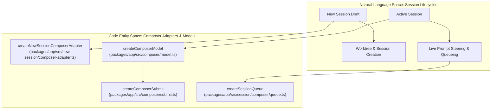
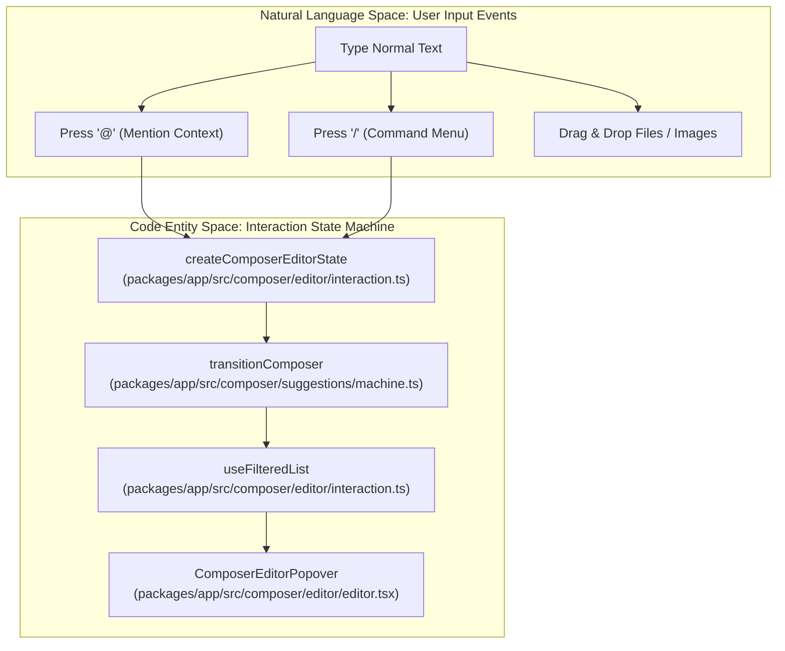
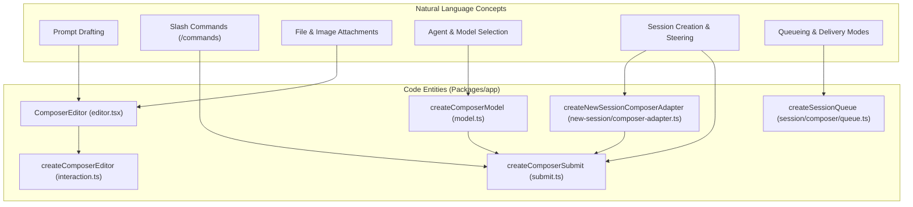
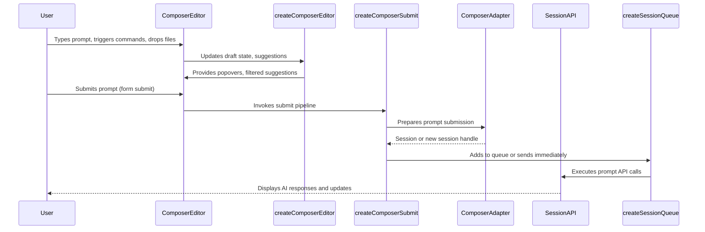

<!-- source: DeepWiki mcp.deepwiki.com · repo anomalyco/opencode · extra page Composer & Input · fetched 2026-10-27 -->

# Composer & Input

Relevant source files

The following files were used as context for generating this wiki page:

- [packages/app/component-tests/composer.spec.ts](packages/app/component-tests/composer.spec.ts)
- [packages/app/e2e/performance/unit/mock-server.test.ts](packages/app/e2e/performance/unit/mock-server.test.ts)
- [packages/app/e2e/regression/composer.spec.ts](packages/app/e2e/regression/composer.spec.ts)
- [packages/app/e2e/regression/session-queue.spec.ts](packages/app/e2e/regression/session-queue.spec.ts)
- [packages/app/e2e/regression/terminal-input.spec.ts](packages/app/e2e/regression/terminal-input.spec.ts)
- [packages/app/e2e/utils/mock-api.ts](packages/app/e2e/utils/mock-api.ts)
- [packages/app/e2e/utils/mock-server.ts](packages/app/e2e/utils/mock-server.ts)
- [packages/app/src/composer/adapter.ts](packages/app/src/composer/adapter.ts)
- [packages/app/src/composer/commands.tsx](packages/app/src/composer/commands.tsx)
- [packages/app/src/composer/composer.stories.tsx](packages/app/src/composer/composer.stories.tsx)
- [packages/app/src/composer/composer.tsx](packages/app/src/composer/composer.tsx)
- [packages/app/src/composer/editor/editor.css](packages/app/src/composer/editor/editor.css)
- [packages/app/src/composer/editor/editor.tsx](packages/app/src/composer/editor/editor.tsx)
- [packages/app/src/composer/editor/interaction.test.ts](packages/app/src/composer/editor/interaction.test.ts)
- [packages/app/src/composer/editor/interaction.ts](packages/app/src/composer/editor/interaction.ts)
- [packages/app/src/composer/model.ts](packages/app/src/composer/model.ts)
- [packages/app/src/composer/submit.test.ts](packages/app/src/composer/submit.test.ts)
- [packages/app/src/composer/submit.ts](packages/app/src/composer/submit.ts)
- [packages/app/src/new-session/composer-adapter.ts](packages/app/src/new-session/composer-adapter.ts)
- [packages/app/src/providers/connect/controller.ts](packages/app/src/providers/connect/controller.ts)
- [packages/app/src/providers/connect/dialog.tsx](packages/app/src/providers/connect/dialog.tsx)
- [packages/app/src/providers/connect/models.css](packages/app/src/providers/connect/models.css)
- [packages/app/src/providers/models/select-dialog.stories.tsx](packages/app/src/providers/models/select-dialog.stories.tsx)
- [packages/app/src/providers/models/selection.tsx](packages/app/src/providers/models/selection.tsx)
- [packages/app/src/runtime/persistence/schema.test.ts](packages/app/src/runtime/persistence/schema.test.ts)
- [packages/app/src/runtime/persistence/schema.ts](packages/app/src/runtime/persistence/schema.ts)
- [packages/app/src/runtime/server/persistence.ts](packages/app/src/runtime/server/persistence.ts)
- [packages/app/src/session/composer/adapter.ts](packages/app/src/session/composer/adapter.ts)
- [packages/app/src/session/composer/controller.ts](packages/app/src/session/composer/controller.ts)
- [packages/app/src/session/composer/queue-panel.tsx](packages/app/src/session/composer/queue-panel.tsx)
- [packages/app/src/session/composer/queue.test.ts](packages/app/src/session/composer/queue.test.ts)
- [packages/app/src/session/composer/queue.ts](packages/app/src/session/composer/queue.ts)
- [packages/app/src/session/composer/region.tsx](packages/app/src/session/composer/region.tsx)
- [packages/app/src/session/handoff.ts](packages/app/src/session/handoff.ts)
- [packages/app/src/session/timeline/controller-projection.test.ts](packages/app/src/session/timeline/controller-projection.test.ts)
- [packages/app/src/session/timeline/controller-projection.ts](packages/app/src/session/timeline/controller-projection.ts)
- [packages/app/src/session/timeline/controller.tsx](packages/app/src/session/timeline/controller.tsx)
- [packages/app/src/settings/about/about.tsx](packages/app/src/settings/about/about.tsx)
- [packages/app/src/settings/about/notices/dialog.tsx](packages/app/src/settings/about/notices/dialog.tsx)
- [packages/app/src/settings/providers/account-actions.ts](packages/app/src/settings/providers/account-actions.ts)
- [packages/app/src/settings/providers/providers.tsx](packages/app/src/settings/providers/providers.tsx)
- [packages/app/src/shell/titlebar/windows-menu.test.ts](packages/app/src/shell/titlebar/windows-menu.test.ts)
- [packages/app/src/shell/titlebar/windows-menu.tsx](packages/app/src/shell/titlebar/windows-menu.tsx)
- [packages/app/test-browser/fixtures/model-selection.ts](packages/app/test-browser/fixtures/model-selection.ts)
- [packages/gui-extensions/src/terminal/terminal.tsx](packages/gui-extensions/src/terminal/terminal.tsx)
- [packages/ui/src/context/dialog.tsx](packages/ui/src/context/dialog.tsx)
- [packages/ui/src/overlays/dialog/dialog.tsx](packages/ui/src/overlays/dialog/dialog.tsx)

## Purpose and Scope

The Composer & Input subsystem provides the rich prompt editing interface used across both the new session screen and active session views in OpenCode (`packages/app`). It handles complex prompt composition elements including markdown token parsing, `@`-mentions for files and resources, `/`-commands, drag-and-drop file attachments, multi-modal image previews, client-side command dispatch, queue management for prompts, and implements an extensible adapter pattern (`ComposerAdapter`). This pattern unifies session creation workflows with active session prompt steering.

This page covers the implementation details of the prompt composer editor, the submit pipeline, queue mechanics, dropzone file handling, mentions, and adapter integrations shared between the new-session and session screens.

Sources: `[packages/app/src/composer/editor/editor.tsx:1-204]`, `[packages/app/src/composer/submit.ts:1-174]`, `[packages/app/src/new-session/composer-adapter.ts:21-196]`

---

## Adapter Pattern & Model Architecture

The composer logic is decoupled from specific persistence or session backends via the `ComposerAdapter` interface, allowing reuse in both new session drafting and live session steering.

- **New Session Adapter**: Implemented by `createNewSessionComposerAdapter`, this prepares a session draft in a worktree, initializes backend state using resolved directories, and starts the session upon submitting the first prompt.
- **Active Session Adapter**: Interfaces directly with an active session model, enabling live steering of the AI with queued or immediate prompts.

At runtime, a common **composer model** is instantiated via `createComposerModel` to manage prompt state, selection, and control mechanisms.

*Diagram 1: Bridging Session Lifecycles to Composer Adapters and Controllers*

Sources: `[packages/app/src/composer/model.ts:40-56]`, `[packages/app/src/new-session/composer-adapter.ts:21-196]`, `[packages/app/src/composer/submit.ts:56-110]`

---

## Editor Component & Interaction State Machine

The user-facing prompt composition is managed by the `ComposerEditor` component (`packages/app/src/composer/editor/editor.tsx`). This SolidJS component renders:

- A `contenteditable` div where rich markdown-like prompt text is edited.
- Attachments as badges/cards inline or below.
- A horizontally scrollable toolbar with model selectors, agent picks, delivery mode toggles, and attachment triggers.
- Popover overlays for commands and mention suggestions.

The editor's interaction state is managed by the `createComposerEditor` function, which implements a deterministic state machine balancing draft prompt text, popover context (mentions and commands), and attachment drag-and-drop. It leverages filtering helpers (`useFilteredList`) to provide reactive, asynchronously updated suggestion lists scoped by user input.

*Diagram 2: Input Events Mapped to Editor State Machine and Popovers*

Sources: `[packages/app/src/composer/editor/editor.tsx:94-204]`, `[packages/app/src/composer/editor/interaction.ts:59-165]`

---

## Submit Pipeline & Delivery Modes

Prompt submission is orchestrated by `createComposerSubmit` in `packages/app/src/composer/submit.ts`. This function handles:

1. **Client-Side Slash Commands**: If the input prompt matches a local slash command (e.g. `/btw`), it intercepts and executes it entirely on the client without admitting the prompt to the session timeline. The client command runs asynchronously, applying model selection changes before execution.

2. **Prompt Cloning & Blob Resolution**: The current prompt content is cloned (to avoid mutating the draft), with all inline image blobs resolved to blob URLs for optimistic rendering.

3. **Session Handoff & Dispatching**:
   - If attached to an active session adapter, it directly calls the session's `.prompt()` API, optionally managing session handoff state.
   - If a new session draft adapter, it starts the session by creating the session in the backend, setting up handoff, and sending the prompt.

4. **Delivery Modes**:
   - `"steer"`: Interrupts or guides ongoing AI generation immediately.
   - `"queue"`: Adds prompts to a queue waiting for previous ones to complete. Shell commands do not support queueing and reject with a notification.
   - `"shell"`: Executes shell commands immediately without queueing.

The submit pipeline also integrates with history management and comment capturing in the composer UI.

Sources: `[packages/app/src/composer/submit.ts:56-171]`, `[packages/app/src/new-session/composer-adapter.ts:47-187]`

---

## Queueing & Pending Prompts

The system supports multi-prompt queueing for active sessions with an ongoing AI task. Queue management is encapsulated in `createSessionQueue` (`packages/app/src/session/composer/queue.ts`).

Key capabilities include:

- **Reordering**: The queue is mutable, allowing users to reprioritize or edit prompts before sending.
- **Editing Queued Prompts**: Queued inbox items can be modified transactionally; the system ensures atomic updates through mutation APIs.
- **Undoing & Cancelling**: Pending inbox items can be cancelled, restoring the prompt text and context back into the active composer for adjustments.
- **Integration with Server Mutation**: Uses TanStack Solid Query for optimistic UI updates and backend synchronization.

In practice, this queue ensures user prompts are processed in turn, providing control over session steering behavior and response timing.

Sources: `[packages/app/src/session/composer/queue.ts:30-110]`

---

## Mentions and Dropzone

The editor supports `@` mentions to inject references to:

- Files and resources in the current workspace.
- Skills, agents, and other composable entities.

Mention completion is managed by the filtered lists driven in `createComposerEditor` and rendered by the popovers in `ComposerEditor`.

The editor integrates a drag-and-drop file dropzone, which hooks into draft state and dispatches file attachments as composable prompt parts. The file input is hidden and programmatically triggered, enabling multi-file uploads and previews.

---

## Integration Summary

The composer editor, submission logic, and queueing layers integrate closely with:

- The **session SDK** for API calls (`session.prompt`, `session.command`, `session.shell`).
- The **model and agent selectors** that affect prompt interpretation and steering.
- The **local draft and history stores** for resilient user experience across reloads or session changes.
- The **new session workflow**, which initializes sessions with git worktree resolutions and experimental MCP (Model Context Protocol) controls.

This design supports a seamless and extensible prompt composition and submission workflow shared between session creation and active collaboration screens.

---

# Diagram: Bridging Natural Language Concepts and Key Code Entities

# Diagram: Data Flow from User Input to Session Submission

---

## Summary

This page documented in detail the architecture and implementation of the OpenCode composer subsystem's prompt editor, submission and queueing pipeline, together with the adapter pattern bridging new session and live session contexts. The interaction design integrates rich mention handling, drag-and-drop attachments, model and agent selection, and submission modes that include live steering and structured prompt queues.

The modular code enables a robust and extensible input experience foundational to user interaction with AI-powered coding agents in OpenCode.

---

# Sources

- `[packages/app/src/composer/editor/editor.tsx:1-204]`
- `[packages/app/src/composer/submit.ts:1-174]`
- `[packages/app/src/new-session/composer-adapter.ts:21-196]`
- `[packages/app/src/composer/editor/interaction.ts:59-165]`
- `[packages/app/src/composer/model.ts:40-56]`
- `[packages/app/src/session/composer/queue.ts:30-110]`

---

