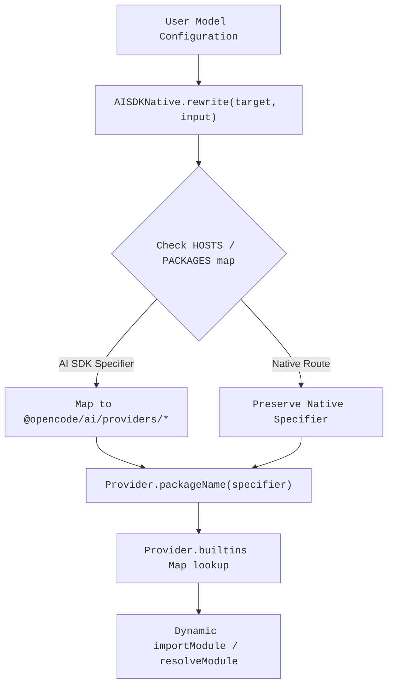
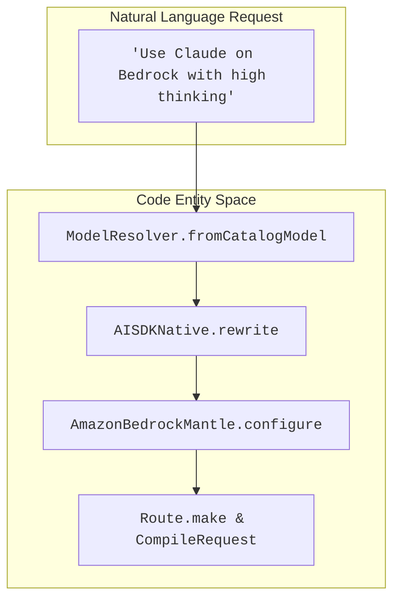

<!-- source: DeepWiki mcp.deepwiki.com · repo anomalyco/opencode · extra page Provider Packages · fetched 2026-10-27 -->

# Provider Packages

Relevant source files

The following files were used as context for generating this wiki page:

- [packages/ai/AGENTS.md](packages/ai/AGENTS.md)
- [packages/ai/README.md](packages/ai/README.md)
- [packages/ai/src/experimental/evaluation-client.ts](packages/ai/src/experimental/evaluation-client.ts)
- [packages/ai/src/experimental/evaluation.ts](packages/ai/src/experimental/evaluation.ts)
- [packages/ai/src/experimental/system-one.ts](packages/ai/src/experimental/system-one.ts)
- [packages/ai/src/protocols/anthropic-messages.ts](packages/ai/src/protocols/anthropic-messages.ts)
- [packages/ai/src/protocols/gemini.ts](packages/ai/src/protocols/gemini.ts)
- [packages/ai/src/protocols/shared.ts](packages/ai/src/protocols/shared.ts)
- [packages/ai/src/providers/anthropic-compatible.ts](packages/ai/src/providers/anthropic-compatible.ts)
- [packages/ai/src/providers/anthropic.ts](packages/ai/src/providers/anthropic.ts)
- [packages/ai/src/providers/cloudflare-ai-gateway.ts](packages/ai/src/providers/cloudflare-ai-gateway.ts)
- [packages/ai/src/providers/cloudflare-workers-ai.ts](packages/ai/src/providers/cloudflare-workers-ai.ts)
- [packages/ai/src/providers/google-vertex-chat.ts](packages/ai/src/providers/google-vertex-chat.ts)
- [packages/ai/src/providers/google-vertex-messages.ts](packages/ai/src/providers/google-vertex-messages.ts)
- [packages/ai/src/providers/google-vertex-mistral.ts](packages/ai/src/providers/google-vertex-mistral.ts)
- [packages/ai/src/providers/google-vertex-responses.ts](packages/ai/src/providers/google-vertex-responses.ts)
- [packages/ai/src/providers/google-vertex.ts](packages/ai/src/providers/google-vertex.ts)
- [packages/ai/src/providers/google-vertex/mistral.ts](packages/ai/src/providers/google-vertex/mistral.ts)
- [packages/ai/src/providers/google.ts](packages/ai/src/providers/google.ts)
- [packages/ai/src/providers/index.ts](packages/ai/src/providers/index.ts)
- [packages/ai/src/providers/opencode.ts](packages/ai/src/providers/opencode.ts)
- [packages/ai/src/providers/xai.ts](packages/ai/src/providers/xai.ts)
- [packages/ai/src/route/framing.ts](packages/ai/src/route/framing.ts)
- [packages/ai/src/route/protocol.ts](packages/ai/src/route/protocol.ts)
- [packages/ai/test/auth-options.types.ts](packages/ai/test/auth-options.types.ts)
- [packages/ai/test/effort-updates.test.ts](packages/ai/test/effort-updates.test.ts)
- [packages/ai/test/evaluation.test.ts](packages/ai/test/evaluation.test.ts)
- [packages/ai/test/evaluation.types.ts](packages/ai/test/evaluation.types.ts)
- [packages/ai/test/exports.test.ts](packages/ai/test/exports.test.ts)
- [packages/ai/test/fixtures/recordings/opencode-evaluation/evaluates-choice-score-and-boolean-questions.json](packages/ai/test/fixtures/recordings/opencode-evaluation/evaluates-choice-score-and-boolean-questions.json)
- [packages/ai/test/provider-options/anthropic-compatible.types.ts](packages/ai/test/provider-options/anthropic-compatible.types.ts)
- [packages/ai/test/provider-options/anthropic.types.ts](packages/ai/test/provider-options/anthropic.types.ts)
- [packages/ai/test/provider-options/google.types.ts](packages/ai/test/provider-options/google.types.ts)
- [packages/ai/test/provider-package.test.ts](packages/ai/test/provider-package.test.ts)
- [packages/ai/test/provider/anthropic-messages.test.ts](packages/ai/test/provider/anthropic-messages.test.ts)
- [packages/ai/test/provider/evaluation.recorded.test.ts](packages/ai/test/provider/evaluation.recorded.test.ts)
- [packages/ai/test/provider/gemini.test.ts](packages/ai/test/provider/gemini.test.ts)
- [packages/ai/test/provider/google-vertex.test.ts](packages/ai/test/provider/google-vertex.test.ts)

## Purpose and Scope

This page documents the architecture, implementation, and resolution mechanisms of provider packages within OpenCode. Provider definitions reside in `packages/ai/src/providers` and are bridged to the Effect-based core runtime via `packages/core/src/aisdk-native.ts`, `packages/core/src/provider.ts`, and `packages/core/src/model-resolver.ts`. These modules translate standard Vercel AI SDK specifiers and custom cloud configurations into strongly typed, provider-native wire routes, request bodies, and authentication headers.

---

## 1. Provider Package Resolution & AISDK Native Rewriting

OpenCode supports loading models configured via standard Vercel AI SDK package specifiers (such as `@ai-sdk/openai` or `@ai-sdk/google-vertex`) and transparently rewriting them to optimized native `@opencode/ai/providers/*` routes [packages/core/src/aisdk-native.ts:59-80]().

The `AISDKNative.rewrite` function evaluates requested catalog models against internal maps of canonical packages and host-specific provider definitions [packages/core/src/aisdk-native.ts:24-57](). If a mapping exists, headers, settings, and request bodies are translated into native configuration overlays [packages/core/src/aisdk-native.ts:35-56]().

*Diagram 1: Provider-Package Resolution and Rewriting Flow*

Sources: [packages/core/src/aisdk-native.ts:24-140](), [packages/core/src/provider.ts:27-110]()

---

## 2. Key Provider Families & Implementations

Provider packages in `packages/ai/src/providers` export standardized configuration facades (`configure`, `model`, `routes`) that target specific upstream wire protocols [packages/ai/src/providers/index.ts:1-48]().

### Google Vertex Family

The Google Vertex provider family (`google-vertex.ts`) supports multiple API surfaces including native Gemini generation (`google-vertex-gemini`), Anthropic Messages via Vertex (`google-vertex-messages`), and OpenAI compatibility layers (`google-vertex-chat`) [packages/core/src/aisdk-native.ts:107-110](), [packages/ai/src/providers/index.ts:22-28]().

* **Credential Loading**: `GoogleVertexShared.loadADCClient` discovers Application Default Credentials via `CLOUDSDK_CONFIG`, `GOOGLE_APPLICATION_CREDENTIALS`, or standard environment files while honoring project quota overrides [packages/ai/test/provider/google-vertex.test.ts:17-66]().
* **Express Mode & API Keys**: When an API key is provided, Express Mode endpoints are selected, rejecting tuned endpoint models that require OAuth [packages/ai/src/providers/google-vertex.ts:87-93]().
* **Service Tiers & Labels**: Metadata such as billing labels and service tiers (`flex`, standard) are automatically injected into request headers (`x-vertex-ai-llm-shared-request-type`) and request bodies [packages/ai/src/providers/google-vertex.ts:68-71]().

### Bedrock Mantle

Amazon Bedrock Mantle (`amazon-bedrock-mantle.ts`) routes requests to native Bedrock Converse APIs or model-specific chat/responses endpoints depending on model capabilities and architecture [packages/core/src/aisdk-native.ts:129-132](). Models containing `gpt-oss` route to chat compatibilities, while standard models map to responses or converse routes [packages/core/src/aisdk-native.ts:145-148]().

### Cloudflare Gateways & OpenRouter

* **Cloudflare AI Gateway (`cloudflare-ai-gateway.ts`)**: Retains upstream model prefixes (e.g., `openai/gpt-5.4`, `anthropic/claude-sonnet`) while proxying through Cloudflare AI Gateway endpoints [packages/core/src/aisdk-native.ts:96-101](), [packages/core/test/aisdk-native.test.ts:24-35]().
* **OpenRouter (`openrouter.ts`)**: Standardizes access to multi-provider model routing with unified error handling and headers.
* **xAI (`xai.ts`)**: Implements native Grok reasoning effort parameters, encrypted content inclusions, and chat/responses lowering [packages/core/test/aisdk-native.test.ts:115-139]().

*Diagram 2: Bridging Natural Language Configuration to Provider Route Execution*

Sources: [packages/ai/src/providers/google-vertex.ts:1-138](), [packages/core/src/aisdk-native.ts:59-148](), [packages/ai/test/provider/google-vertex.test.ts:17-150]()

---

## 3. Variant Spells and Model Overlays

To support runtime capability adjustments (such as reasoning effort levels, token budgets, or thinking toggles), `packages/core/src/variant.ts` defines protocol-specific spells [packages/core/src/variant.ts:14-25]().

The `Variant.resolve` function inspects a model's package and applies appropriate request-local overlays without altering committed model snapshots [packages/core/src/model-resolver.ts:136-161](), [packages/core/src/variant.ts:16-25]():
* **Effort Spells**: Maps levels (`low`, `medium`, `high`, `xhigh`, `max`) to provider settings such as `reasoningEffort` or `thinking` budgets [packages/core/src/variant.ts:77-105]().
* **Toggle Spells**: Configures chat template flags (e.g., `enable_thinking`, `chat_template_kwargs`) for local models and Vertex MaaS deployments [packages/core/src/variant.ts:84-91]().

Sources: [packages/core/src/model-resolver.ts:136-161](), [packages/core/src/variant.ts:14-160]()

---

