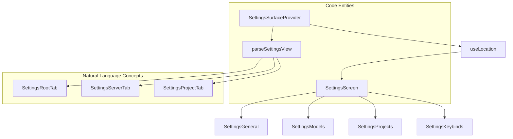
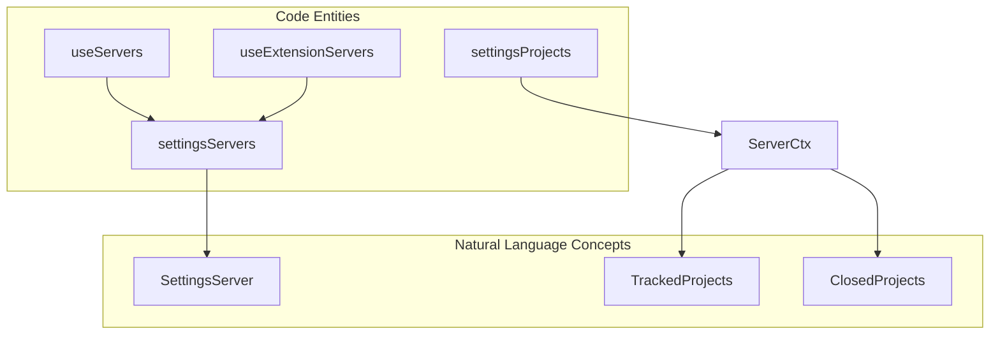
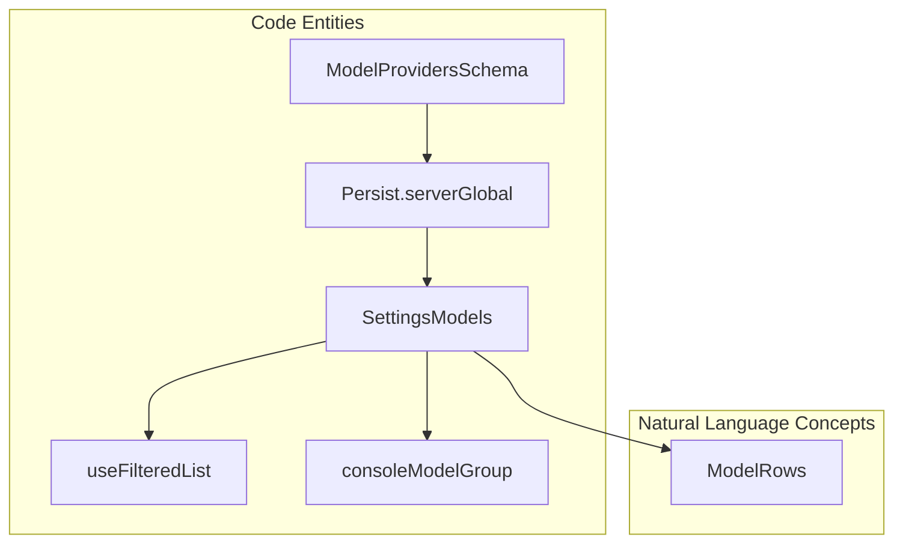
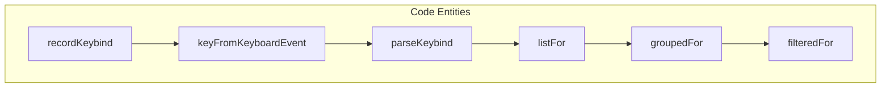
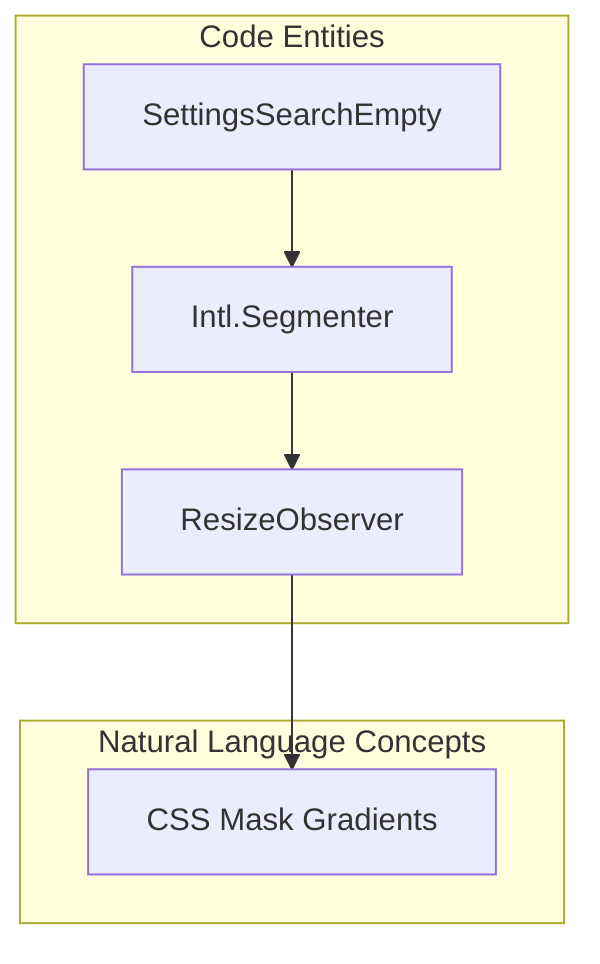
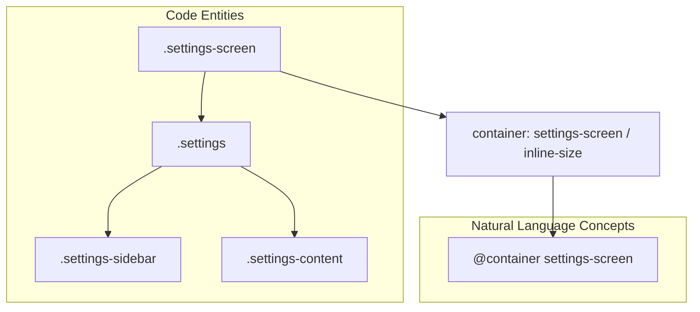

<!-- source: DeepWiki mcp.deepwiki.com · repo anomalyco/opencode · extra page Settings & Preferences · fetched 2026-10-27 -->

# Settings & Preferences

Relevant source files

The following files were used as context for generating this wiki page:

- [packages/app/e2e/regression/multi-server.spec.ts](packages/app/e2e/regression/multi-server.spec.ts)
- [packages/app/e2e/regression/settings-search.spec.ts](packages/app/e2e/regression/settings-search.spec.ts)
- [packages/app/src/runtime/i18n/en.ts](packages/app/src/runtime/i18n/en.ts)
- [packages/app/src/session/commands/use-session-commands.tsx](packages/app/src/session/commands/use-session-commands.tsx)
- [packages/app/src/session/requests/auto-approve.ts](packages/app/src/session/requests/auto-approve.ts)
- [packages/app/src/session/requests/model.ts](packages/app/src/session/requests/model.ts)
- [packages/app/src/settings/general/general.tsx](packages/app/src/settings/general/general.tsx)
- [packages/app/src/settings/keybinds/keybinds.tsx](packages/app/src/settings/keybinds/keybinds.tsx)
- [packages/app/src/settings/model.test.ts](packages/app/src/settings/model.test.ts)
- [packages/app/src/settings/model.tsx](packages/app/src/settings/model.tsx)
- [packages/app/src/settings/models/models.tsx](packages/app/src/settings/models/models.tsx)
- [packages/app/src/settings/route.test.ts](packages/app/src/settings/route.test.ts)
- [packages/app/src/settings/route.ts](packages/app/src/settings/route.ts)
- [packages/app/src/settings/search-catalog.ts](packages/app/src/settings/search-catalog.ts)
- [packages/app/src/settings/search-empty.tsx](packages/app/src/settings/search-empty.tsx)
- [packages/app/src/settings/search-field.tsx](packages/app/src/settings/search-field.tsx)
- [packages/app/src/settings/search.css](packages/app/src/settings/search.css)
- [packages/app/src/settings/servers/inventory.ts](packages/app/src/settings/servers/inventory.ts)
- [packages/app/src/settings/settings.css](packages/app/src/settings/settings.css)
- [packages/app/src/settings/shell.tsx](packages/app/src/settings/shell.tsx)
- [packages/app/src/settings/surface.tsx](packages/app/src/settings/surface.tsx)
- [packages/app/src/settings/workspaces/projects.tsx](packages/app/src/settings/workspaces/projects.tsx)
- [packages/app/src/shell/layout/project-avatar-state.ts](packages/app/src/shell/layout/project-avatar-state.ts)
- [packages/app/src/shell/layout/project-icon.tsx](packages/app/src/shell/layout/project-icon.tsx)
- [packages/ui/src/icons/icon/icon.stories.tsx](packages/ui/src/icons/icon/icon.stories.tsx)
- [packages/ui/src/icons/icon/icon.tsx](packages/ui/src/icons/icon/icon.tsx)

## Purpose and Scope

This page documents the detailed implementation of the OpenCode app's settings and preferences surfaces, located primarily under `packages/app/src/settings/`. It covers the architecture and data flow of general application settings, models configuration, keybind mappings, shell integration, workspace and project inventories, server management, experimental feature flags, and the search system incorporated into settings. This page serves as a comprehensive technical reference for developers contributing to settings-related code.

---

## 1. Settings Surface & View Routing Architecture

The settings system is centralized around the `SettingsSurfaceProvider` context (defined in `packages/app/src/settings/surface.tsx:33-196`), which manages synchronization between the application settings view and the router's location state. This provider parses URL parameters to determine the active settings scope and subpage, dispatching navigation updates accordingly.

The settings UI supports three primary scope levels:

- **Root level:** Global app preferences such as appearance, general settings, notifications, and shortcuts ([shell.tsx:59-64]()).
- **Server level:** Settings scoped to a server connection including servers inventory, providers, models, extensions, workspaces, and projects ([shell.tsx:66-72]()).
- **Project level:** Nested settings scoped within a project under a specific server, including general project options and extensions ([shell.tsx:89-93]()).

The system implements navigation guards and redirects to handle asynchronous server discovery and disconnection events gracefully via `settingsViewRedirect` ([shell.tsx:168-180](), [route.test.ts:52-60]()).

*Diagram: Settings Navigation and View Routing Architecture bridging runtime service providers to UI screen components.*

Sources: `packages/app/src/settings/surface.tsx:33-196()`, `packages/app/src/settings/shell.tsx:59-180()`, `packages/app/src/settings/route.test.ts:52-60()`

---

## 2. Servers & Workspaces Inventory Management

The settings inventory subsystem manages the enumeration and state of active servers and their projects/workspaces.

- **Servers inventory** is coordinated via `useSettingsServers` and the `settingsServers` state in `packages/app/src/settings/servers/inventory.ts`. This includes servers added directly or through external extensions (SSH, WSL, etc.) ([servers/inventory.ts:32-73]()).
- **Projects inventory** is obtained from the server context (`useServerCtx`), combining tracked "live" projects and synched project metadata. Deduplication prevents redundant display and avoids reactive allocations that cause unwanted eviction/reload loops ([servers/inventory.ts:1-22]()).
- **`SettingsProjects`** component provides the project list UI, with support for filtering by name, directory picking, and multi-addition of projects to server context ([workspaces/projects.tsx:21-140]()).

*Diagram: Server and Project Inventory resolution and data flow.*

Sources: `packages/app/src/settings/servers/inventory.ts:1-74()`, `packages/app/src/settings/workspaces/projects.tsx:21-140()`

---

## 3. Models & Provider Management

The models settings panel is implemented in `SettingsModels` (`packages/app/src/settings/models/models.tsx`).

- Uses Effect Schema to persist and validate model-related preferences, such as collapsed state per server scope, via the `Persist.serverGlobal` mechanism ([models.tsx:1-39]()).
- Manages filtered lists of models, grouping, and provider metadata.
- Model visibility toggling updates the centralized models service reactively through calls like `models.setVisibility(...)` ([models.tsx:72-76]()).
- Provides programmatic focus and scrolling behavior for model provider sections when navigated within the UI ([models.tsx:104-139]()).

*Diagram: Model configuration persistence and provider grouping logic.*

Sources: `packages/app/src/settings/models/models.tsx:1-191()`

---

## 4. Keybinds Configuration & Recorder

The keybinds settings module manages keyboard shortcut mappings and recording:

- Defines logical grouping of keybinds into groups such as General, Session, Navigation, Model and Agent, Terminal, and Prompt with mapping logic in `groupFor(...)` ([keybinds.tsx:68-89]()).
- Keyboard event recording filters only non-modifier keys and composes normalized strings reflecting platform modifier conventions (e.g., `mod` on Mac is `Cmd`) ([keybinds.tsx:91-118]()).
- Uses the `fuzzysort` library for fuzzy searching keybinds across the catalog and user-assigned keybinds ([keybinds.tsx:221-224]()).
- Generates grouped and filtered views for display in the UI ([keybinds.tsx:150-234]()).

*Diagram: Keybind recording and fuzzy-filtered catalog generation pipeline.*

Sources: `packages/app/src/settings/keybinds/keybinds.tsx:1-240()`

---

## 5. Settings Search Engine & Empty States

The settings search supports rapid filtering of settings sections, items, and commands, implemented with accessibility and UX considerations:

- `SettingsSearchEmpty` component uses `Intl.Segmenter` with grapheme granularity for safe truncation of overflowing query strings, ensuring UI stability with characters including quotation marks ([search-empty.tsx:1-88]()).
- Employs `ResizeObserver` to measure overflow and dynamically apply CSS mask gradients serving as fade indicators on input and scroll containers ([search.css:41-62,124-129]()).
- Integrated into settings to filter numerous sections and provide accessible fallback messaging on empty search results.

*Diagram: Search empty-state grapheme truncation and measurement pipeline.*

Sources:  
`packages/app/src/settings/search-empty.tsx:1-88()`,  
`packages/app/src/settings/search.css:1-266()`,  
`packages/app/e2e/regression/settings-search.spec.ts:1-162()`

---

## 6. Styling, Container Queries & Layout

The settings UI layout is styled with scoped CSS and utility classes, leveraging CSS container queries for responsive and complex layouts.

- Core styles reside in `packages/app/src/settings/settings.css`.
- Settings screens implement a two-pane layout with a fixed 328px sidebar for navigation tabs and a flexible content panel capped at 720px width ([settings.css:8-58]()).
- Applies shell inset variables (`--shell-inline-inset`, `--shell-top-inset`, `--shell-bottom-inset`) to position the settings screen precisely within the desktop and web app shells.
- Focus styles and hover states are carefully designed for accessibility and improved usability.

*Diagram: Settings screen layout structure and container query adaptation.*

Sources: `packages/app/src/settings/settings.css:1-302()`

---

# Summary Table of Key Components

| Settings Surface         | Description                                           | Primary Location                          |
|-------------------------|-------------------------------------------------------|-------------------------------------------|
| `SettingsSurfaceProvider` | Root context provider syncing settings view with router | `packages/app/src/settings/surface.tsx`   |
| Servers Inventory       | Managing active servers including extensions            | `packages/app/src/settings/servers/inventory.ts` |
| Projects Inventory      | Projects tracked per server, with filtering & adding UI | `packages/app/src/settings/workspaces/projects.tsx` |
| Models Panel            | Model visibility, provider grouping, persisted state    | `packages/app/src/settings/models/models.tsx` |
| Keybinds Manager        | Keyboard shortcut mapping, recording, fuzzy search     | `packages/app/src/settings/keybinds/keybinds.tsx` |
| Settings Search         | Fast search with grapheme-safe truncation and overflow hints | `packages/app/src/settings/search-empty.tsx` & CSS       |
| UI Styling and Layout   | CSS container queries and utility classes for responsive layout | `packages/app/src/settings/settings.css` |

---

This technical overview is intended for contributors to understand the implementation and flow of data through the OpenCode app’s settings architecture. The diagrams and references to specific code locations facilitate deep code exploration and debugging.

# End of "6.1.2 Settings & Preferences" Documentation

---

