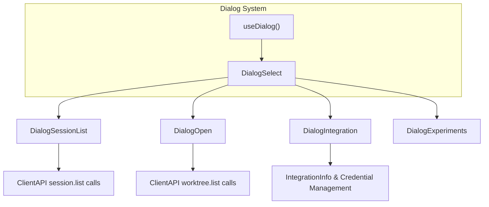
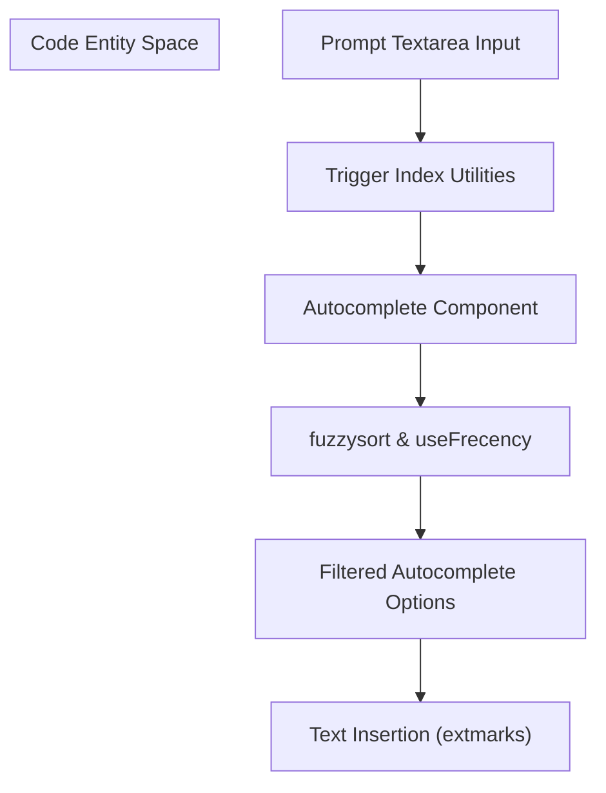
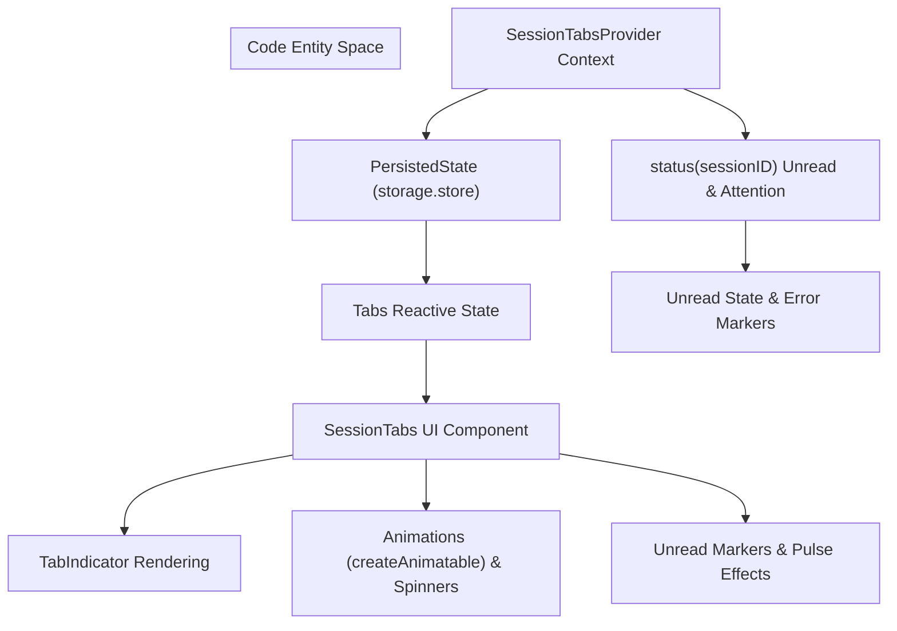
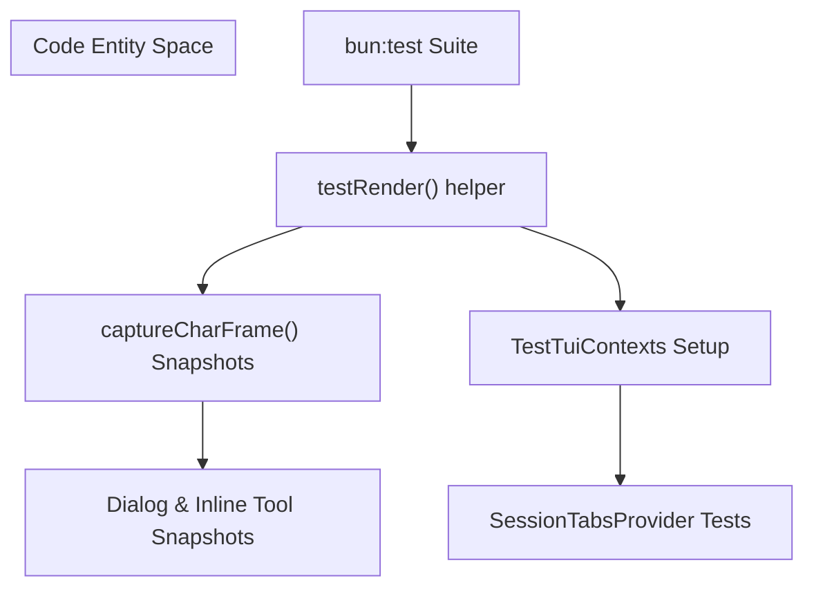
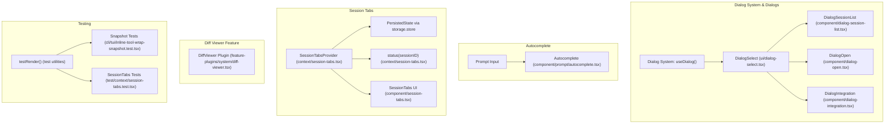

<!-- source: DeepWiki mcp.deepwiki.com · repo anomalyco/opencode · extra page TUI Components & Dialogs · fetched 2026-10-27 -->

# TUI Components & Dialogs

Relevant source files

The following files were used as context for generating this wiki page:

- [packages/tui/src/attention.ts](packages/tui/src/attention.ts)
- [packages/tui/src/component/dialog-debug.tsx](packages/tui/src/component/dialog-debug.tsx)
- [packages/tui/src/component/dialog-error-details.tsx](packages/tui/src/component/dialog-error-details.tsx)
- [packages/tui/src/component/dialog-experiments.tsx](packages/tui/src/component/dialog-experiments.tsx)
- [packages/tui/src/component/dialog-highlights.tsx](packages/tui/src/component/dialog-highlights.tsx)
- [packages/tui/src/component/dialog-image-preview.tsx](packages/tui/src/component/dialog-image-preview.tsx)
- [packages/tui/src/component/dialog-integration.tsx](packages/tui/src/component/dialog-integration.tsx)
- [packages/tui/src/component/dialog-mcp.tsx](packages/tui/src/component/dialog-mcp.tsx)
- [packages/tui/src/component/dialog-open.tsx](packages/tui/src/component/dialog-open.tsx)
- [packages/tui/src/component/dialog-pair.tsx](packages/tui/src/component/dialog-pair.tsx)
- [packages/tui/src/component/dialog-session-list.tsx](packages/tui/src/component/dialog-session-list.tsx)
- [packages/tui/src/component/dialog-shell-output.tsx](packages/tui/src/component/dialog-shell-output.tsx)
- [packages/tui/src/component/dialog-status.tsx](packages/tui/src/component/dialog-status.tsx)
- [packages/tui/src/component/dialog-update.tsx](packages/tui/src/component/dialog-update.tsx)
- [packages/tui/src/component/dialog-workspace-file-changes.tsx](packages/tui/src/component/dialog-workspace-file-changes.tsx)
- [packages/tui/src/component/dialog-worktree-name.tsx](packages/tui/src/component/dialog-worktree-name.tsx)
- [packages/tui/src/component/error-component.tsx](packages/tui/src/component/error-component.tsx)
- [packages/tui/src/component/fade-in-text.tsx](packages/tui/src/component/fade-in-text.tsx)
- [packages/tui/src/component/masked-text.ts](packages/tui/src/component/masked-text.ts)
- [packages/tui/src/component/patch-diff.tsx](packages/tui/src/component/patch-diff.tsx)
- [packages/tui/src/component/prompt/autocomplete.tsx](packages/tui/src/component/prompt/autocomplete.tsx)
- [packages/tui/src/component/reconnecting.tsx](packages/tui/src/component/reconnecting.tsx)
- [packages/tui/src/component/session-tabs-rail.tsx](packages/tui/src/component/session-tabs-rail.tsx)
- [packages/tui/src/component/session-tabs.tsx](packages/tui/src/component/session-tabs.tsx)
- [packages/tui/src/component/shimmer-text.tsx](packages/tui/src/component/shimmer-text.tsx)
- [packages/tui/src/component/spinner.tsx](packages/tui/src/component/spinner.tsx)
- [packages/tui/src/component/startup-loading.tsx](packages/tui/src/component/startup-loading.tsx)
- [packages/tui/src/component/tab-pulse.tsx](packages/tui/src/component/tab-pulse.tsx)
- [packages/tui/src/config/v1/keybind.ts](packages/tui/src/config/v1/keybind.ts)
- [packages/tui/src/context/panel.tsx](packages/tui/src/context/panel.tsx)
- [packages/tui/src/context/session-tabs-model.ts](packages/tui/src/context/session-tabs-model.ts)
- [packages/tui/src/context/session-tabs.tsx](packages/tui/src/context/session-tabs.tsx)
- [packages/tui/src/context/update-notification.tsx](packages/tui/src/context/update-notification.tsx)
- [packages/tui/src/feature-plugins/prompt/btw.tsx](packages/tui/src/feature-plugins/prompt/btw.tsx)
- [packages/tui/src/feature-plugins/prompt/footer.tsx](packages/tui/src/feature-plugins/prompt/footer.tsx)
- [packages/tui/src/feature-plugins/system/diff-viewer-file-tree.tsx](packages/tui/src/feature-plugins/system/diff-viewer-file-tree.tsx)
- [packages/tui/src/feature-plugins/system/diff-viewer.tsx](packages/tui/src/feature-plugins/system/diff-viewer.tsx)
- [packages/tui/src/feature-plugins/system/plugins.tsx](packages/tui/src/feature-plugins/system/plugins.tsx)
- [packages/tui/src/feature-plugins/system/storybook/footer.tsx](packages/tui/src/feature-plugins/system/storybook/footer.tsx)
- [packages/tui/src/feature-plugins/system/storybook/one-cell-spinner.tsx](packages/tui/src/feature-plugins/system/storybook/one-cell-spinner.tsx)
- [packages/tui/src/feature-plugins/system/storybook/session-tabs.tsx](packages/tui/src/feature-plugins/system/storybook/session-tabs.tsx)
- [packages/tui/src/mini/footer.form.tsx](packages/tui/src/mini/footer.form.tsx)
- [packages/tui/src/mini/footer.permission.tsx](packages/tui/src/mini/footer.permission.tsx)
- [packages/tui/src/routes/session/dialog-execute.tsx](packages/tui/src/routes/session/dialog-execute.tsx)
- [packages/tui/src/routes/session/dialog-fork.tsx](packages/tui/src/routes/session/dialog-fork.tsx)
- [packages/tui/src/routes/session/message-navigation.ts](packages/tui/src/routes/session/message-navigation.ts)
- [packages/tui/src/ui/dialog-alert.tsx](packages/tui/src/ui/dialog-alert.tsx)
- [packages/tui/src/ui/dialog-confirm.tsx](packages/tui/src/ui/dialog-confirm.tsx)
- [packages/tui/src/ui/dialog-export-options.tsx](packages/tui/src/ui/dialog-export-options.tsx)
- [packages/tui/src/ui/dialog-export-result.tsx](packages/tui/src/ui/dialog-export-result.tsx)
- [packages/tui/src/ui/dialog-help.tsx](packages/tui/src/ui/dialog-help.tsx)
- [packages/tui/src/ui/dialog-prompt.tsx](packages/tui/src/ui/dialog-prompt.tsx)
- [packages/tui/src/ui/dialog-select.tsx](packages/tui/src/ui/dialog-select.tsx)
- [packages/tui/src/ui/dialog.tsx](packages/tui/src/ui/dialog.tsx)
- [packages/tui/src/ui/layout.ts](packages/tui/src/ui/layout.ts)
- [packages/tui/src/util/diff.ts](packages/tui/src/util/diff.ts)
- [packages/tui/test/cli/tui/__snapshots__/inline-tool-wrap-snapshot.test.tsx.snap](packages/tui/test/cli/tui/__snapshots__/inline-tool-wrap-snapshot.test.tsx.snap)
- [packages/tui/test/cli/tui/dialog-mcp.test.tsx](packages/tui/test/cli/tui/dialog-mcp.test.tsx)
- [packages/tui/test/cli/tui/dialog-open.test.tsx](packages/tui/test/cli/tui/dialog-open.test.tsx)
- [packages/tui/test/cli/tui/dialog-select.test.tsx](packages/tui/test/cli/tui/dialog-select.test.tsx)
- [packages/tui/test/cli/tui/diff-viewer-file-tree.test.tsx](packages/tui/test/cli/tui/diff-viewer-file-tree.test.tsx)
- [packages/tui/test/cli/tui/diff-viewer.test.tsx](packages/tui/test/cli/tui/diff-viewer.test.tsx)
- [packages/tui/test/cli/tui/inline-tool-wrap-snapshot.test.tsx](packages/tui/test/cli/tui/inline-tool-wrap-snapshot.test.tsx)
- [packages/tui/test/cli/tui/message-navigation.test.ts](packages/tui/test/cli/tui/message-navigation.test.ts)
- [packages/tui/test/cli/tui/plugins-dialog.test.tsx](packages/tui/test/cli/tui/plugins-dialog.test.tsx)
- [packages/tui/test/component/dialog-highlights.test.tsx](packages/tui/test/component/dialog-highlights.test.tsx)
- [packages/tui/test/component/session-tabs-mouse.test.tsx](packages/tui/test/component/session-tabs-mouse.test.tsx)
- [packages/tui/test/component/session-tabs-rail.test.tsx](packages/tui/test/component/session-tabs-rail.test.tsx)
- [packages/tui/test/component/session-tabs-status.test.tsx](packages/tui/test/component/session-tabs-status.test.tsx)
- [packages/tui/test/component/tab-pulse.test.tsx](packages/tui/test/component/tab-pulse.test.tsx)
- [packages/tui/test/config.test.tsx](packages/tui/test/config.test.tsx)
- [packages/tui/test/context/session-tabs-model.test.ts](packages/tui/test/context/session-tabs-model.test.ts)
- [packages/tui/test/context/session-tabs.test.tsx](packages/tui/test/context/session-tabs.test.tsx)
- [packages/tui/test/feature-plugins/prompt-footer.test.tsx](packages/tui/test/feature-plugins/prompt-footer.test.tsx)
- [packages/tui/test/fixture/app.ts](packages/tui/test/fixture/app.ts)
- [packages/tui/test/keymap.test.tsx](packages/tui/test/keymap.test.tsx)
- [packages/tui/test/panel.test.ts](packages/tui/test/panel.test.ts)
- [packages/tui/test/plugin-select.test.tsx](packages/tui/test/plugin-select.test.tsx)
- [packages/tui/test/session-panel.test.tsx](packages/tui/test/session-panel.test.tsx)
- [packages/tui/test/ui/layout.test.ts](packages/tui/test/ui/layout.test.ts)
- [packages/tui/test/util/added-patch.test.ts](packages/tui/test/util/added-patch.test.ts)

This page documents the architecture and implementation of the Terminal User Interface (TUI) components and dialog subsystems within `packages/tui`. It covers the core generic dialog controller, specialized application dialogs (session list, open dialog, integration manager, experiments), the prompt autocomplete engine, session tab management, notification mechanisms (toasts and spinners), a diff viewer feature plugin, and snapshot testing suites.

---

## 1. Dialog System & Concrete Dialogs

The OpenCode TUI dialog system is centered on a generic modal dialog stack controlled via the `useDialog()` hook and the `DialogSelect<T>` reusable component [packages/tui/src/ui/dialog-select.tsx:26-198]. This system supports fuzzy search filtering, keyboard navigation, categorized sections, and user actions. It is the basis for multiple domain-specific dialogs that integrate closely with the client API and session state.

### Key Dialog Components and Flows

- **`DialogSelect<T>`**: A parametrized component rendering a modal selection list with optional filtering, action bindings, and category grouping [packages/tui/src/ui/dialog-select.tsx:16-198]. Uses `fuzzysort` for fuzzy matching and integrates carefully with keyboard navigation and mouse interactions.

- **`DialogSessionList`**: Displays a filterable session list optionally scoped to all projects or the current working directory. It supports quick switch slots, pinned sessions, deletion confirmation, and integrates with client-side session querying and storage [packages/tui/src/component/dialog-session-list.tsx:27-159]. It uses a debounced search signal to reduce flicker and a combined local+remote query strategy.

- **`DialogOpen`**: Provides a multi-view modal interface for opening recent sessions, browsing projects, and switching git worktrees. It listens to live session and workspace events for up-to-date lists [packages/tui/src/component/dialog-open.tsx:38-80].

- **`DialogIntegration`**: Manages connections to integration services and MCP (Model Context Protocol) accounts, handling OAuth device flows, API key entries, and connection status presentation [packages/tui/src/component/dialog-integration.tsx:89-175].

- **`DialogExperiments`** (mentioned in diagrams): Allows toggling experimental features, integrating user feedback and configuration [not fully shown].

These dialogs are launched by replacing the dialog stack content via `dialog.replace()` and share common styling, keymap support, and focus management from the dialog system.

*Sources: `packages/tui/src/ui/dialog-select.tsx:26-198`, `packages/tui/src/component/dialog-session-list.tsx:27-159`, `packages/tui/src/component/dialog-open.tsx:38-80`, `packages/tui/src/component/dialog-integration.tsx:89-175`*

---

## 2. Autocomplete Engine

The autocomplete subsystem powers inline command and reference suggestions within prompt inputs. The central component is `Autocomplete` [packages/tui/src/component/prompt/autocomplete.tsx:59-181]. It integrates deeply with the prompt editor context and client data.

### Core Mechanisms and Data Flow

- **Trigger Detection:** Uses utility indices `mentionTriggerIndex` and `slashTriggerIndex` to detect when to activate specific autocomplete modes (references, commands, directories) [packages/tui/src/component/prompt/autocomplete.tsx:22].

- **Search & Filtering:** Combines fuzzy text matching via `fuzzysort` and adaptive frecency scores from usage statistics (`useFrecency`) to rank options such as file references, skills, and agents. Supports prioritized filtering and direct query replacement.

- **Insertion:** Inserts selected completion text into the editable prompt using extmarks (`input.extmarks.create()`), tracking bounds for decorations and updates [packages/tui/src/component/prompt/autocomplete.tsx:180].

- **Reactive Positioning:** Tracks the anchor renderable position and updates the autocomplete popup as the prompt scrolls or resizes [packages/tui/src/component/prompt/autocomplete.tsx:100-134].

*Sources: `packages/tui/src/component/prompt/autocomplete.tsx:20-181`*

---

## 3. Session Tabs & Persistence

Session tabs allow quick navigation between multiple active agent conversations, supporting features like unread indicators, movable tabs, and session reopening.

### Architecture & Implementation

- **Context Provider:** The `SessionTabsProvider` sets up reactive tab state, storing tabs globally or scoped per current working directory (`cwd`) [packages/tui/src/context/session-tabs.tsx:56-166]. It uses persistent storage via `storage.store<PersistedState>("tabs", ...)` to synchronize state on disk.

- **Model Layer:** The model logic resides in `session-tabs-model.ts` (not shown), providing utilities like `openSessionTab()`, `closeSessionTab()`, and `moveSessionTab()`. Tabs are keyed by session ID with titles resolved from session metadata.

- **Unread Status & Attention:** The `status(sessionID)` function evaluates unread activity including error states and permission needs; this impacts tab rendering [packages/tui/src/context/session-tabs.tsx:153-166].

- **UI Component:** The `SessionTabs` component renders tabs with indicators for busy, unread, attention, and renaming states. It animates tab selection and pulse indicators using physics-based `createAnimatable` springs and tweens [packages/tui/src/component/session-tabs.tsx:57-197].

- **Spinners & Markers:** Tabs support spinners (`TAB_SPINNERS`) and unread markers (`TAB_UNREAD_MARKERS`) to communicate status visually [packages/tui/src/component/session-tabs.tsx:57-70].

*Sources: `packages/tui/src/component/session-tabs.tsx:57-197`, `packages/tui/src/context/session-tabs.tsx:56-166`*

---

## 4. Diff Viewer Feature Plugin

OpenCode provides a diff viewer plugin for reviewing session or version control code differences, accessible via the TUI [packages/tui/src/feature-plugins/system/diff-viewer.tsx:1-171].

### Design Highlights

- **Modes & Sources:** Supports diff modes like branch, committed, working changes, and last session turn with respective base commit selection derived lazily [packages/tui/src/feature-plugins/system/diff-viewer.tsx:54-145].

- **Resource Loading:** Uses `createResource` to fetch diffs and base commit info asynchronously, caching base lookups and reactivity on mode or location changes.

- **File Tree & UI:** Implements a collapsible file tree (`DiffViewerFileTree`) with selection and menu capabilities, plus patch rendering including image diffs with rich contextual lines [packages/tui/src/feature-plugins/system/diff-viewer.tsx:17-41].

- **Keyboard & Mouse Binding:** Integrates with keymaps for navigation and toggling file/tree expansions.

*This plugin fits within the plugin architecture and uses shared UI dialogs and session context.*

*Sources: `packages/tui/src/feature-plugins/system/diff-viewer.tsx:1-171`*

---

## 5. Feedback & Notifications (Toasts & Spinners)

The TUI provides asynchronous non-intrusive feedback through toasts and visible spinners:

- **Spinners:** Defined sets such as `dots`, `arcs`, `quadrants`, and `line` animations are used in the UI, registered via `registerOpencodeSpinner()` [packages/tui/src/component/session-tabs.tsx:57-64].

- **Toasts:** A centralized toast system (`useToast()`) delivers transient messages for success, error, and informational states, integrated with dialogs and actions.

*Sources: `packages/tui/src/component/session-tabs.tsx:57-64`, `packages/tui/src/ui/toast.tsx`*

---

## 6. Testing Infrastructure & Snapshot Suites

TUI components are thoroughly tested with Bun’s test framework and SolidJS utilities:

- **Snapshot Testing:** Tests capture terminal render output frames to verify visual consistency for prompts, dialogs, and session tabs [packages/tui/test/cli/tui/inline-tool-wrap-snapshot.test.tsx].

- **Context & Integration Tests:** `session-tabs.test.tsx` mocks APIs and simulates state updates to verify tab persistence, navigation, and unread status [packages/tui/test/context/session-tabs.test.tsx].

*Sources: `packages/tui/test/cli/tui/inline-tool-wrap-snapshot.test.tsx:1-123`, `packages/tui/test/context/session-tabs.test.tsx:29-169`*

---

# Summary Mermaid Diagram: Natural Language to Code Entity Mapping

---

This comprehensive set of components and dialogs forms the core terminal user interface experience of OpenCode, enabling highly interactive, keyboard-driven management of agent sessions, integrations, command input, and advanced review tools like diffs, all backed by reactive persistence and thorough test coverage.

*Full technical details are annotated with source file ranges throughout this document.*

---

# References

- DialogSelect and dialog system: `packages/tui/src/ui/dialog-select.tsx:26-198`
- DialogSessionList: `packages/tui/src/component/dialog-session-list.tsx:27-159`
- DialogOpen: `packages/tui/src/component/dialog-open.tsx:38-80`
- DialogIntegration: `packages/tui/src/component/dialog-integration.tsx:89-175`
- Autocomplete: `packages/tui/src/component/prompt/autocomplete.tsx:59-181`
- SessionTabs context and UI: `packages/tui/src/context/session-tabs.tsx:56-166`, `packages/tui/src/component/session-tabs.tsx:57-197`
- Diff Viewer plugin: `packages/tui/src/feature-plugins/system/diff-viewer.tsx:1-171`
- Test suites: `packages/tui/test/cli/tui/inline-tool-wrap-snapshot.test.tsx`, `packages/tui/test/context/session-tabs.test.tsx`

---

