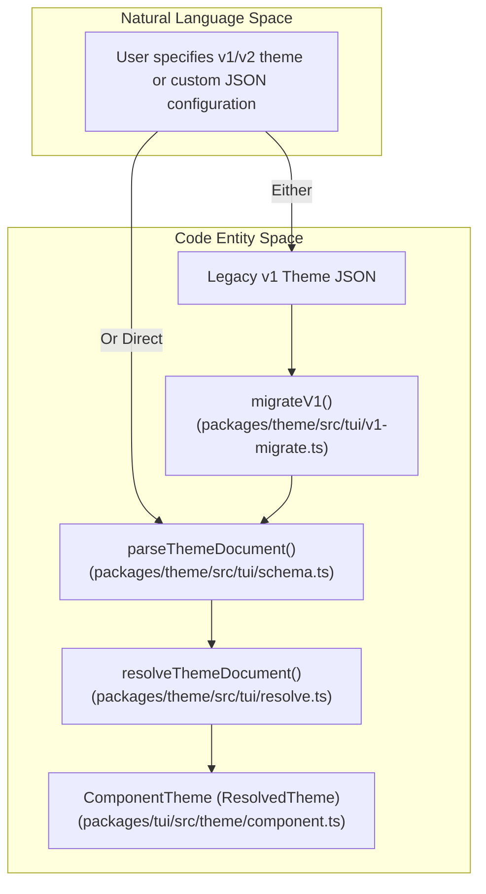
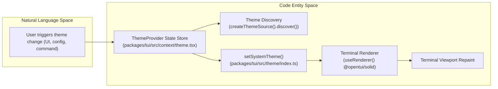
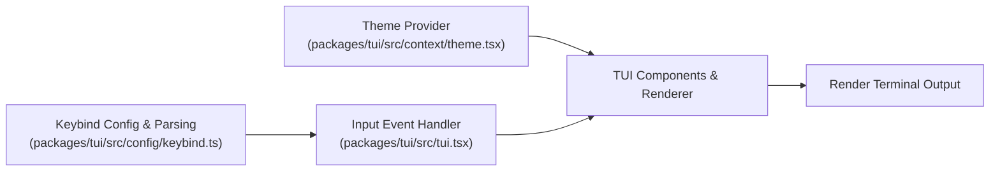

<!-- source: DeepWiki mcp.deepwiki.com · repo anomalyco/opencode · extra page TUI Theming & Keybinds · fetched 2026-10-27 -->

# TUI Theming & Keybinds

<details>
<summary>Relevant source files</summary>

The following files were used as context for generating this wiki page:

- [packages/theme/src/tui/expand.ts](packages/theme/src/tui/expand.ts)
- [packages/theme/src/tui/schema.ts](packages/theme/src/tui/schema.ts)
- [packages/theme/src/tui/types.ts](packages/theme/src/tui/types.ts)
- [packages/theme/src/tui/v1-migrate.ts](packages/theme/src/tui/v1-migrate.ts)
- [packages/tui/src/component/session-tabs.tsx](packages/tui/src/component/session-tabs.tsx)
- [packages/tui/src/component/tab-pulse.tsx](packages/tui/src/component/tab-pulse.tsx)
- [packages/tui/src/config/v1/keybind.ts](packages/tui/src/config/v1/keybind.ts)
- [packages/tui/src/context/session-tabs-model.ts](packages/tui/src/context/session-tabs-model.ts)
- [packages/tui/src/context/session-tabs.tsx](packages/tui/src/context/session-tabs.tsx)
- [packages/tui/src/context/theme.tsx](packages/tui/src/context/theme.tsx)
- [packages/tui/src/feature-plugins/system/storybook/footer.tsx](packages/tui/src/feature-plugins/system/storybook/footer.tsx)
- [packages/tui/src/feature-plugins/system/storybook/one-cell-spinner.tsx](packages/tui/src/feature-plugins/system/storybook/one-cell-spinner.tsx)
- [packages/tui/src/feature-plugins/system/storybook/session-tabs.tsx](packages/tui/src/feature-plugins/system/storybook/session-tabs.tsx)
- [packages/tui/src/mini/theme.ts](packages/tui/src/mini/theme.ts)
- [packages/tui/src/routes/session/message-navigation.ts](packages/tui/src/routes/session/message-navigation.ts)
- [packages/tui/src/theme/assets/v2/opencode.json](packages/tui/src/theme/assets/v2/opencode.json)
- [packages/tui/src/theme/assets/v2/opencode2.json](packages/tui/src/theme/assets/v2/opencode2.json)
- [packages/tui/src/theme/component.ts](packages/tui/src/theme/component.ts)
- [packages/tui/src/theme/index.ts](packages/tui/src/theme/index.ts)
- [packages/tui/src/theme/v1.ts](packages/tui/src/theme/v1.ts)
- [packages/tui/test/cli/tui/message-navigation.test.ts](packages/tui/test/cli/tui/message-navigation.test.ts)
- [packages/tui/test/cli/tui/theme-mode.test.tsx](packages/tui/test/cli/tui/theme-mode.test.tsx)
- [packages/tui/test/component/session-tabs-mouse.test.tsx](packages/tui/test/component/session-tabs-mouse.test.tsx)
- [packages/tui/test/component/session-tabs-status.test.tsx](packages/tui/test/component/session-tabs-status.test.tsx)
- [packages/tui/test/component/tab-pulse.test.tsx](packages/tui/test/component/tab-pulse.test.tsx)
- [packages/tui/test/config.test.tsx](packages/tui/test/config.test.tsx)
- [packages/tui/test/context/session-tabs-model.test.ts](packages/tui/test/context/session-tabs-model.test.ts)
- [packages/tui/test/context/session-tabs.test.tsx](packages/tui/test/context/session-tabs.test.tsx)
- [packages/tui/test/context/theme.test.tsx](packages/tui/test/context/theme.test.tsx)
- [packages/tui/test/keymap.test.tsx](packages/tui/test/keymap.test.tsx)
- [packages/tui/test/mini/theme.test.ts](packages/tui/test/mini/theme.test.ts)
- [packages/tui/test/theme.test.ts](packages/tui/test/theme.test.ts)
- [packages/tui/test/theme/v2/component.test.ts](packages/tui/test/theme/v2/component.test.ts)
- [packages/tui/test/theme/v2/resolve.test.ts](packages/tui/test/theme/v2/resolve.test.ts)
- [packages/tui/test/theme/v2/select.test.ts](packages/tui/test/theme/v2/select.test.ts)
- [packages/tui/test/theme/v2/types.typecheck.ts](packages/tui/test/theme/v2/types.typecheck.ts)
- [packages/tui/test/theme/v2/v1-migrate.test.ts](packages/tui/test/theme/v2/v1-migrate.test.ts)

</details>


This page documents the technical implementation of the Terminal User Interface (TUI) theming and keybinding subsystems in OpenCode. It covers the `packages/theme` schema definitions, v1 migration rules, token resolution pipelines, the SolidJS theme context, and the `packages/tui` keybinding configuration schema centered around the leader-key model.

---

## Purpose & Scope

The TUI theming and keybinding systems provide runtime configuration and visual styling for OpenCode's terminal interface. `packages/theme` defines the canonical schema, migration paths from v1 configurations, and token resolution for terminal color surfaces. Concurrently, `packages/tui/src/config/keybind.ts` and `packages/tui/src/context/theme.tsx` manage user input mapping, sequence parsing via leader keys, and reactive theme state synchronization.

Sources: [packages/tui/src/context/theme.tsx:1-125](), [packages/tui/src/config/keybind.ts:1-35]()

---

## Theme Schema, Resolution & V1 Migration (`packages/theme`)

The theme layer specifies structure and validation for color tokens, syntax highlighting styles, and UI surface styling. 

- **Schema Definition**: The theme schema validates theme definitions to ensure structural consistency and correctness of color tokens and surface styles.

- **Resolution**: The pipeline resolves user-supplied themes by merging base themes like `opencode` with user overrides, producing a fully resolved `ResolvedTheme` object with concrete `RGBA` colors for terminal rendering.

- **V1 Migration**: Legacy theme documents in version 1 format are automatically migrated to the v2 schema using the `migrateV1` function. This migration includes semantic mapping of legacy color tokens to the new format's hues, categorical colors, and syntax styles.

### Data Flow



Sources: [packages/tui/src/context/theme.tsx:1-10](), [packages/theme/src/tui/v1-migrate.ts](), [packages/theme/src/tui/schema.ts](), [packages/theme/src/tui/resolve.ts]()

---

## Theme Context & State Management (`packages/tui/src/context/theme.tsx`)

The SolidJS theme context provides a reactive store and lifecycle management for theme state, exposed via a context (`ThemeProvider`) that wraps the TUI components.

### Core Responsibilities

- **Mode and Theme Selection**: Tracks `mode` states (`dark`, `light`, or `system`) and the currently active theme name (`store.active`).

- **Locking and Override**: The theme mode can be pinned by user configuration to either dark or light mode (`store.lock`), otherwise it follows system preferences via renderer queries.

- **Theme Discovery and Subscription**: Uses a `ThemeSource` (e.g., file system directories) for discovering custom theme definitions and supports dynamic refresh.

- **Terminal Palette Integration**: For `system` mode, queries the terminal renderer to detect the active CLI palette (16 colors) and synthesizes a matching theme. It caches and persists this palette.

### Reactive Data Flow



---

## Keybind Configuration & Leader-Key Model (`packages/tui/src/config/keybind.ts`)

The TUI keybinding system maps keyboard event sequences to internal action commands, supporting single and multi-key bindings with a configurable leader key mechanism.

### Key Concepts

- **Binding Schema**: The keybind schema accepts:

  - Simple strings, e.g. `"ctrl+x"`, or
  - Objects with detailed key stroke and event modifiers,
  - Arrays of such bindings,
  - And explicit false/none disabling.

- **Leader Key**: A configurable leader key (default `"ctrl+x"`) acts as a prefix. After pressing the leader key, subsequent keypresses are interpreted as leader sequences within a timeout window (`leader_timeout` in config).

- **Default Keybinds**: The `Definitions` object enumerates all recognized commands and their default key assignments, including session tab management, editor commands, application controls, and debugging aids.

### Example Default Bindings

| Action                    | Default Binding(s)                | Description                         |
|---------------------------|---------------------------------|-----------------------------------|
| `leader`                  | `ctrl+x`                        | Leader key used for multi-key combos |
| `session.new`             | `<leader>n`                    | Create a new session               |
| `session.tab.next`        | `ctrl+tab,alt+down`            | Switch to next tab                 |
| `session.tab.close`       | `<leader>w`                    | Close current tab                  |
| `app.exit`                | `ctrl+c,ctrl+d,<leader>q`      | Exit the application              |

### Data Flow for Key Resolution

```mermaid
flowchart TD
    subgraph "Natural Language Space"
      UserKeypress["User presses a key or key sequence"]
    end

    subgraph "Code Entity Space"
      UserKeypress --> KeyStroke["KeyEvent Parsing\n(@opentui/core)"]
      KeyStroke --> LeaderCheck{"Is Leader Key?"}
      LeaderCheck -- "Yes" --> WaitNext["Wait for next key(s) within leader_timeout\n(packages/tui/src/config/index.tsx)"]
      LeaderCheck -- "No" --> DirectLookup["Direct keybind lookup\n(packages/tui/src/config/keybind.ts)"]
      WaitNext --> ActionResolved["Resolve action id (e.g. 'session.new')"]
      DirectLookup --> ActionResolved
      ActionResolved --> AppDispatch["Dispatch command or SDK call\n(packages/tui/src/app.tsx)"]
```

---

## Integration Overview

Both theme and keybind systems integrate into TUI contexts enabling reactive usage:

- Themes are provided via `ThemeProvider` which exposes resolved colors and tokens dynamically.
- Keybinds are configured via TUI config schema and parsed/merged with defaults.
- User interaction is handled by key event dispatchers that interpret keybinds, including leader sequences, and run corresponding commands.



---

## References

- Theme schema, migration & resolution: [packages/tui/src/context/theme.tsx:1-125](), [packages/theme/src/tui/v1-migrate.ts](), [packages/theme/src/tui/schema.ts](), [packages/theme/src/tui/resolve.ts]()
- Theme context & state: [packages/tui/src/context/theme.tsx]()
- Keybind definitions & schema: [packages/tui/src/config/keybind.ts]()
- Configuration info schema reference: [packages/tui/src/config/index.tsx:69-90]()

---

# Summary Table

| Aspect                  | Location / Module                           | Notes                                  |
|-------------------------|--------------------------------------------|----------------------------------------|
| Theme Schema            | `packages/theme/src/tui/schema.ts`         | Validation and parsing                  |
| V1 Migration            | `packages/theme/src/tui/v1-migrate.ts`     | Migrate legacy theme JSON               |
| Theme Resolution        | `packages/theme/src/tui/resolve.ts`         | Produce resolved theme tokens           |
| Theme Context Provider  | `packages/tui/src/context/theme.tsx`       | Reactive theme management & palette     |
| Keybind Schema & Defaults | `packages/tui/src/config/keybind.ts`       | Key binding definitions & leader key    |
| Keybind Config Resolve  | `packages/tui/src/config/index.tsx`         | Merge config and apply leader-timeout   |

---

This comprehensive setup offers flexible terminal theming aligned with OpenCode's branding and functional keybinding customizable by users and integrated tightly with the TUI SolidJS environment.

Sources:  
[packages/tui/src/context/theme.tsx:1-125](),  
[packages/theme/src/tui/v1-migrate.ts](),  
[packages/theme/src/tui/schema.ts](),  
[packages/theme/src/tui/resolve.ts](),  
[packages/tui/src/config/keybind.ts:1-131](),  
[packages/tui/src/config/index.tsx:69-90]()

---

