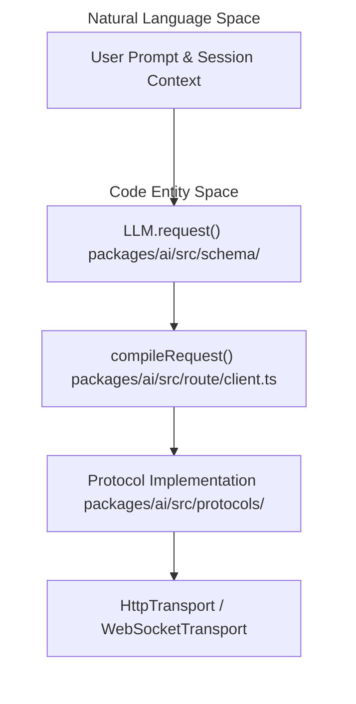
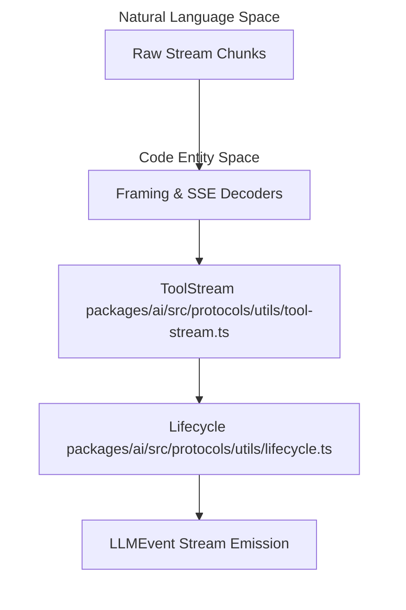

<!-- source: DeepWiki mcp.deepwiki.com · repo anomalyco/opencode · extra page Wire Protocols · fetched 2026-10-27 -->

# Wire Protocols

Relevant source files

The following files were used as context for generating this wiki page:

- [packages/ai/src/cache-policy.ts](packages/ai/src/cache-policy.ts)
- [packages/ai/src/protocols/anthropic-messages.ts](packages/ai/src/protocols/anthropic-messages.ts)
- [packages/ai/src/protocols/bedrock-converse.ts](packages/ai/src/protocols/bedrock-converse.ts)
- [packages/ai/src/protocols/bedrock-event-stream.ts](packages/ai/src/protocols/bedrock-event-stream.ts)
- [packages/ai/src/protocols/gemini.ts](packages/ai/src/protocols/gemini.ts)
- [packages/ai/src/protocols/open-responses-channel.ts](packages/ai/src/protocols/open-responses-channel.ts)
- [packages/ai/src/protocols/open-responses-continuation.ts](packages/ai/src/protocols/open-responses-continuation.ts)
- [packages/ai/src/protocols/open-responses.ts](packages/ai/src/protocols/open-responses.ts)
- [packages/ai/src/protocols/openai-chat.ts](packages/ai/src/protocols/openai-chat.ts)
- [packages/ai/src/protocols/openai-responses.ts](packages/ai/src/protocols/openai-responses.ts)
- [packages/ai/src/protocols/shared.ts](packages/ai/src/protocols/shared.ts)
- [packages/ai/src/protocols/utils/bedrock-cache.ts](packages/ai/src/protocols/utils/bedrock-cache.ts)
- [packages/ai/src/protocols/utils/bedrock-media.ts](packages/ai/src/protocols/utils/bedrock-media.ts)
- [packages/ai/src/protocols/utils/lifecycle.ts](packages/ai/src/protocols/utils/lifecycle.ts)
- [packages/ai/src/protocols/utils/responses-hosted-tools.ts](packages/ai/src/protocols/utils/responses-hosted-tools.ts)
- [packages/ai/src/protocols/utils/tool-stream.ts](packages/ai/src/protocols/utils/tool-stream.ts)
- [packages/ai/src/protocols/xai-responses.ts](packages/ai/src/protocols/xai-responses.ts)
- [packages/ai/src/providers/anthropic-compatible.ts](packages/ai/src/providers/anthropic-compatible.ts)
- [packages/ai/src/providers/anthropic.ts](packages/ai/src/providers/anthropic.ts)
- [packages/ai/src/providers/cloudflare-ai-gateway.ts](packages/ai/src/providers/cloudflare-ai-gateway.ts)
- [packages/ai/src/providers/cloudflare-workers-ai.ts](packages/ai/src/providers/cloudflare-workers-ai.ts)
- [packages/ai/src/providers/google-vertex-chat.ts](packages/ai/src/providers/google-vertex-chat.ts)
- [packages/ai/src/providers/google-vertex-messages.ts](packages/ai/src/providers/google-vertex-messages.ts)
- [packages/ai/src/providers/google-vertex-mistral.ts](packages/ai/src/providers/google-vertex-mistral.ts)
- [packages/ai/src/providers/google-vertex-responses.ts](packages/ai/src/providers/google-vertex-responses.ts)
- [packages/ai/src/providers/google-vertex.ts](packages/ai/src/providers/google-vertex.ts)
- [packages/ai/src/providers/google-vertex/mistral.ts](packages/ai/src/providers/google-vertex/mistral.ts)
- [packages/ai/src/providers/google.ts](packages/ai/src/providers/google.ts)
- [packages/ai/src/providers/openrouter.ts](packages/ai/src/providers/openrouter.ts)
- [packages/ai/src/route/framing.ts](packages/ai/src/route/framing.ts)
- [packages/ai/src/schema/events.ts](packages/ai/src/schema/events.ts)
- [packages/ai/src/schema/options.ts](packages/ai/src/schema/options.ts)
- [packages/ai/test/auth-options.types.ts](packages/ai/test/auth-options.types.ts)
- [packages/ai/test/cache-policy.test.ts](packages/ai/test/cache-policy.test.ts)
- [packages/ai/test/compaction.test.ts](packages/ai/test/compaction.test.ts)
- [packages/ai/test/effort-updates.test.ts](packages/ai/test/effort-updates.test.ts)
- [packages/ai/test/fixtures/recordings/bedrock-mantle/streams-text.json](packages/ai/test/fixtures/recordings/bedrock-mantle/streams-text.json)
- [packages/ai/test/fixtures/recordings/openai-responses-cache/reports-cached-tokens-on-identical-second-call.json](packages/ai/test/fixtures/recordings/openai-responses-cache/reports-cached-tokens-on-identical-second-call.json)
- [packages/ai/test/fixtures/recordings/pdf/openai-tool-result.json](packages/ai/test/fixtures/recordings/pdf/openai-tool-result.json)
- [packages/ai/test/fixtures/recordings/pdf/openai-user-input.json](packages/ai/test/fixtures/recordings/pdf/openai-user-input.json)
- [packages/ai/test/fixtures/recordings/pdf/xai-tool-result.json](packages/ai/test/fixtures/recordings/pdf/xai-tool-result.json)
- [packages/ai/test/fixtures/recordings/pdf/xai-user-input.json](packages/ai/test/fixtures/recordings/pdf/xai-user-input.json)
- [packages/ai/test/provider-options/anthropic-compatible.types.ts](packages/ai/test/provider-options/anthropic-compatible.types.ts)
- [packages/ai/test/provider-options/anthropic.types.ts](packages/ai/test/provider-options/anthropic.types.ts)
- [packages/ai/test/provider-options/google.types.ts](packages/ai/test/provider-options/google.types.ts)
- [packages/ai/test/provider-options/openrouter.types.ts](packages/ai/test/provider-options/openrouter.types.ts)
- [packages/ai/test/provider/anthropic-messages.test.ts](packages/ai/test/provider/anthropic-messages.test.ts)
- [packages/ai/test/provider/bedrock-converse-cache.test.ts](packages/ai/test/provider/bedrock-converse-cache.test.ts)
- [packages/ai/test/provider/bedrock-converse.test.ts](packages/ai/test/provider/bedrock-converse.test.ts)
- [packages/ai/test/provider/cloudflare.test.ts](packages/ai/test/provider/cloudflare.test.ts)
- [packages/ai/test/provider/compaction.test.ts](packages/ai/test/provider/compaction.test.ts)
- [packages/ai/test/provider/explicit-compaction.test.ts](packages/ai/test/provider/explicit-compaction.test.ts)
- [packages/ai/test/provider/gemini.test.ts](packages/ai/test/provider/gemini.test.ts)
- [packages/ai/test/provider/google-vertex.test.ts](packages/ai/test/provider/google-vertex.test.ts)
- [packages/ai/test/provider/open-responses-finals.test.ts](packages/ai/test/provider/open-responses-finals.test.ts)
- [packages/ai/test/provider/open-responses-lifecycle.test.ts](packages/ai/test/provider/open-responses-lifecycle.test.ts)
- [packages/ai/test/provider/openai-chat-reasoning.recorded.test.ts](packages/ai/test/provider/openai-chat-reasoning.recorded.test.ts)
- [packages/ai/test/provider/openai-chat.test.ts](packages/ai/test/provider/openai-chat.test.ts)
- [packages/ai/test/provider/openai-compatible-chat.test.ts](packages/ai/test/provider/openai-compatible-chat.test.ts)
- [packages/ai/test/provider/openai-compatible-responses.test.ts](packages/ai/test/provider/openai-compatible-responses.test.ts)
- [packages/ai/test/provider/openai-responses.test.ts](packages/ai/test/provider/openai-responses.test.ts)
- [packages/ai/test/provider/openrouter.test.ts](packages/ai/test/provider/openrouter.test.ts)
- [packages/ai/test/provider/xai-responses.test.ts](packages/ai/test/provider/xai-responses.test.ts)
- [packages/ai/test/recorded-scenarios.ts](packages/ai/test/recorded-scenarios.ts)
- [packages/ai/test/response.test.ts](packages/ai/test/response.test.ts)
- [packages/ai/test/tool-stream.test.ts](packages/ai/test/tool-stream.test.ts)

## Purpose and Scope

This page details the wire protocol implementations within the OpenCode AI provider layer (`packages/ai/src/protocols/`). Wire protocols are responsible for translating normalized OpenCode abstractions (`LLMRequest`, `Message`, `ToolDefinition`) into provider-native HTTP or WebSocket payloads, and parsing incoming streaming or unary responses back into canonical `LLMEvent` streams and usage objects.

Sources: `[packages/ai/src/protocols/open-responses.ts:1-31](), [packages/ai/src/protocols/anthropic-messages.ts:1-42]()`

---

## Protocol Architecture & Translation Flow

OpenCode's protocol layer abstracts vendor-specific endpoints using Effect-based schemas and routing contracts defined in `packages/ai/src/route/`. Each protocol implementation exposes an adapter that validates input request types, compiles structures using Effect `Schema`, handles server-sent events (SSE) or binary framing, and maps raw provider transport errors through `classifyProviderFailure`.

Sources: `[packages/ai/src/protocols/open-responses.ts:1-27](), [packages/ai/src/protocols/anthropic-messages.ts:4-35]()`

---

## Open Responses & OpenAI Protocols

### Open Responses (`open-responses.ts`)
The `open-responses` protocol provides a standardized schema for conversational items, reasoning steps, tool calls, and structured compaction. It handles input content types including `OpenResponsesInputText`, `OpenResponsesInputImage`, and `OpenResponsesInputFile` `[packages/ai/src/protocols/open-responses.ts:35-50]()`. 

Key schemas include:
- `InputItem` and `HostedToolItem` (`OpenResponsesWebSearchCall`, `OpenResponsesFileSearchCall`, `OpenResponsesCodeInterpreterCall`, `OpenResponsesMCPCall`) `[packages/ai/src/protocols/open-responses.ts:90-142]()`.
- `ConfigurationUpdate` and `CompactionItem` for state management and context pruning `[packages/ai/src/protocols/open-responses.ts:160-172]()`.

### OpenAI Responses & Chat (`openai-responses.ts` & `openai-chat.ts`)
- `openai-responses.ts` wraps the `open-responses` baseline for OpenAI-specific endpoints, configuring web sockets (`WEBSOCKET_PROTOCOL_HEADER`) and specialized tools like `OpenAIResponsesImageGenerationTool` `[packages/ai/src/protocols/openai-responses.ts:19-53]()`.
- `openai-chat.ts` implements the standard `/chat/completions` endpoint. It maps messages across system, user, assistant, and tool roles, while preserving vendor-specific extensions such as `reasoning_content`, `reasoning_details`, and Kimi/OpenRouter reasoning dialects `[packages/ai/src/protocols/openai-chat.ts:31-112]()`.

Sources: `[packages/ai/src/protocols/open-responses.ts:35-172](), [packages/ai/src/protocols/openai-responses.ts:19-87](), [packages/ai/src/protocols/openai-chat.ts:31-163]()`

---

## Anthropic Messages & Gemini Protocols

### Anthropic Messages (`anthropic-messages.ts`)
Implements Anthropic's `/messages` route with server-sent event (SSE) framing via `Framing.sseEvents` `[packages/ai/src/protocols/anthropic-messages.ts:38-54]()`.
- **Content Blocks**: Supports `AnthropicTextBlock`, `AnthropicImageBlock`, `AnthropicDocumentBlock`, `AnthropicThinkingBlock`, and `AnthropicRedactedThinkingBlock` for multi-turn thinking and tool use continuity `[packages/ai/src/protocols/anthropic-messages.ts:88-167]()`.
- **Caching & Context**: Utilizes `AnthropicCacheControl` (`ephemeral` TTLs) and `ContextManagement` edits (`compact_20260112`) `[packages/ai/src/protocols/anthropic-messages.ts:62-85]()`.

### Gemini (`gemini.ts`)
Implements Google's Generative Language API.
- **Parts & Content**: Translates contents into `GeminiContent` structures containing `GeminiTextPart`, `GeminiInlineDataPart`, `GeminiFileDataPart`, `GeminiFunctionCallPart`, and `GeminiFunctionResponsePart` `[packages/ai/src/protocols/gemini.ts:67-114]()`.
- **Thinking & Signatures**: Handles thinking budgets, `includeThoughts`, and thought signatures (`skip_thought_signature_validator`) to support Gemini 3+ function call replaying `[packages/ai/src/protocols/gemini.ts:28-154]()`.

Sources: `[packages/ai/src/protocols/anthropic-messages.ts:38-167](), [packages/ai/src/protocols/gemini.ts:32-154]()`

---

## Bedrock Converse & Binary Event Streams

### Bedrock Converse (`bedrock-converse.ts`)
Translates requests into AWS Bedrock Converse API format (`BedrockConverseBody`), handling `messages`, `system` blocks, `inferenceConfig`, and `toolConfig` `[packages/ai/src/protocols/bedrock-converse.ts:128-148]()`.

### Bedrock Event Stream (`bedrock-event-stream.ts`)
AWS Bedrock streaming responses arrive as binary event streams (`application/vnd.amazon.eventstream`) rather than text SSE. The wire protocol uses `@smithy/eventstream-codec` to decode binary chunks into structured `BedrockEvent` payloads, mapping message starts, content block deltas, and tool use blocks `[packages/ai/test/provider/bedrock-converse.test.ts:1-52](), [packages/ai/src/protocols/bedrock-converse.ts:166-190]()`.

Sources: `[packages/ai/src/protocols/bedrock-converse.ts:128-190](), [packages/ai/test/provider/bedrock-converse.test.ts:1-52]()`

---

## Other Provider Protocols

OpenCode defines dedicated adapters for additional model ecosystems:
- **Mistral Chat**: Handles Mistral AI's chat completion endpoints and tool ID normalization `[packages/ai/src/protocols/mistral-chat.ts:1-30]()`.
- **Cohere Chat**: Translates requests to Cohere's chat API format `[packages/ai/src/protocols/cohere-chat.ts:1-25]()`.
- **xAI Responses**: Manages xAI Grok responses and specialized tool extensions `[packages/ai/src/protocols/xai-responses.ts:1-30]()`.

Sources: `[packages/ai/src/protocols/mistral-chat.ts:1-30](), [packages/ai/src/protocols/cohere-chat.ts:1-25](), [packages/ai/src/protocols/xai-responses.ts:1-30]()`

---

## Shared Utilities, Tool Streaming & Lifecycle

Protocol implementations rely on shared helper modules under `packages/ai/src/protocols/utils/`:
- `ToolStream`: Manages incremental tool call argument assembly and stream chunk aggregation across providers `[packages/ai/src/protocols/utils/tool-stream.ts:1-30]()`.
- `Lifecycle`: Orchestrates the stream lifecycle, tracking token usage, finish reasons, and error boundaries `[packages/ai/src/protocols/utils/lifecycle.ts:1-30]()`.
- `classifyProviderFailure`: Normalizes raw HTTP statuses, transport errors, and provider rejection codes into typed `AIError` instances `[packages/ai/src/provider-error.ts:1-50]()`.

Sources: `[packages/ai/src/protocols/utils/tool-stream.ts:1-30](), [packages/ai/src/protocols/utils/lifecycle.ts:1-30]()`

---

