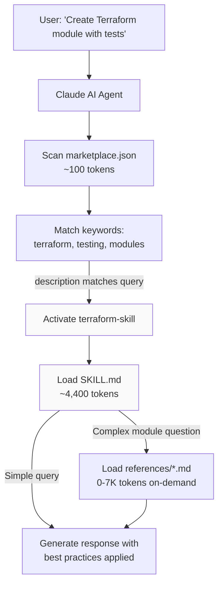
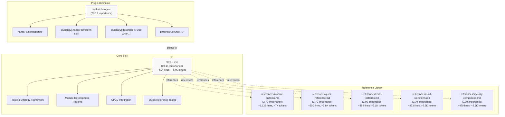
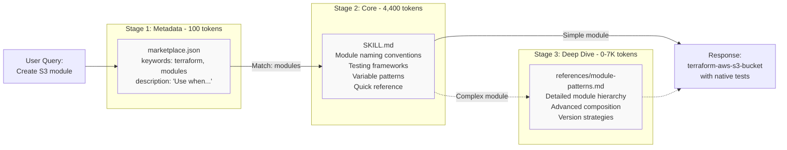

<!-- source: DeepWiki mcp.deepwiki.com · repo antonbabenko/terraform-skill · page 1.1 What is terraform-skill · fetched 2026-10-27 -->

# What is terraform-skill

<details>
<summary>Relevant source files</summary>

The following files were used as context for generating this wiki page:

- [.claude-plugin/marketplace.json](.claude-plugin/marketplace.json)
- [CLAUDE.md](CLAUDE.md)
- [README.md](README.md)

</details>


## Purpose and Scope

This document explains what terraform-skill is, how it integrates with Claude Code, and the architectural philosophy behind treating prompt engineering as infrastructure. For installation instructions, see [Installation](#2.1). For details on the plugin definition system, see [Plugin Definition System](#3.1).

---

## Overview

terraform-skill is a **Claude Code skill** - a version-controlled knowledge artifact that provides Claude with domain expertise in Terraform and OpenTofu infrastructure-as-code best practices. It represents a novel approach to AI assistance: packaging expert knowledge as structured markdown files that Claude loads on-demand to enhance its responses.

Unlike traditional software that executes logic, terraform-skill is **executable documentation** that shapes Claude's understanding and decision-making when working with infrastructure code.

**Sources:** [CLAUDE.md:8-13](), [README.md:1-8]()

---

## Skill Discovery and Activation Flow



**Diagram: Skill Discovery to Response Generation**

The activation process follows a three-stage pattern defined in [.claude-plugin/marketplace.json:14-16]():

1. **Discovery**: Claude scans the `description` field for keyword matches
2. **Activation**: When keywords like "terraform", "opentofu", "modules", or "testing" appear in user queries
3. **Loading**: Progressive content loading from `SKILL.md` and optional `references/` files

**Sources:** [.claude-plugin/marketplace.json:1-29](), [CLAUDE.md:46-64]()

---

## File Structure and Purpose



**Diagram: Code Entity Structure**

The repository structure maps to a three-tier content hierarchy:

| Tier | File | Token Budget | Purpose | Activation |
|------|------|--------------|---------|------------|
| **Entry** | `.claude-plugin/marketplace.json` | ~100 | Plugin metadata, discovery triggers | Always scanned |
| **Core** | `SKILL.md` | ~4,400 | Essential patterns, decision frameworks, quick reference | On skill activation |
| **Reference** | `references/module-patterns.md` | ~7,000 | Deep module architecture guidance | On-demand |
| **Reference** | `references/quick-reference.md` | ~3,800 | Command cheat sheets, troubleshooting | On-demand |
| **Reference** | `references/code-patterns.md` | ~5,100 | Modern Terraform features, version-specific patterns | On-demand |
| **Reference** | `references/ci-cd-workflows.md` | ~2,300 | Pipeline templates, workflow automation | On-demand |
| **Reference** | `references/security-compliance.md` | ~2,500 | Security scanning, compliance frameworks | On-demand |

**Total available content:** ~30,400 tokens  
**Typical query usage:** 4,500-12,000 tokens (56-70% token savings)

**Sources:** [CLAUDE.md:66-82](), [.claude-plugin/marketplace.json:16]()

---

## Progressive Disclosure Architecture

The skill employs a **progressive disclosure pattern** to optimize token usage:



**Diagram: Progressive Content Loading Pattern**

This architecture achieves **56-70% token reduction** compared to loading all content simultaneously. For a simple query, Claude only loads ~4,500 tokens instead of the full ~30,400 tokens available.

The activation logic is defined in [.claude-plugin/marketplace.json:15]():
```
"Use when working with Terraform or OpenTofu - creating modules, writing tests, 
setting up CI/CD pipelines, reviewing configurations, choosing between testing 
approaches, debugging state issues, implementing security scanning, or making 
infrastructure-as-code architecture decisions"
```

**Sources:** [CLAUDE.md:46-82](), [README.md:40-54]()

---

## Prompt Engineering as Infrastructure

terraform-skill embodies the philosophy of **prompt engineering as infrastructure** - treating AI instructions with the same rigor as infrastructure code:

| Traditional IaC | Prompt Engineering as IaC |
|----------------|---------------------------|
| Code defines infrastructure | Markdown defines AI behavior |
| Version controlled (Git) | Version controlled (Git) |
| Automated testing (Terratest) | Behavioral testing (Claude responses) |
| CI/CD pipelines | Validation + release workflows |
| Semantic versioning | Semantic versioning |
| Pull request reviews | Content quality reviews |
| Documentation as code | Instructions as documentation |

The repository applies infrastructure principles to prompt content:

- **Version Control**: All content in Git with semantic versioning [.claude-plugin/marketplace.json:6,26]()
- **Automated Releases**: Conventional commits drive version bumps (see [Release Automation](#6.2))
- **Quality Gates**: Automated validation of frontmatter, file size, and links (see [Validation Workflow](#6.1))
- **Progressive Disclosure**: Token budget optimization like infrastructure cost optimization
- **Modular Architecture**: Core skill + reference files like module composition

**Sources:** [CLAUDE.md:8-13](), [README.md:168-177]()

---

## Differences from Traditional Software

terraform-skill differs fundamentally from traditional software projects:

```mermaid
graph TB
    subgraph "Traditional Software"
        Code["Source Code"]
        Compile["Build/Compile"]
        Test["Unit Tests"]
        Deploy["Binary/Artifact"]
        Execute["Runtime Execution"]
    end
    
    subgraph "terraform-skill"
        Docs["Markdown Documentation"]
        Validate["Content Validation"]
        NoTest["No Test Suite"]
        Publish["Git Tag + Release"]
        Load["Claude Loads Content"]
    end
    
    Code --> Compile
    Compile --> Test
    Test --> Deploy
    Deploy --> Execute
    
    Docs --> Validate
    Validate --> NoTest
    NoTest --> Publish
    Publish --> Load
    
    style NoTest fill:#f9f9f9
```



**Diagram: Software vs. Skill Development Flow**

| Aspect | Traditional Software | terraform-skill |
|--------|---------------------|-----------------|
| **Nature** | Executable code | Executable documentation |
| **Build Process** | Compilation required | No build step |
| **Testing** | Automated test suites | Manual behavioral testing |
| **Validation** | Type checking, linting | Frontmatter validation, markdown linting |
| **Deployment** | Binary distribution | Marketplace publication |
| **Execution** | Runtime interpretation | Claude context loading |
| **Artifacts** | Compiled binaries | Raw markdown files |
| **Updates** | Patch releases | Content improvements |
| **Dependencies** | Libraries, packages | Reference knowledge |

As stated in [CLAUDE.md:163-174]():

> **This Is Not Traditional Software**
> 
> **No build/test/compile:**
> - It's documentation, not code
> - No automated test suite
> - No build artifacts

The validation approach requires:

1. Update `SKILL.md` or reference files
2. Load in Claude Code (skills auto-reload)
3. Test with real Terraform queries
4. Observe if Claude applies patterns correctly
5. Iterate based on behavioral results

**Sources:** [CLAUDE.md:160-199]()

---

## Installation and Discovery

Users install the skill through Claude Code's marketplace system:

```bash
/plugin marketplace add antonbabenko/terraform-skill
/plugin install terraform-skill@antonbabenko
```

The installation process:

1. Claude Code reads [.claude-plugin/marketplace.json:2-11]() for repository metadata
2. Downloads the repository to `~/.claude/skills/terraform-skill/`
3. Indexes the `plugins[0]` definition [.claude-plugin/marketplace.json:13-27]()
4. Makes skill available for query matching

For private testing during development:

```bash
git clone git@github.com:antonbabenko/terraform-skill.git ~/.claude/skills/terraform-skill
# Claude Code auto-loads from local filesystem
```

**Sources:** [README.md:38-63](), [CLAUDE.md:180-187]()

---

## Key Capabilities Provided

The skill provides domain expertise across five core areas:

| Capability | Location | Token Budget | Activation Trigger |
|------------|----------|--------------|-------------------|
| **Testing Strategy Framework** | `SKILL.md` | ~4,400 | "testing", "test framework", "terratest" |
| **Module Development** | `SKILL.md` + `references/module-patterns.md` | ~11,400 | "module", "structure", "naming" |
| **Code Patterns** | `references/code-patterns.md` | ~5,100 | "count vs for_each", "modern features" |
| **CI/CD Workflows** | `references/ci-cd-workflows.md` | ~2,300 | "pipeline", "github actions", "gitlab" |
| **Security & Compliance** | `references/security-compliance.md` | ~2,500 | "security", "trivy", "checkov", "compliance" |

The activation trigger description in [.claude-plugin/marketplace.json:15]() lists specific use cases:
- Creating modules
- Writing tests (native test framework, Terratest)
- Setting up CI/CD pipelines
- Reviewing configurations
- Choosing between testing approaches
- Debugging state issues
- Implementing security scanning (trivy, checkov)
- Making infrastructure-as-code architecture decisions

**Sources:** [.claude-plugin/marketplace.json:14-26](), [README.md:10-36]()

---

## Summary

terraform-skill is:

- **A Claude Code skill** that loads on-demand when Terraform/OpenTofu queries are detected
- **Version-controlled expertise** treating prompt engineering with infrastructure-level rigor
- **Progressively disclosed content** optimizing for 56-70% token savings
- **Executable documentation** that shapes Claude's behavior rather than executing code
- **Marketplace-distributed** through `.claude-plugin/marketplace.json` metadata

The skill represents a paradigm shift: instead of writing code that runs, contributors write documentation that teaches Claude how to generate and review code following production-grade Terraform best practices.

**Sources:** [CLAUDE.md:1-46](), [.claude-plugin/marketplace.json:1-29](), [README.md:1-212]()

---

