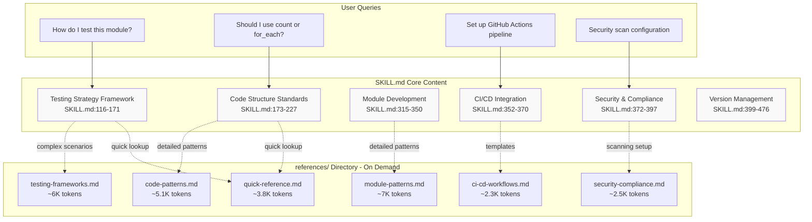
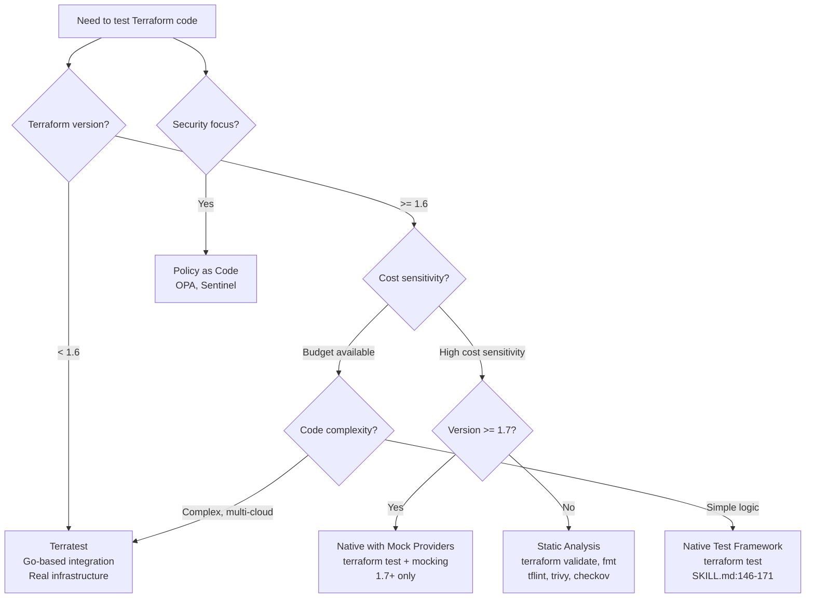
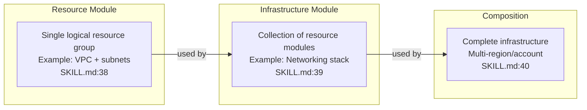
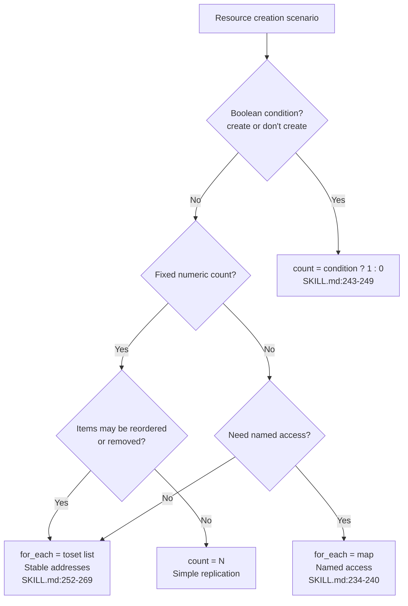
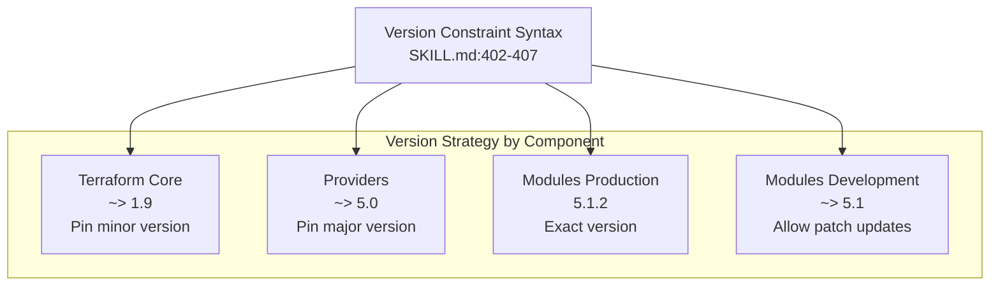
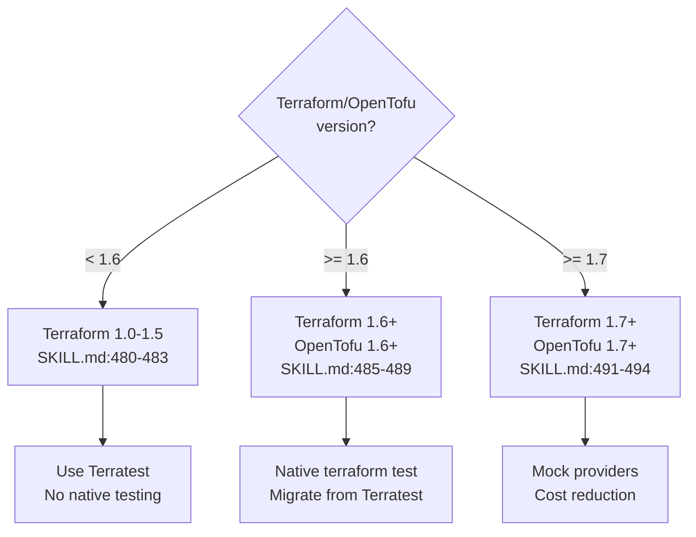
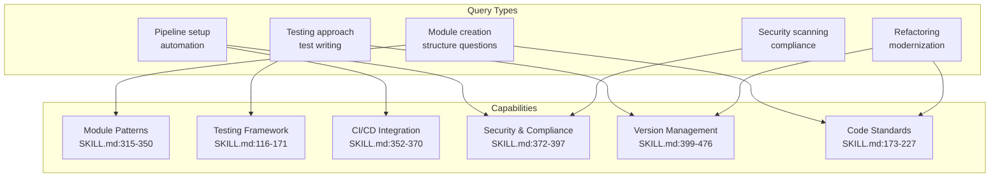

<!-- source: DeepWiki mcp.deepwiki.com · repo antonbabenko/terraform-skill · page 1.2 Key Capabilities · fetched 2026-10-27 -->

# Key Capabilities

<details>
<summary>Relevant source files</summary>

The following files were used as context for generating this wiki page:

- [README.md](README.md)
- [SKILL.md](SKILL.md)

</details>


This page documents the technical capabilities provided by terraform-skill, organized by functional area. The skill delivers Terraform and OpenTofu guidance through a structured knowledge base covering testing methodologies, module architecture, CI/CD automation, security scanning, and version-specific feature support.

For installation and usage instructions, see [Getting Started](#2). For architectural details of how these capabilities are delivered, see [Core Architecture](#3).

## Capability Overview

The skill provides guidance in six primary domains:

| Capability Area | Content Source | Token Size | Primary Use Cases |
|----------------|----------------|------------|-------------------|
| Testing Strategy Framework | [SKILL.md:116-171]() | ~1,200 tokens | Choosing test approaches, cost optimization |
| Module Development Patterns | [SKILL.md:315-350]() + `references/module-patterns.md` | ~4,400 + 7,000 tokens | Module structure, variable/output design |
| Code Structure Standards | [SKILL.md:173-227]() + `references/code-patterns.md` | ~1,100 + 5,100 tokens | Block ordering, count vs for_each, refactoring |
| CI/CD Integration | [SKILL.md:352-370]() + `references/ci-cd-workflows.md` | ~400 + 2,300 tokens | Pipeline setup, cost control, automation |
| Security & Compliance | [SKILL.md:372-397]() + `references/security-compliance.md` | ~500 + 2,500 tokens | Scanning tools, secrets management, compliance |
| Version Management | [SKILL.md:399-476]() + `references/code-patterns.md` | ~1,500 + (included above) | Feature availability, migration paths |

**Sources:** [SKILL.md:1-517](), [README.md:10-122]()

## Content Delivery Architecture



**Diagram: Content routing from user queries to knowledge base files**

**Sources:** [SKILL.md:499-510](), High-level architecture diagrams

## Testing Strategy Framework

### Decision Matrix

The skill provides a structured decision framework for selecting testing approaches based on project requirements and constraints.



**Diagram: Testing approach selection flowchart mapping to SKILL.md sections**

**Sources:** [SKILL.md:116-129](), [SKILL.md:146-171]()

### Testing Pyramid Implementation

The skill defines a three-tier testing strategy documented in [SKILL.md:130-144]():

| Tier | Cost | Tools | Implementation |
|------|------|-------|----------------|
| **Static Analysis** | Free | `terraform validate`, `terraform fmt`, `tflint`, `trivy`, `checkov` | Pre-commit hooks, CI validation stage |
| **Integration Tests** | Low-Medium | Native `terraform test` (1.6+) or Terratest | PR validation, main branch only |
| **End-to-End Tests** | High | Full environment deployment | Release validation, production-like |

**Sources:** [SKILL.md:130-144](), [README.md:92-96]()

### Native Test Framework Guidance

For Terraform 1.6+ and OpenTofu 1.6+, the skill provides specific patterns for using the built-in test framework:

**Key decision points documented in [SKILL.md:148-168]():**

1. **Schema validation** - Use Terraform MCP server to identify block types before generating tests
2. **Command mode selection:**
   - `command = plan` - Fast validation for input checking
   - `command = apply` - Required for computed values and set-type blocks
3. **Set-type block handling** - Use `for` expressions instead of indexing with `[0]`

**Common set-type blocks requiring special handling:**
- S3 encryption rules
- Lifecycle transitions  
- IAM policy statements

**Sources:** [SKILL.md:146-171]()

## Module Development Patterns

### Module Hierarchy

The skill defines a three-tier module architecture documented in [SKILL.md:32-66]():



**Diagram: Module hierarchy from SKILL.md:34-42**

**Sources:** [SKILL.md:32-66]()

### Standard Module Structure

The skill enforces a consistent directory structure defined in [SKILL.md:319-331]():

```
my-module/
├── README.md           # Usage documentation
├── main.tf             # Primary resources (SKILL.md:110)
├── variables.tf        # Input variables (SKILL.md:111)
├── outputs.tf          # Output values (SKILL.md:112)
├── versions.tf         # Provider version constraints (SKILL.md:113)
├── data.tf             # Data sources (SKILL.md:114, optional)
├── examples/
│   ├── minimal/        # Minimal working example
│   └── complete/       # Full-featured example
└── tests/
    └── module_test.tftest.hcl
```

**Sources:** [SKILL.md:44-59](), [SKILL.md:109-114](), [SKILL.md:319-331]()

### Variable and Output Specifications

**Variable block ordering enforced in [SKILL.md:204-224]():**

1. `description` (required)
2. `type`
3. `default`
4. `validation`
5. `nullable`

**Output requirements from [SKILL.md:342-346]():**

- Always include `description`
- Mark sensitive outputs with `sensitive = true`
- Consider returning objects for related values
- Document consumer usage

**Sources:** [SKILL.md:204-224](), [SKILL.md:335-350]()

## Code Structure Standards

### Resource Block Ordering

The skill enforces strict block ordering defined in [SKILL.md:175-202]():

1. `count` or `for_each` FIRST (with blank line after)
2. Other arguments
3. `tags` as last real argument
4. `depends_on` after tags
5. `lifecycle` at the very end

**Sources:** [SKILL.md:173-202]()

### Count vs For_Each Decision Logic



**Diagram: Count vs for_each decision tree mapping to SKILL.md patterns**

**Sources:** [SKILL.md:229-271]()

### Naming Conventions

The skill defines specific naming rules in [SKILL.md:68-108]():

**Resource naming:**
- Use descriptive, contextual names for multiple resources
- Use `"this"` only for singleton resources (one per module)
- Avoid generic names like `"main"` or repeating the resource type

**Variable naming:**
- Prefix with context when needed (e.g., `vpc_cidr_block` not `cidr`)
- Use explicit types and descriptions

**Sources:** [SKILL.md:68-108]()

## CI/CD Integration Capabilities

### Workflow Stages

The skill recommends a four-stage pipeline defined in [SKILL.md:354-360]():

1. **Validate** - Format check + syntax validation + linting
2. **Test** - Automated tests (native or Terratest)
3. **Plan** - Generate and review execution plan
4. **Apply** - Execute changes with approvals

**Sources:** [SKILL.md:352-360]()

### Cost Optimization Strategy

The skill provides a cost optimization framework in [SKILL.md:362-367]():


**Diagram: Cost-optimized CI/CD flow from SKILL.md:362-367**

**Sources:** [SKILL.md:362-367](), [README.md:107-113]()

### Supported Platforms

The skill provides templates and patterns for:

- GitHub Actions workflows
- GitLab CI pipelines
- Atlantis integration
- Infracost integration (cost estimation)

**Sources:** [SKILL.md:368-370](), [README.md:23-27]()

## Security and Compliance Capabilities

### Static Security Scanning

The skill integrates with multiple security scanning tools documented in [SKILL.md:375-380]():

```bash
# Static security scanning
trivy config .
checkov -d .
```

**Supported tools:**
- **Trivy** - Vulnerability and misconfiguration scanning
- **Checkov** - Policy-as-code compliance
- **TFLint** - Terraform-specific linting
- **OPA** (Open Policy Agent) - Custom policy enforcement
- **Sentinel** - HashiCorp policy framework

**Sources:** [SKILL.md:372-380](), [README.md:28-31]()

### Security Best Practices Checklist

The skill enforces security patterns in [SKILL.md:382-394]():

| Category | ❌ Don't | ✅ Do |
|----------|---------|-------|
| **Secrets** | Store in variables | Use AWS Secrets Manager / Parameter Store |
| **Networking** | Use default VPC | Create dedicated VPCs |
| **Encryption** | Skip encryption | Enable encryption at rest |
| **Access Control** | Open to 0.0.0.0/0 | Use least-privilege security groups |

**Sources:** [SKILL.md:382-394]()

### Compliance Framework Integration

The skill provides guidance for:

- State file security
- Secrets management
- Compliance scanning workflows
- Regulatory checklists

Detailed in `references/security-compliance.md` (~2,500 tokens)

**Sources:** [SKILL.md:396-397](), [README.md:115-121]()

## Version Management

### Version Constraint Strategies

The skill defines version pinning strategies in [SKILL.md:399-417]():



**Diagram: Version constraint strategy from SKILL.md:409-417**

**Version constraint operators documented in [SKILL.md:402-407]():**
- `version = "5.0.0"` - Exact (avoid - inflexible)
- `version = "~> 5.0"` - Recommended: 5.0.x only
- `version = ">= 5.0"` - Minimum (risky - breaking changes)

**Sources:** [SKILL.md:399-431]()

### Modern Terraform Features (1.0+)

The skill tracks feature availability by version in [SKILL.md:433-448]():

| Feature | Version | File Reference | Use Case |
|---------|---------|----------------|----------|
| `try()` function | 0.13+ | [SKILL.md:439]() | Safe fallbacks |
| `nullable = false` | 1.1+ | [SKILL.md:440]() | Prevent null values |
| `moved` blocks | 1.1+ | [SKILL.md:441]() | Refactor without destroy |
| `optional()` with defaults | 1.3+ | [SKILL.md:442]() | Optional object attributes |
| Native testing | 1.6+ | [SKILL.md:443]() | Built-in test framework |
| Mock providers | 1.7+ | [SKILL.md:444]() | Cost-free unit testing |
| Provider functions | 1.8+ | [SKILL.md:445]() | Provider-specific transformation |
| Cross-variable validation | 1.9+ | [SKILL.md:446]() | Variable relationship validation |
| Write-only arguments | 1.11+ | [SKILL.md:447]() | Secrets never in state |

**Sources:** [SKILL.md:433-476]()

### Version-Specific Guidance Pathways



**Diagram: Version-specific testing guidance from SKILL.md:479-494**

**Sources:** [SKILL.md:479-497]()

## Progressive Disclosure System

The skill uses a progressive disclosure architecture to optimize token usage:

| Layer | Content | Token Count | When Loaded |
|-------|---------|-------------|-------------|
| **Discovery** | `marketplace.json` metadata | ~100 | Always (skill activation) |
| **Core** | `SKILL.md` | ~4,400 | On Terraform/OpenTofu queries |
| **Deep Dive** | `references/*.md` (5 files) | ~24,000 total | On-demand per topic |

**Token efficiency:** Achieves 56-70% token reduction vs. loading all content upfront.

**Reference file organization:**
- `testing-frameworks.md` - In-depth testing guide
- `module-patterns.md` - Module structure deep dive
- `code-patterns.md` - Modern features and refactoring
- `ci-cd-workflows.md` - Pipeline templates
- `security-compliance.md` - Security scanning setup
- `quick-reference.md` - Command cheat sheets

**Sources:** [SKILL.md:499-510](), High-level architecture Diagram 2

## Capability Integration Matrix



**Diagram: Query routing to capability areas**

**Sources:** [SKILL.md:14-29](), [README.md:74-87]()

---

