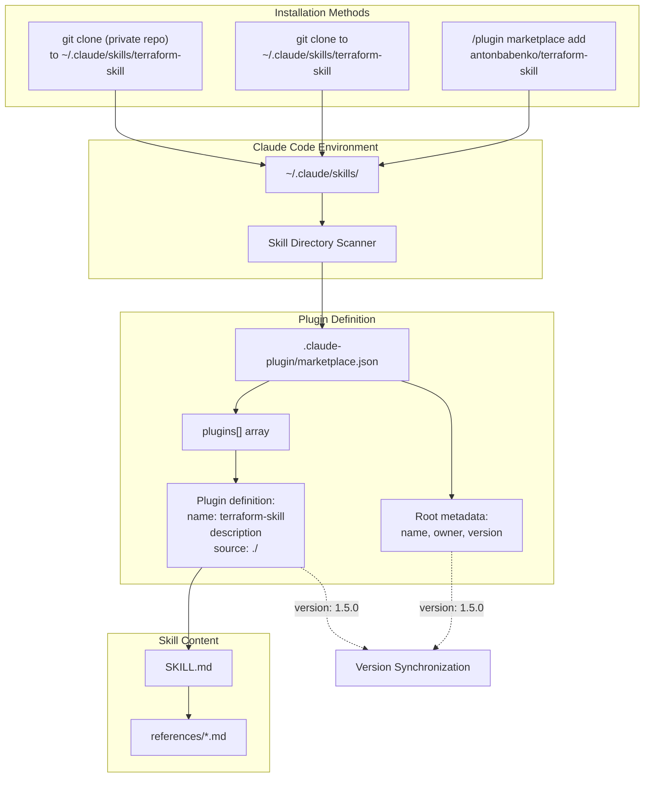
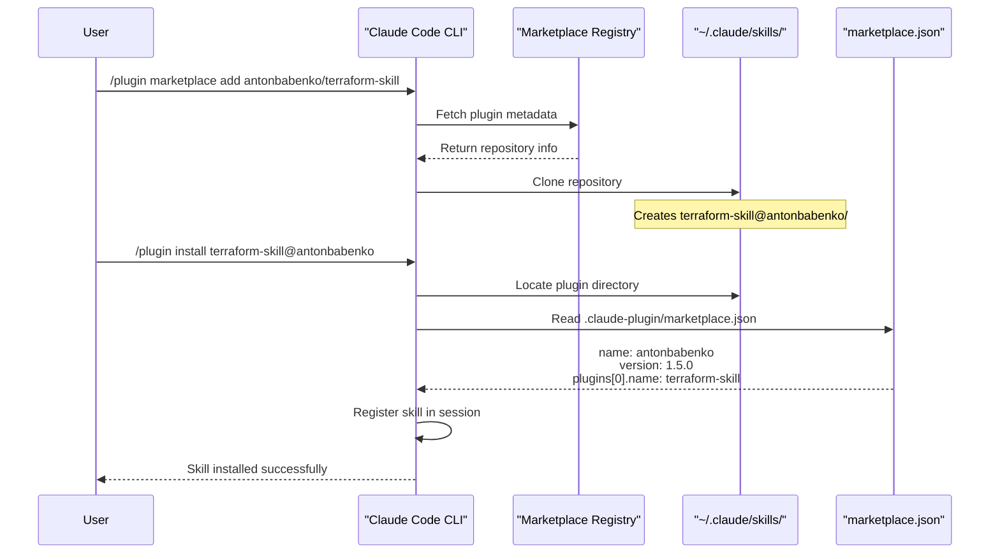
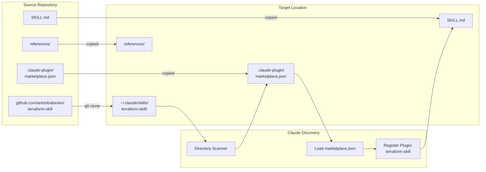
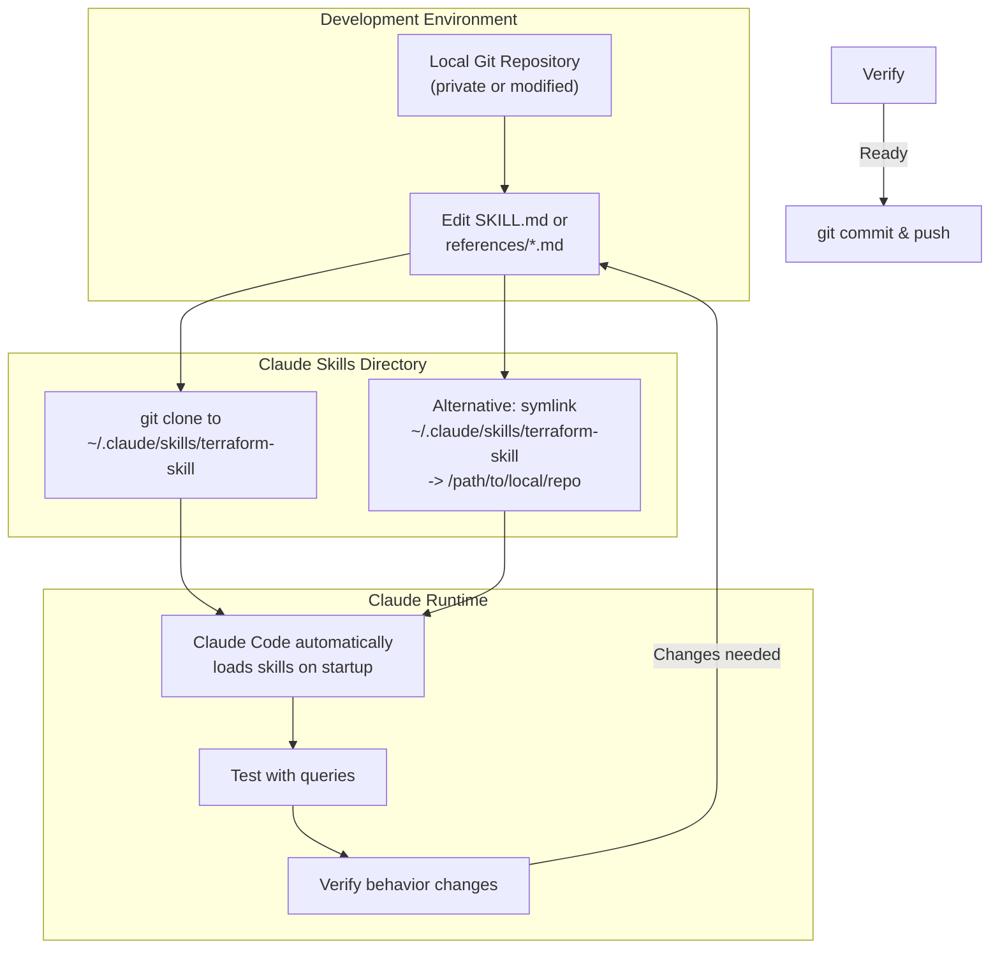

<!-- source: DeepWiki mcp.deepwiki.com · repo antonbabenko/terraform-skill · page 2.1 Installation · fetched 2026-10-27 -->

# Installation

<details>
<summary>Relevant source files</summary>

The following files were used as context for generating this wiki page:

- [.claude-plugin/marketplace.json](.claude-plugin/marketplace.json)
- [README.md](README.md)

</details>


## Purpose and Scope

This document provides detailed installation instructions for the terraform-skill plugin. It covers three installation methods: marketplace installation via Claude Code (recommended), manual filesystem installation, and private testing setup for development. For information about using the skill after installation, see [Using the Skill](#2.2). For contribution and development workflows, see [Development Guide](#5).

---

## Prerequisites

The terraform-skill plugin requires:

| Requirement | Version | Purpose |
|------------|---------|---------|
| Claude Code | Any version supporting skills | Runtime environment for skill execution |
| Terraform | 1.0+ | Target IaC tool (optional for installation) |
| OpenTofu | 1.6+ | Alternative IaC tool (optional for installation) |
| Git | Any recent version | Required for manual/private installation methods |

**Note:** Terraform/OpenTofu are not required for installation itself, only for using the skill's guidance.

Sources: [README.md:149-153]()

---

## Installation Methods

### Overview: Claude Skill Discovery Flow

**Diagram: Skill Discovery and Loading Architecture**



Sources: [.claude-plugin/marketplace.json:1-29](), [README.md:38-72]()

---

## Method 1: Marketplace Installation (Recommended)

The marketplace installation method uses Claude Code's plugin marketplace to fetch and install the skill automatically.

**Diagram: Marketplace Installation Flow**



### Installation Commands

Execute these commands in Claude Code:

```bash
/plugin marketplace add antonbabenko/terraform-skill
/plugin install terraform-skill@antonbabenko
```

**Command Breakdown:**

| Command | Purpose | Result |
|---------|---------|--------|
| `/plugin marketplace add` | Registers repository with marketplace | Downloads repository to `~/.claude/skills/terraform-skill@antonbabenko/` |
| `/plugin install` | Activates specific plugin from repository | Loads `terraform-skill` plugin defined in [.claude-plugin/marketplace.json:14]() |

### Key Files Involved

| File Path | Purpose | Key Fields |
|-----------|---------|------------|
| `.claude-plugin/marketplace.json` | Plugin definition and metadata | `name: "antonbabenko"`<br/>`version: "1.5.0"`<br/>`plugins[0].name: "terraform-skill"` |
| `SKILL.md` | Core skill content | Referenced by `plugins[0].source: "./"` |
| `references/*.md` | Extended documentation | Loaded on-demand |

Sources: [README.md:42-47](), [.claude-plugin/marketplace.json:1-29]()

---

## Method 2: Manual Installation

Manual installation clones the repository directly to Claude's skills directory, bypassing the marketplace.

**Diagram: Manual Installation File Mapping**



### Installation Command

```bash
git clone https://github.com/antonbabenko/terraform-skill ~/.claude/skills/terraform-skill
```

### Directory Structure After Installation

```
~/.claude/skills/terraform-skill/
├── .claude-plugin/
│   └── marketplace.json          # Plugin definition [lines 1-29]
├── SKILL.md                       # Core skill content
├── references/
│   ├── module-patterns.md         # ~7K tokens
│   ├── quick-reference.md         # ~3.8K tokens
│   ├── code-patterns.md           # ~5.1K tokens
│   ├── ci-cd-workflows.md         # ~2.3K tokens
│   └── security-compliance.md     # ~2.5K tokens
├── README.md
└── LICENSE
```

### How Claude Discovers Manually Installed Skills

Claude Code automatically scans `~/.claude/skills/` for subdirectories containing `.claude-plugin/marketplace.json`. The `source` field in [.claude-plugin/marketplace.json:16]() points to `"./"`, indicating the skill content is in the repository root.

Sources: [README.md:49-54](), [.claude-plugin/marketplace.json:16]()

---

## Method 3: Private Testing

This method is used for testing local changes before committing to the repository, or when the repository is private.

**Diagram: Private Testing Workflow**



### Installation Command

```bash
git clone git@github.com:antonbabenko/terraform-skill.git ~/.claude/skills/terraform-skill
```

**Alternative: Symlink for Active Development**

```bash
ln -s /path/to/your/terraform-skill ~/.claude/skills/terraform-skill
```

This allows editing files in your development directory without copying them to `~/.claude/skills/`.

### Private Repository Authentication

For private repositories, ensure your Git credentials are configured:

```bash
# SSH key authentication (recommended)
ssh-add ~/.ssh/id_rsa

# Or use Git credential helper
git config --global credential.helper cache
```

Sources: [README.md:56-63]()

---

## Verification

After installation using any method, verify the skill is available and functioning correctly.

### Step 1: Check Skill Registration

In Claude Code, the skill should appear when querying about Terraform/OpenTofu topics. The activation trigger keywords are defined in [.claude-plugin/marketplace.json:15]():

```json
"description": "Use when working with Terraform or OpenTofu - creating modules, 
writing tests (native test framework, Terratest), setting up CI/CD pipelines, 
reviewing configurations, choosing between testing approaches, debugging state 
issues, implementing security scanning (trivy, checkov), or making 
infrastructure-as-code architecture decisions"
```

### Step 2: Test Activation

Execute a test query in Claude Code:

```
"Create a Terraform module with testing for an S3 bucket"
```

**Expected Behavior:**
- Claude recognizes the query as Terraform-related
- The `terraform-skill` plugin activates automatically
- Response includes best practices from `SKILL.md` and relevant reference files

### Step 3: Verify Version

Check that the installed version matches the latest release. The version is specified in three locations:

| File | Field | Line Reference |
|------|-------|----------------|
| `.claude-plugin/marketplace.json` | `version` (root level) | [.claude-plugin/marketplace.json:6]() |
| `.claude-plugin/marketplace.json` | `plugins[0].version` | [.claude-plugin/marketplace.json:26]() |
| `SKILL.md` | Frontmatter `version` field | Referenced by release automation |

All three should show the same version (e.g., `1.5.0`).

Sources: [README.md:65-72](), [.claude-plugin/marketplace.json:6](), [.claude-plugin/marketplace.json:26]()

---

## Troubleshooting

### Skill Not Activating

**Problem:** Claude doesn't use the skill when asked about Terraform topics.

**Diagnosis:**

1. **Check file structure:**
   ```bash
   ls -la ~/.claude/skills/terraform-skill/.claude-plugin/marketplace.json
   ```
   
2. **Verify JSON syntax:**
   ```bash
   cat ~/.claude/skills/terraform-skill/.claude-plugin/marketplace.json | jq .
   ```
   If `jq` fails, the JSON is malformed.

3. **Check plugin name match:**
   The `plugins[0].name` field in [.claude-plugin/marketplace.json:14]() must be `"terraform-skill"`.

**Solutions:**

- **Manual/Private installation:** Ensure the directory is named exactly `terraform-skill` (not `terraform-skill-main` or similar)
- **Marketplace installation:** Try reinstalling:
  ```bash
  /plugin uninstall terraform-skill@antonbabenko
  /plugin install terraform-skill@antonbabenko
  ```

### Version Mismatch Errors

**Problem:** Version numbers don't match across files.

**Cause:** Manual editing without updating all three version fields.

**Solution:** The release automation ([.github/workflows/automated-release.yml]()) handles version synchronization automatically. For local testing, manually verify:

```bash
# Check root version
jq '.version' ~/.claude/skills/terraform-skill/.claude-plugin/marketplace.json

# Check plugin version
jq '.plugins[0].version' ~/.claude/skills/terraform-skill/.claude-plugin/marketplace.json
```

Both should return the same version string.

### Permission Errors

**Problem:** Cannot write to `~/.claude/skills/`.

**Solution:**

```bash
# Ensure directory exists and is writable
mkdir -p ~/.claude/skills
chmod 755 ~/.claude/skills
```

### Private Repository Access Denied

**Problem:** `git clone` fails with authentication error.

**Solutions:**

1. **Verify SSH key:**
   ```bash
   ssh -T git@github.com
   ```
   Should return: `Hi <username>! You've successfully authenticated...`

2. **Use HTTPS with token:**
   ```bash
   git clone https://<token>@github.com/antonbabenko/terraform-skill.git ~/.claude/skills/terraform-skill
   ```

3. **Check repository permissions:** Ensure your GitHub account has read access to the repository.

Sources: [README.md:56-63]()

---

## Installation Summary

**Quick Reference Table:**

| Method | Command | Use Case | Pros | Cons |
|--------|---------|----------|------|------|
| **Marketplace** | `/plugin marketplace add` → `/plugin install` | General use | Automatic updates<br/>Official distribution | Requires marketplace access |
| **Manual** | `git clone https://...` | Stable version, offline use | Works without marketplace<br/>Full control | Manual updates needed |
| **Private Testing** | `git clone git@github.com:...` or symlink | Development, private repos | Test local changes<br/>Active development | Requires Git access<br/>No automatic updates |

All methods result in the same functional skill, with differences only in update mechanism and initial setup complexity.

Sources: [README.md:38-72](), [.claude-plugin/marketplace.json:1-29]()

---

