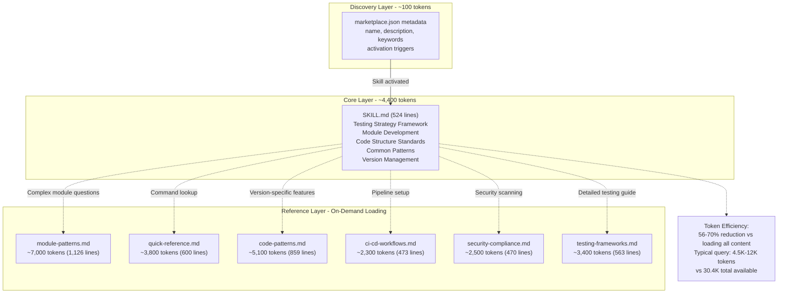
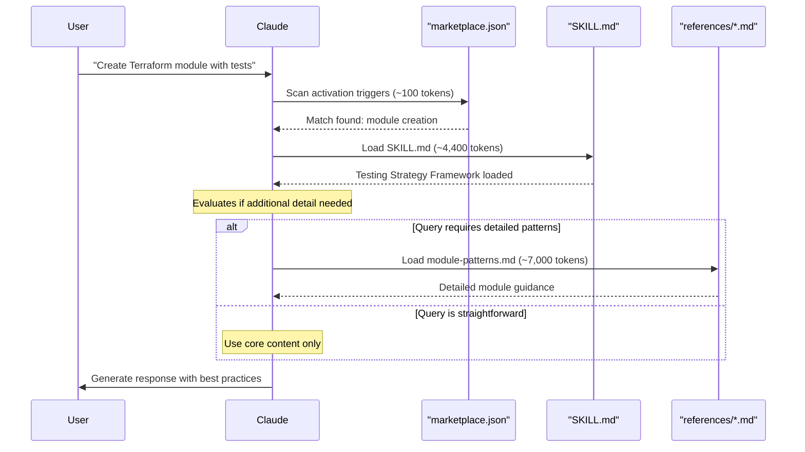
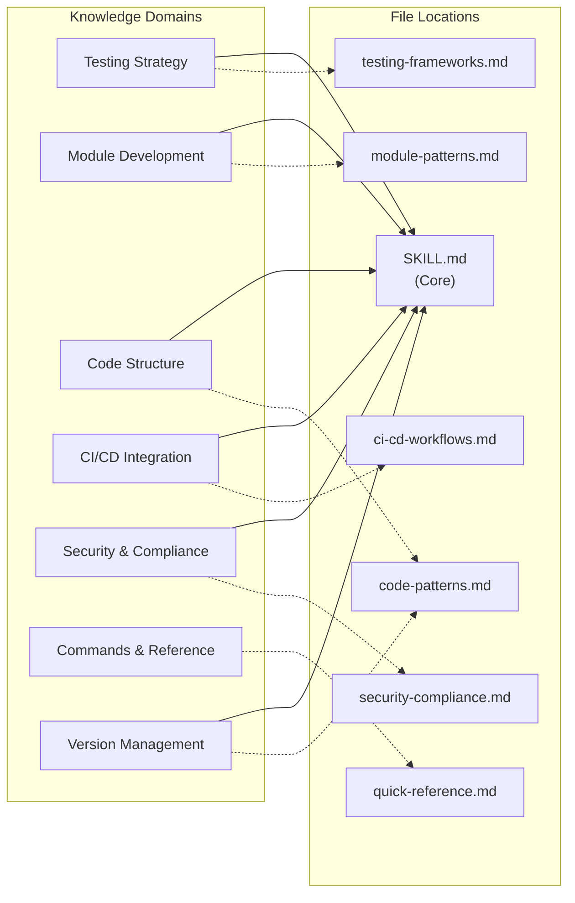
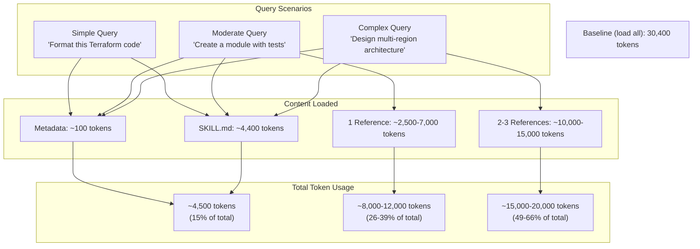
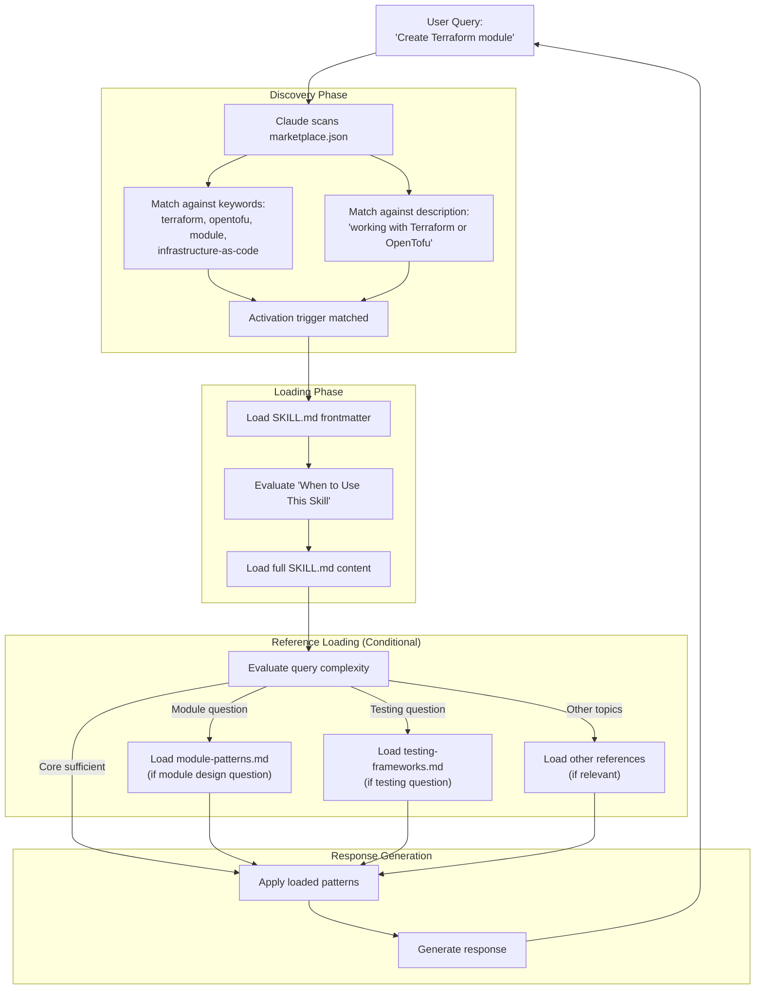

<!-- source: DeepWiki mcp.deepwiki.com · repo antonbabenko/terraform-skill · page 4 Knowledge Base · fetched 2026-10-27 -->

# Knowledge Base

<details>
<summary>Relevant source files</summary>

The following files were used as context for generating this wiki page:

- [CLAUDE.md](CLAUDE.md)
- [SKILL.md](SKILL.md)

</details>


This document describes the Terraform/OpenTofu knowledge base structure, content organization, and progressive disclosure architecture that enables Claude to provide expert guidance on infrastructure-as-code development. The knowledge base contains approximately 30.4K tokens of technical content distributed across a core skill file and specialized reference documents.

For information about how Claude discovers and loads this skill, see [Plugin Definition System](#3.1). For guidelines on contributing new content, see [Development Guide](#5).

---

## Knowledge Base Architecture

The knowledge base implements a **three-tier progressive disclosure pattern** to optimize token usage while maintaining comprehensive coverage of Terraform/OpenTofu best practices.

### Content Distribution Model



**Sources:** [SKILL.md:1-517](), [CLAUDE.md:49-82](), [.claude-plugin/marketplace.json:1-20]()

### Progressive Loading Sequence

The knowledge base loads in stages based on query complexity:



**Sources:** [SKILL.md:499-510](), [CLAUDE.md:49-64](), [CLAUDE.md:66-82]()

---

## Content Organization

The knowledge base is organized into two primary directories with distinct responsibilities:

### File Structure and Token Distribution

| File Path | Lines | Est. Tokens | Purpose | Loading Strategy |
|-----------|-------|-------------|---------|------------------|
| `SKILL.md` | 524 | ~4,400 | Core patterns, decision frameworks, quick reference | Always loaded on activation |
| `references/module-patterns.md` | 1,126 | ~7,000 | Module architecture, variable/output design | Loaded for module questions |
| `references/code-patterns.md` | 859 | ~5,100 | Block ordering, count vs for_each, modern features | Loaded for version-specific queries |
| `references/quick-reference.md` | 600 | ~3,800 | Command cheat sheets, troubleshooting | Loaded for command lookup |
| `references/testing-frameworks.md` | 563 | ~3,400 | Static analysis, native tests, Terratest | Loaded for testing questions |
| `references/ci-cd-workflows.md` | 473 | ~2,300 | GitHub Actions, GitLab CI, Atlantis | Loaded for pipeline setup |
| `references/security-compliance.md` | 470 | ~2,500 | Trivy, Checkov, secrets management | Loaded for security queries |
| **Total** | **4,615** | **~30,400** | Complete knowledge base | Progressive disclosure |

**Sources:** [CLAUDE.md:16-43](), [CLAUDE.md:66-82](), [SKILL.md:499-510]()

### Directory Structure

```
terraform-skill/
├── SKILL.md                           # Core skill file (always loaded)
└── references/                        # Reference library (on-demand)
    ├── module-patterns.md             # Module development guidance
    ├── code-patterns.md               # Modern Terraform patterns
    ├── quick-reference.md             # Command cheat sheets
    ├── testing-frameworks.md          # Testing methodology
    ├── ci-cd-workflows.md             # Pipeline integration
    └── security-compliance.md         # Security best practices
```

**Sources:** [CLAUDE.md:16-32](), [SKILL.md:503-509]()

---

## Core Content Categories

The knowledge base covers seven primary categories of Terraform/OpenTofu expertise:

### Topic to File Mapping



**Sources:** [SKILL.md:14-28](), [SKILL.md:116-476](), [SKILL.md:499-510]()

### Content Coverage Matrix

| Category | Core Guidance (SKILL.md) | Extended Reference | Key Topics |
|----------|--------------------------|-------------------|------------|
| **Testing Strategy** | Decision matrix, framework selection | testing-frameworks.md | Static analysis, native tests, Terratest, mock providers |
| **Module Development** | Structure, naming, best practices summary | module-patterns.md | Variable design, output patterns, DO/DON'T examples |
| **Code Structure** | Block ordering, resource naming, file organization | code-patterns.md | count vs for_each, locals, dependency management |
| **CI/CD Integration** | Workflow stages, cost optimization | ci-cd-workflows.md | GitHub Actions, GitLab CI, Atlantis, automated cleanup |
| **Security** | Essential checks, common issues | security-compliance.md | Trivy, Checkov, secrets management, compliance testing |
| **Commands** | Version constraints, update workflow | quick-reference.md | Command cheat sheets, troubleshooting, migration paths |
| **Modern Features** | Feature availability, quick examples | code-patterns.md | try(), optional(), moved blocks, cross-variable validation |

**Sources:** [SKILL.md:116-476](), [SKILL.md:499-510]()

---

## Content Categories in Detail

### Testing Strategy Framework

The knowledge base provides a comprehensive testing decision framework spanning multiple testing approaches:

**Core Content Location:** [SKILL.md:116-171]()

**Key Components:**
- Decision matrix for testing approach selection [SKILL.md:119-128]()
- Testing pyramid for infrastructure [SKILL.md:130-144]()
- Native test best practices for Terraform 1.6+ [SKILL.md:146-171]()
- Version-specific guidance (1.0-1.5, 1.6+, 1.7+) [SKILL.md:478-493]()

**Extended Reference:** `references/testing-frameworks.md` (~563 lines, ~3,400 tokens)

**Sources:** [SKILL.md:116-171](), [SKILL.md:478-493](), [CLAUDE.md:69-75]()

### Module Development Patterns

Module development guidance covers architecture principles, naming conventions, and best practices:

**Core Content Location:** [SKILL.md:315-350]()

**Key Components:**
- Standard module structure [SKILL.md:317-331]()
- Variable best practices (description, type, default, validation) [SKILL.md:335-341]()
- Output design principles [SKILL.md:342-347]()
- Reference to detailed patterns [SKILL.md:348-350]()

**Extended Reference:** `references/module-patterns.md` (~1,126 lines, ~7,000 tokens)

**Sources:** [SKILL.md:315-350](), [CLAUDE.md:71]()

### Code Structure Standards

Code structure guidance ensures consistency and maintainability:

**Core Content Location:** [SKILL.md:173-313]()

**Key Components:**
- Resource block ordering (count/for_each, arguments, tags, depends_on, lifecycle) [SKILL.md:175-202]()
- Variable block ordering (description, type, default, validation, nullable) [SKILL.md:204-225]()
- Count vs for_each decision guide [SKILL.md:229-271]()
- Locals for dependency management [SKILL.md:273-313]()

**Extended Reference:** `references/code-patterns.md` (~859 lines, ~5,100 tokens)

**Sources:** [SKILL.md:173-313](), [CLAUDE.md:70]()

### CI/CD Integration

CI/CD guidance covers pipeline integration, cost optimization, and workflow automation:

**Core Content Location:** [SKILL.md:352-370]()

**Key Components:**
- Recommended workflow stages (validate, test, plan, apply) [SKILL.md:354-359]()
- Cost optimization strategy (mocking, cleanup, resource tagging) [SKILL.md:361-367]()
- Reference to detailed templates [SKILL.md:368-370]()

**Extended Reference:** `references/ci-cd-workflows.md` (~473 lines, ~2,300 tokens)

**Sources:** [SKILL.md:352-370](), [CLAUDE.md:69]()

### Security and Compliance

Security guidance covers scanning tools, secrets management, and compliance frameworks:

**Core Content Location:** [SKILL.md:372-397]()

**Key Components:**
- Essential security checks (trivy, checkov) [SKILL.md:374-380]()
- Common security issues to avoid [SKILL.md:382-394]()
- Reference to detailed security guide [SKILL.md:396-397]()

**Extended Reference:** `references/security-compliance.md` (~470 lines, ~2,500 tokens)

**Sources:** [SKILL.md:372-397](), [CLAUDE.md:74]()

### Quick Reference and Commands

Command reference provides rapid consultation for common operations:

**Core Content Location:** [SKILL.md:399-476]()

**Key Components:**
- Version constraint syntax [SKILL.md:401-407]()
- Version strategy by component [SKILL.md:409-416]()
- Update workflow [SKILL.md:418-429]()
- Modern Terraform features by version [SKILL.md:433-476]()

**Extended Reference:** `references/quick-reference.md` (~600 lines, ~3,800 tokens)

**Sources:** [SKILL.md:399-476](), [CLAUDE.md:71]()

---

## Token Budget and Efficiency

The knowledge base achieves significant token efficiency through progressive disclosure:

### Token Usage Patterns



**Sources:** [CLAUDE.md:66-82](), [SKILL.md:499-510]()

### Efficiency Metrics

| Metric | Value | Calculation |
|--------|-------|-------------|
| **Total Available Content** | 30,400 tokens | Sum of all files |
| **Typical Simple Query** | 4,500 tokens | Metadata + SKILL.md |
| **Typical Moderate Query** | 8,000-12,000 tokens | + 1 reference file |
| **Typical Complex Query** | 15,000-20,000 tokens | + 2-3 reference files |
| **Token Reduction (Simple)** | 85% | vs loading all content |
| **Token Reduction (Moderate)** | 56-70% | vs loading all content |
| **Token Reduction (Complex)** | 34-51% | vs loading all content |

**Sources:** [CLAUDE.md:78-82](), [CLAUDE.md:320-328]()

### Content Distribution Strategy

The 524-line `SKILL.md` core file exceeds the suggested 500-line target but is justified by:

1. **Comprehensive decision matrices** - Testing approach selection, count vs for_each [SKILL.md:119-271]()
2. **Essential quick reference tables** - Version management, modern features [SKILL.md:399-476]()
3. **Version-specific guidance** - Multiple Terraform versions supported [SKILL.md:433-493]()
4. **Progressive disclosure architecture** - Minimizes actual token cost per query [CLAUDE.md:320-328]()

The extra 24 lines provide significant value while maintaining scannability. Future content additions prioritize reference file expansion over core skill growth.

**Sources:** [CLAUDE.md:314-328](), [SKILL.md:1-517]()

---

## Content Discovery and Loading

Claude Code discovers and loads knowledge base content through a multi-stage process:

### Discovery Mechanism



**Sources:** [.claude-plugin/marketplace.json:1-20](), [SKILL.md:1-8](), [SKILL.md:14-28](), [SKILL.md:499-510]()

### Activation Triggers

The skill activates when queries match specific patterns defined in `SKILL.md`:

**Primary Triggers:** [SKILL.md:16-23]()
- Creating new Terraform or OpenTofu configurations or modules
- Setting up testing infrastructure for IaC code
- Deciding between testing approaches
- Structuring multi-environment deployments
- Implementing CI/CD for infrastructure-as-code
- Reviewing or refactoring existing Terraform/OpenTofu projects
- Choosing between module patterns or state management approaches

**Exclusion Triggers:** [SKILL.md:25-28]()
- Basic Terraform/OpenTofu syntax questions (Claude's base knowledge)
- Provider-specific API reference (delegated to documentation)
- Cloud platform questions unrelated to Terraform/OpenTofu

**Sources:** [SKILL.md:14-28](), [.claude-plugin/marketplace.json:3-4]()

### Reference File Loading Logic

Reference files load based on query analysis:

| Query Pattern | Reference File Loaded | Lines Loaded | Typical Use Case |
|---------------|----------------------|--------------|------------------|
| "module", "architecture", "structure" | module-patterns.md | 1,126 | Module design questions |
| "count", "for_each", "version", "modern" | code-patterns.md | 859 | Version-specific patterns |
| "command", "troubleshoot", "cheat sheet" | quick-reference.md | 600 | Command lookup |
| "test", "terratest", "native test", "mock" | testing-frameworks.md | 563 | Testing methodology |
| "ci", "cd", "pipeline", "github actions" | ci-cd-workflows.md | 473 | Pipeline setup |
| "security", "trivy", "checkov", "secrets" | security-compliance.md | 470 | Security scanning |

**Sources:** [SKILL.md:499-510](), [CLAUDE.md:69-76]()

---

## Content Maintenance Strategy

The knowledge base follows a structured approach to content maintenance:

### Content Quality Criteria

**Essential Characteristics:** [CLAUDE.md:85-109]()
- Terraform-specific patterns and idioms (not generic programming advice)
- Decision frameworks (when to use X vs Y)
- Version-specific features clearly marked
- ✅ DO vs ❌ DON'T examples
- Scannable format (tables, headers, visual hierarchy)
- Imperative voice ("Use X", not "You should consider X")

**What Doesn't Belong:** [CLAUDE.md:102-109]()
- Generic programming advice
- Terraform syntax basics (covered in official docs)
- Provider-specific resource details (use MCP tools)
- Obvious practices ("use version control")
- Long prose explanations (use tables instead)

**Sources:** [CLAUDE.md:85-109](), [CONTRIBUTING.md:1-50]()

### Update Triggers

Content updates occur when: [CLAUDE.md:200-211]()
- New Terraform major/minor versions introduce features
- Community consensus emerges on patterns
- Real-world usage reveals gaps or ambiguities
- Anti-patterns discovered that should be warned against

Content does not update for: [CLAUDE.md:208-211]()
- Provider-specific resource changes (use MCP tools)
- Minor version patches without feature changes
- Personal preferences without community consensus

**Sources:** [CLAUDE.md:200-211](), [CONTRIBUTING.md:1-50]()

### Version-Specific Content Organization

The knowledge base maintains guidance for multiple Terraform/OpenTofu versions:

| Version Range | Key Features Documented | Location |
|---------------|------------------------|----------|
| Terraform 1.0-1.5 | Terratest-based testing, core functionality | [SKILL.md:480-483]() |
| Terraform 1.6+ | Native test framework | [SKILL.md:485-488]() |
| Terraform 1.7+ | Mock providers for unit testing | [SKILL.md:490-493]() |
| Terraform 1.8+ | Provider functions | [SKILL.md:445]() |
| Terraform 1.9+ | Cross-variable validation | [SKILL.md:446]() |
| Terraform 1.11+ | Write-only arguments | [SKILL.md:447]() |

**Sources:** [SKILL.md:433-493](), [CLAUDE.md:91]()

---

For detailed information on specific knowledge domains, see:
- [Core Skill Content (SKILL.md)](#4.1) - Testing strategy, module development, patterns
- [Module Development Patterns](#4.2) - Module architecture and best practices
- [Code Patterns & Modern Features](#4.3) - Block ordering, version-specific features
- [Quick Reference & Commands](#4.4) - Command cheat sheets, troubleshooting
- [CI/CD Workflows](#4.5) - Pipeline integration templates
- [Security & Compliance](#4.6) - Security scanning, compliance testing

---

