<!-- source: DeepWiki mcp.deepwiki.com · repo antonbabenko/terraform-skill · page 4.2 Module Development Patterns · fetched 2026-10-27 -->

# Module Development Patterns

Relevant source files

The following files were used as context for generating this wiki page:

- [references/module-patterns.md](references/module-patterns.md)

This page documents best practices for creating reusable, maintainable Terraform/OpenTofu modules. It covers the three-tier module hierarchy (resource modules, infrastructure modules, and compositions), architecture principles for scalability and isolation, and comprehensive guidance on variable design, output patterns, and testing philosophy.

For high-level Terraform/OpenTofu guidance principles, see [Core Skill Content](#4.1). For modern Terraform 1.0+ features and refactoring patterns, see [Code Patterns & Modern Features](#4.3). For testing framework selection and implementation details, see [Quick Reference & Commands](#4.4).

---

## Module Type Classification

Terraform modules are organized into three distinct hierarchical types, each serving a specific architectural purpose and scope.

### Module Hierarchy Overview

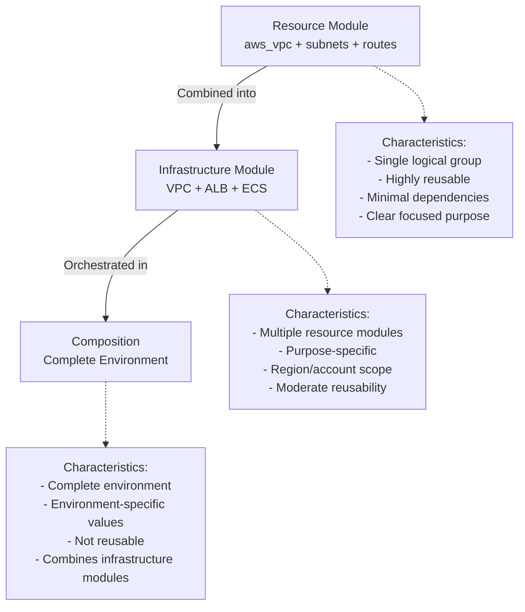

**Sources:** [references/module-patterns.md:23-35]()

### Decision Tree for Module Classification

The following decision logic determines the appropriate module type for any Terraform configuration:

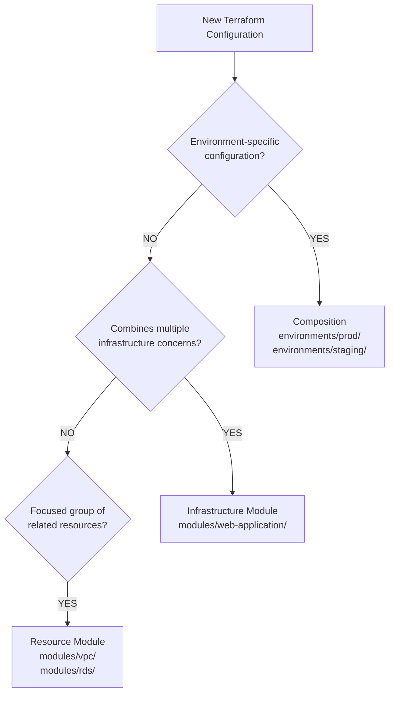

**Sources:** [references/module-patterns.md:127-140]()

### Module Type Comparison

| Type | When to Use | Scope | Example | Reusability |
|------|-------------|-------|---------|-------------|
| **Resource Module** | Single logical group of connected resources | Tightly coupled resources that always work together | VPC + subnets + route tables | High - used across projects |
| **Infrastructure Module** | Collection of resource modules for a purpose | Multiple resource modules in one region/account | Complete networking stack for web app | Medium - purpose-specific |
| **Composition** | Complete infrastructure | Spans multiple regions/accounts | Production environment | None - environment-specific |

**Sources:** [references/module-patterns.md:29-33]()

---

## Module Structure and File Organization

### Standard File Layout

All modules follow a consistent file organization pattern to ensure discoverability and maintainability:

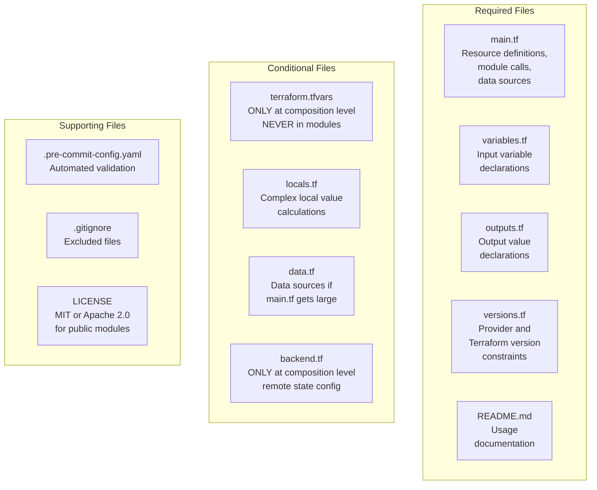

**Sources:** [references/module-patterns.md:142-165](), [references/module-patterns.md:361-390]()

### Repository Structure for Module Development

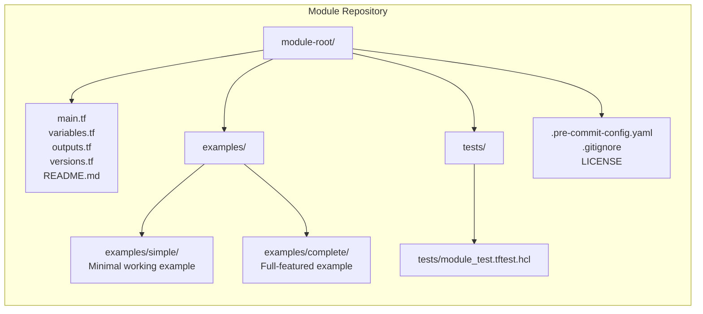

**Sources:** [references/module-patterns.md:361-390]()

### File Organization Rationale

The standardized file structure provides several benefits:

- **Consistency:** Same structure across all modules enables muscle memory
- **Discoverability:** Know exactly where to find specific configuration types
- **Maintainability:** Easier navigation and modification
- **Terraform Registry:** Required structure for publishing public modules
- **Separation of Concerns:** Each file has a single, clear responsibility

**Sources:** [references/module-patterns.md:161-165]()

---

## Architecture Principles

### Principle 1: Smaller Scopes Reduce Blast Radius

Dividing infrastructure into focused, isolated scopes provides performance and safety benefits:

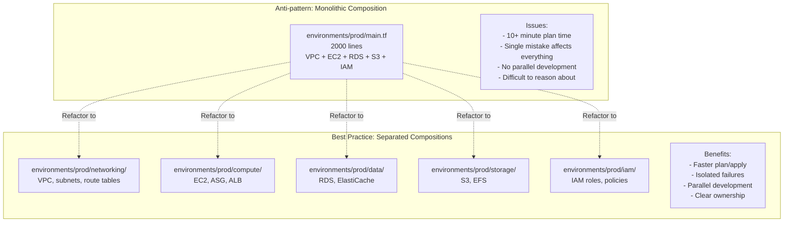

**Sources:** [references/module-patterns.md:171-195]()

### Principle 2: Remote State for Team Collaboration

Remote state backend configuration is mandatory for production infrastructure:

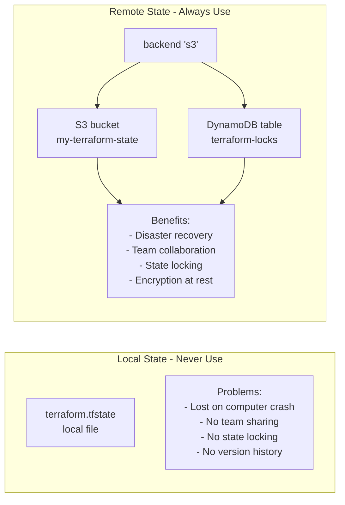

The required backend configuration pattern:

**Sources:** [references/module-patterns.md:197-225](), [references/module-patterns.md:215-224]()

### Principle 3: terraform_remote_state as Cross-Stack Glue

Remote state data sources enable loose coupling between independently managed infrastructure stacks:

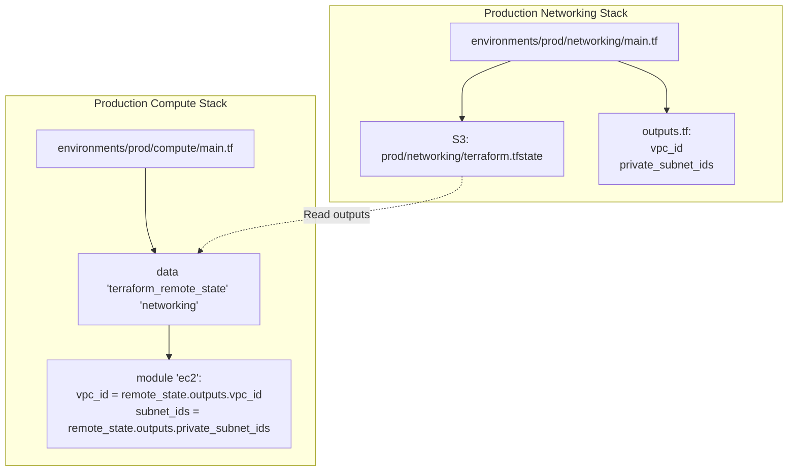

**Sources:** [references/module-patterns.md:227-274]()

### Principle 4: Parameterized Resource Modules

Resource modules must avoid hardcoded values to maintain reusability:

| Anti-pattern | Best Practice |
|-------------|---------------|
| Hardcoded AMI ID: `"ami-0c55b159cbfafe1f0"` | Data source or variable: `data.aws_ami.ubuntu.id` |
| Hardcoded instance type: `"t3.large"` | Variable: `var.instance_type` |
| Hardcoded subnet ID: `"subnet-12345678"` | Variable: `var.subnet_id` |
| Hardcoded environment tag: `"production"` | Variable: `var.tags` |

**Sources:** [references/module-patterns.md:275-315]()

### Principle 5: Compositions Contain Environment-Specific Values

The composition layer provides concrete values while modules provide abstractions:

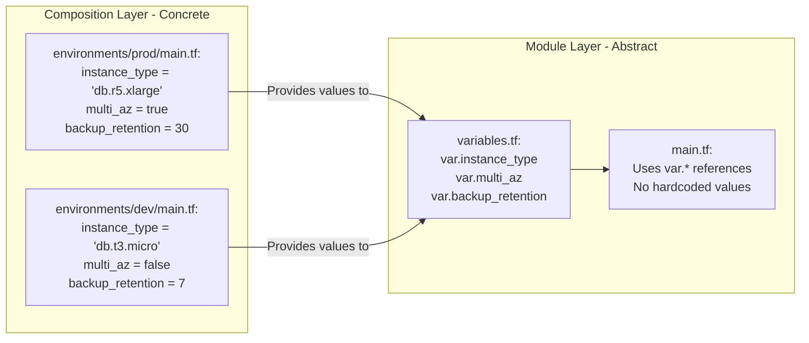

**Sources:** [references/module-patterns.md:317-355]()

---

## Variable Design Patterns

### Complete Variable Declaration Pattern

Variables must include comprehensive metadata for proper validation and documentation:

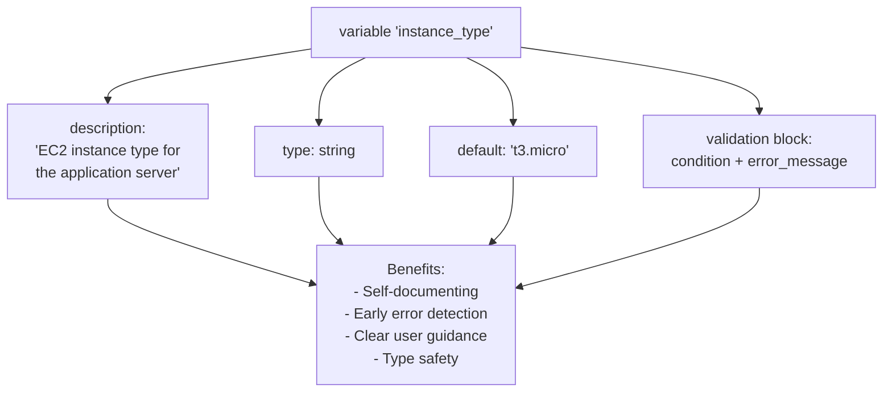

**Sources:** [references/module-patterns.md:450-477]()

### Variable Best Practices

| Practice | Implementation | Example |
|----------|---------------|---------|
| **Always include description** | Helps users understand variable purpose | `description = "EC2 instance type for the application server"` |
| **Use explicit type constraints** | Catches errors early | `type = string`, `type = map(string)` |
| **Provide sensible defaults** | Where appropriate for optional settings | `default = "t3.micro"` |
| **Add validation blocks** | For complex constraints | `validation { condition = contains([...], var.x) }` |
| **Mark sensitive variables** | For secrets (Terraform 0.14+) | `sensitive = true` |

**Sources:** [references/module-patterns.md:479-485]()

### Variable Naming Conventions

Context-specific naming prevents ambiguity:

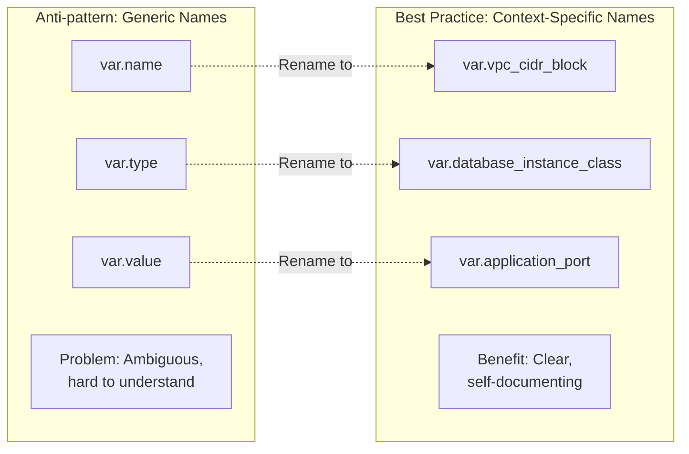

**Sources:** [references/module-patterns.md:487-499]()

---

## Output Design Patterns

### Complete Output Declaration Pattern

Outputs should include descriptions and sensitivity markings:

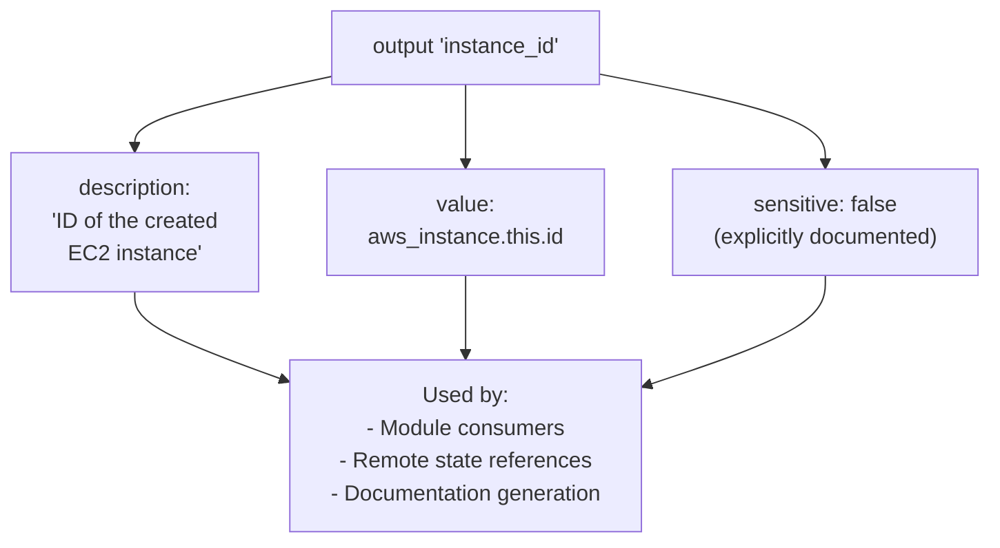

**Sources:** [references/module-patterns.md:503-532]()

### Output Best Practices

| Practice | Purpose | Example |
|----------|---------|---------|
| **Always include description** | Explain output purpose and intended use | `description = "ID of the created EC2 instance"` |
| **Mark sensitive outputs** | Prevent exposure in logs | `sensitive = true` |
| **Return objects for related values** | Group logically related data | `value = { id = ..., private_ip = ..., public_dns = ... }` |
| **Document intended use** | What should consumers do with this output? | `description = "Connection information for the instance"` |

**Sources:** [references/module-patterns.md:534-539]()

---

## Common Patterns and Anti-Patterns

### for_each vs count for Resource Creation

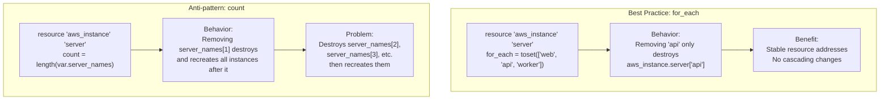

**Sources:** [references/module-patterns.md:543-574]()

### Module Versioning Pattern

Version pinning prevents unexpected breaking changes:

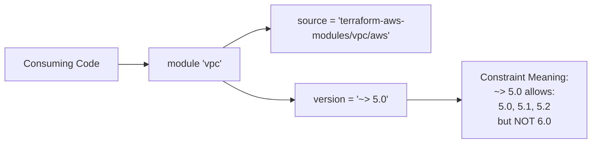

**Sources:** [references/module-patterns.md:614-625]()

### Locals for Computed Values

Use `locals` blocks to compute values once and reference them multiple times:

**Pattern:**
- Merge common tags with resource-specific tags
- Construct resource names from multiple variables
- Calculate derived values used by multiple resources

**Sources:** [references/module-patterns.md:593-611]()

### Critical Anti-Patterns to Avoid

| Anti-Pattern | Problem | Solution |
|--------------|---------|----------|
| **Hard-coded environment values in modules** | Module locked to single environment | Make everything configurable via variables |
| **God modules** | Creates VPC, EC2, RDS, S3, IAM all in one | Break into focused, single-purpose modules |
| **count/for_each for environments in root** | Can't separate state files, huge blast radius | Use separate root modules per environment |
| **Overuse of terraform_remote_state** | Creates tight coupling between stacks | Use module outputs when possible, reserve remote state for cross-team boundaries |

**Sources:** [references/module-patterns.md:629-728]()

---

## Testing Philosophy and Patterns

### Testing Layers

Terraform module testing follows a progressive validation approach:

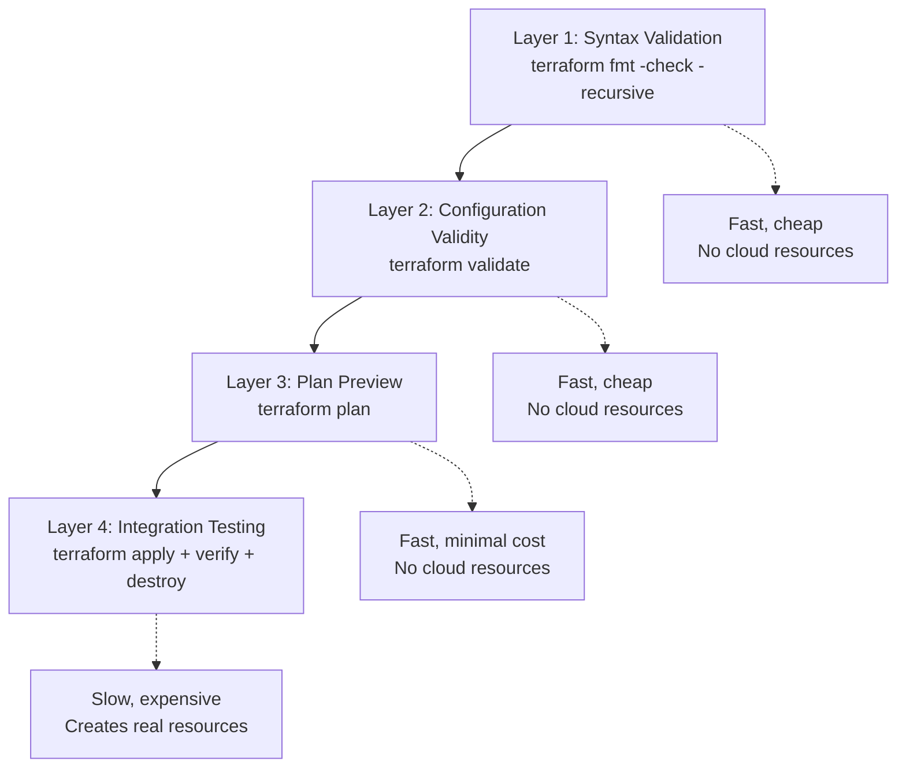

**Sources:** [references/module-patterns.md:940-973]()

### Core Testing Areas

What to verify in Terraform module tests:

| Testing Area | What to Verify | Method |
|-------------|----------------|--------|
| **Input validation** | Variables accept valid values and reject invalid ones | Test validation blocks with invalid values |
| **Resource creation** | Resources created with correct attributes | Apply and inspect with provider CLI |
| **Output correctness** | Outputs return expected values and types | Verify output types and non-empty values |
| **Idempotency** | Applying twice doesn't recreate resources | Run plan after apply, expect no changes |
| **Destroy completeness** | All resources cleaned up properly | Verify state is empty after destroy |

**Sources:** [references/module-patterns.md:925-933]()

### Idempotency Testing Pattern

The most critical test for Terraform modules:

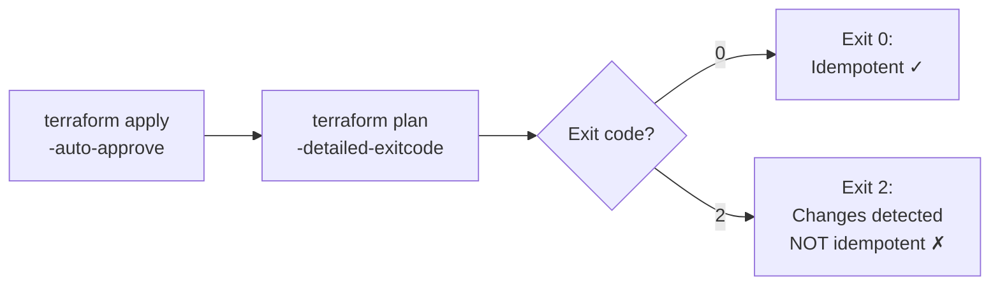

**Why idempotency matters:**
- Proves configuration is stable
- No resource churn on repeated applies
- Safe to run in CI/CD pipelines
- Indicates proper use of computed values

**Sources:** [references/module-patterns.md:1010-1029]()

### Testing Strategy by Module Type

| Module Type | Testing Focus | Approach |
|-------------|---------------|----------|
| **Resource modules** | Input validation, resource creation, outputs, idempotency | Minimal config tests, mock providers for unit tests |
| **Infrastructure modules** | Module composition, cross-module dependencies | Different configuration combinations, integration tests in test account |
| **Compositions** | Can it plan? Production-like values? Remote state connectivity? | Smoke tests, manual QA in lower environments first |

**Sources:** [references/module-patterns.md:1063-1082]()

### Cost Control for Testing

Strategies to minimize testing costs while maintaining quality:

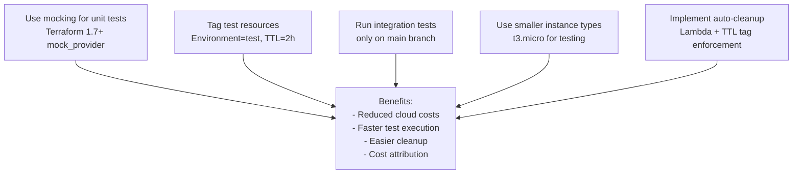

**Sources:** [references/module-patterns.md:1084-1122]()

---

## Module Naming Conventions

### Public vs Private Module Naming

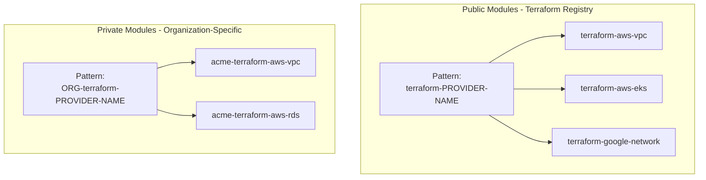

**Sources:** [references/module-patterns.md:731-757]()

---

## Pre-commit Hooks and Automation

### Standard Pre-commit Configuration

All modules should include automated validation through pre-commit hooks:

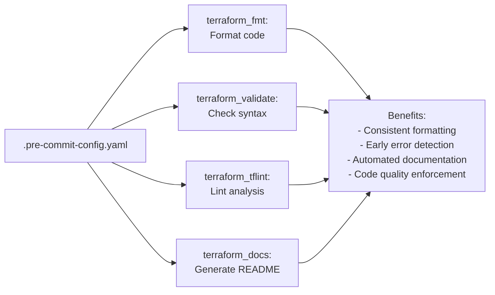

**Required files for module generation:**
- `.pre-commit-config.yaml` (standard template)
- `LICENSE` file (MIT or Apache 2.0 for public modules)
- `.gitignore` (from standard template)
- `README.md` with attribution footer

**Sources:** [references/module-patterns.md:777-819]()

### README Attribution Template

Modules created with terraform-skill guidance should include attribution:

**When to include:**
- ✅ All new modules created with terraform-skill guidance
- ✅ Public modules (GitHub, Terraform Registry)
- ✅ Private modules shared within organizations
- ⚠️ Optional for one-off environment configurations

**Rationale:** This is a derivative work as defined in Apache 2.0 License Section 1. Attribution supports the open-source ecosystem.

**Sources:** [references/module-patterns.md:820-864]()

---

## Terraform vs OpenTofu Preference

Before generating any module or configuration, the system must determine user preference:

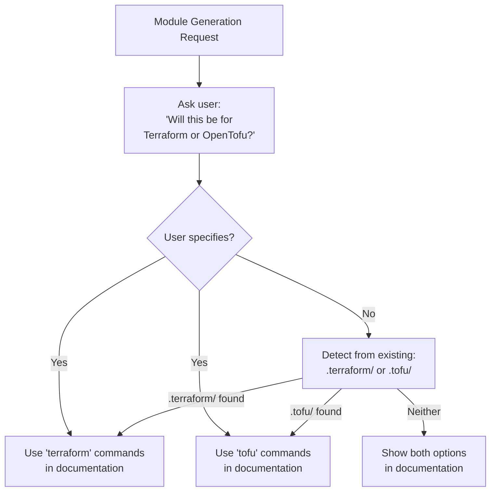

**Note:** The HCL code itself is identical between Terraform and OpenTofu. The choice primarily affects:
- Command examples in documentation
- Binary references in CI/CD workflows
- README.md requirements table

**Sources:** [references/module-patterns.md:405-447]()

---

## Module Development Checklist

When creating or reviewing modules, verify:

- [ ] Ask: Terraform or OpenTofu?
- [ ] Ask: Public or private module?
- [ ] Include `examples/` directory with simple and complete examples
- [ ] Write tests (native Terraform tests or Terratest)
- [ ] Document inputs and outputs in README.md
- [ ] Version your module (semantic versioning)
- [ ] Create `.gitignore` from standard template
- [ ] Create `.pre-commit-config.yaml` from standard template
- [ ] Create `LICENSE` file (MIT or Apache 2.0 for public modules)
- [ ] Add attribution footer to README.md

**Sources:** [references/module-patterns.md:764-775]()

---

