<!-- source: DeepWiki mcp.deepwiki.com · repo antonbabenko/terraform-skill · page 4.3 Code Patterns & Modern Features · fetched 2026-10-27 -->

# Code Patterns & Modern Features

<details>
<summary>Relevant source files</summary>

The following files were used as context for generating this wiki page:

- [references/code-patterns.md](references/code-patterns.md)

</details>


This document provides comprehensive guidance on Terraform/OpenTofu code structure, modern language features, and refactoring patterns. It covers block ordering conventions, the `count` vs `for_each` decision framework, version-specific features from Terraform 0.13+ through 1.11+, version constraint strategies, and safe refactoring techniques.

For high-level module architecture principles, see [Module Development Patterns](#4.2). For command-line usage and troubleshooting, see [Quick Reference & Commands](#4.4).

---

## Block Ordering & Structure

Terraform enforces strict argument ordering conventions within resource blocks to maintain consistency and readability across codebases. The canonical ordering follows a specific hierarchy designed to surface meta-arguments first.

### Resource Block Argument Order

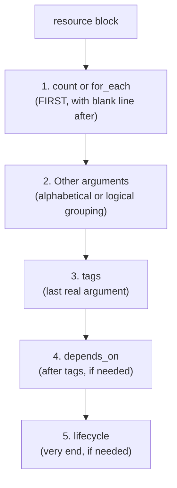

**Sources:** [references/code-patterns.md:21-69]()

The pattern enforces `count` or `for_each` as the first argument because these meta-arguments determine whether the resource will be created at all. A blank line follows to visually separate the conditional logic from the resource configuration. The `tags` argument appears last among real arguments to keep resource-specific configuration grouped together. Meta-arguments `depends_on` and `lifecycle` follow at the very end since they control Terraform's execution behavior rather than the resource's actual configuration.

| Position | Argument | Purpose | Required Blank Line |
|----------|----------|---------|---------------------|
| 1 | `count` or `for_each` | Conditional creation | Yes (after) |
| 2 | Other arguments | Resource configuration | No |
| 3 | `tags` | Metadata/labels | No |
| 4 | `depends_on` | Explicit dependencies | No |
| 5 | `lifecycle` | Terraform behavior | No |

**Sources:** [references/code-patterns.md:21-69]()

### Variable Block Structure

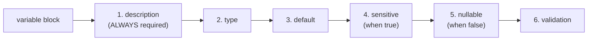

**Sources:** [references/code-patterns.md:71-95]()

Every variable must include a `description` as the first argument. This is not just convention but a requirement for self-documenting code. The `type` follows to define the data structure, then `default` for optional variables. The `sensitive` and `nullable` attributes modify behavior when set to non-default values (`true` and `false` respectively).

### Output Naming Convention

Output identifiers follow the pattern `{name}_{type}_{attribute}`, omitting the `this_` prefix that is common in resource declarations. Plural forms indicate list returns.

| Pattern | Example | Return Type |
|---------|---------|-------------|
| `{name}_{type}_{attribute}` | `security_group_id` | Single value |
| `{name}_{type}_{attribute}s` | `private_subnet_ids` | List |

**Sources:** [references/code-patterns.md:144-168]()

---

## Count vs For_Each Decision Framework

The choice between `count` and `for_each` affects resource addressability, state management, and behavior during list modifications.

### Decision Tree

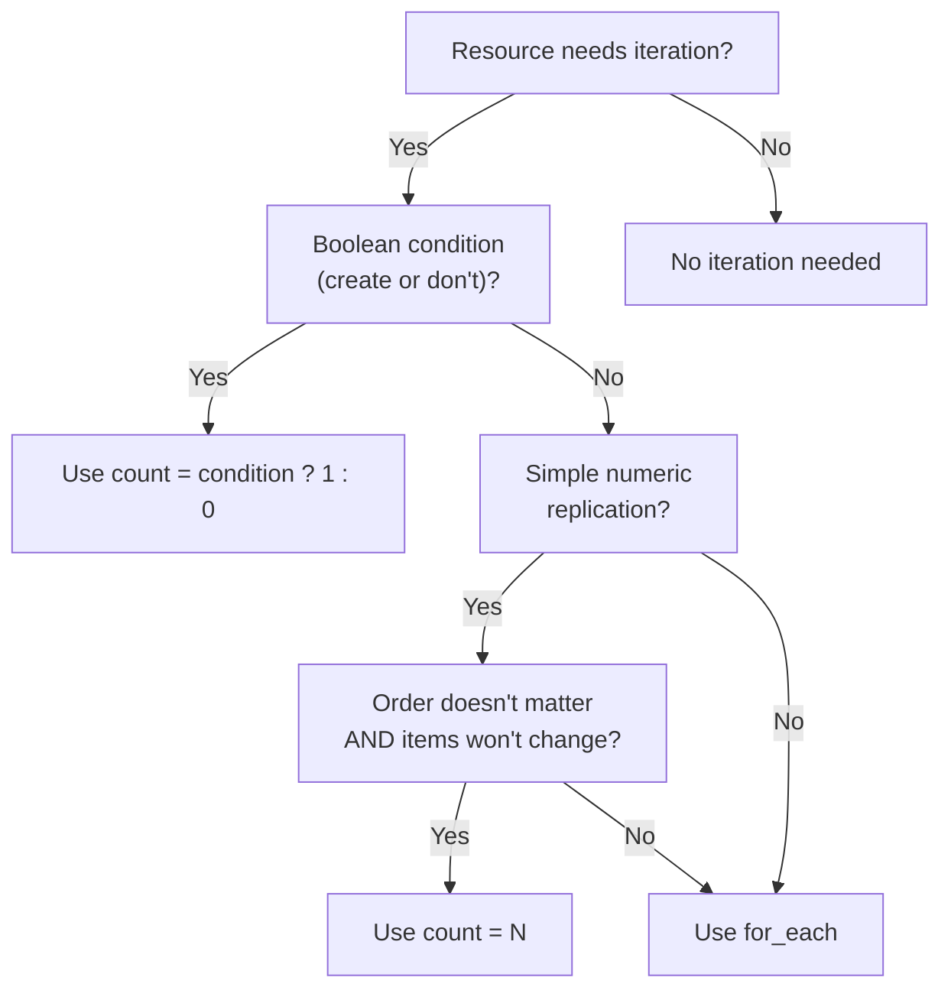

**Sources:** [references/code-patterns.md:172-259]()

### Count Use Cases

The `count` meta-argument works best for:

1. **Boolean conditions** where resources are either created or not created
2. **Simple numeric replication** with stable item order
3. **Fixed lists** that will never have items added or removed from the middle

The boolean pattern `count = var.create_nat_gateway ? 1 : 0` appears extensively in conditional resource creation. Resources created with `count` are addressed by numeric index: `aws_nat_gateway.this[0]`.

**Sources:** [references/code-patterns.md:174-196]()

### For_Each Use Cases

The `for_each` meta-argument provides:

1. **Key-based addressing** for stable resource references
2. **Safe list modification** where items can be added/removed without recreating other resources
3. **Named resource sets** with semantic keys

Resources created with `for_each` use the `each.key` and `each.value` references and are addressed by their key: `aws_subnet.private["us-east-1a"]`.

**Sources:** [references/code-patterns.md:200-259]()

### Impact of List Modification

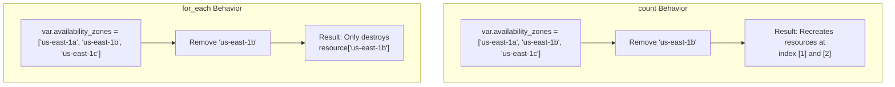

**Sources:** [references/code-patterns.md:215-232]()

When using `count`, removing an item from the middle of a list causes Terraform to shift all subsequent resources down by one index, triggering destroy/recreate cycles. With `for_each`, resources are addressed by stable keys, so removal only affects that specific resource.

---

## Modern Terraform Features by Version

Terraform has introduced significant language enhancements across versions 0.13 through 1.11+. Adoption of these features reduces code complexity and improves state management.

### Feature Timeline

| Version | Feature | Replacement For | Key Benefit |
|---------|---------|-----------------|-------------|
| 0.13+ | `try()` | `element(concat())` | Simplified null handling |
| 1.1+ | `nullable = false` | Manual null checks | Explicit null rejection |
| 1.1+ | `moved` blocks | State surgery | Refactoring without recreation |
| 1.3+ | `optional()` | Multiple object types | Default values in objects |
| 1.8+ | Provider functions | Custom logic | Provider-native operations |
| 1.9+ | Cross-variable validation | External validation | Inter-variable constraints |
| 1.11+ | Write-only arguments | Secrets in state | Secrets never stored |

**Sources:** [references/code-patterns.md:335-525]()

### try() Function Pattern

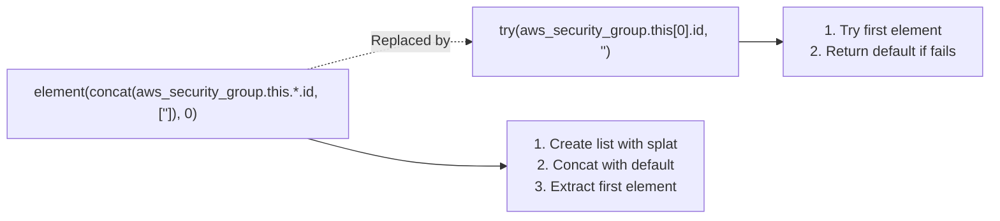

**Sources:** [references/code-patterns.md:337-361]()

The `try()` function replaces the legacy `element(concat())` pattern for accessing potentially non-existent resources. It accepts multiple fallback arguments and returns the first successful evaluation. The pattern `try(aws_security_group.this[0].id, "")` attempts to access the resource at index 0, returning an empty string if it doesn't exist.

### optional() with Defaults

The `optional()` type constructor enables object attributes with default values, reducing the need for complex `merge()` operations.

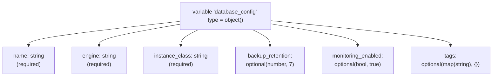

**Sources:** [references/code-patterns.md:377-402]()

Users can omit optional attributes when calling modules, and the defaults specified in the `optional()` constructor are automatically applied. This pattern appears in [references/code-patterns.md:106-126]() and [references/code-patterns.md:381-402]().

### moved Blocks for Refactoring

The `moved` block enables resource renaming and restructuring without destroy/recreate cycles.

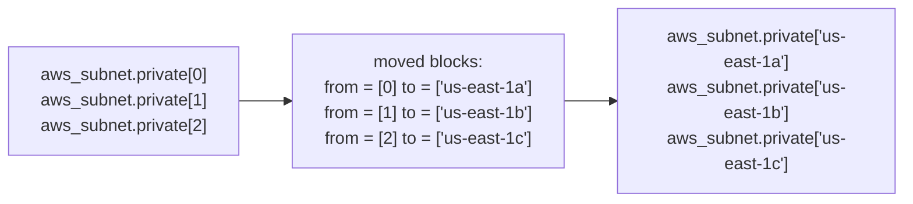

**Sources:** [references/code-patterns.md:262-327](), [references/code-patterns.md:404-426]()

The migration from `count` to `for_each` requires `moved` blocks to preserve existing resources. Each `moved` block maps an old address to a new address. Running `terraform plan` after adding `moved` blocks should show only move operations, not destroy/create.

### Write-Only Arguments

Terraform 1.11+ introduces write-only arguments that prevent sensitive values from being stored in state files. These arguments use a `_wo` suffix.

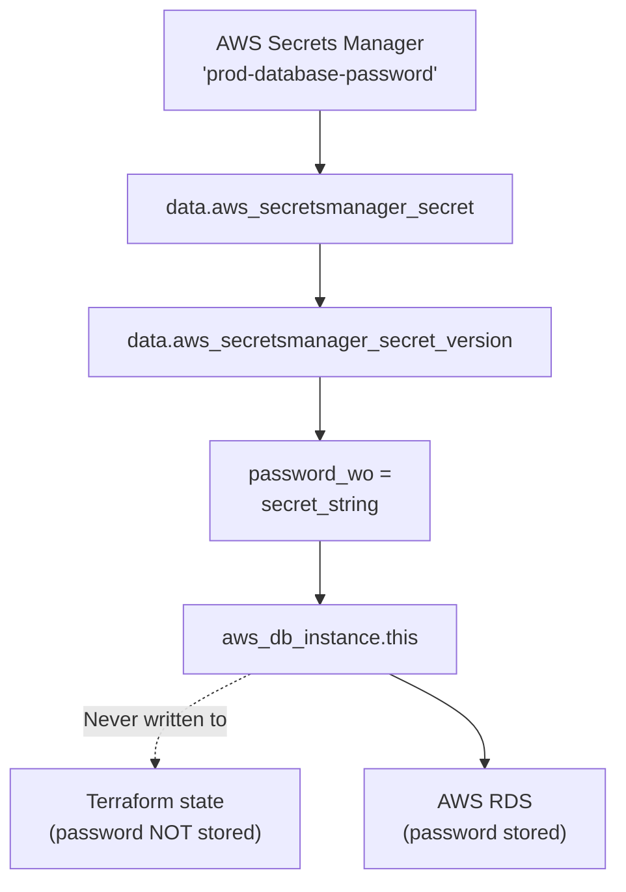

**Sources:** [references/code-patterns.md:488-524]()

The write-only pattern fetches secrets from external secret managers using data sources, passes them to resources via `*_wo` arguments, and ensures they never appear in the Terraform state file. This is critical for compliance with secret management policies.

---

## Version Management Strategy

Version constraints control Terraform core, provider, and module updates. The strategy balances stability with security patch adoption.

### Constraint Syntax

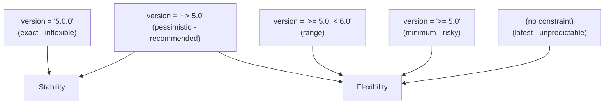

**Sources:** [references/code-patterns.md:528-550]()

The pessimistic constraint operator `~>` allows patch-level updates but prevents minor or major version changes. For example, `~> 5.0` permits `5.0.x` but blocks `5.1.0`. This balances receiving security patches while preventing breaking changes.

### Component Versioning Strategy

| Component | Constraint Type | Example | Rationale |
|-----------|----------------|---------|-----------|
| Terraform Core | Pessimistic minor | `~> 1.9` | Allow patch updates only |
| Providers (production) | Pessimistic major | `~> 5.0` | Allow minor/patch updates |
| Providers (dev) | Pessimistic major | `~> 5.0` | Same as production |
| Modules (production) | Exact | `5.1.2` | Maximum stability |
| Modules (dev) | Pessimistic minor | `~> 5.1` | Allow patch updates |

**Sources:** [references/code-patterns.md:552-594]()

Production modules use exact versions to prevent unexpected changes during `terraform init`. Development environments can use pessimistic constraints to test newer versions before promoting to production.

### Version Lock File Workflow

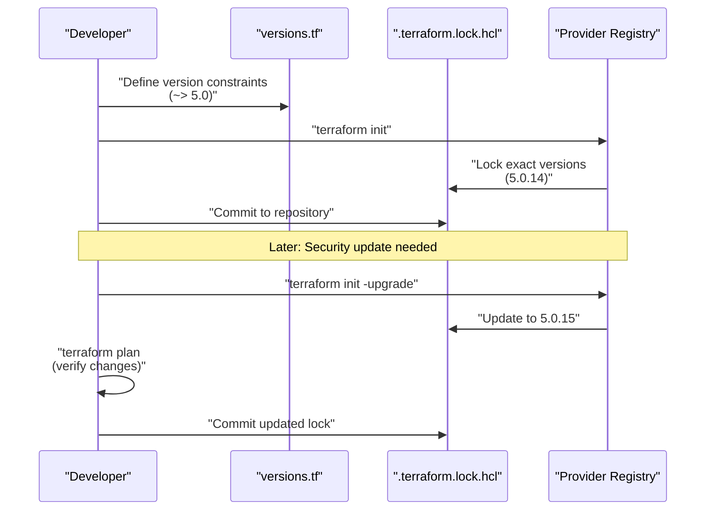

**Sources:** [references/code-patterns.md:613-638]()

The `.terraform.lock.hcl` file records the exact provider versions selected during `terraform init`. This file must be committed to version control to ensure all team members use identical provider versions. The `terraform init -upgrade` command updates providers within the constraints defined in `versions.tf`.

---

## Refactoring Patterns

Safe refactoring of Terraform code requires migration strategies that preserve existing infrastructure while updating code patterns.

### Legacy to Modern Migration Checklist

The migration from Terraform 0.12/0.13 to 1.x involves replacing deprecated patterns with modern equivalents:

- [ ] Replace `element(concat(...))` with `try()`
- [ ] Add `nullable = false` to variables that shouldn't accept null
- [ ] Use `optional()` in object types for optional attributes
- [ ] Add `validation` blocks to variables with constraints
- [ ] Migrate secrets to write-only arguments (Terraform 1.11+)
- [ ] Use `moved` blocks for resource refactoring (Terraform 1.1+)
- [ ] Consider cross-variable validation (Terraform 1.9+)

**Sources:** [references/code-patterns.md:676-719]()

### Secrets Remediation Pattern

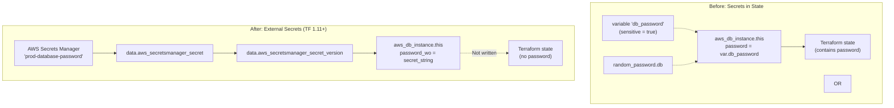

**Sources:** [references/code-patterns.md:721-804]()

The remediation process involves:

1. Creating the secret in AWS Secrets Manager outside Terraform
2. Adding data sources to fetch the secret
3. Updating resources to use the `*_wo` argument variant
4. Removing `random_password` resources or `sensitive` variables
5. Verifying the secret does not appear in `terraform show` output

For Terraform versions before 1.11, secrets must be managed entirely outside Terraform to avoid state file storage.

---

## Locals for Dependency Management

Local values can encode implicit dependencies to control resource deletion order without explicit `depends_on` declarations.

### VPC Deletion Order Pattern

```mermaid
graph TB
    subgraph creation["Resource Creation Order"]
        CREATE_VPC["aws_vpc.this"]
        CREATE_CIDR["aws_vpc_ipv4_cidr_block_association.this[0]"]
        CREATE_SUBNET["aws_subnet.public<br/>(vpc_id = local.vpc_id)"]
        
        CREATE_VPC --> CREATE_CIDR
        CREATE_CIDR --> CREATE_SUBNET
    end
    
    subgraph local_logic["local.vpc_id Logic"]
        TRY["try()"]
        CIDR_REF["aws_vpc_ipv4_cidr_block_association.this[0].vpc_id"]
        VPC_REF["aws_vpc.this.id"]
        EMPTY["''"]
        
        TRY --> CIDR_REF
        CIDR_REF -.->|"fallback"| VPC_REF
        VPC_REF -.->|"fallback"| EMPTY
    end
    
    subgraph deletion["Deletion Order (Implicit)"]
        DELETE_SUBNET["1. aws_subnet.public<br/>(depends on local.vpc_id)"]
        DELETE_CIDR["2. aws_vpc_ipv4_cidr_block_association.this[0]<br/>(referenced by local)"]
        DELETE_VPC["3. aws_vpc.this"]
        
        DELETE_SUBNET --> DELETE_CIDR
        DELETE_CIDR --> DELETE_VPC
    end
```

**Sources:** [references/code-patterns.md:807-856]()

The pattern uses `local.vpc_id` with a `try()` chain that references the secondary CIDR association before falling back to the VPC ID. This creates an implicit dependency graph:

```
aws_subnet.public → local.vpc_id → aws_vpc_ipv4_cidr_block_association.this[0] → aws_vpc.this
```

During destruction, Terraform must delete the subnet first (which depends on the local), then the CIDR association (which the local references), and finally the VPC. This prevents errors where Terraform attempts to delete the CIDR association while subnets still reference it.

### Common Use Cases

- VPC configurations with secondary CIDR blocks
- Resources depending on optional configurations
- Complex multi-resource dependency chains requiring specific deletion order

**Sources:** [references/code-patterns.md:852-856]()

---

**Related Documentation:**
- For module structure and hierarchy, see [Module Development Patterns](#4.2)
- For command-line workflows and troubleshooting, see [Quick Reference & Commands](#4.4)
- For testing methodology that validates these patterns, see [Testing Methodology](#5.3)

---

