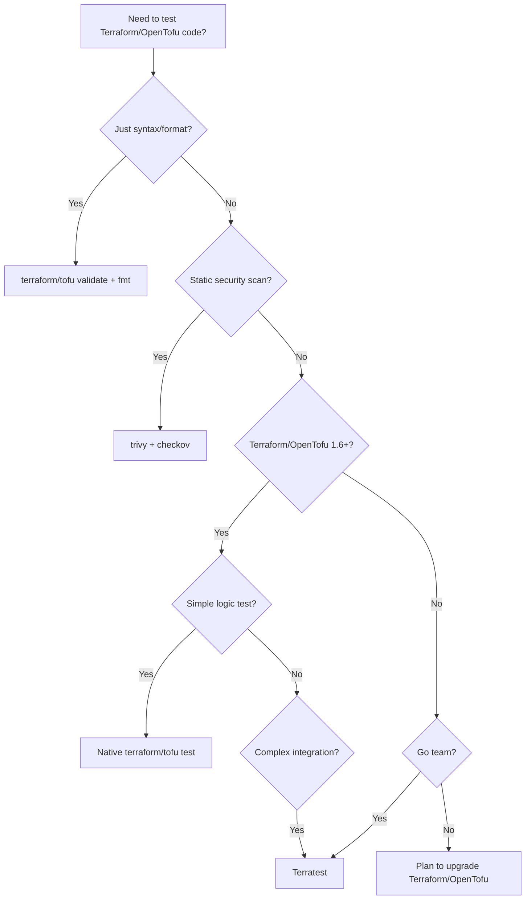
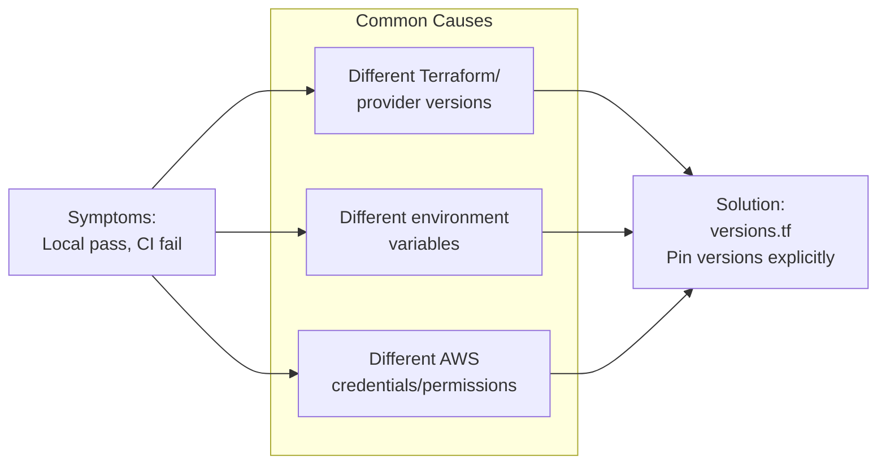
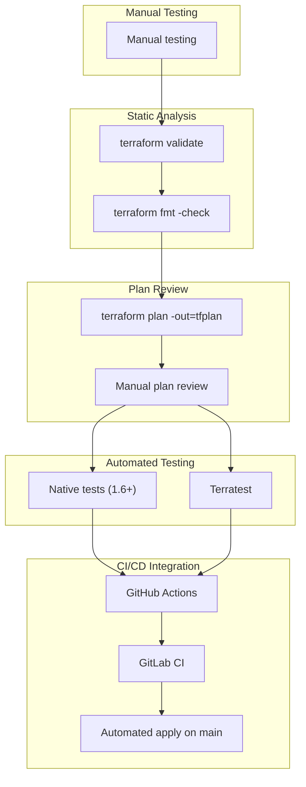
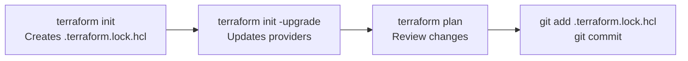
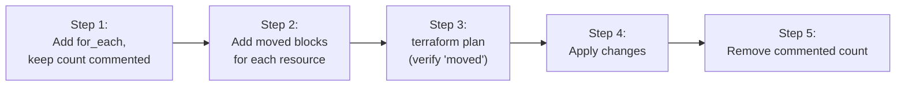
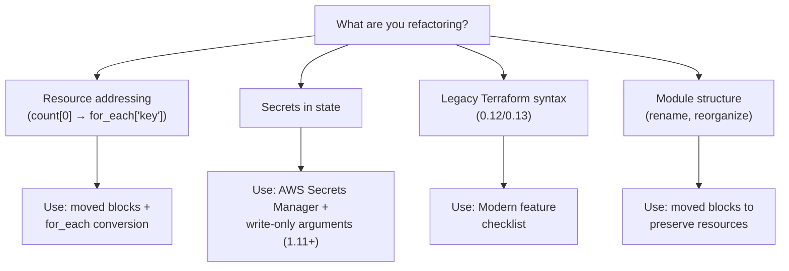

<!-- source: DeepWiki mcp.deepwiki.com · repo antonbabenko/terraform-skill · page 4.4 Quick Reference & Commands · fetched 2026-10-27 -->

# Quick Reference & Commands

<details>
<summary>Relevant source files</summary>

The following files were used as context for generating this wiki page:

- [references/quick-reference.md](references/quick-reference.md)

</details>


## Purpose and Scope

This page provides rapid-access command references, decision flowcharts, and troubleshooting guides for Terraform/OpenTofu development. It serves as a quick lookup resource during active development work, containing command cheat sheets, version-specific guidance, migration strategies, and pre-commit checklists.

For detailed module architecture patterns, see [Module Development Patterns](#4.2). For modern Terraform language features and code organization, see [Code Patterns & Modern Features](#4.3). For CI/CD pipeline integration, see [CI/CD Workflows](#4.5).

Sources: [references/quick-reference.md:1-6]()

---

## Command Cheat Sheet

The skill provides command references for both `terraform` and `tofu` (OpenTofu) commands, which are functionally equivalent for most operations.

### Static Analysis Commands

| Command | Purpose | Notes |
|---------|---------|-------|
| `terraform fmt -recursive -check` | Format validation | Works with `tofu` equivalent |
| `terraform validate` | Syntax validation | Validates configuration files |
| `tflint --init && tflint` | Linting | Third-party static analyzer |
| `checkov -d .` | Security scanning | Static security analysis |

### Native Testing (Terraform/OpenTofu 1.6+)

| Command | Purpose | Notes |
|---------|---------|-------|
| `terraform test` | Run all tests | Requires 1.6+ |
| `terraform test -test-directory=tests/unit/` | Specific directory | Target subset of tests |
| `terraform test -verbose` | Verbose output | Detailed test execution info |

### Plan Validation Workflow

| Command | Purpose | Output |
|---------|---------|--------|
| `terraform plan -out tfplan` | Generate plan | Binary plan file |
| `terraform show -json tfplan \| jq -r '.'` | Convert to JSON | Human-readable plan |
| `terraform show tfplan \| grep "will be created"` | Filter changes | Quick change summary |

Sources: [references/quick-reference.md:20-63]()

---

## Testing Approach Decision Tree

The skill provides a structured decision framework for selecting the appropriate testing strategy based on project requirements and Terraform/OpenTofu version.

### Testing Strategy Selection



Sources: [references/quick-reference.md:66-92]()

---

## Module Development Workflow

The skill defines a five-phase module development process that ensures quality and maintainability.

### Development Phases

```mermaid
graph LR
    subgraph "1. Plan"
        VARS["variables.tf<br/>Define inputs"]
        OUTPUTS["outputs.tf<br/>Define outputs"]
        README_PLAN["README.md<br/>Document purpose"]
    end
    
    subgraph "2. Implement"
        MAIN["main.tf<br/>Create resources"]
        VERSIONS["versions.tf<br/>Pin versions"]
        EXAMPLES["examples/<br/>simple/, complete/"]
    end
    
    subgraph "3. Test"
        STATIC["validate, fmt, lint"]
        UNIT["Native tests or Terratest"]
        INTEGRATION["examples/ testing"]
    end
    
    subgraph "4. Document"
        README_UPDATE["Update README usage"]
        INPUTS_OUTPUTS["Document inputs/outputs"]
        CHANGELOG["Add CHANGELOG"]
    end
    
    subgraph "5. Publish"
        TAG["git tag v1.0.0"]
        REGISTRY["Push to registry"]
        ANNOUNCE["Announce changes"]
    end
    
    VARS --> OUTPUTS --> README_PLAN
    README_PLAN --> MAIN
    MAIN --> VERSIONS --> EXAMPLES
    EXAMPLES --> STATIC
    STATIC --> UNIT --> INTEGRATION
    INTEGRATION --> README_UPDATE
    README_UPDATE --> INPUTS_OUTPUTS --> CHANGELOG
    CHANGELOG --> TAG
    TAG --> REGISTRY --> ANNOUNCE
```



Sources: [references/quick-reference.md:94-121]()

---

## Version-Specific Guidance

### Terraform/OpenTofu Version Capabilities

| Feature | 1.0-1.5 | 1.6+ | 1.7+ |
|---------|---------|------|------|
| Native testing framework | ❌ | ✅ `terraform test` | ✅ |
| Mock providers | ❌ | ❌ | ✅ Mock providers for unit testing |
| Terratest recommended | ✅ | ✅ (complex only) | ✅ (complex only) |
| Static analysis | ✅ | ✅ | ✅ |

### Terraform vs OpenTofu Decision Matrix

| Factor | Terraform | OpenTofu |
|--------|-----------|----------|
| Licensing | Business Source License (BSL) 1.1 | Mozilla Public License 2.0 (MPL 2.0) |
| Governance | HashiCorp (single vendor) | Linux Foundation (community-driven) |
| Latest Version | 1.14+ | 1.11+ |
| Native Testing | 1.6+ | 1.6+ |
| Mock Providers | 1.7+ | 1.7+ |
| Feature Parity | Reference implementation | Compatible fork with additions |
| Enterprise Support | HCP Terraform, Terraform Cloud | Multiple vendors |
| Migration Path | N/A | Drop-in replacement for Terraform ≤1.5 |

**When to choose Terraform:**
- Using HashiCorp Terraform Cloud or HCP Terraform
- Enterprise support contract with HashiCorp
- Need absolute latest features first

**When to choose OpenTofu:**
- Prefer open-source governance model
- Want to avoid vendor lock-in concerns
- Building on community-driven development
- BSL 1.1 license doesn't fit your use case

Sources: [references/quick-reference.md:125-182]()

---

## Troubleshooting Guide

### Common Issue Patterns

#### Issue 1: Tests Fail in CI But Pass Locally



**Resolution:** Pin versions in `versions.tf`:

```hcl
terraform {
  required_version = ">= 1.6.0"

  required_providers {
    aws = {
      source  = "hashicorp/aws"
      version = "~> 6.0"  # Pin to major version
    }
  }
}
```

Sources: [references/quick-reference.md:186-213]()

#### Issue 2: Parallel Test Conflicts

**Symptoms:**
- Tests fail when run in parallel
- Error: "ResourceAlreadyExistsException"

**Cause:** Resource naming collisions

**Terratest Solution:**

```go
import "github.com/gruntwork-io/terratest/modules/random"

uniqueId := random.UniqueId()
bucketName := fmt.Sprintf("test-bucket-%s", uniqueId)
```

Sources: [references/quick-reference.md:215-231]()

#### Issue 3: High Test Costs

The skill provides five strategies for reducing test infrastructure costs:

| Strategy | Implementation | Use Case |
|----------|----------------|----------|
| Mock providers | `mock_provider "aws" { ... }` | Terraform 1.7+ unit tests |
| Resource TTL tags | `tags = { "TTL" = "2h" }` | Automated cleanup systems |
| Conditional integration tests | `if: github.ref == 'refs/heads/main'` | Run full tests only on main |
| Smaller instance types | `instance_type = "t3.micro"` | Test environments |
| Shared resources | Reuse VPCs, security groups | Stable infrastructure |

Sources: [references/quick-reference.md:233-269]()

---

## Migration Paths

### Migration Strategy Map



Sources: [references/quick-reference.md:272-294]()

### Terratest to Native Tests Migration

**Gradual migration strategy:**

| Test Type | Keep in Terratest | Migrate to Native |
|-----------|-------------------|-------------------|
| Complex integration tests | ✅ | ❌ |
| Multi-step workflows | ✅ | ❌ |
| Cross-provider tests | ✅ | ❌ |
| Simple unit tests | ❌ | ✅ |
| Logic validation | ❌ | ✅ |
| Mock-friendly tests | ❌ | ✅ |

**Directory structure during transition:**

```
tests/
├── unit/                    # Native tests
│   └── validation.tftest.hcl
└── integration/             # Terratest
    └── complete_test.go
```

Sources: [references/quick-reference.md:296-323]()

### Terraform to OpenTofu Migration

**Migration requirements:**

1. **No code changes needed** - OpenTofu is a drop-in replacement
2. **Update CI/CD commands:**

| Before (Terraform) | After (OpenTofu) |
|-------------------|------------------|
| `terraform init` | `tofu init` |
| `terraform plan` | `tofu plan` |
| `terraform apply` | `tofu apply` |

3. **Update documentation** to mention OpenTofu compatibility

Sources: [references/quick-reference.md:325-350]()

---

## Pre-Commit Checklist

### Formatting and Validation

```bash
# Format all Terraform files
terraform fmt -recursive

# Validate configuration
terraform validate
```

### Naming Convention Checklist

- [ ] All identifiers use `_` not `-`
- [ ] No resource names repeat resource type (no `aws_vpc.main_vpc`)
- [ ] Single-instance resources named `this` or descriptive name
- [ ] Variables have plural names for lists/maps (`subnet_ids` not `subnet_id`)
- [ ] All variables have descriptions
- [ ] All outputs have descriptions
- [ ] Output names follow `{name}_{type}_{attribute}` pattern
- [ ] No double negatives in variable names

### Code Structure Checklist

- [ ] `count`/`for_each` at top of resource blocks (blank line after)
- [ ] `tags` as last real argument in resources
- [ ] `depends_on` after tags (if used)
- [ ] `lifecycle` at end of resource (if used)
- [ ] Variables ordered: description → type → default → sensitive → nullable → validation
- [ ] Only `#` comments used (no `//` or `/* */`)

### Modern Features Checklist

- [ ] Using `try()` not `element(concat())`
- [ ] Secrets use write-only arguments or external data sources (not in state)
- [ ] `nullable = false` set on non-null variables
- [ ] `optional()` used in object types where applicable (Terraform 1.3+)
- [ ] Variable validation blocks added where constraints needed
- [ ] Consider cross-variable validation for related variables (Terraform 1.9+)

### Architecture Checklist

- [ ] `terraform.tfvars` only at composition level (not in modules)
- [ ] Remote state configured (never local state)
- [ ] Resource modules don't hardcode values (use variables/data sources)
- [ ] `terraform_remote_state` used for cross-composition dependencies
- [ ] File structure follows standard: `main.tf`, `variables.tf`, `outputs.tf`, `versions.tf`

### Documentation Checklist

- [ ] **README.md exists** with absolute links (Terraform Registry compatibility)
- [ ] **All variables documented** in README with descriptions and types
- [ ] **All outputs documented** in README with descriptions
- [ ] **Usage examples provided** showing how to use the module
- [ ] **Version requirements specified** (Terraform version, provider versions)

Sources: [references/quick-reference.md:353-413]()

---

## Version Management

### Version Constraint Syntax

| Syntax | Meaning | Use Case |
|--------|---------|----------|
| `"5.0.0"` | Exact version | Avoid (inflexible) |
| `"~> 5.0"` | Pessimistic (5.0.x) | Recommended for stability |
| `"~> 5.0.1"` | Pessimistic (5.0.x where x >= 1) | Specific patch minimum |
| `">= 5.0, < 6.0"` | Range | Any 5.x version |
| `">= 5.0"` | Minimum | Risky (breaking changes) |

### Version Strategy by Component

| Component | Recommendation | Example |
|-----------|----------------|---------|
| **Terraform** | Pin minor, allow patch | `required_version = "~> 1.9"` |
| **Providers** | Pin major, allow minor/patch | `version = "~> 5.0"` |
| **Modules (prod)** | Pin exact version | `version = "5.1.2"` |
| **Modules (dev)** | Allow patch updates | `version = "~> 5.1"` |

### Update Workflow



### Update Strategy by Severity

| Update Type | Timing | Testing Path |
|-------------|--------|--------------|
| Security patches | Immediate | dev → stage → prod |
| Minor versions | Monthly/quarterly | Review changelog, test thoroughly |
| Major versions | Planned cycles | Dedicated testing, phased rollout |

Sources: [references/quick-reference.md:416-471]()

---

## Refactoring Quick Reference

### Common Refactoring Patterns

#### Pattern 1: Count to For_Each Migration



**Key principle:** Use `moved` blocks to preserve existing resources, avoiding destroy/create cycles.

Sources: [references/quick-reference.md:476-490]()

#### Pattern 2: Legacy to Modern Terraform

**0.12/0.13 → 1.x migration checklist:**

- [ ] Replace `element(concat(...))` → `try()`
- [ ] Add `nullable = false` where appropriate
- [ ] Use `optional()` in object types (1.3+)
- [ ] Add `validation` blocks
- [ ] Migrate secrets to write-only arguments (1.11+)
- [ ] Use `moved` blocks for refactoring (1.1+)
- [ ] Add cross-variable validation (1.9+)

Sources: [references/quick-reference.md:492-502]()

#### Pattern 3: Secrets Remediation

**Goal:** Move secrets out of Terraform state

```bash
# Step 1: Create secret in AWS Secrets Manager (outside Terraform)
aws secretsmanager create-secret --name prod-db-password --secret-string "..."

# Step 2: Update Terraform to use data sources
# Step 3: Use write-only argument (Terraform 1.11+)
# Step 4: Remove random_password resource or variable
# Step 5: Apply and verify secret not in state
terraform show | grep -i password  # Should not appear
```

Sources: [references/quick-reference.md:504-517]()

### Refactoring Decision Tree



Sources: [references/quick-reference.md:519-535]()

### Migration Best Practices

#### Before Refactoring

1. Backup state file
2. Test in development first
3. Review `terraform plan` carefully
4. Document what changed and why

#### During Refactoring

1. One change at a time
2. Verify each step with `terraform plan`
3. Use `moved` blocks, not destroy/recreate
4. Keep git history clean with logical commits

#### After Refactoring

1. Verify idempotency (plan shows no changes)
2. Test in staging before production
3. Update documentation
4. Communicate changes to team

For detailed refactoring patterns, see [Code Patterns & Modern Features](#4.3).

Sources: [references/quick-reference.md:537-557]()

---

## Common Patterns

### Resource Naming Conventions

| Pattern | Example | Status |
|---------|---------|--------|
| Descriptive, contextual | `resource "aws_instance" "web_server" { }` | ✅ Good |
| Generic | `resource "aws_instance" "main" { }` | ❌ Bad |
| Context-specific variables | `var.vpc_cidr_block` | ✅ Good |
| Generic variables | `var.cidr` | ❌ Bad |

### Standard Module File Structure

```
Standard module structure:
├── main.tf          # Primary resources
├── variables.tf     # Input variables
├── outputs.tf       # Output values
├── versions.tf      # Provider versions
└── README.md        # Documentation
```

Sources: [references/quick-reference.md:561-597]()

---

