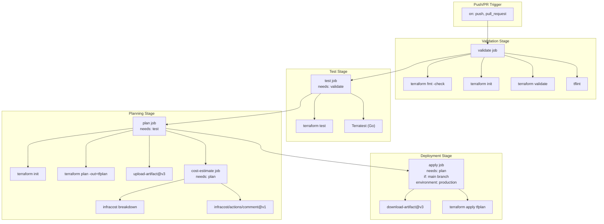
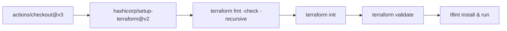
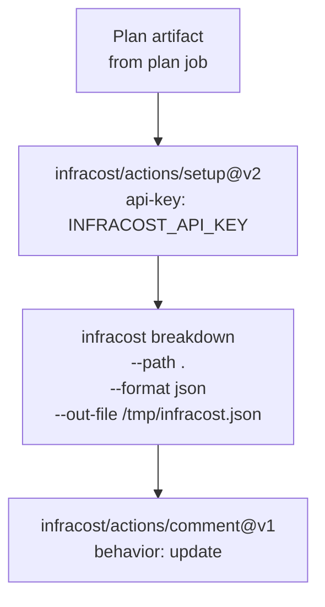
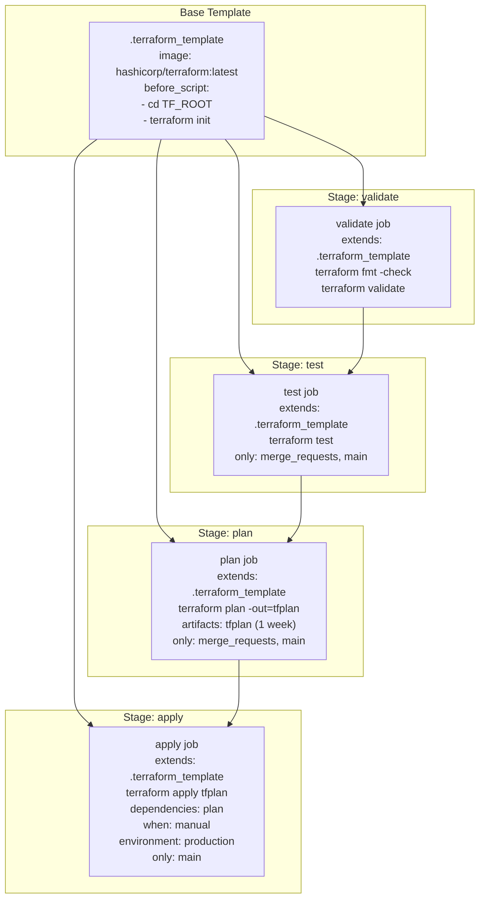
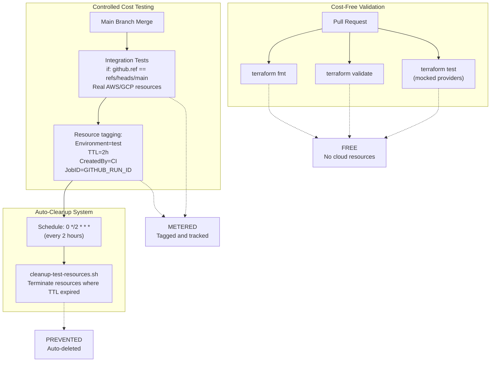
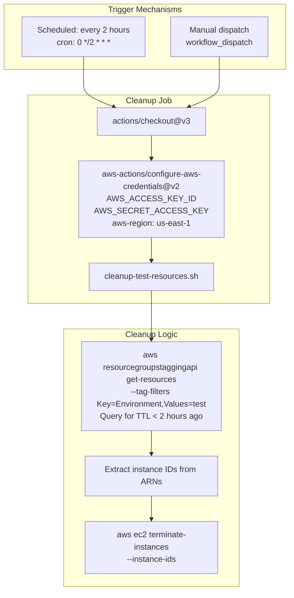
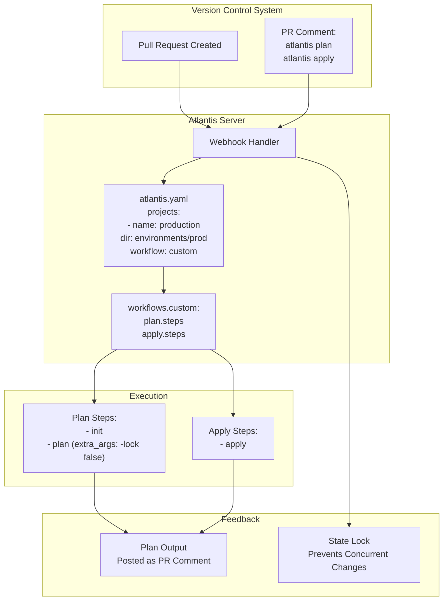

<!-- source: DeepWiki mcp.deepwiki.com · repo antonbabenko/terraform-skill · page 4.5 CI/CD Workflows · fetched 2026-10-27 -->

# CI/CD Workflows

<details>
<summary>Relevant source files</summary>

The following files were used as context for generating this wiki page:

- [references/ci-cd-workflows.md](references/ci-cd-workflows.md)

</details>


This page documents CI/CD pipeline integration patterns for Terraform and OpenTofu infrastructure-as-code projects. It covers workflow templates for GitHub Actions and GitLab CI, cost optimization strategies, automated resource cleanup, and production deployment patterns.

For module development guidance, see [Module Development Patterns](#4.2). For testing strategies that integrate with these workflows, see [Quick Reference & Commands](#4.4). For security scanning integration, see [Security & Compliance](#4.6).

**Sources:** [references/ci-cd-workflows.md:1-6]()

---

## Overview

The CI/CD workflow system provides four primary capabilities:

| Capability | Purpose | Implementation Files |
|------------|---------|---------------------|
| **Validation** | Format checking, linting, validation | `.github/workflows/terraform.yml` (validate job) |
| **Testing** | Unit and integration test execution | `.github/workflows/terraform.yml` (test job) |
| **Planning** | Change preview and cost estimation | `.github/workflows/terraform.yml` (plan, cost-estimate jobs) |
| **Deployment** | Automated infrastructure application | `.github/workflows/terraform.yml` (apply job) |

The reference file provides complete, production-ready templates that implement these capabilities across multiple CI/CD platforms.

**Sources:** [references/ci-cd-workflows.md:10-17]()

---

## GitHub Actions Pipeline Architecture

### Pipeline Structure



**Diagram: Complete GitHub Actions Terraform Workflow Pipeline**

The workflow is defined in [references/ci-cd-workflows.md:24-107]() and uses job dependencies (`needs:`) to enforce sequential execution. Key implementation details:

- **Conditional Apply**: The `apply` job uses `if: github.ref == 'refs/heads/main' && github.event_name == 'push'` to restrict deployments to the main branch
- **Environment Protection**: The `environment: production` setting enables manual approval gates
- **Artifact Passing**: Plan files are transferred between jobs using `actions/upload-artifact@v3` and `actions/download-artifact@v3`

**Sources:** [references/ci-cd-workflows.md:20-107]()

### Job Definitions

#### validate Job



**Diagram: validate Job Execution Flow**

This job performs static analysis without requiring cloud credentials. Implementation at [references/ci-cd-workflows.md:31-50]() includes:
- Format verification with `terraform fmt -check -recursive`
- Syntax validation with `terraform validate`
- Policy checking with `tflint`

**Sources:** [references/ci-cd-workflows.md:31-50]()

#### test Job

The `test` job has two execution paths depending on the testing framework:

| Framework | Setup Action | Test Command | Configuration |
|-----------|-------------|--------------|---------------|
| Native Terraform Tests | N/A | `terraform test` | Test files in `tests/` directory |
| Terratest | `actions/setup-go@v4` with Go 1.21 | `go test -v -timeout 30m -parallel 4` | Test files in `tests/` directory |

Implementation at [references/ci-cd-workflows.md:52-70]() shows both patterns. The Terratest path requires additional setup of the Go environment before test execution.

**Sources:** [references/ci-cd-workflows.md:52-70]()

#### plan Job

The `plan` job generates an execution plan and uploads it as an artifact:

1. Checkout code and setup Terraform
2. Run `terraform init`
3. Execute `terraform plan -out=tfplan`
4. Upload `tfplan` artifact with name `tfplan`

The artifact is stored for 90 days by default and consumed by the `apply` and `cost-estimate` jobs. Implementation at [references/ci-cd-workflows.md:72-89]().

**Sources:** [references/ci-cd-workflows.md:72-106]()

#### cost-estimate Job

The cost estimation integration uses Infracost to analyze plan files:



**Diagram: Infracost Integration Flow**

This job requires the `INFRACOST_API_KEY` secret to be configured in GitHub repository settings. The `behavior: update` parameter ensures cost comments are updated rather than creating new comments on each run.

**Sources:** [references/ci-cd-workflows.md:109-134]()

#### apply Job

The `apply` job implementation at [references/ci-cd-workflows.md:91-106]() includes critical safety controls:

- **Branch Restriction**: `if: github.ref == 'refs/heads/main' && github.event_name == 'push'`
- **Environment Gate**: `environment: production` enables manual approval requirements
- **Plan Verification**: Downloads the exact plan file from the `plan` job to prevent drift

**Sources:** [references/ci-cd-workflows.md:91-106]()

---

## GitLab CI Pipeline Architecture

### Pipeline Structure

The GitLab CI implementation uses a template pattern with inheritance:



**Diagram: GitLab CI Template Inheritance and Stage Flow**

The `.terraform_template` base template at [references/ci-cd-workflows.md:151-155]() provides:
- Terraform Docker image configuration
- Working directory navigation (`cd ${TF_ROOT}`)
- Automatic `terraform init` execution in `before_script`

Each job extends this template and adds stage-specific commands. The `only` keyword controls execution context (merge requests vs. main branch).

**Sources:** [references/ci-cd-workflows.md:138-198]()

### Key Differences from GitHub Actions

| Feature | GitHub Actions | GitLab CI |
|---------|---------------|-----------|
| Template Pattern | Reusable workflows (separate files) | `.terraform_template` (inline) |
| Artifact Storage | `actions/upload-artifact@v3` | `artifacts.paths` with `expire_in` |
| Manual Approval | `environment:` with GitHub settings | `when: manual` |
| Branch Filtering | `if: github.ref == ...` | `only: main` |
| Dependency Declaration | `needs: job-name` | `dependencies: [job-name]` |

The GitLab implementation at [references/ci-cd-workflows.md:140-198]() demonstrates these patterns.

**Sources:** [references/ci-cd-workflows.md:138-198]()

---

## Cost Optimization Strategy

### Execution Cost Model



**Diagram: Three-Tier Cost Optimization Strategy**

### Implementation Pattern

The conditional test execution pattern at [references/ci-cd-workflows.md:212-229]() implements cost controls:

```yaml
test:
  runs-on: ubuntu-latest
  steps:
    - name: Run Unit Tests (Mocked)
      run: terraform test

    - name: Run Integration Tests
      if: github.ref == 'refs/heads/main'
      env:
        AWS_ACCESS_KEY_ID: ${{ secrets.AWS_ACCESS_KEY_ID }}
        AWS_SECRET_ACCESS_KEY: ${{ secrets.AWS_SECRET_ACCESS_KEY }}
      run: |
        cd tests
        go test -v -timeout 30m
```

This pattern ensures:
1. **PR validation** uses mocked tests (no cloud cost)
2. **Main branch** runs integration tests with real resources (metered cost)
3. Cloud credentials are only exposed to the main branch job

**Sources:** [references/ci-cd-workflows.md:200-229]()

### Resource Tagging

The Terratest example at [references/ci-cd-workflows.md:232-246]() shows cost-aware tagging:

```go
terraformOptions := &terraform.Options{
    TerraformDir: "../examples/complete",
    Vars: map[string]interface{}{
        "tags": map[string]string{
            "Environment": "test",
            "TTL":         "2h",
            "CreatedBy":   "CI",
            "JobID":       os.Getenv("GITHUB_RUN_ID"),
        },
    },
}
```

Tags enable:
- **Environment identification**: Filter test resources
- **TTL enforcement**: Automatic cleanup based on creation time
- **Audit trail**: Link resources to specific CI runs via `GITHUB_RUN_ID`

**Sources:** [references/ci-cd-workflows.md:231-246]()

---

## Automated Cleanup System

### Cleanup Architecture



**Diagram: Automated Cleanup Workflow and Execution Flow**

### Cleanup Script Implementation

The cleanup script at [references/ci-cd-workflows.md:252-270]() uses AWS Resource Groups Tagging API to find and terminate expired test resources:

```bash
#!/bin/bash
# cleanup-test-resources.sh

# Find and terminate instances older than 2 hours with test tag
aws resourcegroupstaggingapi get-resources \
  --tag-filters Key=Environment,Values=test \
  --query 'ResourceTagMappingList[?Tags[?Key==`TTL` && Value<`'$(date -u -d '2 hours ago' +%Y-%m-%dT%H:%M:%S)'`]].ResourceARN' \
  --output text | \
  while read arn; do
    instance_id=$(echo $arn | grep -oP 'instance/\K[^/]+')
    if [ ! -z "$instance_id" ]; then
      echo "Terminating instance: $instance_id"
      aws ec2 terminate-instances --instance-ids $instance_id
    fi
  done
```

This script:
1. Queries resources with `Environment=test` tag
2. Filters for resources with `TTL` older than 2 hours
3. Extracts EC2 instance IDs from resource ARNs
4. Terminates matching instances

**Sources:** [references/ci-cd-workflows.md:250-270]()

### Scheduled Workflow

The GitHub Actions workflow at [references/ci-cd-workflows.md:272-298]() implements scheduled cleanup:

- **Trigger**: Runs every 2 hours via cron schedule
- **Manual Override**: `workflow_dispatch` enables on-demand cleanup
- **AWS Credentials**: Uses GitHub secrets for authentication
- **Region**: Configured for `us-east-1` but can be parameterized

**Sources:** [references/ci-cd-workflows.md:272-298]()

---

## Production Deployment Best Practices

### Environment Separation

The reference documents two organizational patterns for environment management:

**Pattern 1: Separate Workflow Files**

```
.github/workflows/
  terraform-dev.yml
  terraform-staging.yml
  terraform-prod.yml
```

Each file contains a complete workflow for one environment.

**Pattern 2: Reusable Workflow with Parameters**

The reusable workflow pattern at [references/ci-cd-workflows.md:314-329]() defines a parameterized workflow:

```yaml
# .github/workflows/terraform-deploy.yml (reusable)
on:
  workflow_call:
    inputs:
      environment:
        required: true
        type: string

jobs:
  deploy:
    environment: ${{ inputs.environment }}
    # ... deployment steps
```

This is called from environment-specific workflows that pass the environment name as input.

**Sources:** [references/ci-cd-workflows.md:300-329]()

### Approval Gates

GitHub environment protection rules are enforced via the `environment` setting at [references/ci-cd-workflows.md:331-339]():

```yaml
apply:
  environment:
    name: production
    # Requires manual approval in GitHub
  when: manual
```

GitLab uses `when: manual` for equivalent functionality.

**Sources:** [references/ci-cd-workflows.md:331-339]()

### State Management

#### Remote State Configuration

The backend configuration example at [references/ci-cd-workflows.md:341-354]() shows S3 backend setup:

```hcl
# backend.tf
terraform {
  backend "s3" {
    bucket         = "my-terraform-state"
    key            = "prod/terraform.tfstate"
    region         = "us-east-1"
    dynamodb_table = "terraform-locks"
    encrypt        = true
  }
}
```

Critical elements:
- **bucket**: S3 bucket for state storage
- **key**: Unique path per environment/workspace
- **dynamodb_table**: DynamoDB table for state locking
- **encrypt**: Server-side encryption enabled

**Sources:** [references/ci-cd-workflows.md:341-354]()

#### State Locking in CI

The `terraform apply` command at [references/ci-cd-workflows.md:356-362]() includes lock timeout handling:

```yaml
- name: Terraform Apply
  run: terraform apply -lock-timeout=10m tfplan
```

The `-lock-timeout=10m` parameter ensures the apply operation waits up to 10 minutes if another operation holds the state lock, preventing concurrent modification failures.

**Sources:** [references/ci-cd-workflows.md:356-362]()

### Plugin Caching

GitHub Actions cache configuration at [references/ci-cd-workflows.md:364-374]():

```yaml
- name: Cache Terraform Plugins
  uses: actions/cache@v3
  with:
    path: |
      ~/.terraform.d/plugin-cache
    key: ${{ runner.os }}-terraform-${{ hashFiles('**/.terraform.lock.hcl') }}
```

Cache key components:
- **OS identifier**: `runner.os` ensures platform-specific caching
- **Lock file hash**: `hashFiles('**/.terraform.lock.hcl')` invalidates cache when provider versions change

This reduces provider download time by caching providers between workflow runs.

**Sources:** [references/ci-cd-workflows.md:364-374]()

### Security Scanning Integration

The security scanning job at [references/ci-cd-workflows.md:376-395]() integrates static analysis tools:

```yaml
security-scan:
  runs-on: ubuntu-latest
  steps:
    - uses: actions/checkout@v3

    - name: Run Trivy
      uses: aquasecurity/trivy-action@master
      with:
        scan-type: 'config'
        scan-ref: '.'

    - name: Run Checkov
      uses: bridgecrewio/bridgecrewio/checkov-action@master
      with:
        directory: .
        framework: terraform
```

This job runs in parallel with validation and fails the build if security issues are detected. For detailed security scanning configuration, see [Security & Compliance](#4.6).

**Sources:** [references/ci-cd-workflows.md:376-395]()

---

## Atlantis Integration

### Architecture



**Diagram: Atlantis Pull Request Automation Flow**

### Configuration

The `atlantis.yaml` configuration at [references/ci-cd-workflows.md:403-424]() defines:

```yaml
version: 3
projects:
  - name: production
    dir: environments/prod
    workspace: default
    terraform_version: v1.6.0
    workflow: custom

workflows:
  custom:
    plan:
      steps:
        - init
        - plan:
            extra_args: ["-lock", "false"]
    apply:
      steps:
        - apply
```

Configuration elements:
- **projects**: Defines Terraform root modules and their configurations
- **terraform_version**: Pins Terraform version per project
- **workflow**: References custom workflow definition
- **extra_args**: Passes additional arguments to Terraform commands

**Sources:** [references/ci-cd-workflows.md:399-424]()

### Benefits

Atlantis provides at [references/ci-cd-workflows.md:426-431]():

| Benefit | Description |
|---------|-------------|
| Plan results as PR comments | Terraform plan output appears directly in pull request comments |
| Apply via PR comments | Trigger deployments with `atlantis apply` comment |
| Locking prevents concurrent changes | Automatic state locking across pull requests |
| VCS integration | Works with GitHub, GitLab, Bitbucket, Azure DevOps |

**Sources:** [references/ci-cd-workflows.md:426-432]()

---

## Troubleshooting

### Version Mismatch Issues

**Problem**: Tests fail in CI but pass locally

**Root Cause**: Different Terraform or provider versions between local and CI environments

**Solution**: Version pinning in `versions.tf` at [references/ci-cd-workflows.md:438-455]():

```hcl
# versions.tf - Pin versions
terraform {
  required_version = ">= 1.6.0"

  required_providers {
    aws = {
      source  = "hashicorp/aws"
      version = "~> 5.0"
    }
  }
}
```

This ensures consistent versions across all execution environments.

**Sources:** [references/ci-cd-workflows.md:436-455]()

### Parallel Test Conflicts

**Problem**: Parallel tests conflict due to resource naming collisions

**Root Cause**: Multiple test runs creating resources with identical names

**Solution**: Unique identifier generation at [references/ci-cd-workflows.md:457-469]():

```go
// Use unique identifiers
uniqueId := random.UniqueId()
bucketName := fmt.Sprintf("test-bucket-%s-%s",
    os.Getenv("GITHUB_RUN_ID"),
    uniqueId)
```

This pattern combines:
- **CI run identifier**: `GITHUB_RUN_ID` ensures uniqueness across workflow runs
- **Random identifier**: `uniqueId` ensures uniqueness within a single run when tests execute in parallel

**Sources:** [references/ci-cd-workflows.md:457-470]()

---

## Integration with Core Skill

The CI/CD workflows reference file is part of the progressive disclosure architecture documented in [Core Architecture](#3). When Claude processes Terraform pipeline questions, it:

1. Loads core guidance from `SKILL.md`
2. References `references/ci-cd-workflows.md` for detailed pipeline templates
3. Cross-references `references/security-compliance.md` for security scanning integration
4. Cross-references `references/module-patterns.md` for module testing in pipelines

This architecture is maintained by the validation workflow at [.github/workflows/validate.yml]() which ensures all reference links remain valid.

**Sources:** [references/ci-cd-workflows.md:1-6](), [references/ci-cd-workflows.md:473]()

---

