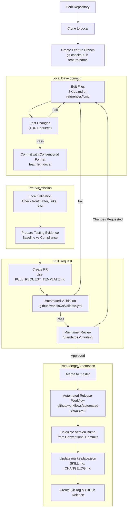
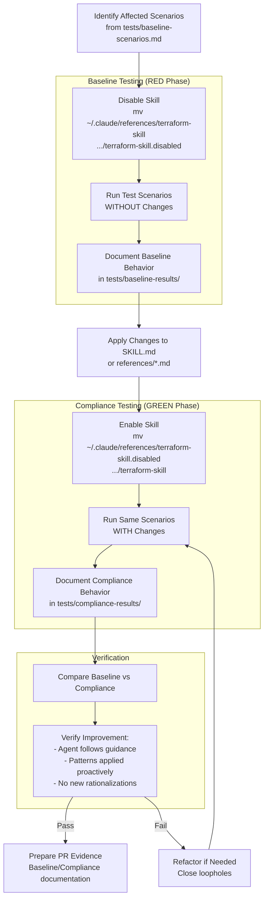
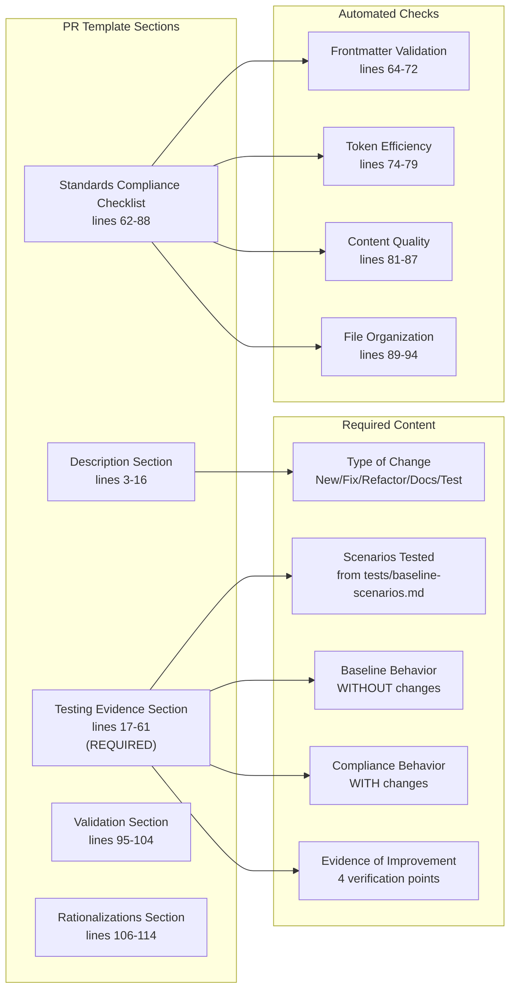
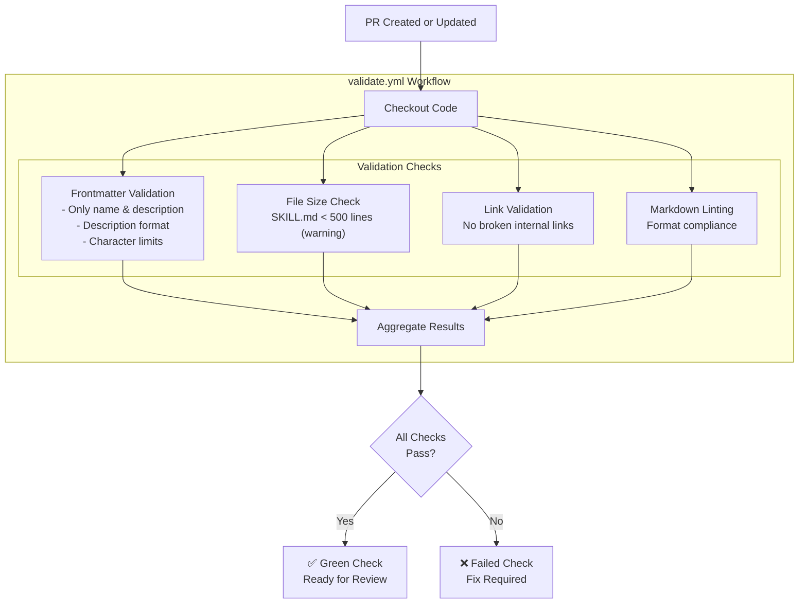
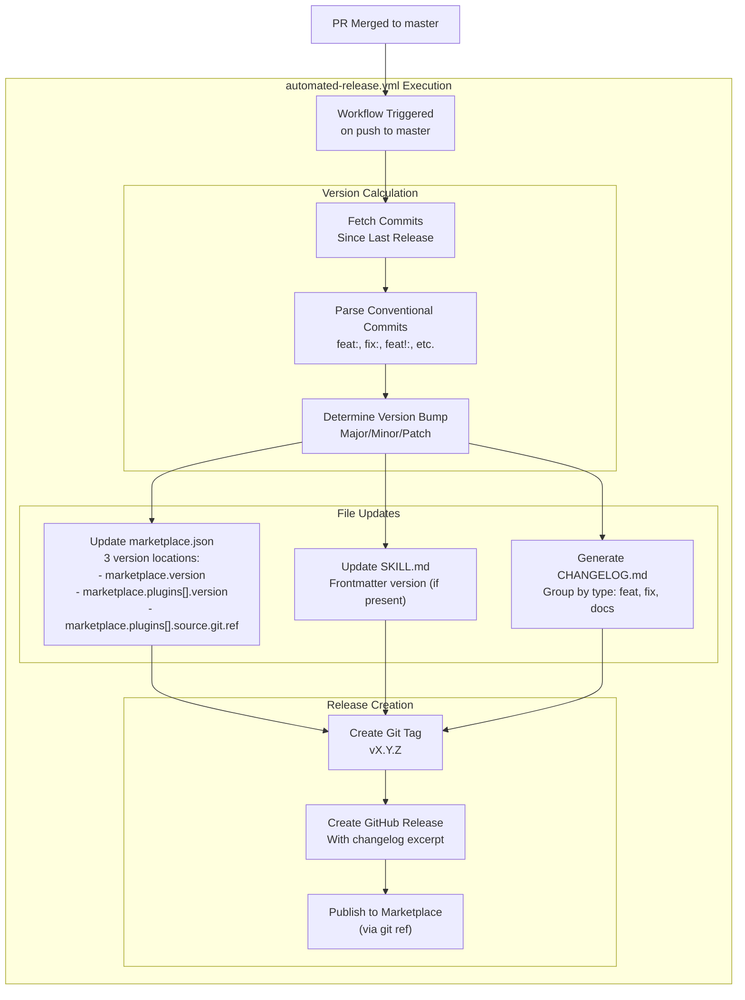

<!-- source: DeepWiki mcp.deepwiki.com · repo antonbabenko/terraform-skill · page 5.4 Contribution Workflow · fetched 2026-10-27 -->

# Contribution Workflow

<details>
<summary>Relevant source files</summary>

The following files were used as context for generating this wiki page:

- [.github/PULL_REQUEST_TEMPLATE.md](.github/PULL_REQUEST_TEMPLATE.md)
- [CONTRIBUTING.md](CONTRIBUTING.md)

</details>


This document describes the step-by-step process for contributing changes to terraform-skill, from initial development through PR submission to automated release. It covers the practical mechanics of creating, testing, and submitting contributions.

For the testing methodology details, see [Testing Methodology](#5.3). For content quality standards, see [Content Standards](#5.2). For the underlying development philosophy, see [Development Philosophy](#5.1).

---

## Overview of Contribution Process

The contribution workflow follows a standard fork-and-PR model with mandatory testing requirements and automated release management. All version management, changelog generation, and releases are fully automated based on conventional commit messages.

**Complete Contribution Workflow**



**Sources:** [CONTRIBUTING.md:1-381](), [.github/PULL_REQUEST_TEMPLATE.md:1-148]()

---

## Step 1: Repository Setup

### Forking and Cloning

Fork the repository at `https://github.com/antonbabenko/terraform-skill` and clone your fork locally [CONTRIBUTING.md:8-9]().

```bash
git clone https://github.com/YOUR_USERNAME/terraform-skill.git
cd terraform-skill
```

### Branch Creation

Create a feature branch from `master` following the naming convention `feature/descriptive-name` [CONTRIBUTING.md:312-315]():

```bash
git checkout -b feature/improve-testing-guidance
```

**Sources:** [CONTRIBUTING.md:312-315]()

---

## Step 2: Making Changes

### File Location Guidelines

Changes must follow the file organization structure [CONTRIBUTING.md:92-110]():

| File Type | Location | Purpose | Size Guideline |
|-----------|----------|---------|----------------|
| Core skill content | `SKILL.md` | Primary skill content loaded by Claude | <1,500 words, <500 lines |
| Reference documentation | `references/*.md` | Progressive disclosure content | No strict limit |
| Testing scenarios | `tests/baseline-scenarios.md` | Test scenario definitions | N/A |
| Rationalization tracking | `tests/rationalization-table.md` | Agent rationalization database | N/A |
| Documentation | `README.md`, `CONTRIBUTING.md` | User/contributor documentation | N/A |

### Frontmatter Requirements (Critical)

If modifying `SKILL.md`, the frontmatter must contain **exactly two fields** [CONTRIBUTING.md:34-56]():

```yaml
---
name: terraform-skill
description: Use when working with Terraform or OpenTofu - creating modules,
  writing tests...
---
```

**Prohibited fields:**
- `author` (belongs in README.md)
- `version` (managed by automated-release workflow)
- `license` (belongs in LICENSE)
- Any custom fields

**Sources:** [CONTRIBUTING.md:34-78](), [CONTRIBUTING.md:92-110]()

---

## Step 3: Testing Changes (Mandatory)

### The Iron Law

**NO CHANGES WITHOUT TESTING FIRST** [CONTRIBUTING.md:112-124](). This requirement has no exceptions and applies to all content changes, including documentation updates.

**Testing Process Flow**



### Testing Checklist

The PR must include evidence that all testing steps were completed [CONTRIBUTING.md:181-192]():

- [ ] Identified affected scenarios from `tests/baseline-scenarios.md`
- [ ] Ran baseline WITHOUT changes (documented)
- [ ] Applied changes
- [ ] Ran compliance WITH changes (documented)
- [ ] Verified behavior improvement
- [ ] No new rationalizations discovered (or documented in `tests/rationalization-table.md`)
- [ ] Re-tested if rationalizations found

**Sources:** [CONTRIBUTING.md:112-192]()

---

## Step 4: Committing Changes

### Conventional Commit Format

All commits must follow the Conventional Commits specification [CONTRIBUTING.md:244-307](). The commit type determines the automated version bump:

| Commit Type | Version Bump | Use Case | Example |
|-------------|--------------|----------|---------|
| `feat!:` or `BREAKING CHANGE:` | Major (1.x.x → 2.0.0) | Breaking changes | `feat!: remove deprecated test framework guidance` |
| `feat:` | Minor (1.2.x → 1.3.0) | New features | `feat: add OpenTofu 1.8 support` |
| `fix:` | Patch (1.2.3 → 1.2.4) | Bug fixes | `fix: correct module output syntax in examples` |
| `docs:` | Patch | Documentation only | `docs: improve testing strategy documentation` |
| `chore:` | Patch | Maintenance, tooling | `chore: update workflow dependencies` |
| `test:` | Patch | Test improvements | `test: add new baseline scenarios` |
| `refactor:` | Patch | Code refactoring | `refactor: reorganize module patterns` |

### Commit Message Structure

[CONTRIBUTING.md:248-255]()

```
<type>: <description>

[optional body]

[optional footer]
```

**Examples:**

```bash
# Simple feature
git commit -m "feat: add native testing examples"

# With detailed body
git commit -m "feat: add native testing examples

- Add examples for Terraform 1.6+ native tests
- Include decision matrix for test framework selection
- Document best practices for test organization"

# Bug fix
git commit -m "fix: correct security scanning tool recommendations"
```

**Sources:** [CONTRIBUTING.md:244-307]()

---

## Step 5: Pull Request Submission

### Using the PR Template

Create a PR using the template at `.github/PULL_REQUEST_TEMPLATE.md` [CONTRIBUTING.md:330-337](). The template enforces structured documentation of changes and testing evidence.

**PR Template Structure Mapping**



### Testing Evidence Requirements

The PR **must** include [.github/PULL_REQUEST_TEMPLATE.md:17-61]():

1. **Scenarios Tested**: List which scenarios from `tests/baseline-scenarios.md` were affected
2. **Baseline Behavior**: Verbatim agent response WITHOUT changes
3. **Compliance Behavior**: Verbatim agent response WITH changes
4. **Evidence of Improvement**: Checkboxes verifying:
   - Agent references new content
   - Agent applies new patterns proactively
   - Agent doesn't rationalize skipping guidance
   - No new rationalizations introduced

### Standards Compliance Checklist

**Frontmatter (if SKILL.md changed)** [.github/PULL_REQUEST_TEMPLATE.md:64-72]():
- [ ] Only `name` and `description` fields present
- [ ] Description starts with "Use when..."
- [ ] Description focuses on triggers/symptoms (not workflow summary)
- [ ] Description < 1024 characters
- [ ] Total frontmatter < 1024 characters
- [ ] Name uses only letters, numbers, hyphens

**Token Efficiency** [.github/PULL_REQUEST_TEMPLATE.md:74-79]():
- [ ] SKILL.md remains <1,500 words (current: ~1,400)
- [ ] Detailed content moved to `references/*.md` where appropriate
- [ ] Used tables instead of prose
- [ ] No content duplication

**Content Quality** [.github/PULL_REQUEST_TEMPLATE.md:81-87]():
- [ ] Imperative voice ("Use X", not "You should use X")
- [ ] Scannable format (tables, bullets, clear headers)
- [ ] Code examples are complete and runnable
- [ ] Version-specific features clearly marked
- [ ] ✅ DO vs ❌ DON'T patterns where appropriate

**Sources:** [.github/PULL_REQUEST_TEMPLATE.md:1-148](), [CONTRIBUTING.md:330-337]()

---

## Step 6: Automated Validation

Upon PR creation, the `validate.yml` workflow runs automated checks. See [Validation Workflow](#6.1) for complete details.

**Validation Workflow Components**



**Sources:** [CONTRIBUTING.md:338-346](), [.github/PULL_REQUEST_TEMPLATE.md:95-104]()

---

## Step 7: Maintainer Review

### Review Criteria

Maintainers evaluate PRs against five criteria [CONTRIBUTING.md:338-346]():

| Criterion | Evaluation | Reference |
|-----------|------------|-----------|
| **Standards compliance** | Frontmatter format, description structure | [CONTRIBUTING.md:34-78]() |
| **Testing evidence** | Baseline vs compliance documented, improvement shown | [CONTRIBUTING.md:112-192]() |
| **Token efficiency** | Not adding unnecessary content, SKILL.md <1,500 words | [CONTRIBUTING.md:80-91]() |
| **Accuracy** | Technically correct, reflects current best practices | [CONTRIBUTING.md:194-242]() |
| **Quality** | Clear, scannable, well-organized | [CONTRIBUTING.md:194-242]() |

### Maintainer Checklist

Maintainers complete the review checklist in the PR template [.github/PULL_REQUEST_TEMPLATE.md:130-148]():

**Review Checklist:**
- [ ] Testing evidence is convincing (baseline → compliance improvement shown)
- [ ] Standards compliance verified
- [ ] Content is accurate and current
- [ ] Token efficiency maintained
- [ ] Quality standards met
- [ ] No conflicts with existing content
- [ ] CHANGELOG.md updated (if needed)

**Merge Checklist:**
- [ ] Squash commits with clear commit message
- [ ] Update CHANGELOG.md if not done in PR
- [ ] Consider if version bump needed
- [ ] Tag if this completes a planned milestone

**Sources:** [CONTRIBUTING.md:338-346](), [.github/PULL_REQUEST_TEMPLATE.md:128-148]()

---

## Step 8: Post-Merge Automation

### Automated Release Process

When a PR is merged to `master`, the `automated-release.yml` workflow executes [CONTRIBUTING.md:347-361](). The entire release process is fully automated - contributors do not manage versions manually.

**Automated Release Workflow**



### Version Synchronization Points

The automated release workflow updates versions in three locations [CONTRIBUTING.md:352-358]():

1. `.claude-plugin/marketplace.json` - `marketplace.version` field
2. `.claude-plugin/marketplace.json` - `marketplace.plugins[0].version` field
3. `.claude-plugin/marketplace.json` - `marketplace.plugins[0].source.git.ref` field
4. `CHANGELOG.md` - Generated from conventional commits

For complete details on version synchronization, see [Version Synchronization](#6.3).

**Sources:** [CONTRIBUTING.md:347-361]()

---

## Common Workflow Patterns

### Pattern: Adding New Content

```bash
# 1. Create branch
git checkout -b feat/add-security-scanning

# 2. Edit file (e.g., add security content to SKILL.md)
# 3. Test WITHOUT changes (baseline)
mv ~/.claude/references/terraform-skill ~/.claude/references/terraform-skill.disabled
# Run test scenarios, document results

# 4. Test WITH changes (compliance)
mv ~/.claude/references/terraform-skill.disabled ~/.claude/references/terraform-skill
# Run same scenarios, document improvements

# 5. Commit with conventional format
git commit -m "feat: add trivy and checkov security scanning guidance"

# 6. Push and create PR
git push origin feat/add-security-scanning
# Create PR using template
```

### Pattern: Fixing Incorrect Information

```bash
# 1. Create branch
git checkout -b fix/correct-module-syntax

# 2. Edit file
# 3. Test baseline vs compliance
# 4. Commit
git commit -m "fix: correct module output syntax in examples"

# 5. Submit PR
```

### Pattern: Documentation-Only Changes

```bash
# 1. Create branch
git checkout -b docs/improve-readme

# 2. Edit README.md or CONTRIBUTING.md
# 3. If changes affect agent behavior, TEST
# 4. Commit
git commit -m "docs: clarify installation instructions"

# 5. Submit PR
```

**Sources:** [CONTRIBUTING.md:312-327]()

---

## Workflow Decision Matrix

| Your Situation | Recommended Action | Commit Type | Testing Required |
|----------------|-------------------|-------------|------------------|
| Adding new Terraform guidance | Edit `SKILL.md` or `references/*.md` | `feat:` | Yes (baseline vs compliance) |
| Fixing technical error | Edit affected file | `fix:` | Yes (verify fix works) |
| Reorganizing content | Edit affected files | `refactor:` | Yes (verify no behavior change) |
| Updating README only | Edit `README.md` | `docs:` | No (unless affects agent behavior) |
| Improving CI workflows | Edit `.github/workflows/*` | `chore:` | No (but test locally) |
| Adding test scenarios | Edit `tests/*.md` | `test:` | N/A (defines tests) |
| Breaking change (rare) | Edit affected files | `feat!:` or add `BREAKING CHANGE:` | Yes (extensive testing) |

**Sources:** [CONTRIBUTING.md:14-30](), [CONTRIBUTING.md:259-268]()

---

## Troubleshooting

### PR Validation Fails

**Problem:** Automated validation workflow fails

**Solution:**
1. Check workflow output in PR checks
2. Common issues:
   - Frontmatter contains prohibited fields (e.g., `version`, `author`)
   - Description doesn't start with "Use when..."
   - Broken internal links
   - Markdown linting errors

**Fix and re-push:**
```bash
# Fix issues
git add .
git commit -m "fix: resolve validation errors"
git push
```

### Testing Evidence Unclear

**Problem:** Maintainer requests clearer testing evidence

**Solution:**
1. Re-run baseline test (disable skill)
2. Capture verbatim agent response
3. Re-run compliance test (enable skill)
4. Document specific improvements
5. Update PR description with evidence

### Version Bump Incorrect

**Problem:** Merged PR created wrong version bump

**Issue:** Conventional commit type doesn't match change magnitude

**Prevention:**
- Use `feat:` for new features (minor bump)
- Use `fix:` for bug fixes (patch bump)
- Use `feat!:` for breaking changes (major bump)
- Review commit message before merge

**Sources:** [CONTRIBUTING.md:338-346](), [.github/PULL_REQUEST_TEMPLATE.md:95-104]()

---

## Summary

The contribution workflow enforces quality through mandatory testing and automated processes:

1. **Fork and branch** from `master`
2. **Make changes** following file organization guidelines
3. **Test changes** using baseline vs compliance methodology (no exceptions)
4. **Commit** with conventional commit format
5. **Submit PR** with complete testing evidence
6. **Pass validation** (automated checks)
7. **Pass review** (maintainer evaluation)
8. **Automated release** upon merge (version bump, changelog, GitHub release)

Contributors focus on **quality content and testing** - the automation handles versioning, releases, and distribution.

**Sources:** [CONTRIBUTING.md:1-381](), [.github/PULL_REQUEST_TEMPLATE.md:1-148]()

---

