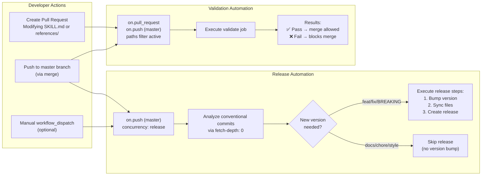

<!-- source: DeepWiki mcp.deepwiki.com · repo antonbabenko/terraform-skill · page 6 Automation Systems · fetched 2026-10-27 -->

# Automation Systems

Relevant source files

The following files were used as context for generating this wiki page:

- [.github/workflows/automated-release.yml](.github/workflows/automated-release.yml)
- [.github/workflows/validate.yml](.github/workflows/validate.yml)

## Purpose and Scope

This document provides an overview of the automated quality assurance and release management systems that ensure consistency and reliability of the terraform-skill codebase. The automation systems consist of two GitHub Actions workflows that handle validation and release processes.

For detailed information about specific automation workflows, see:
- Validation checks and quality gates: [Validation Workflow](#6.1)
- Release process and version management: [Release Automation](#6.2)
- Version synchronization mechanism: [Version Synchronization](#6.3)

For manual contribution processes that precede automation, see [Contribution Workflow](#5.4).

---

## System Overview

The terraform-skill repository implements a dual automation strategy:

1. **Validation System** (`.github/workflows/validate.yml`) - Quality gates for pull requests and commits
2. **Release System** (`.github/workflows/automated-release.yml`) - Automated semantic versioning and publishing

Both systems operate autonomously, requiring no manual version management or release preparation. The validation workflow ensures content quality before merge, while the release workflow automates version bumping, changelog generation, and GitHub release creation based on conventional commit messages.

**Sources:** [.github/workflows/validate.yml:1-183](), [.github/workflows/automated-release.yml:1-171]()

---

## Workflow Architecture

The following diagram illustrates the structure and responsibilities of both automation workflows:

### Automation Workflow Components

```mermaid
graph TB
    subgraph validate_yml["validate.yml Workflow"]
        validate_trigger["Trigger: PR + push to master<br/>Paths: SKILL.md, references/**, .claude-plugin/**"]
        validate_job["Job: validate"]
        
        validate_checkout["Step: Checkout"]
        validate_python["Step: Set up Python"]
        validate_deps["Step: Install Dependencies<br/>pip install pyyaml"]
        
        validate_frontmatter["Step: Check SKILL.md Frontmatter<br/>Python validation script"]
        validate_size["Step: Check File Size<br/>500 line warning threshold"]
        validate_marketplace["Step: Validate marketplace.json<br/>Python validation script"]
        validate_links["Step: Check for Broken Links<br/>Bash link checker"]
        validate_lint["Step: Lint Markdown<br/>markdownlint-cli2-action"]
        validate_summary["Step: Summary<br/>GitHub Step Summary output"]
    end
    
    subgraph release_yml["automated-release.yml Workflow"]
        release_trigger["Trigger: push to master<br/>+ workflow_dispatch"]
        release_job["Job: release"]
        
        release_checkout["Step: Checkout<br/>fetch-depth: 0 for commit history"]
        release_changelog["Step: Conventional Changelog Action<br/>TriPSs/conventional-changelog-action@v5"]
        release_sync["Step: Sync Plugin Version and SKILL.md<br/>Python sync script"]
        release_gh["Step: Create GitHub Release<br/>softprops/action-gh-release@v2"]
        release_summary["Step: Release Summary<br/>GitHub Step Summary output"]
    end
    
    validate_trigger --> validate_job
    validate_job --> validate_checkout
    validate_checkout --> validate_python
    validate_python --> validate_deps
    validate_deps --> validate_frontmatter
    validate_frontmatter --> validate_size
    validate_size --> validate_marketplace
    validate_marketplace --> validate_links
    validate_links --> validate_lint
    validate_lint --> validate_summary
    
    release_trigger --> release_job
    release_job --> release_checkout
    release_checkout --> release_changelog
    release_changelog --> release_sync
    release_sync --> release_gh
    release_gh --> release_summary
```

**Sources:** [.github/workflows/validate.yml:1-24](), [.github/workflows/validate.yml:34-183](), [.github/workflows/automated-release.yml:1-27](), [.github/workflows/automated-release.yml:34-171]()

---

## Automation Lifecycle and Triggers

This diagram shows when each automation system activates and how they interact with the development workflow:

### Automation Trigger Flow

**Sources:** [.github/workflows/validate.yml:3-15](), [.github/workflows/automated-release.yml:3-14](), [.github/workflows/automated-release.yml:22-49]()

---

## Key Automation Components

The following table catalogs the critical components within each workflow:

| Component | Type | File Location | Purpose |
|-----------|------|---------------|---------|
| `validate` | Job | [.github/workflows/validate.yml:18-183]() | Runs all validation checks |
| `Check SKILL.md Frontmatter` | Step | [.github/workflows/validate.yml:34-92]() | Validates YAML frontmatter structure, required fields (`name`, `description`), name pattern, and description length |
| `Check File Size` | Step | [.github/workflows/validate.yml:94-103]() | Warns if `SKILL.md` exceeds 500 lines |
| `Validate marketplace.json` | Step | [.github/workflows/validate.yml:105-151]() | Validates marketplace schema, version format, owner structure, and plugins array |
| `Check for Broken Links` | Step | [.github/workflows/validate.yml:153-166]() | Scans for broken internal references to `references/*.md` files |
| `Lint Markdown` | Step | [.github/workflows/validate.yml:168-176]() | Uses `markdownlint-cli2-action@v16` on `SKILL.md`, `references/**/*.md`, `README.md`, `CONTRIBUTING.md` |
| `release` | Job | [.github/workflows/automated-release.yml:17-171]() | Orchestrates entire release process |
| `Conventional Changelog Action` | Step | [.github/workflows/automated-release.yml:34-49]() | Uses `TriPSs/conventional-changelog-action@v5` with Angular preset to analyze commits and bump version |
| `Sync Plugin Version and SKILL.md` | Step | [.github/workflows/automated-release.yml:56-138]() | Python script that synchronizes three version fields: `marketplace.json` root, `plugins[0].version`, and `SKILL.md` metadata |
| `Create GitHub Release` | Step | [.github/workflows/automated-release.yml:142-152]() | Uses `softprops/action-gh-release@v2` to create tagged release with changelog |

**Sources:** [.github/workflows/validate.yml:18-183](), [.github/workflows/automated-release.yml:17-171]()

---

## Validation System Details

The validation workflow (`validate.yml`) implements five validation layers:

### 1. Frontmatter Validation

Python script validates YAML frontmatter in `SKILL.md`:
- Required fields: `name`, `description`
- Optional fields: `license`, `metadata.version`, `metadata.author`
- Name pattern: alphanumeric and hyphens only (`^[a-zA-Z0-9-]+$`)
- Description length limit: 1024 characters

**Sources:** [.github/workflows/validate.yml:34-92]()

### 2. File Size Monitoring

Bash script checks `SKILL.md` line and word count:
- Warning threshold: 500 lines
- Reports metrics to GitHub Actions output
- Non-blocking warning (does not fail build)

**Sources:** [.github/workflows/validate.yml:94-103]()

### 3. Marketplace Schema Validation

Python script validates `.claude-plugin/marketplace.json`:
- Marketplace-level required fields: `name`, `owner`, `version`, `plugins`
- Owner structure: must have `name` field
- Version format: semantic versioning pattern (`^\d+\.\d+\.\d+$`)
- Plugin validation: each plugin must have `name`, `description`, `source`

**Sources:** [.github/workflows/validate.yml:105-151]()

### 4. Link Integrity Checking

Bash script using `grep` and pattern matching:
- Extracts all internal links matching `[text](references/*.md)` pattern
- Verifies referenced files exist on filesystem
- Fails build if broken links detected

**Sources:** [.github/workflows/validate.yml:153-166]()

### 5. Markdown Linting

Uses `DavidAnson/markdownlint-cli2-action@v16`:
- Lints `SKILL.md`, `references/**/*.md`, `README.md`, `CONTRIBUTING.md`
- Configured with `continue-on-error: true` (warnings only)

**Sources:** [.github/workflows/validate.yml:168-176]()

---

## Release System Details

The release workflow (`automated-release.yml`) executes a four-phase release process:

### Phase 1: Conventional Commit Analysis

Uses `TriPSs/conventional-changelog-action@v5` with:
- Full git history (`fetch-depth: 0`)
- Angular commit convention preset
- Version file: `.claude-plugin/marketplace.json`
- Version path: `version` (root-level field)
- Changelog file: `CHANGELOG.md`
- Tag prefix: `v`

Commit types that trigger version bumps:
- `feat:` → minor version bump
- `fix:` → patch version bump
- `BREAKING CHANGE:` → major version bump

**Sources:** [.github/workflows/automated-release.yml:22-49]()

### Phase 2: Version Synchronization

Python script (`Sync Plugin Version and SKILL.md` step) performs three-way synchronization:

1. **Updates `marketplace.json` plugin version** at `plugins[0].version`
2. **Updates `SKILL.md` frontmatter** at `metadata.version` line
3. **Validates consistency** across all three version fields

The script amends the commit created by conventional-changelog-action to include these additional changes, maintaining a single commit for the entire release.

**Sources:** [.github/workflows/automated-release.yml:56-138]()

### Phase 3: GitHub Release Creation

Uses `softprops/action-gh-release@v2`:
- Creates release from git tag
- Populates release body with `clean_changelog` output
- Only executes if version bump occurred (`steps.changelog.outputs.skipped == 'false'`)

**Sources:** [.github/workflows/automated-release.yml:142-152]()

### Phase 4: Summary Generation

Outputs to GitHub Actions step summary:
- Version number
- Git tag
- Release URL
- Formatted changelog excerpt

**Sources:** [.github/workflows/automated-release.yml:154-170]()

---

## Workflow Permissions and Concurrency

Both workflows use strict permission and concurrency controls:

### Validation Workflow
- **Permissions:** Default (read-only for public repos)
- **Concurrency:** No restrictions (multiple PRs can validate simultaneously)
- **Triggers:** Pull requests, pushes to master/main, manual dispatch

**Sources:** [.github/workflows/validate.yml:3-15]()

### Release Workflow
- **Permissions:** `contents: write` (required for creating releases and pushing commits)
- **Concurrency:** Group `release`, `cancel-in-progress: false` (serializes releases)
- **Triggers:** Pushes to master, manual dispatch

The release workflow's concurrency control ensures only one release process runs at a time, preventing race conditions during version synchronization.

**Sources:** [.github/workflows/automated-release.yml:9-14]()

---

## File Modification Patterns

The following table shows which files each automation system reads and writes:

| File | Validation Reads | Validation Writes | Release Reads | Release Writes |
|------|-----------------|-------------------|---------------|----------------|
| `SKILL.md` | ✅ Frontmatter, size, links | ❌ | ✅ Version field | ✅ Version field |
| `references/**/*.md` | ✅ Link validation, linting | ❌ | ❌ | ❌ |
| `.claude-plugin/marketplace.json` | ✅ Schema validation | ❌ | ✅ Root version | ✅ Root + plugin version |
| `CHANGELOG.md` | ❌ | ❌ | ✅ Append mode | ✅ Generated entries |
| `README.md` | ✅ Linting only | ❌ | ❌ | ❌ |
| `CONTRIBUTING.md` | ✅ Linting only | ❌ | ❌ | ❌ |
| Git refs (tags) | ❌ | ❌ | ✅ Commit history | ✅ New tags |

**Sources:** [.github/workflows/validate.yml:5-14](), [.github/workflows/automated-release.yml:22-49](), [.github/workflows/automated-release.yml:56-138]()

---

## Integration with GitHub Features

Both workflows leverage GitHub Actions features for enhanced visibility:

### Step Summaries
- Validation: Displays pass/fail status with `$GITHUB_STEP_SUMMARY`
- Release: Shows version, tag, release URL, and changelog excerpt

### Status Checks
- Validation workflow creates required status check for PR merges
- Release workflow status visible in commit history

### Release Assets
- GitHub Releases automatically created with formatted changelogs
- Release notes populated from conventional commit messages
- Releases tagged with semantic version (`v1.2.3` format)

**Sources:** [.github/workflows/validate.yml:178-182](), [.github/workflows/automated-release.yml:154-170](), [.github/workflows/automated-release.yml:142-152]()

---

