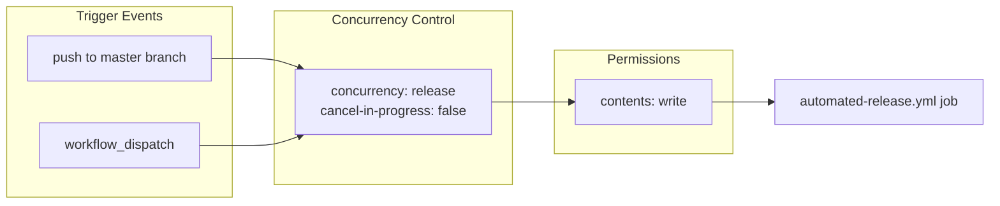
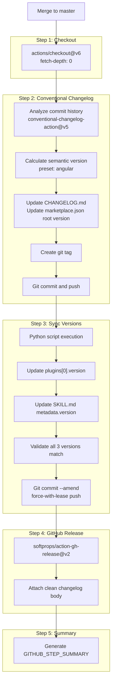
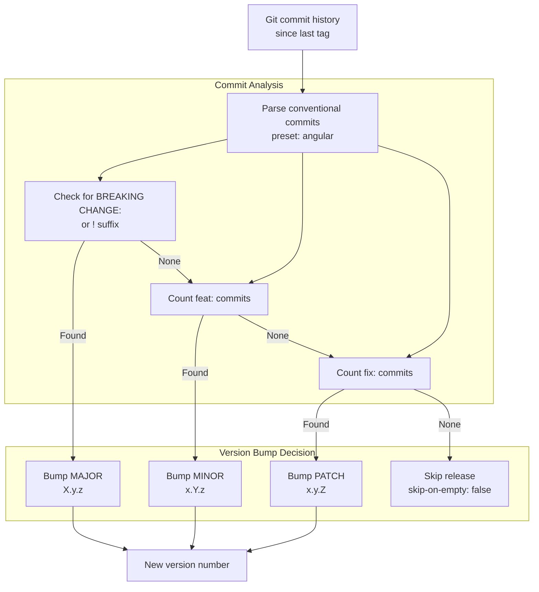
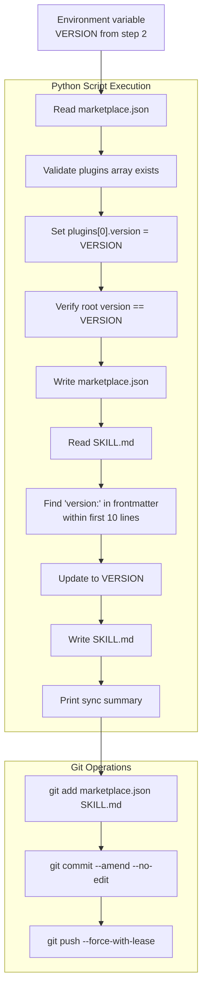
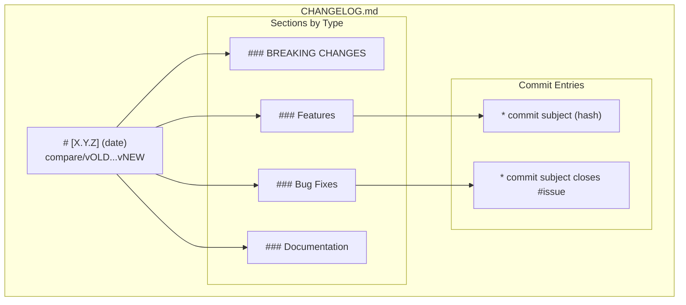

<!-- source: DeepWiki mcp.deepwiki.com · repo antonbabenko/terraform-skill · page 6.2 Release Automation · fetched 2026-10-27 -->

# Release Automation

<details>
<summary>Relevant source files</summary>

The following files were used as context for generating this wiki page:

- [.github/workflows/automated-release.yml](.github/workflows/automated-release.yml)
- [CHANGELOG.md](CHANGELOG.md)

</details>


## Purpose and Scope

This document describes the automated release process implemented in [.github/workflows/automated-release.yml](), which handles semantic versioning, changelog generation, and GitHub release creation. The workflow analyzes conventional commits to determine version bumps, updates version metadata across multiple files, generates release notes, and publishes releases—all without manual intervention.

For details on how versions are synchronized across `marketplace.json`, `SKILL.md`, and git tags, see [Version Synchronization](#6.3). For pre-release validation checks, see [Validation Workflow](#6.1).

---

## Workflow Architecture

The `automated-release.yml` workflow executes on every push to the `master` branch and can be manually triggered via `workflow_dispatch`. It uses concurrency control to prevent simultaneous releases and requires `contents: write` permissions to create tags and releases.

**Workflow Trigger Configuration**



Sources: [.github/workflows/automated-release.yml:3-14]()

---

## Release Process Overview

The release workflow consists of five sequential steps that transform conventional commits into a published GitHub release:

**End-to-End Release Flow**



Sources: [.github/workflows/automated-release.yml:21-171]()

---

## Conventional Commits as Version Drivers

The workflow uses the **Angular commit convention** preset to determine version bumps. Commit messages must follow the pattern `<type>(<scope>): <description>` to trigger version changes.

**Commit Type to Version Bump Mapping**

| Commit Type | Version Component | Example | Result |
|-------------|-------------------|---------|--------|
| `feat:` or `feat!:` | Minor (x.Y.z) | `feat: Add module patterns` | 1.4.0 → 1.5.0 |
| `fix:` | Patch (x.y.Z) | `fix: Correct validation` | 1.4.0 → 1.4.1 |
| `feat!:` or `BREAKING CHANGE:` | Major (X.y.z) | `feat!: Remove plugin.json` | 1.4.0 → 2.0.0 |
| `docs:`, `chore:`, `refactor:` | None | `docs: Update README` | No release |

**Version Calculation Flow**



Sources: [.github/workflows/automated-release.yml:42-49]()

---

## Step-by-Step Workflow Execution

### Step 1: Repository Checkout

The workflow checks out the repository with full commit history (`fetch-depth: 0`) to enable conventional commit analysis across all tags.

```yaml
- name: Checkout
  uses: actions/checkout@v6
  with:
    fetch-depth: 0
```

Sources: [.github/workflows/automated-release.yml:23-26]()

### Step 2: Conventional Changelog Action

The `TriPSs/conventional-changelog-action@v5` performs multiple operations:

**Configuration Parameters**

| Parameter | Value | Purpose |
|-----------|-------|---------|
| `preset` | `angular` | Commit convention parser |
| `tag-prefix` | `v` | Prepends 'v' to semantic version |
| `output-file` | `CHANGELOG.md` | Changelog file location |
| `version-file` | `./.claude-plugin/marketplace.json` | Version source file |
| `version-path` | `version` | JSON path to version field |
| `skip-on-empty` | `false` | Create release even if no changelog changes |
| `skip-version-file` | `false` | Update version file |
| `skip-commit` | `false` | Create commit and tag |

**Outputs**

The action sets output variables used by subsequent steps:

- `steps.changelog.outputs.version` - Calculated semantic version (e.g., `1.5.0`)
- `steps.changelog.outputs.tag` - Git tag with prefix (e.g., `v1.5.0`)
- `steps.changelog.outputs.clean_changelog` - Markdown changelog content
- `steps.changelog.outputs.skipped` - Boolean indicating if release was skipped

Sources: [.github/workflows/automated-release.yml:34-49]()

### Step 3: Version Synchronization

After the conventional-changelog-action updates the root `version` field in `marketplace.json` and creates a tag, a Python script synchronizes two additional version locations. This step only executes if `steps.changelog.outputs.skipped == 'false'`.

**Version Synchronization Script Flow**



**SKILL.md Version Update Logic**

The script locates the version field in the YAML frontmatter by searching for lines matching `version:` within the first 10 lines and updates the value with 2-space indentation:

```python
# Match "  version: X.Y.Z" pattern (2 spaces indent)
if line.strip().startswith('version:') and i < 10:
    lines[i] = f'  version: {version}\n'
    updated = True
    break
```

The script uses `git commit --amend` to incorporate version sync changes into the same commit created by the conventional-changelog-action, maintaining a clean git history with a single commit per release.

Sources: [.github/workflows/automated-release.yml:56-138]()

### Step 4: GitHub Release Creation

The `softprops/action-gh-release@v2` action creates a GitHub release using the tag and changelog generated by step 2. This step is conditional on `steps.changelog.outputs.skipped == 'false'`.

**Release Configuration**

```yaml
- name: Create GitHub Release
  uses: softprops/action-gh-release@v2
  with:
    tag_name: ${{ steps.changelog.outputs.tag }}
    name: ${{ steps.changelog.outputs.tag }}
    body: ${{ steps.changelog.outputs.clean_changelog }}
    draft: false
    prerelease: false
```

The release is published immediately (not draft) and marked as a stable release (not prerelease).

Sources: [.github/workflows/automated-release.yml:142-152]()

### Step 5: Workflow Summary

The final step generates a human-readable summary in `GITHUB_STEP_SUMMARY` that appears in the GitHub Actions UI:

```markdown
## Release Summary

✅ **Version:** 1.5.0
✅ **Tag:** v1.5.0
✅ **Release:** https://github.com/antonbabenko/terraform-skill/releases/tag/v1.5.0

### Changelog
<clean_changelog content>
```

Sources: [.github/workflows/automated-release.yml:155-170]()

---

## Changelog Generation

The `CHANGELOG.md` file is automatically generated and maintained by the conventional-changelog-action. It organizes commits by version and type:

**Changelog Structure**



**Example Changelog Entry**

The CHANGELOG.md file shows actual release entries:

```markdown
# [1.5.0](compare/v1.0.0...v1.5.0) (2026-01-19)

### Bug Fixes
* Allow optional frontmatter fields (e4393cb), closes #21146856119
* **changelog:** prevent regeneration from losing releases (b81b57d)

### Features
* Added plugin install command to docs (c400b18)
* Enhance skill with comprehensive best practices (f32fc3b)
```

Sources: [CHANGELOG.md:1-17](), [.github/workflows/automated-release.yml:44]()

---

## Workflow Outputs and Integration

The workflow produces several artifacts and state changes:

**Release Artifacts**

| Artifact | Location | Purpose |
|----------|----------|---------|
| Git Tag | `refs/tags/v{version}` | Version reference point |
| Git Commit | `master` branch | Version bump commit |
| Changelog | `CHANGELOG.md` | Human-readable history |
| GitHub Release | Releases page | Published release with notes |
| marketplace.json | Root & plugins[0] | Version metadata |
| SKILL.md | Frontmatter metadata | Skill version |

**Error Handling**

The Python synchronization script includes error handling for common failure modes:

- Missing `SKILL.md` file: `FileNotFoundError`
- Invalid marketplace.json structure: `ValueError("No plugins found")`
- Version mismatch: `ValueError("Marketplace version != VERSION")`
- Missing version field in SKILL.md: `ValueError("Could not find version field")`

All errors cause immediate workflow failure with descriptive messages.

Sources: [.github/workflows/automated-release.yml:128-130]()

---

## Historical Context

The workflow has evolved through several iterations:

1. **v1.0.0**: Initial marketplace migration, establishing version synchronization across three locations
2. **v1.5.0**: Fixed changelog regeneration bug that lost intermediate releases, reverted to `conventional-changelog-action@v5` due to tag detection issues in v6

The changelog shows the workflow's own evolution:

```markdown
### Bug Fixes
* **changelog:** prevent regeneration from losing intermediate releases (b81b57d)
* revert conventional-changelog-action to v5 due to tag detection bug (9ba8215)
```

Sources: [CHANGELOG.md:7-8]()

---

