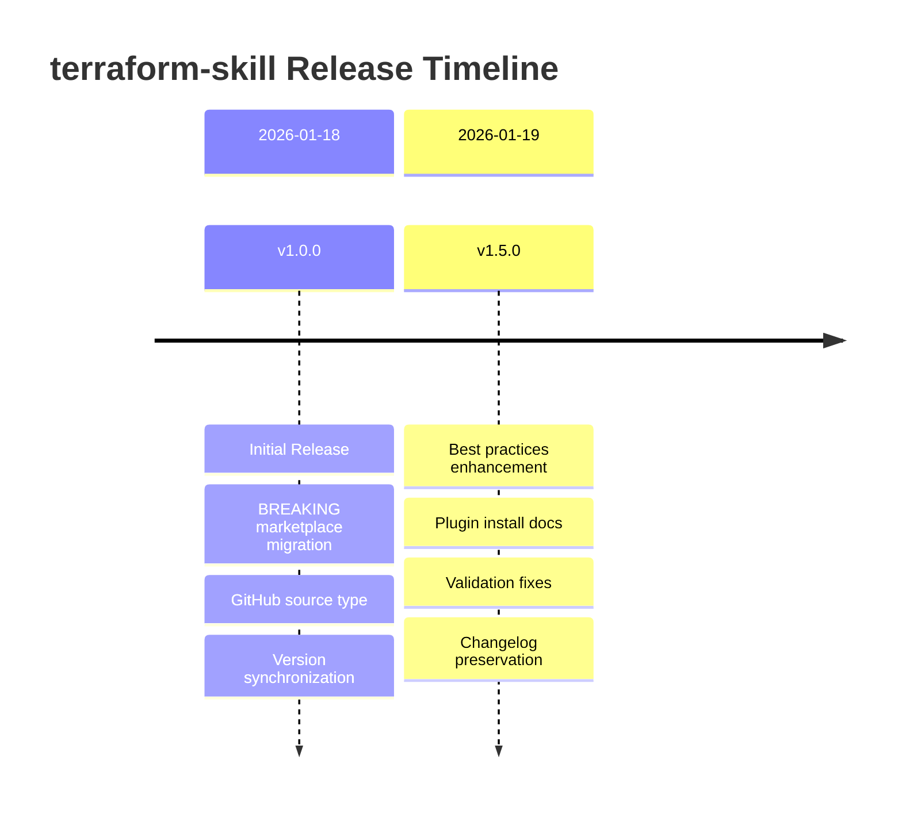
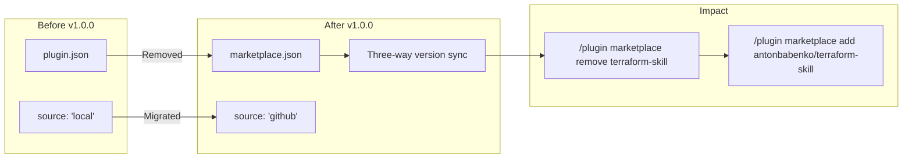
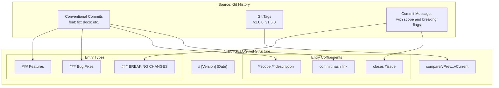
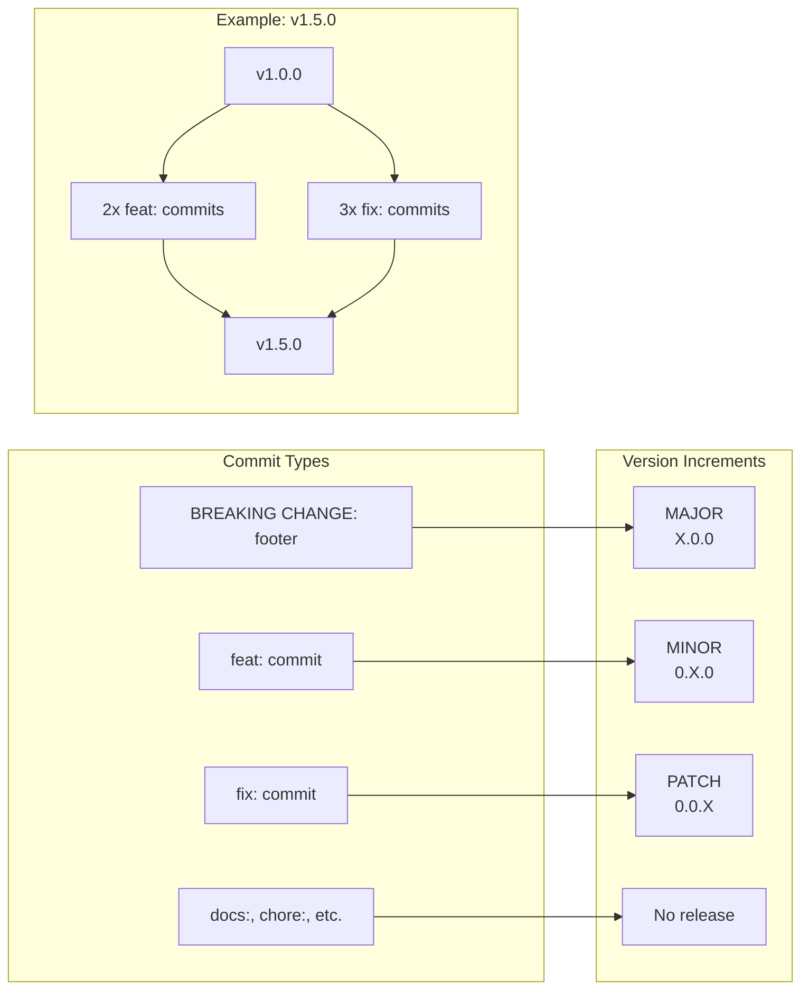
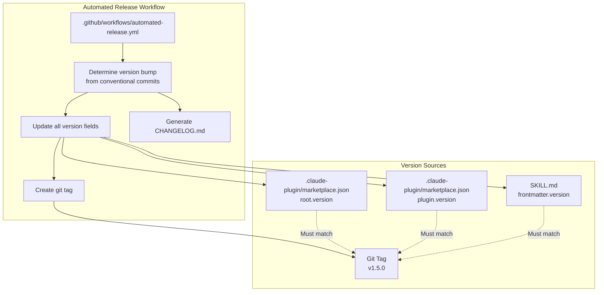
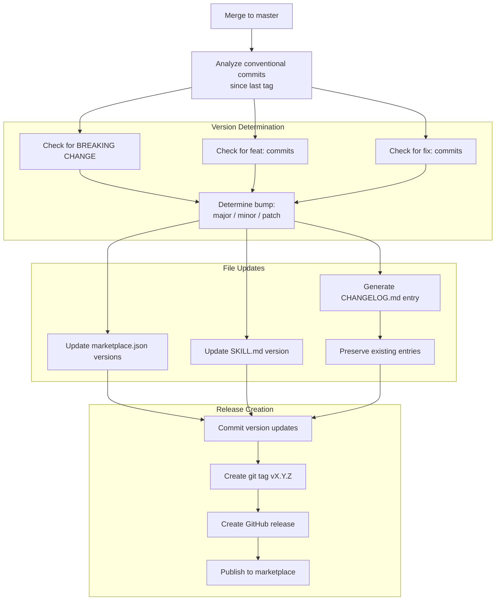

<!-- source: DeepWiki mcp.deepwiki.com · repo antonbabenko/terraform-skill · page 7 Release History · fetched 2026-10-27 -->

# Release History

<details>
<summary>Relevant source files</summary>

The following files were used as context for generating this wiki page:

- [CHANGELOG.md](CHANGELOG.md)

</details>


This document provides a complete version history of the terraform-skill project, documenting all releases, features, bug fixes, and breaking changes. The changelog is automatically generated by the [automated-release workflow](#6.2) using conventional commit analysis and semantic versioning principles.

For information about the automated release process itself, see [Release Automation](#6.2). For version synchronization mechanisms, see [Version Synchronization](#6.3).

---

## Version Timeline

The following diagram shows the progression of releases and their major characteristics:

**Version Release Timeline**



**Sources:** [CHANGELOG.md:1-51]()

---

## Release Versions

### v1.5.0 (2026-01-19)

The latest release focused on content enhancement and automation reliability improvements.

| Category | Change | Commit | Issue |
|----------|--------|--------|-------|
| **Feature** | Added plugin install command to docs | `c400b18` | - |
| **Feature** | Enhance skill with comprehensive best practices from original guide | `f32fc3b` | - |
| **Bug Fix** | Allow optional frontmatter fields in SKILL.md validation | `e4393cb` | #21146856119 |
| **Bug Fix** | Prevent changelog regeneration from losing intermediate releases | `b81b57d` | - |
| **Bug Fix** | Revert conventional-changelog-action to v5 due to tag detection bug | `9ba8215` | - |

**Key Improvements:**
- Enhanced SKILL.md with comprehensive Terraform/OpenTofu best practices
- Improved validation workflow to support optional frontmatter fields
- Fixed changelog generation to preserve version history across regenerations
- Documented marketplace installation command for better user onboarding

**Sources:** [CHANGELOG.md:1-16]()

---

### v1.0.0 (2026-01-18)

Initial public release with marketplace-based distribution architecture.

| Category | Change | Commit | Issue |
|----------|--------|--------|-------|
| **Feature** | Initial release of terraform-skill v1.0.0 | `4f1a017` | - |
| **Feature** | Migrate to marketplace-only architecture | `f32de12` | - |
| **Bug Fix** | Update marketplace.json version and source structure | `2bca71c` | - |
| **Bug Fix** | Fixed marketplace.json | `2b12e4e` | - |

**Sources:** [CHANGELOG.md:18-48]()

---

## Breaking Changes

### v1.0.0: Marketplace Migration

The v1.0.0 release introduced a **breaking change** that fundamentally altered the distribution mechanism.

**Change Details:**



**Migration Requirements:**

Users upgrading from pre-1.0.0 versions must manually reinstall the skill:

```bash
/plugin marketplace remove terraform-skill
/plugin marketplace add antonbabenko/terraform-skill
```

**Technical Changes:**
- Removed `plugin.json` in favor of `.claude-plugin/marketplace.json`
- Changed source type from `local` to `github` for marketplace distribution
- Implemented version synchronization across marketplace root, plugin definition, and git refs
- Updated validation and release workflows to support `marketplace.json`
- Updated all documentation references from `plugin.json` to `marketplace.json`

**Sources:** [CHANGELOG.md:27-48]()

---

## Changelog Structure

The changelog file follows the [Conventional Changelog](https://github.com/conventional-changelog/conventional-changelog) format and is automatically generated.

**Changelog File Mapping**



**Entry Format Examples:**

| Component | Example | Location in CHANGELOG.md |
|-----------|---------|--------------------------|
| Version header | `# [1.5.0](https://github.com/.../compare/v1.0.0...v1.5.0)` | [CHANGELOG.md:1]() |
| Feature entry | `* Added plugin install command to docs ([c400b18](...))` | [CHANGELOG.md:13]() |
| Bug fix entry | `* Allow optional frontmatter fields ([e4393cb](...)), closes [#21146856119](...)` | [CHANGELOG.md:6]() |
| Breaking change | `* Removed plugin.json in favor of marketplace.json.` | [CHANGELOG.md:37]() |

**Sources:** [CHANGELOG.md:1-51]()

---

## Semantic Versioning Strategy

The project follows [Semantic Versioning 2.0.0](https://semver.org/) with automated version determination based on conventional commit types.

**Version Bump Rules**



**Version Component Mapping:**

| Version | MAJOR | MINOR | PATCH | Trigger |
|---------|-------|-------|-------|---------|
| v1.0.0 | 1 | 0 | 0 | `BREAKING CHANGE` footer in commit `f32de12` |
| v1.5.0 | 1 | 5 | 0 | `feat:` commits `c400b18`, `f32fc3b` |

**Sources:** [CHANGELOG.md:1-51](), High-level diagrams (Diagram 3: Development & Release Workflow)

---

## Version Synchronization Points

Each release ensures version consistency across multiple files through automated synchronization.

**Three-Way Version Sync**



**Synchronized Fields:**

| File | Field Path | v1.5.0 Value |
|------|-----------|--------------|
| Git repository | Tag | `v1.5.0` |
| `.claude-plugin/marketplace.json` | `version` (root) | `1.5.0` |
| `.claude-plugin/marketplace.json` | `plugin.version` | `1.5.0` |
| `SKILL.md` | `version` (frontmatter) | `1.5.0` |
| `CHANGELOG.md` | Latest header | `# [1.5.0]` |

**Sources:** [CHANGELOG.md:1-51](), High-level diagrams (Diagram 3: Development & Release Workflow)

---

## Changelog Generation Process

The changelog is automatically generated during the release workflow and follows a preservation strategy to prevent data loss.

**Generation Workflow**



**Bug Fix: Changelog Preservation**

Commit `b81b57d` fixed an issue where regenerating the changelog would lose intermediate releases. The fix ensures that:
- Existing changelog entries are preserved during generation
- Only new version entries are appended
- Historical release data remains intact across workflow runs

**Sources:** [CHANGELOG.md:7](), High-level diagrams (Diagram 3: Development & Release Workflow)

---

## Commit Hash Reference

All changelog entries link to full commit details on GitHub. The following table provides quick access to significant commits:

| Commit | Type | Description | Version |
|--------|------|-------------|---------|
| `c400b18` | feat | Added plugin install command to docs | v1.5.0 |
| `f32fc3b` | feat | Enhance skill with comprehensive best practices | v1.5.0 |
| `e4393cb` | fix | Allow optional frontmatter fields in validation | v1.5.0 |
| `b81b57d` | fix | Prevent changelog regeneration data loss | v1.5.0 |
| `9ba8215` | fix | Revert conventional-changelog-action to v5 | v1.5.0 |
| `f32de12` | feat! | Migrate to marketplace-only architecture | v1.0.0 |
| `2bca71c` | fix | Update marketplace.json version and source | v1.0.0 |
| `2b12e4e` | fix | Fixed marketplace.json | v1.0.0 |
| `4f1a017` | feat | Initial release of terraform-skill | v1.0.0 |

**Sources:** [CHANGELOG.md:1-51]()

---

## Release Artifacts

Each release generates the following artifacts:

| Artifact | Location | Purpose |
|----------|----------|---------|
| Git Tag | `refs/tags/vX.Y.Z` | Version reference point |
| GitHub Release | `https://github.com/antonbabenko/terraform-skill/releases` | Release notes and downloads |
| Updated CHANGELOG.md | [CHANGELOG.md:1-51]() | Version history documentation |
| Updated marketplace.json | `.claude-plugin/marketplace.json` | Plugin metadata |
| Updated SKILL.md | `SKILL.md` frontmatter | Skill version metadata |

**Sources:** [CHANGELOG.md:1-51](), High-level diagrams (Diagram 3: Development & Release Workflow)

---

