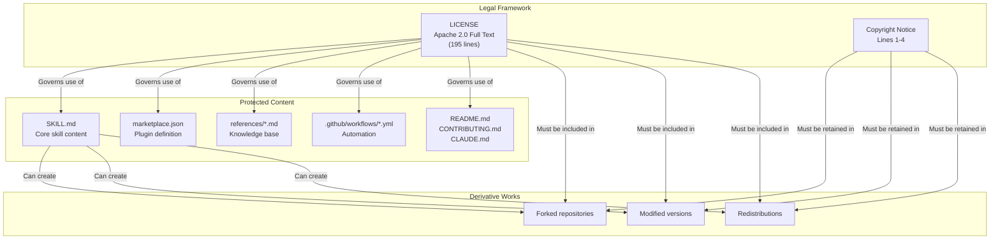
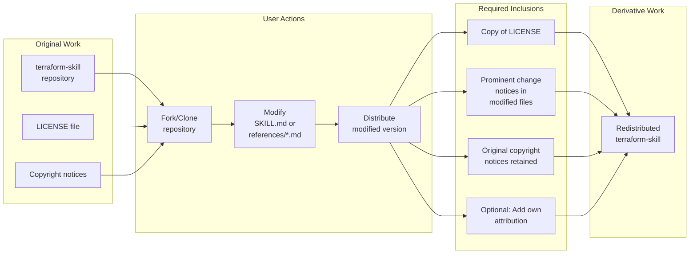
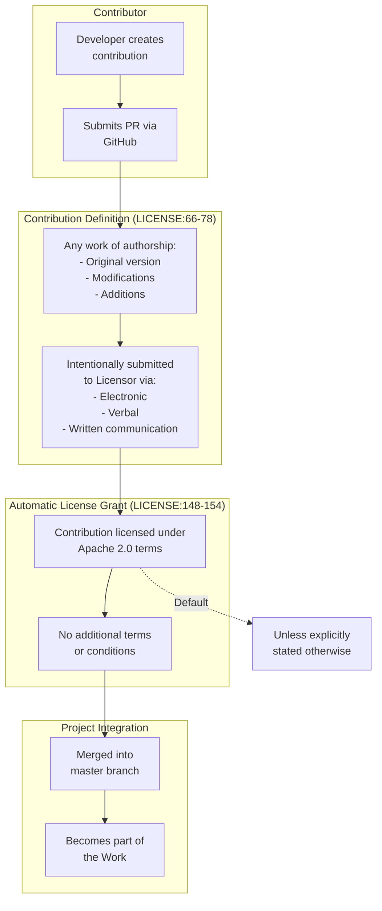
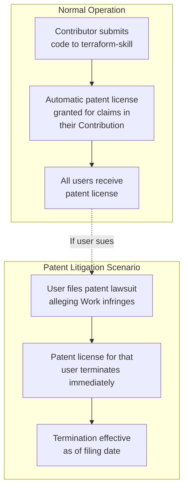
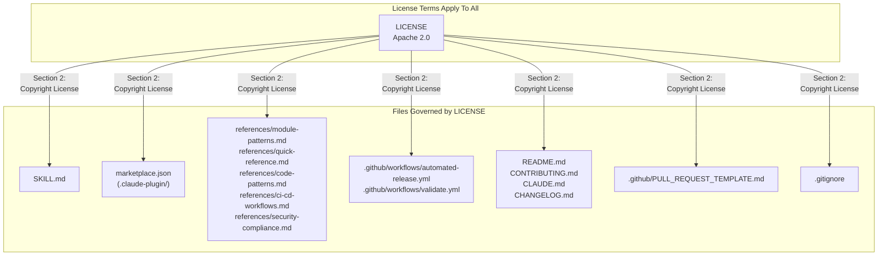

<!-- source: DeepWiki mcp.deepwiki.com · repo antonbabenko/terraform-skill · page 8 Legal & Licensing · fetched 2026-10-27 -->

# Legal & Licensing

<details>
<summary>Relevant source files</summary>

The following files were used as context for generating this wiki page:

- [LICENSE](LICENSE)

</details>


## Purpose and Scope

This document describes the licensing terms, copyright information, and legal framework governing the terraform-skill repository. The project is released under the Apache License, Version 2.0, which defines how users may use, modify, redistribute, and contribute to the codebase.

For information about contribution requirements and workflow processes, see [Development Guide](#5).

**Sources:** [LICENSE:1-195]()

---

## License Overview

The terraform-skill repository is licensed under the **Apache License, Version 2.0** (January 2004). This is a permissive open-source license that allows broad use, modification, and redistribution while providing patent protection and clear attribution requirements.

### Copyright Holder

```
Copyright 2026 Anton Babenko
terraform-best-practices.com
Compliance.tf - Terraform Compliance for Cloud-Native Enterprise
```

The copyright notice appears at [LICENSE:1-4]() and establishes Anton Babenko as the copyright holder.

### License Location

The full license text is available at:
- Repository: [LICENSE:1-195]()
- Official text: http://www.apache.org/licenses/LICENSE-2.0 [LICENSE:10]()

**Sources:** [LICENSE:1-21]()

---

## License Architecture

### File Coverage Diagram



**Sources:** [LICENSE:1-195](), [LICENSE:107-146]()

---

## Key Permissions Granted

The Apache 2.0 license grants the following permissions to users:

| Permission | Scope | Conditions |
|------------|-------|------------|
| **Use** | Use the Work for any purpose | None |
| **Reproduction** | Make copies of the Work | Must include license copy |
| **Distribution** | Distribute copies | Must meet redistribution requirements (Section 4) |
| **Modification** | Create Derivative Works | Modified files must carry prominent notices |
| **Sublicensing** | Grant sublicenses | Must comply with license terms |
| **Patent Use** | Use patent claims in Contributions | Subject to patent license terms |
| **Commercial Use** | Use in commercial applications | Permitted without restriction |

### Copyright License Grant

As defined in [LICENSE:84-89]():

- **Perpetual**: No expiration date
- **Worldwide**: Valid in all jurisdictions
- **Non-exclusive**: Does not prevent other licenses
- **No-charge**: No royalty or fees required
- **Royalty-free**: No ongoing payments
- **Irrevocable**: Cannot be revoked (except for patent termination)

The license covers both **Source form** (markdown files, YAML, JSON) and **Object form** (generated documentation, compiled artifacts).

**Sources:** [LICENSE:84-89](), [LICENSE:43-65]()

---

## Redistribution Requirements

### Mandatory Requirements

When redistributing the Work or Derivative Works, users **must** comply with all conditions in [LICENSE:107-146](). The following table summarizes the requirements:

| Requirement | Location | Description |
|-------------|----------|-------------|
| **License Copy** | [LICENSE:112-113]() | Provide a copy of the Apache 2.0 license |
| **Change Notices** | [LICENSE:115-116]() | Mark modified files with prominent notices |
| **Copyright Retention** | [LICENSE:118-122]() | Retain all copyright, patent, trademark notices |
| **NOTICE File** | [LICENSE:124-139]() | Include NOTICE file if present (not applicable) |
| **Attribution** | [LICENSE:141-146]() | May add own attribution alongside original |

### Redistribution Flow Diagram



### Example Change Notice

When modifying files, add notices like:

```markdown
<!-- Modified by [Your Name/Organization] on [Date] -->
<!-- Changes: [Description of modifications] -->
```

This satisfies the requirement at [LICENSE:115-116]().

**Sources:** [LICENSE:107-146]()

---

## Contribution Licensing

### Automatic License Grant

All contributions to the terraform-skill repository are automatically licensed under the Apache 2.0 license through the submission process. This is defined in [LICENSE:148-154]().



### Key Terms

- **Contribution**: Defined at [LICENSE:66-78]() as any work of authorship intentionally submitted for inclusion
- **Contributor**: Defined at [LICENSE:80-82]() as the Licensor and anyone whose Contribution has been incorporated
- **Submission**: Includes electronic, verbal, or written communication to maintainers

### Explicit Override Option

Contributors may explicitly state different terms before submission [LICENSE:148](), but this is uncommon and requires prior negotiation.

**Sources:** [LICENSE:66-82](), [LICENSE:148-154]()

---

## Patent License

### Patent Grant

The Apache 2.0 license includes a **patent license grant** at [LICENSE:91-105]() that provides protection for both contributors and users.

| Aspect | Terms |
|--------|-------|
| **Duration** | Perpetual |
| **Scope** | Worldwide, non-exclusive, no-charge, royalty-free |
| **Irrevocability** | Except for patent litigation |
| **Rights Granted** | Make, have made, use, offer to sell, sell, import, transfer |
| **Coverage** | Patent claims in Contributions that are necessarily infringed |

### Patent Termination Provision

If a user institutes patent litigation alleging that the Work or a Contribution infringes a patent, all patent licenses granted to that user terminate as of the litigation filing date [LICENSE:100-105]().



This defensive termination provision discourages patent trolling against the project.

**Sources:** [LICENSE:91-105]()

---

## Warranties and Liability

### Disclaimer of Warranty

The Apache 2.0 license provides the Work **"AS IS"** without any warranties. This is stated at [LICENSE:161-169]().

| Warranty Type | Status |
|--------------|--------|
| **Express warranties** | None |
| **Implied warranties** | None |
| **Title** | No warranty |
| **Non-infringement** | No warranty |
| **Merchantability** | No warranty |
| **Fitness for particular purpose** | No warranty |

Users are **solely responsible** for:
- Determining appropriateness of use
- Determining appropriateness of redistribution
- Assuming all risks of use

### Limitation of Liability

Contributors have **no liability** for damages arising from use of the Work [LICENSE:171-181](). This includes:

- Direct damages
- Indirect damages
- Special damages
- Incidental damages
- Consequential damages
- Loss of goodwill
- Work stoppage
- Computer failure or malfunction
- Any other commercial damages or losses

This limitation applies even if the contributor has been advised of the possibility of such damages.

### Optional Liability Assumption

When redistributing the Work, users may **choose** to offer support, warranty, or indemnity [LICENSE:183-192](). However:
- This is on the user's own behalf and sole responsibility
- Not on behalf of any other Contributor
- User must indemnify, defend, and hold Contributors harmless

**Sources:** [LICENSE:161-192]()

---

## Trademark Restrictions

The Apache 2.0 license **does not grant** permission to use trade names, trademarks, service marks, or product names of the Licensor [LICENSE:156-159]().

| Permitted Use | Prohibited Use |
|--------------|----------------|
| Describing origin of the Work | Using "terraform-skill" trademark without permission |
| Reproducing NOTICE file content (if present) | Implying endorsement by Anton Babenko |
| Reasonable and customary attribution | Marketing materials using licensor's trademarks |

The copyright notice references:
- `terraform-best-practices.com` [LICENSE:3]()
- `Compliance.tf` [LICENSE:4]()

These names should only be used for factual attribution, not to imply affiliation.

**Sources:** [LICENSE:156-159](), [LICENSE:1-4]()

---

## Practical Implications

### For End Users

| Scenario | Permitted | Requirements |
|----------|-----------|--------------|
| Using skill in Claude Code | ✅ Yes | None |
| Forking repository for private use | ✅ Yes | Retain LICENSE file |
| Modifying SKILL.md for internal use | ✅ Yes | Mark changes in modified files |
| Sharing modified version publicly | ✅ Yes | Include LICENSE, mark changes, retain copyright |
| Using in commercial product | ✅ Yes | Include LICENSE and attribution |
| Removing copyright notices | ❌ No | Violates [LICENSE:118-122]() |
| Suing project for patent infringement | ⚠️ Permitted but terminates patent license | See [LICENSE:100-105]() |

### For Contributors

When submitting a pull request to the repository:

1. Your contribution is automatically licensed under Apache 2.0 [LICENSE:148-154]()
2. You grant a perpetual patent license for any patent claims in your contribution [LICENSE:91-105]()
3. You retain copyright to your contribution, but grant broad usage rights
4. No additional agreements or CLAs required

This aligns with the contribution workflow described in [Development Guide](#5).

### For Redistributors

When creating a derivative version:

1. ✅ Include complete `LICENSE` file [LICENSE:112-113]()
2. ✅ Add change notices to modified files [LICENSE:115-116]()
3. ✅ Retain original copyright notices [LICENSE:118-122]()
4. ✅ Optionally add your own attribution [LICENSE:141-146]()
5. ❌ Do not claim the work is officially endorsed without permission

**Sources:** [LICENSE:84-192]()

---

## License Version and Applicability

### Apache License Version

The specific license version is **Apache License, Version 2.0, January 2004** [LICENSE:19-21](). This is the current version of the Apache License and is widely used in open-source projects.

### Work Definition

Under the license, "Work" means [LICENSE:53-56]():
- All files in the repository
- Source form (markdown, YAML, JSON files)
- Object form (generated documentation if any)
- Indicated by copyright notice [LICENSE:1-4]()

### License Applicability Diagram



The license covers all files in the repository tree, as indicated by the copyright notice being attached to the Work as a whole [LICENSE:53-56]().

**Sources:** [LICENSE:19-21](), [LICENSE:53-56](), [LICENSE:1-4]()

---

## Summary Table

### Quick Reference

| Topic | Key Points | License Section |
|-------|------------|-----------------|
| **License Type** | Apache 2.0, January 2004 | [LICENSE:19-21]() |
| **Copyright** | © 2026 Anton Babenko | [LICENSE:1]() |
| **Permissions** | Use, modify, distribute, sublicense, commercial use | [LICENSE:84-89]() |
| **Patent Grant** | Perpetual, irrevocable patent license for Contributions | [LICENSE:91-105]() |
| **Redistribution** | Must include LICENSE, mark changes, retain copyright | [LICENSE:107-146]() |
| **Contributions** | Automatic Apache 2.0 licensing upon submission | [LICENSE:148-154]() |
| **Warranties** | None - provided "AS IS" | [LICENSE:161-169]() |
| **Liability** | Contributors not liable for damages | [LICENSE:171-181]() |
| **Trademarks** | No permission to use licensor's trademarks | [LICENSE:156-159]() |

**Sources:** [LICENSE:1-195]()

---

