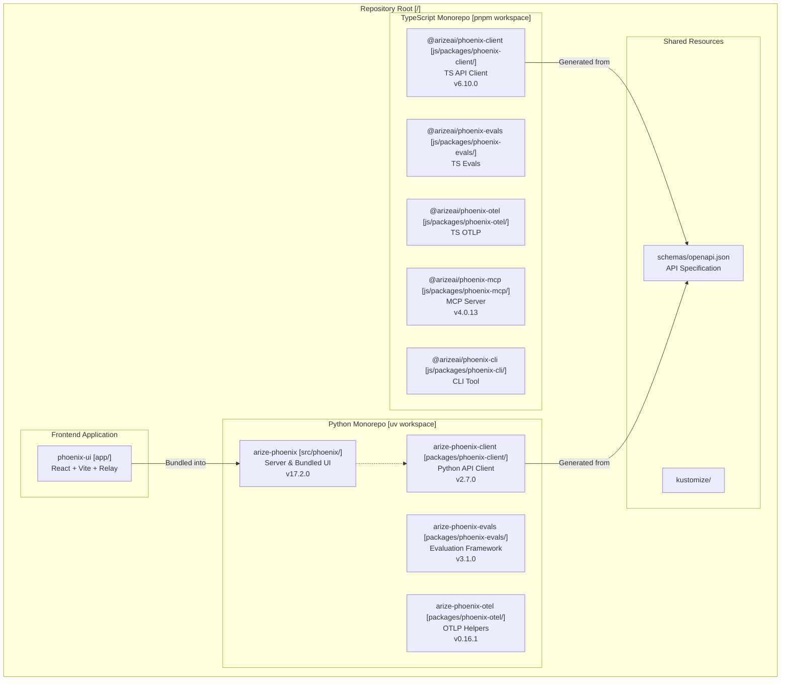
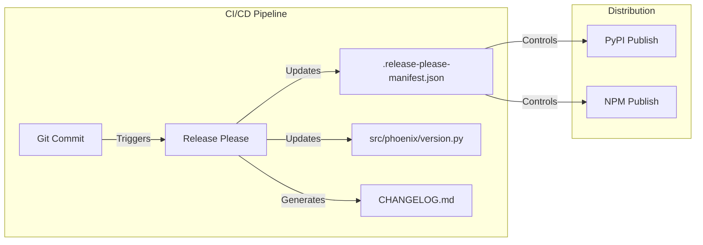
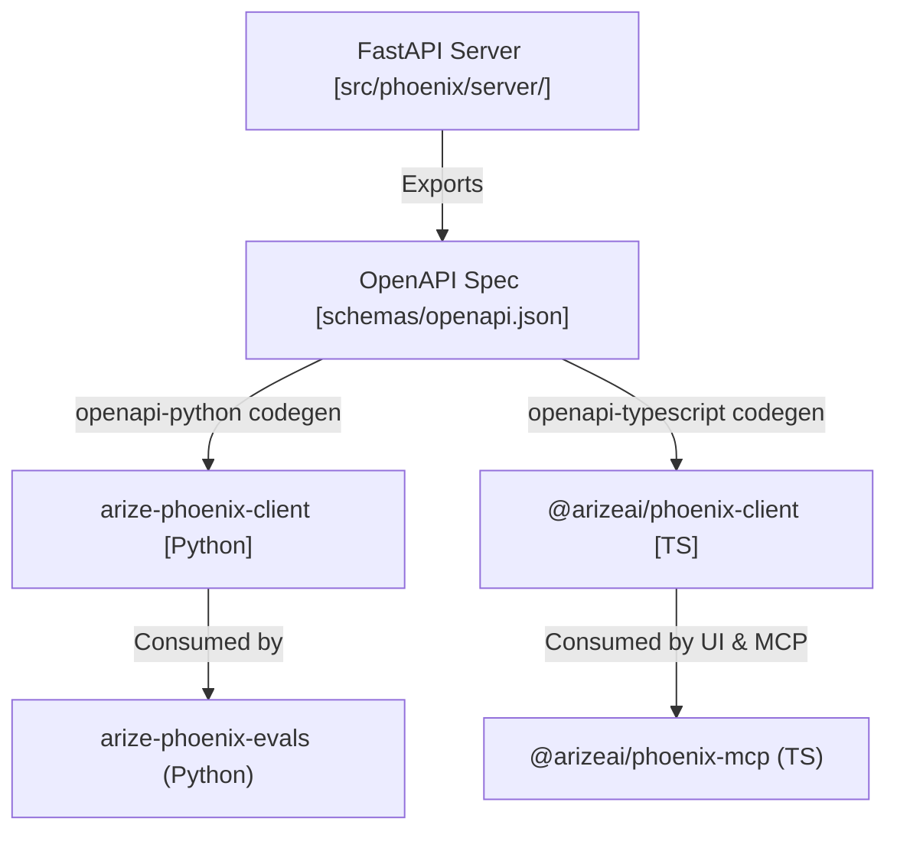

<!-- source: DeepWiki mcp.deepwiki.com · repo arize-ai/phoenix · page 1.1 Package Structure & Monorepo · fetched 2026-10-27 -->

# Package Structure & Monorepo

<details>
<summary>Relevant source files</summary>

The following files were used as context for generating this wiki page:

- [.release-please-manifest.json](.release-please-manifest.json)
- [CHANGELOG.md](CHANGELOG.md)
- [app/.env.example](app/.env.example)
- [app/package.json](app/package.json)
- [app/pnpm-lock.yaml](app/pnpm-lock.yaml)
- [app/src/components/table/Table.tsx](app/src/components/table/Table.tsx)
- [app/src/openInference/tracing/__tests__/types.test.ts](app/src/openInference/tracing/__tests__/types.test.ts)
- [app/src/openInference/tracing/types.ts](app/src/openInference/tracing/types.ts)
- [app/src/pages/trace/TracePage.tsx](app/src/pages/trace/TracePage.tsx)
- [app/src/typeUtils.ts](app/src/typeUtils.ts)
- [app/vite.config.mts](app/vite.config.mts)
- [app/vitest.setup.ts](app/vitest.setup.ts)
- [internal_docs/specs/playground.md](internal_docs/specs/playground.md)
- [internal_docs/specs/prompts.md](internal_docs/specs/prompts.md)
- [internal_docs/specs/server_evaluators.md](internal_docs/specs/server_evaluators.md)
- [js/examples/apps/demo-document-relevancy-experiment/CHANGELOG.md](js/examples/apps/demo-document-relevancy-experiment/CHANGELOG.md)
- [js/examples/apps/demo-document-relevancy-experiment/package.json](js/examples/apps/demo-document-relevancy-experiment/package.json)
- [js/package.json](js/package.json)
- [js/packages/phoenix-cli/CHANGELOG.md](js/packages/phoenix-cli/CHANGELOG.md)
- [js/packages/phoenix-cli/package.json](js/packages/phoenix-cli/package.json)
- [js/packages/phoenix-client/CHANGELOG.md](js/packages/phoenix-client/CHANGELOG.md)
- [js/packages/phoenix-client/package.json](js/packages/phoenix-client/package.json)
- [js/packages/phoenix-config/CHANGELOG.md](js/packages/phoenix-config/CHANGELOG.md)
- [js/packages/phoenix-config/package.json](js/packages/phoenix-config/package.json)
- [js/packages/phoenix-evals/CHANGELOG.md](js/packages/phoenix-evals/CHANGELOG.md)
- [js/packages/phoenix-evals/package.json](js/packages/phoenix-evals/package.json)
- [js/packages/phoenix-mcp/CHANGELOG.md](js/packages/phoenix-mcp/CHANGELOG.md)
- [js/packages/phoenix-mcp/package.json](js/packages/phoenix-mcp/package.json)
- [js/packages/phoenix-otel/CHANGELOG.md](js/packages/phoenix-otel/CHANGELOG.md)
- [js/packages/phoenix-otel/package.json](js/packages/phoenix-otel/package.json)
- [js/pnpm-lock.yaml](js/pnpm-lock.yaml)
- [kustomize/README.md](kustomize/README.md)
- [packages/phoenix-client/CHANGELOG.md](packages/phoenix-client/CHANGELOG.md)
- [packages/phoenix-client/pyproject.toml](packages/phoenix-client/pyproject.toml)
- [packages/phoenix-evals/CHANGELOG.md](packages/phoenix-evals/CHANGELOG.md)
- [packages/phoenix-evals/docs/source/api/evals.rst](packages/phoenix-evals/docs/source/api/evals.rst)
- [packages/phoenix-evals/docs/source/index.md](packages/phoenix-evals/docs/source/index.md)
- [packages/phoenix-evals/pyproject.toml](packages/phoenix-evals/pyproject.toml)
- [packages/phoenix-otel/CHANGELOG.md](packages/phoenix-otel/CHANGELOG.md)
- [packages/phoenix-otel/pyproject.toml](packages/phoenix-otel/pyproject.toml)
- [packages/phoenix-otel/src/phoenix/otel/__init__.py](packages/phoenix-otel/src/phoenix/otel/__init__.py)
- [packages/phoenix-otel/src/phoenix/otel/otel.py](packages/phoenix-otel/src/phoenix/otel/otel.py)
- [packages/phoenix-otel/tests/__init__.py](packages/phoenix-otel/tests/__init__.py)
- [packages/phoenix-otel/tests/test_exports.py](packages/phoenix-otel/tests/test_exports.py)
- [packages/phoenix-otel/tests/test_otel.py](packages/phoenix-otel/tests/test_otel.py)
- [packages/phoenix-otel/tests/test_settings.py](packages/phoenix-otel/tests/test_settings.py)
- [pyproject.toml](pyproject.toml)
- [release-please-config.json](release-please-config.json)
- [requirements/packages/phoenix-evals.txt](requirements/packages/phoenix-evals.txt)
- [requirements/type-check.txt](requirements/type-check.txt)
- [requirements/unit-tests.txt](requirements/unit-tests.txt)
- [scripts/docker/devops/oidc-server/frontend/package.json](scripts/docker/devops/oidc-server/frontend/package.json)
- [scripts/docker/devops/oidc-server/frontend/src/contexts/ThemeContext.tsx](scripts/docker/devops/oidc-server/frontend/src/contexts/ThemeContext.tsx)
- [scripts/docker/devops/oidc-server/package.json](scripts/docker/devops/oidc-server/package.json)
- [scripts/docker/devops/smtp-server/package.json](scripts/docker/devops/smtp-server/package.json)
- [src/phoenix/__init__.py](src/phoenix/__init__.py)
- [src/phoenix/tests/test_config.py](src/phoenix/tests/test_config.py)
- [src/phoenix/trace/fixtures.py](src/phoenix/trace/fixtures.py)
- [src/phoenix/trace/utils.py](src/phoenix/trace/utils.py)
- [src/phoenix/version.py](src/phoenix/version.py)
- [tests/conftest.py](tests/conftest.py)
- [tests/unit/conftest.py](tests/unit/conftest.py)
- [uv.lock](uv.lock)

</details>


This document describes the monorepo organization of the Phoenix codebase, covering the Python and TypeScript packages, their versioning, workspace management, and interrelations. It explains how Phoenix’s various components are modularized, developed, and released within a unified repository.

For deployment considerations, see [Kubernetes Deployment](#6.5). For API usage by developers, see [Python Client (arize-phoenix-client)](#3.1) and [TypeScript Client](#3.4).

---

## Monorepo Overview

Phoenix uses a **dual-language monorepo** strategy:

- **Python packages** managed with **uv** workspaces
- **TypeScript packages** managed with **pnpm** workspaces

Each package is versioned and released independently but shares tooling, version control, and CI/CD pipelines.

### Mapping System Components to Monorepo Packages

The diagram below maps Phoenix’s system components and their code entities within the monorepo folder structure and versioning:



**Sources:** [.release-please-manifest.json:1](), [src/phoenix/version.py:1](), [packages/phoenix-client/pyproject.toml:24](), [packages/phoenix-evals/pyproject.toml:24](), [js/packages/phoenix-client/package.json:3](), [js/packages/phoenix-mcp/package.json:3]()

---

## Python Package Structure

The Python ecosystem consists of four main packages, all sharing the `phoenix` namespace but released separately. They are managed via `uv` workspaces to allow simultaneous local development and testing.

### Main Package: `arize-phoenix`

This package contains the Phoenix server implementation, backend business logic, API layers, and the bundled React UI for the web frontend.

| Attribute          | Value                         |
|--------------------|-------------------------------|
| Package Name       | `arize-phoenix`               |
| Version           | v17.2.0                       |
| Location          | `src/phoenix/`                 |
| PyPI Package Name  | `arize-phoenix`               |
| Python Version Support | 3.10 - 3.14               |

**Key contents & responsibilities:**

- **Server Application:** The FastAPI app and GraphQL/REST API layer located primarily in `src/phoenix/server/`.
- **Static Assets / Frontend UI:** Compiled React build from `app/` is integrated in `src/phoenix/server/static/`.
- **Span & Trace Processing:** Contains ingestion logic and fixtures in `src/phoenix/trace/`.
- **Namespace Packaging:** Managed by `pkgutil.extend_path` for the `phoenix` namespace [src/phoenix/__init__.py:5]().
- **Legacy Import Handling:** Custom import hooks redirect legacy client & trace modules to updated packages [src/phoenix/__init__.py:47-66]().

**CLI Entry Points:**
- Scripts `arize-phoenix` and `phoenix` both launch the server main at `phoenix.server.main:main` [pyproject.toml:78-79]().

### Client Package: `arize-phoenix-client`

The official Python client package for interacting programmatically with Phoenix servers.

| Attribute          | Value                         |
|--------------------|-------------------------------|
| Package Name       | `arize-phoenix-client`        |
| Version            | v2.7.0                        |
| Location           | `packages/phoenix-client/`    |

**Features:**
- Provides resource APIs for spans, datasets, experiments, and prompts.
- Integrates OpenTelemetry SDK and OTLP export to support tracing [packages/phoenix-client/pyproject.toml:31-32]().
- Replacement for the legacy `phoenix.session.client.Client` with guidance enforced by import hooks [src/phoenix/__init__.py:47-66]().

### Evaluations Package: `arize-phoenix-evals`

Contains tools and frameworks to evaluate and benchmark large language models and AI behavior.

| Attribute          | Value                      |
|--------------------|----------------------------|
| Package Name       | `arize-phoenix-evals`      |
| Version            | v3.1.0                     |
| Location           | `packages/phoenix-evals/`  |

### OpenTelemetry Helpers Package: `arize-phoenix-otel`

Helper utilities for integrating OTLP and OpenTelemetry protocol with Phoenix.

| Attribute          | Value                      |
|--------------------|----------------------------|
| Package Name       | `arize-phoenix-otel`       |
| Version            | v0.16.1                    |
| Location           | `packages/phoenix-otel/`   |

---

## TypeScript Package Structure

The TypeScript ecosystem is managed under the `js/` directory using `pnpm` workspaces, enabling modular development and versioning.

### TypeScript Client Package: `@arizeai/phoenix-client`

| Attribute          | Value                         |
|--------------------|-------------------------------|
| Package Name       | `@arizeai/phoenix-client`     |
| Version            | v6.10.0                       |
| Location           | `js/packages/phoenix-client/` |

**Notes:**
- Types are generated from the OpenAPI spec `schemas/openapi.json` using `openapi-typescript`.
- Build outputs support both CommonJS (`dist/src/`) and ESM (`dist/esm/`) modules.

### MCP Server Package: `@arizeai/phoenix-mcp`

The Model Context Protocol server allows AI coding assistants to integrate and query Phoenix.

| Attribute          | Value                         |
|--------------------|-------------------------------|
| Package Name       | `@arizeai/phoenix-mcp`        |
| Version            | v4.0.13                       |
| Location           | `js/packages/phoenix-mcp/`    |

### Additional TS Packages:
- `@arizeai/phoenix-evals` – TypeScript port of the evals framework.
- `@arizeai/phoenix-otel` – OTLP/OTEL helpers in TypeScript.
- `@arizeai/phoenix-cli` – CLI tooling for Phoenix.

---

## Version Manifest & Release Automation

Phoenix leverages independent versioning for each package, tracked centrally by `.release-please-manifest.json`. For example:

| Package                      | Current Version |
|------------------------------|-----------------|
| arize-phoenix                | 17.2.0          |
| arize-phoenix-client         | 2.7.0           |
| arize-phoenix-evals          | 3.1.0           |
| arize-phoenix-otel           | 0.16.1          |

```json
{
  ".": "17.2.0",
  "packages/phoenix-evals": "3.1.0",
  "packages/phoenix-otel": "0.16.1",
  "packages/phoenix-client": "2.7.0"
}
```

**Release flow:**



**Sources:** [.release-please-manifest.json:1](), [CHANGELOG.md:1-24](), [src/phoenix/version.py:1]()

---

## Workspace & Dependency Management

### Python Workspace (`uv`)

- The Python monorepo uses `uv` to manage package workspace linking and dependency resolution.
- Packages like `arize-phoenix-evals` and `arize-phoenix-client` can be developed alongside the main server package.
- Major dependencies include:
  - FastAPI (>=0.135.2) for the server web framework [pyproject.toml:62]().
  - Pydantic AI extensions for agent support [pyproject.toml:64]().
  - SQLAlchemy (asyncio) and Alembic for DB layer and migrations [pyproject.toml:51-52]().
  - OpenTelemetry SDK and exporters for tracing [pyproject.toml:45-47]().
- The `src/phoenix/__init__.py` sets up namespace package support via `pkgutil` and manages legacy import redirections [src/phoenix/__init__.py:4-44]().

### TypeScript Workspace (`pnpm`)

- The JavaScript/TypeScript workspace is managed by `pnpm` with workspaces declared in `js/package.json` and root workspace files.
- React-based frontend app (`app/`) and TS packages (`js/packages`) co-exist, with `pnpm` managing dependencies and inter-package linking.
- Versioned packages include client libs, CLI, evals, OTLP helpers, and MCP server [js/packages/phoenix-client/package.json:1-130](), [app/package.json:1-177]().

---

## Code Generation & API Specification

Phoenix uses an OpenAPI schema (`schemas/openapi.json`) as the single source of truth for API contracts.



This flow guarantees API consistency across languages and packages.

---

# Summary Table of Python Packages

| Package Name           | Directory                 | Version | Description                                             |
|-----------------------|---------------------------|---------|---------------------------------------------------------|
| arize-phoenix          | src/phoenix/              | 17.2.0  | Core Phoenix server + API + bundled UI                   |
| arize-phoenix-client   | packages/phoenix-client/  | 2.7.0   | Python client API for Phoenix                            |
| arize-phoenix-evals    | packages/phoenix-evals/   | 3.1.0   | Evaluation and model benchmarking framework             |
| arize-phoenix-otel     | packages/phoenix-otel/    | 0.16.1  | OpenTelemetry helpers for OTLP ingestion                |

---

# Summary Table of TypeScript Packages

| Package Name                 | Directory                        | Version | Description                          |
|-----------------------------|---------------------------------|---------|------------------------------------|
| @arizeai/phoenix-client      | js/packages/phoenix-client/     | 6.10.0  | TypeScript client API lib           |
| @arizeai/phoenix-evals       | js/packages/phoenix-evals/      | —       | TypeScript evals framework          |
| @arizeai/phoenix-otel        | js/packages/phoenix-otel/       | —       | OTLP/OTEL helpers in TypeScript     |
| @arizeai/phoenix-mcp         | js/packages/phoenix-mcp/        | 4.0.13  | MCP server for AI agent integration |
| @arizeai/phoenix-cli         | js/packages/phoenix-cli/        | —       | CLI tooling package                 |
| phoenix-ui                   | app/                           | 0.0.1   | React frontend app with Vite + Relay|

---

This detailed breakdown provides clear insights into how Phoenix’s monorepo is structured, how the distinct language ecosystems interoperate, and how versioning and release automation maintain consistency.

**Sources:**  
[.release-please-manifest.json:1](), [src/phoenix/version.py:1](), [src/phoenix/__init__.py:1-149](),  
[pyproject.toml:1-74](), [packages/phoenix-client/pyproject.toml:1-104](), [packages/phoenix-evals/pyproject.toml:1-130](),  
[js/packages/phoenix-client/package.json:1-130](), [app/package.json:1-177]()

---

