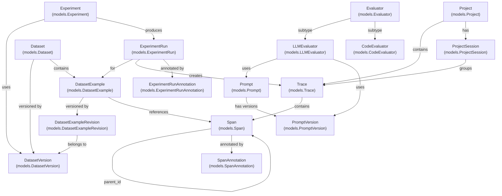
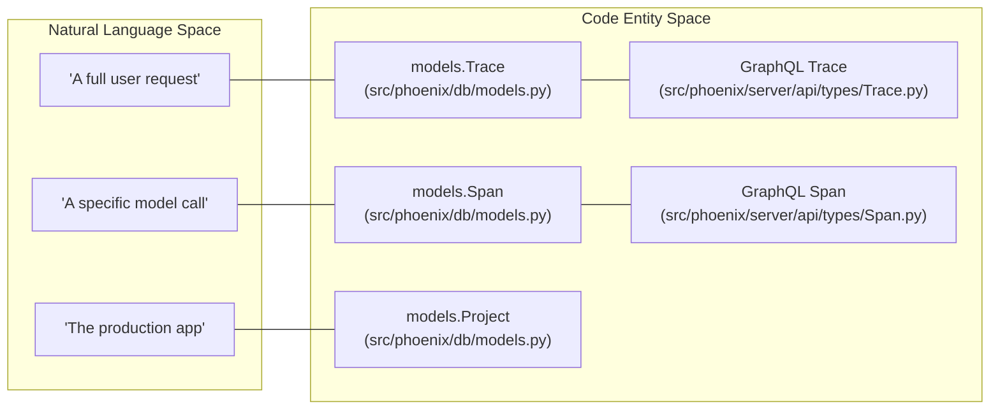
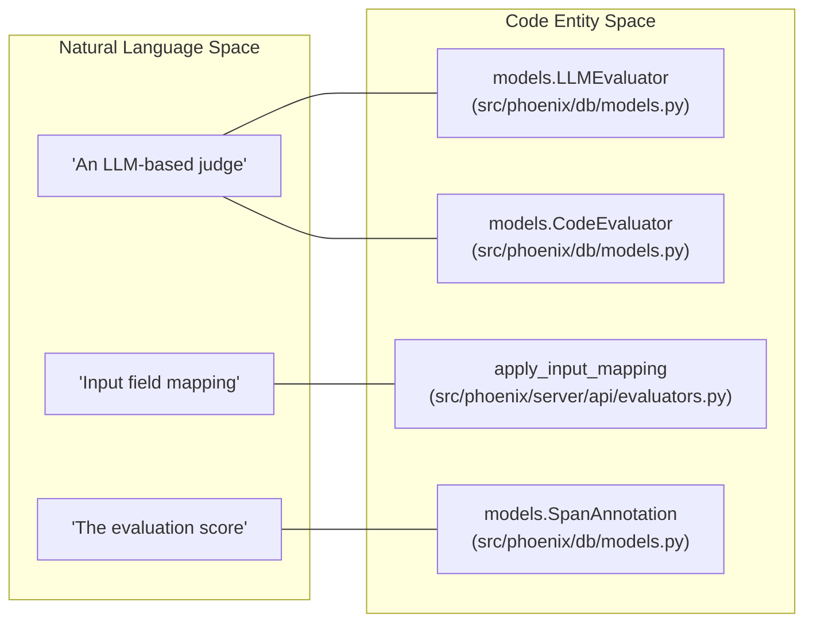

<!-- source: DeepWiki mcp.deepwiki.com · repo arize-ai/phoenix · page 1.2 Core Concepts & Terminology · fetched 2026-10-27 -->

# Core Concepts & Terminology

Relevant source files

The following files were used as context for generating this wiki page:

- [README.md](README.md)
- [app/schema.graphql](app/schema.graphql)
- [app/src/components/trace/SpanKindIcon.tsx](app/src/components/trace/SpanKindIcon.tsx)
- [app/src/pages/auth/AuthLayout.tsx](app/src/pages/auth/AuthLayout.tsx)
- [app/src/window.d.ts](app/src/window.d.ts)
- [cspell.json](cspell.json)
- [docs/phoenix/integrations/typescript/vercel/vercel-ai-sdk-tracing-js.mdx](docs/phoenix/integrations/typescript/vercel/vercel-ai-sdk-tracing-js.mdx)
- [docs/phoenix/sdk-api-reference/typescript/arizeai-phoenix-otel.mdx](docs/phoenix/sdk-api-reference/typescript/arizeai-phoenix-otel.mdx)
- [docs/phoenix/sdk-api-reference/typescript/overview.mdx](docs/phoenix/sdk-api-reference/typescript/overview.mdx)
- [docs/phoenix/sdk-api-reference/typescript/packages/phoenix-otel/manual-spans.mdx](docs/phoenix/sdk-api-reference/typescript/packages/phoenix-otel/manual-spans.mdx)
- [docs/phoenix/sdk-api-reference/typescript/packages/phoenix-otel/overview.mdx](docs/phoenix/sdk-api-reference/typescript/packages/phoenix-otel/overview.mdx)
- [js/packages/phoenix-client/README.md](js/packages/phoenix-client/README.md)
- [js/packages/phoenix-config/README.md](js/packages/phoenix-config/README.md)
- [js/packages/phoenix-evals/README.md](js/packages/phoenix-evals/README.md)
- [js/packages/phoenix-mcp/README.md](js/packages/phoenix-mcp/README.md)
- [js/packages/phoenix-mcp/src/index.ts](js/packages/phoenix-mcp/src/index.ts)
- [js/packages/phoenix-mcp/src/projectTools.ts](js/packages/phoenix-mcp/src/projectTools.ts)
- [js/packages/phoenix-otel/README.md](js/packages/phoenix-otel/README.md)
- [packages/phoenix-client/README.md](packages/phoenix-client/README.md)
- [packages/phoenix-evals/README.md](packages/phoenix-evals/README.md)
- [packages/phoenix-otel/README.md](packages/phoenix-otel/README.md)
- [scripts/data/generate_traces.py](scripts/data/generate_traces.py)
- [src/phoenix/config.py](src/phoenix/config.py)
- [src/phoenix/db/alembic.ini](src/phoenix/db/alembic.ini)
- [src/phoenix/db/engines.py](src/phoenix/db/engines.py)
- [src/phoenix/db/migrate.py](src/phoenix/db/migrate.py)
- [src/phoenix/db/migrations/__init__.py](src/phoenix/db/migrations/__init__.py)
- [src/phoenix/db/migrations/env.py](src/phoenix/db/migrations/env.py)
- [src/phoenix/db/migrations/versions/10460e46d750_datasets.py](src/phoenix/db/migrations/versions/10460e46d750_datasets.py)
- [src/phoenix/db/migrations/versions/3be8647b87d8_add_token_columns_to_spans_table.py](src/phoenix/db/migrations/versions/3be8647b87d8_add_token_columns_to_spans_table.py)
- [src/phoenix/db/migrations/versions/cf03bd6bae1d_init.py](src/phoenix/db/migrations/versions/cf03bd6bae1d_init.py)
- [src/phoenix/db/models.py](src/phoenix/db/models.py)
- [src/phoenix/server/api/context.py](src/phoenix/server/api/context.py)
- [src/phoenix/server/api/dataloaders/__init__.py](src/phoenix/server/api/dataloaders/__init__.py)
- [src/phoenix/server/api/input_types/SpanSort.py](src/phoenix/server/api/input_types/SpanSort.py)
- [src/phoenix/server/api/mutations/__init__.py](src/phoenix/server/api/mutations/__init__.py)
- [src/phoenix/server/api/queries.py](src/phoenix/server/api/queries.py)
- [src/phoenix/server/api/routers/v1/experiment_evaluations.py](src/phoenix/server/api/routers/v1/experiment_evaluations.py)
- [src/phoenix/server/api/routers/v1/experiment_runs.py](src/phoenix/server/api/routers/v1/experiment_runs.py)
- [src/phoenix/server/api/routers/v1/experiments.py](src/phoenix/server/api/routers/v1/experiments.py)
- [src/phoenix/server/api/schema.py](src/phoenix/server/api/schema.py)
- [src/phoenix/server/api/types/Dataset.py](src/phoenix/server/api/types/Dataset.py)
- [src/phoenix/server/api/types/Project.py](src/phoenix/server/api/types/Project.py)
- [src/phoenix/server/api/types/Span.py](src/phoenix/server/api/types/Span.py)
- [src/phoenix/server/api/types/Trace.py](src/phoenix/server/api/types/Trace.py)
- [src/phoenix/server/app.py](src/phoenix/server/app.py)
- [src/phoenix/server/main.py](src/phoenix/server/main.py)
- [src/phoenix/server/templates/index.html](src/phoenix/server/templates/index.html)
- [src/phoenix/server/thread_server.py](src/phoenix/server/thread_server.py)
- [src/phoenix/services.py](src/phoenix/services.py)
- [src/phoenix/session/session.py](src/phoenix/session/session.py)
- [src/phoenix/settings.py](src/phoenix/settings.py)
- [src/phoenix/trace/schemas.py](src/phoenix/trace/schemas.py)
- [src/phoenix/trace/span_json_decoder.py](src/phoenix/trace/span_json_decoder.py)
- [src/phoenix/trace/span_json_encoder.py](src/phoenix/trace/span_json_encoder.py)
- [tests/unit/server/api/routers/v1/test_experiments.py](tests/unit/server/api/routers/v1/test_experiments.py)
- [tests/unit/server/api/test_queries.py](tests/unit/server/api/test_queries.py)
- [tests/unit/server/api/types/test_Trace.py](tests/unit/server/api/types/test_Trace.py)

This page defines the core data entities and domain concepts used throughout Phoenix. It covers the primary objects that developers interact with when tracing LLM applications, managing datasets, running experiments, and evaluating model outputs.

---

## Overview of Core Entities

Phoenix's architecture is built around several interconnected entities that enable observability, experimentation, and evaluation of LLM applications.

### Entity Relationship Diagram

**Sources**: [src/phoenix/db/models.py:602-712](), [src/phoenix/db/models.py:887-1163](), [src/phoenix/db/models.py:1644-2087]()

---

## Traces and Spans

### Trace

A **Trace** represents a complete execution flow through an LLM application. Each trace is uniquely identified by a `trace_id` and belongs to a **Project**. Traces are the high-level containers for observability data.

- **Implementation**: The `models.Trace` SQLAlchemy ORM model defines columns such as `trace_id`, `project_rowid`, `start_time`, and `end_time`.  
- **Data Flow**: Traces are ingested during runtime through OpenTelemetry protocols and stored internally for analysis and query.  
- **Key Class**: `models.Trace` manages database representation. The GraphQL API exposes it through the `Trace` type for queries.  

| Property | Type | Description |
|----------|------|-------------|
| `trace_id` | `str` | Globally unique identifier for the trace |
| `project_rowid` | `int` | Foreign key to owning project |
| `start_time` | `datetime` | When the trace began |
| `end_time` | `datetime` | When the trace completed |

**Sources**: [src/phoenix/db/models.py:659-712](), [src/phoenix/server/api/types/Trace.py:1-50]()

---

### Span

A **Span** is the fundamental unit of work in a trace. Spans form a tree structure via the `parent_id` relationship, with the root span having `parent_id=None`. Spans contain detailed metadata including inputs, outputs, token counts, and latency information.

- **Implementation**: The `models.Span` ORM model stores span data, including IDs, names, timing, status codes, and OpenTelemetry attributes.  
- **Data Flow**: Spans are collected from distributed tracing instrumentation and recorded as children of traces. They are queried with pagination and filtering support.  
- **Key Functions/Classes**:  
  - `models.Span` defines DB schema.  
  - GraphQL type `Span` exposes fields with data loader batching (`src/phoenix/server/api/types/Span.py`).  
  - `SpanKind` enum organizes span types for UI and processing logic.

| Property | Type | Description |
|----------|------|-------------|
| `span_id` | `str` | Unique identifier for the span |
| `parent_id` | `Optional[str]` | Parent span ID (null for root spans) |
| `name` | `str` | Human-readable name |
| `span_kind` | `SpanKind` | Type of operation (LLM, RETRIEVER, etc.) |
| `start_time` | `datetime` | Start timestamp |
| `end_time` | `datetime` | End timestamp |
| `attributes` | `JSON` | OpenTelemetry attributes containing metadata |
| `status_code` | `SpanStatusCode` | OK, ERROR, or UNSET |

---

### Natural Language to Code Entity Mapping: Tracing

This diagram maps natural language concepts in tracing to specific code entities.

**Sources**: [src/phoenix/db/models.py:602-885](), [src/phoenix/server/api/types/Span.py:127-150](), [src/phoenix/server/api/types/Trace.py:1-50]()

---

### SpanKind Enumeration

`SpanKind` categorizes the nature of work a span represents. This enumeration informs filtering, UI icons, and aggregation logic.

| Value       | Description                         |
|-------------|-----------------------------------|
| `CHAIN`     | Orchestration or workflow span    |
| `LLM`       | LLM inference call                |
| `RETRIEVER` | Document retrieval operation       |
| `RERANKER`  | Document reranking                 |
| `EMBEDDING` | Embedding generation              |
| `TOOL`      | Tool or function call             |
| `AGENT`     | Agent decision-making             |
| `EVALUATOR` | Evaluation logic execution        |
| `GUARDRAIL` | Guardrail validation span         |
| `UNKNOWN`   | Unknown type                      |

- Defined as `SpanKind` enum in `src/phoenix/server/api/types/Span.py` [lines 56-81]()  
- Supports case-insensitive fallback and unknown default.

**Sources**: [src/phoenix/server/api/types/Span.py:57-80]()

---

## Projects and Sessions

### Project

A **Project** is the highest organizational unit in Phoenix. All traces, sessions, datasets, and experiments belong to a project. Projects let you segment data by application or environment.

- **Implementation**:  
  - `models.Project` ORM model stores project metadata.  
  - GraphQL type `Project` provides fields like `name`, description, and data counts, leveraging data loaders for efficiency.  

| Property       | Type        | Description                    |
|----------------|-------------|--------------------------------|
| `id`           | int         | Unique project identifier      |
| `name`         | string      | Project name                   |
| `description`  | string|null | Optional project description   |
| `gradient_start_color` | string | UI theming property           |
| `gradient_end_color` | string  | UI theming property           |

**Sources**: [src/phoenix/db/models.py:602-640](), [src/phoenix/server/api/types/Project.py:61-122]()

---

### ProjectSession

A **ProjectSession** groups related traces as a logical unit—often representing a multi-turn conversation or workflow within a project. Sessions help correlate related traces for analysis.

- **Implementation**:  
  - `models.ProjectSession` stores session metadata.  
  - GraphQL type `ProjectSession` exposes session data and aggregates trace counts.  

| Property       | Type | Description             |
|----------------|------|-------------------------|
| `id`           | int  | Unique session ID       |
| `project_id`   | int  | Owning project's ID     |
| `name`         | string | Session name or slug   |
| `start_time`   | datetime | When session started |
| `end_time`     | datetime | When session ended   |

**Sources**: [src/phoenix/db/models.py:642-657](), [src/phoenix/server/api/types/ProjectSession.py:1-50]()

---

## Datasets and Experiments

### Dataset

A **Dataset** contains a versioned set of examples for experiments and evaluations. Datasets support example revisions and version metadata for reproducibility.

- **Implementation**:  
  - `models.Dataset` and `models.DatasetVersion` represent dataset and their versions.  
  - `DatasetExample` stores individual examples.  
  - Dataset versioning is key to experiment reproducibility.  
  - GraphQL `Dataset` type exposes dataset properties and linked examples.

| Property       | Type        | Description                          |
|----------------|-------------|------------------------------------|
| `id`           | int         | Dataset unique identifier           |
| `name`         | string      | Dataset name                       |
| `description`  | string|null | Optional description                 |
| `versions`     | List        | Versions attached to the dataset    |

**Sources**: [src/phoenix/db/models.py:887-936](), [src/phoenix/server/api/types/Dataset.py:44-146]()

---

### Experiment

An **Experiment** runs evaluations of task functions over a dataset version. It tracks runs and metadata for repeated experiment analysis.

- **Implementation**:  
  - `models.Experiment` stores experiment configuration.  
  - An experiment links to a specific dataset version.  
  - GraphQL exposes `Experiment` type.  

| Property       | Type      | Description                   |
|----------------|-----------|-------------------------------|
| `id`           | int       | Unique experiment ID          |
| `name`         | string    | Name of the experiment        |
| `dataset_version_id` | int  | Dataset version used          |

**Sources**: [src/phoenix/db/models.py:1041-1100](), [src/phoenix/server/api/types/Experiment.py:1-50]()

---

### ExperimentRun

An **ExperimentRun** records the output of an experiment for a single dataset example. It includes generated traces and annotations.

- **Implementation**:  
  - `models.ExperimentRun` tracks run metadata and links to dataset example and traces.  
  - GraphQL type supports querying run details.

| Property       | Type      | Description                      |
|----------------|-----------|----------------------------------|
| `id`           | int       | Unique experiment run ID         |
| `dataset_example_id` | int   | Dataset example involved         |
| `trace_id`     | string    | Trace generated in this run      |

**Sources**: [src/phoenix/db/models.py:1102-1163](), [src/phoenix/server/api/types/ExperimentRun.py:1-50]()

---

## Annotations

Annotations provide feedback or metadata on spans, traces, or sessions. They can be generated by humans, LLMs, or code-based logic and are essential for evaluation and debugging.

### Annotation Interface (GraphQL)

The `Annotation` interface describes the core properties common to all annotation types.

| Property       | Type                | Description                                      |
|----------------|---------------------|------------------------------------------------|
| `name`         | `String!`           | Annotation name, e.g., 'helpfulness'            |
| `annotatorKind`| `AnnotatorKind!`     | Kind of annotator: LLM, HUMAN, or CODE          |
| `label`        | `String`            | Categorical label value                          |
| `score`        | `Float`             | Numeric score value                              |
| `explanation`  | `String`            | Explanation or reasoning for the annotation     |
| `source`       | `AnnotationSource!` | Source of annotation, e.g., API or APP          |
| `identifier`   | `String!`           | Unique identifier                                |
| `createdAt`    | `DateTime!`         | Timestamp of creation                            |
| `updatedAt`    | `DateTime!`         | Timestamp of last update                         |
| `user`         | `User` (optional)   | User who created the annotation (if applicable) |

- Annotation kinds enable filtering and aggregation in queries.

**Sources**: [app/schema.graphql:121-158](), [src/phoenix/db/models.py:1165-1428]()

---

## Evaluators

Evaluators judge LLM outputs by applying metrics or scoring functions. Phoenix supports multiple evaluator types, including LLM-based and code-based evaluators.

### Natural Language to Code Entity Mapping: Evaluation

---

### LLMEvaluator

An LLM-based evaluator prompts an LLM with a structured output prompt and interprets the output as scores or categories, facilitating nuanced automatic evaluation.

- **Implementation**:  
  - Stored in `models.LLMEvaluator`.  
  - Uses references to prompt templates and versioning.  
  - Output conforms to categorical or continuous annotation configurations.  

**Sources**: [src/phoenix/db/models.py:1732-1846](), [src/phoenix/server/api/types/Evaluator.py:80-120]()

---

## Prompts and Versions

### Prompt

A **Prompt** organizes LLM prompt templates into versioned entities to manage prompt changes systematically.

- **Implementation**:  
  - `models.Prompt` stores prompt metadata and references versions.  
  - GraphQL `Prompt` type supports access to prompt versions and properties.

### PromptVersion

A **PromptVersion** contains the concrete prompt template, LLM invocation parameters, and output format details.

- **Implementation**:  
  - Stored in `models.PromptVersion`.  
  - Supports template formats, variables, and associated model/cloud provider config.  
  - Used by evaluators and playground interfaces.

**Sources**: [src/phoenix/db/models.py:1866-2087](), [src/phoenix/server/api/types/PromptVersion.py:115-128]()

---

# Summary Table of Core Concepts

| Concept         | Description                                      | Key Code Entities                                        |
|-----------------|------------------------------------------------|----------------------------------------------------------|
| Project         | Top-level container for all artifacts          | `models.Project`, GraphQL `Project`                      |
| ProjectSession  | Grouping of related traces (e.g., user session)| `models.ProjectSession`, GraphQL `ProjectSession`        |
| Trace           | Complete LLM request journey                    | `models.Trace`, GraphQL `Trace`                          |
| Span            | Unit of work within a trace                      | `models.Span`, GraphQL `Span`, `SpanKind` enum           |
| Dataset         | Versioned collection of examples                | `models.Dataset`, `models.DatasetVersion`, GraphQL `Dataset` |
| Experiment      | Run of evaluations over dataset version         | `models.Experiment`, GraphQL `Experiment`                |
| ExperimentRun   | Single example run within an experiment          | `models.ExperimentRun`, GraphQL `ExperimentRun`           |
| Annotation      | Feedback or metadata on spans or runs           | GraphQL interface, `models.SpanAnnotation`                |
| Evaluator       | Entity applying scoring or classification       | `models.Evaluator`, `models.LLMEvaluator`, `models.CodeEvaluator` |
| Prompt          | Versioned prompt template set                     | `models.Prompt`, `models.PromptVersion`, GraphQL `Prompt`|

---

This page provides a technical grounding in the primary entities of Phoenix to help engineers understand their implementation, relationships, and usage in the codebase.

**Sources**:  
[src/phoenix/db/models.py:602-885](),  
[src/phoenix/db/models.py:887-1163](),  
[src/phoenix/db/models.py:1644-2087](),  
[src/phoenix/server/api/types/Span.py:57-267](),  
[src/phoenix/server/api/types/Trace.py:1-50](),  
[src/phoenix/server/api/types/Project.py:61-122](),  
[src/phoenix/server/api/types/ProjectSession.py:1-50](),  
[src/phoenix/server/api/types/Dataset.py:44-146](),  
[src/phoenix/server/api/types/Experiment.py:1-50](),  
[src/phoenix/server/api/types/ExperimentRun.py:1-50](),  
[app/schema.graphql:121-158](),  
[src/phoenix/server/api/queries.py:37-43](),  
[src/phoenix/server/api/types/Evaluator.py:80-120]()

---

