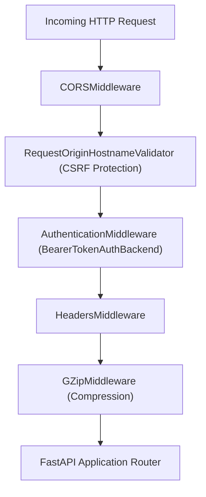
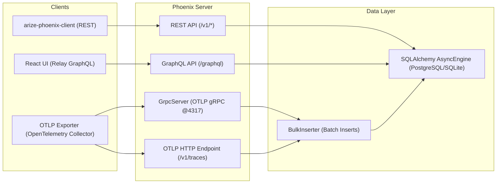
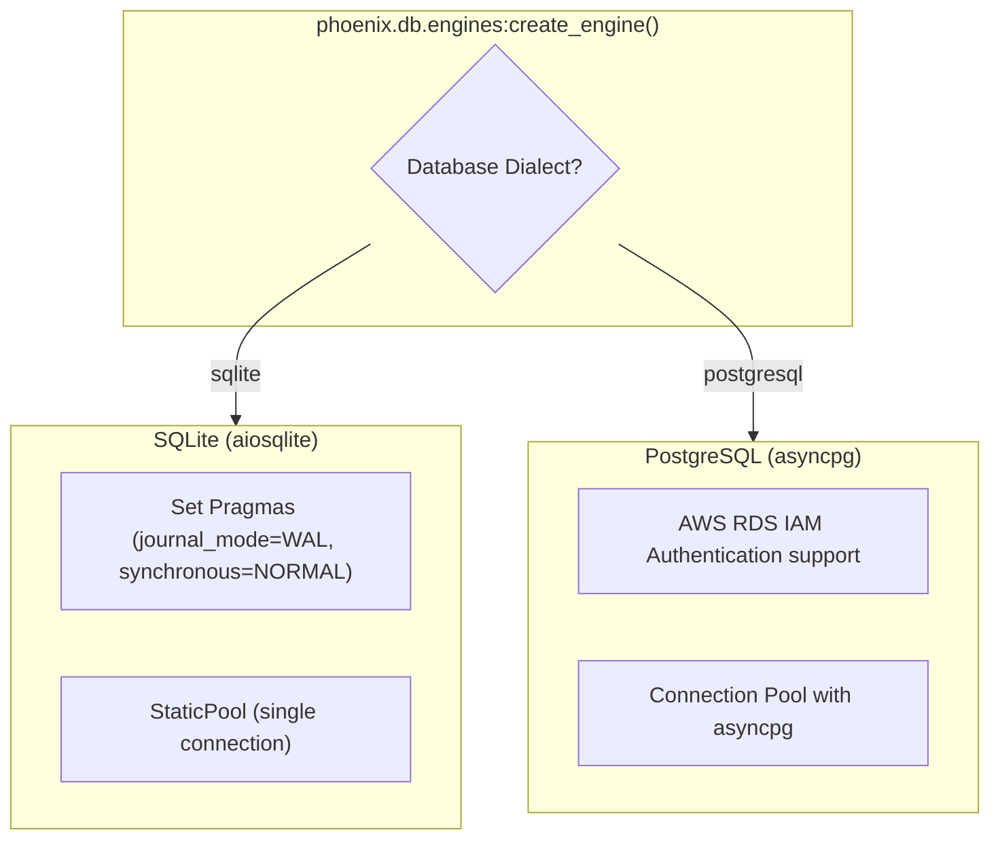
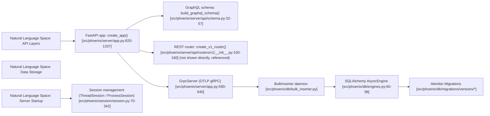
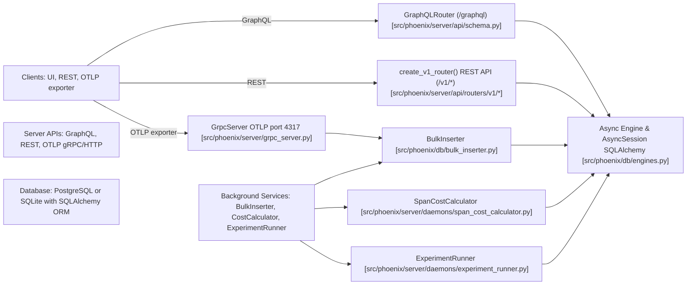

<!-- source: DeepWiki mcp.deepwiki.com · repo arize-ai/phoenix · page 2 Server Architecture · fetched 2026-10-27 -->

# Server Architecture

<details>
<summary>Relevant source files</summary>

The following files were used as context for generating this wiki page:

- [app/schema.graphql](app/schema.graphql)
- [app/src/api/__generated__/v1.ts](app/src/api/__generated__/v1.ts)
- [app/src/components/trace/SpanKindIcon.tsx](app/src/components/trace/SpanKindIcon.tsx)
- [app/src/pages/playground/__tests__/playgroundAgentContextUtils.test.ts](app/src/pages/playground/__tests__/playgroundAgentContextUtils.test.ts)
- [app/src/pages/playground/playgroundAgentContextUtils.ts](app/src/pages/playground/playgroundAgentContextUtils.ts)
- [app/src/window.d.ts](app/src/window.d.ts)
- [cspell.json](cspell.json)
- [docs/phoenix/tracing/how-to-tracing/setup-tracing/setup-projects.mdx](docs/phoenix/tracing/how-to-tracing/setup-tracing/setup-projects.mdx)
- [js/packages/phoenix-client/src/__generated__/api/v1.ts](js/packages/phoenix-client/src/__generated__/api/v1.ts)
- [packages/phoenix-client/src/phoenix/client/__generated__/v1/__init__.py](packages/phoenix-client/src/phoenix/client/__generated__/v1/__init__.py)
- [packages/phoenix-client/src/phoenix/client/helpers/sdk/anthropic/messages.py](packages/phoenix-client/src/phoenix/client/helpers/sdk/anthropic/messages.py)
- [packages/phoenix-client/src/phoenix/client/helpers/sdk/openai/chat.py](packages/phoenix-client/src/phoenix/client/helpers/sdk/openai/chat.py)
- [packages/phoenix-client/tests/canary/sdk/anthropic/test_messages.py](packages/phoenix-client/tests/canary/sdk/anthropic/test_messages.py)
- [packages/phoenix-client/tests/canary/sdk/openai/test_chat.py](packages/phoenix-client/tests/canary/sdk/openai/test_chat.py)
- [schemas/openapi.json](schemas/openapi.json)
- [scripts/data/generate_traces.py](scripts/data/generate_traces.py)
- [src/phoenix/config.py](src/phoenix/config.py)
- [src/phoenix/db/alembic.ini](src/phoenix/db/alembic.ini)
- [src/phoenix/db/engines.py](src/phoenix/db/engines.py)
- [src/phoenix/db/migrate.py](src/phoenix/db/migrate.py)
- [src/phoenix/db/migrations/__init__.py](src/phoenix/db/migrations/__init__.py)
- [src/phoenix/db/migrations/env.py](src/phoenix/db/migrations/env.py)
- [src/phoenix/db/migrations/versions/10460e46d750_datasets.py](src/phoenix/db/migrations/versions/10460e46d750_datasets.py)
- [src/phoenix/db/migrations/versions/3be8647b87d8_add_token_columns_to_spans_table.py](src/phoenix/db/migrations/versions/3be8647b87d8_add_token_columns_to_spans_table.py)
- [src/phoenix/db/migrations/versions/cf03bd6bae1d_init.py](src/phoenix/db/migrations/versions/cf03bd6bae1d_init.py)
- [src/phoenix/db/models.py](src/phoenix/db/models.py)
- [src/phoenix/server/agents/context.py](src/phoenix/server/agents/context.py)
- [src/phoenix/server/agents/prompts/context/PLAYGROUND_CONTEXT_INSTRUCTIONS.xml.j2](src/phoenix/server/agents/prompts/context/PLAYGROUND_CONTEXT_INSTRUCTIONS.xml.j2)
- [src/phoenix/server/agents/prompts/skills/playground/SKILL.md](src/phoenix/server/agents/prompts/skills/playground/SKILL.md)
- [src/phoenix/server/api/context.py](src/phoenix/server/api/context.py)
- [src/phoenix/server/api/dataloaders/__init__.py](src/phoenix/server/api/dataloaders/__init__.py)
- [src/phoenix/server/api/input_types/SpanSort.py](src/phoenix/server/api/input_types/SpanSort.py)
- [src/phoenix/server/api/mutations/__init__.py](src/phoenix/server/api/mutations/__init__.py)
- [src/phoenix/server/api/queries.py](src/phoenix/server/api/queries.py)
- [src/phoenix/server/api/routers/agents.py](src/phoenix/server/api/routers/agents.py)
- [src/phoenix/server/api/routers/v1/experiment_evaluations.py](src/phoenix/server/api/routers/v1/experiment_evaluations.py)
- [src/phoenix/server/api/routers/v1/experiment_runs.py](src/phoenix/server/api/routers/v1/experiment_runs.py)
- [src/phoenix/server/api/routers/v1/experiments.py](src/phoenix/server/api/routers/v1/experiments.py)
- [src/phoenix/server/api/routers/v1/spans.py](src/phoenix/server/api/routers/v1/spans.py)
- [src/phoenix/server/api/routers/v1/traces.py](src/phoenix/server/api/routers/v1/traces.py)
- [src/phoenix/server/api/schema.py](src/phoenix/server/api/schema.py)
- [src/phoenix/server/api/types/Dataset.py](src/phoenix/server/api/types/Dataset.py)
- [src/phoenix/server/api/types/Project.py](src/phoenix/server/api/types/Project.py)
- [src/phoenix/server/api/types/Span.py](src/phoenix/server/api/types/Span.py)
- [src/phoenix/server/api/types/Trace.py](src/phoenix/server/api/types/Trace.py)
- [src/phoenix/server/app.py](src/phoenix/server/app.py)
- [src/phoenix/server/dml_event_handler.py](src/phoenix/server/dml_event_handler.py)
- [src/phoenix/server/main.py](src/phoenix/server/main.py)
- [src/phoenix/server/templates/index.html](src/phoenix/server/templates/index.html)
- [src/phoenix/server/thread_server.py](src/phoenix/server/thread_server.py)
- [src/phoenix/services.py](src/phoenix/services.py)
- [src/phoenix/session/session.py](src/phoenix/session/session.py)
- [src/phoenix/settings.py](src/phoenix/settings.py)
- [src/phoenix/trace/schemas.py](src/phoenix/trace/schemas.py)
- [src/phoenix/trace/span_json_decoder.py](src/phoenix/trace/span_json_decoder.py)
- [src/phoenix/trace/span_json_encoder.py](src/phoenix/trace/span_json_encoder.py)
- [tests/integration/_helpers.py](tests/integration/_helpers.py)
- [tests/integration/auth/conftest.py](tests/integration/auth/conftest.py)
- [tests/integration/auth/test_auth.py](tests/integration/auth/test_auth.py)
- [tests/unit/server/agents/capabilities/contexts/test_capabilities.py](tests/unit/server/agents/capabilities/contexts/test_capabilities.py)
- [tests/unit/server/api/routers/v1/test_experiments.py](tests/unit/server/api/routers/v1/test_experiments.py)
- [tests/unit/server/api/routers/v1/test_spans.py](tests/unit/server/api/routers/v1/test_spans.py)
- [tests/unit/server/api/routers/v1/test_traces.py](tests/unit/server/api/routers/v1/test_traces.py)
- [tests/unit/server/api/test_queries.py](tests/unit/server/api/test_queries.py)
- [tests/unit/server/api/types/test_Trace.py](tests/unit/server/api/types/test_Trace.py)

</details>


## Purpose and Scope

This document provides a high-level overview of the Phoenix server architecture, outlining its FastAPI application structure, API layers, data storage approach, and background services. Phoenix server is designed to:

- Serve HTTP/gRPC endpoints for ingesting OpenTelemetry traces via OTLP protocol
- Host GraphQL and REST APIs for querying and managing observability and evaluation data
- Serve the React-based frontend static assets
- Manage background daemons for batch insertions, cost calculations, experiment execution, and model synchronization

This page offers a parent-level summary. Detailed architecture is documented in these child pages:

- [Application Server & Configuration](#2.1) – FastAPI app internals and startup lifecycle  
- [GraphQL API](#2.2) – GraphQL schema, resolvers, DataLoader pattern  
- [REST API & OpenAPI](#2.3) – REST endpoints, OpenAPI spec, client generation  
- [OTLP Ingestion & gRPC Server](#2.4) – Ingestion via OTLP over HTTP and gRPC  
- [Database Layer & Migrations](#2.5) – SQLAlchemy ORM models and Alembic migrations  
- [Authentication & Authorization](#2.6) – Auth methods, RBAC, API keys  
- [Cost Tracking & Model Pricing](#2.7) – Model cost manifest, cost calculation daemons  

For information on client libraries, frontend architecture, and deployment, see the relevant sections in the full documentation.

**Sources:** [src/phoenix/server/main.py:1-44](), [src/phoenix/server/app.py:1-250](), [src/phoenix/server/api/schema.py:1-84]()


---

## Application Lifecycle

### Startup Flow Overview

The Phoenix server initialization involves creating the database engine, building the FastAPI app, and starting background services that manage ingestion and processing.

```mermaid
sequenceDiagram
    participant CLI as "phoenix.server.main:main()"
    participant Engine as "phoenix.db.engines:create_engine()"
    participant App as "phoenix.server.app:create_app()"
    participant Lifespan as "phoenix.server.app:lifespan()"
    participant Services as "Background Services"
    participant Uvicorn as "uvicorn.Server"

    CLI->>Engine: Create AsyncEngine
    Note over Engine: SQLite (aiosqlite) or PostgreSQL (asyncpg), run Alembic migrations

    CLI->>App: create_app(db factory, ...)
    App->>App: Build Middleware Stack
    App->>App: build_graphql_schema()
    App->>App: Mount REST and GraphQL routers
    App->>Lifespan: Register lifespan manager

    CLI->>Uvicorn: Start server
    Uvicorn->>Lifespan: Enter lifespan context
    Lifespan->>Services: Start BulkInserter
    Lifespan->>Services: Start GrpcServer (OTLP ingestion)
    Lifespan->>Services: Start DmlEventHandler
    Lifespan->>Services: Start SpanCostCalculator
    Lifespan->>Services: Start GenerativeModelStore
    Lifespan->>Services: Start ExperimentRunner

    Note over Uvicorn: Server ready; serving API & UI requests
```

### Entry Point: `main()`

The entry point is the `main()` function ([src/phoenix/server/main.py:17-44]()) which performs:

- Loading environment variables and configuring logging  
- Parsing CLI arguments (`serve`, `db`)  
- Invoking the respective command function  

### Application Factory: `create_app()`

The application's FastAPI instance is created via `create_app()` ([src/phoenix/server/app.py:820-1337]()) which:

- Constructs the middleware stack for CORS, CSRF validation, authentication, compression  
- Builds the Strawberry GraphQL schema and mounts the GraphQL router  
- Mounts API v1 REST endpoints, OAuth2 routes, and static React frontend files  
- Registers a lifespan context manager responsible for running background services  

### Lifespan and Background Services

The lifespan context ([src/phoenix/server/app.py:589-664]()) manages these key background services:

- **BulkInserter**: Efficient batch insertion of incoming spans and annotations to the database  
- **GrpcServer (OTLP)**: Accepts OpenTelemetry spans over gRPC on port 4317  
- **DmlEventHandler**: Watches database mutation events for cache invalidation and subscription updates  
- **SpanCostCalculator**: Periodically processes span data to compute LLM token costs  
- **GenerativeModelStore**: Synchronizes generative model metadata and pricing info  
- **ExperimentRunner**: Runs evaluation experiments asynchronously  

This manager ensures graceful startup and shutdown of all services.

**Sources:** [src/phoenix/server/main.py:17-44](), [src/phoenix/server/app.py:589-664]()

---

## Middleware Stack

Phoenix's middleware layers (from outermost to innermost):



| Middleware Component                    | Description                                  | Source                                      |
|---------------------------------------|----------------------------------------------|---------------------------------------------|
| `CORSMiddleware`                      | Handles Cross-Origin Resource Sharing         | [src/phoenix/server/app.py:952-957]()       |
| `RequestOriginHostnameValidator`     | Validates request origin for CSRF protection | [src/phoenix/server/app.py:359-375]()       |
| `AuthenticationMiddleware`            | Authenticates requests with bearer tokens    | [src/phoenix/server/app.py:970-977]()       |
| `HeadersMiddleware`                   | Adds standard headers                         | [src/phoenix/server/app.py:978-982]()       |
| `GZipMiddleware`                     | Compresses HTTP responses                      | [src/phoenix/server/app.py:980-986]()       |

For authentication details, see the [Authentication & Authorization](#2.6) child page.

**Sources:** [src/phoenix/server/app.py:950-991]()

---

## API Layers

Phoenix provides three main API access points for clients:



### REST API (v1)

Accessible under `/v1`, it supports resource CRUD operations, including spans, projects, datasets, annotations, and experiments. It is routed using `create_v1_router()` [src/phoenix/server/app.py:175-180]().

For detailed REST API documentation, see [REST API & OpenAPI](#2.3).

### GraphQL API

Exposed at `/graphql`, the GraphQL API is implemented using Strawberry GraphQL, including Relay-compliant pagination and subscriptions [src/phoenix/server/api/schema.py:32-57]().

It provides a rich queryable graph for entities like Projects, Spans, Datasets, and Evaluators defined in schema files, e.g. [app/schema.graphql:1-134]().

For deeper coverage, see [GraphQL API](#2.2).

### OTLP Ingestion

Trace data is ingested over OTLP:

- **gRPC server** listens on port 4317 and processes OpenTelemetry spans [src/phoenix/server/app.py:70-90]()  
- **HTTP OTLP endpoint** supports OTLP ingestion over HTTP POST requests on REST API  

For OTLP ingestion internal mechanisms, see [OTLP Ingestion & gRPC Server](#2.4).

**Sources:** [src/phoenix/server/app.py:70-180](), [src/phoenix/server/api/schema.py:32-57](), [app/schema.graphql:1-134]()

---

## Database Architecture

Phoenix uses SQLAlchemy 2.0 asyncio ORM on top of either SQLite (aiosqlite driver) or PostgreSQL (asyncpg driver).

### Database Dialects & Engine Creation



Engine initialization chooses configuration and connection pool based on database type [src/phoenix/db/engines.py:69-98]().

### ORM Models & Schema

The core data model classes derive from SQLAlchemy's DeclarativeBase [src/phoenix/db/models.py:43-48](). Important domain models include:

- `Project` — logical container of telemetry and experiments [src/phoenix/server/api/types/Project.py:61-63]()  
- `Span` — individual work units within a trace [src/phoenix/server/api/types/Span.py:127-129]()  
- `Dataset` — versioned collection of examples used in evaluation [src/phoenix/server/api/types/Dataset.py:44-46]()  
- Additional types cover annotations, evaluators, generative models, prompt versions, sessions, and experiments.  

### Migrations

Database schema migration is managed by Alembic. Migrations run automatically at startup unless disabled via environment variables (`PHOENIX_DISABLE_MIGRATIONS`) [src/phoenix/config.py:180-190]().

Details on migration and database schema are in [Database Layer & Migrations](#2.5).

**Sources:** [src/phoenix/db/engines.py:50-98](), [src/phoenix/db/models.py:43-150](), [src/phoenix/config.py:170-190]()

---

## Data Ingestion Pipeline

### Bulk Insertion with BulkInserter

To avoid overwhelming the database with many small writes, the server ingests spans and annotations into an asynchronous queue. The `BulkInserter` service flushes these batches periodically into the database for efficiency [src/phoenix/db/bulk_inserter.py]().

### Database Mutation Events (DML Event Handling)

To stay responsive to data changes, a `DmlEventHandler` listens for database mutation events encapsulated as `DmlEvent` objects. It triggers cache invalidation on `DataLoaders` and propagates updates to subscribed GraphQL clients for real-time UI updates [src/phoenix/server/dml_event_handler.py](), [src/phoenix/server/app.py:795-805]().

**Sources:** [src/phoenix/db/bulk_inserter.py](), [src/phoenix/server/dml_event_handler.py](), [src/phoenix/server/app.py:790-810]()

---

## Request Context and DataLoaders

Every GraphQL request is served with a rich `Context` container embedding over 80 **DataLoaders** ([src/phoenix/server/api/context.py:120-216]()).

### Purpose of DataLoaders

DataLoaders batch and cache database lookups within the scope of a single request to prevent redundant queries and solve the N+1 query problem. Examples include:

- `SpanByIdDataLoader`: Batch load spans by database ID  
- `ProjectByNameDataLoader`: Efficient lookup of projects by name  
- `AnnotationConfigsByProjectDataLoader`: Fetch annotation configurations scoped per project  

This mechanism optimizes GraphQL resolver performance.

**Sources:** [src/phoenix/server/api/context.py:120-216](), [src/phoenix/server/app.py:87-173]()

---

## Session Management for Notebook Usage

Phoenix can be run interactively in notebook environments (Jupyter, Colab, SageMaker) via:

- **ThreadSession**: Runs the FastAPI app in a background thread using `ThreadServer` ([src/phoenix/server/thread_server.py:21-67]())  
- **ProcessSession**: Runs the server in a separate OS process managed via `AppService` ([src/phoenix/services.py]())  

Both manage lifecycles and app interaction programmatically inside notebooks [src/phoenix/session/session.py:70-342]().

**Sources:** [src/phoenix/session/session.py:70-342](), [src/phoenix/server/thread_server.py:21-67]()


---

# Architecture Bridging Diagrams: Mapping Natural Language to Code Entities





---

This concludes the high-level architecture overview. For deeper technical details, refer to the child pages on application server configuration, APIs, ingestion, database, authentication, and cost tracking.

# References

- [src/phoenix/server/main.py:1-44]()  
- [src/phoenix/server/app.py:1-250]()  
- [src/phoenix/server/api/schema.py:1-84]()  
- [src/phoenix/db/engines.py:50-98]()  
- [src/phoenix/db/models.py:43-150]()  
- [src/phoenix/db/bulk_inserter.py]()  
- [src/phoenix/server/dml_event_handler.py]()  
- [src/phoenix/server/api/context.py:120-216]()  
- [src/phoenix/session/session.py:70-342]()  
- [src/phoenix/server/thread_server.py:21-67]()

---

