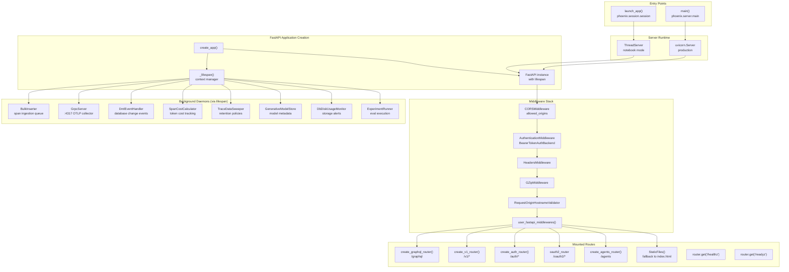
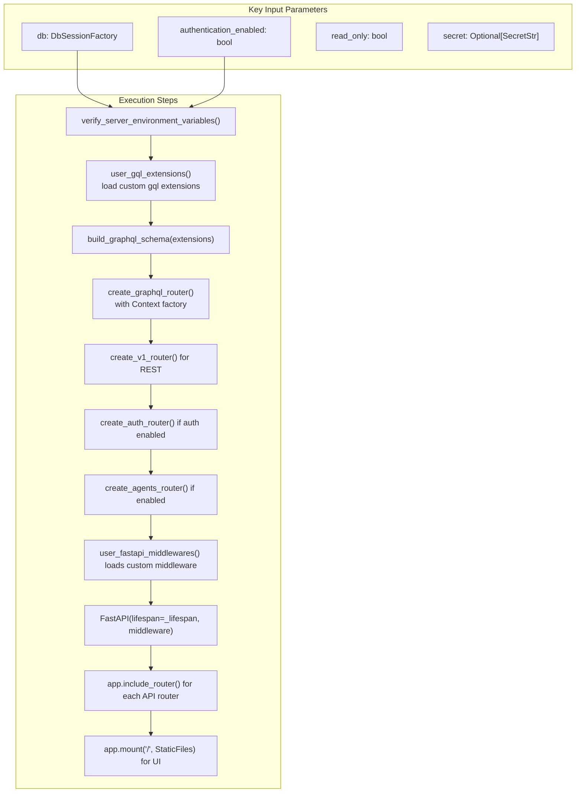
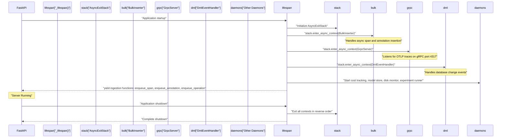
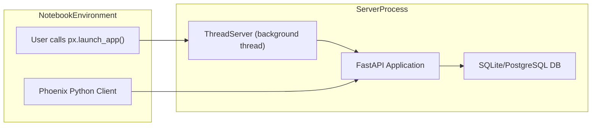

<!-- source: DeepWiki mcp.deepwiki.com · repo arize-ai/phoenix · page 2.1 Application Server & Configuration · fetched 2026-10-27 -->

# Application Server & Configuration

Relevant source files

The following files were used as context for generating this wiki page:

- [.agents/skills/phoenix-release-please/SKILL.md](.agents/skills/phoenix-release-please/SKILL.md)
- [MIGRATION.md](MIGRATION.md)
- [app/schema.graphql](app/schema.graphql)
- [app/src/components/trace/SpanKindIcon.tsx](app/src/components/trace/SpanKindIcon.tsx)
- [app/src/window.d.ts](app/src/window.d.ts)
- [cspell.json](cspell.json)
- [scripts/data/generate_traces.py](scripts/data/generate_traces.py)
- [src/phoenix/config.py](src/phoenix/config.py)
- [src/phoenix/db/bulk_inserter.py](src/phoenix/db/bulk_inserter.py)
- [src/phoenix/db/constants.py](src/phoenix/db/constants.py)
- [src/phoenix/db/migrations/versions/f1a6b2f0c9d5_add_span_session_id_index.py](src/phoenix/db/migrations/versions/f1a6b2f0c9d5_add_span_session_id_index.py)
- [src/phoenix/db/types/trace_retention.py](src/phoenix/db/types/trace_retention.py)
- [src/phoenix/server/api/context.py](src/phoenix/server/api/context.py)
- [src/phoenix/server/api/dataloaders/__init__.py](src/phoenix/server/api/dataloaders/__init__.py)
- [src/phoenix/server/api/input_types/SpanSort.py](src/phoenix/server/api/input_types/SpanSort.py)
- [src/phoenix/server/api/mutations/__init__.py](src/phoenix/server/api/mutations/__init__.py)
- [src/phoenix/server/api/queries.py](src/phoenix/server/api/queries.py)
- [src/phoenix/server/api/schema.py](src/phoenix/server/api/schema.py)
- [src/phoenix/server/api/types/Dataset.py](src/phoenix/server/api/types/Dataset.py)
- [src/phoenix/server/api/types/Project.py](src/phoenix/server/api/types/Project.py)
- [src/phoenix/server/api/types/Span.py](src/phoenix/server/api/types/Span.py)
- [src/phoenix/server/api/types/Trace.py](src/phoenix/server/api/types/Trace.py)
- [src/phoenix/server/app.py](src/phoenix/server/app.py)
- [src/phoenix/server/cli/commands/serve.py](src/phoenix/server/cli/commands/serve.py)
- [src/phoenix/server/grpc_server.py](src/phoenix/server/grpc_server.py)
- [src/phoenix/server/main.py](src/phoenix/server/main.py)
- [src/phoenix/server/prometheus.py](src/phoenix/server/prometheus.py)
- [src/phoenix/server/retention.py](src/phoenix/server/retention.py)
- [src/phoenix/server/templates/index.html](src/phoenix/server/templates/index.html)
- [src/phoenix/server/thread_server.py](src/phoenix/server/thread_server.py)
- [src/phoenix/services.py](src/phoenix/services.py)
- [src/phoenix/session/session.py](src/phoenix/session/session.py)
- [src/phoenix/trace/schemas.py](src/phoenix/trace/schemas.py)
- [src/phoenix/trace/span_json_decoder.py](src/phoenix/trace/span_json_decoder.py)
- [src/phoenix/trace/span_json_encoder.py](src/phoenix/trace/span_json_encoder.py)
- [tests/unit/db/types/test_trace_retention.py](tests/unit/db/types/test_trace_retention.py)
- [tests/unit/server/api/test_queries.py](tests/unit/server/api/test_queries.py)
- [tests/unit/server/api/types/test_Trace.py](tests/unit/server/api/types/test_Trace.py)
- [tests/unit/server/test_retention.py](tests/unit/server/test_retention.py)

## Purpose and Scope

This document describes the Phoenix application server architecture, including its FastAPI setup, startup lifecycle, configuration management, and session handling. The server serves as the foundation for all Phoenix HTTP/GraphQL endpoints and manages crucial background daemons and request middleware.

For details on the GraphQL API, see [GraphQL API](2.2). For REST API endpoints, see [REST API & OpenAPI](2.3). For gRPC and OTLP ingestion, see [OTLP Ingestion & gRPC Server](2.4).

---

## Server Architecture Overview

Phoenix's server is a FastAPI application constructed and configured in `create_app()` (see [src/phoenix/server/app.py:734-1176]()). It supports two primary deployment modes:

- **Thread-based server** for environments such as interactive notebooks where the server runs in the same process but on a background thread ([src/phoenix/server/thread_server.py:22-68]()).
- **Process-based server** for production use, launched as a standalone process with full daemon management ([src/phoenix/server/main.py:17-44]()).

The server architecture integrates several important elements: GraphQL and REST API endpoints, gRPC OTLP trace ingestion, a React web UI served as static assets, authentication and middleware stacks, and background daemons for ingestion, trace retention, cost calculation, and experiment execution.

### Phoenix Application Server - Component Architecture

**Sources:** [src/phoenix/server/app.py:591-1176](), [src/phoenix/server/main.py:17-44](), [src/phoenix/session/session.py:185-216]()

---

## FastAPI Application Creation

### `create_app()` - Factory Function

The `create_app()` function is the core factory responsible for building and configuring the FastAPI application instance. It is defined at [src/phoenix/server/app.py:734-1176]().

This function accepts parameters like a database session factory, flags for authentication and read-only mode, a secret for token signing, initial spans for startup, and the working directory.

**Stepwise Execution Flow of `create_app()`**

#### Key Components Instantiated in `create_app()`:

| Component              | Role                                                     | Location/Function                              |
|------------------------|----------------------------------------------------------|------------------------------------------------|
| Database               | `DbSessionFactory` - encapsulates async sessions         | Passed into `create_app()`                       |
| Authentication Backend | `BearerTokenAuthBackend` - for bearer token auth         | Activated if `authentication_enabled=True`      |
| GraphQL Schema         | Constructed with extensions, queries, mutations, subscriptions | `build_graphql_schema()` [src/phoenix/server/api/schema.py:33-58]() |
| GraphQL Router         | Strawberry GraphQL router at `/graphql`                   | `create_graphql_router()`                        |
| REST API Router        | Versioned V1 REST API at `/v1`                            | `create_v1_router()`                             |
| Auth Router            | Authentication endpoints at `/auth`                       | `create_auth_router()` if auth enabled          |
| OAuth2 Router          | OAuth2 routes at `/oauth2`                                | Always included                                  |
| Agents Router          | Agent endpoints at `/agents`                              | Conditional via `create_agents_router()`        |
| Static Files           | Serves React SPA User Interface at root path              | Starlette `StaticFiles` mount                     |
| Lifespan Context       | Manages startup/shutdown lifecycle and background tasks  | `_lifespan()` async context manager              |

**Sources:** [src/phoenix/server/app.py:734-1176](), [src/phoenix/server/api/schema.py:33-58](), [src/phoenix/config.py:58-79]()

---

## Server Lifecycle Management (Lifespan)

Phoenix manages its startup and shutdown cleanly using an async context manager `_lifespan()` defined at [src/phoenix/server/app.py:591-662]().

This context manager:

- Verifies required environment variables on startup.
- Starts multiple async background daemons in a specific order.
- Provides ingestion queue functions back to the FastAPI internal state.
- Ensures graceful shutdown and cleanup of all async contexts.

### Background Daemons Managed by `_lifespan()`

| Daemon                     | Purpose                                      |
|----------------------------|----------------------------------------------|
| `BulkInserter`             | Manages async ingestion of spans and annotations |
| `GrpcServer`               | gRPC OTLP server listening on port 4317       |
| `DmlEventHandler`          | Handles DB change events and cache invalidations |
| `SpanCostCalculator`       | Calculates token costs for spans               |
| `TraceDataSweeper`         | Applies trace retention policies               |
| `GenerativeModelStore`     | Manages metadata for generative models         |
| `DbDiskUsageMonitor`       | Monitors and warns about DB storage usage      |
| `ExperimentRunner`         | Runs scheduled experiment evaluations          |

### Lifespan Startup/Shutdown Sequence Diagram

The ingestion functions yielded by `_lifespan()` become accessible via the FastAPI app state, allowing the GraphQL and REST layers to enqueue new data for ingestion asynchronously.

**Sources:** [src/phoenix/server/app.py:591-662](), [src/phoenix/db/bulk_inserter.py:20-50]()

---

## Middleware Stack

Phoenix composes its HTTP request handling with several middleware layers to provide security, authentication, reporting, and performance optimizations.

| Middleware                    | Purpose                                      | Code References                        |
|-------------------------------|----------------------------------------------|-------------------------------------|
| **CORSMiddleware**            | Manages Cross-Origin Resource Sharing (CORS) policies | FastAPI's CORSMiddleware used [src/phoenix/server/app.py:34-34]() |
| **AuthenticationMiddleware**  | Validates bearer tokens, API keys, sets user context | Uses `BearerTokenAuthBackend` [src/phoenix/server/app.py:47-47]() |
| **RequestOriginHostnameValidator** | CSRF protection; validates origin and host for protected routes | See [src/phoenix/server/app.py:361-377]() |
| **GZipMiddleware**            | Compresses HTTP responses with GZip            | FastAPI/GZipMiddleware [src/phoenix/server/app.py:402-402]() |
| **Custom Middleware Loader**  | Loads additional user-defined middleware from config paths | via `get_env_fastapi_middleware_paths()` [src/phoenix/config.py:69]() |

This layered middleware ensures:

- Robust security by validating origins and authenticating requests.
- Compression for efficient network usage.
- Extensibility for customized middleware.

**Sources:** [src/phoenix/server/app.py:361-455](), [src/phoenix/config.py:69-69]()

---

## Configuration Management

Phoenix centralizes configuration through environment variables, mostly defined and managed in the `phoenix.config` module [src/phoenix/config.py](). This module provides getters for environment variables with defaults and documentation.

### Key Environment Variables

| Variable                         | Purpose                              | Default Value / Notes                              |
|---------------------------------|------------------------------------|--------------------------------------------------|
| `PHOENIX_PORT`                  | HTTP server port                   | `6006` [src/phoenix/config.py:53-53]()           |
| `PHOENIX_GRPC_PORT`             | gRPC port (OTLP trace ingestion)  | `4317` [src/phoenix/config.py:54-54]()           |
| `PHOENIX_SQL_DATABASE_URL`       | Database connection URL            | SQLite file in working directory by default [src/phoenix/config.py:118-129]() |
| `PHOENIX_ENABLE_AUTH`            | Enables authentication             | `False` by default [src/phoenix/config.py:243-243]()  |
| `PHOENIX_WORKING_DIR`            | Directory for CSV/dataset storage  | `~/.arize-phoenix` [src/phoenix/config.py:88-92]() |
| `PHOENIX_ALLOW_EXTERNAL_RESOURCES` | Enable external resources in UI  | Defaults to True [src/phoenix/config.py:119-123]() |

### Runtime Settings Singleton

Runtime settings are encapsulated in the `Settings` class in `src/phoenix/settings.py`. At launch, `initialize_settings()` in `src/phoenix/server/main.py` reads environment variables and sets these settings.

**Configuration examples:**

- SQL logging mode and level
- Migration enablement flags
- FullStory and Scarf.sh telemetry configuration

**Sources:** [src/phoenix/config.py:1-150](), [src/phoenix/server/main.py:32-40]()

---

## Session and Notebook Handling

Phoenix supports interactive notebook usage by abstracting the application lifecycle behind a `Session` class hierarchy in [src/phoenix/session/session.py:70-207]().

### Session Classes

| Session Type     | Description                                                                                         |
|------------------|----------------------------------------------------------------------------------------------------|
| **ThreadSession**| Runs the FastAPI server in a background daemon thread for the notebook process ([src/phoenix/server/thread_server.py:22-68]()) |
| **ProcessSession**| Creates and manages a standalone server subprocess encapsulated in an `AppService` instance ([src/phoenix/session/session.py:148-183]()) |

### `Session` Base Class

- Stores host, port, database URL, working directory, and notebook environment type.
- Provides properties like `url` for the Phoenix app and a `view()` method to embed the UI in notebooks via an IFrame.

### Dataflow: Notebook Session Integration

This design lets notebook users run a Phoenix server embedded in their environment with access to all API endpoints, while also supporting a full standalone server deployment for other clients.

**Sources:** [src/phoenix/session/session.py:70-207](), [src/phoenix/server/thread_server.py:22-68]()

---

# Summary

This page detailed how the Phoenix application server is constructed and operates. The FastAPI app is created with a rich middleware stack and mounted routers for GraphQL, REST, OAuth2, and agents. A dedicated lifespan manager initializes and cleans up multiple background daemons that power ingestion, tracing, cost calculations, and more.

Configuration is externally managed via environment variables centralized in `phoenix.config`, with runtime settings initialized early in the server process. Interactive notebook environments are supported via session abstractions that launch the Phoenix server inline with user code.

This foundational layer enables the scalable, extensible AI observability platform that Phoenix provides.

---

**Sources:**  
[src/phoenix/server/app.py](),  
[src/phoenix/session/session.py](),  
[src/phoenix/server/main.py](),  
[src/phoenix/config.py](),  
[src/phoenix/server/thread_server.py](),  
[src/phoenix/server/api/schema.py]()

---

