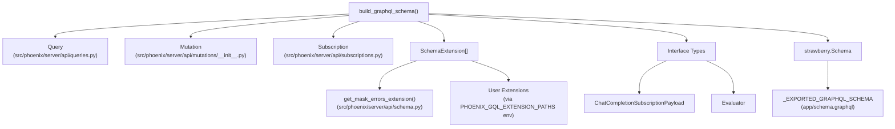
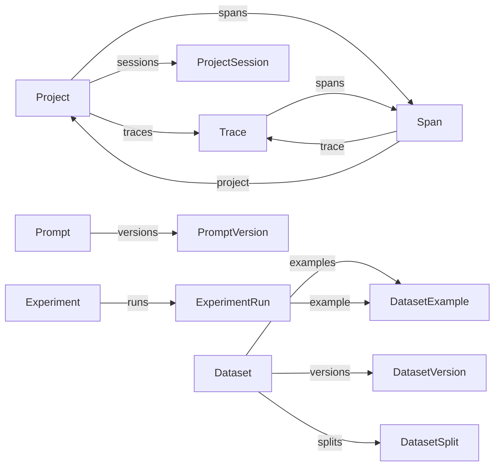
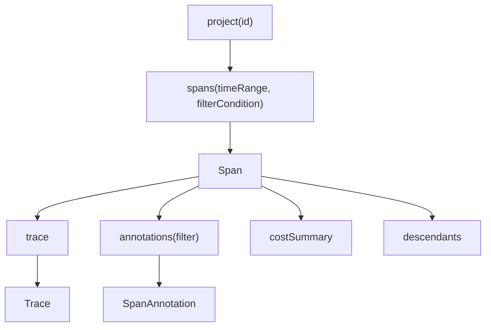
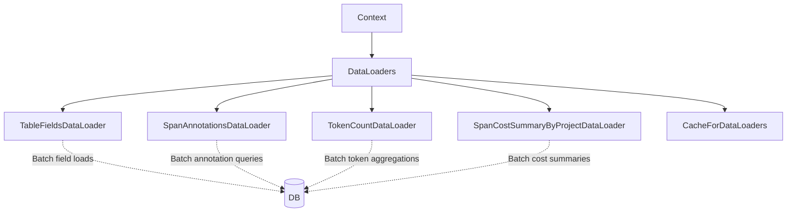
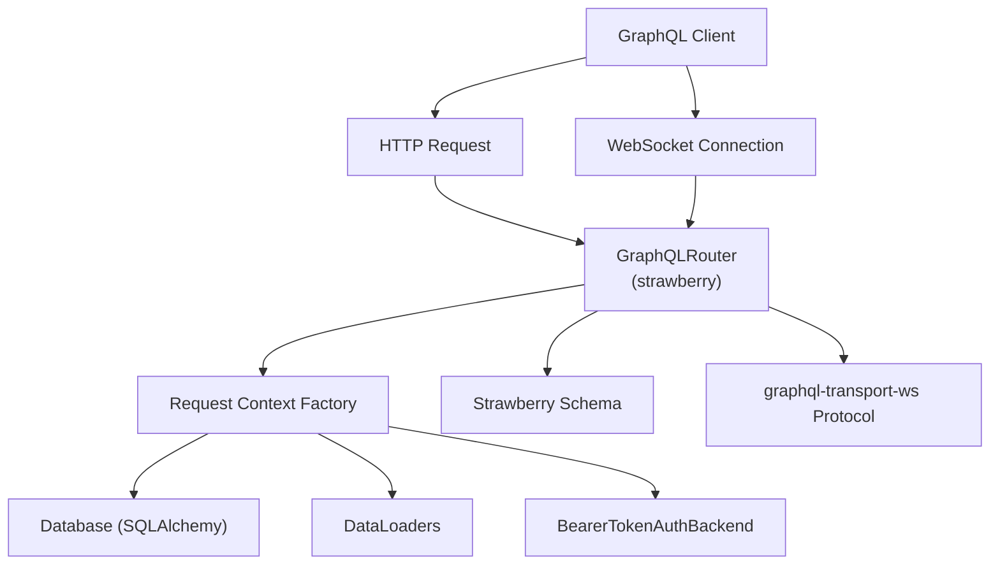
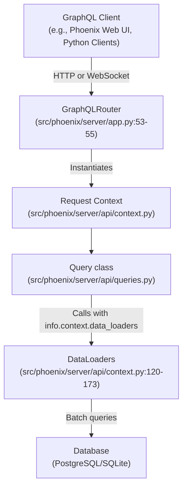
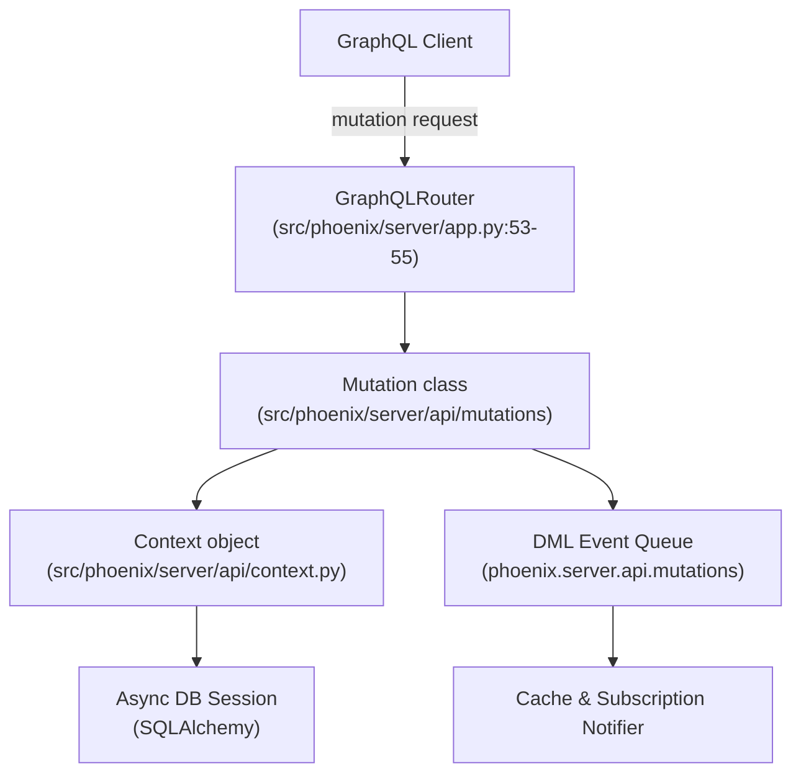

<!-- source: DeepWiki mcp.deepwiki.com · repo arize-ai/phoenix · page 2.2 GraphQL API · fetched 2026-10-27 -->

# GraphQL API

<details>
<summary>Relevant source files</summary>

The following files were used as context for generating this wiki page:

- [app/schema.graphql](app/schema.graphql)
- [app/src/components/trace/SpanKindIcon.tsx](app/src/components/trace/SpanKindIcon.tsx)
- [app/src/window.d.ts](app/src/window.d.ts)
- [cspell.json](cspell.json)
- [scripts/data/generate_traces.py](scripts/data/generate_traces.py)
- [src/phoenix/config.py](src/phoenix/config.py)
- [src/phoenix/db/helpers.py](src/phoenix/db/helpers.py)
- [src/phoenix/server/api/auth.py](src/phoenix/server/api/auth.py)
- [src/phoenix/server/api/context.py](src/phoenix/server/api/context.py)
- [src/phoenix/server/api/dataloaders/__init__.py](src/phoenix/server/api/dataloaders/__init__.py)
- [src/phoenix/server/api/dataloaders/cache/two_tier_cache.py](src/phoenix/server/api/dataloaders/cache/two_tier_cache.py)
- [src/phoenix/server/api/dataloaders/document_evaluation_summaries.py](src/phoenix/server/api/dataloaders/document_evaluation_summaries.py)
- [src/phoenix/server/api/dataloaders/latency_ms_quantile.py](src/phoenix/server/api/dataloaders/latency_ms_quantile.py)
- [src/phoenix/server/api/dataloaders/min_start_or_max_end_times.py](src/phoenix/server/api/dataloaders/min_start_or_max_end_times.py)
- [src/phoenix/server/api/dataloaders/record_counts.py](src/phoenix/server/api/dataloaders/record_counts.py)
- [src/phoenix/server/api/dataloaders/session_token_usages.py](src/phoenix/server/api/dataloaders/session_token_usages.py)
- [src/phoenix/server/api/dataloaders/span_annotations.py](src/phoenix/server/api/dataloaders/span_annotations.py)
- [src/phoenix/server/api/dataloaders/token_counts.py](src/phoenix/server/api/dataloaders/token_counts.py)
- [src/phoenix/server/api/input_types/CreateSpanAnnotationInput.py](src/phoenix/server/api/input_types/CreateSpanAnnotationInput.py)
- [src/phoenix/server/api/input_types/CreateTraceAnnotationInput.py](src/phoenix/server/api/input_types/CreateTraceAnnotationInput.py)
- [src/phoenix/server/api/input_types/PatchAnnotationInput.py](src/phoenix/server/api/input_types/PatchAnnotationInput.py)
- [src/phoenix/server/api/input_types/SpanSort.py](src/phoenix/server/api/input_types/SpanSort.py)
- [src/phoenix/server/api/mutations/__init__.py](src/phoenix/server/api/mutations/__init__.py)
- [src/phoenix/server/api/mutations/api_key_mutations.py](src/phoenix/server/api/mutations/api_key_mutations.py)
- [src/phoenix/server/api/mutations/dataset_mutations.py](src/phoenix/server/api/mutations/dataset_mutations.py)
- [src/phoenix/server/api/mutations/experiment_mutations.py](src/phoenix/server/api/mutations/experiment_mutations.py)
- [src/phoenix/server/api/mutations/project_mutations.py](src/phoenix/server/api/mutations/project_mutations.py)
- [src/phoenix/server/api/mutations/span_annotations_mutations.py](src/phoenix/server/api/mutations/span_annotations_mutations.py)
- [src/phoenix/server/api/mutations/trace_annotations_mutations.py](src/phoenix/server/api/mutations/trace_annotations_mutations.py)
- [src/phoenix/server/api/queries.py](src/phoenix/server/api/queries.py)
- [src/phoenix/server/api/routers/v1/sessions.py](src/phoenix/server/api/routers/v1/sessions.py)
- [src/phoenix/server/api/schema.py](src/phoenix/server/api/schema.py)
- [src/phoenix/server/api/types/Annotation.py](src/phoenix/server/api/types/Annotation.py)
- [src/phoenix/server/api/types/Dataset.py](src/phoenix/server/api/types/Dataset.py)
- [src/phoenix/server/api/types/Project.py](src/phoenix/server/api/types/Project.py)
- [src/phoenix/server/api/types/Span.py](src/phoenix/server/api/types/Span.py)
- [src/phoenix/server/api/types/SpanAnnotation.py](src/phoenix/server/api/types/SpanAnnotation.py)
- [src/phoenix/server/api/types/Trace.py](src/phoenix/server/api/types/Trace.py)
- [src/phoenix/server/api/types/TraceAnnotation.py](src/phoenix/server/api/types/TraceAnnotation.py)
- [src/phoenix/server/app.py](src/phoenix/server/app.py)
- [src/phoenix/server/main.py](src/phoenix/server/main.py)
- [src/phoenix/server/templates/index.html](src/phoenix/server/templates/index.html)
- [src/phoenix/server/thread_server.py](src/phoenix/server/thread_server.py)
- [src/phoenix/services.py](src/phoenix/services.py)
- [src/phoenix/session/session.py](src/phoenix/session/session.py)
- [src/phoenix/trace/schemas.py](src/phoenix/trace/schemas.py)
- [src/phoenix/trace/span_json_decoder.py](src/phoenix/trace/span_json_decoder.py)
- [src/phoenix/trace/span_json_encoder.py](src/phoenix/trace/span_json_encoder.py)
- [tests/unit/server/api/mutations/test_project_mutations.py](tests/unit/server/api/mutations/test_project_mutations.py)
- [tests/unit/server/api/mutations/test_span_annotation_mutations.py](tests/unit/server/api/mutations/test_span_annotation_mutations.py)
- [tests/unit/server/api/routers/v1/test_list_project_traces.py](tests/unit/server/api/routers/v1/test_list_project_traces.py)
- [tests/unit/server/api/routers/v1/test_sessions.py](tests/unit/server/api/routers/v1/test_sessions.py)
- [tests/unit/server/api/test_queries.py](tests/unit/server/api/test_queries.py)
- [tests/unit/server/api/types/test_SpanAnnotation.py](tests/unit/server/api/types/test_SpanAnnotation.py)
- [tests/unit/server/api/types/test_Trace.py](tests/unit/server/api/types/test_Trace.py)
- [tests/unit/server/api/types/test_TraceAnnotation.py](tests/unit/server/api/types/test_TraceAnnotation.py)

</details>


## Purpose and Scope

The GraphQL API is the core programmatic interface for interacting with Phoenix’s AI observability platform. It provides structured, typed access to key domain concepts such as traces, spans, datasets, experiments, prompts, users, and annotations. This API enables clients to query, mutate, and subscribe to relevant data artifacts with efficient batching and real-time updates.

This documentation covers:

- The GraphQL schema and type system
- Resolver function implementations and practices
- Use of the DataLoader pattern to optimize database access
- Definition and organization of queries, mutations, and subscriptions
- Integration with FastAPI and authentication workflows

Related API aspects:

- REST API endpoints: [2.3 REST API & OpenAPI](2.3)
- OTLP and gRPC ingestion: [2.4 OTLP Ingestion & gRPC Server](2.4)
- Frontend GraphQL usage: [4.1 Application Structure & Build System](4.1)

---

## Schema Construction

Phoenix uses **Strawberry GraphQL**, leveraging Python's type annotations for declarative schema definition. The GraphQL schema is instantiated in [src/phoenix/server/api/schema.py:33-58]() and consists of three main root types:

- `Query`: Entry point for all read (fetch) operations.
- `Mutation`: Entry point for all write (modifying) operations.
- `Subscription`: Entry point for real-time data streaming.

Additional schema extensions provide error masking and support for custom mod extensions.

### Schema Building Architecture



- The schema factory method `build_graphql_schema` constructs the full schema with root types, extensions, and interface implementations.
- Custom scalar types such as `Identifier`, `CronExpression`, `SecretStr`, and `RedactedString` are configured during schema creation.
- The exported GraphQL schema SDL file (`app/schema.graphql`) is generated from this schema.

**Sources:** [src/phoenix/server/api/schema.py:33-58](), [src/phoenix/server/app.py:182-182](), [src/phoenix/config.py:70-70]()

---

## Core Type System

Phoenix’s schema uses Strawberry’s Relay-compliant Node interface, which provides globally unique IDs for all important types. Key domain types implement this `Node` interface, ensuring consistency in identification and pagination.

### Node Interface Hierarchy

```mermaid
graph TB
    Node["Node Interface<br/>(strawberry.relay)"]

    Span["Span<br/>id: NodeID[int]")]
    Trace["Trace<br/>id: NodeID[int]")]
    Project["Project<br/>id: NodeID[int]")]
    Dataset["Dataset<br/>id: NodeID[int]")]
    DatasetExample["DatasetExample<br/>id: NodeID[int]")]
    Experiment["Experiment<br/>id: NodeID[int]")]
    ExperimentRun["ExperimentRun<br/>id: NodeID[int]")]
    Prompt["Prompt<br/>id: NodeID[int]")]
    User["User<br/>id: NodeID[int])"]

    Node --> Span
    Node --> Trace
    Node --> Project
    Node --> Dataset
    Node --> DatasetExample
    Node --> Experiment
    Node --> ExperimentRun
    Node --> Prompt
    Node --> User

    Annotation["Annotation Interface"]
    SpanAnnotation["SpanAnnotation"]
    TraceAnnotation["TraceAnnotation"]

    Annotation --> SpanAnnotation
    Annotation --> TraceAnnotation
```

- Each type caches its database record internally (`db_record`) when available to avoid redundant queries.
- The `NodeID[int]` types encode database row IDs as global IDs opaque to clients.

Example pattern from `Span` type:

```python
@strawberry.type
class Span(Node):
    id: NodeID[SpanRowId]
    db_record: strawberry.Private[Optional[models.Span]] = None

    def __post_init__(self) -> None:
        if self.db_record and self.id != self.db_record.id:
            raise ValueError("Span ID mismatch")
    
    @strawberry.field
    async def name(self, info: Info[Context, None]) -> str:
        if self.db_record:
            return self.db_record.name
        value = await info.context.data_loaders.span_fields.load(
            (self.id, models.Span.name),
        )
        return str(value)
```

**Sources:** [src/phoenix/server/api/types/Span.py:127-134](), [src/phoenix/server/api/types/Project.py:61-68](), [src/phoenix/server/api/types/Dataset.py:44-51]()

---

### Primary Domain Types and Relationships



| Type              | Description                       | Key Fields & Responsibilities                                            |
|-------------------|---------------------------------|--------------------------------------------------------------------------|
| `Project`          | Top-level organization unit     | `name`, `description`, aggregate counts of spans/traces, sessions       |
| `Trace`            | Execution trace container        | `traceId`, associated spans, project, annotations                        |
| `Span`             | Individual operation within trace| `name`, `spanKind`, `startTime`, `endTime`, `latencyMs`, cost summaries |
| `ProjectSession`   | Grouping of interaction episodes| Session annotations, spans, parent grouping                              |
| `Dataset`          | Collection of labeled examples   | Versions, splits, examples                                               |
| `DatasetExample`   | Individual data example for evals| Input, output, annotations                                               |
| `Experiment`       | Evaluation runs over datasets    | Runs, repeated run groups, job status                                   |
| `ExperimentRun`    | Single execution of an experiment| Input example, outputs, error rate                                       |
| `Prompt`           | Versioned prompt templates       | Chat or text templates versions                                         |

**Sources:** [app/schema.graphql:1-320](), [src/phoenix/server/api/types/Span.py:127-129](), [src/phoenix/server/api/types/Project.py:61-68](), [src/phoenix/server/api/types/Dataset.py:44-46]()

---

## Query Operations

All data fetching operations are defined as methods on the `Query` root type in [src/phoenix/server/api/queries.py]().

### Query Structure Overview

```mermaid
graph TB
    Query["Query"]

    ModelQueries["Model Queries"]
    generativeProviders["generativeProviders()"]
    generativeModels["generativeModels()"]
    playgroundModels["playgroundModels()"]

    ProjectQueries["Project Queries"]
    projects["projects()"]
    project["project(id)"]

    DatasetQueries["Dataset Queries"]
    datasets["datasets()"]
    dataset["dataset(id)"]
    datasetExample["datasetExample(id)"]

    ExperimentQueries["Experiment Queries"]
    experiments["experiments()"]
    experiment["experiment(id)"]

    PromptQueries["Prompt Queries"]
    prompts["prompts()"]
    prompt["prompt(id)"]

    NodeQuery["Node Query"]
    node["node(id: ID!)"]

    Query --> ModelQueries
    Query --> ProjectQueries
    Query --> DatasetQueries
    Query --> ExperimentQueries
    Query --> PromptQueries
    Query --> NodeQuery

    ModelQueries --> generativeProviders
    ModelQueries --> generativeModels
    ModelQueries --> playgroundModels

    ProjectQueries --> projects
    ProjectQueries --> project

    DatasetQueries --> datasets
    DatasetQueries --> dataset
    DatasetQueries --> datasetExample

    ExperimentQueries --> experiments
    ExperimentQueries --> experiment

    PromptQueries --> prompts
    PromptQueries --> prompt
```



- Query fields accept inputs for pagination, filtering, and sorting as appropriate.
- Detailed filtering DSL is supported for spans, sessions, and experiments.
- The `node(id: ID!)` query retrieves any Node type by its global ID.

Example input for model filters:

```python
@strawberry.input
class ModelsInput:
    provider_key: Optional[GenerativeProviderKey]
    model_name: Optional[str] = None
    openai_api_type: Optional[OpenAIApiType] = None
```

### Relay-Style Pagination

Connection types are used for all collections. The API consumers receive:

- `pageInfo` including cursors and paging booleans (`hasNextPage`, `hasPreviousPage`)
- `edges` array containing `{cursor, node}` items

This supports efficient incremental loading in clients.

### Complex Nested Queries Example

Queries involving projects can dive into deeply nested related data like spans and annotations:



- Query filters (e.g., `filter_condition`, `session_filter_condition`) allow fine-grained slicing of data.
- Filters are compiled into SQLAlchemy expressions [src/phoenix/server/api/queries.py:48-52]().

**Sources:** [src/phoenix/server/api/queries.py:1-160](), [src/phoenix/server/api/types/Project.py:156-176](), [src/phoenix/server/api/types/Span.py:208-223]()

---

## Mutation Operations

Mutation operations handle creation, update, and deletion of server state. They are aggregated under the `Mutation` root type in [src/phoenix/server/api/mutations/__init__.py]() and other grouped mutation files.

### Mutation Categories and Examples

```mermaid
graph TB
    Mutation["Mutation"]

    ProjectMutations["Project Mutations"]
    createProject["createProject"]
    clearProject["clearProject"]

    DatasetMutations["Dataset Mutations"]
    createDataset["createDataset"]
    addExamplesToDataset["addExamplesToDataset"]
    addSpansToDataset["addSpansToDataset"]
    deleteDataset["deleteDataset"]

    ExperimentMutations["Experiment Mutations"]
    deleteExperiments["deleteExperiments"]

    AnnotationMutations["Annotation Mutations"]
    createSpanAnnotation["createSpanAnnotation"]
    createTraceAnnotation["createTraceAnnotation"]

    PromptMutations["Prompt Mutations"]
    createChatPrompt["createChatPrompt"]
    createChatPromptVersion["createChatPromptVersion"]

    Mutation --> ProjectMutations
    Mutation --> DatasetMutations
    Mutation --> ExperimentMutations
    Mutation --> AnnotationMutations
    Mutation --> PromptMutations

    ProjectMutations --> createProject
    ProjectMutations --> clearProject

    DatasetMutations --> createDataset
    DatasetMutations --> addExamplesToDataset
    DatasetMutations --> addSpansToDataset
    DatasetMutations --> deleteDataset

    ExperimentMutations --> deleteExperiments

    AnnotationMutations --> createSpanAnnotation
    AnnotationMutations --> createTraceAnnotation

    PromptMutations --> createChatPrompt
    PromptMutations --> createChatPromptVersion
```



- Mutations often return a payload containing the updated affected entities and the `query` root, enabling effective frontend cache updates.
- Example mutation payload pattern from `AddAnnotationConfigToProjectPayload`:

```graphql
type AddAnnotationConfigToProjectPayload {
  query: Query!
  project: Project!
}
```

- All mutations are executed within database transactions for atomicity and consistency.
- Mutations enqueue DML events (e.g., `DatasetInsertEvent`) to trigger cache invalidation and notify subscription watchers.

**Sources:** [app/schema.graphql:56-64](), [src/phoenix/server/api/mutations/dataset_mutations.py:51-54](), [src/phoenix/server/api/mutations/evaluator_mutations.py:1-58](), [src/phoenix/server/api/context.py:119-234]()

---

## Subscription Operations

Subscriptions provide real-time data streams to clients over WebSocket. Libraries support the `graphql-transport-ws` protocol implemented in `GraphQLRouter`.

### Subscription Overview

- Implemented as async generator methods on the `Subscription` root type ([src/phoenix/server/api/schema.py:14-17]()).
- Primary use case: streaming playground LLM chat completions (`chatCompletion` subscription).
- Enables clients to receive incremental partial results for interactive responsiveness.

| Subscription           | Description                                | Triggered by                         |
|------------------------|--------------------------------------------|------------------------------------|
| `chatCompletion`       | Streams LLM response tokens to clients    | User prompts a Playground query    |

**Sources:** [src/phoenix/server/api/schema.py:14-17](), [src/phoenix/server/app.py:53-55](), [app/schema.graphql:1-30]()

---

## DataLoader Architecture

Phoenix uses the DataLoader pattern extensively to solve the N+1 query problem and achieve efficient batched data fetching. DataLoaders batch load requests per GraphQL request scope, reducing the total number of database queries.

### DataLoader Initialization and Role

- A `DataLoaders` dataclass bundles all DataLoader instances ([src/phoenix/server/api/context.py:120-173]()).
- A per-request context includes DataLoaders, a reference to the database session factory, and user info.
- Resolvers access DataLoaders via `info.context.data_loaders`.

### DataLoader Pattern Diagram



### DataLoader Categories

| Category          | DataLoaders                                                           | Purpose                                      |
|-------------------|----------------------------------------------------------------------|----------------------------------------------|
| Field Loaders     | `TableFieldsDataLoader`                                               | Batch load specific table columns            |
| Relationship Loaders | `SpanAnnotationsDataLoader`, `TraceRootSpansDataLoader`            | Batch load related child or parent objects   |
| Aggregation Loaders | `TokenCountDataLoader`, `RecordCountDataLoader`                      | Batch compute aggregate counts and sums      |
| Cost Loaders      | `SpanCostSummaryByProjectDataLoader`, `SpanCostBySpanDataLoader`     | Calculate LLM span cost summaries             |

Example: `TableFieldsDataLoader` batches requests for multiple row IDs and columns into one complex database query.

### Cache-Backed DataLoaders

Several DataLoaders include internal request-scoped caches to avoid duplicate database hits in the same request:

| DataLoader                 | Purpose                                           |
|----------------------------|--------------------------------------------------|
| `RecordCountDataLoader`    | Cache span/trace counts by project/time range    |
| `TokenCountDataLoader`     | Cache token counts for spans and prompts          |
| `LatencyMsQuantileDataLoader` | Cache latency percentile data                   |
| `SpanCostSummaryByProjectDataLoader` | Cache summarized LLM cost data             |

**Sources:** [src/phoenix/server/api/context.py:120-173](), [src/phoenix/server/api/dataloaders/__init__.py:1-106]()

---

## GraphQL Router Integration

The GraphQL API is exposed as a FastAPI router created by Strawberry’s `GraphQLRouter` in [src/phoenix/server/app.py:53-55]().

### Router Setup

- The router uses the schema built with `build_graphql_schema()` ([src/phoenix/server/api/schema.py:33-58]()).
- A custom request context factory injects per-request DataLoaders, database sessions, and user authentication info.
- The WebSocket subscription protocol `graphql-transport-ws` is enabled on the router.

### Authentication Workflow

- Authentication for GraphQL requests integrates with the Bearer token backend ([src/phoenix/server/app.py:183-183]()).
- For HTTP requests, the `Authorization` header bearer token is used.
- For WebSocket connections, the token is passed in connection parameters.
- The currently authenticated user is accessible in resolvers via `info.context.user_id`.

### Router Interaction Diagram



**Sources:** [src/phoenix/server/app.py:53-55](), [src/phoenix/server/api/schema.py:33-58](), [src/phoenix/server/api/context.py:120-173](), [src/phoenix/server/bearer_auth.py:183-183]()

---

## Type Resolver Patterns

### Database Record Caching

Many types store a private `db_record` (an SQLAlchemy ORM instance) to:

- Provide immediate synchronous access to fields without additional queries if already loaded.
- Avoid repeated database requests when fields are accessed multiple times.
- Fall back to async DataLoader batch requests when `db_record` is absent.

Example from `Span` resolver:

```python
@strawberry.field
async def name(self, info: Info[Context, None]) -> str:
    if self.db_record:
        return self.db_record.name
    value = await info.context.data_loaders.span_fields.load((self.id, models.Span.name))
    return str(value)
```

### Relay Connection Pagination

Connection types encapsulate paginated results. Helper functions construct connection responses from entity lists or DB cursors:

- `connection_from_list(data, args)` builds edges and pageInfo.
- Cursor strings are opaque base64 encoded strings encoding position markers.

This pattern applies to collections like projects, datasets, experiments, spans, etc.

---

## Error Handling

- GraphQL errors in production are masked by a custom schema extension to avoid leaking internal details ([src/phoenix/server/api/schema.py:42-42]()).
- Specific exceptions raised by resolvers (e.g., `BadRequest`, `NotFound`, `Unauthorized`) are user-visible and map to GraphQL errors with meaningful messages.
- Mutation conflicts and validation failures produce appropriate user errors visible in GraphQL responses.

| Error Type      | Visible to User | Description                             |
|-----------------|-----------------|-------------------------------------|
| `BadRequest`    | Yes             | Input validation errors              |
| `NotFound`      | Yes             | Requested resource not found        |
| `Unauthorized`  | Yes             | Authentication or authorization failure |
| `Conflict`      | Yes             | Resource version conflicts           |
| Others          | Masked          | Internal or unexpected errors       |

---

# Diagrams Bridging Natural Language and Code Entity Space

### Diagram 1: Query Flow from Client to DataLoaders



### Diagram 2: Mutation Execution and DML Event Propagation



---

# Summary

The Phoenix GraphQL API is a carefully designed system built on Strawberry GraphQL that enforces type safety and efficient data operations. Its key strengths include:

- Relay-compliant global IDs and cursor-based pagination
- Rich domain type models with caching of loaded database records
- A comprehensive set of queries, mutations, and subscriptions
- Extensive use of DataLoaders for batching and caching DB access
- Secure and robust error handling and authentication integration
- FastAPI integration for serving HTTP and WebSocket GraphQL traffic

This architecture provides a scalable and extensible foundation for Phoenix’s AI observability platform to serve both UI and programmatic clients.

---

**Sources:**  
[src/phoenix/server/api/schema.py:33-58](), [src/phoenix/server/api/queries.py:1-160](), [src/phoenix/server/api/types/Span.py:127-146](), [src/phoenix/server/api/context.py:120-173](), [src/phoenix/server/api/dataloaders/__init__.py:1-106](), [src/phoenix/server/app.py:53-55](), [app/schema.graphql:1-320](), [src/phoenix/server/api/mutations/dataset_mutations.py:25-55]()

---

