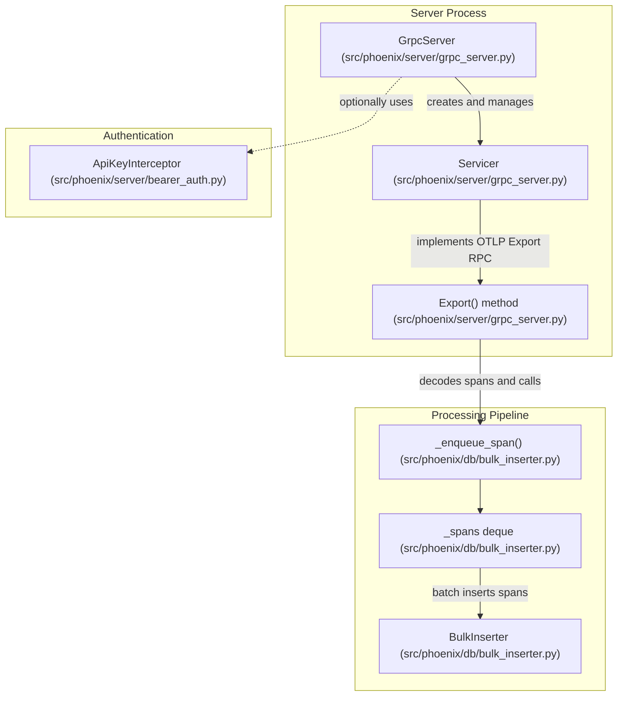
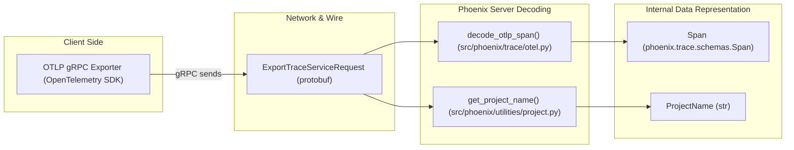
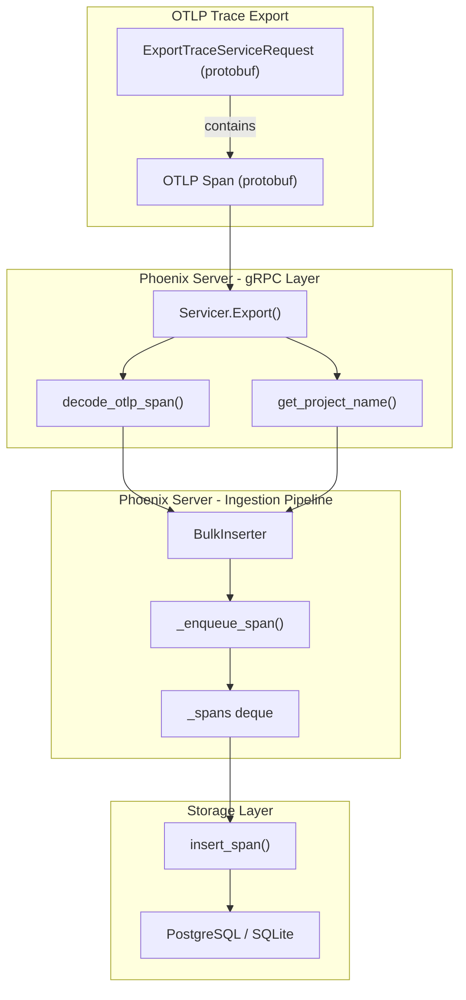
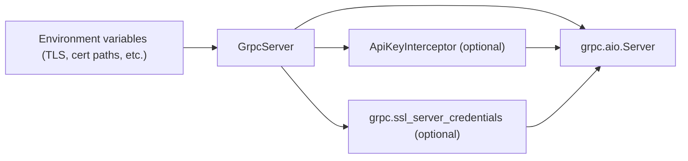

<!-- source: DeepWiki mcp.deepwiki.com · repo arize-ai/phoenix · page 2.4 OTLP Ingestion & gRPC Server · fetched 2026-10-27 -->

# OTLP Ingestion & gRPC Server

Relevant source files

The following files were used as context for generating this wiki page:

- [app/src/api/__generated__/v1.ts](app/src/api/__generated__/v1.ts)
- [app/src/pages/playground/__tests__/playgroundAgentContextUtils.test.ts](app/src/pages/playground/__tests__/playgroundAgentContextUtils.test.ts)
- [app/src/pages/playground/playgroundAgentContextUtils.ts](app/src/pages/playground/playgroundAgentContextUtils.ts)
- [docs/phoenix/tracing/how-to-tracing/setup-tracing/setup-projects.mdx](docs/phoenix/tracing/how-to-tracing/setup-tracing/setup-projects.mdx)
- [js/packages/phoenix-client/src/__generated__/api/v1.ts](js/packages/phoenix-client/src/__generated__/api/v1.ts)
- [packages/phoenix-client/src/phoenix/client/__generated__/v1/__init__.py](packages/phoenix-client/src/phoenix/client/__generated__/v1/__init__.py)
- [packages/phoenix-client/src/phoenix/client/helpers/sdk/anthropic/messages.py](packages/phoenix-client/src/phoenix/client/helpers/sdk/anthropic/messages.py)
- [packages/phoenix-client/src/phoenix/client/helpers/sdk/openai/chat.py](packages/phoenix-client/src/phoenix/client/helpers/sdk/openai/chat.py)
- [packages/phoenix-client/tests/canary/sdk/anthropic/test_messages.py](packages/phoenix-client/tests/canary/sdk/anthropic/test_messages.py)
- [packages/phoenix-client/tests/canary/sdk/openai/test_chat.py](packages/phoenix-client/tests/canary/sdk/openai/test_chat.py)
- [requirements/integration-tests.txt](requirements/integration-tests.txt)
- [schemas/openapi.json](schemas/openapi.json)
- [src/phoenix/db/bulk_inserter.py](src/phoenix/db/bulk_inserter.py)
- [src/phoenix/db/constants.py](src/phoenix/db/constants.py)
- [src/phoenix/db/insertion/span.py](src/phoenix/db/insertion/span.py)
- [src/phoenix/db/migrations/data_migration_scripts/populate_project_sessions.py](src/phoenix/db/migrations/data_migration_scripts/populate_project_sessions.py)
- [src/phoenix/db/migrations/versions/4ded9e43755f_create_project_sessions_table.py](src/phoenix/db/migrations/versions/4ded9e43755f_create_project_sessions_table.py)
- [src/phoenix/db/types/trace_retention.py](src/phoenix/db/types/trace_retention.py)
- [src/phoenix/server/agents/context.py](src/phoenix/server/agents/context.py)
- [src/phoenix/server/agents/prompts/context/PLAYGROUND_CONTEXT_INSTRUCTIONS.xml.j2](src/phoenix/server/agents/prompts/context/PLAYGROUND_CONTEXT_INSTRUCTIONS.xml.j2)
- [src/phoenix/server/agents/prompts/skills/playground/SKILL.md](src/phoenix/server/agents/prompts/skills/playground/SKILL.md)
- [src/phoenix/server/api/routers/agents.py](src/phoenix/server/api/routers/agents.py)
- [src/phoenix/server/api/routers/v1/spans.py](src/phoenix/server/api/routers/v1/spans.py)
- [src/phoenix/server/api/routers/v1/traces.py](src/phoenix/server/api/routers/v1/traces.py)
- [src/phoenix/server/dml_event_handler.py](src/phoenix/server/dml_event_handler.py)
- [src/phoenix/server/grpc_server.py](src/phoenix/server/grpc_server.py)
- [src/phoenix/server/prometheus.py](src/phoenix/server/prometheus.py)
- [src/phoenix/server/retention.py](src/phoenix/server/retention.py)
- [tests/integration/_helpers.py](tests/integration/_helpers.py)
- [tests/integration/auth/conftest.py](tests/integration/auth/conftest.py)
- [tests/integration/auth/test_auth.py](tests/integration/auth/test_auth.py)
- [tests/integration/conftest.py](tests/integration/conftest.py)
- [tests/integration/db_migrations/__init__.py](tests/integration/db_migrations/__init__.py)
- [tests/integration/db_migrations/conftest.py](tests/integration/db_migrations/conftest.py)
- [tests/integration/db_migrations/test_data_migration_4ded9e43755f_create_project_sessions_table.py](tests/integration/db_migrations/test_data_migration_4ded9e43755f_create_project_sessions_table.py)
- [tests/integration/db_migrations/test_db_schema_6a88424799fe_update_users_with_auth_method.py](tests/integration/db_migrations/test_db_schema_6a88424799fe_update_users_with_auth_method.py)
- [tests/integration/db_migrations/test_db_schema_a20694b15f82_cost.py](tests/integration/db_migrations/test_db_schema_a20694b15f82_cost.py)
- [tests/integration/db_migrations/test_db_schema_for_annotations.py](tests/integration/db_migrations/test_db_schema_for_annotations.py)
- [tests/integration/db_migrations/test_up_and_down_migrations.py](tests/integration/db_migrations/test_up_and_down_migrations.py)
- [tests/integration/project_sessions/conftest.py](tests/integration/project_sessions/conftest.py)
- [tests/integration/project_sessions/test_project_sessions.py](tests/integration/project_sessions/test_project_sessions.py)
- [tests/integration/server/test_launch_app.py](tests/integration/server/test_launch_app.py)
- [tests/unit/db/types/test_trace_retention.py](tests/unit/db/types/test_trace_retention.py)
- [tests/unit/server/agents/capabilities/contexts/test_capabilities.py](tests/unit/server/agents/capabilities/contexts/test_capabilities.py)
- [tests/unit/server/api/routers/v1/test_spans.py](tests/unit/server/api/routers/v1/test_spans.py)
- [tests/unit/server/api/routers/v1/test_traces.py](tests/unit/server/api/routers/v1/test_traces.py)
- [tests/unit/server/test_retention.py](tests/unit/server/test_retention.py)

## Purpose and Scope

This document describes the mechanisms by which Phoenix ingests OpenTelemetry traces using the OpenTelemetry Protocol (OTLP) over both HTTP and gRPC. Phoenix acts as an OTLP-compatible collector, accepting binary protobuf-encoded trace data primarily via gRPC, decoding it into its internal span representation, and efficiently persisting it to the database. The page covers the implementation details, data flow, key classes and methods, and instrumentation for observability.

---

## Architecture Overview

Phoenix runs two servers in parallel:

- **HTTP Server**: Powered by FastAPI to handle the REST and GraphQL APIs (non-OTLP ingestion endpoints).
- **gRPC Server**: Dedicated to OTLP trace ingestion over the gRPC protocol, usually listening on port 4317, mimicking an OTLP collector endpoint.

The gRPC server exposes the OTLP `Export` method for trace export requests from instrumented applications.

### System Components Diagram: From Ingestion to Code

#### GrpcServer Class

- Located in `src/phoenix/server/grpc_server.py` (lines 55-123).
- It manages the gRPC server lifecycle as an async context manager.
- Supports both insecure and optional TLS-secured ports with flexible credential configurations.
- Instantiates the `Servicer` which implements OTLP service methods.

Sources: [src/phoenix/server/grpc_server.py:55-123](), [src/phoenix/db/bulk_inserter.py:51-88](), [src/phoenix/server/bearer_auth.py:13-40]()

---

## OTLP Protocol Support

Phoenix implements the OTLP trace export interface from the OpenTelemetry proto definitions (`opentelemetry.proto.collector.trace.v1.TraceService`).

### Data Flow Diagram: OTLP Trace Export Request to Phoenix Span Insertion

### OTLP Export Method Processing Steps

- **Receiving Requests**: The gRPC `Export` method implemented in the `Servicer` class accepts `ExportTraceServiceRequest` objects.
- **Iteration over ResourceSpans**: For each `resource_spans` batch in the request, project attributes are inspected.
- **Project Resolution**: The target project is resolved via `get_project_name()` from resource attributes.
- **Span Decoding**: Each OTLP span is decoded into Phoenix’s internal `Span` data structure by calling the thread-pool executed `decode_otlp_span()` to avoid blocking the async event loop.
- **Span Enqueueing**: The decoded span along with its project name is delivered to the ingestion queue via the `_enqueue_span` callback.

Sources: [src/phoenix/server/grpc_server.py:33-52](), [src/phoenix/trace/otel.py:20-40](), [src/phoenix/utilities/project.py:20-30]()

---

## Request Processing Pipeline

Phoenix employs an asynchronous ingestion pipeline for spans, decoupling network-bound gRPC processing from database storage. This design supports high throughput and resilience under load.

### Span Enqueueing & Background Batch Insertions

1. **In-Memory Queueing**: Spans are appended to an in-memory `deque` (`_spans`) managed by the `BulkInserter`, ensuring immediate acceptance without blocking the exporter [src/phoenix/db/bulk_inserter.py:81-82, 121-123]().

2. **BulkInserter Background Task**: Runs the async `_bulk_insert()` loop:
   - Processes any queued database mutations and span insertions in batches (respecting `max_ops_per_transaction`).
   - Calls `_insert_spans()` to persist spans in the database with transaction isolation.
   - Emits DML events for further handling (e.g., annotations) asynchronously.
   - Sleeps briefly between batches to balance CPU and I/O.

3. **Span Insertion Logic**:
   - The `insert_span()` coroutine (from `src/phoenix/db/insertion/span.py`) handles insertion of individual spans, performs trace/project/session linkage, and updates cumulative error and token counts.
   - Handles project creation if the project does not exist upon new span arrival.

Sources: [src/phoenix/db/bulk_inserter.py:121-155](), [src/phoenix/db/insertion/span.py:20-164]()

---

## Capacity Management & Monitoring

To maintain stability and avoid memory exhaustion, Phoenix monitors span ingestion capacity and metrics:

- **Queue Capacity**: The `BulkInserter` exposes the `is_full` boolean indicating when the span queue length surpasses the configured maximum [src/phoenix/db/bulk_inserter.py:89-91]().

- **Prometheus Metrics**:
  - `phoenix_span_queue_size`: Current count of spans waiting in memory queue [src/phoenix/server/prometheus.py:110-114]().
  - `phoenix_span_queue_rejections_total`: Counts how often ingestion occurs when the queue is full to observe backpressure events [src/phoenix/server/prometheus.py:104-108]().
  - `phoenix_bulk_loader_last_activity_timestamp_seconds`: Timestamp for last ingestion batch activity [src/phoenix/server/prometheus.py:116-120]().
  - `phoenix_bulk_loader_span_exceptions_total`: Counts span insertion exceptions [src/phoenix/server/prometheus.py:47-51]().

This setup facilitates external observability for ingestion health, queue saturation, and error conditions for operational alerting.

Sources: [src/phoenix/db/bulk_inserter.py:89-91](), [src/phoenix/server/prometheus.py:40-120]()

---

## Authentication and Security

The gRPC server supports API key validation to secure ingestion endpoints:

- **API Key Interceptor**:
  - Implemented by `ApiKeyInterceptor` class in `src/phoenix/server/bearer_auth.py`.
  - Injected into the gRPC interceptor stack if a `token_store` is given at server initialization.
  - Intercepts all incoming gRPC calls to validate bearer tokens passed for authentication before forwarding to the servicer.

- **TLS Support**:
  - The server can optionally run with TLS (SSL) enabled.
  - Reads TLS settings and certificate/key files via environment variables to configure the `grpc.ssl_server_credentials`.
  - Supports passing client certificate authorities for client cert validation or using a broad `check_client_cert` flag.
  - If TLS is enabled, binds the server to the secured port, else uses plaintext.

This design allows deploying Phoenix in secured environments where unauthorized trace exports must be guarded.

Sources: [src/phoenix/server/grpc_server.py:75-109](), [src/phoenix/server/bearer_auth.py:10-40]()

---

## Summary of Key Classes and Methods

| Component / Class       | Role / Description                                                                                 | Location                                    |
|------------------------|--------------------------------------------------------------------------------------------------|---------------------------------------------|
| `GrpcServer`           | Manages the gRPC server lifecycle, setup, TLS, and interceptor injection                         | `src/phoenix/server/grpc_server.py:55-123` |
| `Servicer`             | Implements OTLP trace export `Export` method, decodes spans, enqueues them                        | `src/phoenix/server/grpc_server.py:23-65`  |
| `_enqueue_span` (BulkInserter) | Callback to append decoded spans to the in-memory queue                                      | `src/phoenix/db/bulk_inserter.py:121-123`  |
| `BulkInserter`          | Background bulk insertion management, batching spans & database operations                       | `src/phoenix/db/bulk_inserter.py:51-183`   |
| `insert_span()`         | Inserts a single decoded span internally linking to trace, project, sessions                     | `src/phoenix/db/insertion/span.py:20-164`  |
| `ApiKeyInterceptor`     | gRPC interceptor for validating API keys on incoming requests                                   | `src/phoenix/server/bearer_auth.py`         |
| `decode_otlp_span()`    | Converts OTLP spans into Phoenix internal span schema                                           | `src/phoenix/trace/otel.py`                   |
| `get_project_name()`    | Extracts project_name attribute from OTLP resource spans for span routing                       | `src/phoenix/utilities/project.py`            |

---

# Additional Diagrams

### OTLP Ingestion Pipeline: Natural Language to Code Entities

### gRPC Server Security and Startup

---

# References and Sources

- `src/phoenix/server/grpc_server.py:23-123` (GrpcServer and Servicer implementation)
- `src/phoenix/db/bulk_inserter.py:51-183` (BulkInserter and enqueue logic)
- `src/phoenix/db/insertion/span.py:20-164` (insert_span insertion logic)
- `src/phoenix/server/bearer_auth.py` (ApiKeyInterceptor)
- `src/phoenix/trace/otel.py` (decode_otlp_span function)
- `src/phoenix/utilities/project.py` (get_project_name function)
- `src/phoenix/server/prometheus.py:40-120` (Prometheus metrics for ingestion)

This completes the detailed technical documentation for Phoenix's OTLP Ingestion & gRPC Server subsystem.

---

