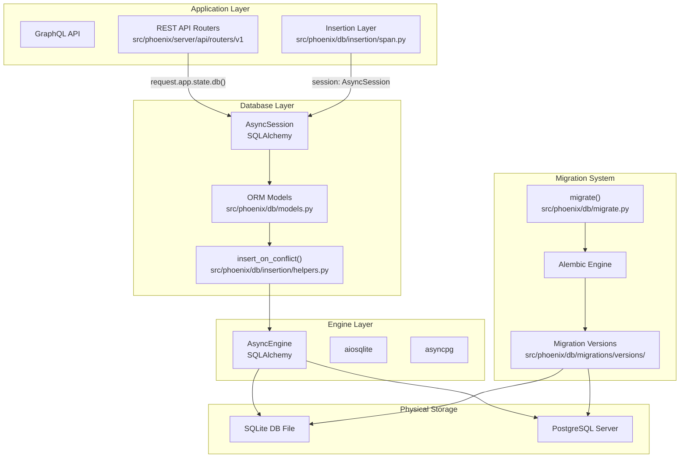
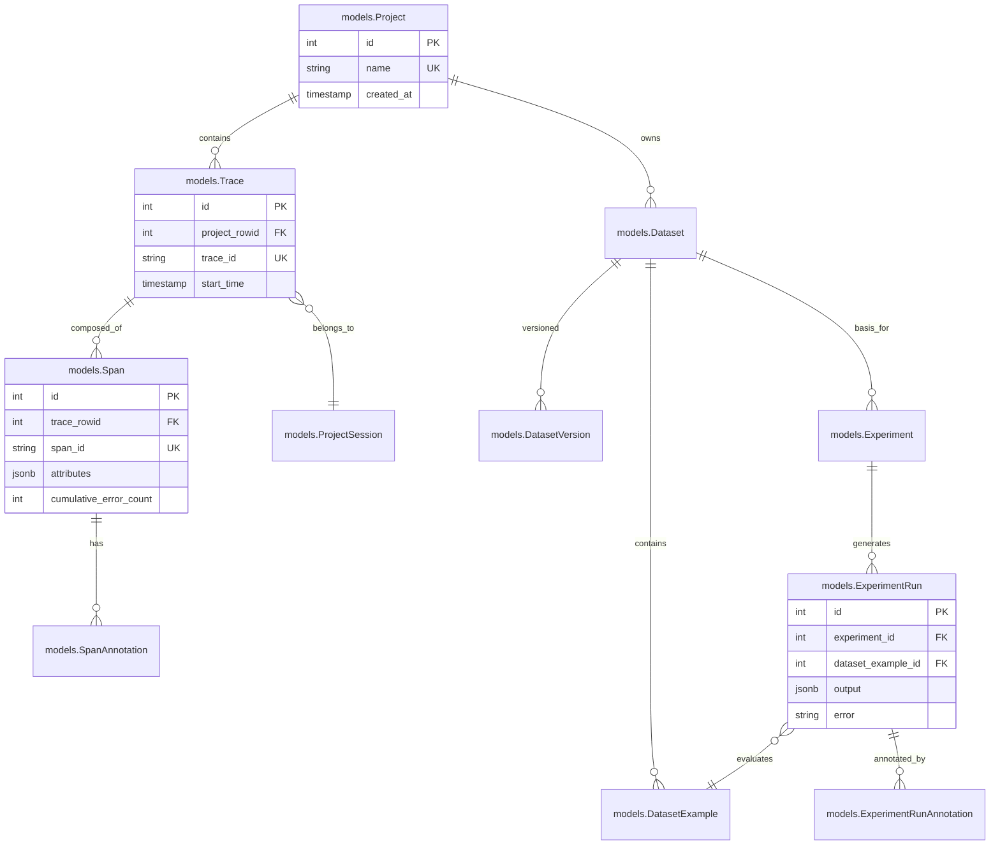
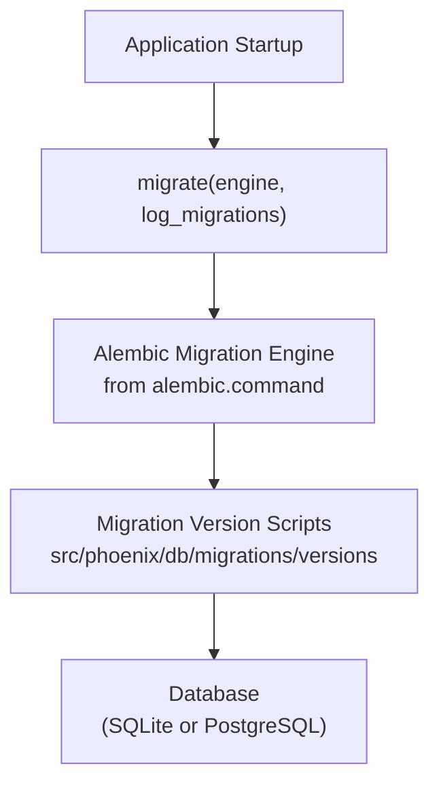
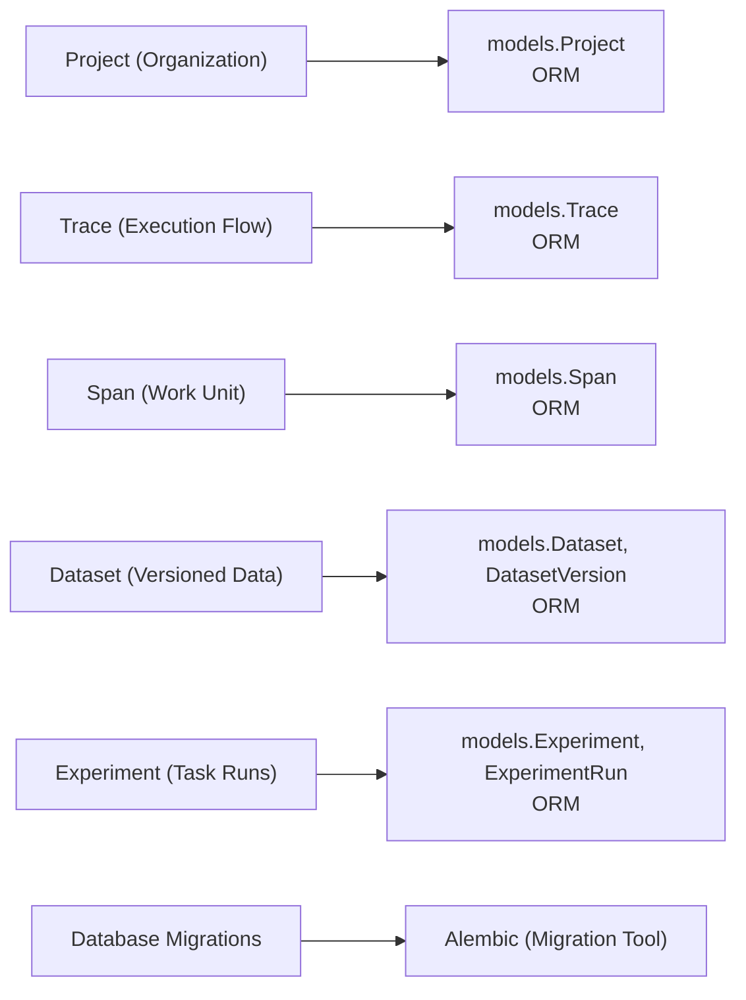
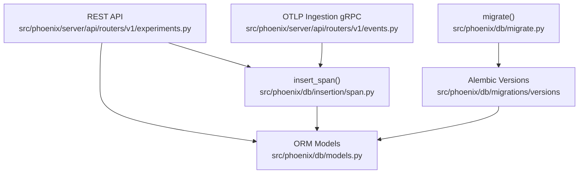

<!-- source: DeepWiki mcp.deepwiki.com · repo arize-ai/phoenix · page 2.5 Database Layer & Migrations · fetched 2026-10-27 -->

# Database Layer & Migrations

Relevant source files

The following files were used as context for generating this wiki page:

- [requirements/integration-tests.txt](requirements/integration-tests.txt)
- [scripts/ddl/generate_ddl_postgresql.py](scripts/ddl/generate_ddl_postgresql.py)
- [scripts/ddl/postgresql_schema.sql](scripts/ddl/postgresql_schema.sql)
- [src/phoenix/db/alembic.ini](src/phoenix/db/alembic.ini)
- [src/phoenix/db/engines.py](src/phoenix/db/engines.py)
- [src/phoenix/db/insertion/span.py](src/phoenix/db/insertion/span.py)
- [src/phoenix/db/migrate.py](src/phoenix/db/migrate.py)
- [src/phoenix/db/migrations/__init__.py](src/phoenix/db/migrations/__init__.py)
- [src/phoenix/db/migrations/data_migration_scripts/populate_project_sessions.py](src/phoenix/db/migrations/data_migration_scripts/populate_project_sessions.py)
- [src/phoenix/db/migrations/env.py](src/phoenix/db/migrations/env.py)
- [src/phoenix/db/migrations/versions/01a8342c9cdf_add_user_id_on_datasets.py](src/phoenix/db/migrations/versions/01a8342c9cdf_add_user_id_on_datasets.py)
- [src/phoenix/db/migrations/versions/0df286449799_add_session_annotations_table.py](src/phoenix/db/migrations/versions/0df286449799_add_session_annotations_table.py)
- [src/phoenix/db/migrations/versions/10460e46d750_datasets.py](src/phoenix/db/migrations/versions/10460e46d750_datasets.py)
- [src/phoenix/db/migrations/versions/3be8647b87d8_add_token_columns_to_spans_table.py](src/phoenix/db/migrations/versions/3be8647b87d8_add_token_columns_to_spans_table.py)
- [src/phoenix/db/migrations/versions/4ded9e43755f_create_project_sessions_table.py](src/phoenix/db/migrations/versions/4ded9e43755f_create_project_sessions_table.py)
- [src/phoenix/db/migrations/versions/58228d933c91_dataset_labels.py](src/phoenix/db/migrations/versions/58228d933c91_dataset_labels.py)
- [src/phoenix/db/migrations/versions/699f655af132_experiment_tags.py](src/phoenix/db/migrations/versions/699f655af132_experiment_tags.py)
- [src/phoenix/db/migrations/versions/ab513d89518b_add_user_id_on_dataset_versions.py](src/phoenix/db/migrations/versions/ab513d89518b_add_user_id_on_dataset_versions.py)
- [src/phoenix/db/migrations/versions/cf03bd6bae1d_init.py](src/phoenix/db/migrations/versions/cf03bd6bae1d_init.py)
- [src/phoenix/db/migrations/versions/d0690a79ea51_users_on_experiments.py](src/phoenix/db/migrations/versions/d0690a79ea51_users_on_experiments.py)
- [src/phoenix/db/migrations/versions/deb2c81c0bb2_dataset_splits.py](src/phoenix/db/migrations/versions/deb2c81c0bb2_dataset_splits.py)
- [src/phoenix/db/models.py](src/phoenix/db/models.py)
- [src/phoenix/server/api/dataloaders/dataset_example_splits.py](src/phoenix/server/api/dataloaders/dataset_example_splits.py)
- [src/phoenix/server/api/helpers/playground_users.py](src/phoenix/server/api/helpers/playground_users.py)
- [src/phoenix/server/api/mutations/dataset_split_mutations.py](src/phoenix/server/api/mutations/dataset_split_mutations.py)
- [src/phoenix/server/api/routers/v1/experiment_evaluations.py](src/phoenix/server/api/routers/v1/experiment_evaluations.py)
- [src/phoenix/server/api/routers/v1/experiment_runs.py](src/phoenix/server/api/routers/v1/experiment_runs.py)
- [src/phoenix/server/api/routers/v1/experiments.py](src/phoenix/server/api/routers/v1/experiments.py)
- [src/phoenix/settings.py](src/phoenix/settings.py)
- [tests/integration/conftest.py](tests/integration/conftest.py)
- [tests/integration/db_migrations/__init__.py](tests/integration/db_migrations/__init__.py)
- [tests/integration/db_migrations/conftest.py](tests/integration/db_migrations/conftest.py)
- [tests/integration/db_migrations/test_data_migration_4ded9e43755f_create_project_sessions_table.py](tests/integration/db_migrations/test_data_migration_4ded9e43755f_create_project_sessions_table.py)
- [tests/integration/db_migrations/test_db_schema_6a88424799fe_update_users_with_auth_method.py](tests/integration/db_migrations/test_db_schema_6a88424799fe_update_users_with_auth_method.py)
- [tests/integration/db_migrations/test_db_schema_a20694b15f82_cost.py](tests/integration/db_migrations/test_db_schema_a20694b15f82_cost.py)
- [tests/integration/db_migrations/test_db_schema_for_annotations.py](tests/integration/db_migrations/test_db_schema_for_annotations.py)
- [tests/integration/db_migrations/test_up_and_down_migrations.py](tests/integration/db_migrations/test_up_and_down_migrations.py)
- [tests/integration/project_sessions/conftest.py](tests/integration/project_sessions/conftest.py)
- [tests/integration/project_sessions/test_project_sessions.py](tests/integration/project_sessions/test_project_sessions.py)
- [tests/integration/server/test_launch_app.py](tests/integration/server/test_launch_app.py)
- [tests/unit/db/test_helpers.py](tests/unit/db/test_helpers.py)
- [tests/unit/server/api/routers/v1/test_experiments.py](tests/unit/server/api/routers/v1/test_experiments.py)

This page documents the database layer architecture, SQLAlchemy ORM models, schema management, and Alembic migration system. It covers the data persistence layer that stores traces, spans, projects, datasets, experiments, and all other Phoenix entities.

For information about data ingestion and bulk insertion, see [OTLP Ingestion & gRPC Server](2.4).

## Overview

Phoenix uses SQLAlchemy 2.0+ with async support for database operations. The database layer provides:

- **ORM Models**: Declarative models for all entities (projects, traces, spans, datasets, experiments, etc.) [src/phoenix/db/models.py:602-1590]().
- **Dual Database Support**: SQLite for development/dev, PostgreSQL for production.
- **Type Safety**: Custom `TypeDecorator`s for JSON, timestamps, identifiers, and domain types [src/phoenix/db/models.py:210-559]().
- **Schema Migrations**: Alembic-based migration system for schema evolution [src/phoenix/db/migrate.py:37-70]().
- **Async Operations**: Full async/await support with `AsyncEngine` and `AsyncSession` [src/phoenix/db/models.py:39-48]().

The database layer strives for backend dialect agnosticism, with tailored code paths and type handling to achieve compatibility for both SQLite and PostgreSQL.

**Sources:** [src/phoenix/db/models.py:1-600](), [src/phoenix/db/migrate.py:37-70]()

---

## Database Architecture

Phoenix structures its database interactions in layered components:

- The **REST API** and **GraphQL API** layers interact with the async SQLAlchemy `AsyncSession` for database transactions.
- The **Insertion Layer** contains optimized logic for safe, idempotent span insertion with conflict handling.
- The **ORM Models** declare all entities and relationships, used by the session.
- The **Engine Layer** abstracts actual DB implementation with drivers: `aiosqlite` for SQLite and `asyncpg` for PostgreSQL.
- The **Migration System** uses Alembic, invoked on startup to apply pending migrations.
- Physical storage is either a local file for SQLite or a remote PostgreSQL server.

**Sources:** [src/phoenix/db/insertion/span.py:25-30](), [src/phoenix/db/migrate.py:37-70](), [src/phoenix/db/models.py:39-48](), [src/phoenix/server/api/routers/v1/experiments.py:160-161]()

---

## Database Support

Phoenix supports two relational database backends configured via connection string:

| Dialect   | Driver         | Use Case                              |
|-----------|----------------|-------------------------------------|
| SQLite    | `aiosqlite`    | Development, single-node, notebooks |
| PostgreSQL| `asyncpg`      | Production, high-concurrency         |

### PostgreSQL Specifics
- Supports schemas via `get_env_database_schema()`, enabling namespace separation in multi-tenant deployments [src/phoenix/db/models.py:55]().
- Uses native JSONB type for efficient JSON operations and indexing [src/phoenix/db/models.py:189-202]().
- Supports concurrent index creation during migrations, controlled by environment variables in tests [tests/integration/db_migrations/test_up_and_down_migrations.py:57-60]().

### SQLite Specifics
- Implements a workaround for SQLite's `VALUES` clause rendering for multi-row inserts using `UNION ALL` via custom compiled classes `SubValues` and overrides [src/phoenix/db/models.py:123-169]().
- Maps JSONB to JSON and overrides dialect behavior for compatibility [src/phoenix/db/migrations/versions/cf03bd6bae1d_init.py:23-26]().
- SQLite pragmas optimized at connection for foreign keys, WAL mode, and performance tuning [src/phoenix/db/engines.py:37-45]().

**Sources:** [src/phoenix/db/models.py:123-169](), [src/phoenix/db/migrations/versions/cf03bd6bae1d_init.py:23-26](), [src/phoenix/db/engines.py:37-45]()

---

## SQLAlchemy ORM Models

### Core Entity Relationships

The major entities with relationships are:

- `Project`: Top-level organizational unit; owns traces and datasets.
- `Trace`: Groups spans representing a full execution flow; belongs to a project and optionally a project session.
- `Span`: Unit of work within a trace; stores OTel attributes and status, with cumulative aggregation fields.
- `ProjectSession`: Represents an application-level session grouping traces.
- `Dataset`, `DatasetVersion`, `DatasetExample`: Entities representing evaluation data with version control.
- `Experiment`: Represents a systematic set of runs on a dataset version.
- `ExperimentRun`: Individual execution in an experiment linked to an example.
- `ExperimentRunAnnotation`: Stores evaluation results (labels, scores) annotated on experiment runs.

**Sources:** [src/phoenix/db/models.py:602-1590](), [scripts/ddl/postgresql_schema.sql:9-250](), [src/phoenix/db/migrations/versions/cf03bd6bae1d_init.py:48-220]()

---

### Key Model Classes

| Model Class              | Table Name                 | Primary Purpose                                                       |
|--------------------------|----------------------------|---------------------------------------------------------------------|
| `Project`                | `projects`                 | Organizational grouping for tracing and evaluations [DDL:63-80]()   |
| `Trace`                  | `traces`                   | Aggregate of spans forming a trace [migration init:80-93]()         |
| `Span`                   | `spans`                    | Individual trace unit storing attributes and status [migration init:95-126]() |
| `ProjectSession`         | `project_sessions`         | Application session grouping traces [DDL:115-135]()                 |
| `Dataset`                | `datasets`                 | Versioned data collection for experiments [datasets migration:49-68]() |
| `Experiment`             | `experiments`              | Stores experiment metadata and setup [datasets migration:153-199]()|
| `ExperimentRun`          | `experiment_runs`          | Records results of experiment executions [datasets migration:201-246]() |
| `ExperimentRunAnnotation`| `experiment_run_annotations` | Evaluation results on experiment runs [API:78-126]()               |

**Sources:** [src/phoenix/db/models.py:602-1560](), [scripts/ddl/postgresql_schema.sql:55-120](), [src/phoenix/db/migrations/versions/cf03bd6bae1d_init.py:80-126]()

---

## Custom Type Decorators

Phoenix enhances SQLAlchemy with custom types to improve serialization, timezone handling, and domain-specific validation:

| TypeDecorator           | Purpose & Behavior                                                                                      |
|------------------------|-------------------------------------------------------------------------------------------------------|
| `JsonDict`              | Serializes Python dictionaries to JSON automatically, ensures non-null with default empty dict [210-222]() |
| `UtcTimeStamp`          | Normalizes datetime values to UTC, enforces timezone-aware timestamp storage [241-255]()              |
| `PromptTemplate`        | Validates and serializes structured prompt templates safely [397-414]()                               |

These decorators integrate seamlessly into models to enforce data integrity and representation consistency across database backends.

**Sources:** [src/phoenix/db/models.py:210-414]()

---

## Migration System

Phoenix employs Alembic for managing schema migrations to evolve the database safely and transparently.

### Alembic Integration

- The `migrate()` function programmatically runs database migrations during server startup.
- It loads Alembic config from `alembic.ini` and migration scripts directory.
- Runs `alembic upgrade head` asynchronously on provided engine.
- Supports running in separate thread (`migrate_in_thread`) for environments like notebooks where main thread async migrations are problematic.

### Migration Evolution Highlights

- **Initial migration `cf03bd6bae1d_init.py`**: Creates foundational observability schema tables—Projects, Traces, Spans, Annotations [src/phoenix/db/migrations/versions/cf03bd6bae1d_init.py:48-220]().
- **Datasets and Experiments `10460e46d750_datasets.py`**: Adds evaluation framework tables (Datasets, DatasetVersions, DatasetExamples, Experiments, ExperimentRuns) [src/phoenix/db/migrations/versions/10460e46d750_datasets.py:48-245]().
- **Project Sessions table migration**: Adds project_sessions table to group traces by application session.

**Sources:** [src/phoenix/db/migrate.py:37-101](), [src/phoenix/db/migrations/versions/cf03bd6bae1d_init.py:1-220](), [src/phoenix/db/migrations/versions/10460e46d750_datasets.py:1-245]()

---

## Insertion Logic & Helpers

Insertion operations leverage async SQLAlchemy sessions with conflict handling to ensure data integrity during concurrent writes.

### Span Insertion Flow

The key function `insert_span` ([src/phoenix/db/insertion/span.py:25-168]()):

1. **Trace resolution**:
   - Finds existing `Trace` by `trace_id`.
   - Expands `start_time`/`end_time` on the `Trace` to include new span times.
   - Creates `Project` if not existing, links `Trace` accordingly.
2. **ProjectSession management**:
   - Retrieves `session_id` from span attributes.
   - Retrieves or creates a `ProjectSession` record.
   - Updates session start/end times if needed.
3. **Cumulative metrics**:
   - Aggregates cumulative error counts and LLM token counts across child spans recursively.
4. **Span insertion**:
   - Inserts or ignores conflicting rows on duplicate `span_id`.
5. **Propagates aggregates up to parent spans** for maintaining cumulative metrics integrity.

### Experiment Run Upsert

The REST API for `create_experiment_run` uses `insert_on_conflict` with `DO_UPDATE` for allowing safe retry of failed runs but preventing overwriting of successful runs:

- Checks existing experiment run by unique keys.
- Rejects if a successful run exists.
- Otherwise, inserts or updates run record with new data and error state.
- Returns GlobalID for the experiment run resource.

This logic ensures idempotent safe insertion of experiment runs and annotator results.

**Sources:** [src/phoenix/db/insertion/span.py:25-168](), [src/phoenix/server/api/routers/v1/experiment_runs.py:113-146]()

---

## Summary

- Phoenix uses SQLAlchemy ORM models extensively for mapping domain entities to relational schema.
- The database layer supports PostgreSQL and SQLite with dialect-specific adaptations.
- Alembic migrations control schema versioning and are applied automatically at runtime.
- Custom SQLAlchemy types maintain type safety and serialization consistency.
- Insertions use conflict handling to support high-throughput, idempotent writes, especially for spans.
- The schema covers observability, evaluation, experiments, and annotations as first-class database entities.

This cohesive design enables Phoenix to manage complex data workflows reliably with a well-structured persistence layer.

---

# Appendix: Natural Language to Code Entity Associations

Below diagrams illustrate how natural language concepts map to key code entities.

### From Natural Language Concepts to Database Layer Components

### From Phoenix System Names to Database Code Artifacts

---

This concludes the documentation of Phoenix's database layer and migrations system.

**Sources:**

- [src/phoenix/db/models.py:1-600]()
- [src/phoenix/db/migrate.py:37-101]()
- [src/phoenix/db/migrations/versions/cf03bd6bae1d_init.py:1-220]()
- [src/phoenix/db/migrations/versions/10460e46d750_datasets.py:1-245]()
- [src/phoenix/db/insertion/span.py:25-168]()
- [src/phoenix/db/engines.py:37-45]()
- [tests/integration/db_migrations/test_up_and_down_migrations.py:57-60]()
- [src/phoenix/server/api/routers/v1/experiment_runs.py:113-146]()
- [src/phoenix/server/api/routers/v1/experiments.py:160-161]()

---

