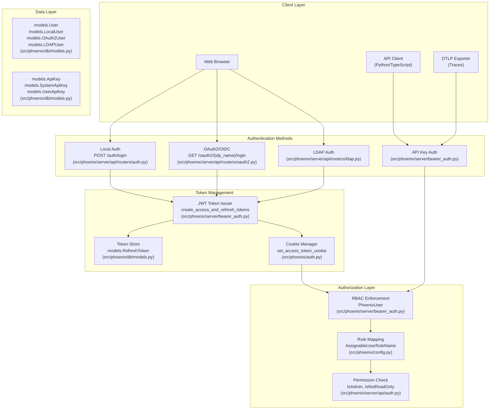
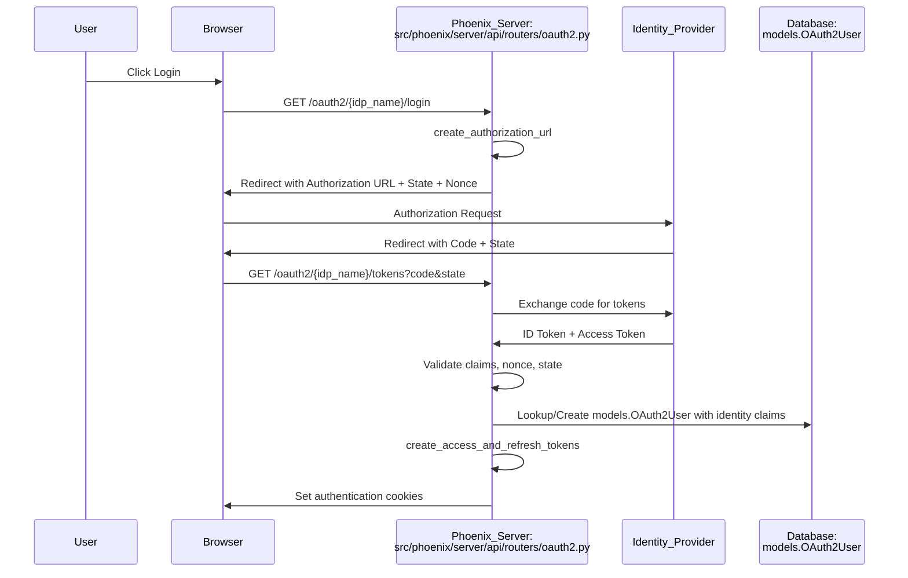

<!-- source: DeepWiki mcp.deepwiki.com · repo arize-ai/phoenix · page 2.6 Authentication & Authorization · fetched 2026-10-27 -->

# Authentication & Authorization

<details>
<summary>Relevant source files</summary>

The following files were used as context for generating this wiki page:

- [internal_docs/specs/oauth2-email-attribute-path.md](internal_docs/specs/oauth2-email-attribute-path.md)
- [src/phoenix/auth.py](src/phoenix/auth.py)
- [src/phoenix/db/facilitator.py](src/phoenix/db/facilitator.py)
- [src/phoenix/db/migrations/versions/cd164e83824f_users_and_tokens.py](src/phoenix/db/migrations/versions/cd164e83824f_users_and_tokens.py)
- [src/phoenix/server/api/auth.py](src/phoenix/server/api/auth.py)
- [src/phoenix/server/api/dataloaders/span_annotations.py](src/phoenix/server/api/dataloaders/span_annotations.py)
- [src/phoenix/server/api/input_types/CreateSpanAnnotationInput.py](src/phoenix/server/api/input_types/CreateSpanAnnotationInput.py)
- [src/phoenix/server/api/input_types/CreateTraceAnnotationInput.py](src/phoenix/server/api/input_types/CreateTraceAnnotationInput.py)
- [src/phoenix/server/api/input_types/PatchAnnotationInput.py](src/phoenix/server/api/input_types/PatchAnnotationInput.py)
- [src/phoenix/server/api/mutations/api_key_mutations.py](src/phoenix/server/api/mutations/api_key_mutations.py)
- [src/phoenix/server/api/mutations/dataset_mutations.py](src/phoenix/server/api/mutations/dataset_mutations.py)
- [src/phoenix/server/api/mutations/experiment_mutations.py](src/phoenix/server/api/mutations/experiment_mutations.py)
- [src/phoenix/server/api/mutations/model_mutations.py](src/phoenix/server/api/mutations/model_mutations.py)
- [src/phoenix/server/api/mutations/project_mutations.py](src/phoenix/server/api/mutations/project_mutations.py)
- [src/phoenix/server/api/mutations/span_annotations_mutations.py](src/phoenix/server/api/mutations/span_annotations_mutations.py)
- [src/phoenix/server/api/mutations/trace_annotations_mutations.py](src/phoenix/server/api/mutations/trace_annotations_mutations.py)
- [src/phoenix/server/api/mutations/user_mutations.py](src/phoenix/server/api/mutations/user_mutations.py)
- [src/phoenix/server/api/routers/auth.py](src/phoenix/server/api/routers/auth.py)
- [src/phoenix/server/api/routers/oauth2.py](src/phoenix/server/api/routers/oauth2.py)
- [src/phoenix/server/api/types/Annotation.py](src/phoenix/server/api/types/Annotation.py)
- [src/phoenix/server/api/types/SpanAnnotation.py](src/phoenix/server/api/types/SpanAnnotation.py)
- [src/phoenix/server/api/types/TraceAnnotation.py](src/phoenix/server/api/types/TraceAnnotation.py)
- [src/phoenix/server/cost_tracking/cost_model_lookup.py](src/phoenix/server/cost_tracking/cost_model_lookup.py)
- [src/phoenix/server/daemons/generative_model_store.py](src/phoenix/server/daemons/generative_model_store.py)
- [src/phoenix/server/jwt_store.py](src/phoenix/server/jwt_store.py)
- [src/phoenix/server/oauth2.py](src/phoenix/server/oauth2.py)
- [src/phoenix/server/sandbox/wasm_backend.py](src/phoenix/server/sandbox/wasm_backend.py)
- [src/phoenix/server/types.py](src/phoenix/server/types.py)
- [tests/unit/db/test_facilitator.py](tests/unit/db/test_facilitator.py)
- [tests/unit/server/api/mutations/test_project_mutations.py](tests/unit/server/api/mutations/test_project_mutations.py)
- [tests/unit/server/api/mutations/test_span_annotation_mutations.py](tests/unit/server/api/mutations/test_span_annotation_mutations.py)
- [tests/unit/server/api/routers/test_oauth2.py](tests/unit/server/api/routers/test_oauth2.py)
- [tests/unit/server/api/types/test_SpanAnnotation.py](tests/unit/server/api/types/test_SpanAnnotation.py)
- [tests/unit/server/api/types/test_TraceAnnotation.py](tests/unit/server/api/types/test_TraceAnnotation.py)
- [tests/unit/server/cost_tracking/test_cost_model_lookup.py](tests/unit/server/cost_tracking/test_cost_model_lookup.py)
- [tests/unit/server/daemons/test_generative_model_store.py](tests/unit/server/daemons/test_generative_model_store.py)
- [tests/unit/server/test_oauth2.py](tests/unit/server/test_oauth2.py)
- [tests/unit/test_config.py](tests/unit/test_config.py)

</details>


This document describes Phoenix's authentication and authorization system, including supported authentication methods, role-based access control, token management, and security configuration options. For configuration details of the Phoenix server, see [Application Server & Configuration](#2.1). For API access patterns, see [REST API & OpenAPI](#2.3).

## Overview

Phoenix supports multiple authentication methods that can be enabled simultaneously:

- **Local Authentication**: Password-based authentication where user credentials are stored securely as hashed passwords in the database with salts. Handled mainly via `models.LocalUser`. System initialization creates default admin and system users automatically.  
  Key files:  
  - User model: `src/phoenix/db/models.py:348-355`  
  - User mutations: `src/phoenix/server/api/mutations/user_mutations.py:145-152`  
  - Startup facilitator initialization: `src/phoenix/db/facilitator.py:110-158`  

- **OAuth2/OIDC**: Supports integration with multiple identity providers using OAuth2 authorization code flow. Handles login, token exchange, nonce/state verification, and user provisioning as `models.OAuth2User`.  
  Key files:  
  - OAuth2 API router: `src/phoenix/server/api/routers/oauth2.py:92-276`  
  - OAuth2 client helpers: `src/phoenix/server/oauth2.py`  

- **LDAP**: Enterprise directory services integration (Active Directory, OpenLDAP). Supports user provisioning during login, role mapping via LDAP groups. Users are represented as `models.LDAPUser`.  
  Key files:  
  - LDAP user model: `src/phoenix/db/models.py:365-372`  
  - LDAP router (not fully shown here)  

- **API Keys**: Provides programmatic access through system and user API keys represented as JWTs and stored hashed in the database (`models.ApiKey`).  
  Key files:  
  - API key models: `src/phoenix/db/models.py:404-447`  
  - API key mutations: `src/phoenix/server/api/mutations/api_key_mutations.py`  

Authorization is enforced via Role-Based Access Control (RBAC) with predefined roles `ADMIN`, `MEMBER`, and `VIEWER`. The internal `SYSTEM` role is reserved for automated processes and infrastructure users. Role names and assignments are managed in configuration.  
Key files:  
- Role config: `src/phoenix/config.py:40-43`  
- User roles table: `src/phoenix/db/models.py`  

**Sources:**  
[helm/values.yaml:48-61]()  
[src/phoenix/config.py:39-43]()  
[src/phoenix/db/models.py:348-355, 365-372, 404-447]()  
[src/phoenix/server/api/routers/oauth2.py:92-276]()  
[src/phoenix/server/api/mutations/user_mutations.py:145-152]()  
[src/phoenix/db/facilitator.py:110-158]()

---

## Authentication Architecture

### Code Entity Space Mapping of Authentication Components



This diagram highlights how high-level natural language entities—like "Local Auth" or "OAuth2/OIDC"—map to concrete API routes and key classes in the codebase, showing the flow from client interactions through token issuance and authorization enforcement.

**Sources:**  
[src/phoenix/server/api/routers/oauth2.py:92-142]()  
[src/phoenix/server/bearer_auth.py:1-50]()  
[src/phoenix/server/api/auth.py:1-32]()  
[src/phoenix/db/models.py:348-447]()  
[src/phoenix/config.py:40-43]()

---

## Authentication Methods

### Local Authentication (Password-Based)

Local authentication uses password hashes stored in the database `models.LocalUser`, with salts for security. Password hashing uses PBKDF2-HMAC-SHA256 with iteration count configured by `NUM_ITERATIONS`. Password validation compares user-supplied input similarly hashed with stored salt to the stored hash using `is_valid_password`.

User creation checks the password and email format for correctness and security. Passwords are validated against configured requirements (`get_password_requirements()`). The system administrator user and system user are seeded on startup by the `Facilitator` class to ensure system integrity and access.

**Key Implementation Details:**

- User credentials stored in fields `password_hash` and `password_salt` on `LocalUser`.  
- Password hashing done through `compute_password_hash` in `src/phoenix/auth.py`.  
- Login endpoint `_login` in `src/phoenix/server/api/routers/auth.py` validates password and issues JWT tokens on success.  
- Admin and system users created if missing by `Facilitator` callbacks on startup (`_ensure_user_roles`, `_ensure_admins`).  

**Configuration:**

- `PHOENIX_DISABLE_BASIC_AUTH` disables password authentication system-wide.  
- `PHOENIX_DEFAULT_ADMIN_INITIAL_PASSWORD` sets the initial admin password on first boot.  

**Sources:**  
[src/phoenix/db/models.py:348-355]()  
[src/phoenix/auth.py:22-50]()  
[src/phoenix/server/api/routers/auth.py:144-187]()  
[src/phoenix/db/facilitator.py:110-158]()  
[helm/values.yaml:45-48]()

---

### OAuth2/OIDC Integration

Phoenix supports OAuth2 authentication with multiple external identity providers (Google, Microsoft Entra ID, AWS Cognito, Keycloak, etc.).

**Workflow overview:**

1. User initiates login via `GET /oauth2/{idp_name}/login`.  
2. Phoenix creates an authorization URL via `create_authorization_url` of the selected OAuth2 client, attaches cryptographic `state` and `nonce`, stores them in cookies to protect against CSRF and replay attacks.  
3. User is redirected to the external IdP for authorization.  
4. IdP redirects back to Phoenix at `GET /oauth2/{idp_name}/tokens` with `code` and `state`.  
5. Phoenix validates the `state` cookie against the query parameter, exchanges the code for tokens (including an ID token), validates nonce, and extracts user claims.  
6. Phoenix looks up or creates a user record (`models.OAuth2User`) mapping OAuth2 identity to internal user database.  
7. Phoenix creates access and refresh tokens (JWT) via `create_access_and_refresh_tokens` and sets cookies for session management.  

**Security notes:**

- `state` and `nonce` stored and validated in cookies for CSRF and replay prevention.  
- Token exchange and validation use `joserfc` library for JWT decoding and validation.  
- Rate limiting enforced on login endpoints.  



**Sources:**  
[src/phoenix/server/api/routers/oauth2.py:92-276]()  
[src/phoenix/server/oauth2.py]()

---

### LDAP Authentication

Phoenix supports LDAP authentication integration as an alternative or supplement to local or OAuth methods. This allows enterprise organizations to integrate their existing directory services such as Active Directory or OpenLDAP.

**Key aspects:**

- LDAP users are stored as `models.LDAPUser` objects. These users do not have local passwords but authenticate against the LDAP server.  
- Role mappings can be configured by LDAP group membership with `auth.ldap.groupRoleMappings`.  
- Automatic user creation (signup) is possible on first LDAP login via configuration `auth.ldap.allowSignUp`.  
- LDAP user attributes like `ldap_unique_id` are stored and updated on successful login.  

**Sources:**  
[helm/values.yaml:50-61]()  
[src/phoenix/db/models.py:365-372]()

---

## Role-Based Access Control (RBAC)

Phoenix implements role-based access control with the following assignable roles:

| Role   | Permission Level                                | Internal Representation                     |
|--------|------------------------------------------------|---------------------------------------------|
| ADMIN  | Full administrative access including user management, system configuration | `Literal["ADMIN"]`                         |
| MEMBER | Standard read/write access to projects, datasets, experiments | `Literal["MEMBER"]`                        |
| VIEWER | Read-only access to most system functionality | `Literal["VIEWER"]`                         |

The `SYSTEM` role exists internally for automated processes, e.g., system API keys and background jobs, and is not assignable to human users.

### Enforcement

Permissions are enforced at the API layer using Strawberry GraphQL permission classes and FastAPI dependencies:

- `IsAdmin`: Restricts an operation to `ADMIN` users only.  
- `IsNotReadOnly`: Blocks operations if the system is in a read-only mode.  
- `IsNotViewer`: Ensures that only `MEMBER` and `ADMIN` roles can perform the operation, blocking `VIEWER` access.

These permission classes are used as decorators on mutations and queries to guard sensitive operations.

**Sources:**  
[src/phoenix/config.py:40-43]()  
[src/phoenix/server/api/auth.py:30]()  
[src/phoenix/server/api/mutations/user_mutations.py:121]()

---

## API Key Management

Phoenix supports system and user API keys to enable programmatic and service-to-service access.

### Storage and Representation

- API keys are stored securely as hashed tokens in the database `models.ApiKey`, to prevent plaintext exposure.  
- System API keys are linked to the `SYSTEM` user role and intended for trusted infrastructure integrations.  
- User API keys are linked to individual users and inherit their permissions and roles.  

### Mutation Operations

API keys can be created and deleted via GraphQL mutations guarded by permission classes (`IsAdmin` for system keys, authenticated for user keys). Creation mutations return the JWT token string for the client to store securely.

```python
# Example create system API key mutation logic:
claims = ApiKeyClaims(
    subject=UserId(system_user.id),
    issued_at=current_time,
    expiration_time=input.expires_at or None,
    attributes=ApiKeyAttributes(
        user_role="SYSTEM",
        name=input.name,
        description=input.description,
    ),
)
token, token_id = await token_store.create_api_key(claims)
```

**Sources:**  
[src/phoenix/db/models.py:404-447]()  
[src/phoenix/server/api/mutations/api_key_mutations.py:63-164]()

---

## Token Management

Phoenix uses JSON Web Tokens (JWT) extensively for session and API key management.

- **Access Tokens**: Short-lived tokens representing authenticated session identity, stored in an HTTP-only cookie called `PHOENIX_ACCESS_TOKEN_COOKIE_NAME`.  
- **Refresh Tokens**: Longer-lived tokens allowing session renewal, stored in the database in `models.RefreshToken` and HTTP-only cookies.  
- **Password Reset Tokens**: JWT tokens for password reset flows.  
- **API Keys**: Special JWT tokens representing system or user API keys.

The `JwtStore` class encapsulates creation, storage, lookup, and revocation of all token types, integrating with the database and caching systems.

Tokens are created via `create_access_and_refresh_tokens` function, setting proper expiration and claims. Token data flows from generation → storage → set cookies (for access tokens) → client usage → authentication → authorization.

**Sources:**  
[src/phoenix/server/bearer_auth.py:1-50]()  
[src/phoenix/db/models.py:378-385]()  
[src/phoenix/server/jwt_store.py:40-190]()

---

## Security Configuration

### Brute Force Protection

Phoenix implements a brute force login protection mechanism that tracks failed login attempts per email address and temporarily blocks further attempts after a configurable limit (`auth.bruteForceLoginProtectionMaxAttempts`). This protects against password guessing attacks.

- Failures and successes are recorded in `BruteForceLoginRateLimiter`.  
- If the limit is reached, HTTP 429 is returned with a generic message to avoid information leakage.

### CSRF and CORS Configuration

- `PHOENIX_CSRF_TRUSTED_ORIGINS`: List of origins that are trusted for CSRF protection in cookies.  
- `PHOENIX_ALLOWED_ORIGINS`: List of allowed CORS origins for cross-origin requests. This is critical for browser-based clients interacting with Phoenix APIs.

### Password Policy

The system supports enforcing a strong password policy (12+ characters, mixed case, digits, special characters) if enabled via `PHOENIX_ENABLE_STRONG_PASSWORD_POLICY`. Password validation is performed when users set or reset passwords.

**Sources:**  
[helm/values.yaml:40-49]()  
[src/phoenix/server/api/routers/auth.py:80-97]()  
[src/phoenix/auth.py:80-98]()

# Summary

Phoenix implements comprehensive authentication and authorization features covering local, OAuth2, and LDAP authentication methods, secured JWT token management including session and API keys, and robust role-based access control policies enforced at the API layer. Security hygiene such as password hashing, brute force protection, CSRF and CORS config, and configurable password policies are key components ensuring Phoenix can securely manage user identities and permissions in AI observability environments.

**Sources Summary:**  
[src/phoenix/db/facilitator.py:110-158]()  
[src/phoenix/server/api/routers/oauth2.py:92-276]()  
[src/phoenix/db/models.py:348-355,365-372,378-385,404-447]()  
[src/phoenix/auth.py:22-50,80-98]()  
[src/phoenix/server/api/routers/auth.py:144-187]()  
[src/phoenix/server/api/mutations/api_key_mutations.py:63-164]()  
[src/phoenix/server/api/auth.py:30]()  
[src/phoenix/server/bearer_auth.py:1-50]()  
[src/phoenix/server/jwt_store.py:40-190]()  
[helm/values.yaml:40-61]()

---

