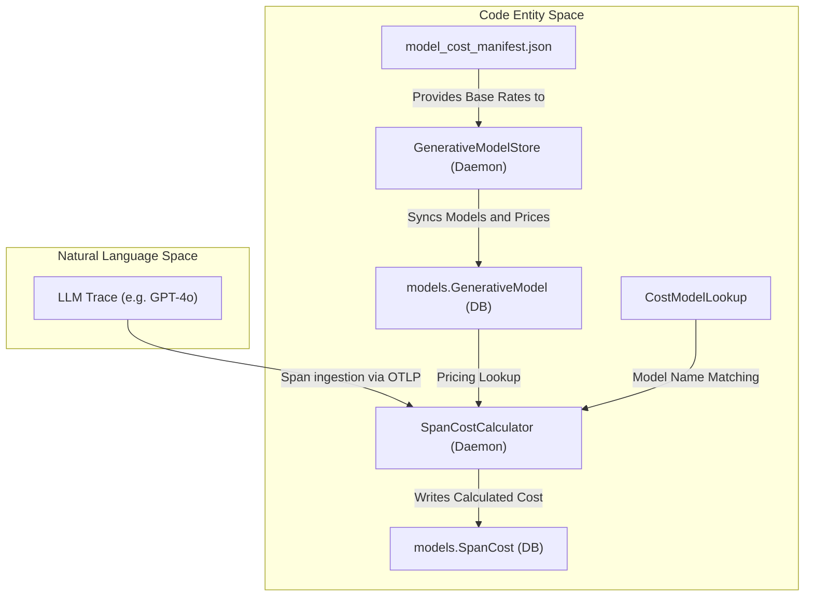
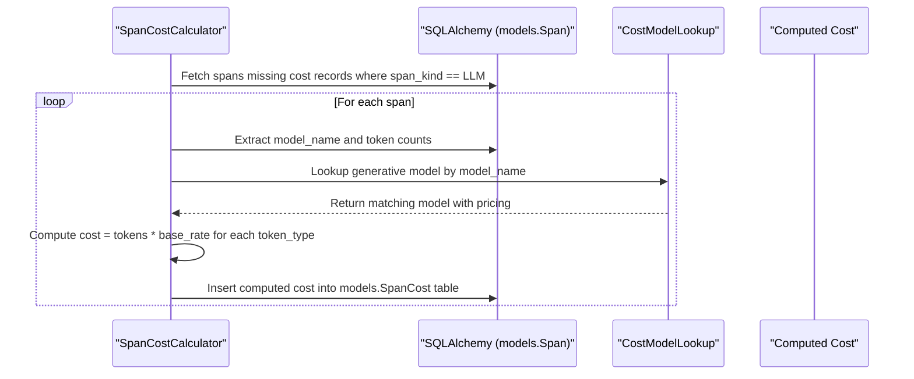

<!-- source: DeepWiki mcp.deepwiki.com · repo arize-ai/phoenix · page 2.7 Cost Tracking & Model Pricing · fetched 2026-10-27 -->

# Cost Tracking & Model Pricing

<details>
<summary>Relevant source files</summary>

The following files were used as context for generating this wiki page:

- [.github/.scripts/sync_models.py](.github/.scripts/sync_models.py)
- [src/phoenix/auth.py](src/phoenix/auth.py)
- [src/phoenix/db/facilitator.py](src/phoenix/db/facilitator.py)
- [src/phoenix/db/migrations/versions/cd164e83824f_users_and_tokens.py](src/phoenix/db/migrations/versions/cd164e83824f_users_and_tokens.py)
- [src/phoenix/server/api/mutations/model_mutations.py](src/phoenix/server/api/mutations/model_mutations.py)
- [src/phoenix/server/api/mutations/user_mutations.py](src/phoenix/server/api/mutations/user_mutations.py)
- [src/phoenix/server/api/routers/auth.py](src/phoenix/server/api/routers/auth.py)
- [src/phoenix/server/cost_tracking/cost_model_lookup.py](src/phoenix/server/cost_tracking/cost_model_lookup.py)
- [src/phoenix/server/cost_tracking/model_cost_manifest.json](src/phoenix/server/cost_tracking/model_cost_manifest.json)
- [src/phoenix/server/daemons/generative_model_store.py](src/phoenix/server/daemons/generative_model_store.py)
- [src/phoenix/server/sandbox/wasm_backend.py](src/phoenix/server/sandbox/wasm_backend.py)
- [tests/unit/db/test_facilitator.py](tests/unit/db/test_facilitator.py)
- [tests/unit/server/cost_tracking/test_cost_model_lookup.py](tests/unit/server/cost_tracking/test_cost_model_lookup.py)
- [tests/unit/server/daemons/test_generative_model_store.py](tests/unit/server/daemons/test_generative_model_store.py)
- [tests/unit/test_config.py](tests/unit/test_config.py)

</details>


The cost tracking subsystem in Phoenix provides automated calculation and reporting of LLM token costs across spans, traces, and projects. It integrates a static manifest of model prices, a background daemon to synchronize model metadata, a cache lookup mechanism to resolve model pricing, and specialized calculators that compute costs based on token usage.

## System Architecture

The cost tracking system consists of four major components managing cost data from ingestion to cost computation and storage:

1. **Model Cost Manifest**  
   A static JSON file defining baseline pricing configurations for known LLM models and providers, such as OpenAI, Anthropic, and AWS Bedrock.

2. **CostModelLookup**  
   A utility class that matches raw model names reported in spans/traces to standardized model pricing information using regex patterns and database cache entries.

3. **GenerativeModelStore Daemon**  
   A server-side background daemon that periodically fetches generative model metadata and pricing from the database, maintaining an in-memory cache to reduce database queries during high-frequency lookups.

4. **SpanCostCalculator**  
   A background process that scans ingested spans for LLM usage, resolves their models through `CostModelLookup`, and calculates USD cost contributions based on token counts and pricing tiers.

---

### Overview Diagram: Cost Tracking System Components and Data Flow



Sources:  
[src/phoenix/server/daemons/generative_model_store.py:1-102](),  
[src/phoenix/server/cost_tracking/model_cost_manifest.json:1-60](),  
[src/phoenix/server/cost_tracking/cost_model_lookup.py:1-40](),  
[src/phoenix/db/facilitator.py:75-89,82-82]()

---

## Model Cost Manifest

The core reference for pricing is the `model_cost_manifest.json` file located in the server cost tracking directory. This JSON manifest provides canonical LLM model entries along with detailed token price attributes.

### Structure and Content

Each model entry contains:

- **name**  
  The canonical internal model name identifier.

- **name_pattern**  
  A regex pattern to match variants and aliases of the model name as reported in incoming span attributes.

- **source**  
  The origin source of the pricing data (e.g., "litellm" indicating pricing from LiteLLM data).

- **token_prices**  
  An array of objects specifying per-token pricing by type and whether tokens contribute to prompt (input) or output costs.

Example snippet of a model entry:
```json
{
  "name": "chatgpt-4o-latest",
  "name_pattern": "chatgpt-4o-latest",
  "source": "litellm",
  "token_prices": [
    {
      "base_rate": 5e-6,
      "is_prompt": true,
      "token_type": "input"
    },
    {
      "base_rate": 0.000015,
      "is_prompt": false,
      "token_type": "output"
    }
  ]
}
```

The manifest includes price entries for input tokens, output tokens, and sometimes for cache reads/writes or audio tokens. Rates are expressed in USD per token.

Sources:  
[src/phoenix/server/cost_tracking/model_cost_manifest.json:1-60]()

---

## CostModelLookup Class

`CostModelLookup` is designed to match fuzzy model names from span attributes to canonical models stored in the database. It uses regex matching against the `name_pattern` field of cached generative models.

### Key Responsibilities

- On initialization or upon model data refresh, it caches the set of generative models from the database with their regex patterns compiled.

- Given a model name string and timestamp of the span, it resolves the best matching generative model, which includes token pricing information.

- Supports quick lookup for repeated queries without hitting the database on each span processing.

Sources:  
[src/phoenix/server/cost_tracking/cost_model_lookup.py:1-40]()

---

## GenerativeModelStore Daemon

The `GenerativeModelStore` is a long-running background daemon within the Phoenix server responsible for synchronizing generative model data from the database into an in-memory cache for efficient pricing lookups.

### Functionality and Implementation

- Periodically queries the `generative_models` and associated token prices from the relational database.

- Employs **incremental fetching** using timestamp filters (`updated_at`, `deleted_at`) with a 10-second clock skew buffer to minimize redundant database queries and reduce cloud egress costs.

- On fetch, uses `.merge()` semantics to update or add new models into the internal `CostModelLookup`.

- The lookup cache is then used by the `SpanCostCalculator` for cost resolution per span.

- The daemon runs asynchronously, sleeping for a configurable refresh interval (default ~5 seconds) between fetch cycles.

### Important Notes

- Models' `updated_at` field must be explicitly maintained on all modifications, including associated token prices, to allow incremental fetch to work reliably.

- The synchronization strategy trading memory for reduced DB calls is optimized to support frequent queries at computation time without incurring repeated remote database cost.

### Relevant code snippet illustrating fetch and incremental updates:
```python
async def _fetch_models(self) -> None:
    stmt = sa.select(models.GenerativeModel).options(
        joinedload(models.GenerativeModel.token_prices)
    )
    if self._last_fetch_time:
        stmt = stmt.where(
            sa.or_(
                models.GenerativeModel.updated_at >= self._last_fetch_time,
                models.GenerativeModel.deleted_at >= self._last_fetch_time,
            )
        )
    async with self._db() as session:
        generative_models = (await session.scalars(stmt)).unique().all()

    if not generative_models:
        return

    self._lookup.merge(generative_models)
```

Sources:  
[src/phoenix/server/daemons/generative_model_store.py:20-102](),  
[src/phoenix/db/facilitator.py:82-85]()

---

## SpanCostCalculator Overview

`SpanCostCalculator` is a subsystem daemon that processes ingested spans to compute and persist LLM token usage costs.

### Process Steps

1. **Span Fetching**  
   Iterates over spans marked with `span_kind` of type `LLM` which typically contain token usage details.

2. **Model Name Extraction & Lookup**  
   Extracts model identifying information from span attributes, uses `CostModelLookup` to resolve to a canonical model with known pricing.

3. **Token Counts & Pricing**  
   Reads token counts for prompt (input), completion (output), and optionally other categories such as cache reads/writes.

4. **Cost Computation**  
   For each token type present, multiplies token count by the matching price rate.

5. **Cost Recording**  
   Creates `SpanCost` records reflecting USD amounts for the associated span.

### Span Cost Calculation Sequence Diagram



Sources:  
[src/phoenix/server/daemons/generative_model_store.py:61-102](),  
[src/phoenix/db/facilitator.py:80-85]()

---

## Database Seeding and Facilitation

Phoenix provides a `Facilitator` class that runs at server startup to ensure all required database enums, roles, users, and model cost data are seeded correctly for proper system operation.

### Model Cost Initialization

- The `_ensure_model_costs` function is one of the standard callbacks in `Facilitator`.

- It reads the cost manifest JSON and inserts new or missing generative models and token prices into the database, ensuring idempotency.

- This process guarantees that model cost data from the manifest is available in the database for `GenerativeModelStore` to load.

Sources:  
[src/phoenix/db/facilitator.py:55-91](),  
[tests/unit/db/test_facilitator.py:10-135]()

---

## Managing Models via GraphQL API Mutations

Cost tracking data can be managed interactively with GraphQL mutations, facilitating manual override or addition of cost models.

### Key Mutations Supported

- **createModel**  
  Adds a new generative model with associated pricing details.

- **updateModel**  
  Modifies existing models, allowing updates to name patterns or token costs.

- **deleteModel**  
  Soft deletes models, ensuring removal from the lookup cache.

These mutations allow dynamic control over model pricing, supplementing the static manifest.

### Lifecycle and Incremental Sync Testing

Unit tests verify the `GenerativeModelStore` daemon's correct behavior:

- Loading all models on first fetch.

- Incremental fetching for updates using `updated_at` timestamp.

- Correctly removing soft-deleted models.

- Updating `_last_fetch_time` after each cycle to track incremental changes.

Sources:  
[tests/unit/server/daemons/test_generative_model_store.py:30-180](),  
[src/phoenix/server/api/mutations/user_mutations.py:120-180]()

---

# Summary

The Phoenix cost tracking and model pricing subsystem offers fully automated, accurate LLM cost computation by:

- Utilizing a comprehensive static JSON manifest with regex-based model matching.

- Providing an in-memory cache and lookup via `CostModelLookup` for efficient runtime price resolution.

- Synchronizing model state continuously with `GenerativeModelStore` to reflect the latest database state.

- Calculating costs through span processors that compute per-span USD token usage.

- Supporting administrative overrides and expansions via GraphQL mutations.

This design optimizes database load, reduces egress costs, and provides transparent cost tracking as part of Phoenix’s AI observability platform.

---

Sources:  
[src/phoenix/server/cost_tracking/model_cost_manifest.json](),  
[src/phoenix/server/cost_tracking/cost_model_lookup.py](),  
[src/phoenix/server/daemons/generative_model_store.py](),  
[src/phoenix/db/facilitator.py](),  
[tests/unit/server/daemons/test_generative_model_store.py](),  
[tests/unit/db/test_facilitator.py]()

---

