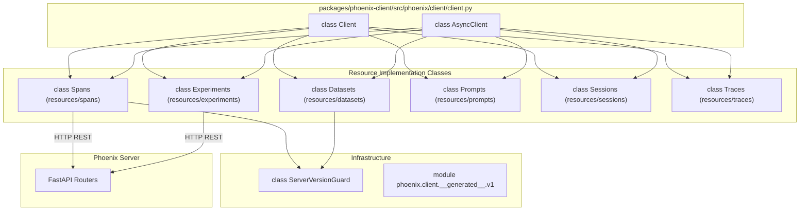
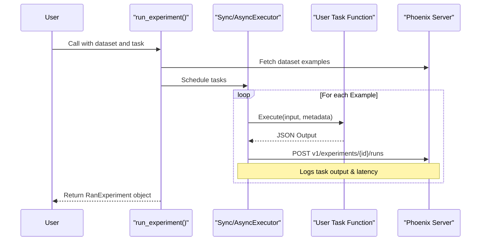
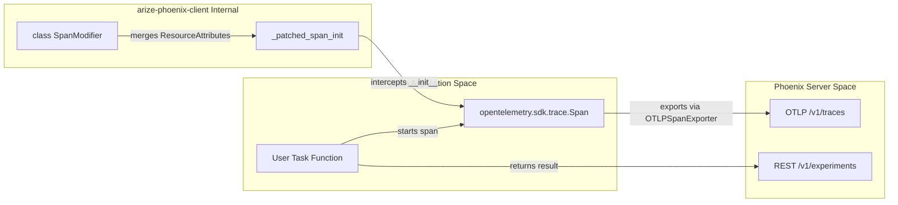

<!-- source: DeepWiki mcp.deepwiki.com · repo arize-ai/phoenix · page 3.1 Python Client (arize-phoenix-client) · fetched 2026-10-27 -->

# Python Client (arize-phoenix-client)

Relevant source files

The following files were used as context for generating this wiki page:

- [js/packages/phoenix-client/examples/create_dataset_from_spans.ts](js/packages/phoenix-client/examples/create_dataset_from_spans.ts)
- [js/packages/phoenix-client/examples/dataset_get_by_name.ts](js/packages/phoenix-client/examples/dataset_get_by_name.ts)
- [js/packages/phoenix-client/src/constants/serverRequirements.ts](js/packages/phoenix-client/src/constants/serverRequirements.ts)
- [js/packages/phoenix-client/src/datasets/appendDatasetExamples.ts](js/packages/phoenix-client/src/datasets/appendDatasetExamples.ts)
- [js/packages/phoenix-client/src/datasets/createDataset.ts](js/packages/phoenix-client/src/datasets/createDataset.ts)
- [js/packages/phoenix-client/src/datasets/getDataset.ts](js/packages/phoenix-client/src/datasets/getDataset.ts)
- [js/packages/phoenix-client/src/datasets/getDatasetExamples.ts](js/packages/phoenix-client/src/datasets/getDatasetExamples.ts)
- [js/packages/phoenix-client/src/datasets/getDatasetInfo.ts](js/packages/phoenix-client/src/datasets/getDatasetInfo.ts)
- [js/packages/phoenix-client/src/datasets/getDatasetInfoByName.ts](js/packages/phoenix-client/src/datasets/getDatasetInfoByName.ts)
- [js/packages/phoenix-client/src/datasets/index.ts](js/packages/phoenix-client/src/datasets/index.ts)
- [js/packages/phoenix-client/src/experiments/getExperimentInfo.ts](js/packages/phoenix-client/src/experiments/getExperimentInfo.ts)
- [js/packages/phoenix-client/src/sessions/getSession.ts](js/packages/phoenix-client/src/sessions/getSession.ts)
- [js/packages/phoenix-client/src/sessions/listSessions.ts](js/packages/phoenix-client/src/sessions/listSessions.ts)
- [js/packages/phoenix-client/src/sessions/sessionUtils.ts](js/packages/phoenix-client/src/sessions/sessionUtils.ts)
- [js/packages/phoenix-client/src/spans/getSpanAnnotations.ts](js/packages/phoenix-client/src/spans/getSpanAnnotations.ts)
- [js/packages/phoenix-client/src/spans/getSpans.ts](js/packages/phoenix-client/src/spans/getSpans.ts)
- [js/packages/phoenix-client/src/traces/index.ts](js/packages/phoenix-client/src/traces/index.ts)
- [js/packages/phoenix-client/src/types/datasets.ts](js/packages/phoenix-client/src/types/datasets.ts)
- [js/packages/phoenix-client/src/types/projects.ts](js/packages/phoenix-client/src/types/projects.ts)
- [js/packages/phoenix-client/src/types/sessions.ts](js/packages/phoenix-client/src/types/sessions.ts)
- [js/packages/phoenix-client/test/datasets/appendDatasetExamples.test.ts](js/packages/phoenix-client/test/datasets/appendDatasetExamples.test.ts)
- [js/packages/phoenix-client/test/datasets/createDataset.test.ts](js/packages/phoenix-client/test/datasets/createDataset.test.ts)
- [js/packages/phoenix-client/test/datasets/getDataset.test.ts](js/packages/phoenix-client/test/datasets/getDataset.test.ts)
- [js/packages/phoenix-client/test/sessions/getSession.test.ts](js/packages/phoenix-client/test/sessions/getSession.test.ts)
- [js/packages/phoenix-client/test/spans/getSpans.test.ts](js/packages/phoenix-client/test/spans/getSpans.test.ts)
- [packages/phoenix-client/examples/experiments/experiment_trace_evaluator.py](packages/phoenix-client/examples/experiments/experiment_trace_evaluator.py)
- [packages/phoenix-client/src/phoenix/client/client.py](packages/phoenix-client/src/phoenix/client/client.py)
- [packages/phoenix-client/src/phoenix/client/constants/server_requirements.py](packages/phoenix-client/src/phoenix/client/constants/server_requirements.py)
- [packages/phoenix-client/src/phoenix/client/experiments/__init__.py](packages/phoenix-client/src/phoenix/client/experiments/__init__.py)
- [packages/phoenix-client/src/phoenix/client/helpers/sdk/google_generativeai/generate_content.py](packages/phoenix-client/src/phoenix/client/helpers/sdk/google_generativeai/generate_content.py)
- [packages/phoenix-client/src/phoenix/client/resources/datasets/__init__.py](packages/phoenix-client/src/phoenix/client/resources/datasets/__init__.py)
- [packages/phoenix-client/src/phoenix/client/resources/experiments/__init__.py](packages/phoenix-client/src/phoenix/client/resources/experiments/__init__.py)
- [packages/phoenix-client/src/phoenix/client/resources/experiments/evaluators.py](packages/phoenix-client/src/phoenix/client/resources/experiments/evaluators.py)
- [packages/phoenix-client/src/phoenix/client/resources/experiments/types.py](packages/phoenix-client/src/phoenix/client/resources/experiments/types.py)
- [packages/phoenix-client/src/phoenix/client/resources/prompts/__init__.py](packages/phoenix-client/src/phoenix/client/resources/prompts/__init__.py)
- [packages/phoenix-client/src/phoenix/client/resources/spans/__init__.py](packages/phoenix-client/src/phoenix/client/resources/spans/__init__.py)
- [packages/phoenix-client/src/phoenix/client/types/prompts.py](packages/phoenix-client/src/phoenix/client/types/prompts.py)
- [packages/phoenix-client/src/phoenix/client/utils/annotation_helpers.py](packages/phoenix-client/src/phoenix/client/utils/annotation_helpers.py)
- [packages/phoenix-client/src/phoenix/client/utils/executors.py](packages/phoenix-client/src/phoenix/client/utils/executors.py)
- [packages/phoenix-client/src/phoenix/client/utils/rate_limiters.py](packages/phoenix-client/src/phoenix/client/utils/rate_limiters.py)
- [packages/phoenix-client/tests/client/resources/datasets/test_datasets.py](packages/phoenix-client/tests/client/resources/datasets/test_datasets.py)
- [packages/phoenix-client/tests/client/resources/experiments/test_example_proxy.py](packages/phoenix-client/tests/client/resources/experiments/test_example_proxy.py)
- [packages/phoenix-client/tests/client/resources/experiments/test_experiment_urls.py](packages/phoenix-client/tests/client/resources/experiments/test_experiment_urls.py)
- [packages/phoenix-client/tests/client/resources/experiments/test_trace_id_binding.py](packages/phoenix-client/tests/client/resources/experiments/test_trace_id_binding.py)
- [packages/phoenix-client/tests/client/resources/spans/test_spans.py](packages/phoenix-client/tests/client/resources/spans/test_spans.py)
- [packages/phoenix-client/tests/client/test_client.py](packages/phoenix-client/tests/client/test_client.py)
- [packages/phoenix-client/tests/client/utils/test_annotation_hepers.py](packages/phoenix-client/tests/client/utils/test_annotation_hepers.py)
- [packages/phoenix-client/tests/client/utils/test_executors.py](packages/phoenix-client/tests/client/utils/test_executors.py)
- [packages/phoenix-evals/tests/phoenix/evals/test_executor.py](packages/phoenix-evals/tests/phoenix/evals/test_executor.py)
- [requirements/packages/phoenix-client.txt](requirements/packages/phoenix-client.txt)
- [tests/integration/client/test_datasets.py](tests/integration/client/test_datasets.py)
- [tests/integration/client/test_experiments.py](tests/integration/client/test_experiments.py)
- [tests/integration/client/test_spans.py](tests/integration/client/test_spans.py)
- [tutorials/human_feedback/chatbot_with_human_feedback.ipynb](tutorials/human_feedback/chatbot_with_human_feedback.ipynb)

The `arize-phoenix-client` package is a lightweight Python library designed for programmatic interaction with a Phoenix server. Unlike the main `arize-phoenix` package, which contains the full server and UI logic, the client focuses on providing high-performance access to the Phoenix REST and GraphQL APIs. It is primarily used for managing datasets, running experiments, retrieving traces/spans, and managing prompts.

## Architecture and Client Structure

The client is built on top of `httpx` and provides both synchronous (`Client`) and asynchronous (`AsyncClient`) interfaces. It organizes functionality into specialized resource classes that map to the server's domain model.

### Code Entity Space: Client Structure
The following diagram maps the logical resources to their implementation classes in the codebase.

Sources: [packages/phoenix-client/src/phoenix/client/client.py:18-66](), [packages/phoenix-client/src/phoenix/client/client.py:132-179]()

### Initialization and Configuration
The client automatically discovers the Phoenix server using environment variables such as `PHOENIX_BASE_URL` and `PHOENIX_API_KEY`.

- **Client**: Initializes `httpx.Client` and attaches resource managers. It sets default timeouts for connection (10s) and reading (30s). [packages/phoenix-client/src/phoenix/client/client.py:18-50]()
- **AsyncClient**: Initializes `httpx.AsyncClient` for non-blocking I/O. [packages/phoenix-client/src/phoenix/client/client.py:132-163]()
- **ServerVersionGuard**: A utility that checks the server's version against requirements to prevent calling unsupported endpoints. [packages/phoenix-client/src/phoenix/client/utils/server_requirements.py:15-38](), [packages/phoenix-client/src/phoenix/client/constants/server_requirements.py:30-34]()

Sources: [packages/phoenix-client/src/phoenix/client/client.py:18-180](), [packages/phoenix-client/src/phoenix/client/utils/config.py:14-15]()

---

## Resource APIs

### 1. Spans and Annotations
The `Spans` resource provides methods to retrieve spans, log spans manually, and manage annotations (evaluations). It supports both list-based and `pandas.DataFrame` outputs.

- **Data Retrieval**: `get_spans_dataframe` allows complex filtering using `SpanQuery` objects and handles serialization of attributes for query parameters. [packages/phoenix-client/src/phoenix/client/resources/spans/__init__.py:171-182](), [packages/phoenix-client/src/phoenix/client/resources/spans/__init__.py:46-73]()
- **Annotation**: Methods like `add_span_annotation` allow users to attach feedback (LLM, CODE, or HUMAN) to specific spans. This is commonly used for human-in-the-loop feedback or recording programmatic evaluation results. [packages/phoenix-client/src/phoenix/client/resources/spans/__init__.py:365-420](), [tutorials/human_feedback/chatbot_with_human_feedback.ipynb:157-168]()

| Method | Purpose | Implementation File |
|--------|---------|---------------------|
| `get_spans` | Retrieves a list of span objects. | [packages/phoenix-client/src/phoenix/client/resources/spans/__init__.py:236-250]() |
| `get_spans_dataframe` | Retrieves spans as a pandas DataFrame. | [packages/phoenix-client/src/phoenix/client/resources/spans/__init__.py:171-215]() |
| `log_spans` | Uploads raw span data to a project. | [packages/phoenix-client/src/phoenix/client/resources/spans/__init__.py:604-620]() |
| `add_span_annotation` | Adds a single evaluation/feedback entry. | [packages/phoenix-client/src/phoenix/client/resources/spans/__init__.py:365-420]() |

Sources: [packages/phoenix-client/src/phoenix/client/resources/spans/__init__.py:106-160](), [tests/integration/client/test_spans.py:37-97]()

### 2. Datasets and Experiments
The `Datasets` resource manages versioned collections of examples, while the `Experiments` resource handles the execution of tasks against those datasets.

- **Dataset Management**: The `Dataset` class provides a `to_dataframe()` method for easy local manipulation of examples. [packages/phoenix-client/src/phoenix/client/resources/datasets/__init__.py:179-202]()
- **Experiment Execution**: The `run_experiment` function automates the process of iterating over a dataset, executing a task function, and running evaluators. It supports `repetitions` and `retries` for robustness. [packages/phoenix-client/src/phoenix/client/experiments/__init__.py:17-108]()
- **Task Binding**: Tasks can dynamically bind arguments like `input`, `expected`, `metadata`, and `example` from dataset examples using signature inspection. [packages/phoenix-client/src/phoenix/client/experiments/__init__.py:42-53](), [packages/phoenix-client/src/phoenix/client/resources/experiments/types.py:219-243]()

### Data Flow: Experiment Execution

Sources: [packages/phoenix-client/src/phoenix/client/experiments/__init__.py:17-108](), [packages/phoenix-client/src/phoenix/client/resources/experiments/__init__.py:159-180]()

### 3. Prompt Management
The `Prompts` resource allows users to manage prompt templates and versions. It includes helpers for converting to and from common SDK formats like OpenAI and Anthropic.

- **SDK Interop**: Functions like `create_prompt_version_from_openai` and `create_prompt_version_from_anthropic` simplify importing existing prompts into Phoenix. [packages/phoenix-client/src/phoenix/client/helpers/sdk/openai/chat.py:110-148](), [packages/phoenix-client/src/phoenix/client/helpers/sdk/anthropic/messages.py:119-161]()
- **Version Retrieval**: `get` retrieves a `PromptVersion` which includes the template, model provider, and parameters. [packages/phoenix-client/src/phoenix/client/resources/prompts/__init__.py:86-125]()
- **Tag Management**: The `PromptVersionTags` class handles associating labels like "production" or "staging" with specific prompt versions. [packages/phoenix-client/src/phoenix/client/resources/prompts/__init__.py:173-191]()

Sources: [packages/phoenix-client/src/phoenix/client/resources/prompts/__init__.py:20-71](), [packages/phoenix-client/src/phoenix/client/types/prompts.py:10-50]()

---

## Implementation Details

### Span Modification and Capture
For experiments, the client must associate the traces generated by a task with the experiment run. It uses a monkey-patching mechanism to automatically inject resource attributes (like experiment IDs) into spans created during execution.

- **capture_spans**: A context manager that uses `_ACTIVE_MODIFIER` (a `ContextVar`) to store a `SpanModifier`. [packages/phoenix-client/src/phoenix/client/resources/experiments/__init__.py:127-141]()
- **Monkey Patching**: The `_monkey_patch_span_init` function patches `opentelemetry.sdk.trace.ReadableSpan.__init__`. When a new span is initialized, it checks the `ContextVar` and merges the experiment's resource attributes into the span. [packages/phoenix-client/src/phoenix/client/resources/experiments/__init__.py:91-125]()

### Data Flow: SDK to Server
The client acts as a bridge between high-level Python objects and the Phoenix server's OTLP and REST collectors.

Sources: [packages/phoenix-client/src/phoenix/client/resources/experiments/__init__.py:65-100](), [packages/phoenix-client/src/phoenix/client/resources/experiments/__init__.py:159-180]()

### Rate Limiting and Retries
When running large experiments or evaluations, the client utilizes a `RateLimiter` to handle `RateLimitErrors` (e.g., from OpenAI). It supports adaptive throttling and a configurable number of retries for failed tasks.

- **RateLimiter**: Implements token-bucket logic for throttling requests to external providers during experiment runs. [packages/phoenix-client/src/phoenix/client/utils/rate_limiters.py:1-20]()
- **Retry Logic**: Controlled via the `retries` parameter in `run_experiment`, which leverages the `SyncExecutor` or `AsyncExecutor` to manage task lifecycles. [packages/phoenix-client/src/phoenix/client/experiments/__init__.py:30-32](), [packages/phoenix-client/src/phoenix/client/utils/executors.py:10-50]()

Sources: [packages/phoenix-client/src/phoenix/client/experiments/__init__.py:17-108](), [packages/phoenix-client/src/phoenix/client/utils/executors.py:10-50]()

---

