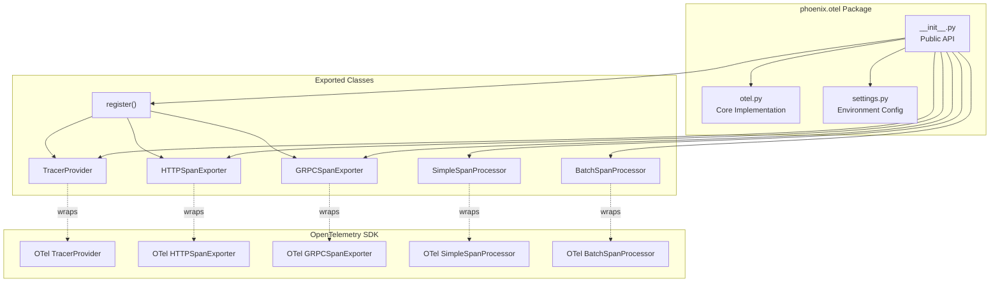
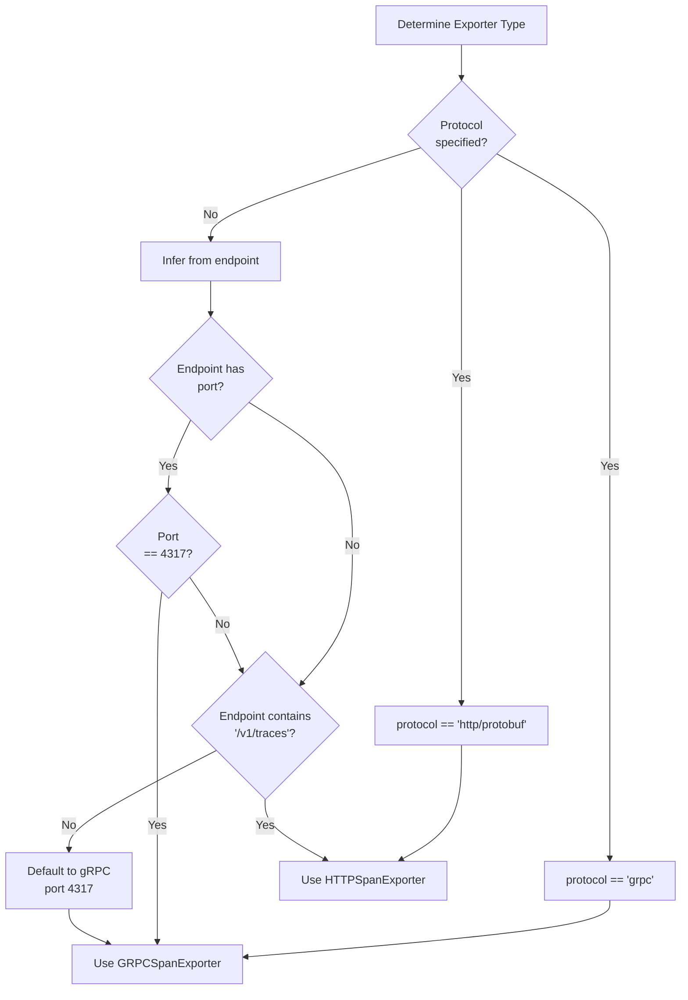
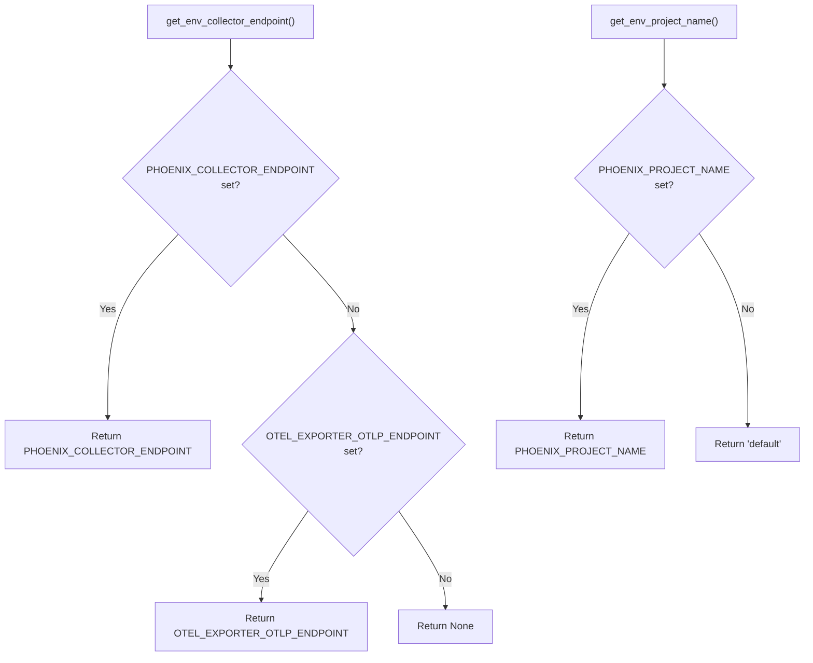
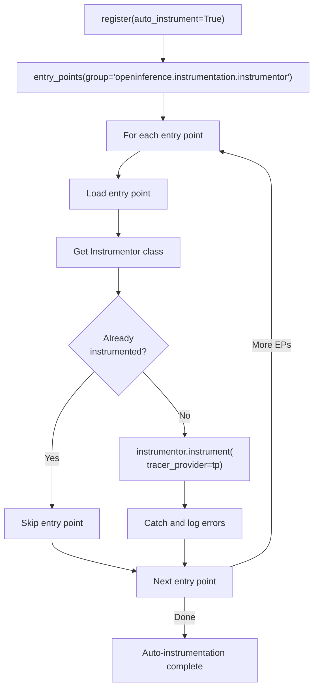

<!-- source: DeepWiki mcp.deepwiki.com · repo arize-ai/phoenix · page 3.2 Python OpenTelemetry (arize-phoenix-otel) · fetched 2026-10-27 -->

# Python OpenTelemetry (arize-phoenix-otel)

<details>
<summary>Relevant source files</summary>

The following files were used as context for generating this wiki page:

- [.release-please-manifest.json](.release-please-manifest.json)
- [CHANGELOG.md](CHANGELOG.md)
- [README.md](README.md)
- [app/src/pages/auth/AuthLayout.tsx](app/src/pages/auth/AuthLayout.tsx)
- [docs/phoenix/integrations/typescript/vercel/vercel-ai-sdk-tracing-js.mdx](docs/phoenix/integrations/typescript/vercel/vercel-ai-sdk-tracing-js.mdx)
- [docs/phoenix/sdk-api-reference/typescript/arizeai-phoenix-otel.mdx](docs/phoenix/sdk-api-reference/typescript/arizeai-phoenix-otel.mdx)
- [docs/phoenix/sdk-api-reference/typescript/overview.mdx](docs/phoenix/sdk-api-reference/typescript/overview.mdx)
- [docs/phoenix/sdk-api-reference/typescript/packages/phoenix-otel/manual-spans.mdx](docs/phoenix/sdk-api-reference/typescript/packages/phoenix-otel/manual-spans.mdx)
- [docs/phoenix/sdk-api-reference/typescript/packages/phoenix-otel/overview.mdx](docs/phoenix/sdk-api-reference/typescript/packages/phoenix-otel/overview.mdx)
- [internal_docs/specs/playground.md](internal_docs/specs/playground.md)
- [internal_docs/specs/prompts.md](internal_docs/specs/prompts.md)
- [internal_docs/specs/server_evaluators.md](internal_docs/specs/server_evaluators.md)
- [js/packages/phoenix-client/README.md](js/packages/phoenix-client/README.md)
- [js/packages/phoenix-config/README.md](js/packages/phoenix-config/README.md)
- [js/packages/phoenix-evals/README.md](js/packages/phoenix-evals/README.md)
- [js/packages/phoenix-mcp/README.md](js/packages/phoenix-mcp/README.md)
- [js/packages/phoenix-mcp/src/index.ts](js/packages/phoenix-mcp/src/index.ts)
- [js/packages/phoenix-mcp/src/projectTools.ts](js/packages/phoenix-mcp/src/projectTools.ts)
- [js/packages/phoenix-otel/README.md](js/packages/phoenix-otel/README.md)
- [kustomize/README.md](kustomize/README.md)
- [packages/phoenix-client/CHANGELOG.md](packages/phoenix-client/CHANGELOG.md)
- [packages/phoenix-client/README.md](packages/phoenix-client/README.md)
- [packages/phoenix-client/pyproject.toml](packages/phoenix-client/pyproject.toml)
- [packages/phoenix-evals/CHANGELOG.md](packages/phoenix-evals/CHANGELOG.md)
- [packages/phoenix-evals/README.md](packages/phoenix-evals/README.md)
- [packages/phoenix-evals/docs/source/api/evals.rst](packages/phoenix-evals/docs/source/api/evals.rst)
- [packages/phoenix-evals/docs/source/index.md](packages/phoenix-evals/docs/source/index.md)
- [packages/phoenix-evals/pyproject.toml](packages/phoenix-evals/pyproject.toml)
- [packages/phoenix-otel/CHANGELOG.md](packages/phoenix-otel/CHANGELOG.md)
- [packages/phoenix-otel/README.md](packages/phoenix-otel/README.md)
- [packages/phoenix-otel/pyproject.toml](packages/phoenix-otel/pyproject.toml)
- [packages/phoenix-otel/src/phoenix/otel/__init__.py](packages/phoenix-otel/src/phoenix/otel/__init__.py)
- [packages/phoenix-otel/src/phoenix/otel/otel.py](packages/phoenix-otel/src/phoenix/otel/otel.py)
- [packages/phoenix-otel/tests/__init__.py](packages/phoenix-otel/tests/__init__.py)
- [packages/phoenix-otel/tests/test_exports.py](packages/phoenix-otel/tests/test_exports.py)
- [packages/phoenix-otel/tests/test_otel.py](packages/phoenix-otel/tests/test_otel.py)
- [packages/phoenix-otel/tests/test_settings.py](packages/phoenix-otel/tests/test_settings.py)
- [pyproject.toml](pyproject.toml)
- [release-please-config.json](release-please-config.json)
- [requirements/packages/phoenix-evals.txt](requirements/packages/phoenix-evals.txt)
- [requirements/type-check.txt](requirements/type-check.txt)
- [requirements/unit-tests.txt](requirements/unit-tests.txt)
- [scripts/docker/devops/oidc-server/frontend/package.json](scripts/docker/devops/oidc-server/frontend/package.json)
- [scripts/docker/devops/oidc-server/frontend/src/contexts/ThemeContext.tsx](scripts/docker/devops/oidc-server/frontend/src/contexts/ThemeContext.tsx)
- [scripts/docker/devops/oidc-server/package.json](scripts/docker/devops/oidc-server/package.json)
- [scripts/docker/devops/smtp-server/package.json](scripts/docker/devops/smtp-server/package.json)
- [src/phoenix/__init__.py](src/phoenix/__init__.py)
- [src/phoenix/tests/test_config.py](src/phoenix/tests/test_config.py)
- [src/phoenix/version.py](src/phoenix/version.py)
- [tests/conftest.py](tests/conftest.py)
- [tests/unit/conftest.py](tests/unit/conftest.py)
- [uv.lock](uv.lock)

</details>


The `arize-phoenix-otel` package provides a lightweight wrapper around OpenTelemetry primitives with Phoenix-aware defaults. It simplifies the configuration of OpenTelemetry tracing for Phoenix users by providing drop-in replacements for standard OpenTelemetry classes and a streamlined registration function that handles protocol inference, authentication, and auto-instrumentation.

For information about the full Phoenix platform server and UI, see [1. Phoenix Overview](). For REST/GraphQL API access, see [3.1. Python Client (arize-phoenix-client)](). For evaluation frameworks, see [3.3. Python Evaluations (arize-phoenix-evals)]().

## Package Overview

The `arize-phoenix-otel` package (version 0.16.1) is a standalone Python package that depends on OpenTelemetry SDK components and OpenInference semantic conventions [packages/phoenix-otel/pyproject.toml:2-24](). It provides Phoenix-specific defaults while maintaining full compatibility with the OpenTelemetry ecosystem.

**Key Dependencies:**
- `opentelemetry-sdk` - Core OpenTelemetry SDK [packages/phoenix-otel/pyproject.toml:29-29]()
- `opentelemetry-exporter-otlp` - OTLP exporters [packages/phoenix-otel/pyproject.toml:27-27]()
- `openinference-semantic-conventions` - OpenInference resource attributes [packages/phoenix-otel/pyproject.toml:30-30]()
- `openinference-instrumentation` - Auto-instrumentation framework [packages/phoenix-otel/pyproject.toml:31-31]()

**Supported Python Versions:** 3.10 - 3.14 [packages/phoenix-otel/pyproject.toml:5-5]()

Sources: [packages/phoenix-otel/pyproject.toml:1-34](), [packages/phoenix-otel/README.md:1-58](), [packages/phoenix-otel/CHANGELOG.md:1-10]()

## Module Structure

The package architecture maps Phoenix-specific logic onto standard OpenTelemetry components. It re-exports OpenInference helpers and semantic conventions to provide a unified tracing surface [packages/phoenix-otel/src/phoenix/otel/__init__.py:1-25]().

Title: arize-phoenix-otel Module Architecture


Sources: [packages/phoenix-otel/src/phoenix/otel/otel.py:10-23](), [packages/phoenix-otel/src/phoenix/otel/settings.py:1-17](), [packages/phoenix-otel/src/phoenix/otel/__init__.py:1-60]()

## Core Components

### The `register()` Function

The `register()` function is the primary entry point for configuring OpenTelemetry tracing with Phoenix defaults [packages/phoenix-otel/src/phoenix/otel/otel.py:64-76](). It creates and configures a `TracerProvider` with automatic protocol inference, authentication, and optional auto-instrumentation.

**Function Signature:**
```python
def register(
    *,
    endpoint: Optional[str] = None,
    project_name: Optional[str] = None,
    batch: bool = False,
    set_global_tracer_provider: bool = True,
    headers: Optional[Dict[str, str]] = None,
    protocol: Optional[Literal["http/protobuf", "grpc"]] = None,
    verbose: bool = True,
    auto_instrument: bool = False,
    api_key: Optional[str] = None,
    **kwargs: Any,
) -> _TracerProvider
```

Title: register() Execution Flow

```mermaid
graph TB
    Start["register() called"]
    ResolveProject["Resolve project_name<br/>from args or get_env_project_name()"]
    CreateResource["Create Resource with<br/>PROJECT_NAME attribute"]
    ResolveEndpoint["Resolve endpoint<br/>from args or environment"]
    InferProtocol["Infer protocol from endpoint<br/>or use explicit protocol arg"]
    ResolveAuth["Resolve authentication<br/>API key or custom headers"]
    CreateExporter["Create HTTPSpanExporter<br/>or GRPCSpanExporter"]
    CreateProcessor["Create SimpleSpanProcessor<br/>or BatchSpanProcessor"]
    CreateProvider["Create TracerProvider<br/>with resource and processor"]
    AutoInstrument{"auto_instrument<br/>== True?"}
    LoadInstrumentors["Load and instrument<br/>via entry points"]
    SetGlobal{"set_global_tracer_provider<br/>== True?"}
    RegisterGlobal["Set as global<br/>tracer provider"]
    PrintDetails{"verbose<br/>== True?"}
    LogConfig["Print configuration<br/>details to stdout"]
    Return["Return TracerProvider"]
    
    Start --> ResolveProject
    ResolveProject --> CreateResource
    CreateResource --> ResolveEndpoint
    ResolveEndpoint --> InferProtocol
    InferProtocol --> ResolveAuth
    ResolveAuth --> CreateExporter
    CreateExporter --> CreateProcessor
    CreateProcessor --> CreateProvider
    CreateProvider --> AutoInstrument
    AutoInstrument -->|Yes| LoadInstrumentors
    AutoInstrument -->|No| SetGlobal
    LoadInstrumentors --> SetGlobal
    SetGlobal -->|Yes| RegisterGlobal
    SetGlobal -->|No| PrintDetails
    RegisterGlobal --> PrintDetails
    PrintDetails -->|Yes| LogConfig
    PrintDetails -->|No| Return
    LogConfig --> Return
```


Sources: [packages/phoenix-otel/src/phoenix/otel/otel.py:145-243](), [packages/phoenix-otel/src/phoenix/otel/settings.py:30-31]()

### TracerProvider

The `TracerProvider` class is a drop-in replacement for the OpenTelemetry `TracerProvider` with Phoenix-aware defaults. It extends the OpenInference `TracerProvider` to add verbose logging and default configuration [packages/phoenix-otel/src/phoenix/otel/otel.py:246-250]().

**Key Features:**
- Automatically merges project name into resource attributes [packages/phoenix-otel/src/phoenix/otel/otel.py:151-158]().
- Provides detailed configuration logging when `verbose=True` [packages/phoenix-otel/src/phoenix/otel/otel.py:263-320]().
- Re-exports OpenInference decorators like `@tracer.chain` and `@tracer.tool` [packages/phoenix-otel/README.md:164-171]().
- Re-exports context management helpers like `using_session`, `using_user`, and `using_tags` [packages/phoenix-otel/src/phoenix/otel/__init__.py:1-9]().

Sources: [packages/phoenix-otel/src/phoenix/otel/otel.py:246-320](), [packages/phoenix-otel/src/phoenix/otel/__init__.py:1-60]()

### Span Exporters

The package provides two span exporter classes with Phoenix-aware defaults:

#### HTTPSpanExporter
Exports spans using OTLP over HTTP/protobuf protocol. It defaults to using the `PHOENIX_COLLECTOR_ENDPOINT` environment variable [packages/phoenix-otel/src/phoenix/otel/otel.py:323-333]().

#### GRPCSpanExporter
Exports spans using OTLP over gRPC protocol. It defaults to port 4317 if no endpoint is specified [packages/phoenix-otel/src/phoenix/otel/otel.py:393-403]().

Title: Protocol Selection Logic


Sources: [packages/phoenix-otel/src/phoenix/otel/otel.py:36-61](), [packages/phoenix-otel/src/phoenix/otel/otel.py:549-564]()

## Configuration System

### Environment Variables

The package reads configuration from environment variables defined in `settings.py`:

| Environment Variable | Purpose | Default |
|---------------------|---------|---------|
| `PHOENIX_COLLECTOR_ENDPOINT` | Collector endpoint URL | `None` (standard OTel fallback) [packages/phoenix-otel/src/phoenix/otel/settings.py:12-34]() |
| `PHOENIX_PROJECT_NAME` | Project name for traces | `"default"` [packages/phoenix-otel/src/phoenix/otel/settings.py:14-44]() |
| `PHOENIX_CLIENT_HEADERS` | Custom headers (W3C Baggage format) | `None` [packages/phoenix-otel/src/phoenix/otel/settings.py:15-59]() |
| `PHOENIX_API_KEY` | API key for authentication | `None` [packages/phoenix-otel/src/phoenix/otel/settings.py:16-76]() |
| `PHOENIX_GRPC_PORT` | gRPC port override | `4317` [packages/phoenix-otel/src/phoenix/otel/settings.py:13-93]() |

Title: Environment Configuration Flow


Sources: [packages/phoenix-otel/src/phoenix/otel/settings.py:1-125]()

## Auto-Instrumentation

The `register()` function supports automatic instrumentation of installed OpenInference libraries through Python entry points [packages/phoenix-otel/src/phoenix/otel/otel.py:184-226](). This allows users to trace popular frameworks like OpenAI, LangChain, and LlamaIndex with zero code changes [packages/phoenix-otel/README.md:77-85]().

Title: Auto-Instrumentation Entry Point Flow


Sources: [packages/phoenix-otel/src/phoenix/otel/otel.py:184-226](), [packages/phoenix-otel/README.md:77-85]()

## Usage Examples

### Production Setup with Auto-Instrumentation

```python
from phoenix.otel import register

tracer_provider = register(
    auto_instrument=True,  # Auto-trace all OpenInference libraries
    batch=True,            # Use batching for efficiency
    project_name="prod-app",
    api_key="your-api-key"
)
```

### Manual Configuration

For advanced use cases, use Phoenix OTEL components directly:

```python
from phoenix.otel import TracerProvider, BatchSpanProcessor, HTTPSpanExporter

tracer_provider = TracerProvider()
exporter = HTTPSpanExporter(endpoint="http://localhost:6006/v1/traces")
processor = BatchSpanProcessor(span_exporter=exporter)
tracer_provider.add_span_processor(processor)
```

Sources: [packages/phoenix-otel/README.md:129-152](), [packages/phoenix-otel/src/phoenix/otel/otel.py:106-143]()

---

