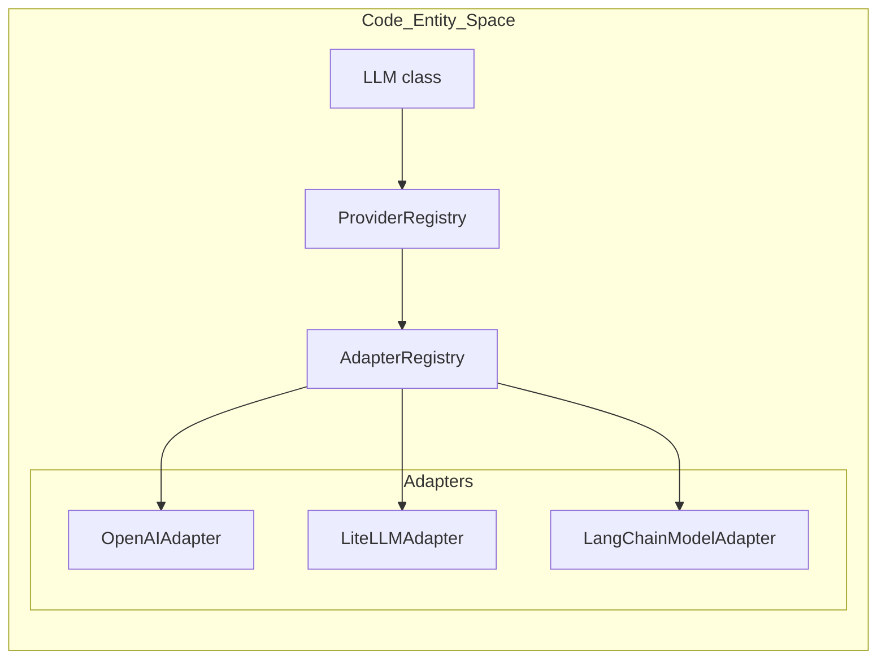

<!-- source: DeepWiki mcp.deepwiki.com · repo arize-ai/phoenix · page 3.3 Python Evaluations (arize-phoenix-evals) · fetched 2026-10-27 -->

# Python Evaluations (arize-phoenix-evals)

Relevant source files

The following files were used as context for generating this wiki page:

- [js/packages/phoenix-evals/src/__generated__/default_templates/index.ts](js/packages/phoenix-evals/src/__generated__/default_templates/index.ts)
- [js/packages/phoenix-evals/src/llm/createToolSelectionEvaluator.ts](js/packages/phoenix-evals/src/llm/createToolSelectionEvaluator.ts)
- [js/packages/phoenix-evals/src/llm/index.ts](js/packages/phoenix-evals/src/llm/index.ts)
- [packages/phoenix-evals/src/phoenix/evals/__generated__/classification_evaluator_configs/__init__.py](packages/phoenix-evals/src/phoenix/evals/__generated__/classification_evaluator_configs/__init__.py)
- [packages/phoenix-evals/src/phoenix/evals/__generated__/classification_evaluator_configs/_tool_invocation_classification_evaluator_config.py](packages/phoenix-evals/src/phoenix/evals/__generated__/classification_evaluator_configs/_tool_invocation_classification_evaluator_config.py)
- [packages/phoenix-evals/src/phoenix/evals/__generated__/classification_evaluator_configs/_tool_selection_classification_evaluator_config.py](packages/phoenix-evals/src/phoenix/evals/__generated__/classification_evaluator_configs/_tool_selection_classification_evaluator_config.py)
- [packages/phoenix-evals/src/phoenix/evals/__init__.py](packages/phoenix-evals/src/phoenix/evals/__init__.py)
- [packages/phoenix-evals/src/phoenix/evals/evaluators.py](packages/phoenix-evals/src/phoenix/evals/evaluators.py)
- [packages/phoenix-evals/src/phoenix/evals/executors.py](packages/phoenix-evals/src/phoenix/evals/executors.py)
- [packages/phoenix-evals/src/phoenix/evals/llm/__init__.py](packages/phoenix-evals/src/phoenix/evals/llm/__init__.py)
- [packages/phoenix-evals/src/phoenix/evals/llm/adapters/__init__.py](packages/phoenix-evals/src/phoenix/evals/llm/adapters/__init__.py)
- [packages/phoenix-evals/src/phoenix/evals/llm/adapters/anthropic/adapter.py](packages/phoenix-evals/src/phoenix/evals/llm/adapters/anthropic/adapter.py)
- [packages/phoenix-evals/src/phoenix/evals/llm/adapters/google/adapter.py](packages/phoenix-evals/src/phoenix/evals/llm/adapters/google/adapter.py)
- [packages/phoenix-evals/src/phoenix/evals/llm/adapters/google/factories.py](packages/phoenix-evals/src/phoenix/evals/llm/adapters/google/factories.py)
- [packages/phoenix-evals/src/phoenix/evals/llm/adapters/langchain/__init__.py](packages/phoenix-evals/src/phoenix/evals/llm/adapters/langchain/__init__.py)
- [packages/phoenix-evals/src/phoenix/evals/llm/adapters/langchain/adapter.py](packages/phoenix-evals/src/phoenix/evals/llm/adapters/langchain/adapter.py)
- [packages/phoenix-evals/src/phoenix/evals/llm/adapters/langchain/factories.py](packages/phoenix-evals/src/phoenix/evals/llm/adapters/langchain/factories.py)
- [packages/phoenix-evals/src/phoenix/evals/llm/adapters/litellm/__init__.py](packages/phoenix-evals/src/phoenix/evals/llm/adapters/litellm/__init__.py)
- [packages/phoenix-evals/src/phoenix/evals/llm/adapters/litellm/adapter.py](packages/phoenix-evals/src/phoenix/evals/llm/adapters/litellm/adapter.py)
- [packages/phoenix-evals/src/phoenix/evals/llm/adapters/litellm/client.py](packages/phoenix-evals/src/phoenix/evals/llm/adapters/litellm/client.py)
- [packages/phoenix-evals/src/phoenix/evals/llm/adapters/litellm/factories.py](packages/phoenix-evals/src/phoenix/evals/llm/adapters/litellm/factories.py)
- [packages/phoenix-evals/src/phoenix/evals/llm/adapters/openai/adapter.py](packages/phoenix-evals/src/phoenix/evals/llm/adapters/openai/adapter.py)
- [packages/phoenix-evals/src/phoenix/evals/llm/adapters/openai/factories.py](packages/phoenix-evals/src/phoenix/evals/llm/adapters/openai/factories.py)
- [packages/phoenix-evals/src/phoenix/evals/llm/prompts.py](packages/phoenix-evals/src/phoenix/evals/llm/prompts.py)
- [packages/phoenix-evals/src/phoenix/evals/llm/registries.py](packages/phoenix-evals/src/phoenix/evals/llm/registries.py)
- [packages/phoenix-evals/src/phoenix/evals/llm/types.py](packages/phoenix-evals/src/phoenix/evals/llm/types.py)
- [packages/phoenix-evals/src/phoenix/evals/llm/wrapper.py](packages/phoenix-evals/src/phoenix/evals/llm/wrapper.py)
- [packages/phoenix-evals/src/phoenix/evals/metrics/__init__.py](packages/phoenix-evals/src/phoenix/evals/metrics/__init__.py)
- [packages/phoenix-evals/src/phoenix/evals/metrics/matches_regex.py](packages/phoenix-evals/src/phoenix/evals/metrics/matches_regex.py)
- [packages/phoenix-evals/src/phoenix/evals/tracing.py](packages/phoenix-evals/src/phoenix/evals/tracing.py)
- [packages/phoenix-evals/src/phoenix/evals/utils.py](packages/phoenix-evals/src/phoenix/evals/utils.py)
- [packages/phoenix-evals/tests/phoenix/evals/llm/test_prompts.py](packages/phoenix-evals/tests/phoenix/evals/llm/test_prompts.py)
- [packages/phoenix-evals/tests/phoenix/evals/metrics/test_matches_regex.py](packages/phoenix-evals/tests/phoenix/evals/metrics/test_matches_regex.py)
- [packages/phoenix-evals/tests/phoenix/evals/test_evaluators.py](packages/phoenix-evals/tests/phoenix/evals/test_evaluators.py)
- [packages/phoenix-evals/tests/phoenix/evals/test_imports.py](packages/phoenix-evals/tests/phoenix/evals/test_imports.py)
- [packages/phoenix-evals/tests/phoenix/evals/test_utils.py](packages/phoenix-evals/tests/phoenix/evals/test_utils.py)
- [prompts/classification_evaluator_configs/TOOL_INVOCATION_CLASSIFICATION_EVALUATOR_CONFIG.yaml](prompts/classification_evaluator_configs/TOOL_INVOCATION_CLASSIFICATION_EVALUATOR_CONFIG.yaml)
- [prompts/classification_evaluator_configs/TOOL_SELECTION_CLASSIFICATION_EVALUATOR_CONFIG.yaml](prompts/classification_evaluator_configs/TOOL_SELECTION_CLASSIFICATION_EVALUATOR_CONFIG.yaml)
- [prompts/formatters/server.yaml](prompts/formatters/server.yaml)
- [src/phoenix/__generated__/classification_evaluator_configs/__init__.py](src/phoenix/__generated__/classification_evaluator_configs/__init__.py)
- [src/phoenix/__generated__/classification_evaluator_configs/_tool_invocation_classification_evaluator_config.py](src/phoenix/__generated__/classification_evaluator_configs/_tool_invocation_classification_evaluator_config.py)
- [src/phoenix/__generated__/classification_evaluator_configs/_tool_selection_classification_evaluator_config.py](src/phoenix/__generated__/classification_evaluator_configs/_tool_selection_classification_evaluator_config.py)
- [src/phoenix/server/api/helpers/substitutions/server.yaml](src/phoenix/server/api/helpers/substitutions/server.yaml)
- [tests/unit/server/api/helpers/test_substitutions.py](tests/unit/server/api/helpers/test_substitutions.py)

The `arize-phoenix-evals` package provides a lightweight, composable evaluation framework for LLM applications. It offers building blocks for creating and running automatic evaluations using LLM-based judges, code-based metrics, and pre-built evaluators. The package is instrumented for OpenTelemetry tracing and supports multiple LLM providers through a unified adapter system.

**Scope**: This document covers the Python evaluation framework (`arize-phoenix-evals`). For the Phoenix client used to log evaluation results, see page [3.1]().

**Package Version**: [packages/phoenix-evals/src/phoenix/evals/__init__.py:23-23]()

## Architecture Overview

The evaluation framework consists of four main layers: evaluator abstractions, LLM provider adapters, a templating system, and an execution engine.

### Evaluation Data Flow
The following diagram illustrates how data flows from user input through the evaluation engine to produce scores, mapping natural language concepts to code entities.

Title: Evaluation Data Flow

```mermaid
graph TB
    subgraph "Natural_Language_&_Data"
        InputDF["pandas.DataFrame"]
        PromptText["Natural Language Prompt"]
    end
    
    subgraph "Evaluator_Layer"
        Evaluator["Evaluator (Abstract Base)"]
        LLMEvaluator["LLMEvaluator"]
        ClassEval["ClassificationEvaluator"]
        CreateEval["create_evaluator()"]
        CreateClass["create_classifier()"]
    end
    
    subgraph "LLM_Abstraction_Space"
        LLM_Class["LLM (Unified Wrapper)"]
        Registry["PROVIDER_REGISTRY"]
        Adapter["BaseLLMAdapter"]
        LiteLLM["LiteLLMAdapter"]
        OpenAI["OpenAIAdapter"]
    end
    
    subgraph "Execution_&_Tracing"
        AsyncExec["AsyncExecutor"]
        Controller["ConcurrencyController"]
        Trace["@trace decorator"]
    end
    
    InputDF --> CreateEval
    InputDF --> CreateClass
    PromptText --> LLMEvaluator
    
    CreateEval --> LLMEvaluator
    CreateClass --> ClassEval
    
    LLMEvaluator --> LLM_Class
    LLM_Class --> Registry
    Registry --> Adapter
    Adapter --> LiteLLM
    Adapter --> OpenAI
    
    LLMEvaluator --> AsyncExec
    AsyncExec --> Controller
    LLM_Class --> Trace
    
    ClassEval --> Score["Score Object"]
```

**Sources**: [packages/phoenix-evals/src/phoenix/evals/evaluators.py:328-330](), [packages/phoenix-evals/src/phoenix/evals/llm/wrapper.py:97-122](), [packages/phoenix-evals/src/phoenix/evals/executors.py:170-196]()

## Core Abstractions

### Evaluator Base Class

The `Evaluator` class is an abstract base class that defines the interface for all evaluation logic.

| Class | Role | Definition |
|-------|------|------------|
| `Evaluator` | Abstract base class for all evaluators. | [packages/phoenix-evals/src/phoenix/evals/evaluators.py:328-330]() |
| `LLMEvaluator` | Uses an LLM to perform evaluation based on a prompt template. | [packages/phoenix-evals/src/phoenix/evals/evaluators.py:535-537]() |
| `ClassificationEvaluator` | Specialization of `LLMEvaluator` for categorical labels. | [packages/phoenix-evals/src/phoenix/evals/evaluators.py:738-740]() |

**Key Features**:
- **Input Mapping**: Uses `remap_eval_input` to extract values from nested data structures using JSONPath or callable mappings [packages/phoenix-evals/src/phoenix/evals/utils.py:175-187]().
- **Variable Binding**: `bind_evaluator` allows partial application of template variables for reusable configurations [packages/phoenix-evals/src/phoenix/evals/evaluators.py:1260-1262]().
- **Async Support**: Evaluators implement `async_evaluate` for non-blocking execution [packages/phoenix-evals/src/phoenix/evals/evaluators.py:382-384]().

### Score Model

The `Score` class represents the result of an evaluation. It is a frozen dataclass containing:
- `name`: The name of the evaluation metric [packages/phoenix-evals/src/phoenix/evals/evaluators.py:209-209]().
- `score`: A numeric value (float/int) [packages/phoenix-evals/src/phoenix/evals/evaluators.py:210-210]().
- `label`: A categorical string label [packages/phoenix-evals/src/phoenix/evals/evaluators.py:211-211]().
- `explanation`: LLM-generated reasoning [packages/phoenix-evals/src/phoenix/evals/evaluators.py:212-212]().
- `metadata`: A dictionary of additional context [packages/phoenix-evals/src/phoenix/evals/evaluators.py:213-213]().
- `kind`: The type of evaluator (e.g., "llm", "code", "human") [packages/phoenix-evals/src/phoenix/evals/evaluators.py:214-214]().

**Sources**: [packages/phoenix-evals/src/phoenix/evals/evaluators.py:158-216]()

## LLM Provider Support

The `LLM` class acts as a unified interface for various providers, delegating to specific adapters.

### Provider Registry and Adapters
Phoenix uses a registration system to manage model adapters.

Title: Provider and Adapter Registry

- **OpenAIAdapter**: Supports OpenAI and Azure OpenAI [packages/phoenix-evals/src/phoenix/evals/llm/adapters/openai/adapter.py:60-60]().
- **LiteLLMAdapter**: Provides access to 100+ providers via the LiteLLM library [packages/phoenix-evals/src/phoenix/evals/llm/adapters/litellm/adapter.py:66-66]().
- **LangChainModelAdapter**: Allows using existing LangChain chat models as evaluators [packages/phoenix-evals/src/phoenix/evals/llm/adapters/langchain/adapter.py:63-63]().

**Sources**: [packages/phoenix-evals/src/phoenix/evals/llm/registries.py:39-147](), [packages/phoenix-evals/src/phoenix/evals/llm/wrapper.py:97-122]()

### Execution & Concurrency
The framework includes an `AsyncExecutor` and `ConcurrencyController` to manage API rate limits.
- **ConcurrencyController**: Implements an AIMD (Additive Increase/Multiplicative Decrease) algorithm to dynamically adjust request rates based on success/failure [packages/phoenix-evals/src/phoenix/evals/executors.py:73-86]().
- **AsyncExecutor**: Manages the producer-consumer pattern for batch evaluations [packages/phoenix-evals/src/phoenix/evals/executors.py:170-196]().

**Sources**: [packages/phoenix-evals/src/phoenix/evals/executors.py:73-196]()

## Built-in Metrics

Phoenix provides several pre-built evaluators for common tasks.

| Evaluator | Purpose | Implementation |
|-----------|---------|----------------|
| `FaithfulnessEvaluator` | Detects factual consistency between context and response. | [packages/phoenix-evals/src/phoenix/evals/metrics/faithfulness.py:1]() |
| `CorrectnessEvaluator` | Evaluates if a response is correct relative to a reference. | [packages/phoenix-evals/src/phoenix/evals/metrics/correctness.py:1]() |
| `DocumentRelevanceEvaluator` | Evaluates if a document is relevant to the query. | [packages/phoenix-evals/src/phoenix/evals/metrics/document_relevance.py:1]() |
| `ToolSelectionEvaluator` | Validates if the correct tool was chosen. | [packages/phoenix-evals/src/phoenix/evals/metrics/tool_selection.py:1]() |
| `MatchesRegex` | Code-based evaluator for pattern matching. | [packages/phoenix-evals/src/phoenix/evals/metrics/matches_regex.py:1]() |
| `PrecisionRecallFScore` | Calculates classification metrics. | [packages/phoenix-evals/src/phoenix/evals/metrics/precision_recall.py:8]() |

**Sources**: [packages/phoenix-evals/src/phoenix/evals/metrics/__init__.py:1-27]()

## Templating and Data Handling

### Prompt Templates
Phoenix uses a flexible templating system for LLM prompts.
- `PromptTemplate`: Manages template rendering and variable substitution [packages/phoenix-evals/src/phoenix/evals/llm/prompts.py:1]().
- `SmartString`: A Pydantic type that ensures non-string values (like dictionaries or lists) are properly JSON-serialized before being inserted into a prompt [packages/phoenix-evals/src/phoenix/evals/evaluators.py:80-87]().

### Evaluation Execution
Users can evaluate entire datasets using `evaluate_dataframe` or `async_evaluate_dataframe`.
- `evaluate_dataframe`: Synchronous batch evaluation [packages/phoenix-evals/src/phoenix/evals/evaluators.py:18-18]().
- `async_evaluate_dataframe`: Asynchronous batch evaluation using the `AsyncExecutor` [packages/phoenix-evals/src/phoenix/evals/evaluators.py:14-14]().

**Sources**: [packages/phoenix-evals/src/phoenix/evals/evaluators.py:1-154](), [packages/phoenix-evals/src/phoenix/evals/llm/prompts.py:1]()

## Tracing and Instrumentation

Evaluations are instrumented using OpenTelemetry via the `@trace` decorator.
- **Span Metadata**: Evaluators attach metadata such as `evaluator.kind` and `evaluator.class` to spans [packages/phoenix-evals/src/phoenix/evals/evaluators.py:103-111]().
- **Span Inputs/Outputs**: Remapped inputs and generated `Score` objects are serialized to JSON and attached to the span attributes [packages/phoenix-evals/src/phoenix/evals/evaluators.py:113-121]().
- **LLM Tracing**: The `LLM` wrapper provides helper functions like `_get_prompt` and `_get_llm_model_name` to extract tracing attributes from bound arguments [packages/phoenix-evals/src/phoenix/evals/llm/wrapper.py:19-70]().

**Sources**: [packages/phoenix-evals/src/phoenix/evals/tracing.py:34-34](), [packages/phoenix-evals/src/phoenix/evals/evaluators.py:91-121](), [packages/phoenix-evals/src/phoenix/evals/llm/wrapper.py:19-95]()

---

