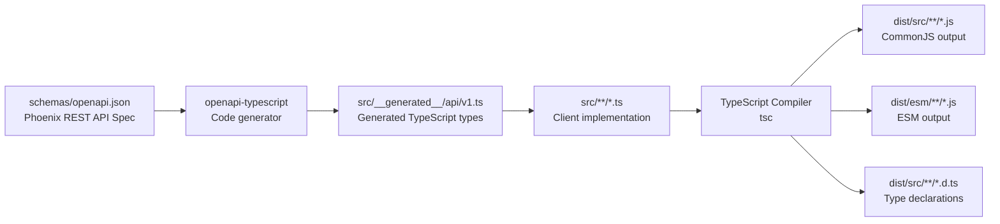
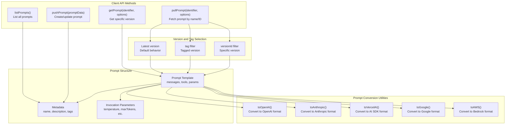
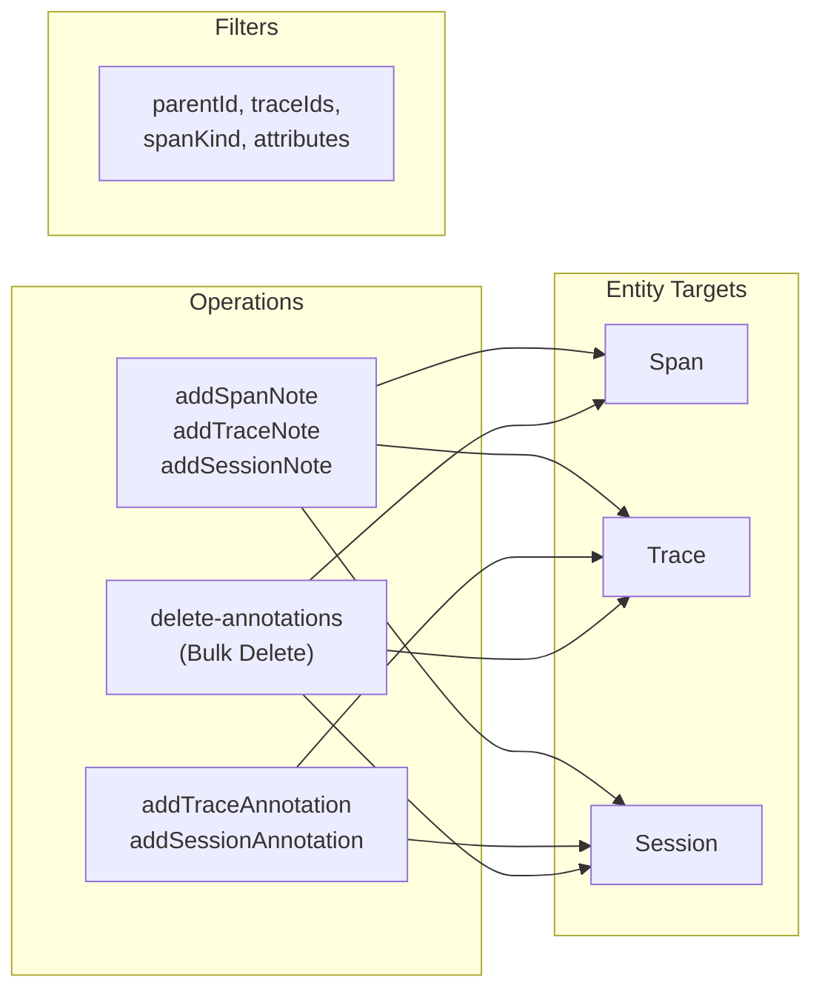
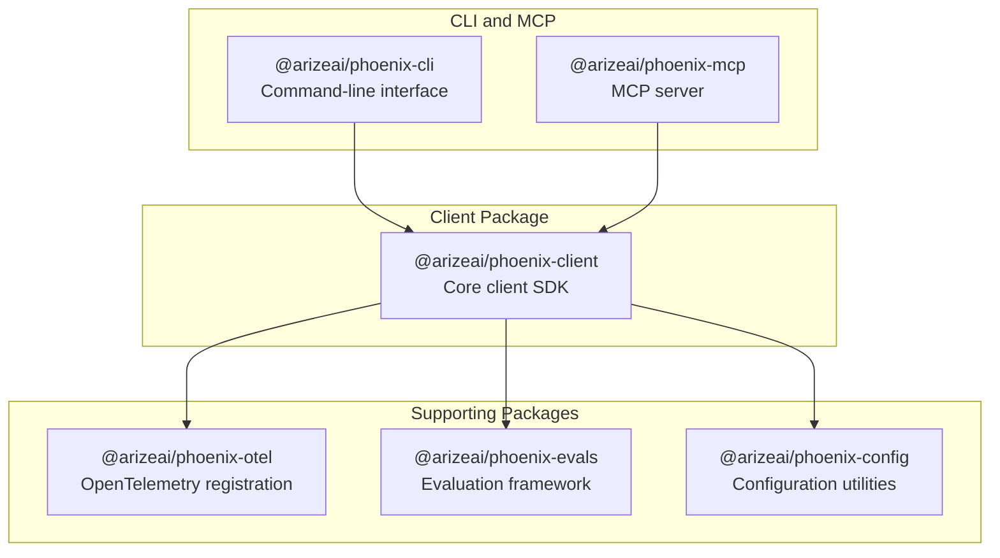

<!-- source: DeepWiki mcp.deepwiki.com · repo arize-ai/phoenix · page 3.4 TypeScript Client · fetched 2026-10-27 -->

# TypeScript Client

Relevant source files

The following files were used as context for generating this wiki page:

- [docs/phoenix/sdk-api-reference/typescript/packages/phoenix-client/experiments.mdx](docs/phoenix/sdk-api-reference/typescript/packages/phoenix-client/experiments.mdx)
- [js/examples/apps/demo-document-relevancy-experiment/CHANGELOG.md](js/examples/apps/demo-document-relevancy-experiment/CHANGELOG.md)
- [js/examples/apps/demo-document-relevancy-experiment/package.json](js/examples/apps/demo-document-relevancy-experiment/package.json)
- [js/examples/apps/phoenix-experiment-runner/index.ts](js/examples/apps/phoenix-experiment-runner/index.ts)
- [js/examples/apps/phoenix-experiment-runner/package.json](js/examples/apps/phoenix-experiment-runner/package.json)
- [js/packages/phoenix-cli/CHANGELOG.md](js/packages/phoenix-cli/CHANGELOG.md)
- [js/packages/phoenix-cli/package.json](js/packages/phoenix-cli/package.json)
- [js/packages/phoenix-client/CHANGELOG.md](js/packages/phoenix-client/CHANGELOG.md)
- [js/packages/phoenix-client/examples/experiment_trace_evaluator.ts](js/packages/phoenix-client/examples/experiment_trace_evaluator.ts)
- [js/packages/phoenix-client/package.json](js/packages/phoenix-client/package.json)
- [js/packages/phoenix-client/src/client.ts](js/packages/phoenix-client/src/client.ts)
- [js/packages/phoenix-client/src/constants/serverRequirements.ts](js/packages/phoenix-client/src/constants/serverRequirements.ts)
- [js/packages/phoenix-client/src/experiments/index.ts](js/packages/phoenix-client/src/experiments/index.ts)
- [js/packages/phoenix-client/src/experiments/logging.ts](js/packages/phoenix-client/src/experiments/logging.ts)
- [js/packages/phoenix-client/src/experiments/resumeEvaluation.ts](js/packages/phoenix-client/src/experiments/resumeEvaluation.ts)
- [js/packages/phoenix-client/src/experiments/resumeExperiment.ts](js/packages/phoenix-client/src/experiments/resumeExperiment.ts)
- [js/packages/phoenix-client/src/experiments/runExperiment.ts](js/packages/phoenix-client/src/experiments/runExperiment.ts)
- [js/packages/phoenix-client/src/logger.ts](js/packages/phoenix-client/src/logger.ts)
- [js/packages/phoenix-client/src/sessions/getSession.ts](js/packages/phoenix-client/src/sessions/getSession.ts)
- [js/packages/phoenix-client/src/sessions/listSessions.ts](js/packages/phoenix-client/src/sessions/listSessions.ts)
- [js/packages/phoenix-client/src/sessions/sessionUtils.ts](js/packages/phoenix-client/src/sessions/sessionUtils.ts)
- [js/packages/phoenix-client/src/spans/getSpanAnnotations.ts](js/packages/phoenix-client/src/spans/getSpanAnnotations.ts)
- [js/packages/phoenix-client/src/spans/getSpans.ts](js/packages/phoenix-client/src/spans/getSpans.ts)
- [js/packages/phoenix-client/src/traces/index.ts](js/packages/phoenix-client/src/traces/index.ts)
- [js/packages/phoenix-client/src/types/experiments.ts](js/packages/phoenix-client/src/types/experiments.ts)
- [js/packages/phoenix-client/src/types/projects.ts](js/packages/phoenix-client/src/types/projects.ts)
- [js/packages/phoenix-client/src/types/sessions.ts](js/packages/phoenix-client/src/types/sessions.ts)
- [js/packages/phoenix-client/src/utils/noopLogger.ts](js/packages/phoenix-client/src/utils/noopLogger.ts)
- [js/packages/phoenix-client/test/experiments/resumeEvaluation.test.ts](js/packages/phoenix-client/test/experiments/resumeEvaluation.test.ts)
- [js/packages/phoenix-client/test/experiments/runExperiment.test.ts](js/packages/phoenix-client/test/experiments/runExperiment.test.ts)
- [js/packages/phoenix-client/test/sessions/getSession.test.ts](js/packages/phoenix-client/test/sessions/getSession.test.ts)
- [js/packages/phoenix-client/test/spans/getSpans.test.ts](js/packages/phoenix-client/test/spans/getSpans.test.ts)
- [js/packages/phoenix-config/CHANGELOG.md](js/packages/phoenix-config/CHANGELOG.md)
- [js/packages/phoenix-config/package.json](js/packages/phoenix-config/package.json)
- [js/packages/phoenix-config/src/env.test.ts](js/packages/phoenix-config/src/env.test.ts)
- [js/packages/phoenix-config/src/env.ts](js/packages/phoenix-config/src/env.ts)
- [js/packages/phoenix-evals/CHANGELOG.md](js/packages/phoenix-evals/CHANGELOG.md)
- [js/packages/phoenix-evals/package.json](js/packages/phoenix-evals/package.json)
- [js/packages/phoenix-mcp/CHANGELOG.md](js/packages/phoenix-mcp/CHANGELOG.md)
- [js/packages/phoenix-mcp/package.json](js/packages/phoenix-mcp/package.json)
- [js/packages/phoenix-otel/CHANGELOG.md](js/packages/phoenix-otel/CHANGELOG.md)
- [js/packages/phoenix-otel/package.json](js/packages/phoenix-otel/package.json)
- [packages/phoenix-client/src/phoenix/client/constants/server_requirements.py](packages/phoenix-client/src/phoenix/client/constants/server_requirements.py)
- [packages/phoenix-client/src/phoenix/client/resources/spans/__init__.py](packages/phoenix-client/src/phoenix/client/resources/spans/__init__.py)
- [packages/phoenix-client/tests/client/resources/spans/test_spans.py](packages/phoenix-client/tests/client/resources/spans/test_spans.py)
- [tests/integration/client/test_spans.py](tests/integration/client/test_spans.py)
- [tutorials/human_feedback/chatbot_with_human_feedback.ipynb](tutorials/human_feedback/chatbot_with_human_feedback.ipynb)

The `@arizeai/phoenix-client` package is the TypeScript SDK for interacting with the Phoenix API. It provides typed interfaces for managing prompts, datasets, experiments, spans, and sessions. The client handles authentication, request/response serialization, and provides utilities for converting prompts between different LLM provider formats (OpenAI, Anthropic, Google, AWS, Vercel AI SDK). For information about the Python client equivalent, see [Python Client (arize-phoenix-client)](#3.1). For CLI usage built on this client, see [Command Line Interface (CLI)](#3.5).

**Sources:** [js/packages/phoenix-client/package.json:1-14](), [js/packages/phoenix-client/package.json:81-90]()

## Package Structure

The client is organized into modular exports with both CommonJS and ESM support. Each submodule provides focused functionality for a specific domain area.

### Module Organization

```mermaid
graph TB
    subgraph "@arizeai/phoenix-client Package"
        MainExport["index.ts"]
        PromptsModule["./prompts<br/>Prompt management"]
        SpansModule["./spans<br/>Span querying"]
        SessionsModule["./sessions<br/>Session management"]
        TracesModule["./traces<br/>Trace retrieval"]
        ExperimentsModule["./experiments<br/>Experiment execution"]
        DatasetsModule["./datasets<br/>Dataset management"]
        UtilsModule["./utils/*<br/>Helper functions"]
        TypesModule["./types/*<br/>Type definitions"]
    end
    
    subgraph "Core Dependencies"
        OpenAPIFetch["openapi-fetch<br/>HTTP client"]
        PhoenixOtel["@arizeai/phoenix-otel<br/>OpenTelemetry integration"]
        PhoenixConfig["@arizeai/phoenix-config<br/>Configuration utilities"]
        OpenInferenceConventions["@arizeai/openinference-semantic-conventions<br/>Semantic conventions"]
        GeneratedTypes["__generated__/api/v1.ts<br/>OpenAPI-generated types"]
    end
    
    subgraph "Optional Provider SDKs"
        OpenAISDK["openai<br/>OpenAI SDK"]
        AnthropicSDK["@anthropic-ai/sdk<br/>Anthropic SDK"]
        VercelAI["ai<br/>Vercel AI SDK"]
    end
    
    MainExport --> PromptsModule
    MainExport --> SpansModule
    MainExport --> SessionsModule
    MainExport --> TracesModule
    MainExport --> ExperimentsModule
    MainExport --> DatasetsModule
    MainExport --> UtilsModule
    MainExport --> TypesModule
    
    PromptsModule --> OpenAPIFetch
    PromptsModule --> GeneratedTypes
    PromptsModule --> OpenAISDK
    PromptsModule --> AnthropicSDK
    PromptsModule --> VercelAI
    
    ExperimentsModule --> PhoenixOtel
    ExperimentsModule --> OpenAPIFetch
    
    DatasetsModule --> OpenAPIFetch
    DatasetsModule --> GeneratedTypes
    
    SpansModule --> OpenAPIFetch
    SessionsModule --> OpenAPIFetch
    TracesModule --> OpenAPIFetch
    
    UtilsModule --> PhoenixConfig
    UtilsModule --> OpenInferenceConventions
```

**Sources:** [js/packages/phoenix-client/package.json:33-70](), [js/packages/phoenix-client/package.json:81-90]()

### Build System and Type Generation

The client uses a code-generation workflow to maintain type safety with the Phoenix REST API. It generates TypeScript definitions directly from the Phoenix OpenAPI schema using `openapi-typescript`.

**Sources:** [js/packages/phoenix-client/package.json:75-86](), [js/packages/phoenix-client/package.json:107-107]()

## Client Initialization

The client supports flexible configuration through environment variables and constructor parameters. It includes server version gating to ensure compatibility between the client and the Phoenix server instance. The client reads the server version from response headers and validates it against minimum version requirements before calling newer API routes.

| Configuration Method | Environment Variable | Constructor Parameter | Default |
|---------------------|---------------------|----------------------|---------|
| API endpoint | `PHOENIX_CLIENT_BASE_URL` | `baseURL` | `http://localhost:6006` |
| API key | `PHOENIX_API_KEY` | `apiKey` | `undefined` |
| Headers | - | `headers` | `{}` |

The client reads configuration in this priority order:
1. Constructor parameters (highest priority)
2. Environment variables (managed via `@arizeai/phoenix-config`)
3. Default values (lowest priority)

**Sources:** [js/packages/phoenix-client/CHANGELOG.md:140-141](), [js/packages/phoenix-client/package.json:90-91](), [js/packages/phoenix-client/src/client.ts:1-20]()

## Prompt Management

The prompts module provides functionality for managing prompt templates with versioning, tagging, and multi-provider format conversion.

### Prompt Operations Flow

**Sources:** [js/packages/phoenix-client/CHANGELOG.md:120-125](), [js/packages/phoenix-client/CHANGELOG.md:228-229]()

### Provider Conversion

The client provides conversion utilities for each major LLM provider, handling differences in message format, tool calling syntax, and invocation parameters. It supports the latest Vercel AI SDK (v6) and OpenAI versions.

| Template Type | Structure | Provider Support |
|--------------|-----------|------------------|
| Chat Messages | Array of role/content pairs with optional tool definitions | OpenAI, Anthropic, Google, AWS Bedrock, Vercel AI SDK |
| String Template | Single text template with variable interpolation | All providers with adaptation |

**Sources:** [js/packages/phoenix-client/CHANGELOG.md:43-44](), [js/packages/phoenix-client/CHANGELOG.md:161-162](), [js/packages/phoenix-client/package.json:105-109]()

## Dataset and Experiment Management

The datasets and experiments modules support evaluation workflows, with OpenTelemetry integration for trace capture and support for dataset splits.

### Dataset Operations

```mermaid
graph TB
    subgraph "Dataset Creation"
        CreateDataset["createDataset(name, examples)<br/>Create new dataset"]
        CreateOrGet["createOrGetDataset(name, examples)<br/>Idempotent creation"]
        AppendExamples["appendDatasetExamples(id, examples)<br/>Add examples to dataset"]
    end
    
    subgraph "Dataset Retrieval"
        GetDataset["getDataset(selector)<br/>Fetch dataset by ID/name"]
        ListDatasets["listDatasets()<br/>List all datasets"]
    end
    
    subgraph "Dataset Selection"
        ByID["datasetId: string<br/>Select by ID"]
        ByName["datasetName: string<br/>Select by name"]
        ByVersion["versionId: string<br/>Specific version"]
        BySplits["splits: string[]<br/>Filter by split"]
    end
    
    subgraph "Example Structure"
        ExampleInput["input: Record<string, any><br/>Input data"]
        ExampleOutput["output: Record<string, any><br/>Expected output"]
        ExampleMetadata["metadata: Record<string, any><br/>Additional context"]
        ExampleSpanId["spanId: string<br/>Link to trace span"]
        ExampleSplit["split: string<br/>train/test/validation"]
    end
    
    CreateDataset --> ExampleInput
    CreateDataset --> ExampleOutput
    CreateDataset --> ExampleMetadata
    CreateDataset --> ExampleSpanId
    CreateDataset --> ExampleSplit
    
    GetDataset --> ByID
    GetDataset --> ByName
    GetDataset --> ByVersion
    GetDataset --> BySplits
    
    AppendExamples --> ExampleInput
    AppendExamples --> ExampleSplit
```

**Sources:** [js/packages/phoenix-client/src/datasets/createDataset.ts:1-20](), [js/packages/phoenix-client/src/datasets/getDataset.ts:1-30](), [js/packages/phoenix-client/src/types/datasets.ts:1-50]()

### Experiment Execution Workflow

The `runExperiment` function provides a full lifecycle for running tasks across datasets with evaluation. It utilizes a `NodeTracerProvider` to capture traces and can be configured to set the global tracer provider.

| Parameter | Type | Description |
|-----------|------|-------------|
| `task` | `ExperimentTask` | The function to run for each dataset example. |
| `dataset` | `DatasetSelector` | The dataset to run the experiment on. |
| `evaluators` | `ExperimentEvaluatorLike[]` | Optional evaluators to measure task behavior. |
| `concurrency` | `number` | Number of examples to run in parallel (default: 5). |
| `repetitions` | `number` | Number of times to repeat each example (default: 1). |

**Sources:** [js/packages/phoenix-client/src/experiments/runExperiment.ts:69-135](), [js/packages/phoenix-client/src/experiments/runExperiment.ts:169-185]()

## Span and Session Management

The client provides methods for querying spans and annotating entities. Recent updates added support for "notes" which can be upserted using a unique identifier.

### Note and Annotation Operations

Annotations and notes are structured feedback mechanisms. While annotations are typically for scores/labels, notes are for text-based feedback. Notes support an optional `identifier` for upserting behavior on `(entity_id, name='note', identifier)`.

**Sources:** [js/packages/phoenix-client/CHANGELOG.md:7-22](), [js/packages/phoenix-client/CHANGELOG.md:49-55](), [js/packages/phoenix-client/CHANGELOG.md:67-68](), [js/packages/phoenix-client/CHANGELOG.md:73-74]()

## Integration with Phoenix Ecosystem

The TypeScript client integrates with other Phoenix packages to provide a complete development experience. It utilizes `zod` v4 for runtime validation.

The client serves as the foundation for higher-level tools:
- **phoenix-cli**: Command-line interface using the client for prompt, dataset, and experiment management. [js/packages/phoenix-cli/package.json:42-45]()
- **phoenix-mcp**: Model Context Protocol server exposing client functionality to MCP clients like Claude Desktop. [js/packages/phoenix-mcp/package.json:33-35]()
- **phoenix-otel**: Provides registration for automatic OpenTelemetry setup with Phoenix endpoints. [js/packages/phoenix-client/package.json:91]()
- **phoenix-evals**: Evaluation framework that integrates with experiments through the client. [js/packages/phoenix-client/package.json:100]()

**Sources:** [js/packages/phoenix-client/package.json:87-96](), [js/packages/phoenix-cli/package.json:42-45](), [js/packages/phoenix-mcp/package.json:33-35]()

---

