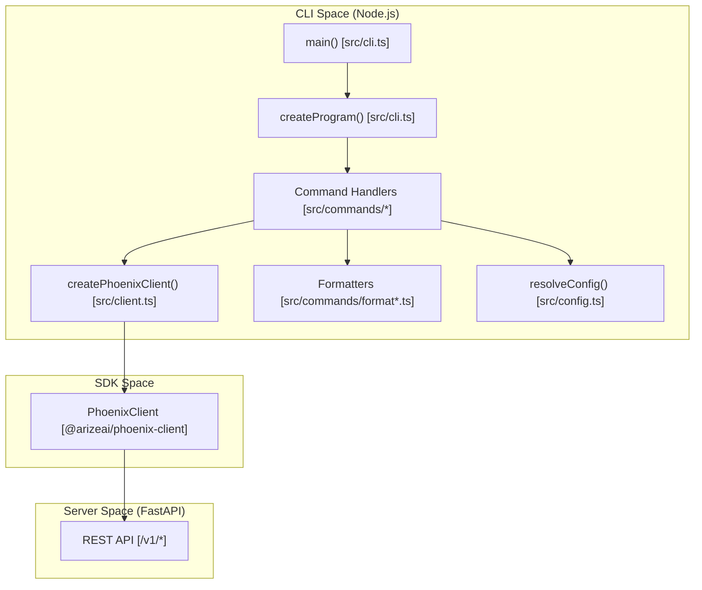
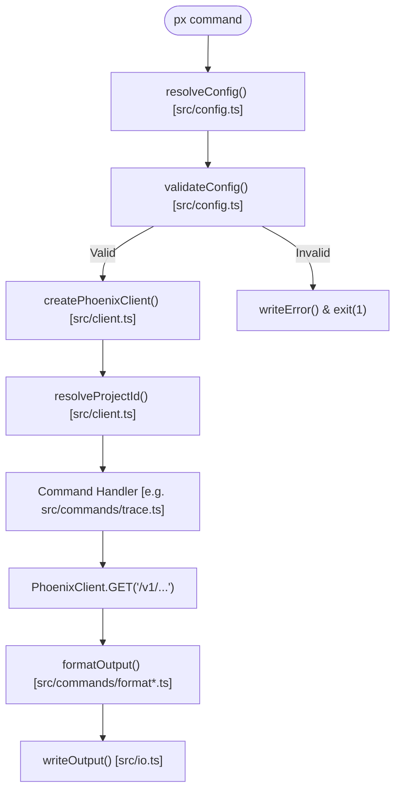

<!-- source: DeepWiki mcp.deepwiki.com · repo arize-ai/phoenix · page 3.5 Command Line Interface (CLI) · fetched 2026-10-27 -->

# Command Line Interface (CLI)

<details>
<summary>Relevant source files</summary>

The following files were used as context for generating this wiki page:

- [.agents/skills/phoenix-cli/SKILL.md](.agents/skills/phoenix-cli/SKILL.md)
- [.agents/skills/phoenix-cli/references/axial-coding.md](.agents/skills/phoenix-cli/references/axial-coding.md)
- [.agents/skills/phoenix-cli/references/open-coding.md](.agents/skills/phoenix-cli/references/open-coding.md)
- [.agents/skills/phoenix-evals/references/experiments-datasets-python.md](.agents/skills/phoenix-evals/references/experiments-datasets-python.md)
- [.agents/skills/phoenix-evals/references/experiments-datasets-typescript.md](.agents/skills/phoenix-evals/references/experiments-datasets-typescript.md)
- [docs/phoenix/datasets-and-experiments/how-to-datasets/exporting-datasets.mdx](docs/phoenix/datasets-and-experiments/how-to-datasets/exporting-datasets.mdx)
- [docs/phoenix/sdk-api-reference/typescript/arizeai-phoenix-cli.mdx](docs/phoenix/sdk-api-reference/typescript/arizeai-phoenix-cli.mdx)
- [docs/phoenix/tracing/how-to-tracing/importing-and-exporting-traces/retrieve-traces-via-cli.mdx](docs/phoenix/tracing/how-to-tracing/importing-and-exporting-traces/retrieve-traces-via-cli.mdx)
- [js/.gitignore](js/.gitignore)
- [js/examples/apps/demo-document-relevancy-experiment/CHANGELOG.md](js/examples/apps/demo-document-relevancy-experiment/CHANGELOG.md)
- [js/examples/apps/demo-document-relevancy-experiment/package.json](js/examples/apps/demo-document-relevancy-experiment/package.json)
- [js/packages/phoenix-cli/CHANGELOG.md](js/packages/phoenix-cli/CHANGELOG.md)
- [js/packages/phoenix-cli/README.md](js/packages/phoenix-cli/README.md)
- [js/packages/phoenix-cli/package.json](js/packages/phoenix-cli/package.json)
- [js/packages/phoenix-cli/src/cli.ts](js/packages/phoenix-cli/src/cli.ts)
- [js/packages/phoenix-cli/src/client.ts](js/packages/phoenix-cli/src/client.ts)
- [js/packages/phoenix-cli/src/commands/dataset.ts](js/packages/phoenix-cli/src/commands/dataset.ts)
- [js/packages/phoenix-cli/src/commands/experiment.ts](js/packages/phoenix-cli/src/commands/experiment.ts)
- [js/packages/phoenix-cli/src/commands/formatAnnotationDelete.ts](js/packages/phoenix-cli/src/commands/formatAnnotationDelete.ts)
- [js/packages/phoenix-cli/src/commands/formatNoteMutation.ts](js/packages/phoenix-cli/src/commands/formatNoteMutation.ts)
- [js/packages/phoenix-cli/src/commands/formatSpans.ts](js/packages/phoenix-cli/src/commands/formatSpans.ts)
- [js/packages/phoenix-cli/src/commands/formatTraces.ts](js/packages/phoenix-cli/src/commands/formatTraces.ts)
- [js/packages/phoenix-cli/src/commands/index.ts](js/packages/phoenix-cli/src/commands/index.ts)
- [js/packages/phoenix-cli/src/commands/noteMutationUtils.ts](js/packages/phoenix-cli/src/commands/noteMutationUtils.ts)
- [js/packages/phoenix-cli/src/commands/project.ts](js/packages/phoenix-cli/src/commands/project.ts)
- [js/packages/phoenix-cli/src/commands/prompt.ts](js/packages/phoenix-cli/src/commands/prompt.ts)
- [js/packages/phoenix-cli/src/commands/session.ts](js/packages/phoenix-cli/src/commands/session.ts)
- [js/packages/phoenix-cli/src/commands/span.ts](js/packages/phoenix-cli/src/commands/span.ts)
- [js/packages/phoenix-cli/src/commands/trace.ts](js/packages/phoenix-cli/src/commands/trace.ts)
- [js/packages/phoenix-cli/src/config.ts](js/packages/phoenix-cli/src/config.ts)
- [js/packages/phoenix-cli/src/trace.ts](js/packages/phoenix-cli/src/trace.ts)
- [js/packages/phoenix-cli/test/cli.test.ts](js/packages/phoenix-cli/test/cli.test.ts)
- [js/packages/phoenix-cli/test/notes.test.ts](js/packages/phoenix-cli/test/notes.test.ts)
- [js/packages/phoenix-cli/test/output.test.ts](js/packages/phoenix-cli/test/output.test.ts)
- [js/packages/phoenix-client/CHANGELOG.md](js/packages/phoenix-client/CHANGELOG.md)
- [js/packages/phoenix-client/package.json](js/packages/phoenix-client/package.json)
- [js/packages/phoenix-config/CHANGELOG.md](js/packages/phoenix-config/CHANGELOG.md)
- [js/packages/phoenix-config/package.json](js/packages/phoenix-config/package.json)
- [js/packages/phoenix-evals/CHANGELOG.md](js/packages/phoenix-evals/CHANGELOG.md)
- [js/packages/phoenix-evals/package.json](js/packages/phoenix-evals/package.json)
- [js/packages/phoenix-mcp/CHANGELOG.md](js/packages/phoenix-mcp/CHANGELOG.md)
- [js/packages/phoenix-mcp/package.json](js/packages/phoenix-mcp/package.json)
- [js/packages/phoenix-otel/CHANGELOG.md](js/packages/phoenix-otel/CHANGELOG.md)
- [js/packages/phoenix-otel/package.json](js/packages/phoenix-otel/package.json)

</details>


The Phoenix CLI (`@arizeai/phoenix-cli`) is a Node.js-based command-line tool designed for interacting with Phoenix servers. It provides a technical interface for managing projects, traces, spans, datasets, experiments, and prompts directly from the terminal. It is optimized for both human use and piping into AI coding agents (e.g., Claude Code, Cursor) or Unix utilities like `jq` [js/packages/phoenix-cli/README.md:25-26]().

The CLI is implemented in TypeScript and serves as a functional wrapper around the `@arizeai/phoenix-client` SDK [js/packages/phoenix-cli/src/commands/trace.ts:3-4]().

## Installation and Configuration

The CLI is distributed via NPM and provides the `px` binary alias [js/packages/phoenix-cli/package.json:21-24]().

```bash
npm install -g @arizeai/phoenix-cli
# or run without installing
npx @arizeai/phoenix-cli
```

**Sources:** [js/packages/phoenix-cli/README.md:27-32](), [js/packages/phoenix-cli/package.json:21-24]()

### Configuration and Profiles
The CLI resolves its connection settings using a hierarchical configuration system. Priority is given to CLI flags, followed by environment variables, then active profiles, and finally built-in defaults [js/packages/phoenix-cli/README.md:46-47]().

| Variable | Description |
| :--- | :--- |
| `PHOENIX_HOST` | Phoenix API endpoint (e.g., `http://localhost:6006`) |
| `PHOENIX_PROJECT` | Default project name or ID |
| `PHOENIX_API_KEY` | API key for authenticated instances |
| `PHOENIX_CLIENT_HEADERS` | Custom HTTP headers as a JSON string |
| `PHOENIX_CLI_DANGEROUSLY_ENABLE_DELETES` | Must be `true` to execute delete commands |

**Profiles** allow users to persist named settings (e.g., `prod`, `staging`) in a `settings.json` file [js/packages/phoenix-cli/README.md:58-70](). The CLI supports named profiles via `px profile list|show|create|edit|use|delete` [js/packages/phoenix-cli/CHANGELOG.md:54](). The settings file is JSON-Schema validated against `schemas/phoenix-cli-settings.json` [js/packages/phoenix-cli/CHANGELOG.md:54-56]().

**Sources:** [js/packages/phoenix-cli/README.md:40-56](), [js/packages/phoenix-cli/src/config.ts:1-20](), [js/packages/phoenix-cli/CHANGELOG.md:54-56]()

## Architecture and Data Flow

The CLI architecture follows a command-pattern where the `commander` library routes inputs to specific handlers that utilize a central `PhoenixClient` [js/packages/phoenix-cli/src/cli.ts:3-24]().

### System Entity Map



**Sources:** [js/packages/phoenix-cli/src/cli.ts:26-52](), [js/packages/phoenix-cli/src/commands/index.ts:1-16](), [js/packages/phoenix-cli/src/client.ts:7-15](), [js/packages/phoenix-cli/src/commands/trace.ts:7-15]()

### Data Retrieval Flow (Traces Example)

When a user executes `px trace list`, the following internal sequence occurs:
1. **Config Resolution**: `resolveConfig` merges environment variables, profiles, and CLI flags [js/packages/phoenix-cli/src/config.ts:25-50]().
2. **Client Initialization**: `createPhoenixClient` instantiates the client from `@arizeai/phoenix-client` [js/packages/phoenix-cli/src/client.ts:7-15]().
3. **Project Resolution**: `resolveProjectId` converts a project name to a UUID if necessary [js/packages/phoenix-cli/src/client.ts:35-60]().
4. **Data Fetching**: The `fetchProjectSpans` function performs paginated `GET` requests to `/v1/projects/{project_identifier}/spans` [js/packages/phoenix-cli/src/commands/trace.ts:200-246]().
5. **Reconstruction**: Raw spans are grouped by `trace_id` and assembled into hierarchical `Trace` objects using `groupSpansByTrace` and `buildTrace` [js/packages/phoenix-cli/src/trace.ts:81-159]().
6. **Output**: Data is passed to `formatTracesOutput` for rendering in `pretty`, `json`, or `raw` formats [js/packages/phoenix-cli/src/commands/trace.ts:42-44]().

**Sources:** [js/packages/phoenix-cli/src/commands/trace.ts:200-246](), [js/packages/phoenix-cli/src/trace.ts:81-159](), [js/packages/phoenix-cli/src/config.ts:25-50]()

## Command Reference

### Tracing, Spans, and Annotations
The CLI supports granular inspection and feedback for observability data.

*   `px trace list [directory]`: Fetches recent traces. Supports `--include-annotations` and `--include-notes` [js/packages/phoenix-cli/README.md:121-142]().
*   `px trace get <trace-id>`: Retrieves a single trace by ID [js/packages/phoenix-cli/README.md:158-164]().
*   `px span list`: Fetches individual spans with optional filters like `--span-kind`, `--status-code`, or `--attribute` [js/packages/phoenix-cli/src/commands/span.ts:47-64]().
*   `px trace annotate <trace-id>`: Adds an annotation (label, score, explanation) to a trace [js/packages/phoenix-cli/src/commands/trace.ts:175-186]().
*   `px span add-note <span-id>`: Appends a text note to a specific span [js/packages/phoenix-cli/src/commands/span.ts:79-86]().
*   `px span-annotations delete`: Bulk-delete annotations from spans [js/packages/phoenix-cli/CHANGELOG.md:8]().
*   `px trace-annotations delete`: Bulk-delete annotations from traces [js/packages/phoenix-cli/CHANGELOG.md:9]().

**Sources:** [js/packages/phoenix-cli/src/commands/trace.ts:1-200](), [js/packages/phoenix-cli/src/commands/span.ts:1-150](), [js/packages/phoenix-cli/README.md:121-164](), [js/packages/phoenix-cli/CHANGELOG.md:7-12]()

### Sessions
Sessions group traces into multi-turn conversations.

*   `px session list`: Lists sessions with start/end times [js/packages/phoenix-cli/src/commands/session.ts:64-74]().
*   `px session get <session-id>`: Fetches specific session data [js/packages/phoenix-cli/src/commands/session.ts:53-62]().
*   `px session add-note <session-id>`: Creates a session-level note [js/packages/phoenix-cli/src/commands/session.ts:89-96]().
*   `px session-annotations delete`: Bulk-delete annotations from sessions [js/packages/phoenix-cli/CHANGELOG.md:10]().

**Sources:** [js/packages/phoenix-cli/src/commands/session.ts:1-122](), [js/packages/phoenix-cli/CHANGELOG.md:10]()

### Datasets, Experiments, and Prompts
*   `px dataset list`: Lists all available datasets [js/packages/phoenix-cli/src/commands/dataset.ts:1-20]().
*   `px experiment get <experiment-id>`: Fetches full experiment data including runs and evaluations [js/packages/phoenix-cli/src/commands/experiment.ts:1-20]().
*   `px prompt list`: Lists prompt templates [js/packages/phoenix-cli/src/commands/prompt.ts:1-20]().
*   `px annotation-config list`: Lists configured annotation definitions [js/packages/phoenix-cli/README.md:204-206]().

**Sources:** [js/packages/phoenix-cli/src/commands/dataset.ts:1-20](), [js/packages/phoenix-cli/src/commands/experiment.ts:1-20](), [js/packages/phoenix-cli/src/commands/prompt.ts:1-20](), [js/packages/phoenix-cli/README.md:204-206]()

## Implementation Details

### Output Formatting and Self-Update
The CLI supports `pretty` (human-readable tables/trees), `json` (pretty-printed JSON), and `raw` (compact JSON for piping) formats [js/packages/phoenix-cli/README.md:139]().

*   `px self update`: Checks the npm registry and upgrades the global installation in place. Supported for `npm`, `pnpm`, `bun`, and `deno` global installs [js/packages/phoenix-cli/README.md:108-119]().

**Sources:** [js/packages/phoenix-cli/README.md:108-119](), [js/packages/phoenix-cli/src/commands/formatTraces.ts:41-44]()

### Internal Logic Diagram



**Sources:** [js/packages/phoenix-cli/src/config.ts:55-80](), [js/packages/phoenix-cli/src/client.ts:35-60](), [js/packages/phoenix-cli/src/commands/trace.ts:152-246]()

---

