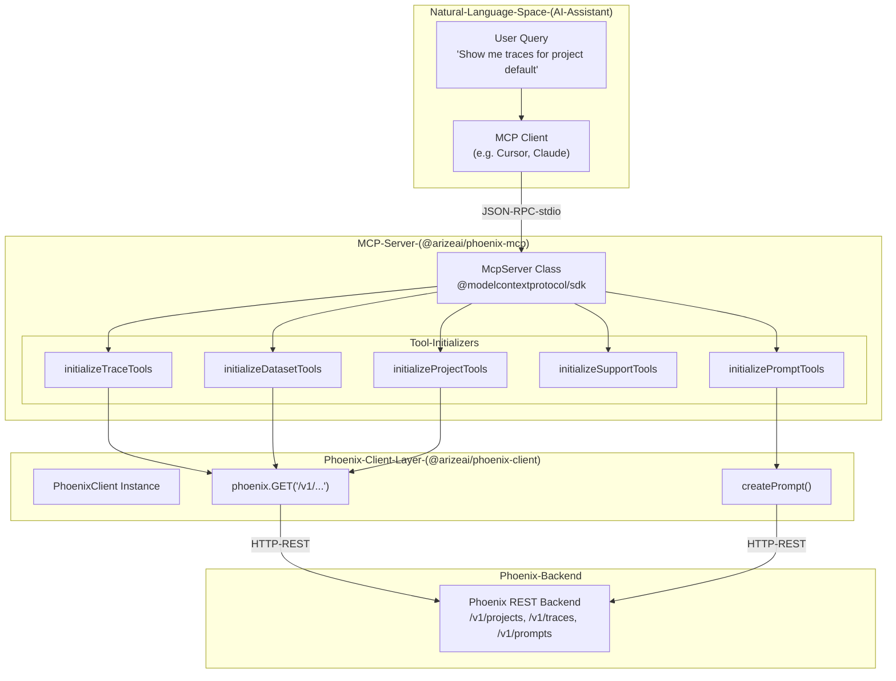
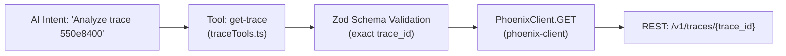
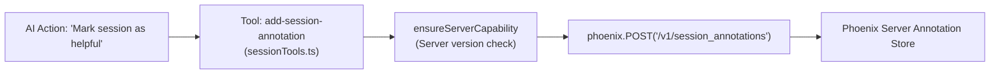

<!-- source: DeepWiki mcp.deepwiki.com · repo arize-ai/phoenix · page 3.6 MCP Server · fetched 2026-10-27 -->

# MCP Server

<details>
<summary>Relevant source files</summary>

The following files were used as context for generating this wiki page:

- [README.md](README.md)
- [app/src/pages/auth/AuthLayout.tsx](app/src/pages/auth/AuthLayout.tsx)
- [docs/phoenix/integrations/typescript/vercel/vercel-ai-sdk-tracing-js.mdx](docs/phoenix/integrations/typescript/vercel/vercel-ai-sdk-tracing-js.mdx)
- [docs/phoenix/sdk-api-reference/typescript/arizeai-phoenix-otel.mdx](docs/phoenix/sdk-api-reference/typescript/arizeai-phoenix-otel.mdx)
- [docs/phoenix/sdk-api-reference/typescript/overview.mdx](docs/phoenix/sdk-api-reference/typescript/overview.mdx)
- [docs/phoenix/sdk-api-reference/typescript/packages/phoenix-otel/manual-spans.mdx](docs/phoenix/sdk-api-reference/typescript/packages/phoenix-otel/manual-spans.mdx)
- [docs/phoenix/sdk-api-reference/typescript/packages/phoenix-otel/overview.mdx](docs/phoenix/sdk-api-reference/typescript/packages/phoenix-otel/overview.mdx)
- [js/examples/apps/demo-document-relevancy-experiment/CHANGELOG.md](js/examples/apps/demo-document-relevancy-experiment/CHANGELOG.md)
- [js/examples/apps/demo-document-relevancy-experiment/package.json](js/examples/apps/demo-document-relevancy-experiment/package.json)
- [js/packages/phoenix-cli/CHANGELOG.md](js/packages/phoenix-cli/CHANGELOG.md)
- [js/packages/phoenix-cli/package.json](js/packages/phoenix-cli/package.json)
- [js/packages/phoenix-client/CHANGELOG.md](js/packages/phoenix-client/CHANGELOG.md)
- [js/packages/phoenix-client/README.md](js/packages/phoenix-client/README.md)
- [js/packages/phoenix-client/package.json](js/packages/phoenix-client/package.json)
- [js/packages/phoenix-config/CHANGELOG.md](js/packages/phoenix-config/CHANGELOG.md)
- [js/packages/phoenix-config/README.md](js/packages/phoenix-config/README.md)
- [js/packages/phoenix-config/package.json](js/packages/phoenix-config/package.json)
- [js/packages/phoenix-evals/CHANGELOG.md](js/packages/phoenix-evals/CHANGELOG.md)
- [js/packages/phoenix-evals/README.md](js/packages/phoenix-evals/README.md)
- [js/packages/phoenix-evals/package.json](js/packages/phoenix-evals/package.json)
- [js/packages/phoenix-mcp/CHANGELOG.md](js/packages/phoenix-mcp/CHANGELOG.md)
- [js/packages/phoenix-mcp/README.md](js/packages/phoenix-mcp/README.md)
- [js/packages/phoenix-mcp/package.json](js/packages/phoenix-mcp/package.json)
- [js/packages/phoenix-mcp/src/index.ts](js/packages/phoenix-mcp/src/index.ts)
- [js/packages/phoenix-mcp/src/projectTools.ts](js/packages/phoenix-mcp/src/projectTools.ts)
- [js/packages/phoenix-otel/CHANGELOG.md](js/packages/phoenix-otel/CHANGELOG.md)
- [js/packages/phoenix-otel/README.md](js/packages/phoenix-otel/README.md)
- [js/packages/phoenix-otel/package.json](js/packages/phoenix-otel/package.json)
- [packages/phoenix-client/README.md](packages/phoenix-client/README.md)
- [packages/phoenix-evals/README.md](packages/phoenix-evals/README.md)
- [packages/phoenix-otel/README.md](packages/phoenix-otel/README.md)

</details>


## Purpose and Scope

The MCP Server (`@arizeai/phoenix-mcp`) is a Model Context Protocol (MCP) server implementation designed to facilitate integration between AI coding assistants (e.g., Claude Desktop, Cursor, ChatGPT) and the Phoenix platform. It exposes Phoenix's rich functionality—including tracing, datasets, experiments, and prompt management—via a standardized protocol that AI assistants can consume to assist users interactively. [README.md:37-40](), [js/packages/phoenix-mcp/package.json:2-4]()

The server is built as a TypeScript package within the Phoenix JavaScript monorepo, employing the Phoenix TypeScript client (`@arizeai/phoenix-client`) to handle API requests directed at the Phoenix backend. [js/packages/phoenix-mcp/package.json:34-36](), [js/packages/phoenix-mcp/CHANGELOG.md:111-112]()

---

## Architecture Overview

The MCP Server acts as a bridge translating between:

- **Natural Language Space:** The conversational AI assistant environment and user queries.
- **Code Entity Space:** The Phoenix API and its underlying domain entities.

It exposes a set of MCP "tools" that correspond to Phoenix API operations. These tools are registered and handled internally by the MCP server, which validates input parameters, invokes the Phoenix client functions, and returns responses in MCP-compatible formats. [js/packages/phoenix-mcp/CHANGELOG.md:111-124]()

### Data Flow Diagram



**Sources:** [js/packages/phoenix-mcp/package.json:33-36](), [js/packages/phoenix-mcp/src/index.ts:36-44](), [js/packages/phoenix-client/package.json:78-81]()

---

## Package Configuration

The MCP server is distributed as an NPM package and can be executed directly via `npx`. [js/packages/phoenix-mcp/package.json:19-21](), [README.md:40]()

| Property       | Value                              | Description                                   |
|----------------|----------------------------------|-----------------------------------------------|
| **Name**       | `@arizeai/phoenix-mcp`           | NPM package identifier [js/packages/phoenix-mcp/package.json:2]() |
| **Executable** | `build/index.js`                 | CLI entry point launching the MCP server [js/packages/phoenix-mcp/package.json:20]() |
| **Transport**  | `stdio`                          | Communication via standard input/output [js/packages/phoenix-mcp/package.json:29]() |

### Core Dependencies

- `@modelcontextprotocol/sdk`: The official MCP framework library implementing the protocol. [js/packages/phoenix-mcp/package.json:36]()
- `@arizeai/phoenix-client`: TypeScript Phoenix client library providing strongly-typed API calls. [js/packages/phoenix-mcp/package.json:34]()
- `@arizeai/phoenix-config`: Centralized configuration management for environment variables. [js/packages/phoenix-mcp/package.json:35]()
- `minimist`: Used for parsing command-line arguments. [js/packages/phoenix-mcp/package.json:38]()

**Sources:** [js/packages/phoenix-mcp/package.json:33-40]()

---

## Available Tools

The MCP Server exposes a comprehensive set of "tools" that allow AI assistants to programmatically query and mutate Phoenix resources. Recent updates moved tool parameters to `snake_case`. [js/packages/phoenix-mcp/CHANGELOG.md:115-117]()

| Category | Tool Examples | Description |
| :--- | :--- | :--- |
| **Projects** | `list-projects`, `get-project` | Manage observability projects [js/packages/phoenix-mcp/CHANGELOG.md:121]() |
| **Prompts** | `get-prompt-version-by-tag`, `list-prompt-version-tags`, `add-prompt-version-tag` | Manage prompt templates, versions, and tags [js/packages/phoenix-mcp/CHANGELOG.md:123-124]() |
| **Traces & Spans** | `list-traces`, `get-trace`, `get-spans`, `get-span-annotations` | Retrieve observability data and feedback [js/packages/phoenix-mcp/CHANGELOG.md:121-122]() |
| **Datasets** | `list-datasets`, `add-dataset-examples` | Explore and modify evaluation datasets [js/packages/phoenix-mcp/CHANGELOG.md:99-100]() |
| **Sessions** | `list-sessions`, `get-session` | Explore conversation flows and session annotations [js/packages/phoenix-mcp/CHANGELOG.md:122]() |
| **Support** | `phoenix-support` | Diagnostic tool for server configuration [js/packages/phoenix-mcp/CHANGELOG.md:122]() |

**Sources:** [js/packages/phoenix-mcp/CHANGELOG.md:111-124](), [js/packages/phoenix-mcp/src/index.ts:36-44]()

---

## Implementation Details

### Entry Point and Initialization

The main entry point performs the following sequence:

1. **Configuration Resolution**: Resolves API keys and base URLs from `minimist` and `@arizeai/phoenix-config`. [js/packages/phoenix-mcp/src/index.ts:21-27](), [js/packages/phoenix-mcp/package.json:35]()
2. **Client Creation**: Instantiates the `PhoenixClient` which serves as the interface to the Phoenix REST API. [js/packages/phoenix-mcp/src/index.ts:28]()
3. **Server Instantiation**: Creates a new `McpServer` instance. [js/packages/phoenix-mcp/src/index.ts:31-34]()
4. **Tool Registration**: Calls various `initialize...Tools` functions, passing the client and server instances. [js/packages/phoenix-mcp/src/index.ts:36-44]()
5. **Pagination Helper**: Uses a generic `fetchAllPages` pagination helper to handle large resource lists. [js/packages/phoenix-mcp/CHANGELOG.md:127]()

### Version Gating

The underlying `@arizeai/phoenix-client` implements server version gating. It reads the server version from response headers and validates it against minimum version requirements before calling newer API routes. [js/packages/phoenix-client/CHANGELOG.md:141-142]()

**Sources:** [js/packages/phoenix-mcp/src/index.ts:20-53](), [js/packages/phoenix-client/CHANGELOG.md:141-142]()

---

## Code Entity to Natural Language Space Mapping

### Diagram: Trace Retrieval Workflow

This diagram maps the natural language intent of an AI agent to the specific TypeScript functions and API paths in the Phoenix codebase.



**Sources:** [js/packages/phoenix-mcp/CHANGELOG.md:116-117](), [js/packages/phoenix-client/package.json:54-57]()

### Diagram: Session Annotation Flow

Mapping the flow of adding feedback to a session from an AI assistant's context.



**Sources:** [js/packages/phoenix-client/CHANGELOG.md:109-110](), [js/packages/phoenix-client/CHANGELOG.md:14-22]()

---

## Development and Deployment

### Development Workflow

1. **Build**: Run `pnpm build` to compile TypeScript and set execution permissions. [js/packages/phoenix-mcp/package.json:27]()
2. **Local Testing**: Use `pnpm dev` to run the server with environment variables. [js/packages/phoenix-mcp/package.json:28]()
3. **Inspection**: Use `pnpm inspect` to launch the MCP inspector for debugging tool definitions. [js/packages/phoenix-mcp/package.json:29]()

### Environment Variables

Configuration is managed via environment variables or CLI flags:

| Variable | Description |
| :--- | :--- |
| `PHOENIX_API_KEY` | Authentication key for Phoenix. [js/packages/phoenix-client/README.md:41]() |
| `PHOENIX_BASE_URL` | The base URL for the Phoenix server. [js/packages/phoenix-mcp/package.json:28]() |
| `PHOENIX_PROJECT` | Default project name (moved to `@arizeai/phoenix-config`). [js/packages/phoenix-mcp/CHANGELOG.md:129]() |

### Integration with Assistants

The MCP server can be integrated into Cursor using a deep link or manual configuration: [README.md:40]()

```json
{
  "mcpServers": {
    "phoenix": {
      "command": "npx",
      "args": [
        "-y",
        "@arizeai/phoenix-mcp@latest",
        "--baseUrl",
        "https://my-phoenix.com",
        "--apiKey",
        "your-api-key"
      ]
    }
  }
}
```

**Sources:** [js/packages/phoenix-mcp/package.json:26-31](), [README.md:40]()

---

# Summary

The MCP Server implementation in Phoenix bridges the gap between AI-driven development tools and complex observability data. By wrapping the `@arizeai/phoenix-client` in a standardized Model Context Protocol interface, it enables AI assistants to perform deep analysis of traces, manage prompt versions, and interact with evaluation datasets directly within the user's coding environment.

---

# References

- `js/packages/phoenix-mcp/package.json`
- `js/packages/phoenix-mcp/src/index.ts`
- `js/packages/phoenix-mcp/CHANGELOG.md`
- `js/packages/phoenix-client/CHANGELOG.md`
- `README.md`

**Sources:** All factual statements cited with `[path/to/file:line-range]()`.

---

