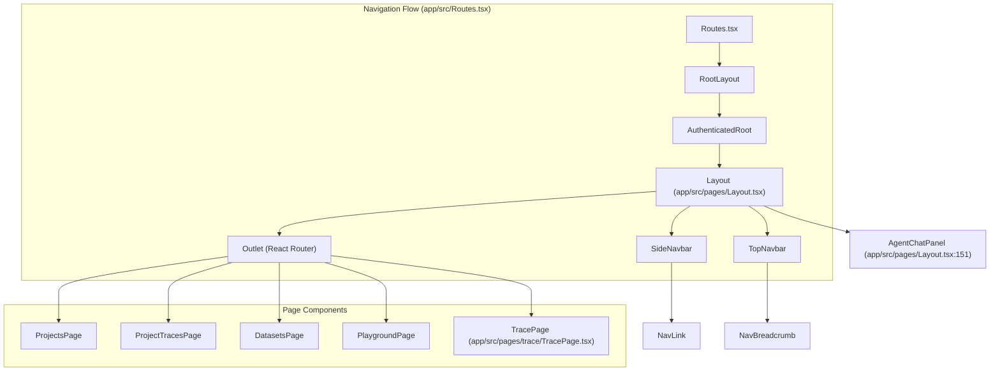
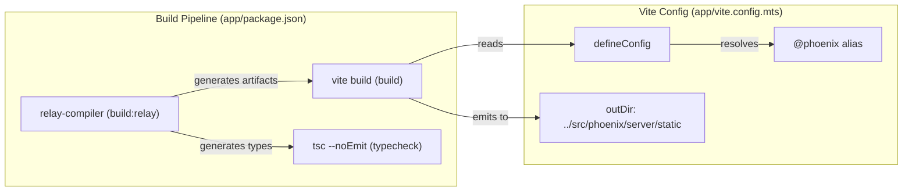

<!-- source: DeepWiki mcp.deepwiki.com · repo arize-ai/phoenix · page 4 Frontend Application · fetched 2026-10-27 -->

# Frontend Application

Relevant source files

The following files were used as context for generating this wiki page:

- [app/.env.example](app/.env.example)
- [app/.storybook/main.ts](app/.storybook/main.ts)
- [app/.storybook/manager.ts](app/.storybook/manager.ts)
- [app/.storybook/preview-body.html](app/.storybook/preview-body.html)
- [app/.storybook/preview.tsx](app/.storybook/preview.tsx)
- [app/package.json](app/package.json)
- [app/pnpm-lock.yaml](app/pnpm-lock.yaml)
- [app/src/App.tsx](app/src/App.tsx)
- [app/src/GlobalStyles.tsx](app/src/GlobalStyles.tsx)
- [app/src/Routes.tsx](app/src/Routes.tsx)
- [app/src/components/ai/prompt-input/styles.ts](app/src/components/ai/prompt-input/styles.ts)
- [app/src/components/core/button/IconButton.tsx](app/src/components/core/button/IconButton.tsx)
- [app/src/components/core/layout/Divider.tsx](app/src/components/core/layout/Divider.tsx)
- [app/src/components/index.tsx](app/src/components/index.tsx)
- [app/src/components/nav/Navbar.tsx](app/src/components/nav/Navbar.tsx)
- [app/src/components/table/Table.tsx](app/src/components/table/Table.tsx)
- [app/src/contexts/ThemeContext.tsx](app/src/contexts/ThemeContext.tsx)
- [app/src/openInference/tracing/__tests__/types.test.ts](app/src/openInference/tracing/__tests__/types.test.ts)
- [app/src/openInference/tracing/types.ts](app/src/openInference/tracing/types.ts)
- [app/src/pages/Layout.tsx](app/src/pages/Layout.tsx)
- [app/src/pages/index.tsx](app/src/pages/index.tsx)
- [app/src/pages/prompt/promptLoader.tsx](app/src/pages/prompt/promptLoader.tsx)
- [app/src/pages/trace/TracePage.tsx](app/src/pages/trace/TracePage.tsx)
- [app/src/typeUtils.ts](app/src/typeUtils.ts)
- [app/stories/Alert.stories.tsx](app/stories/Alert.stories.tsx)
- [app/stories/ComboBox.stories.tsx](app/stories/ComboBox.stories.tsx)
- [app/stories/Gallery.stories.tsx](app/stories/Gallery.stories.tsx)
- [app/stories/TagGroup.stories.tsx](app/stories/TagGroup.stories.tsx)
- [app/vite.config.mts](app/vite.config.mts)
- [app/vitest.setup.ts](app/vitest.setup.ts)
- [js/package.json](js/package.json)
- [js/pnpm-lock.yaml](js/pnpm-lock.yaml)
- [src/phoenix/trace/fixtures.py](src/phoenix/trace/fixtures.py)
- [src/phoenix/trace/utils.py](src/phoenix/trace/utils.py)

Phoenix's frontend is a React 19 single-page application (SPA) located in the `app/` directory. The UI is built using Vite and served as static assets by the FastAPI server at runtime. This page provides an architectural overview of the frontend application.

For detailed information on the React app structure, Vite build system, and Relay integration, see **Application Structure & Build System** ([#4.1]()). For state management, theming, and context providers, see **State Management & Theming** ([#4.2]()). For the LLM interaction interface, see **Playground Interface** ([#4.3]()). For the built-in AI assistant, see **AI Assistant (PxI) Interface** ([#4.4]()).

## Technology Stack

Phoenix's frontend uses a modern TypeScript-based stack optimized for performance and type safety. The project utilizes `pnpm` workspaces for dependency management.

| Technology | Purpose | Key Files |
|------------|---------|-----------|
| `react` | UI framework (v19.2.6) | [app/package.json:92]() |
| `vite` | Build tool and dev server (v8.0.1) | [app/package.json:165](), [app/vite.config.mts:1-117]() |
| `react-relay` | GraphQL client & data fetching | [app/package.json:99](), [app/package.json:104]() |
| `react-router` | Client-side routing (v7.15.1) | [app/package.json:102](), [app/src/Routes.tsx:1-170]() |
| `zustand` | Client-side state management | [app/package.json:112]() |
| `@emotion/react` | CSS-in-JS styling | [app/package.json:59]() |
| `react-aria` | Accessible UI primitives | [app/package.json:93-94]() |
| `ai` | Vercel AI SDK for streaming | [app/package.json:76]() |

Sources: [app/package.json:43-112](), [app/vite.config.mts:1-117]()

## Application Architecture

The application is structured as a component-based hierarchy where data flows from the GraphQL API through Relay fragments into specialized page components.

### Directory Structure
- `app/src/pages/`: Contains route-level components and their associated data loaders (e.g., `TracePage` in [app/src/pages/trace/TracePage.tsx:30-83]()).
- `app/src/components/`: Reusable UI elements, including navigation and the design system (e.g., [app/src/components/index.tsx:1-40]()).
- `app/src/contexts/`: React Context providers for global concerns like theming, feature flags, and functionality (e.g., [app/src/pages/Layout.tsx:29-31]()).
- `app/src/store/`: Zustand stores for complex UI state that lives outside the Relay cache.

### Navigation and Layout
The UI utilizes a consistent layout defined in the `Layout` component ([app/src/pages/Layout.tsx:93-157]()), featuring a collapsible `SideNavbar` and a `TopNavbar` with breadcrumbs. The layout uses `react-resizable-panels` to manage the space between the main content and the optional AI assistant panel ([app/src/pages/Layout.tsx:125-153]()).

**Entity Mapping: Routing and Layout**

Sources: [app/src/Routes.tsx:132-170](), [app/src/pages/Layout.tsx:93-157](), [app/src/pages/trace/TracePage.tsx:30-83]()

## Build and Development Workflow

Phoenix uses a tight integration between the Vite build system and the Relay compiler. The `vite.config.mts` is configured to output bundled assets directly into the Python package's server directory ([app/vite.config.mts:77]()).

- **Relay Compiler**: Runs `relay-compiler` to generate TypeScript types from GraphQL queries and fragments. This is a prerequisite for the main build ([app/package.json:10]()).
- **Vite Build**: The `pnpm run build` command triggers the Relay compiler followed by `vite build` ([app/package.json:8]()). It uses `rolldownOptions` for code splitting, grouping heavy libraries like `codemirror` and `recharts` into separate chunks ([app/vite.config.mts:80-113]()).
- **Dev Server**: `pnpm run dev` ([app/package.json:13]()) starts a development environment. The `dev:server` script ([app/package.json:16]()) launches the Python backend with Vite proxying enabled.

**Entity Mapping: Build Pipeline**

Sources: [app/package.json:7-42](), [app/vite.config.mts:42-114]()

## Key Feature Systems

### Tracing and Observability
The primary interface for browsing traces and spans. The `TracePage` component handles the display of trace details and utilizes a `Drawer` for overlaying information ([app/src/pages/trace/TracePage.tsx:45-81]()). It relies on search parameters like `SELECTED_SPAN_NODE_ID_PARAM` to manage UI state ([app/src/pages/trace/TracePage.tsx:35]()).
For details, see [Tracing & Observability](#5.1).

### State and Theming
The application uses CSS custom properties for theming, defined in `GlobalStyles.tsx`. It supports `mediumRootCSS` for scaling and `darkThemeCSS` for dark mode ([app/src/GlobalStyles.tsx:9-180]()). The theme is toggled via a `ThemeSelector` in the navbar ([app/src/components/nav/Navbar.tsx:194-253]()).
For details, see [State Management & Theming](#4.2).

### Playground Interface
A specialized environment for testing LLM prompts. It is integrated into the main routing ([app/src/Routes.tsx:66]()) and allows users to interact with models directly. It utilizes `@ai-sdk/react` for handling streaming interactions ([app/package.json:44]()).
For details, see [Playground Interface](#4.3).

### AI Assistant (PxI) Interface
Phoenix Intelligence (PxI) provides an interactive chat interface. The `Layout` component manages its visibility and positioning (docked vs. floating) using the `AgentContext` ([app/src/pages/Layout.tsx:96-109]()). It can be rendered as a `FloatingAgentChatPanel` or a docked `AgentChatPanel` ([app/src/pages/Layout.tsx:139-151]()).
For details, see [AI Assistant (PxI) Interface](#4.4).

Sources: [app/src/GlobalStyles.tsx:9-180](), [app/src/pages/Layout.tsx:93-157](), [app/src/pages/trace/TracePage.tsx:30-83](), [app/src/Routes.tsx:66-95]()

---

