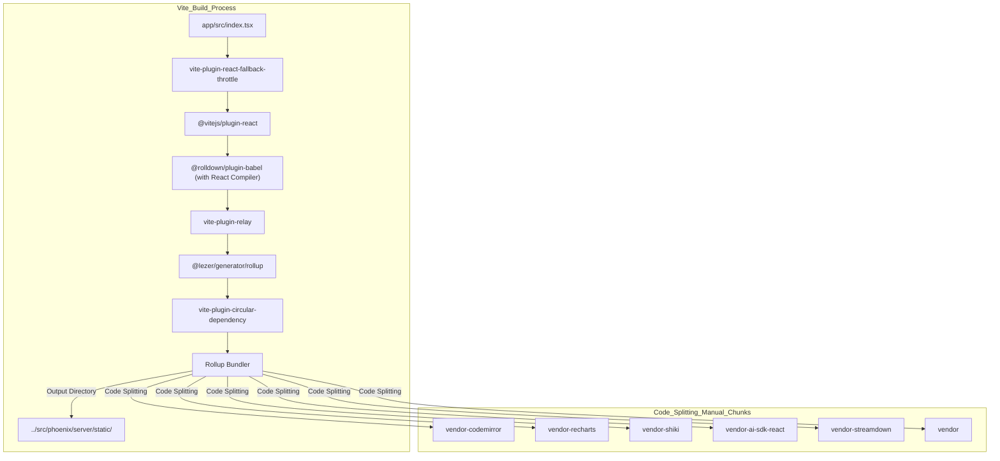
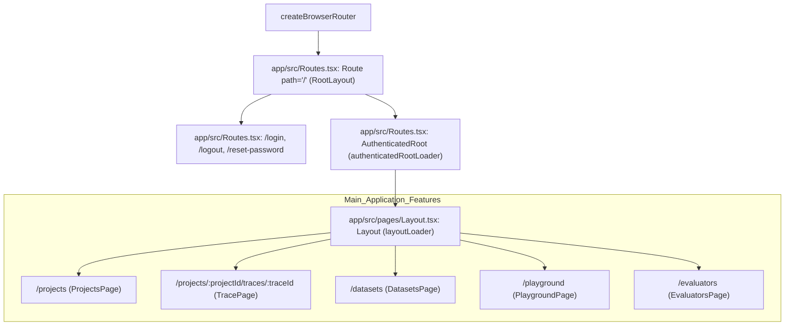
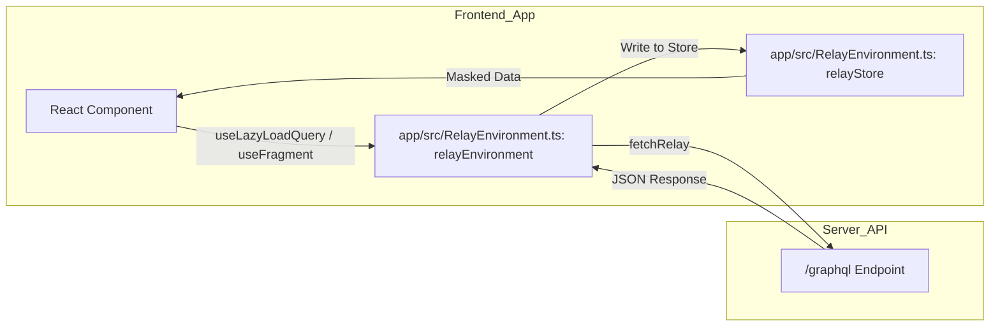

<!-- source: DeepWiki mcp.deepwiki.com · repo arize-ai/phoenix · page 4.1 Application Structure & Build System · fetched 2026-10-27 -->

# Application Structure & Build System

Relevant source files

The following files were used as context for generating this wiki page:

- [app/.env.example](app/.env.example)
- [app/package.json](app/package.json)
- [app/pnpm-lock.yaml](app/pnpm-lock.yaml)
- [app/src/GlobalStyles.tsx](app/src/GlobalStyles.tsx)
- [app/src/RelayEnvironment.ts](app/src/RelayEnvironment.ts)
- [app/src/Routes.tsx](app/src/Routes.tsx)
- [app/src/authFetch.ts](app/src/authFetch.ts)
- [app/src/components/index.tsx](app/src/components/index.tsx)
- [app/src/components/nav/Navbar.tsx](app/src/components/nav/Navbar.tsx)
- [app/src/components/settings/OAuthUserForm.tsx](app/src/components/settings/OAuthUserForm.tsx)
- [app/src/components/settings/UserForm.tsx](app/src/components/settings/UserForm.tsx)
- [app/src/components/table/Table.tsx](app/src/components/table/Table.tsx)
- [app/src/openInference/tracing/__tests__/types.test.ts](app/src/openInference/tracing/__tests__/types.test.ts)
- [app/src/openInference/tracing/types.ts](app/src/openInference/tracing/types.ts)
- [app/src/pages/Layout.tsx](app/src/pages/Layout.tsx)
- [app/src/pages/auth/ForgotPasswordForm.tsx](app/src/pages/auth/ForgotPasswordForm.tsx)
- [app/src/pages/auth/LoggedOutPage.tsx](app/src/pages/auth/LoggedOutPage.tsx)
- [app/src/pages/auth/LoginForm.tsx](app/src/pages/auth/LoginForm.tsx)
- [app/src/pages/auth/LoginPage.tsx](app/src/pages/auth/LoginPage.tsx)
- [app/src/pages/auth/OAuth2Login.tsx](app/src/pages/auth/OAuth2Login.tsx)
- [app/src/pages/auth/ResetPasswordForm.tsx](app/src/pages/auth/ResetPasswordForm.tsx)
- [app/src/pages/auth/ResetPasswordWithTokenForm.tsx](app/src/pages/auth/ResetPasswordWithTokenForm.tsx)
- [app/src/pages/auth/authErrors.ts](app/src/pages/auth/authErrors.ts)
- [app/src/pages/index.tsx](app/src/pages/index.tsx)
- [app/src/pages/prompt/promptLoader.tsx](app/src/pages/prompt/promptLoader.tsx)
- [app/src/pages/settings/NewUserDialog.tsx](app/src/pages/settings/NewUserDialog.tsx)
- [app/src/pages/settings/__generated__/NewUserDialogMutation.graphql.ts](app/src/pages/settings/__generated__/NewUserDialogMutation.graphql.ts)
- [app/src/pages/trace/TracePage.tsx](app/src/pages/trace/TracePage.tsx)
- [app/src/typeUtils.ts](app/src/typeUtils.ts)
- [app/src/utils/__tests__/routingUtils.test.ts](app/src/utils/__tests__/routingUtils.test.ts)
- [app/src/utils/routingUtils.ts](app/src/utils/routingUtils.ts)
- [app/stories/ComboBox.stories.tsx](app/stories/ComboBox.stories.tsx)
- [app/stories/Gallery.stories.tsx](app/stories/Gallery.stories.tsx)
- [app/stories/TagGroup.stories.tsx](app/stories/TagGroup.stories.tsx)
- [app/tests/auth-refresh.spec.ts](app/tests/auth-refresh.spec.ts)
- [app/tsconfig.json](app/tsconfig.json)
- [app/vite.config.mts](app/vite.config.mts)
- [app/vitest.setup.ts](app/vitest.setup.ts)
- [js/package.json](js/package.json)
- [js/pnpm-lock.yaml](js/pnpm-lock.yaml)
- [src/phoenix/server/api/auth_messages.py](src/phoenix/server/api/auth_messages.py)
- [src/phoenix/trace/fixtures.py](src/phoenix/trace/fixtures.py)
- [src/phoenix/trace/utils.py](src/phoenix/trace/utils.py)

This page documents the frontend application's architecture, the Vite-based build system, and the integration of React Relay and Zustand. The Phoenix frontend is a modern React application built with TypeScript, designed for high-performance AI observability visualizations.

## Build System Overview

The Phoenix frontend uses **Vite** as its primary build tool and development server, with **pnpm** as the package manager. The build system is optimized for a monorepo structure where the frontend assets are eventually served by the Python FastAPI backend.

### Package Management & Scripts

The application is defined in `app/package.json` [app/package.json:1-177](). It uses **pnpm** (version 11.3.0) [app/package.json:175]().

Key scripts for the build lifecycle:
- `build`: Runs the Relay compiler followed by the Vite production build [app/package.json:8]().
- `build:relay`: Executes `relay-compiler` to generate TypeScript types from GraphQL definitions [app/package.json:10]().
- `build:static`: Copies static assets into the Python server directory `../src/phoenix/server` [app/package.json:11]().
- `dev`: A multi-process command (using `mprocs`) that typically starts both the Vite dev server and the Python backend [app/package.json:13-16]().
- `generate:openapi`: Generates TypeScript types from the Phoenix OpenAPI schema [app/package.json:26]().

### Vite Configuration

The Vite configuration (`app/vite.config.mts`) manages the transformation of TypeScript, React, and Relay code into optimized browser bundles.

**Vite Build Pipeline**

**Build Configuration Details:**
- **Plugins**: The `vite.config.mts` [app/vite.config.mts:25-38]() defines several plugins:
    - `reactFallbackThrottlePlugin()`: Disables React's built-in 300ms suspense fallback timer to prevent UI delays [app/vite.config.mts:28]().
    - `react()`: Standard React plugin [app/vite.config.mts:29]().
    - `babel()`: Integrates Babel with `@rolldown/plugin-babel` and the `babel-plugin-react-compiler` for React Compiler support [app/vite.config.mts:32-34]().
    - `relay`: Uses `vite-plugin-relay` to transform `graphql` tagged templates [app/vite.config.mts:35]().
    - `lezer()`: For Lezer grammar generation [app/vite.config.mts:36]().
    - `circleDependency()`: Detects circular dependencies and throws errors if found [app/vite.config.mts:37]().
- **Source Maps**: Source map generation is controlled by the `PHOENIX_ENABLE_SOURCE_MAP` environment variable [app/vite.config.mts:15,79]().
- **Optimization**: Implements manual code splitting for large libraries like `codemirror`, `recharts`, `shiki`, `@ai-sdk/react`, and `streamdown` to improve initial load times [app/vite.config.mts:82-113]().
- **Output**: The build output directory is `../src/phoenix/server/static`, allowing the FastAPI server to serve the UI directly [app/vite.config.mts:77]().
- **Aliases**: `@phoenix` is aliased to `app/src` for cleaner imports [app/vite.config.mts:61]().

Sources: [app/package.json:1-177](), [app/vite.config.mts:1-117]()

## Application Architecture

The application is structured as a single-page application (SPA) with a clear separation between routing, state management, and visual components.

### Routing System

Phoenix uses `react-router` (v7) to manage navigation. The routes are defined in `app/src/Routes.tsx` [app/src/Routes.tsx:1-131]().

**Routing Implementation**

**Key Routing Features:**
- **Revalidation Logic**: A `revalidateOnPathChange` function prevents unnecessary loader execution when only search parameters or URL hashes change, optimizing performance for UI-only state updates [app/src/Routes.tsx:123-130]().
- **Breadcrumbs**: Routes use a `handle` with a `crumb` function to dynamically generate navigation breadcrumbs [app/src/Routes.tsx:166-167]().
- **Redirects**: Specific routes like `/v1/*` are redirected to the root to handle common user misconfigurations with OpenTelemetry collector URLs [app/src/Routes.tsx:135-141]().

Sources: [app/src/Routes.tsx:1-240]()

### State Management Strategy

Phoenix employs a tiered state management approach:

| Layer | Technology | Responsibility |
| :--- | :--- | :--- |
| **Server State** | **React Relay** | Fetching GraphQL data, caching, and fragment-based data masking. |
| **Global UI State** | **Zustand** | Cross-component state such as side-navigation expansion or AI agent panel state. |
| **Theme & Auth** | **React Context** | Application-wide settings like Dark/Light mode and session handling. |

Sources: [app/package.json:99,112](), [app/src/pages/Layout.tsx:96-97,160-162](), [app/src/GlobalStyles.tsx:4-5]()

## Relay Integration & Data Flow

Relay is the primary data fetching mechanism. It ensures that components only request the data they need through GraphQL fragments.

1.  **Relay Compiler**: During build, `relay-compiler` scans for `graphql` literals and generates TypeScript types in `__generated__` directories [app/package.json:10]().
2.  **Fragments**: Components define their data requirements using fragments, which are then composed into parent queries.
3.  **Environment**: The Relay Environment (configured in `app/src/RelayEnvironment.ts` [app/src/RelayEnvironment.ts:1-181]()) handles the network layer, communicating with the `/graphql` endpoint.

**Relay Data Flow**

Sources: [app/package.json:10,99,141,159](), [app/vite.config.mts:35](), [app/src/RelayEnvironment.ts:1-181]()

## Component Architecture & Theming

### Theming System

Phoenix uses a CSS-variable-based theming system powered by **Emotion**. Global styles and theme variables (colors, dimensions, font weights) are defined in `app/src/GlobalStyles.tsx` [app/src/GlobalStyles.tsx:1-175]().

-   **Root Variables**: Defines standard scales for spacing using `--global-dimension-size-*` variables [app/src/GlobalStyles.tsx:12-67]().
-   **Static Variables**: Defines static colors (white/black alphas) and standard component heights for inputs and buttons [app/src/GlobalStyles.tsx:70-91]().
-   **Theme Switching**: Supports `light` and `dark` themes by overriding color variables. The `darkThemeCSS` includes `color-scheme: dark` to sync system elements like scrollbars [app/src/GlobalStyles.tsx:177-183]().

### Component Library

The UI is built using a combination of:
-   **React Aria Components**: For accessible UI primitives (buttons, modals, forms) [app/package.json:93-94](). Core components are re-exported in `app/src/components/index.tsx` [app/src/components/index.tsx:2-11]().
-   **CodeMirror**: Used for syntax-highlighted code editors for Python, JSON, and Javascript [app/package.json:47-55]().
-   **Recharts**: For observability metrics and trace visualizations [app/package.json:103]().
-   **Custom Components**: Specialized components for AI observability, such as `TraceDetails` [app/src/pages/trace/TracePage.tsx:73-76]() and `AgentChatPanel` [app/src/pages/Layout.tsx:8-12,151]().

Sources: [app/src/GlobalStyles.tsx:1-186](), [app/package.json:44-113](), [app/src/components/index.tsx:1-40](), [app/src/pages/trace/TracePage.tsx:7-10](), [app/src/pages/Layout.tsx:8-28]()

---

