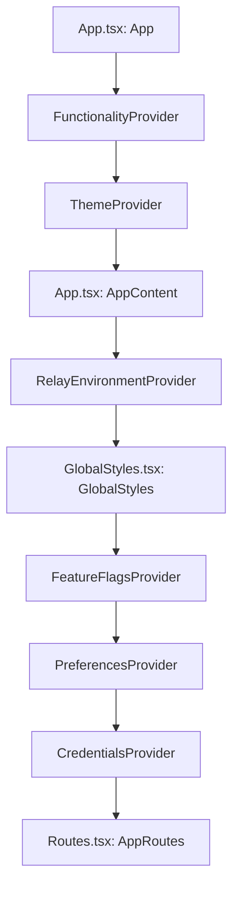
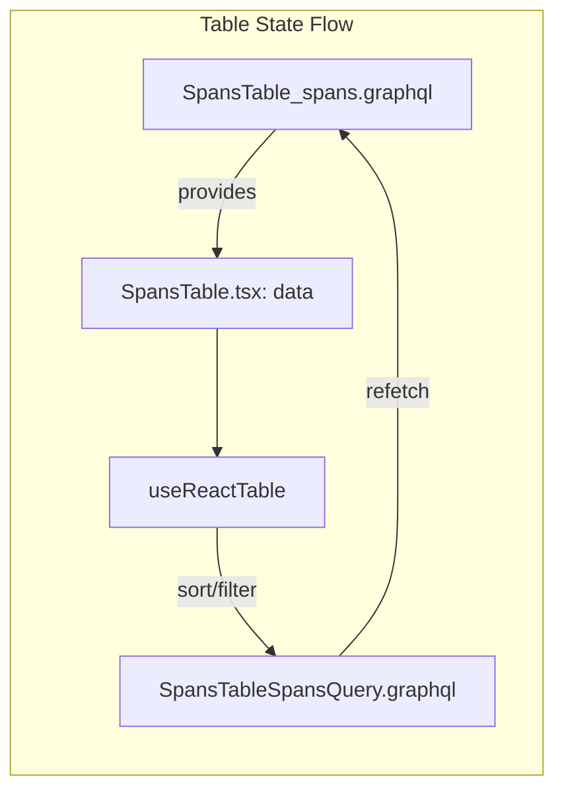
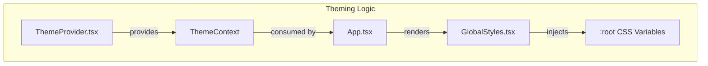

<!-- source: DeepWiki mcp.deepwiki.com · repo arize-ai/phoenix · page 4.2 State Management & Theming · fetched 2026-10-27 -->

# State Management & Theming

Relevant source files

The following files were used as context for generating this wiki page:

- [app/.storybook/main.ts](app/.storybook/main.ts)
- [app/.storybook/manager.ts](app/.storybook/manager.ts)
- [app/.storybook/preview-body.html](app/.storybook/preview-body.html)
- [app/.storybook/preview.tsx](app/.storybook/preview.tsx)
- [app/src/App.tsx](app/src/App.tsx)
- [app/src/components/agent/AgentConsentGate.tsx](app/src/components/agent/AgentConsentGate.tsx)
- [app/src/components/agent/AgentObservabilitySettings.tsx](app/src/components/agent/AgentObservabilitySettings.tsx)
- [app/src/components/agent/useAssistantAgentEnabled.ts](app/src/components/agent/useAssistantAgentEnabled.ts)
- [app/src/components/ai/prompt-input/styles.ts](app/src/components/ai/prompt-input/styles.ts)
- [app/src/components/core/button/IconButton.tsx](app/src/components/core/button/IconButton.tsx)
- [app/src/components/core/layout/Divider.tsx](app/src/components/core/layout/Divider.tsx)
- [app/src/contexts/ThemeContext.tsx](app/src/contexts/ThemeContext.tsx)
- [app/src/contexts/ViewerContext.tsx](app/src/contexts/ViewerContext.tsx)
- [app/src/contexts/__generated__/ViewerContextRefetchQuery.graphql.ts](app/src/contexts/__generated__/ViewerContextRefetchQuery.graphql.ts)
- [app/src/contexts/__generated__/ViewerContext_viewer.graphql.ts](app/src/contexts/__generated__/ViewerContext_viewer.graphql.ts)
- [app/src/pages/AuthenticatedRoot.tsx](app/src/pages/AuthenticatedRoot.tsx)
- [app/src/pages/__generated__/authenticatedRootLoaderQuery.graphql.ts](app/src/pages/__generated__/authenticatedRootLoaderQuery.graphql.ts)
- [app/src/pages/authenticatedRootLoader.ts](app/src/pages/authenticatedRootLoader.ts)
- [app/src/pages/profile/APIKeysTable.tsx](app/src/pages/profile/APIKeysTable.tsx)
- [app/src/pages/profile/ProfilePage.tsx](app/src/pages/profile/ProfilePage.tsx)
- [app/src/pages/profile/ViewerProfileCard.tsx](app/src/pages/profile/ViewerProfileCard.tsx)
- [app/src/pages/profile/__generated__/APIKeysTableDeleteAPIKeyMutation.graphql.ts](app/src/pages/profile/__generated__/APIKeysTableDeleteAPIKeyMutation.graphql.ts)
- [app/src/pages/project/ProjectPage.tsx](app/src/pages/project/ProjectPage.tsx)
- [app/src/pages/project/SpanColumnSelector.tsx](app/src/pages/project/SpanColumnSelector.tsx)
- [app/src/pages/project/SpansTable.tsx](app/src/pages/project/SpansTable.tsx)
- [app/src/pages/project/TracesTable.tsx](app/src/pages/project/TracesTable.tsx)
- [app/src/pages/project/__generated__/ProjectPageQueriesSpansQuery.graphql.ts](app/src/pages/project/__generated__/ProjectPageQueriesSpansQuery.graphql.ts)
- [app/src/pages/project/__generated__/ProjectPageQueriesTracesQuery.graphql.ts](app/src/pages/project/__generated__/ProjectPageQueriesTracesQuery.graphql.ts)
- [app/src/pages/project/__generated__/ProjectPageQuery.graphql.ts](app/src/pages/project/__generated__/ProjectPageQuery.graphql.ts)
- [app/src/pages/project/__generated__/SpansTableSpansQuery.graphql.ts](app/src/pages/project/__generated__/SpansTableSpansQuery.graphql.ts)
- [app/src/pages/project/__generated__/SpansTable_spans.graphql.ts](app/src/pages/project/__generated__/SpansTable_spans.graphql.ts)
- [app/src/pages/project/__generated__/TracesTableQuery.graphql.ts](app/src/pages/project/__generated__/TracesTableQuery.graphql.ts)
- [app/src/pages/project/__generated__/TracesTable_spans.graphql.ts](app/src/pages/project/__generated__/TracesTable_spans.graphql.ts)
- [app/src/store/tracingStore.tsx](app/src/store/tracingStore.tsx)
- [app/stories/Alert.stories.tsx](app/stories/Alert.stories.tsx)

This document describes the Phoenix frontend state management architecture, which utilizes Zustand for client-side stores, Relay for GraphQL caching, and a robust theming system built on CSS custom properties.

## State Management Architecture

Phoenix employs a layered approach to state: Zustand for ephemeral or persisted UI state, React Context for configuration and dependency injection, and Relay for server-synchronized data.

### Provider Tree Hierarchy

The application initializes with a hierarchy of providers that establish the environment for data fetching, theming, and state access.

**Sources:** [app/src/App.tsx:15-40]()

### Zustand Stores

Phoenix uses Zustand for lightweight state management. Stores are often integrated with `persist` middleware to maintain state across page reloads.

| Store | Purpose | Persistence | Key Entities |
|-------|---------|-------------|--------------|
| **TracingStore** | Manages span selection and trace view state | In-memory | `selectedSpanId`, `expandedTraceIds` |
| **CredentialsStore** | Manages API keys for LLM providers | localStorage | `ModelProvider`, `APIKey` |
| **PreferencesStore** | Global user UI settings | localStorage | `isSideNavExpanded`, `themeMode` |

#### Data Flow and State Synchronization
Components often combine Relay data with local Zustand state to handle interactive UI elements like tables. For example, `SpansTable` uses Relay for paginated data fetching and Zustand (or local React state) for managing column visibility and sorting.

**Sources:** [app/src/pages/project/SpansTable.tsx:108-132](), [app/src/pages/project/__generated__/SpansTable_spans.graphql.ts:16-91](), [app/src/store/tracingStore.tsx:1-20]()

### Relay Cache & Data Flow

Relay handles the synchronization of server-side data. The application uses a fragment-based architecture where parent components fetch data and children define their requirements via fragments.

- **Preloading**: Data is fetched using `useQueryLoader` and `usePreloadedQuery` patterns to optimize initial renders [app/src/pages/project/ProjectPage.tsx:154-165]().
- **Pagination**: Large lists like spans and traces use `usePaginationFragment` to handle infinite scrolling and "Load More" functionality [app/src/pages/project/SpansTable.tsx:18-22]().
- **Cache Policy**: Queries often specify `store-and-network` to ensure immediate UI updates from the cache followed by background synchronization [app/src/pages/project/ProjectPage.tsx:150-152]().

**Sources:** [app/src/pages/project/ProjectPage.tsx:134-165](), [app/src/pages/project/SpansTable.tsx:116-179]()

## Theming System

Phoenix uses a CSS-in-JS approach (via Emotion) combined with CSS custom properties to provide a themeable interface.

### CSS Custom Properties Architecture

The system is founded on `GlobalStyles.tsx`, which defines variables for dimensions and colors.

- **Dimension Scaling**: Standardized sizes are defined using a consistent scale (e.g., `--global-dimension-size-200`) [app/src/pages/project/SpansTable.tsx:189-192]().
- **Thematic Colors**: Colors are assigned to variables like `--global-color-gray-100` which are redefined in dark mode [app/src/pages/project/TracesTable.tsx:177]().
- **Dynamic Resizing**: Table columns utilize CSS variables for dynamic width calculations (e.g., `--col-id-size`) [app/src/pages/project/SpansTable.tsx:149-155]().

**Sources:** [app/src/pages/project/SpansTable.tsx:149-165](), [app/src/pages/project/TracesTable.tsx:175-179]()

### Theme Selection & Application

The `ThemeProvider` manages the application of the `light` and `dark` themes.

- **Storybook Integration**: Theming is also integrated into the development environment via Storybook, allowing previewing components in different modes [app/.storybook/preview.tsx:21-40]().
- **System Sync**: The application can detect and react to system-level theme changes using the `useSystemTheme` hook [app/.storybook/preview.tsx:258-275]().

**Sources:** [app/src/App.tsx:4-20](), [app/.storybook/preview.tsx:56-57]()

## Layout & Context Integration

The main application layout integrates multiple state sources to manage complex UI behaviors.

- **Project Context**: `ProjectContext` provides project-specific configuration, such as whether to treat orphan spans as roots [app/src/pages/project/ProjectPage.tsx:123-125]().
- **Time Range State**: The `useTimeRange` hook interacts with global state to synchronize data fetching across different tabs (Spans, Traces, Sessions) [app/src/pages/project/ProjectPage.tsx:67-68]().
- **Streaming State**: `StreamStateProvider` manages the real-time update status for the current project view [app/src/pages/project/ProjectPage.tsx:110-112]().

**Sources:** [app/src/pages/project/ProjectPage.tsx:102-114](), [app/src/pages/project/SpansTable.tsx:64-66]()

---

