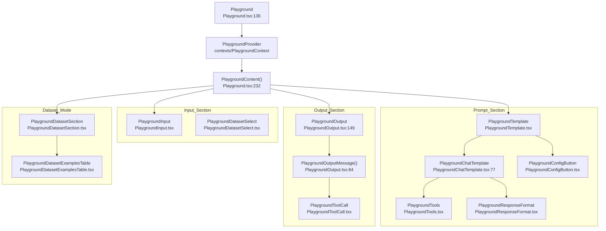
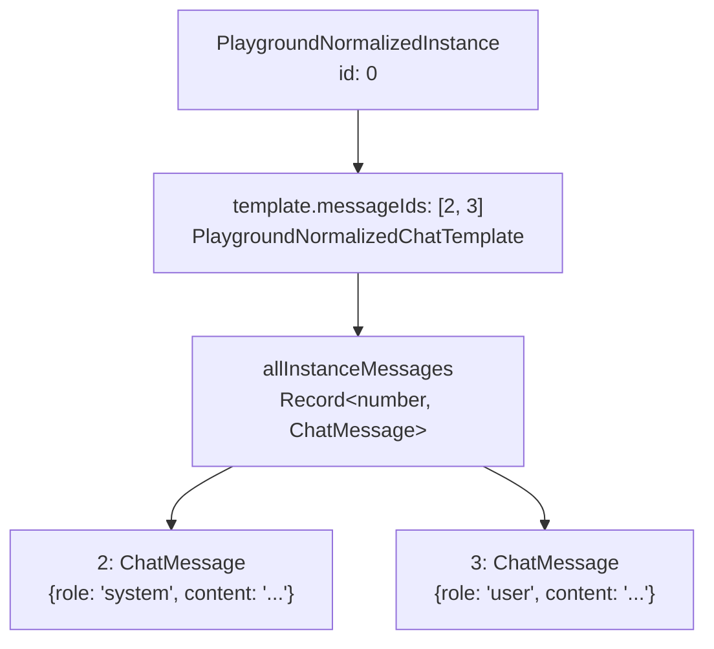
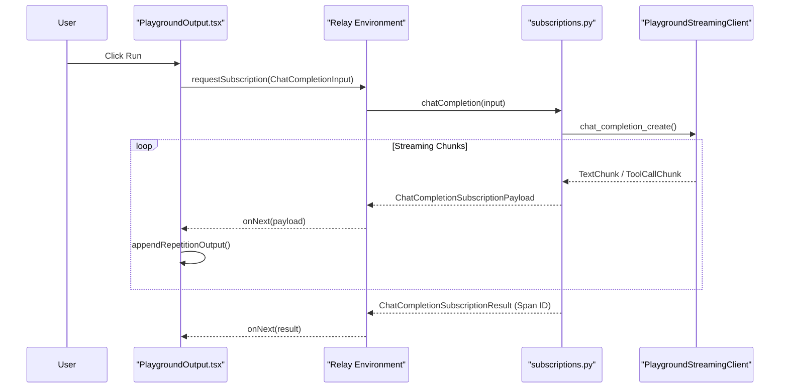

<!-- source: DeepWiki mcp.deepwiki.com · repo arize-ai/phoenix · page 4.3 Playground Interface · fetched 2026-10-27 -->

# Playground Interface

Relevant source files

The following files were used as context for generating this wiki page:

- [app/src/@types/generative.d.ts](app/src/@types/generative.d.ts)
- [app/src/components/evaluators/AddEvaluatorMenu.tsx](app/src/components/evaluators/AddEvaluatorMenu.tsx)
- [app/src/components/evaluators/EvaluatorForm.tsx](app/src/components/evaluators/EvaluatorForm.tsx)
- [app/src/components/evaluators/EvaluatorPromptPreview.tsx](app/src/components/evaluators/EvaluatorPromptPreview.tsx)
- [app/src/components/evaluators/__generated__/EvaluatorPromptPreviewQuery.graphql.ts](app/src/components/evaluators/__generated__/EvaluatorPromptPreviewQuery.graphql.ts)
- [app/src/components/evaluators/templates/defaultEvaluatorTemplate.tsx](app/src/components/evaluators/templates/defaultEvaluatorTemplate.tsx)
- [app/src/components/evaluators/templates/index.ts](app/src/components/evaluators/templates/index.ts)
- [app/src/components/evaluators/templates/types.tsx](app/src/components/evaluators/templates/types.tsx)
- [app/src/components/evaluators/utils.ts](app/src/components/evaluators/utils.ts)
- [app/src/components/generative/ToolChoiceSelector.tsx](app/src/components/generative/ToolChoiceSelector.tsx)
- [app/src/constants/__tests__/generativeConstants.test.ts](app/src/constants/__tests__/generativeConstants.test.ts)
- [app/src/constants/generativeConstants.ts](app/src/constants/generativeConstants.ts)
- [app/src/pages/playground/ChatMessageToolCallsEditor.tsx](app/src/pages/playground/ChatMessageToolCallsEditor.tsx)
- [app/src/pages/playground/Playground.tsx](app/src/pages/playground/Playground.tsx)
- [app/src/pages/playground/PlaygroundChatTemplate.tsx](app/src/pages/playground/PlaygroundChatTemplate.tsx)
- [app/src/pages/playground/PlaygroundCredentialsDropdown.tsx](app/src/pages/playground/PlaygroundCredentialsDropdown.tsx)
- [app/src/pages/playground/PlaygroundDatasetExamplesTable.tsx](app/src/pages/playground/PlaygroundDatasetExamplesTable.tsx)
- [app/src/pages/playground/PlaygroundDatasetSection.tsx](app/src/pages/playground/PlaygroundDatasetSection.tsx)
- [app/src/pages/playground/PlaygroundEvaluatorSelect.tsx](app/src/pages/playground/PlaygroundEvaluatorSelect.tsx)
- [app/src/pages/playground/PlaygroundExperimentToolbar.tsx](app/src/pages/playground/PlaygroundExperimentToolbar.tsx)
- [app/src/pages/playground/PlaygroundOutput.tsx](app/src/pages/playground/PlaygroundOutput.tsx)
- [app/src/pages/playground/PlaygroundTemplate.tsx](app/src/pages/playground/PlaygroundTemplate.tsx)
- [app/src/pages/playground/PlaygroundTool.tsx](app/src/pages/playground/PlaygroundTool.tsx)
- [app/src/pages/playground/PlaygroundToolCall.tsx](app/src/pages/playground/PlaygroundToolCall.tsx)
- [app/src/pages/playground/PlaygroundTools.tsx](app/src/pages/playground/PlaygroundTools.tsx)
- [app/src/pages/playground/__generated__/PlaygroundDatasetExamplesTableMutation.graphql.ts](app/src/pages/playground/__generated__/PlaygroundDatasetExamplesTableMutation.graphql.ts)
- [app/src/pages/playground/__generated__/PlaygroundDatasetExamplesTableSubscription.graphql.ts](app/src/pages/playground/__generated__/PlaygroundDatasetExamplesTableSubscription.graphql.ts)
- [app/src/pages/playground/__generated__/PlaygroundDatasetSectionQuery.graphql.ts](app/src/pages/playground/__generated__/PlaygroundDatasetSectionQuery.graphql.ts)
- [app/src/pages/playground/__generated__/PlaygroundDatasetSection_evaluator.graphql.ts](app/src/pages/playground/__generated__/PlaygroundDatasetSection_evaluator.graphql.ts)
- [app/src/pages/playground/__generated__/PlaygroundOutputSubscription.graphql.ts](app/src/pages/playground/__generated__/PlaygroundOutputSubscription.graphql.ts)
- [app/src/pages/playground/__tests__/playgroundUtils.test.ts](app/src/pages/playground/__tests__/playgroundUtils.test.ts)
- [app/src/pages/playground/constants.tsx](app/src/pages/playground/constants.tsx)
- [app/src/pages/playground/playgroundUtils.ts](app/src/pages/playground/playgroundUtils.ts)
- [app/src/pages/playground/schemas.ts](app/src/pages/playground/schemas.ts)
- [app/src/schemas/__tests__/toolCallSchemas.test.ts](app/src/schemas/__tests__/toolCallSchemas.test.ts)
- [app/src/schemas/__tests__/toolSchemas.test.ts](app/src/schemas/__tests__/toolSchemas.test.ts)
- [app/src/schemas/phoenixToolTypeSchemas.ts](app/src/schemas/phoenixToolTypeSchemas.ts)
- [app/src/schemas/toolChoiceSchemas.ts](app/src/schemas/toolChoiceSchemas.ts)
- [app/src/schemas/toolSchemas.ts](app/src/schemas/toolSchemas.ts)
- [app/src/store/credentialsStore.tsx](app/src/store/credentialsStore.tsx)
- [app/src/store/datasetStore.tsx](app/src/store/datasetStore.tsx)
- [app/src/store/evaluatorStore.tsx](app/src/store/evaluatorStore.tsx)
- [app/src/store/playground/__tests__/playgroundStore.test.ts](app/src/store/playground/__tests__/playgroundStore.test.ts)
- [app/src/store/playground/__tests__/playgroundStoreUtils.test.ts](app/src/store/playground/__tests__/playgroundStoreUtils.test.ts)
- [app/src/store/playground/playgroundStore.tsx](app/src/store/playground/playgroundStore.tsx)
- [app/src/store/playground/playgroundStoreUtils.ts](app/src/store/playground/playgroundStoreUtils.ts)
- [app/src/store/playground/types.ts](app/src/store/playground/types.ts)
- [app/src/types/evaluators.ts](app/src/types/evaluators.ts)
- [app/src/utils/generativeUtils.ts](app/src/utils/generativeUtils.ts)
- [src/phoenix/server/api/evaluators.py](src/phoenix/server/api/evaluators.py)
- [src/phoenix/server/api/helpers/evaluators.py](src/phoenix/server/api/helpers/evaluators.py)
- [src/phoenix/server/api/helpers/playground_clients.py](src/phoenix/server/api/helpers/playground_clients.py)
- [src/phoenix/server/api/mutations/chat_mutations.py](src/phoenix/server/api/mutations/chat_mutations.py)
- [src/phoenix/server/api/subscriptions.py](src/phoenix/server/api/subscriptions.py)
- [tests/unit/server/api/helpers/test_evaluators.py](tests/unit/server/api/helpers/test_evaluators.py)
- [tests/unit/server/api/helpers/test_playground_clients.py](tests/unit/server/api/helpers/test_playground_clients.py)
- [tests/unit/server/api/test_subscriptions.py](tests/unit/server/api/test_subscriptions.py)

The Playground Interface is Phoenix's frontend system for interactively testing LLM prompts across multiple providers with real-time streaming responses. This document covers the React-based UI components, state management via Zustand, GraphQL communication patterns, and the data flow from user input through LLM invocation to displayed output.

## Component Architecture

The playground is structured as a hierarchical React application with main sections for prompts, inputs (when using template variables), and outputs. The top-level `Playground` component ([app/src/pages/playground/Playground.tsx:136-210]()) orchestrates the layout and provides the context for all child components via `PlaygroundProvider`.

**Primary Component Files and Responsibilities**

| Component | File | Primary Responsibility |
|-----------|------|----------------------|
| `Playground` | `Playground.tsx` | Root component, checks provider availability, wraps app in `PlaygroundProvider` [app/src/pages/playground/Playground.tsx:136-210]() |
| `PlaygroundContent` | `Playground.tsx` | Layout orchestration using `react-resizable-panels` [app/src/pages/playground/Playground.tsx:232-378]() |
| `PlaygroundTemplate` | `PlaygroundTemplate.tsx` | Template editor wrapper, model config button, and prompt versioning UI |
| `PlaygroundChatTemplate` | `PlaygroundChatTemplate.tsx` | Message list with drag-and-drop, role selection, and content editing [app/src/pages/playground/PlaygroundChatTemplate.tsx:77-181]() |
| `PlaygroundOutput` | `PlaygroundOutput.tsx` | Streaming response display, repetition management, and span linking [app/src/pages/playground/PlaygroundOutput.tsx:149-548]() |
| `PlaygroundInput` | `PlaygroundInput.tsx` | Template variable input form for testing prompts with different inputs |
| `PlaygroundDatasetExamplesTable` | `PlaygroundDatasetExamplesTable.tsx` | Batch dataset execution table with virtualization and status indicators [app/src/pages/playground/PlaygroundDatasetExamplesTable.tsx:182-211]() |

**Component Hierarchy with Code Entities**

Sources: [app/src/pages/playground/Playground.tsx:136-210](), [app/src/pages/playground/PlaygroundChatTemplate.tsx:77-181](), [app/src/pages/playground/PlaygroundOutput.tsx:149-548](), [app/src/pages/playground/PlaygroundDatasetExamplesTable.tsx:182-211]()

## State Management

The playground uses Zustand for centralized state management with a normalized message structure. The store is defined in `app/src/store/playground/playgroundStore.tsx` and maintains state across multiple "instances" (parallel prompts/configs).

**PlaygroundState Interface and Store Actions**

```mermaid
graph TB
    PlaygroundState["PlaygroundState<br/>store/playground/types.ts"]
    
    subgraph "Core_State_Fields"
        instances["instances: PlaygroundNormalizedInstance[]<br/>Prompts + Model Configs"]
        allInstanceMessages["allInstanceMessages: Record&lt;number, ChatMessage&gt;<br/>Normalized message storage"]
        dirtyInstances["dirtyInstances: Record&lt;number, boolean&gt;"]
        templateFormat["templateFormat: TemplateFormat"]
        streaming["streaming: boolean"]
    end
    
    subgraph "Instance_Actions"
        addInstance["addInstance()"]
        updateInstance["updateInstance()"]
        deleteInstance["deleteInstance()"]
    end
    
    subgraph "Execution_Actions"
        runPlaygroundInstances["runPlaygroundInstances()"]
        appendRepetitionOutput["appendRepetitionOutput()"]
        setRepetitionSpanId["setRepetitionSpanId()"]
        setRepetitionError["setRepetitionError()"]
    end
    
    PlaygroundState --> instances
    PlaygroundState --> allInstanceMessages
    PlaygroundState --> addInstance
    PlaygroundState --> updateInstance
    PlaygroundState --> runPlaygroundInstances
    PlaygroundState --> appendRepetitionOutput
```

Sources: [app/src/store/playground/types.ts:247-457](), [app/src/store/playground/playgroundStore.tsx:250-718]()

**Normalized Message Storage Pattern**

To avoid data redundancy and simplify reordering, messages are stored in a flat map. `PlaygroundNormalizedChatTemplate` contains only message IDs [app/src/store/playground/types.ts:230-245](). The `normalizeChatTemplate()` function [app/src/store/playground/playgroundStore.tsx:104-118]() facilitates this conversion.

Sources: [app/src/store/playground/types.ts:230-245](), [app/src/store/playground/playgroundStore.tsx:104-118]()

## Communication and Streaming

The playground uses GraphQL subscriptions to handle streaming responses from LLM providers.

**GraphQL Communication Pattern**

Sources: [app/src/pages/playground/PlaygroundOutput.tsx:395-439](), [src/phoenix/server/api/subscriptions.py:76-134]()

The `handleChatCompletionSubscriptionPayload` callback [app/src/pages/playground/PlaygroundOutput.tsx:237-323]() updates the store based on the chunk type:
- `TextChunk`: Incremental content update.
- `ToolCallChunk`: Accumulates partial tool call arguments.
- `ChatCompletionSubscriptionResult`: Links the result to a database `Span` [src/phoenix/server/api/subscriptions.py:129-132]().

## Template and Message Editing

`PlaygroundChatTemplate` provides a drag-and-drop interface for conversation composition using `@dnd-kit/sortable` [app/src/pages/playground/PlaygroundChatTemplate.tsx:111-134]().

**Message Editor Features:**
- **Role Selection**: Uses `MessageRoleSelect` to toggle between `system`, `user`, `assistant`, and `tool` roles [app/src/pages/playground/PlaygroundChatTemplate.tsx:57]().
- **Template Support**: Supports Mustache and f-string formats via `TemplateEditor` [app/src/pages/playground/PlaygroundChatTemplate.tsx:37]().
- **Tool Calls**: AI messages include a `ChatMessageToolCallsEditor` for manual tool call entry or editing streamed results [app/src/pages/playground/PlaygroundChatTemplate.tsx:54]().

## Instance Management

The playground allows multiple parallel instances for prompt engineering comparisons.
- **Limit**: Defined by `NUM_MAX_PLAYGROUND_INSTANCES` (typically 4).
- **Repetitions**: Each instance can run multiple times with different seeds/parameters, managed by `PlaygroundRepetition` [app/src/store/playground/types.ts:130-136]().
- **Normalization**: `createNormalizedPlaygroundInstance` [app/src/store/playground/playgroundStore.tsx:153-165]() generates a new instance with a default chat template.

## Credential Handling

Credentials (API keys, base URLs) are managed through the `CredentialsContext` [app/src/pages/playground/PlaygroundOutput.tsx:159]() and rendered in `PlaygroundCredentialsDropdown`.

**Credential Flow:**
1. User provides credentials in the UI or settings.
2. Credentials are stored in `CredentialsStore` [app/src/store/credentialsStore.tsx]().
3. During execution, `getChatCompletionInput` [app/src/pages/playground/playgroundUtils.ts:782-828]() maps these credentials to `GenerativeCredentialInput` objects sent to the backend.

## Span Integration

The Playground can be populated from existing traces to debug specific LLM calls.
- **Hydration**: `transformSpanAttributesToPlaygroundInstance` [app/src/pages/playground/playgroundUtils.ts:625-772]() parses OpenInference semantic conventions (e.g., `llm.input_messages`, `llm.invocation_parameters`) from a `Span`.
- **Tool Mapping**: `processAttributeToolCalls` [app/src/pages/playground/playgroundUtils.ts:148-219]() converts provider-specific tool call formats (OpenAI, Anthropic, etc.) into the internal `ChatMessage["toolCalls"]` format.

Sources: [app/src/pages/playground/playgroundUtils.ts:148-219](), [app/src/pages/playground/playgroundUtils.ts:625-772](), [app/src/store/playground/playgroundStore.tsx:153-165]()

---

