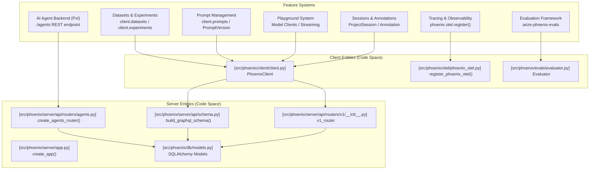
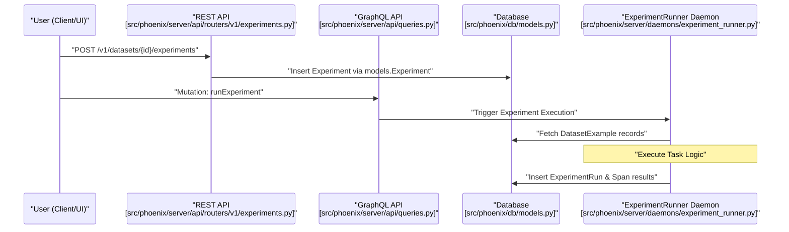

<!-- source: DeepWiki mcp.deepwiki.com · repo arize-ai/phoenix · page 5 Feature Systems · fetched 2026-10-27 -->

# Feature Systems

Relevant source files

The following files were used as context for generating this wiki page:

- [app/schema.graphql](app/schema.graphql)
- [app/src/components/trace/SpanKindIcon.tsx](app/src/components/trace/SpanKindIcon.tsx)
- [app/src/window.d.ts](app/src/window.d.ts)
- [cspell.json](cspell.json)
- [scripts/data/generate_traces.py](scripts/data/generate_traces.py)
- [src/phoenix/config.py](src/phoenix/config.py)
- [src/phoenix/db/alembic.ini](src/phoenix/db/alembic.ini)
- [src/phoenix/db/engines.py](src/phoenix/db/engines.py)
- [src/phoenix/db/migrate.py](src/phoenix/db/migrate.py)
- [src/phoenix/db/migrations/__init__.py](src/phoenix/db/migrations/__init__.py)
- [src/phoenix/db/migrations/env.py](src/phoenix/db/migrations/env.py)
- [src/phoenix/db/migrations/versions/10460e46d750_datasets.py](src/phoenix/db/migrations/versions/10460e46d750_datasets.py)
- [src/phoenix/db/migrations/versions/3be8647b87d8_add_token_columns_to_spans_table.py](src/phoenix/db/migrations/versions/3be8647b87d8_add_token_columns_to_spans_table.py)
- [src/phoenix/db/migrations/versions/cf03bd6bae1d_init.py](src/phoenix/db/migrations/versions/cf03bd6bae1d_init.py)
- [src/phoenix/db/models.py](src/phoenix/db/models.py)
- [src/phoenix/server/api/context.py](src/phoenix/server/api/context.py)
- [src/phoenix/server/api/dataloaders/__init__.py](src/phoenix/server/api/dataloaders/__init__.py)
- [src/phoenix/server/api/input_types/SpanSort.py](src/phoenix/server/api/input_types/SpanSort.py)
- [src/phoenix/server/api/mutations/__init__.py](src/phoenix/server/api/mutations/__init__.py)
- [src/phoenix/server/api/queries.py](src/phoenix/server/api/queries.py)
- [src/phoenix/server/api/routers/v1/experiment_evaluations.py](src/phoenix/server/api/routers/v1/experiment_evaluations.py)
- [src/phoenix/server/api/routers/v1/experiment_runs.py](src/phoenix/server/api/routers/v1/experiment_runs.py)
- [src/phoenix/server/api/routers/v1/experiments.py](src/phoenix/server/api/routers/v1/experiments.py)
- [src/phoenix/server/api/schema.py](src/phoenix/server/api/schema.py)
- [src/phoenix/server/api/types/Dataset.py](src/phoenix/server/api/types/Dataset.py)
- [src/phoenix/server/api/types/Project.py](src/phoenix/server/api/types/Project.py)
- [src/phoenix/server/api/types/Span.py](src/phoenix/server/api/types/Span.py)
- [src/phoenix/server/api/types/Trace.py](src/phoenix/server/api/types/Trace.py)
- [src/phoenix/server/app.py](src/phoenix/server/app.py)
- [src/phoenix/server/main.py](src/phoenix/server/main.py)
- [src/phoenix/server/templates/index.html](src/phoenix/server/templates/index.html)
- [src/phoenix/server/thread_server.py](src/phoenix/server/thread_server.py)
- [src/phoenix/services.py](src/phoenix/services.py)
- [src/phoenix/session/session.py](src/phoenix/session/session.py)
- [src/phoenix/settings.py](src/phoenix/settings.py)
- [src/phoenix/trace/schemas.py](src/phoenix/trace/schemas.py)
- [src/phoenix/trace/span_json_decoder.py](src/phoenix/trace/span_json_decoder.py)
- [src/phoenix/trace/span_json_encoder.py](src/phoenix/trace/span_json_encoder.py)
- [tests/unit/server/api/routers/v1/test_experiments.py](tests/unit/server/api/routers/v1/test_experiments.py)
- [tests/unit/server/api/test_queries.py](tests/unit/server/api/test_queries.py)
- [tests/unit/server/api/types/test_Trace.py](tests/unit/server/api/types/test_Trace.py)

This document provides an overview of Phoenix's major feature areas and how they integrate across client libraries, server components, and the user interface. Phoenix's functionality is organized into primary feature systems that work together to provide comprehensive AI observability, evaluation, and experimentation capabilities.

For detailed information about each system:
- Tracing and instrumentation setup: see [Tracing & Observability](#5.1)
- Evaluation framework implementation: see [Evaluation Framework](#5.2)
- Dataset and experiment management: see [Datasets & Experiments](#5.3)
- Prompt versioning and templating: see [Prompt Management](#5.4)
- LLM Playground and provider abstraction: see [Playground System](#5.5)
- AI Agent Backend: see [AI Agent Backend (PxI)](#5.6)
- Sessions and Annotations: see [Sessions & Annotations](#5.7)

## Feature System Architecture

Phoenix is organized into major feature systems that span the entire stack from client instrumentation to server storage to UI visualization:

Sources: [src/phoenix/server/app.py:175-181](), [src/phoenix/server/api/schema.py:33-42](), [src/phoenix/db/models.py:1-50](), [src/phoenix/server/api/routers/v1/experiments.py:40-40]()

## Core Feature Overviews

### Tracing & Observability
Phoenix provides an OpenTelemetry-native tracing backend. It ingests spans via OTLP (gRPC and HTTP) and organizes them into traces and projects. The system supports complex LLM app architectures, including RAG pipelines and multi-agent systems, by capturing inputs, outputs, and metadata as span attributes. The `SpanKind` enum categorizes different types of spans, such as `CHAIN`, `LLM`, `TOOL`, and `AGENT` [src/phoenix/server/api/types/Span.py:56-75](). Token counts for prompt and completion are tracked as specific span attributes [src/phoenix/db/models.py:94-104]().
For details, see [Tracing & Observability](#5.1).
Sources: [src/phoenix/server/api/types/Span.py:56-75](), [src/phoenix/db/models.py:94-104](), [src/phoenix/server/app.py:143-157]()

### Evaluation Framework
The evaluation system allows users to run LLM-based, code-based, or heuristic evaluators against traces or datasets. It includes a template engine for prompt-based evaluators and supports mapping span attributes to evaluator inputs. Evaluation results are stored as `Annotation` records linked to spans, traces, sessions, or experiment runs. The `AnnotatorKind` enum distinguishes between `LLM`, `HUMAN`, and `CODE` evaluators [app/schema.graphql:224-228]().
For details, see [Evaluation Framework](#5.2).
Sources: [app/schema.graphql:121-158](), [src/phoenix/server/api/queries.py:76-82](), [app/schema.graphql:203-206]()

### Datasets & Experiments
Phoenix manages versioned datasets consisting of `DatasetExample` records. The experimentation system allows running a "task" (e.g., a prompt or a chain) against a dataset version and recording the results in `ExperimentRuns`. This enables regression testing and side-by-side comparison of different models or prompts. The server runs background daemons like `ExperimentRunner` and `ExperimentSweeper` to manage these lifecycles [src/phoenix/server/app.py:185-186]().
For details, see [Datasets & Experiments](#5.3).
Sources: [src/phoenix/server/api/types/Dataset.py:44-50](), [app/schema.graphql:66-78](), [src/phoenix/server/app.py:185-186]()

### Prompt Management
The prompt system provides a central repository for prompt templates, supporting versioning, tagging, and model-specific invocation parameters. Prompts are treated as first-class citizens that can be pulled into the Playground or used as the basis for experiments. The `PromptVersion` type represents a specific version of a prompt, including its `PromptChatTemplate` and invocation parameters [src/phoenix/db/models.py:73-85]().
For details, see [Prompt Management](#5.4).
Sources: [src/phoenix/db/models.py:73-85](), [src/phoenix/server/api/queries.py:115-128](), [app/schema.graphql:1115-1150]()

### Playground System
The Playground is an interactive environment for testing prompts and models. It abstracts various LLM providers (OpenAI, Anthropic, Azure, AWS Bedrock) through a unified backend interface that handles streaming, credential management (secrets), and parameter tuning. The system supports advanced provider configurations like `AWSBedrockCustomProviderConfig` [app/schema.graphql:46-50]().
For details, see [Playground System](#5.5).
Sources: [src/phoenix/server/api/queries.py:53-57](), [app/schema.graphql:3-54](), [src/phoenix/server/api/queries.py:109-109]()

### AI Agent Backend (PxI)
The AI Agent Backend, also known as Phoenix Intelligence (PxI), provides server-side AI agent capabilities. It leverages a `pydantic-ai` agent factory, handles model selection, manages tool capabilities (like `MintlifyDocsMCPServer`), and resolves context for agent interactions [src/phoenix/server/app.py:85-85](). The system configuration controls features like `webAccessEnabled` and `assistantEnabled` [app/schema.graphql:89-119]().
For details, see [AI Agent Backend (PxI)](#5.6).
Sources: [src/phoenix/server/app.py:176-176](), [app/schema.graphql:80-119](), [src/phoenix/server/api/queries.py:21-24]()

### Sessions & Annotations
Phoenix groups related traces into `ProjectSession` objects, representing multi-turn conversations or extended interactions. The system allows for `Annotation` of these sessions, as well as individual spans and traces, providing a flexible mechanism for qualitative feedback and evaluation results. DataLoaders like `SessionAnnotationsBySessionDataLoader` optimize the retrieval of these relationships [src/phoenix/server/api/app.py:137-137]().
For details, see [Sessions & Annotations](#5.7).
Sources: [src/phoenix/server/api/types/ProjectSession.py:44-44](), [app/schema.graphql:121-158](), [src/phoenix/server/api/dataloaders/__init__.py:66-66]()

## Data Model Integration

The feature systems are unified by a shared database schema managed via SQLAlchemy.

| Feature Area | Primary Code Entities | Database Table (approx) |
| :--- | :--- | :--- |
| **Tracing** | `Span`, `Trace`, `Project` | `spans`, `traces`, `projects` |
| **Evaluations** | `Annotation`, `Evaluator` | `span_annotations`, `trace_annotations`, `session_annotations`, `evaluators` |
| **Experiments** | `Dataset`, `Experiment`, `ExperimentRun` | `datasets`, `experiments`, `experiment_runs` |
| **Prompts** | `Prompt`, `PromptVersion` | `prompts`, `prompt_versions` |
| **Sessions** | `ProjectSession` | `project_sessions` |

Sources: [src/phoenix/db/models.py:172-187](), [src/phoenix/db/migrations/versions/cf03bd6bae1d_init.py:49-126](), [src/phoenix/server/api/queries.py:72-117]()

## Cross-System Data Flow

The following diagram illustrates how a single user action (running an experiment) bridges multiple systems and code entities:

Sources: [src/phoenix/server/api/routers/v1/experiments.py:121-125](), [src/phoenix/server/app.py:185-186](), [src/phoenix/server/api/queries.py:83-92]()

## Common Infrastructure Features

### Authentication & Authorization
All feature systems are protected by a unified authentication layer supporting OAuth2, LDAP, and Local auth. The `AuthMethod` enum defines the supported authentication methods [src/phoenix/db/models.py:173-173]().

### Secrets Management
The server provides a secure way to store and retrieve LLM provider API keys used by the Playground and Evaluators. DataLoaders like `SecretsDataLoader` manage efficient access to these sensitive values [src/phoenix/server/api/app.py:136-136]().

### Cost Tracking
Phoenix includes a `SpanCostCalculator` that runs as a daemon to estimate token costs for spans based on model-specific pricing manifests [src/phoenix/server/app.py:187-188](). This is facilitated by the `GenerativeModelStore` which maintains pricing and model availability.
Sources: [src/phoenix/server/app.py:187-188](), [src/phoenix/server/api/dataloaders/__init__.py:74-90]()

---

