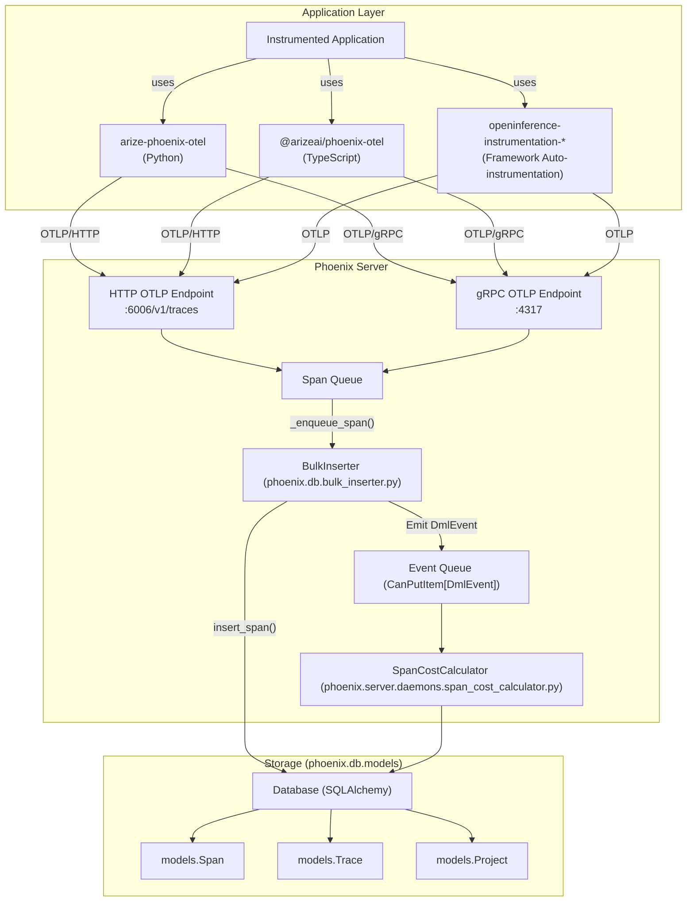
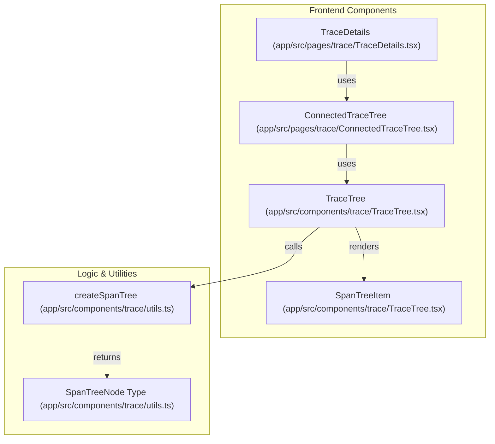

<!-- source: DeepWiki mcp.deepwiki.com · repo arize-ai/phoenix · page 5.1 Tracing & Observability · fetched 2026-10-27 -->

# Tracing & Observability

Relevant source files

The following files were used as context for generating this wiki page:

- [app/src/components/annotation/AnnotationInputLabel.tsx](app/src/components/annotation/AnnotationInputLabel.tsx)
- [app/src/components/annotation/__generated__/AnnotationSummaryGroup.graphql.ts](app/src/components/annotation/__generated__/AnnotationSummaryGroup.graphql.ts)
- [app/src/components/trace/AnnotationConfigList.tsx](app/src/components/trace/AnnotationConfigList.tsx)
- [app/src/components/trace/AnnotationFormProvider.tsx](app/src/components/trace/AnnotationFormProvider.tsx)
- [app/src/components/trace/AnnotatorKindToken.tsx](app/src/components/trace/AnnotatorKindToken.tsx)
- [app/src/components/trace/SpanAnnotationsEditor.tsx](app/src/components/trace/SpanAnnotationsEditor.tsx)
- [app/src/components/trace/TraceTree.tsx](app/src/components/trace/TraceTree.tsx)
- [app/src/components/trace/__generated__/SpanAnnotationsEditorCreateAnnotationMutation.graphql.ts](app/src/components/trace/__generated__/SpanAnnotationsEditorCreateAnnotationMutation.graphql.ts)
- [app/src/components/trace/__generated__/SpanAnnotationsEditorDeleteAnnotationMutation.graphql.ts](app/src/components/trace/__generated__/SpanAnnotationsEditorDeleteAnnotationMutation.graphql.ts)
- [app/src/components/trace/__generated__/SpanAnnotationsEditorEditAnnotationMutation.graphql.ts](app/src/components/trace/__generated__/SpanAnnotationsEditorEditAnnotationMutation.graphql.ts)
- [app/src/components/trace/__generated__/SpanAnnotationsEditorSpanAnnotationsListQuery.graphql.ts](app/src/components/trace/__generated__/SpanAnnotationsEditorSpanAnnotationsListQuery.graphql.ts)
- [app/src/components/trace/__generated__/SpanAnnotationsEditor_spanAnnotations.graphql.ts](app/src/components/trace/__generated__/SpanAnnotationsEditor_spanAnnotations.graphql.ts)
- [app/src/components/trace/__tests__/utils.test.ts](app/src/components/trace/__tests__/utils.test.ts)
- [app/src/components/trace/types.ts](app/src/components/trace/types.ts)
- [app/src/components/trace/utils.ts](app/src/components/trace/utils.ts)
- [app/src/pages/project/ProjectPage.tsx](app/src/pages/project/ProjectPage.tsx)
- [app/src/pages/project/SpanColumnSelector.tsx](app/src/pages/project/SpanColumnSelector.tsx)
- [app/src/pages/project/SpansTable.tsx](app/src/pages/project/SpansTable.tsx)
- [app/src/pages/project/TracesTable.tsx](app/src/pages/project/TracesTable.tsx)
- [app/src/pages/project/__generated__/ProjectPageQueriesSpansQuery.graphql.ts](app/src/pages/project/__generated__/ProjectPageQueriesSpansQuery.graphql.ts)
- [app/src/pages/project/__generated__/ProjectPageQueriesTracesQuery.graphql.ts](app/src/pages/project/__generated__/ProjectPageQueriesTracesQuery.graphql.ts)
- [app/src/pages/project/__generated__/ProjectPageQuery.graphql.ts](app/src/pages/project/__generated__/ProjectPageQuery.graphql.ts)
- [app/src/pages/project/__generated__/SpansTableSpansQuery.graphql.ts](app/src/pages/project/__generated__/SpansTableSpansQuery.graphql.ts)
- [app/src/pages/project/__generated__/SpansTable_spans.graphql.ts](app/src/pages/project/__generated__/SpansTable_spans.graphql.ts)
- [app/src/pages/project/__generated__/TracesTableQuery.graphql.ts](app/src/pages/project/__generated__/TracesTableQuery.graphql.ts)
- [app/src/pages/project/__generated__/TracesTable_spans.graphql.ts](app/src/pages/project/__generated__/TracesTable_spans.graphql.ts)
- [app/src/pages/trace/SpanAside.tsx](app/src/pages/trace/SpanAside.tsx)
- [app/src/pages/trace/SpanDetails.tsx](app/src/pages/trace/SpanDetails.tsx)
- [app/src/pages/trace/SpanFeedback.tsx](app/src/pages/trace/SpanFeedback.tsx)
- [app/src/pages/trace/SpanNotesEditor.tsx](app/src/pages/trace/SpanNotesEditor.tsx)
- [app/src/pages/trace/TraceDetails.tsx](app/src/pages/trace/TraceDetails.tsx)
- [app/src/pages/trace/TraceHeaderRootSpanAnnotations.tsx](app/src/pages/trace/TraceHeaderRootSpanAnnotations.tsx)
- [app/src/pages/trace/__generated__/SpanAsideAnnotationList_span.graphql.ts](app/src/pages/trace/__generated__/SpanAsideAnnotationList_span.graphql.ts)
- [app/src/pages/trace/__generated__/SpanAside_span.graphql.ts](app/src/pages/trace/__generated__/SpanAside_span.graphql.ts)
- [app/src/pages/trace/__generated__/SpanDetailsQuery.graphql.ts](app/src/pages/trace/__generated__/SpanDetailsQuery.graphql.ts)
- [app/src/pages/trace/__generated__/SpanFeedback_annotations.graphql.ts](app/src/pages/trace/__generated__/SpanFeedback_annotations.graphql.ts)
- [app/src/pages/trace/__generated__/SpanNotesEditorAddNoteMutation.graphql.ts](app/src/pages/trace/__generated__/SpanNotesEditorAddNoteMutation.graphql.ts)
- [app/src/pages/trace/__generated__/SpanNotesEditorQuery.graphql.ts](app/src/pages/trace/__generated__/SpanNotesEditorQuery.graphql.ts)
- [app/src/pages/trace/__generated__/TraceDetailsQuery.graphql.ts](app/src/pages/trace/__generated__/TraceDetailsQuery.graphql.ts)
- [app/src/pages/trace/__generated__/TraceHeaderRootSpanAnnotationsQuery.graphql.ts](app/src/pages/trace/__generated__/TraceHeaderRootSpanAnnotationsQuery.graphql.ts)
- [app/src/store/preferencesStore.tsx](app/src/store/preferencesStore.tsx)
- [app/src/store/tracingStore.tsx](app/src/store/tracingStore.tsx)
- [scripts/testing/send_spans.py](scripts/testing/send_spans.py)
- [src/phoenix/exceptions.py](src/phoenix/exceptions.py)
- [src/phoenix/trace/dsl/filter.py](src/phoenix/trace/dsl/filter.py)
- [src/phoenix/trace/dsl/query.py](src/phoenix/trace/dsl/query.py)
- [src/phoenix/trace/span_evaluations.py](src/phoenix/trace/span_evaluations.py)
- [src/phoenix/trace/trace_dataset.py](src/phoenix/trace/trace_dataset.py)
- [tests/unit/trace/dsl/test_filter.py](tests/unit/trace/dsl/test_filter.py)
- [tests/unit/trace/dsl/test_query.py](tests/unit/trace/dsl/test_query.py)
- [tests/unit/trace/test_span_evaluations.py](tests/unit/trace/test_span_evaluations.py)

## Purpose and Scope

This document describes Phoenix's OpenTelemetry-based tracing and observability system. It covers the instrumentation packages, OTLP collector endpoints, span ingestion pipeline, and trace data model. For information about evaluating traces, see [Evaluation Framework](#5.2). For dataset management and experiments, see [Datasets & Experiments](#5.3).

## Architecture Overview

Phoenix's tracing system is built on OpenTelemetry and follows the OTLP (OpenTelemetry Protocol) specification. Applications instrument their code using OpenTelemetry SDKs, which export spans to Phoenix's collector endpoints. Phoenix processes these spans through a queue-based bulk insertion pipeline before storing them in the database.

Title: Trace Ingestion Architecture

Sources: `[src/phoenix/db/bulk_inserter.py:51-87]()`, `[src/phoenix/db/bulk_inserter.py:157-175]()`, `[src/phoenix/server/prometheus.py:110-115]()`

## Phoenix OTEL Packages

Phoenix provides wrapper packages around OpenTelemetry primitives that simplify configuration with Phoenix-aware defaults.

### Python: arize-phoenix-otel

The `arize-phoenix-otel` package provides drop-in replacements for OpenTelemetry classes.

**Key Components:**

| Class/Function | Purpose |
|-------|---------|
| `register()` | One-line setup function for tracing |
| `TracerProvider` | Extended TracerProvider with Phoenix defaults |
| `HTTPSpanExporter` | HTTP OTLP exporter |
| `GRPCSpanExporter` | gRPC OTLP exporter |

### Trace Ingestion Pipeline

The `BulkInserter` class is responsible for the asynchronous persistence of spans and annotations. It manages an internal `deque` of spans and coordinates with various `QueueInserter` objects for annotations.

**Key Functions:**
- `_bulk_insert()`: The main loop that dequeues operations and executes database transactions [src/phoenix/db/bulk_inserter.py:126-155]().
- `_insert_spans()`: Batch inserts spans into the database using `insert_span()` [src/phoenix/db/bulk_inserter.py:157-175]().
- `_enqueue_span()`: Adds a new span to the processing queue [src/phoenix/db/bulk_inserter.py:121-122]().

Sources: `[src/phoenix/db/bulk_inserter.py:51-175]()`

## Observability Features

The Phoenix UI provides several features for visualizing and analyzing trace data, primarily through the `SpansTable` and `TracesTable`.

### Spans Table & Filtering

The `SpansTable` [app/src/pages/project/SpansTable.tsx:183]() displays a list of spans. It utilizes a Domain Specific Language (DSL) for advanced filtering.

**Filtering Logic:**
Filtering is powered by the `SpanFilter` class [src/phoenix/trace/dsl/filter.py:147](). It takes a condition string, parses it using Python's `ast` module, and translates it into SQLAlchemy expressions.

- `_NAMES`: Maps human-readable keys (e.g., `latency_ms`, `status_code`, `name`) to database columns [src/phoenix/trace/dsl/filter.py:125-133]().
- `_apply_eval_aliasing()`: Handles joining the `span_annotation` table when filters refer to evaluations (e.g., `evals['relevance'].label == 'high'`) [src/phoenix/trace/dsl/filter.py:163]().
- `AliasedAnnotationRelation`: Manages SQL aliases for multiple evaluation joins [src/phoenix/trace/dsl/filter.py:36-50]().
- `_FLOAT_ATTRIBUTES`: Identifies attributes that should be treated as floats (e.g., `llm.token_count.total`) [src/phoenix/trace/dsl/filter.py:90-96]().

Sources: `[app/src/pages/project/SpansTable.tsx:183]()`, `[src/phoenix/trace/dsl/filter.py:36-163]()`

### Trace Tree Visualization

Traces are visualized as hierarchical trees in the UI.

Title: UI Trace Visualization Flow

**Key Tree Logic:**
- `createSpanTree()`: Reconstructs the parent-child hierarchy from a flat array of spans based on `parentId` [app/src/components/trace/utils.ts:10-20]().
- `SpanTreeItem`: Renders an individual span node, showing its kind, status, latency, and token counts [app/src/components/trace/TraceTree.tsx:101-138]().
- `TimelineBar`: Visualizes the span's duration relative to the overall trace time range [app/src/components/trace/TraceTree.tsx:197-207]().
- `TraceDetails`: Manages the overall layout for trace viewing, including the tree and details panels [app/src/pages/trace/TraceDetails.tsx:57-182]().

Sources: `[app/src/components/trace/TraceTree.tsx:31-207]()`, `[app/src/components/trace/utils.ts:10-20]()`, `[app/src/pages/trace/TraceDetails.tsx:57-184]()`

### Span Details & Annotations

The `SpanDetails` component [app/src/pages/trace/SpanDetails.tsx:146]() provides deep inspection of a single span.

**Data Display:**
- **Attributes**: Displays OpenInference semantic conventions (LLM, Retrieval, Tool, etc.) [app/src/pages/trace/SpanDetails.tsx:105-111]().
- **Input/Output**: Renders values based on MIME types, including support for Markdown and JSON [app/src/pages/trace/SpanDetails.tsx:203-211]().
- **Events**: Lists span events such as exceptions [app/src/pages/trace/SpanDetails.tsx:212-216]().

**Annotation Management:**
The `SpanAnnotationsEditor` [app/src/components/trace/SpanAnnotationsEditor.tsx:70]() allows users to add or edit feedback.
- `useMutation`: Uses Relay mutations to create, edit, or delete annotations [app/src/components/trace/SpanAnnotationsEditor.tsx:140-180]().
- `AnnotatorKind`: Tracks whether an annotation was created by a `HUMAN`, `LLM`, or `CODE` [app/src/pages/project/__generated__/TracesTable_spans.graphql.ts:12]().
- `SpanAnnotationInput`: Provides the form for entering labels, scores, and explanations [app/src/components/trace/SpanAnnotationsEditor.tsx:61]().

Sources: `[app/src/pages/trace/SpanDetails.tsx:146-230]()`, `[app/src/components/trace/SpanAnnotationsEditor.tsx:70-203]()`, `[app/src/pages/project/__generated__/TracesTable_spans.graphql.ts:12-101]()`

## Performance Monitoring

Phoenix uses Prometheus to track the health and performance of the tracing pipeline.

**Key Metrics:**
- `BULK_LOADER_SPAN_INSERTION_TIME`: Histogram of database insertion latency [src/phoenix/server/prometheus.py:40-45]().
- `SPAN_QUEUE_SIZE`: Current number of spans waiting to be processed [src/phoenix/server/prometheus.py:110-114]().
- `BULK_LOADER_SPAN_EXCEPTIONS`: Counter for failed span insertions [src/phoenix/server/prometheus.py:47-51]().

Sources: `[src/phoenix/server/prometheus.py:40-120]()`

## Configuration & Preferences

The UI behavior for tracing is controlled by the `preferencesStore` [app/src/store/preferencesStore.tsx:75]().

**Relevant Preferences:**
- `traceStreamingEnabled`: Toggles real-time span updates [app/src/store/preferencesStore.tsx:85]().
- `showMetricsInTraceTree`: Controls visibility of latency/tokens in the tree view [app/src/store/preferencesStore.tsx:98]().
- `isAnnotatingSpans`: Toggles the annotation side panel in `SpanDetails` [app/src/store/preferencesStore.tsx:111]().
- `displayTimezone`: Configures the timezone for displaying timestamps across the trace UI [app/src/store/preferencesStore.tsx:133]().

Sources: `[app/src/store/preferencesStore.tsx:75-160]()`

---

