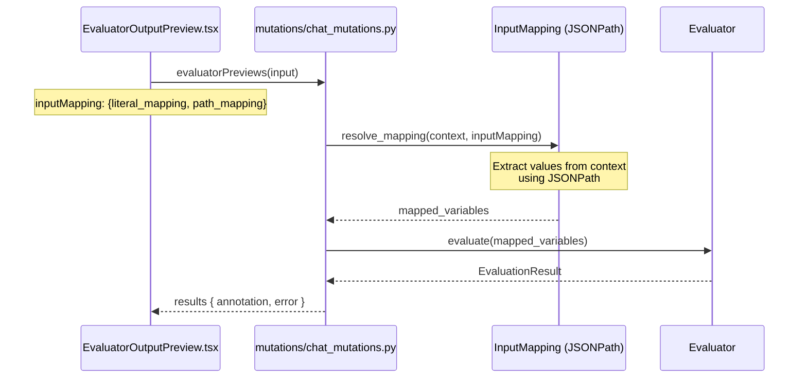

<!-- source: DeepWiki mcp.deepwiki.com · repo arize-ai/phoenix · page 5.2 Evaluation Framework · fetched 2026-10-27 -->

# Evaluation Framework

<details>
<summary>Relevant source files</summary>

The following files were used as context for generating this wiki page:

- [app/src/components/evaluators/EvaluatorOutputPreview.tsx](app/src/components/evaluators/EvaluatorOutputPreview.tsx)
- [app/src/components/evaluators/__generated__/EvaluatorOutputPreviewMutation.graphql.ts](app/src/components/evaluators/__generated__/EvaluatorOutputPreviewMutation.graphql.ts)
- [app/src/pages/dataset/evaluators/DatasetEvaluatorsPage.tsx](app/src/pages/dataset/evaluators/DatasetEvaluatorsPage.tsx)
- [app/src/pages/dataset/evaluators/DatasetEvaluatorsTable.tsx](app/src/pages/dataset/evaluators/DatasetEvaluatorsTable.tsx)
- [app/src/pages/dataset/evaluators/__generated__/DatasetEvaluatorsTableEvaluatorsQuery.graphql.ts](app/src/pages/dataset/evaluators/__generated__/DatasetEvaluatorsTableEvaluatorsQuery.graphql.ts)
- [app/src/pages/dataset/evaluators/__generated__/DatasetEvaluatorsTable_evaluators.graphql.ts](app/src/pages/dataset/evaluators/__generated__/DatasetEvaluatorsTable_evaluators.graphql.ts)
- [app/src/pages/dataset/evaluators/__generated__/datasetEvaluatorsLoaderQuery.graphql.ts](app/src/pages/dataset/evaluators/__generated__/datasetEvaluatorsLoaderQuery.graphql.ts)
- [app/src/pages/dataset/evaluators/datasetEvaluatorsLoader.ts](app/src/pages/dataset/evaluators/datasetEvaluatorsLoader.ts)
- [app/src/pages/evaluators/DatasetEvaluatorsTable.tsx](app/src/pages/evaluators/DatasetEvaluatorsTable.tsx)
- [app/src/pages/evaluators/EvaluatorsPage.tsx](app/src/pages/evaluators/EvaluatorsPage.tsx)
- [app/src/pages/evaluators/EvaluatorsTable.tsx](app/src/pages/evaluators/EvaluatorsTable.tsx)
- [app/src/pages/evaluators/PromptCell.tsx](app/src/pages/evaluators/PromptCell.tsx)
- [app/src/pages/evaluators/__generated__/EvaluatorsTable_row.graphql.ts](app/src/pages/evaluators/__generated__/EvaluatorsTable_row.graphql.ts)
- [app/src/pages/evaluators/__generated__/GlobalEvaluatorsTableEvaluatorsQuery.graphql.ts](app/src/pages/evaluators/__generated__/GlobalEvaluatorsTableEvaluatorsQuery.graphql.ts)
- [app/src/pages/evaluators/__generated__/GlobalEvaluatorsTable_evaluators.graphql.ts](app/src/pages/evaluators/__generated__/GlobalEvaluatorsTable_evaluators.graphql.ts)
- [app/src/pages/evaluators/__generated__/evaluatorsPageLoaderQuery.graphql.ts](app/src/pages/evaluators/__generated__/evaluatorsPageLoaderQuery.graphql.ts)
- [src/phoenix/db/insertion/document_annotation.py](src/phoenix/db/insertion/document_annotation.py)
- [src/phoenix/db/insertion/span_annotation.py](src/phoenix/db/insertion/span_annotation.py)
- [src/phoenix/db/insertion/trace_annotation.py](src/phoenix/db/insertion/trace_annotation.py)
- [src/phoenix/db/insertion/types.py](src/phoenix/db/insertion/types.py)
- [src/phoenix/db/migrations/versions/02463bd83119_add_evaluators.py](src/phoenix/db/migrations/versions/02463bd83119_add_evaluators.py)
- [src/phoenix/db/types/prompts.py](src/phoenix/db/types/prompts.py)
- [src/phoenix/server/api/input_types/EvaluatorPreviewInput.py](src/phoenix/server/api/input_types/EvaluatorPreviewInput.py)
- [src/phoenix/server/api/mutations/evaluator_mutations.py](src/phoenix/server/api/mutations/evaluator_mutations.py)
- [src/phoenix/server/api/types/Evaluator.py](src/phoenix/server/api/types/Evaluator.py)
- [tests/integration/client/test_annotations.py](tests/integration/client/test_annotations.py)
- [tests/integration/client/test_prompts.py](tests/integration/client/test_prompts.py)
- [tests/unit/db/test_models.py](tests/unit/db/test_models.py)
- [tests/unit/server/api/mutations/test_evaluator_mutations.py](tests/unit/server/api/mutations/test_evaluator_mutations.py)
- [tests/unit/server/api/mutations/test_evaluator_preview_mutation.py](tests/unit/server/api/mutations/test_evaluator_preview_mutation.py)
- [tests/unit/server/api/test_create_llm_evaluator_from_inline.py](tests/unit/server/api/test_create_llm_evaluator_from_inline.py)
- [tests/unit/server/api/types/test_Dataset.py](tests/unit/server/api/types/test_Dataset.py)
- [tests/unit/server/api/types/test_Evaluator.py](tests/unit/server/api/types/test_Evaluator.py)

</details>


## Purpose and Scope

The Evaluation Framework provides a unified system for assessing LLM application performance through automated evaluators. It spans both a standalone Python library (`arize-phoenix-evals`) for client-side execution and an integrated server-side system that powers the Phoenix Playground and Experiment workflows.

The framework supports:
- **LLM Evaluators**: Prompt-based classification and generation using various providers (OpenAI, Anthropic, Google, Bedrock, etc.).
- **Code Evaluators**: Python or TypeScript-based logic for deterministic metrics (e.g., JSON diff, Levenshtein distance) executed in sandboxed environments.
- **Built-in Evaluators**: Pre-configured templates for common tasks like Hallucination and Relevance.
- **Input Mapping**: Flexible data extraction using JSONPath to bind evaluation logic to diverse data structures.

**Sources:** [src/phoenix/server/api/types/Evaluator.py:50-55](), [src/phoenix/server/api/mutations/evaluator_mutations.py:31-35]()

---

## Architecture Overview

Phoenix utilizes a dual-layered architecture where evaluations can be triggered programmatically via the SDK or interactively through the Phoenix Server's GraphQL API.

### System Architecture Diagram

This diagram bridges the high-level evaluation concepts with the specific code entities responsible for execution and storage.

```mermaid
graph TD
    subgraph "Execution Layer"
        MutationMixin["mutations/chat_mutations.py: ChatCompletionMutationMixin"]
        EvaluatorPreviews["mutations/chat_mutations.py: evaluator_previews"]
        CodeRunner["mutations/chat_mutations.py: CodeEvaluatorRunner"]
    end

    subgraph "Evaluator Entity Space"
        BaseEval["evaluators.py: BaseEvaluator (ABC)"]
        LLMEval["evaluators.py: LLMEvaluator"]
        BuiltinEval["evaluators.py: BuiltInEvaluator"]
        CodeEval["evaluators.py: CodeEvaluator"]
        
        BaseEval <|-- LLMEval
        BaseEval <|-- BuiltinEval
        BaseEval <|-- CodeEval
    end

    subgraph "Data & Storage"
        InputMap["models.py: InputMapping"]
        Annotation["models.py: SpanAnnotation"]
        OutputConfig["annotation_configs.py: OutputConfigType"]
        DB_Eval["models.py: Evaluator"]
        SandboxCfg["models.py: SandboxConfig"]
    end

    MutationMixin -->|previews| BuiltinEval
    EvaluatorPreviews -->|creates| LLMEval
    EvaluatorPreviews -->|triggers| CodeRunner
    CodeRunner -->|uses| SandboxCfg
    LLMEval -->|resolves| InputMap
    LLMEval -->|produces| Annotation
    LLMEval -->|constrained by| OutputConfig
    LLMEval -->|persisted as| DB_Eval
```

**Sources:** [src/phoenix/server/api/types/Evaluator.py:50-55](), [src/phoenix/server/api/mutations/evaluator_mutations.py:17-41](), [src/phoenix/db/models.py:1-100]()

---

## Evaluator Implementations

### LLMEvaluator
The `LLMEvaluator` executes evaluations by calling an LLM. It transforms a prompt template and input data into a structured LLM request.
- **Prompt Rendering**: Resolves the prompt version via `promptVersion` or `promptVersionTag` [src/phoenix/server/api/types/Evaluator.py:350-370]().
- **Validation**: Ensures that the prompt tools and response formats match the evaluator's `output_configs` via `validate_consistent_llm_evaluator_and_prompt_version` [src/phoenix/server/api/mutations/evaluator_mutations.py:37-41]().
- **Output Parsing**: Extracts structured data from LLM responses, typically via tool calls that map to `CategoricalOutputConfig` labels.

### CodeEvaluator
The `CodeEvaluator` [src/phoenix/server/api/types/Evaluator.py:51]() system allows for running arbitrary logic in a secure sandbox.
- **Language Support**: Supports `PYTHON` and `TYPESCRIPT` [src/phoenix/server/api/types/Evaluator.py:38]().
- **Inference**: Automatically infers the input schema from the function signature using `_infer_python_evaluate_input_schema` [src/phoenix/server/api/mutations/evaluator_mutations.py:32]() or `_infer_typescript_evaluate_input_schema` [src/phoenix/server/api/mutations/evaluator_mutations.py:33]().
- **Sandbox Validation**: Checks if the associated `SandboxConfig` is enabled and matches the evaluator's language before execution [src/phoenix/server/api/mutations/evaluator_mutations.py:125-157]().

### BuiltInEvaluator
The `BuiltInEvaluator` [src/phoenix/server/api/types/Evaluator.py:50]() provides "out-of-the-box" metrics. These are retrieved by key via `get_builtin_evaluator_by_key` [src/phoenix/server/api/mutations/evaluator_mutations.py:34]().

**Sources:** [src/phoenix/server/api/types/Evaluator.py:50-55](), [src/phoenix/server/api/mutations/evaluator_mutations.py:125-157](), [src/phoenix/server/api/mutations/evaluator_mutations.py:31-35]()

---

## Input Mapping and Context Resolution

Evaluation requires mapping raw data (from a Trace, Span, or Dataset Example) into the variables expected by an evaluator's prompt template or code function.

### Mapping Flow Diagram



The system uses `EvaluatorInputMapping` [src/phoenix/server/api/types/Evaluator.py:58]() to perform deep extraction. It contains:
- `literal_mapping`: Direct key-value pairs [src/phoenix/server/api/types/Evaluator.py:59]().
- `path_mapping`: JSONPath expressions to extract values from the evaluation context [src/phoenix/server/api/types/Evaluator.py:61]().

**Sources:** [src/phoenix/server/api/types/Evaluator.py:58-62](), [app/src/components/evaluators/EvaluatorOutputPreview.tsx:137-153]()

---

## Annotation Storage and Configuration

Evaluations result in **Annotations**, which are stored in the database and linked to spans, traces, or experiment runs.

### Output Configuration Types
The framework uses specific configurations to define the expected output of an evaluator:

| Config Class | Description | Fields |
|:---|:---|:---|
| `CategoricalOutputConfig` | Classification labels | `name`, `values` (label/score), `optimization_direction` [src/phoenix/db/types/annotation_configs.py:22]() |
| `ContinuousOutputConfig` | Numeric ranges | `name`, `lower_bound`, `upper_bound`, `optimization_direction` [src/phoenix/db/types/annotation_configs.py:23]() |
| `FreeformOutputConfig` | Unstructured text | `name`, `threshold`, `lower_bound`, `upper_bound` [src/phoenix/db/types/annotation_configs.py:24]() |

### Optimization Direction
Indicates the desired trend for the metric: `MAXIMIZE`, `MINIMIZE`, or `NONE` [src/phoenix/db/types/annotation_configs.py:16-19]().

**Sources:** [src/phoenix/db/types/annotation_configs.py:15-25](), [src/phoenix/server/api/mutations/evaluator_mutations.py:64-103]()

---

## UI Components and Previews

### Evaluator Table
The `EvaluatorsTable` [app/src/pages/evaluators/EvaluatorsTable.tsx:211]() displays all evaluators in the system, supporting sorting by `name`, `kind`, `createdAt`, and `updatedAt` [app/src/pages/evaluators/EvaluatorsTable.tsx:52-57](). It uses a nested row structure to show `DatasetEvaluator` assignments under their parent `Evaluator` [app/src/pages/evaluators/EvaluatorsTable.tsx:145-160]().

### Evaluator Output Preview
The `EvaluatorOutputPreview` [app/src/components/evaluators/EvaluatorOutputPreview.tsx:123]() component allows users to test an evaluator's logic in real-time.
- **Execution**: It triggers the `evaluatorPreviews` mutation [app/src/components/evaluators/EvaluatorOutputPreview.tsx:137]().
- **Payload Construction**: Uses `createLLMEvaluatorPayload` to bundle playground state, input mapping, and output configs [app/src/components/evaluators/EvaluatorOutputPreview.tsx:177-186]().
- **Positive Optimization**: The `computePositiveOptimization` helper determines if a result is "good" based on the `optimizationDirection` and score bounds [app/src/components/evaluators/EvaluatorOutputPreview.tsx:56-121]().

**Sources:** [app/src/pages/evaluators/EvaluatorsTable.tsx:52-57](), [app/src/components/evaluators/EvaluatorOutputPreview.tsx:56-121](), [app/src/components/evaluators/EvaluatorOutputPreview.tsx:137-153]()

---

